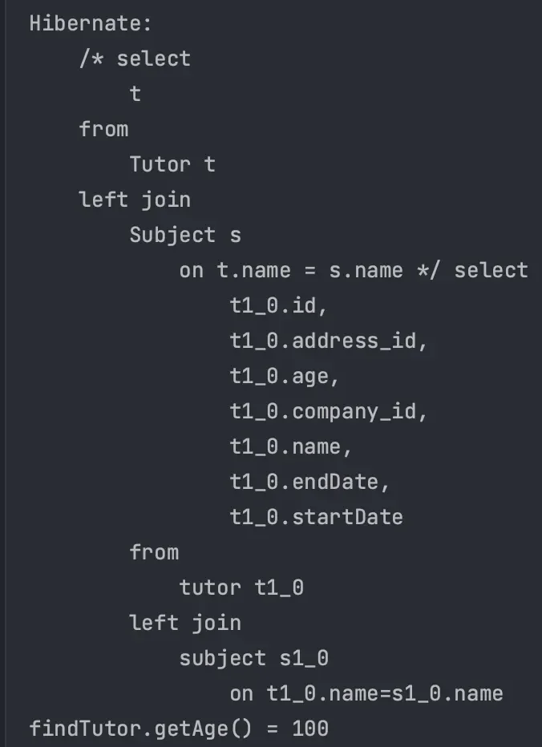
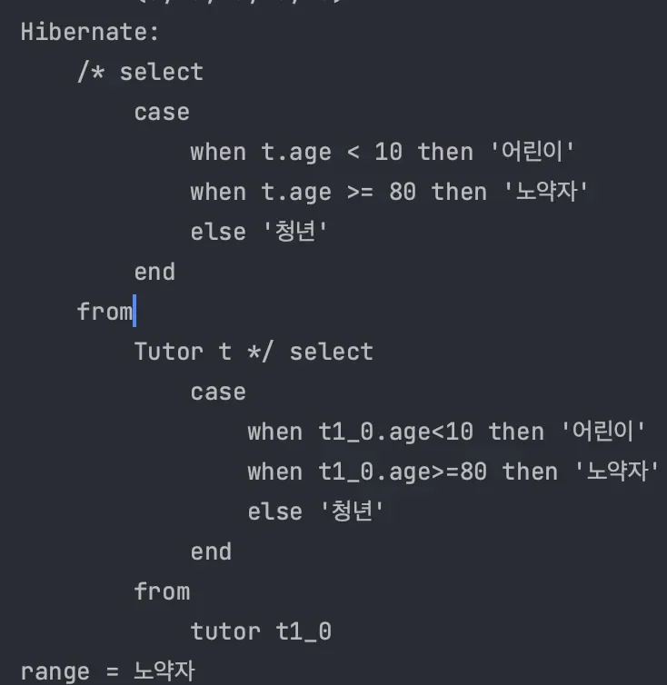
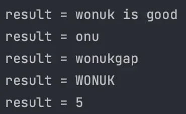

<a id="14ceda9b0fe1816fa02cf3acf0e78d54"></a>

## JOIN ( 중요 )

---

> 📖 
> 
> <a id="14ceda9b0fe181429519d580193522ad"></a>
> 
> <u>JPQL의 </u><u>JOIN</u>은 대상을 <u>필터링(ON)</u> 하거나 <u>연관관계가 없는 Enity</u>와 <u>JOIN 가능</u>하다&#46;

<details>
<summary>JOIN ON</summary>

> 연관관계 없는 Entity와 JOIN

<details>
<summary>코드 예시 </summary>

<a id="14eeda9b0fe18010b80ff4f3bea37840"></a>

```java
String query = "select t from Tutor t left join Subject s on t.name = s.name";
List<Tutor> tutorList = em.createQuery(query, Tutor.class).getResultList();

Tutor findTutor = tutorList.get(0);
System.out.println("findTutor.getAge() = " + findTutor.getAge());
```

- 실행 결과
    - 연관관계가 없지만 on을 사용하여 JOIN 가능

    

</details>

</details>

<a id="14ceda9b0fe180b792f0e47ec2756059"></a>

## CASE

---

> 📖 
> 
> <a id="84b477410c91430da4b1549a25916e5e"></a>
> 
> JPQL에서 <u>CASE 표현식</u>은 <u>조건에 따라 다른 값을 반환</u>할 때 사용된다&#46;<br><u>SQL의  </u><u>CASE 구문</u><u>과  유사</u>하며 주로 조건에 따라 계산된 값을 반환하거나 쿼리 결과를 조정하는데 사용된다&#46; 

> ☝🏻 
> 
> - <code>COALESCE</code> &#58; null이 아니면 반환
> 
> - <code>NULLIF</code> &#58; 같으면 null, 다르면 첫번째 값 반환

<details>
<summary>조건식 CASE</summary>

- 코드 예시
    > 문자열 SQL <u>띄어쓰기 유의</u>

    <a id="14eeda9b0fe180d49fc4f8f6b4eddecd"></a>

    ```java
    String query =
            "select" +
                    " case when t.age < 10 then '어린이'" +
                    " when t.age >= 80 then '노약자'" +
                    " else '청년'" +
                    " end " +
            "from Tutor t";
            
    List<String> resultList = em.createQuery(query, String.class).getResultList();

    for (String range : resultList) {
    		System.out.println("range = " + range);
    }
    ```

    - 실행 결과
        

</details>

<a id="14ceda9b0fe18034b912f8348829ec5d"></a>

## 함수

---

> 📖 
> 
> <a id="dd2120739bd24a18be5f6573a33a0659"></a>
> 
> JPQL은 표준 <u>SQL과 유사</u>하게 사용할 수 있는 <u>다양한 내장 함수들을 제공</u>한다&#46; <br>해당 함수들은 <u>문자열 처리, 숫자 계산, 날짜/시간 연산</u> 등을 수행할 떄 유용하다&#46; 

> ☝🏻 
> 
> <a id="2a1272f7857240f9932a77606e803d7b"></a>
> 
> JPQL은 사용자 정의 함수도 지원한다&#46; 

<details>
<summary>문자열 함수</summary>

1. <code>CONCAT(’a’, ‘b’)</code>  &#45;  <code>&#43;</code> 연산
    - a, b 문자열을 더함

1. <code>SUBSTRING(’abcde’, 2, 3)</code> &#45; 문자열 자름
    - 첫번쨰 인자&#58; 변환할 문자열

    - 두번쨰 인자&#58; 시작 문자 번호 ( 인덱스랑 다르게 1부터 시작)

    - 세번쨰 인자&#58; 자를 문자 길이 ( 3인 경우, 시작 글를 포함하여 3글자를 자름 )

1. <code>TRIM(’ a ‘)</code>
    - 문자열 양쪽 공백 제거

1. <code>LOWER(’A’)</code>, <code>UPPER(’a’)</code>
    - 각각 문자열을 소문자, 대문자로 변환

1. <code>LENGTH(’abcde’)</code>
    - 문자열 길이를 반환한다&#46;

</details>

<details>
<summary>숫자 함수</summary>

1. <code>ABS(&#45;100)</code>
    - 절대값 반환

1. <code>MOD(100, 2)</code>
    - 나머지 계산 

1. <code>SIZE(t&#46;company)</code>
    - 연관된 컬렉션의 크기 반환

</details>

<details>
<summary>코드 예시</summary>

> Query 내부 문자열에 함수 정의한다&#46; 

<a id="14eeda9b0fe180fb96e4d233978bf609"></a>

```java
Tutor tutor = new Tutor("wonuk", 100);
em.persist(tutor);

ArrayList<String> resultList = new ArrayList<>();

// concat() - + 연산 
String concatQuery = "select concat(t.name, ' is good') from Tutor t";
List<String> concatResult = em.createQuery(concatQuery, String.class).getResultList();
resultList.add(concatResult.get(0));

// substring - 문자열 자름
String substringQuery = "select substring(t.name, 2, 3) from Tutor t";
List<String> substringResult = em.createQuery(substringQuery, String.class).getResultList();
resultList.add(substringResult.get(0));
     
Tutor tutor2 = new Tutor(" wonukgap ", 101);
em.persist(tutor2);

// trim() - 문자열 양쪽 공백 제거
		// ex) trim(" wonukgap ") -> "wonukgap"
String trimQuery = "select trim(t.name) from Tutor t";
List<String> trimResult = em.createQuery(trimQuery, String.class).getResultList();
resultList.add(trimResult.get(1));

//  upper() - 대문자 변환, lower() - 소문자 변환
		// ex) UPPER('a') -> 'A'
String upperQuery = "select upper(t.name) from Tutor t";
List<String> upperResult = em.createQuery(upperQuery, String.class).getResultList();
resultList.add(upperResult.get(0));

// length() - 문자열 길이 반환
String lengthQuery = "select length(t.name) from Tutor t";
List<Integer> lengthResult = em.createQuery(lengthQuery, Integer.class).getResultList();
resultList.add(lengthResult.get(0).toString());

for (String result : resultList) {
		System.out.println("result = " + result);
}
```

- 실행 결과
    

</details>
