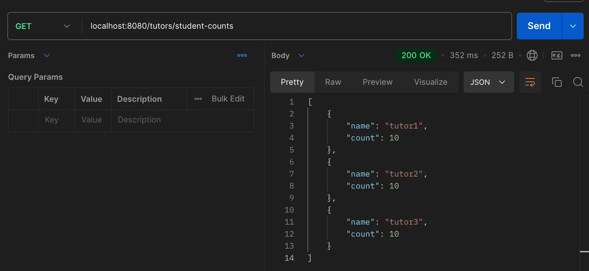
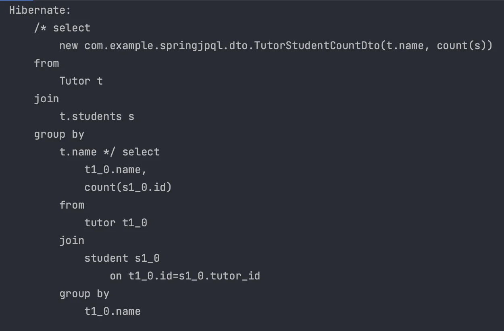
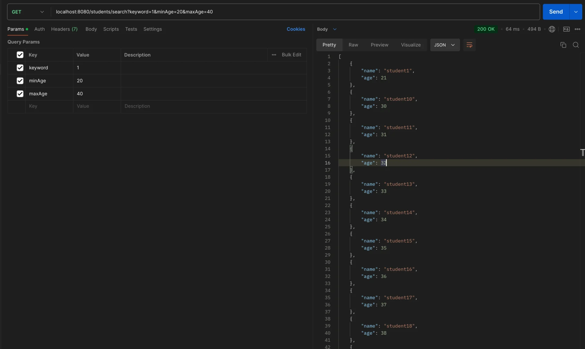
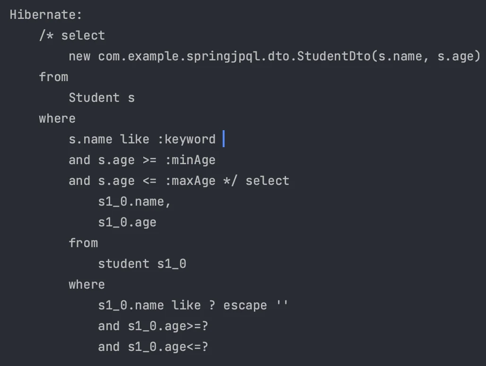
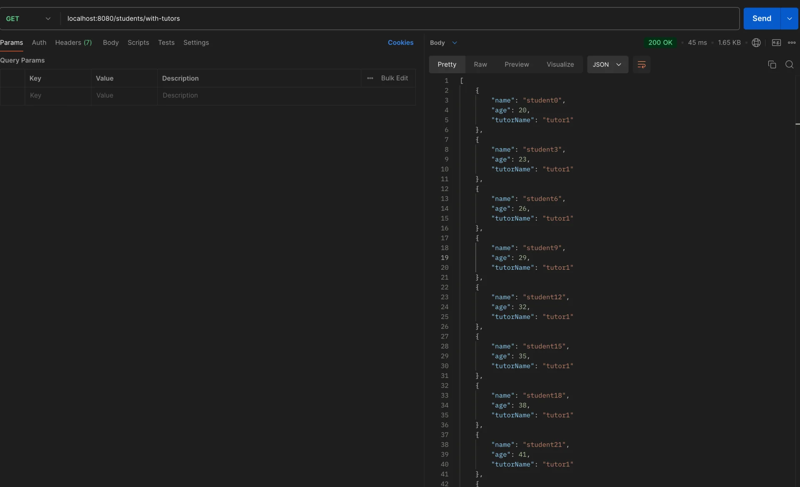
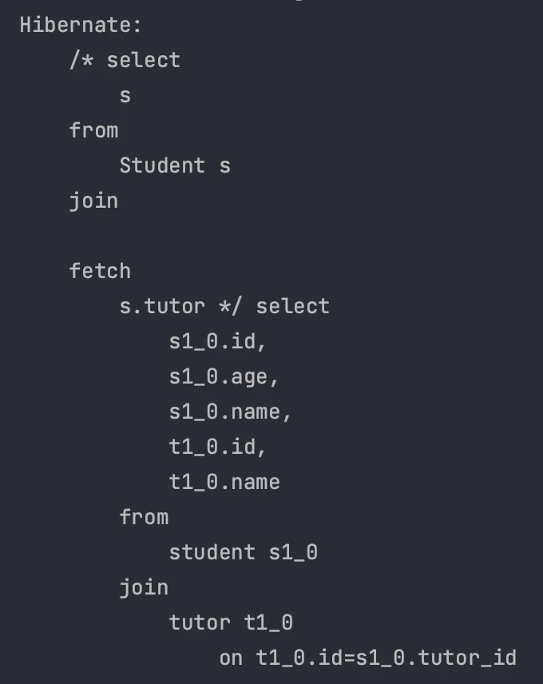
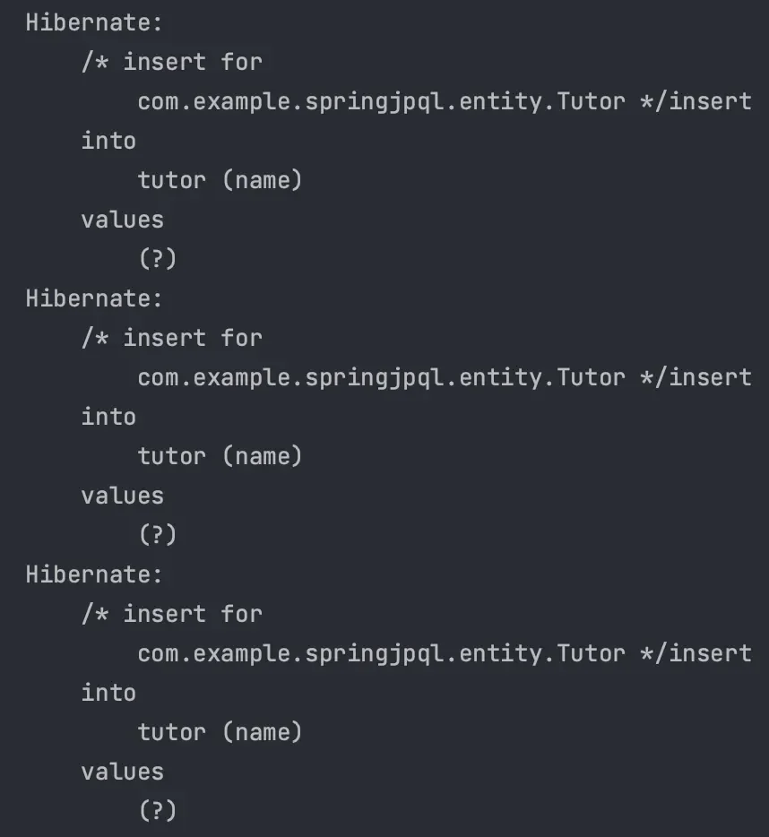

<a id="14ceda9b0fe181ea9e91ccac64916cb8"></a>

## JPQL 적용

---

> 📖 
> 
> <a id="14ceda9b0fe1817baa88ce4a051a8c6c"></a>
> 
> <strong><u>Query Methods</u></strong><u> 만</u>으로는 조회하기 힘든 경우가 많다&#46; 
> 
> - <code>N&#43;1 문제</code>가 발생
> 
> <a id="14eeda9b0fe1805d95efedd7d571d2cd"></a>
> 
> 이를 <u>JPQL을 사용</u>하여 해결한다&#46; 

> ✏️ 
> 
> <a id="14eeda9b0fe1804f80eaf5c05c40c72e"></a>
> 
> Spring Data JPA &#45;  JPQL 적용
> 
> - <code>&#64;Query</code> → JPQL 쿼리 작성
> 
> - <code>&#64;Param</code>  → 파라미터 바인딩

<details>
<summary><strong>예시 &#45; Spring Data JPA 적용</strong></summary>

<details>
<summary><strong>yml, properties</strong></summary>

<details>
<summary><code>application&#46;properties</code></summary>

- <code>key&#45;value</code> 형태 →  구문 간단

- 동일 접두사의 키가 많은 경우 중복이 빈번하다&#46;

<a id="14eeda9b0fe1804da679ea19568a784a"></a>

```groovy
spring.application.name=SpringJPQL

spring.datasource.url=jdbc:mysql://localhost:3306/example
spring.datasource.username=아이디
spring.datasource.password=비밀번호
spring.datasource.driver-class-name=com.mysql.cj.jdbc.Driver

spring.jpa.hibernate.ddl-auto=create

spring.jpa.properties.hibernate.show_sql=true
spring.jpa.properties.hibernate.format_sql=true
spring.jpa.properties.hibernate.use_sql_comments=true
spring.jpa.properties.hibernate.dialect=org.hibernate.dialect.MySQLDialect
```

</details>

<details>
<summary><code>application&#46;yml</code></summary>

- <u>계층적 구조로 작성</u>이 가능하여 가독성이 높다&#46;

- <u>중복을 줄</u>일 수 있다&#46;

<a id="14eeda9b0fe180e5b068d8fa5f329e90"></a>

```groovy
spring:
  application:
    name: SpringJPQL
  datasource:
    url: jdbc:mysql://localhost:3306/example
    username: 아이디
    password: 비밀번호
    driver-class-name: com.mysql.cj.jdbc.Driver

  jpa:
    hibernate:
      ddl-auto: create
    properties:
      hibernate:
        show_sql: true
        format_sql: true
        use_sql_comments: true
        dialect: org.hibernate.dialect.MySQLDialect
```

</details>

> ☝🏻 
> 
> <a id="1c5c48e089ee48f9a46a0f23dbf7a2be"></a>
> 
> properties, yml을 함께 사용할 수 있지만 <u>properties의 우선순위가  더 높</u>다<br>→ 둘 중 하나의 방법을 선택해서 사용한다&#46;

</details>

<details>
<summary>&#91; 코드 &#93;</summary>

<details>
<summary><strong>Entity</strong></summary>

<details>
<summary>Tutor</summary>

<a id="14eeda9b0fe180f5a4bdd58df7e3a7ad"></a>

```java
@Getter
@Entity
@Table(name = "tutor")
public class Tutor {

    @Id
    @GeneratedValue(strategy = GenerationType.IDENTITY)
    private Long id;

    private String name;

    @OneToMany(mappedBy = "tutor", cascade = CascadeType.ALL, orphanRemoval = true)
    private List<Student> students = new ArrayList<>();

    public Tutor() {
    }

    public Tutor(String name) {
        this.name = name;
    }

}
```

</details>

<details>
<summary>Student</summary>

<a id="14eeda9b0fe180d8befbd5aefc71c2b1"></a>

```java
@Getter
@Entity
@Table(name = "student")
public class Student {

    @Id
    @GeneratedValue(strategy = GenerationType.IDENTITY)
    private Long id;

    private String name;

    private Integer age;

    @ManyToOne(fetch = FetchType.LAZY)
    @JoinColumn(name = "tutor_id")
    private Tutor tutor;

    public Student() {
    }

    public Student(String name, Integer age) {
        this.name = name;
        this.age = age;
    }

    public void setTutor(Tutor tutor) {
        this.tutor = tutor;
    }
}
```

</details>

</details>

<details>
<summary><strong>Dto</strong></summary>

<details>
<summary>TutorStudentCountDto</summary>

<a id="14eeda9b0fe180638378de5586e92864"></a>

```java
@Getter
public class TutorStudentCountDto {

    private final String name;
    private final Long count;

    public TutorStudentCountDto(String name, Long count) {
        this.name = name;
        this.count = count;
    }

}
```

</details>

<details>
<summary>StudentDto</summary>

<a id="71bbfbc754ed4290b7931801f3856b21"></a>

```java
@Getter
public class StudentDto {

    private final String name;
    private final Integer age;

    public StudentDto(String name, Integer age) {
        this.name = name;
        this.age = age;
    }

}
```

</details>

<details>
<summary>StudentTutorDto</summary>

<a id="a104b381b8e341c8aa788effdcb0b718"></a>

```java
@Getter
public class StudentTutorDto {

    private final String name;
    private final Integer age;
    private final String tutorName;

    public StudentTutorDto(String name, Integer age, String tutorName) {
        this.name = name;
        this.age = age;
        this.tutorName = tutorName;
    }
}
```

</details>

</details>

<details>
<summary><strong>Controller</strong></summary>

<details>
<summary>TutorController</summary>

<a id="14eeda9b0fe18020902dd19400f2f2e3"></a>

```java
@RestController
@RequiredArgsConstructor
@RequestMapping("/tutors")
public class TutorController {

    private final TutorService tutorService;

    /**
     * 튜터별 학생 수 조회 API
     * @return
     */
    @GetMapping("/student-counts")
    public ResponseEntity<List<TutorStudentCountDto>> getTutorStudentCounts() {
        List<TutorStudentCountDto> result = tutorService.getTutorStudentCounts();
        return ResponseEntity.ok(result);
    }
}
```

</details>

<details>
<summary>StudentController</summary>

<a id="14eeda9b0fe18062bba0dca91e43a281"></a>

```java
@RestController
@RequiredArgsConstructor
@RequestMapping("/students")
public class StudentController {

    private final StudentService studentService;

    /**
     * 학생 검색 API
     * @param keyword 이름에 포함한 키워드
     * @param minAge 최소 나이
     * @param maxAge 최대 나이
     * @return {@link StudentDto}
     */
    @GetMapping("/search")
    public List<StudentDto> searchStudents(
            @RequestParam String keyword,
            @RequestParam int minAge,
            @RequestParam int maxAge
    ) {
        return studentService.searchStudents(keyword, minAge, maxAge);
    }

    /**
     * 자신과 연관된 튜터 조회 API
     * N + 1 fetch join
     * @return
     */
    @GetMapping("/with-tutors")
    public List<StudentTutorDto> getStudentsWithTutors() {
        return studentService.getStudentsWithTutors();
    }

}
```

</details>

</details>

<details>
<summary>Service</summary>

<details>
<summary>TutorService</summary>

<a id="14eeda9b0fe1808fbfc8d5d0018ec290"></a>

```java
@Service
@RequiredArgsConstructor
public class TutorService {

    private final TutorRepository tutorRepository;


    public List<TutorStudentCountDto> getTutorStudentCounts() {
        return tutorRepository.findTutorStudentCounts();
    }
}
```

</details>

<details>
<summary>StudentService</summary>

<a id="e6b1e9db58e84537b1afc3a3bdae32eb"></a>

```java
@Service
@RequiredArgsConstructor
public class StudentService {

    private final StudentRepository studentRepository;

    public List<StudentDto> searchStudents(String keyword, int minAge, int maxAge) {
        return studentRepository.findByNameContainingAndAgeBetween(keyword, minAge, maxAge);
    }

    /**
     * DTO 형태로 반환 가능
     * @return
     */
    public List<StudentTutorDto> getStudentsWithTutors() {
        List<Student> students = studentRepository.findStudentsWithTutor();

        return students.stream()
                .map(student -> new StudentTutorDto(
                        student.getName(),
                        student.getAge(),
                        student.getTutor().getName()))
                .collect(Collectors.toList());
    }

}
```

</details>

</details>

- Repository
    <details>
    <summary>TutorRepository</summary>

    <a id="20e8b5c87c8f4ffc94bf001309a3a555"></a>

    ```java
    public interface TutorRepository extends JpaRepository<Tutor, Long> {

        @Query("select new com.example.springjpql.dto.TutorStudentCountDto(t.name, count(s)) " +
                "from Tutor t join t.students s group by t.name")
        List<TutorStudentCountDto> findTutorStudentCounts();

    }
    ```

    </details>

    <details>
    <summary>StudentRepository</summary>

    <a id="b381d7630aac4197bc00b767f35d00dc"></a>

    ```java
    public interface StudentRepository extends JpaRepository<Student, Long> {

        @Query("select new com.example.springjpql.dto.StudentDto(s.name, s.age) " +
                "from Student s where s.name like %:keyword% " +
                "and s.age >= :minAge and s.age <= :maxAge")
        List<StudentDto> findByNameContainingAndAgeBetween(
                @Param("keyword") String keyword,
                @Param("minAge") int minAge,
                @Param("maxAge") int maxAge
        );

        @Query("select s from Student s join fetch s.tutor")
        List<Student> findStudentsWithTutor();

    }
    ```

    </details>

</details>

---

<details>
<summary><strong>실행결과</strong></summary>

<details>
<summary><strong>튜터별 학생 수 검색</strong></summary>

- JPQL
    <a id="ddf27858cee14a39993c85344c2ea180"></a>

    ```java
    @Query("select new com.example.springjpql.dto.TutorStudentCountDto(t.name, count(s)) " +
            "from Tutor t join t.students s group by t.name")
    List<TutorStudentCountDto> findTutorStudentCounts();
    ```

- Postman
    

- 실행된 SQL Query
    

</details>

<details>
<summary><strong>학생 조건 검색</strong></summary>

- JPQL
    <a id="edc195cb7a74485282e5254fb7520da2"></a>

    ```java
    @Query("select new com.example.springjpql.dto.StudentDto(s.name, s.age) " +
            "from Student s where s.name like %:keyword% " +
            "and s.age >= :minAge and s.age <= :maxAge")
    List<StudentDto> findByNameContainingAndAgeBetween(
            @Param("keyword") String keyword,
            @Param("minAge") int minAge,
            @Param("maxAge") int maxAge
    );
    ```

- Postman
    

- 실행된 SQL Query
    

</details>

<details>
<summary><strong>학생과 연관된 튜터 이름 조회(fetch join)</strong></summary>

- JPQL
    <a id="567f6550767b4406a63d5b53a64aa0e2"></a>

    ```java
    @Query("select s from Student s join fetch s.tutor")
    List<Student> findStudentsWithTutor();
    ```

- Postman
    

- 실행된 SQL Query
    

</details>

</details>

</details>

<a id="14ceda9b0fe18083b893f3fbd2207d74"></a>

## &#64;PostConstruct 활용

---

<details>
<summary>프로필 설정하기</summary>

- <code>application&#46;yml</code>
    - 프로필 환경별로 다른 설정을 적용할 수 있다&#46;

    <a id="14eeda9b0fe180bab0a0e927e39a20eb"></a>

    ```yaml
    profiles:
      active: dev
    ```

</details>

<details>
<summary><strong>테스트용 데이터 추가하기</strong></summary>

<details>
<summary>&#91; 코드 &#93;</summary>

- <code>&#64;PostConstruct</code> 로 Application 최초 실행 시에만 초기화 하도록 설정

- <code>&#64;Profile(&#34;dev&#34;)</code> dev 프로필에서만 동작하도록 설정

<a id="14eeda9b0fe180e59bfce5184f170fe6"></a>

```java
@Slf4j
@Component
@Profile("dev")
public class DataInitializer {

    @Autowired
    private TutorRepository tutorRepository;

    @Autowired
    private StudentRepository studentRepository;

    @PostConstruct
    public void init() {
        // Tutor 데이터 초기화
        Tutor tutor1 = new Tutor("tutor1");
        Tutor tutor2 = new Tutor("tutor2");
        Tutor tutor3 = new Tutor("tutor3");

        tutorRepository.save(tutor1);
        tutorRepository.save(tutor2);
        tutorRepository.save(tutor3);

        // Student 데이터 초기화
        for (int i = 0; i < 30; i++) {
            Student student = new Student("student" + i, 20 + i);
            // 튜터를 순차적으로 할당
            if (i % 3 == 0) {
                student.setTutor(tutor1);
            } else if (i % 3 == 1) {
                student.setTutor(tutor2);
            } else {
                student.setTutor(tutor3);
            }

            studentRepository.save(student);
        }

        log.info("===== Test Data Initialized =====");
    }

}
```

</details>

---

<details>
<summary>실행 결과</summary>




</details>

</details>
