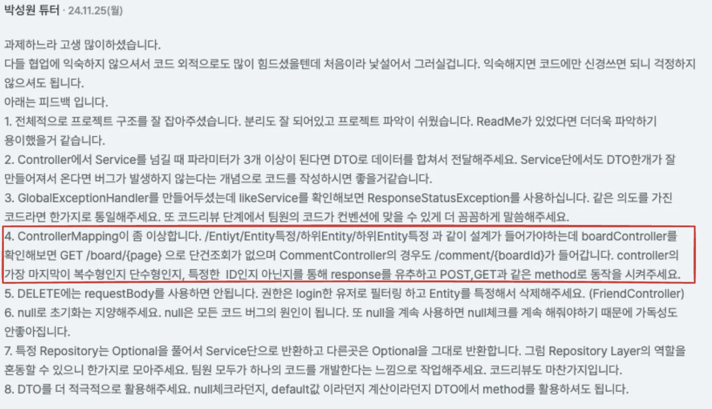

### 배경

---

저번주 팀프로젝트에서 피드백 받은 내용이다&#46; 

해당 부분을 토대로 api 설계 시 아래와 같은 의문점이 들어 질문 후 해당 내용을 정리한다&#46; 

### 의문점

---

환전 요청  API에서 어떤 유저의 요청인지 구분하기 위한 <code>유저 Id(userId)</code> 와 어떤 통화로 변환될 것인지를 알기 위해 <code>통화 Id(currencyId)</code> 를 같이 넘겨줘야 한다&#46; 

처음 설계한 것은 위 그림과 같은데, 요청 body에 <code>유저 Id(userId)</code>,  <code>통화 Id(currencyId)</code> 넘겨줬다&#46;

여기저 저번 팀프로젝트 피드백 내용이 생각이 나, <u><code>유저 Id(userId)</code></u><u>,  </u><u><code>통화 Id(currencyId)</code></u><u> 를  </u><u>url의 하위 요소가 아닌 Body로 넘겨주는 설계</u>가 올바른 것인지 확인 받기 위해 박성원 튜터님을 찾아가 질문을 드렸다&#46; 

### 답변 내용 &#45; RESTapi 설계

---

튜터님께 답변 받은 내용들을 정리하면 아래와 같다&#46;

### 1&#46; RESTfull API <code>HTTP메서드</code> 와 <code>URI</code>를 통해서 <u>명확하게 구분</u>할 수 있어야 한다&#46;      이후 요청, 응답을 확인한다&#46;

‘REST api는 요청의 <u><code>HTTP메서드</code></u><u>와 </u><u><code>URI</code></u><u>만으로 구분이 명확</u>해야 하며 그 이후 요청, 응답을 확인한다’고 말씀하셨다&#46; 

- 그 이유를 생각해보면 HTTP 통신 시, URI로 정의 가능한 문제를 body애서 정의하는 것은 메세지에 본문이 더해지고 통신이 전달되는 메세지의 용량이 커져 더  많은 리소스를 낭비돼서 그런 것 같다&#46; 

따라서  ‘<code>유저 Id(userId)</code>,  <code>통화 Id(currencyId)</code> Body로 넘겨주는 것보다는 이전 학습했던 세션&#45;인증/인가를 통해 세션으로 유저의 상태정보를 넘겨주고, <code>통화 Id</code>를 <u>path variable</u>로 넘겨주는 것이 올바른 설계이다&#46; ‘

라고 답변 받았다&#46; 

### 2&#46; URI의 <u>마지막에 정의된 리소스</u>를 가지고 <u>엔티티를 다룬다</u>&#46; 따라서<u> 필터링할 정보는 앞쪽에 표시</u>한다&#46; 

위 답변을 받고 ’<code>/exchange&#45;requests/currency/{currencyId}</code> 이렇게 설계하면 되나요?’ 라고 질문 드렸는데,   REST api에서는 <u>맨 마지막에 해당 요청에서 다루는 리소스(엔티티)를 정의</u>하며 <u>앞 쪽에 필터링한 정보</u>를 두는 것이  REST API에서 명확한 설계라고  말씀하셨다&#46;  

위 내용에 따라 변경한 URL 설계는 아래와 같다&#46; 

- <code>/currency/{currencyId}/exchange&#45;requests</code>

### 추가 내용

- 엔티티를 구분하기 위한 값으로 꼭 Long 타입이 들어갈 필요는 없다&#46; 
    - 구분을 할 수 있다는게 중점이다&#46;
