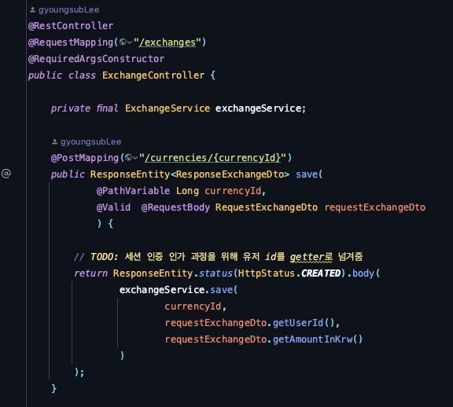
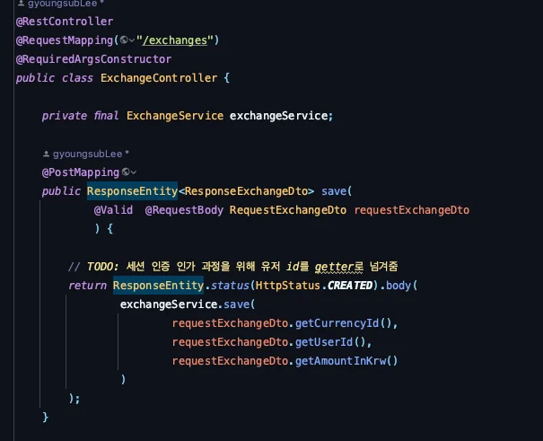
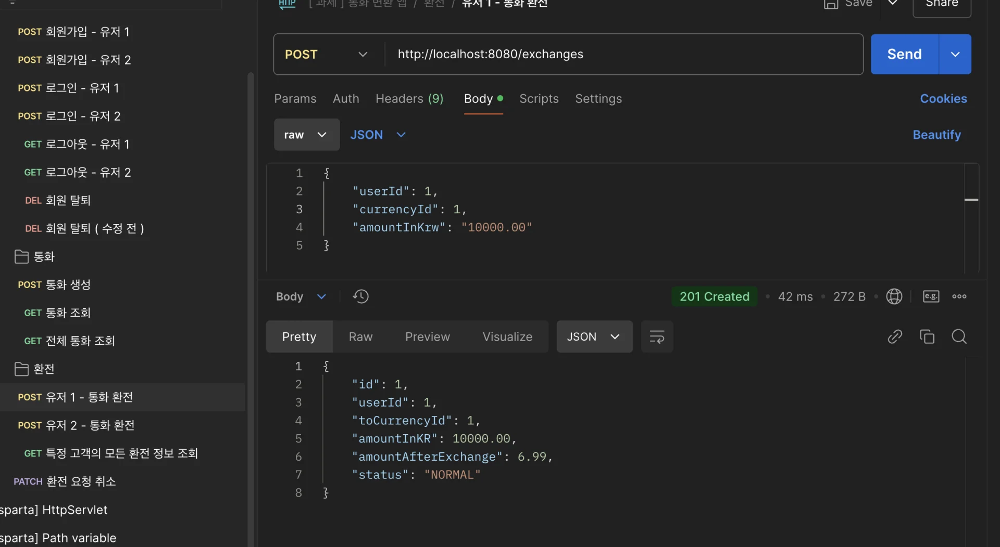
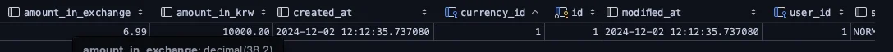
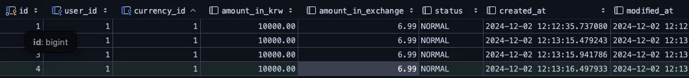
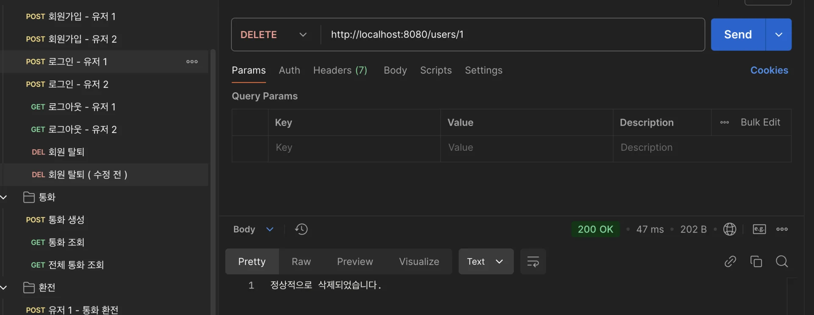
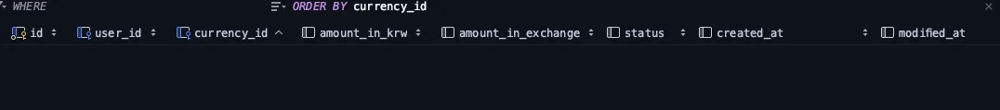

<details>
<summary>reference</summary>

<a id="14feda9b0fe180978a85df1a63af4139"></a>

‣

</details>

<a id="150eda9b0fe1807c8518ebd88ac6a7be"></a>

### 피드백 

---

<details>
<summary> RESTful API  설계</summary>

> 📌 
> 
> <a id="f5ca5fbae6be48e8a7ac97700a70112f"></a>
> 
> RESTful API 사용 시 주의점
> 
> - RESTful API는 URI와 HTTP 메서드만으로 API를 나타내야 한다&#46; 
>     - 그외 부수적으로 Parameter를 확인한다&#46;
>         - QuertParameter, RequestBody …&#46;
> 
> - 마지막엔 url 리소스에 정의하는 엔티티르 명시한다&#46; 
>     - 앞의 하위 엔티티는 필터링을 하는 요소이다&#46; 
> 
>     - 이때 필터링을 어떻게 정의할 것인가? 이 부분이 중요하다&#46; 
> 
> - 동인한 컨트롤러 내에세, 사용하는 api는 같은 PathVariable을 사용하는 것이 일관성 있게 API를 설계하는 것이다 &#46;
>     <details>
>     <summary>ex) <code>Exchange</code></summary>
> 
>     - 아래의 경우, 동일한 컨트롤러 내에서 생성(POST) 시에만, CurrencyId를 사용한다&#46;  해당 부분은 모든 API에 공통적으로 사용되는 부분이 아니기 때문에, PathVariable로 URI에 정의하지 않고, Parameter로 가져와 사용하는 것이 적절라다&#46; 
>         - 조회 시&#46; userId의 경우, 이후 인증/인가 처리 시에 없어질 부분이므로 고려하지 않음
> 
>     - 만약 필터링할 요소를 정의 해야 할 시, 하위 요소로 따로 컨트롤러를 분리하는 것 이 명확하다&#46; 
> 
>     <a id="150eda9b0fe18040b75cd407b6a0b752"></a>
> 
>     ```java
>     package com.sparta.currency_user.controller;
> 
> 
>     import com.sparta.currency_user.dto.Exchange.RequestExchangeDto;
>     import com.sparta.currency_user.dto.Exchange.ResponseExchangeDto;
>     import com.sparta.currency_user.entity.Exchange;
>     import com.sparta.currency_user.service.ExchangeService;
>     import jakarta.validation.Valid;
>     import lombok.RequiredArgsConstructor;
>     import org.springframework.http.HttpStatus;
>     import org.springframework.http.ResponseEntity;
>     import org.springframework.web.bind.annotation.*;
> 
>     import java.util.List;
> 
>     @RestController
>     @RequestMapping("/exchanges")
>     @RequiredArgsConstructor
>     public class ExchangeController {
> 
>         private final ExchangeService exchangeService;
> 
>         @PostMapping
>         public ResponseEntity<ResponseExchangeDto> save(
>                 @Valid  @RequestBody RequestExchangeDto requestExchangeDto
>                 ) {
> 
>             // TODO: 세션 인증 인가 과정을 위해 유저 id를 getter로 넘겨줌
>             return ResponseEntity.status(HttpStatus.CREATED).body(
>                     exchangeService.save(
>                             requestExchangeDto.getUserId(),
>                             requestExchangeDto.getCurrencyId(),
>                             requestExchangeDto.getAmountInKrw()
>                     )
>             );
>         }
> 
>         // TODO: 세션 인증/인가로 변경 시 URI 수정 필요
>         @GetMapping("/users/{userId}")
>         public ResponseEntity<List<ResponseExchangeDto>> findAllExchangesByUser(@PathVariable Long userId){
>             return ResponseEntity.ok().body(
>                     exchangeService.findAllExchangesByUser(userId)
>             );
>         }
> 
>         @PatchMapping("/{id}")
>         public ResponseEntity<String> updateExchangeStatus(@PathVariable Long id){
>             exchangeService.updateExchangeStatus(id);
>             return ResponseEntity.ok().body("환전 요청이 취소 되었숩니다.");
>         }
>     }
> 
>     ```
> 
>     </details>

- 이전 작성 내용
    

- 수정한 내용
    - url에서 하위 엔티티 설계 시, 해당 엔티티의 <u>필터링 정보</u>를 하위 엔티티로 본다&#46;  
        - Excahnge는 유저가 요청한 환전 정보라는 성격을 가진다&#46; 
            - 특정 통화는 환전 금액과 단위 변환을 위해 사용되지만, 유저에 초점을 맞추면 부수적인 성격이 강하다 &#46;

            - 따라서 url path에 통화 정보를 명시하는 것은 적절치 못하다&#46; 

        - 따라서 <code>users/{userId}/exchanges</code> 가 적절한 설계지만, <code>/exchanges</code> 로 표현했다&#46;다&#46; 
            - 세션 인증을 변경을 PathVariable로 넣지않고 Body에 담가 userId를 넘겨주는 방법으로 설계했다&#46; 

    > 수정한 내용&#58; PathVariable로 처리한 <code>currencyId</code>를 <u>바디 내부로 넘김</u>

    

</details>

<details>
<summary>구현</summary>

- Exchange 생성시에 <u>정적팩토리 패턴</u>을 통한 필수값을 잘 지정해주신 것 같습니다&#46; 다만, 개인적으로는 엔티티별 통일성을 위해 <u>생성자를 User 와 Currency 를 받는 생성자</u>를 사용할 것 같습니다&#46;

- [x] 오버로딩을 활용한 생성자 
    <a id="14feda9b0fe1804199d3e8a89d736043"></a>

    ```java
    public Exchange(User user, Currency currency, BigDecimal amountInKrw, ExchangeStatus status) {
    	this.user = user;
    	this.currency = currency;
    	this.amountInKrw = amountInKrw.divide(exchangeRate, 2, RoundingMode.HALF_UP);
    	this.status = status;
    	this.amountInExchange = amountInExchange;
    }
    ```

- [x] setUser 와 같이 지정하신 이유가 user 내부에 list 에 add 하기 위함으로 보입니다만, 영속성 컨택스트에 대해서 한번 학습해보시면 해당 로직은 굳이 구현될 필요가 없습니다 &#46;
    <a id="14feda9b0fe180e8b1b4ee31d227b79f"></a>

    ```java

    private void setCurrency(Currency currency){
    		this.currency = currency;
    		currency.getExchangeList().add(this); <- 이부분입니다.
    }
    ```

    <a id="14feda9b0fe180fbb1dfcf2af602dd6b"></a>

    추가로 OneTOMany는 지연로딩이 일반적이므로 조회시에 sql 문을 조화하기 떄문에 따로 관리해줄 필요는 없습니다&#46;<br>다만, 지금 위와같이 getExchangeList()&#46;add 로직보단 <u><code>currency&#46;addExcahageList(this)</code></u><u> 와 같이 구현하는 것이 좋을 것 같네요&#46;</u>

    - &#46;getExchangeList() 사용 시, <strong>추가적으로 조회(select) 쿼리가 발생</strong>한다&#46; 

    - 해당 부분은 영속성 컨택스트가 지연 로딩으로 정의 시, 자동으로 관리한다&#46; 

---

<details>
<summary>수정 코드 &#45;   Exchange</summary>

<a id="150eda9b0fe180449191f565d8564de3"></a>

```java
package com.sparta.currency_user.entity;

import com.sparta.currency_user.enums.ExchangeStatus;
import jakarta.persistence.*;
import lombok.AccessLevel;
import lombok.Getter;
import lombok.NoArgsConstructor;

import java.math.BigDecimal;

@Entity
@Getter
@NoArgsConstructor(access = AccessLevel.PROTECTED)
@Table(name = "exchange")
public class Exchange extends BaseEntity {

    @Id
    @GeneratedValue(strategy = GenerationType.IDENTITY)
    private Long id;

    @ManyToOne( fetch = FetchType.LAZY )
    @JoinColumn( name =  "user_id", nullable = false)
    private User user;

    @ManyToOne( fetch = FetchType.LAZY )
    @JoinColumn( name = "currency_id", nullable = false)
    private Currency currency;

    @Column(nullable = false)
    private BigDecimal amountInKrw;

    @Column(nullable = false)
    private BigDecimal amountInExchange;

    @Enumerated(value = EnumType.STRING)
    private ExchangeStatus status;


    public Exchange(User user, Currency currency, BigDecimal amountInKrw, BigDecimal amountInExchange, ExchangeStatus status) {
        this.user = user;
        this.currency = currency;
        this.amountInKrw = amountInKrw;
        this.amountInExchange = amountInExchange;
        this.status = status;
    }

    //
    public void updateStatus(ExchangeStatus exchangeStatus) {
        this.status = exchangeStatus;
    }
}


```

</details>

<details>
<summary>테스트 </summary>

- [x] 유저 환전 정보 생성 
    

    

- [x] 유저 삭제 시, 환정 정보 자동 삭제
    

    

    - 유저 삭제 시, Exchange 내 모든 테이블 삭제됨

    

</details>

- [x] <u>중복 코드</u>가 보입니다&#46; 해당부분을 어떻게 처리하면 좋을지 고민해보시는 것도 좋을 것 같아요&#46; (<a href="https://velog.io/@lej7122/Spring-%ED%95%9C-Service%EA%B0%80-%EB%8B%A4%EB%A5%B8-Service-%EB%98%90%EB%8A%94-Repository%EB%A5%BC-%EC%9D%98%EC%A1%B4%ED%95%98%EB%8A%94-%EA%B2%BD%EC%9A%B0">https&#58;//velog&#46;io/&#64;lej7122/Spring&#45;한&#45;Service가&#45;다른&#45;Service&#45;또는&#45;Repository를&#45;의존하는&#45;경우</a>)
    <a id="14feda9b0fe180aab092c7d6597ac6b9"></a>

    ```java

    userRepository.findById(id).orElseThrow(() -> new ResponseStatusException(HttpStatus.NOT_FOUND, "사용자를 찾을 수 없습니다."));
    ```

    <a id="14feda9b0fe1803d820bdf22e184883f"></a>

    다만, 저는 해당로직은 default 로도 충분히 중복 제거 가능하다고 보입니다

- [x] 5&#46; amountInExchange 를 계산하는 건 <u>Exchange 를 생성하며 안에서 처리하는 게 좋지 않을</u>까요? 위에 생성한 생성자를 한번 참고해보시면 좋을것 같습니다&#46;<br>&#45;&#62; 이 Service 로직 부분도 동일한 트랜잭션으로 묶어주시면 좋을 것 같아요

---

<details>
<summary>수정 코드 </summary>

<details>
<summary>Exchange</summary>

<a id="c06bd256c53f4900a7ddfdab913e2b11"></a>

```java
package com.sparta.currency_user.entity;

import com.sparta.currency_user.enums.ExchangeStatus;
import jakarta.persistence.*;
import lombok.AccessLevel;
import lombok.Getter;
import lombok.NoArgsConstructor;

import java.math.BigDecimal;

@Entity
@Getter
@NoArgsConstructor(access = AccessLevel.PROTECTED)
@Table(name = "exchange")
public class Exchange extends BaseEntity {

    .  .  .


      public Exchange(User user, Currency currency, BigDecimal amountInKrw, BigDecimal exchangeRate, ExchangeStatus status) {
        this.user = user;
        this.currency = currency;
        this.amountInKrw = amountInKrw;
        this.amountInExchange = amountInKrw.divide(exchangeRate, 2, RoundingMode.HALF_UP);
        this.status = status;
    }

    //
    public void updateStatus(ExchangeStatus exchangeStatus) {
        this.status = exchangeStatus;
    }
}


```

</details>

<details>
<summary>ExchangeService</summary>

<a id="150eda9b0fe180b7a5d4f7a79b3f4eb7"></a>

```java
@Slf4j
@Service
@RequiredArgsConstructor
public class ExchangeService {

    private final UserRepository userRepository;
    private final CurrencyRepository currencyRepository;
    private final ExchangeRepository exchangeRepository;

    @Transactional
    public ResponseExchangeDto save( Long userId,Long currencyId, BigDecimal amountInKrw) {

        User findUser = userRepository.findByIdOrElseThrow(userId);

        Currency findCurrency = currencyRepository.findByIdOrElseThrow(currencyId);


        // 환율
        BigDecimal exchangeRate = findCurrency.getExchangeRate();
        log.info("환율 {}", exchangeRate);


        // 환전 - 엔티티 생성자 내부에서 처리
        Exchange exchange = new Exchange(findUser, findCurrency, amountInKrw, exchangeRate, ExchangeStatus.NORMAL);

        Exchange saveExchange = exchangeRepository.save(exchange);

        // 저장되는지 id 확인
        log.info("exchange id check {}", saveExchange.getId());

        return new ResponseExchangeDto(saveExchange);
    }

	
    public List<ResponseExchangeDto> findAllExchangesByUser(Long userId) {
        return exchangeRepository.findAllByUserId(userId).stream().map(ResponseExchangeDto::toDto).toList();
    }

    @Transactional
    public void updateExchangeStatus(Long id) {
        Exchange findExchange = exchangeRepository.findByIdOrElseThrow(id);

        findExchange.updateStatus(ExchangeStatus.CANCEL);
    }
}
```

</details>

</details>

<details>
<summary>테스트 </summary>

- [x] 유저 환전 정보 생성 
    

    

- [x] 유저 삭제 시, 환정 정보 자동 삭제
    

    

    - 유저 삭제 시, Exchange 내 모든 테이블 삭제됨

    

</details>

- [x] 7&#46; 엇 오타가 있네요 ㅎ → 수정 완료<br>ResponseExchangeDto toDto(

---

- 잘한점
    - 우선 기존 피드백 드렸던 <code>&#64;NoArgsConstructor(access = AccessLevel&#46;PROTECTED)</code> 를 잘 적용해주신 것 같습니다&#46;

    - 상태에 대한 값을 enum 으로 관리를 잘해주신 것 같습니다&#46;

    - valid 시 이메일에 대한 형식을 잘 작성해주신 것 같아요&#46; &#64;Email 어노테이션도 한번 확인해보시는 것도 좋을 것 같아요&#46;

---

- 정리 
    - 질문주신 엔티티관련 설계는 아직까지는 굉장히 잘 해주셨고 고민하신 흔적이 보엿씁니다&#46; <br>(생성자를 강제하는 등&#46;)

    - 다만 <u>아직 JPA 에 익숙하지 않으신 것 같아 조금 더 심화 내용을 찾아보시는 것</u>도 좋을 것 같아요&#46;

<details>
<summary>추가) Exception</summary>

<a id="14feda9b0fe180e988c3f0539e482656"></a>

추가로 말씀주셨던 Exception 관련 처리가 힘들다고 하셨는데, 아래에 나오는 것 과 같이 Exception 을 정의해서 사용하면 좀 더 세분하하여 컨트롤 할 수 있습니다&#46;

<a id="14feda9b0fe180a388faee4f873e7491"></a>

```java

public class DataNotFoundException extends ResponseStatusException {
		public DataNotFoundException() {
				super(HttpStatus.NOT_FOUND);
		}
		
		public DataNotFoundException(String reason) {
				super(HttpStatus.NOT_FOUND, reason);
		}
		
		public DataNotFoundException(String reason, Throwable cause) {
				super(HttpStatus.NOT_FOUND, reason, cause);
		}
}
```

</details>

</details>

<details>
<summary>github &#45; README</summary>

<a id="14feda9b0fe1800d9b9df5b1faafa2fb"></a>

README dp ERD, API 명세 등은 이미지로 잘 나타내주신 것 같으나, <br>이제는 프로젝트의 역할이나 개발환경 등도 같이 적어주시면 좋을 것 같습니다&#46;<br>Valid 나 ExceptionHandler 를 통해 특수사항도 잘 적용해주신 것같습니다&#46;<br>다만, <strong><u>깃 커밋 컨벤션</u></strong>이 중간중간 지켜지지 않은 것 같네요

</details>

<details>
<summary>TIL </summary>

<a id="14feda9b0fe180479149dc869a05f484"></a>

TIL 에 <u>트러블 슈팅</u>보단 진행사항에 대해서 잘 작성해주신 것 같습니다&#46;<br>디렉토리의 구조는 계층형 구조로 잘 작성해주셨고, 코드도 읽기 편하고 변수명도 적절하게 잘 작성해주신 것 같습니다&#46;<br>다만, <u>아직 주석은 많지 않은 것 </u>같습니다&#46;

</details>

<a id="150eda9b0fe180ecb252c82c71f2ac4a"></a>

### 정리

---

- 개발
    - RESTful API 설계 시, URI 작성 주의하기 
        - 필터링 내용을 URI에 명시할지 말지를 동일 컨트롤러 내 API들과 해당 API의 성격을 파악하여 결정하기

    - 일관성을 고려하여 생성자로 엔티티 생성하기 

    - 간단한 계산 로직은 엔티티 내부에서 생성시 처리하기 
        - 이 부분은 책임에 대해 약간 의문점이 듬

    - 중복 코드 고려하고 제거하면서 개발하기

- 프로젝트
    - git README에 프로젝트의 역할, 개발환경 추가하기

    - git 커밋 컨벤션 정하고 지키기

    - TIL에 트러블 슈팅 내용 담기
