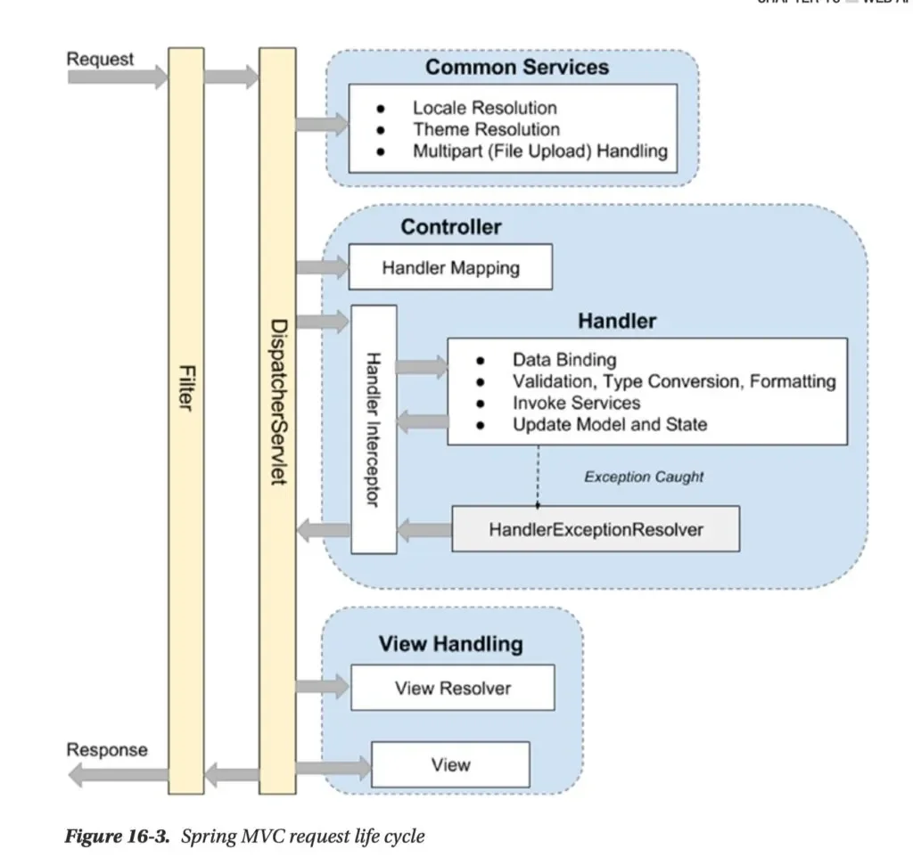
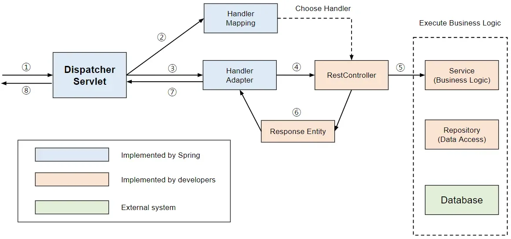
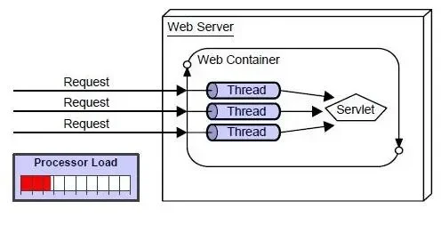
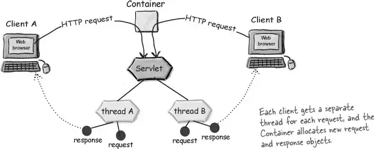

<details>
<summary>Reference</summary>

<a id="150eda9b0fe18032b162d0cfd2f2e326"></a>

<a href="https://beautiful-college-c84.notion.site/ee015e33409a44cca8ae5371e077908d">페이지</a> 

</details>

<details>
<summary>🧐 CSR, SSR</summary>

- CSR, Client Side Rendering
    - 기본적인 HTML구조를 받고 JavaScript가 실행되면서 필요한 데이터를 불러와 화면을 작성

    - 서버에 부하가 적습니다&#46; 

    - 네트워크를 많이 사용하기 때문에 초기 로딩 시간이 길어집니다&#46;

    <details>
    <summary>예시</summary>

    <a id="14bb92b223254a54892c75e624e32a7f"></a>

    ```java
    @RestController
    @RequestMapping("/api")
    public class MemoController {

        private final MemoService memoService;

        public MemoController(MemoService memoService) {
            this.memoService = memoService;
        }

        @PostMapping("/memos")
        public MemoResponseDto createMemo(@RequestBody MemoRequestDto requestDto) {
            return memoService.createMemo(requestDto);
        }
    ```

    </details>

- SSR, Server Side Rendering
    - 모든 HTML을 받아서 렌더링만 하면 됩니다&#46; 

    - 서버에 부하가 많이 갑니다&#46;

    - 완성된 페이지를 빠르게 볼 수 있습니다&#46;

    <details>
    <summary>예시</summary>

    <a id="9af8af77f548492fb88bb6e191b5ab30"></a>

    My Select Shop

    <a id="509a958bc9af4718bec24baa9de682b8"></a>

    ```java
    index.html
    ---
    <!doctype html>
    <html lang="en">
    <head>
        <meta charset="UTF-8">
        <meta name="viewport"
              content="width=device-width, user-scalable=no, initial-scale=1.0, maximum-scale=1.0, minimum-scale=1.0">
        <meta http-equiv="X-UA-Compatible" content="ie=edge">
    		<link rel="preconnect" href="https://fonts.gstatic.com">

        <link rel="stylesheet" href="/css/style.css">
        <script src="https://code.jquery.com/jquery-3.7.0.min.js"
                integrity="sha256-2Pmvv0kuTBOenSvLm6bvfBSSHrUJ+3A7x6P5Ebd07/g=" crossorigin="anonymous"></script>
        <script src="https://cdn.jsdelivr.net/npm/js-cookie@3.0.5/dist/js.cookie.min.js"></script>
        <script src="/js/basic.js"></script>
        <title>나만의 셀렉샵</title>
    </head>
    <body>
    ...
    </body>
    </html>
    ```

    <a id="68e5fba07862448e977128b15434fdaf"></a>

    ```java
    package com.sparta.myselectshop.controller;

    import org.springframework.stereotype.Controller;
    import org.springframework.web.bind.annotation.GetMapping;

    @Controller
    public class HomeController {
        @GetMapping("/")
        public String home() {
            return "index";
        }
    }
    ```

    </details>

</details>

<a id="150eda9b0fe1807eb598ecb6b6a9e8bb"></a>

## DispatcherServlet의 순서도

<a id="caa9bfc4a074446fbde559df86d36305"></a>

### SSR



<a id="150eda9b0fe18093b571e66a47205f6c"></a>

### CSR



<a id="150eda9b0fe180efa034f76f75df8e6d"></a>

## DispatcherServlet &#45; CSR 방식


1. 클라이언트 요청이 디스패처 서블릿으로 들어옴

1. Handler Mapping을 통해 어떤 Controller로 매핑할지 확인

1. Handler Adapter를 사용해 Controller로 요청 전달

1. Service단에서 비지니스 로직을 사용 
    - 보통 Database CRUD 진행

1. 컨트롤러가 ResponseEntity 반환

1. 서버 응답을 클라이언트로 반환

<a id="150eda9b0fe18065bccdf7a881deadbc"></a>

## 웹에서의 동작





1.  하나의 Request가 들어올 때마다 Thread를 생성 

1.  DispatcherServelet으로 전달

1. CSR or SSR로 Response 생성 

1. Response 전달

<details>
<summary>추가 ) Next&#46;js 페이지 렌더링</summary>

- 요세 사용 기술

[Next&#46;js 페이지 렌더링 이해하기]()

</details>
