> /icons/tag_blue.svg 
> 
> <a id="150eda9b0fe181bb8b1cd4f3eb3492bb"></a>
> 
> 내일배움캠프&#95;스프링 7기  &#45; 최종 프로젝트
> 
> > 기간&#58; 24&#46;11&#46;26 &#126; 25&#46;02&#46;10  ( 약 5주 )
> 
> - 팀 노션&#58; <a href="https://beautiful-college-c84.notion.site/9c9a46ceb566418c9d748fd90273284d">페이지</a> 
> 
> - 발제&#58; <a href="https://beautiful-college-c84.notion.site/15a2dc3ef5148049bb73ec798d2da26a">페이지</a> 

> 
> 
> <a id="335eda9b0fe180ee8f21f92722cabf7d"></a>
> 
> <strong>목차</strong>
> 
> - [설계](#335eda9b0fe1805aaff7d96485215c49)
> - [기획](#335eda9b0fe180069a8bf90ec20fa4f5)
> - [와이어프레임](#335eda9b0fe180faaaece4c87d093bc3)
> - [ERD](#335eda9b0fe180b3bd51d6d97a4fd5df)
> - [API 명세서](#335eda9b0fe1809cb95bfa204c924513)
> - [Flow Chart](#335eda9b0fe180009119c11a62e15e69)
> - [Github](#335eda9b0fe180aa9103f1f87fbd7f32)
> - [트러블 슈팅  - RabbitMQ를 사용한 Retry  ( Durable Messaging Pattern 패턴 적용 )](#192eda9b0fe180a896dae568ab576192)
> - [문제 상황](#192eda9b0fe180cda1a7fb73a745fd31)
> - [기술적 의사 결정](#336eda9b0fe1803a9719fe202781d4f5)
> - [[ 배경 ]](#336eda9b0fe1804980c2fe789e6b2897)
> - [[ 고려 기술의  장•단점 ]](#336eda9b0fe180b38f69f117c7b5e4aa)
> - [[ 결정 ]](#336eda9b0fe18006a2c7d7491e94ae66)
> - [[ 배경 ]](#336eda9b0fe18087a9c5ce2d429dac75)
> - [[ 고려 기술의  장•단점 ]](#336eda9b0fe18049a19ad52b780fa000)
> - [[ 결정 ]](#336eda9b0fe18029b027c50a98938ddd)
> - [원인 파악](#192eda9b0fe18006ac3ecf5a0a625ba7)
> - [해결 - Retry ( Durable Messaging Pattern )](#192eda9b0fe180548e0ada77411a157a)
> - [구현 방식](#192eda9b0fe1803e8827c2404eaded03)
> - [구현](#192eda9b0fe180f8864ec40a95959133)
> - [확인](#192eda9b0fe180caba4dc3b77527305a)

<a id="335eda9b0fe1805aaff7d96485215c49"></a>

## 설계

---

<a id="335eda9b0fe180069a8bf90ec20fa4f5"></a>

### 기획

[요구사항](#/post/335eda9b-0fe1-80ca-9d7b-f7a41e5759f9)

<a id="335eda9b0fe180faaaece4c87d093bc3"></a>

### 와이어프레임

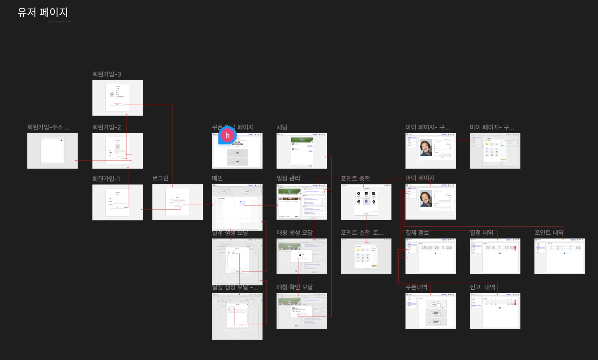

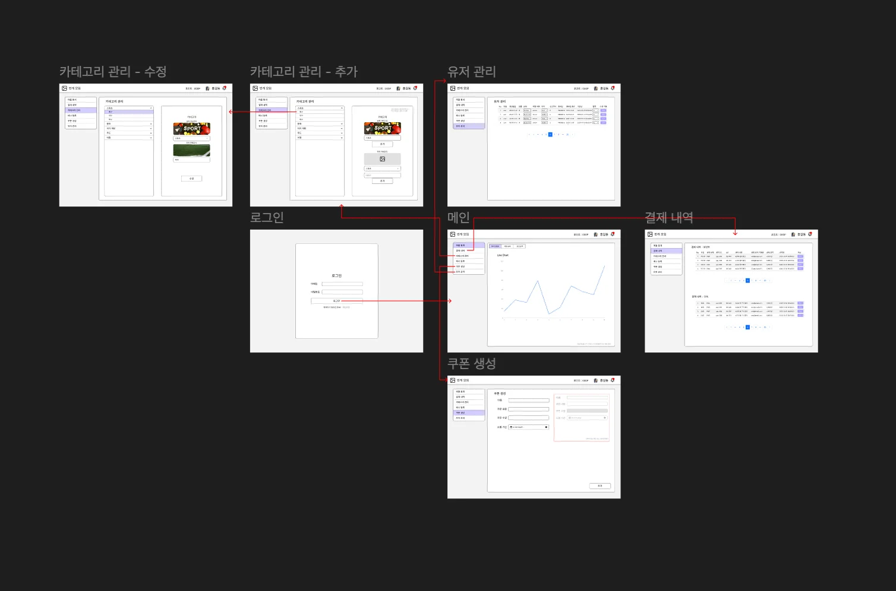

<a id="335eda9b0fe180b3bd51d6d97a4fd5df"></a>

### ERD

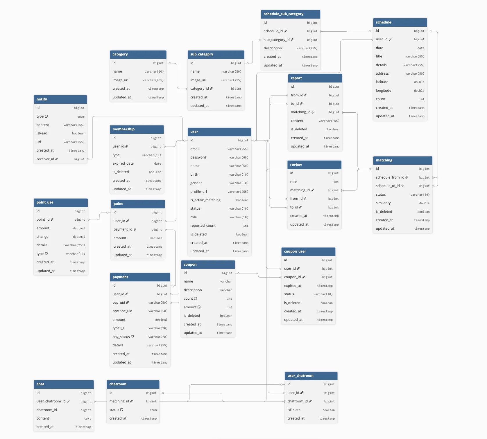

<a id="335eda9b0fe1809cb95bfa204c924513"></a>

### API 명세서

[API 명세서](#/post/4a8eda9b-0fe1-820f-a7ac-81d28aefb5a9)

<a id="335eda9b0fe180009119c11a62e15e69"></a>

### Flow Chart

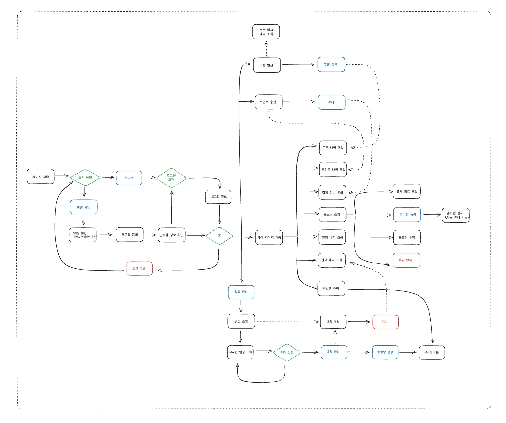

<a id="335eda9b0fe180aa9103f1f87fbd7f32"></a>

### Github

- 프론트엔드
    [Connect-client](https://github.com/alsqja/Connect-client)

- 백엔드 
    [Connect](https://github.com/alsqja/Connect)

<a id="192eda9b0fe180a896dae568ab576192"></a>

## 트러블 슈팅  &#45; RabbitMQ를 사용한 Retry  ( Durable Messaging Pattern 패턴 적용 )

---

<a id="192eda9b0fe180cda1a7fb73a745fd31"></a>

### 문제 상황

<a id="192eda9b0fe1803b87fbc30e514345ad"></a>

채팅 기능에 대한 경우, 1차적으로 <code>WebSocket</code>과 <code>STOMP</code>를  사용하여 구현 하였습니다&#46; 

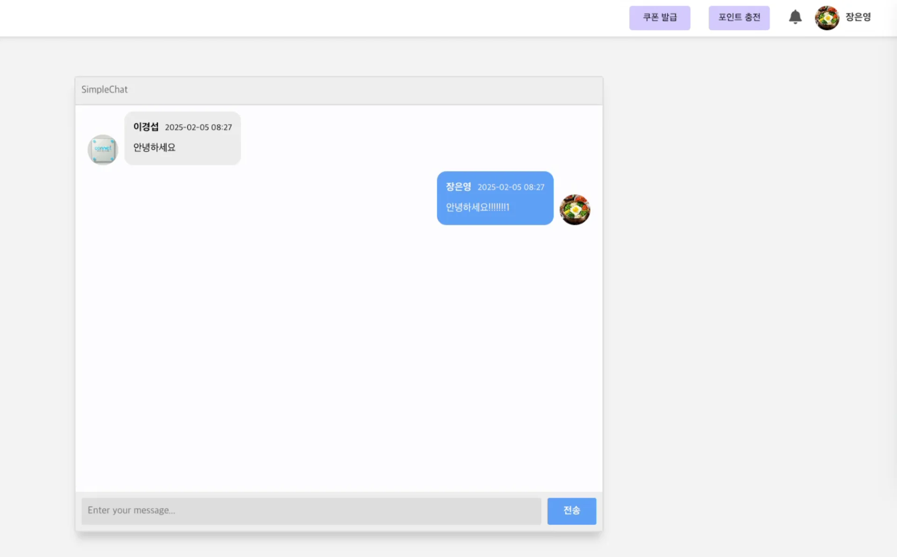

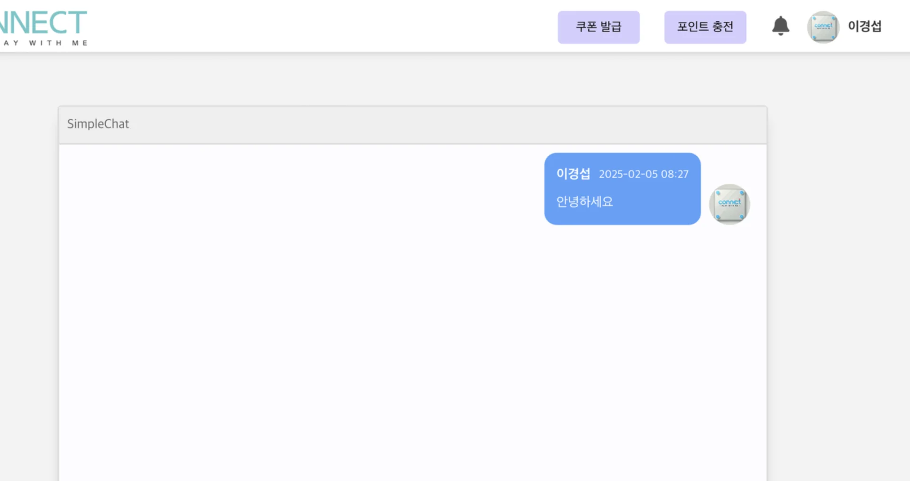

<a id="192eda9b0fe18018ab3dff90a60dc7ff"></a>

팀원과 함께 클라이언트를 통해 앱의 동작 테스트를 해보는 도중, 위와 같이 메세지 전송이 실패되는 경우가 발생하였습니다&#46; 

<a id="192eda9b0fe180f6867bc16bbd9c02d1"></a>

따라서 이 부분을 통계적으로 파악을 하고자 아래와 같이 테스트코드를 작성하고 결과를 확인 했습니다&#46; 

<details>
<summary>&#91; 테스트 코드 &#93; </summary>

<details>
<summary>reference</summary>

[gs-messaging-stomp-websocket](https://github.com/spring-guides/gs-messaging-stomp-websocket)

</details>

<a id="192eda9b0fe180f191c9fa29e00cf249"></a>

```java
@SpringBootTest(webEnvironment = SpringBootTest.WebEnvironment.RANDOM_PORT)
public class ChatControllerTest {

    @LocalServerPort
    private int port;
    private WebSocketStompClient stompClient;
    private final WebSocketHttpHeaders headers = new WebSocketHttpHeaders();
    private int receivedCount = 0;
    private int failedCount = 0;


    @BeforeEach
    public void setup() {
        WebSocketClient webSocketClient = new StandardWebSocketClient();
        this.stompClient = new WebSocketStompClient(webSocketClient);
        this.stompClient.setMessageConverter(new MappingJackson2MessageConverter());
    }

    @Test
    public void getMessaging() throws Exception {
        long startTime = System.nanoTime();

        final int MESSAGE_COUNT = 8000;
        final CountDownLatch latch = new CountDownLatch(MESSAGE_COUNT);
        final AtomicReference<Throwable> failure = new AtomicReference<>();

//        AtomicInteger receivedCount = new AtomicInteger(0);
//        AtomicInteger failedCount = new AtomicInteger(0);

        StompSessionHandler handler = new TestSessionHandler(failure, stompClient, headers, port) {
            @Override
            public void afterConnected(final StompSession session, StompHeaders connectedHeaders) {
                session.subscribe("/sub/chats", new StompFrameHandler() {
                    @Override
                    public Type getPayloadType(StompHeaders headers) {
                        return ChatReqDto.class;
                    }

                    @Override
                    public void handleFrame(StompHeaders headers, Object payload) {
                        try {
                            ChatReqDto chat = (ChatReqDto) payload;
                            System.out.println("메세지 성공: " + receivedCount++);
//                            receivedCount.incrementAndGet();
                        } catch (Throwable t) {
                            System.out.println("메세지 오류1: " + failedCount++);
//                            failedCount.incrementAndGet();
                            failure.set(t);
                        } finally {
                            latch.countDown();
                        }
                    }
                });

                // 메시지 전송 전 작은 지연 추가
                try {
                    Thread.sleep(1000);
                } catch (InterruptedException e) {
                    e.printStackTrace();
                }

                for (int i = 0; i < MESSAGE_COUNT; i++) {
                    try {
                        session.send("/pub/chats", new Chat("안녕하세요", i));
                    } catch (Throwable t) {
                        t.printStackTrace();
                        System.out.println("메세지 오류2: " + failedCount++);
                        failure.set(t);
                        latch.countDown();
                    }
                }

                if (latch.getCount() == 0) {
                    session.disconnect();
                }
            }
        };

        this.stompClient.connectAsync("ws://localhost:{port}/ws", this.headers, handler, this.port);


        // 타임아웃 처리
        if (!latch.await(90, TimeUnit.SECONDS)) {
            System.out.println("타임아웃 발생: 모든 메시지가 처리되지 않았습니다.");
            int remainingMessages = (int) latch.getCount();
            System.out.println("시도 되지 못한 메세지: " + remainingMessages);
        }

        System.out.println("정상 처리 메세지: " + receivedCount);
        System.out.println("실패 처리 메세지: " + failedCount);

        long endTime = System.nanoTime();
        long elapsedTime = endTime - startTime;
        System.out.println("실행 시간: " + elapsedTime / 1_000_000 + " ms");

        if (failure.get() != null) {
            System.err.println("테스트 중 오류 발생: " + failure.get().getMessage());
        }

//        // 모든 메시지가 처리되었는지 확인
//        assertEquals(MESSAGE_COUNT, receivedCount + failedCount,
//                "처리된 메시지 수와 실패한 메시지 수의 합이 전체 메시지 수와 일치하지 않습니다.");
    }
}


class TestSessionHandler extends StompSessionHandlerAdapter {
    private final AtomicReference<Throwable> failure;
    private final WebSocketStompClient stompClient;
    private final WebSocketHttpHeaders headers;
    private final int port;
    private AtomicReference<StompSession> session = new AtomicReference<>(null); // 세션을 AtomicReference로 관리

    public TestSessionHandler(AtomicReference<Throwable> failure, WebSocketStompClient stompClient, WebSocketHttpHeaders headers, int port) {
        this.failure = failure;
        this.stompClient = stompClient;
        this.headers = headers;
        this.port = port;
    }

    @Override
    public void afterConnected(StompSession session, StompHeaders connectedHeaders) {
        this.session.set(session);  // 세션 저장
        session.subscribe("/sub/chats", new StompFrameHandler() {
            @Override
            public Type getPayloadType(StompHeaders headers) {
                return ChatReqDto.class;
            }

            @Override
            public void handleFrame(StompHeaders headers, Object payload) {
                // 프레임 처리 로직
            }
        });
    }

    @Override
    public void handleException(StompSession s, StompCommand c, StompHeaders h, byte[] p, Throwable ex) {
        this.failure.set(ex);
        handleTransportError(s, ex);  // 연결 오류 발생 시 처리
    }

    @Override
    public void handleTransportError(StompSession session, Throwable ex) {
        this.failure.set(ex);
        System.out.println("WebSocket 연결에 문제가 발생했습니다. 재연결 시도...");

        attemptReconnect();
    }

    private void attemptReconnect() {
        // 일정 시간 후 재연결 시도
        try {
            // 2초 대기 후 재연결 시도
            Thread.sleep(2000);
        } catch (InterruptedException e) {
            e.printStackTrace();
        }

        // 기존 세션을 종료하고 새로운 세션을 연결
        if (this.session.get() != null ) {
            this.session.get().disconnect(); // 기존 세션을 종료
        }

        // 새로운 세션을 생성하여 재연결 시도
        stompClient.connectAsync("ws://localhost:{port}/ws", headers, new TestSessionHandler(failure, stompClient, headers, port), port);
    }
}
```

</details>

<details>
<summary>Test) 8000 개의 메세지 전송 확인</summary>

> 5번의 시도, 2번의 실패 케이스

- 성공

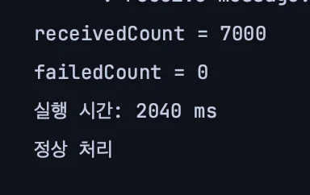

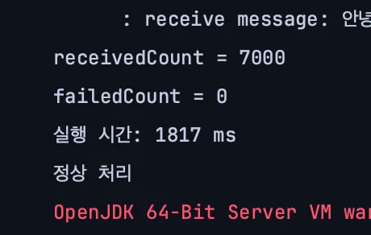

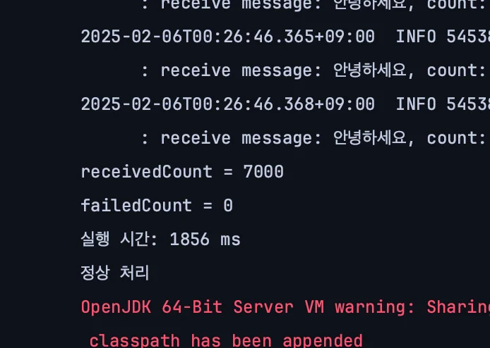

- 실패

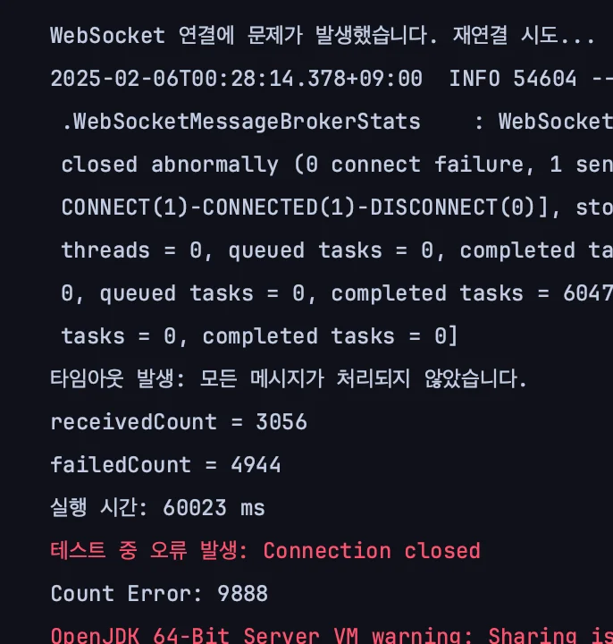

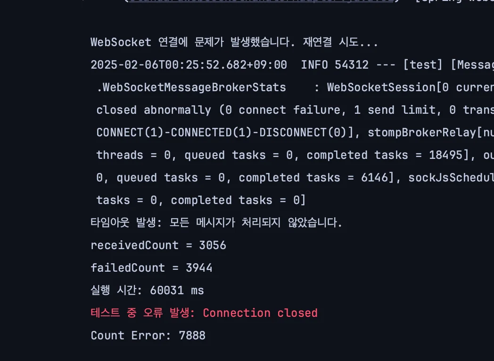

</details>

<a id="336eda9b0fe1803a9719fe202781d4f5"></a>

### 기술적 의사 결정

<details>
<summary>실시간 채팅&#58;  <code>WebSoket</code> </summary>

<a id="336eda9b0fe1804980c2fe789e6b2897"></a>

### &#91; 배경 &#93;

- 유저들이 매칭이 성사된 이후, 실시간 채팅이 이뤄저야 함

<a id="336eda9b0fe180b38f69f117c7b5e4aa"></a>

### &#91; 고려 기술의  장•단점 &#93;

|  | 장점 | 단점 |
| --- | --- | --- |
| <code>WebSoket</code> | • 실시간 양방향 통신 가능 서버와 클라이언트가 자유롭게 데이터를 주고받을 수 있음<br>• 낮은 네트워크 오버헤드 HTTP보다 헤더 크기가 작고, 연결이 유지되므로 네트워크 비용 절감<br>• 빠른 응답 시간 연결이 유지되므로 요청할 때마다 핸드셰이크가 필요 없어 속도가 빠름 | • 방화벽 문제 발생 가능 웹소켓을 지원하지 않는 네트워크 환경에서는 연결이 차단될 수 있음<br>• 서버 부하 증가 가능 지속적인 연결 유지로 인해 많은 사용자가 접속하면 서버 부담 증가<br>• 구현 난이도가 높음 HTTP보다 설정이 복잡하고, 서버에서 별도 WebSocket 핸들러가 필요 |
| <code>HTTP</code> | • 간단한 요청/응답 구조 REST API와 함께 사용하기 편리하며, 구현이 쉬움<br>• 방화벽과 프록시 지원이 용이 대부분의 네트워크 환경에서 별도 설정 없이 사용 가능 | • 비효율적인 통신 방식 클라이언트가 요청해야만 서버가 응답 가능 (Polling, Long Polling 필요)<br>• 헤더 오버헤드가 큼 매 요청마다 헤더를 포함하므로 네트워크 부담이 증가<br>• 실시간 처리에 불리함 항상 클라이언트가 먼저 요청해야 하므로, 실시간 데이터 전송이 어려움 |

<a id="336eda9b0fe18006a2c7d7491e94ae66"></a>

### &#91; 결정 &#93;

<a id="336eda9b0fe180b9a858c630b67a3cfc"></a>

<code>비연결성</code>, <code>비상태성</code>, <code>단방향</code> 특징을 가지는 HTTP 통신 방식으로는 실시간으로 메세지를 전송하기 어렵다고 판단하여 Websocket 통신 도입하였습니다&#46; 

<a id="336eda9b0fe180acb2d2c12daa155b38"></a>

이를 통해 매 요청마다 발생되는<strong><u> &#91; TCP/IP &#45;3 Way Hand Shake &#93; 비용을 줄</u></strong>이고, <strong><u>세션을 통해 연결을 유지</u></strong>하며, <strong><u>요청없이 양방향으로 실시간 메세지 전달</u></strong>을 할 수 있었습니다&#46;

</details>

<details>
<summary>채팅(미들웨어)&#58;  <code>RabbitMQ</code></summary>

<a id="336eda9b0fe18087a9c5ce2d429dac75"></a>

### &#91; 배경 &#93;

- 기존의 채팅 기능을 <code>Websocket</code>, <code>STOMP</code>를 사용하여 구현
    - Websocket, 세션을 통해 연결 유지

    - STOMP, 메모리 기반의 메세지 브로커

- 따라서 트래픽 증가에 따른 <code>scale out</code> 시, <strong><u>동기화 문제</u></strong>가 발생될 수 있음

- 또한 둘다 메모리를 사용하기 때문에 <strong><u>서버에 많은 부하</u></strong>를 줌
    <a id="336eda9b0fe1805194f5e70efdae3948"></a>

    ⇒ <strong><u>부하를 분산 처리</u></strong>하고, <strong><u>동기화 문제를 해결</u></strong>할 외부 미들웨어 설정이 필요  하다고 판단 

- 미들웨어에 대한 구현은 여러 기술이 있지만  그 중 아래의 2가지 내용 고려함
    - <strong><u>엄청 큰 트래픽(큰 수억 • 수천만 단위)</u></strong> 상황은 고려하지 않음

    - 시중에서 많이 사용 되는 기술을 사용

    <a id="336eda9b0fe180328cb3dbdbfa1198d6"></a>

    ⇒ <code>Redis</code>, <code>RabbitMQ</code>  선택

<a id="336eda9b0fe18049a19ad52b780fa000"></a>

### &#91; 고려 기술의  장•단점 &#93;

| 구분 | 장점 | 단점 |
| --- | --- | --- |
| <code>RabbitMQ</code> | • 메세지의 persist(저장)나 실패에 대한 retry 매커니즘을 제공<br>• 병렬 처리 가능 | • Redis에 비해 메세지 처리 속도가 낮음 |
| <code>Redis</code> | • 인메모리 기반으로 빠른 처리가 가능 | • 메세지에 대한 영속성(persist) 처리가 필요<br>• 라우팅 기능만을 제공<br>• 중간 메세지 소실에 대한 retry에 대한 추가 구현 필요 |

<a id="336eda9b0fe18029b027c50a98938ddd"></a>

### &#91; 결정 &#93;

<a id="336eda9b0fe180519cadcae6624b10a1"></a>

신뢰성 있는 서비스를 구성하기 위해서는 메세지 전송 실패 시, retry 처리가 필수적으로 필요 했습니다&#46;

<a id="336eda9b0fe180449dd7d3990fb637fa"></a>

이를 내부적으로 제공하는 rabbitMQ를 사용하면 개발 생산성을 높이고 이후, 유지보수 포인트를 낮추게 되며 또한 병렬 처리가 가능하므로 속도에 대한 문제도 해결할 수 있다고 판단 하였습니다&#46;

<a id="336eda9b0fe180be8e57fde185ef6067"></a>

따라서 외부 미들웨어에 대한 구현 기술로 rabbitMQ를 사용하기로 결정했습니다&#46; 이를 통해, 서버에 대한 부하를 분산 처리 및  scale out 시, 발생될 동기화 문제를 해결할 수 있었습니다&#46;

</details>

<a id="192eda9b0fe18006ac3ecf5a0a625ba7"></a>

### 원인 파악

- 서버의 일시적인 장애로 세션 ID 디코딩 오류
    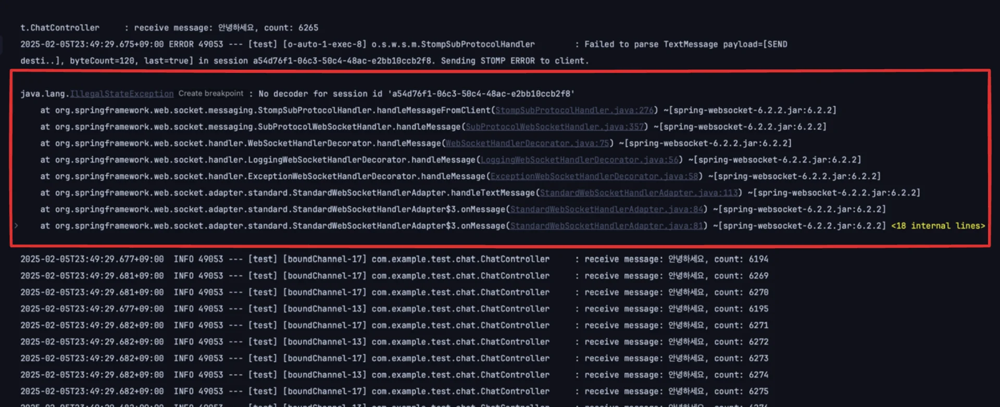

-  <strong>STOMP 메시지 파싱 오류</strong>
    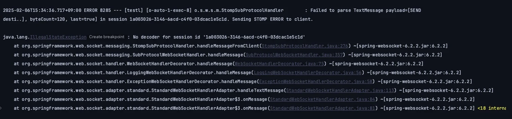

- 웹 소캣 연결 소실 (  <strong>WebSocket 세션 ) 닫힘</strong>
    - 위와 같은 세션 디코딩 및 메세지 파싱 오류가 많아 지는 경우 아래와 같이 Websocket 세션이 종료됨

    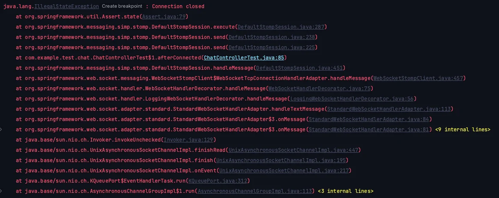

<a id="192eda9b0fe180da87f8daa741f72a64"></a>

오류에 대한 상황은 메세지 파싱 오류, 세션 ID 디코딩 오류, 웹소캣 연결 소실에 대한 오류로 파악할 수 있었습니다 

<a id="192eda9b0fe180548e0ada77411a157a"></a>

### 해결 &#45; Retry ( Durable Messaging Pattern )

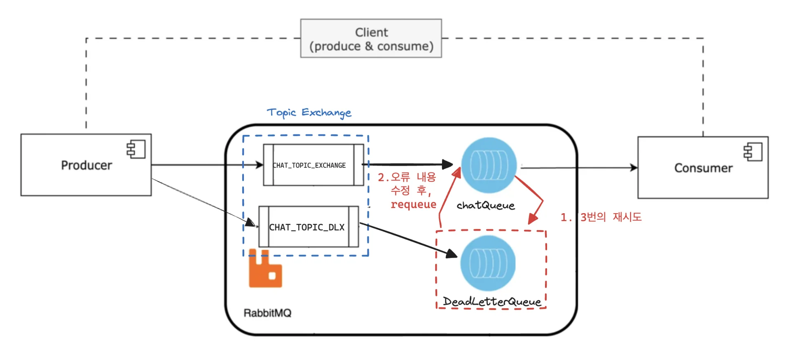

<a id="192eda9b0fe180cb9dfec6d33814a67d"></a>

위 오류에 대한 해결은 메시지를 영속화하고, 수정 및 재시도하여 해결할 수 있는데, <br>이에 대한 내부 매커니즘을 제공하는 RabbitMQ를 도입하여 해결 하였습니다&#46;

- Dead Letter Queue를 통한 retry(<code>requeue</code>) 처리 

<a id="192eda9b0fe1803e8827c2404eaded03"></a>

### 구현 방식

<a id="192eda9b0fe180ff9d3aca7976b447c4"></a>

구현 방식은 아래 <strong><u>3가지 방식</u></strong>을 고려했습니다&#46; 

<details>
<summary>1&#46; <code>AcknowledgeMode&#46;MANUAL</code>을  통한 명시적인 ACK, NACK 처리</summary>

<details>
<summary>코드 레벨로 명시적인 ACK(성공), NACK(실패) 처리</summary>

- ACK&#58; <code>channel&#46;basicAck(tag, false);</code>

- NACK&#58; <code>channel&#46;basicReject(tag, true);</code>

</details>

<details>
<summary>ex) </summary>

<details>
<summary>Reference</summary>

[GitHub &#45; villainscode/HelloMessageQueue at tutorial&#45;step7]()

</details>

<details>
<summary>Consumer</summary>

<a id="192eda9b0fe180599a82d01f93a1e1ce"></a>

```java
@Component
public class OrderConsumer {
    private static final int MAX_RETRIES = 3; // 총 시도 제한 수
    private int retryCount = 0; // 재시도 횟수

    @RabbitListener(queues = RabbitMQConfig.ORDER_COMPLETED_QUEUE, containerFactory = "rabbitListenerContainerFactory")
    public void processOrder(String message, Channel channel, @Header("amqp_deliveryTag") long tag) {
        try {
            // 실패 유발
            if ("fail".equalsIgnoreCase(message)) {
                if (retryCount < MAX_RETRIES) {
                    System.err.println("#### Fail  & Retry = " + retryCount);
                    retryCount++;
                    throw new RuntimeException(message);
                } else {
                    System.err.println("#### 최대 횟수 초과, DLQ 이동 시킴 ");
                    retryCount = 0;
                    channel.basicNack(tag, false, false);
                    return;
                }
            }
            // 성공 처리
            System.out.println("# 성공 : " + message);
            channel.basicAck(tag, false);
            retryCount = 0;
        } catch (Exception e) {
            System.err.println("# error 발생 : " + e.getMessage());
            try {
                // 실패 시 basicReject 재처리 전송
                channel.basicReject(tag, true);
            } catch (IOException e1) {
                System.err.println("# fail & reject message : " + e1.getMessage());
            }
        }
    }
}
```

</details>

<details>
<summary>RabbitMQManualConfig </summary>

<a id="192eda9b0fe1804082cbe2c70cdd567d"></a>

```java
@EnableRabbit
@Configuration
public class RabbitMQManualConfig {

    @Bean
    public SimpleRabbitListenerContainerFactory rabbitListenerContainerFactory(ConnectionFactory connectionFactory) {
        SimpleRabbitListenerContainerFactory factory = new SimpleRabbitListenerContainerFactory();
        factory.setConnectionFactory(connectionFactory);
        // 수정 모드 설정이 들어가야 한다.
        factory.setAcknowledgeMode(AcknowledgeMode.MANUAL);
        return factory;
    }
}
```

</details>

</details>

</details>

<details>
<summary>2&#46; <code>RetryTemplate</code>을 사용한 retry 설정</summary>

<details>
<summary>ex) </summary>

<details>
<summary>Reference</summary>

[GitHub &#45; villainscode/HelloMessageQueue at tutorial&#45;step8&#45;1]()

</details>

<details>
<summary>RetryConfig</summary>

<a id="192eda9b0fe18048a686e05ff2c37686"></a>

```java
@Configuration
public class RetryConfig {

    @Bean
    public RetryTemplate retryTemplate() {
        RetryTemplate retryTemplate = new RetryTemplate();
        // 재시도 정책 설정: 최대 3번 시도
        SimpleRetryPolicy retryPolicy = new SimpleRetryPolicy();
        retryPolicy.setMaxAttempts(3);
        // 백오프 정책 설정: 재시도 간격 1초
        FixedBackOffPolicy backOffPolicy = new FixedBackOffPolicy();
        backOffPolicy.setBackOffPeriod(1000L);
        retryTemplate.setRetryPolicy(retryPolicy);
        retryTemplate.setBackOffPolicy(backOffPolicy);

        return retryTemplate;
    }
}
```

</details>

</details>

</details>

<details>
<summary>3&#46; <strong>애플리케이션 설정 파일(</strong><strong><code>&#46;yml</code></strong><strong>, </strong><strong><code>&#46;properties</code></strong><strong>)을 통한 Retry 설정</strong></summary>

<details>
<summary>ex) </summary>

<details>
<summary>Reference</summary>

[HelloMessageQueue/src/main/java/net/harunote/hellomessagequeue/step8 at tutorial&#45;step8&#45;2 · villainscode/HelloMessageQueue]()

</details>

<details>
<summary>application&#46;yml </summary>

<a id="192eda9b0fe1803c9bcdd5d2e0907254"></a>

```java
spring:
  rabbitmq:
    host: localhost
    port: 5672
    username: guestuser
    password: guestuser
    listener:
      simple:
        retry:
          enabled: true # 재시도 활성화
          initial-interval: 1000 # 첫 재시도 대기 시간 1초
          max-attempts: 3 # 최대 재시도 횟수
          max-interval: 1000 #최 시도간 최대 대기시간
        default-requeue-rejected: false
```

</details>

</details>

</details>

<a id="192eda9b0fe180f0b4a1eac440c3dfc9"></a>

각 방식에 대한 장•단점은 아래와 같습니다&#46; 

| • | 1 | 2 | 3 |
| --- | --- | --- | --- |
| 구현 | <code>AcknowledgeMode&#46;MANUAL</code>을 통한 명시적인 ACK, NACK 처리 |  <code>RetryTemplate</code>를 사용한 retry 설정 | <strong>애플리케이션 설정 파일(</strong><strong><code>&#46;yml</code></strong><strong>, </strong><strong><code>&#46;properties</code></strong><strong>)을 통한 Retry 설정</strong> |
| 장점 | <strong><u> 코드 레벨로 명시적</u></strong>으로 표현하기 때문에, <strong><u>더 세부적인 처리(exception …)가  가능</u></strong>하다&#46;  | 간단한 config 설정을 통해 <strong><u>코드 레벨로 표현</u></strong>이 가능하다 | 가장 간단하게 설정 파일에 명시함으로써 retry 설정이 가능하다&#46;  |
| 단점 | 코드 레벨로써 정의하기 때문에, 이후 <strong><u>유지보수 포인트가 증가</u></strong>한다&#46; |  spring&#45;retry에 대한 의존성을 추가해야 한다&#46; 또한 코드 레벨로 표현하기 때문에 유지보수 포인트가 증가된다&#46; | 코드 레벨로 정의하지 않기 때문에, 세부적인 Exception handling에 대한 어려움이 있다&#46;  |

<a id="192eda9b0fe180b0a38fec7a383c7252"></a>

적용하려는 채팅 기능은 단순하게 Client로부터 Message를 전달 받아 DTO 변환 후, 해당하는 Client로 전달하는 로직이었습니다&#46;  따라서 발생할 수 있는 예외 상황은 아래와 같이 가정했습니다 

> ✏️ 
> 
> 1. <code>JSON</code> 과 <code>Object</code> 사이의 <strong><u>직렬화, 역직렬화</u></strong>
> 
> 1. 요청 받는 메세지에서 Null point
> 
> 1. 타입 변환 
> 
> 1. 소캣 연결 소실
> 
> 1. 네트워크 및 서버 오류로 인한 메세지 처리 실패 

- <code>JSON</code> 과 <code>Object</code> 사이의 <strong><u>직렬화, 역직렬화</u></strong>
    <a id="192eda9b0fe1809a8676d194e9be920c"></a>

    1번째,  직렬화•역직렬화에 대한 오류 상황은  아래와 같이 Config에서 <strong><code>Jackson2JsonMessageConverter</code></strong><strong> 선언하여 처리 할 수 있었습니다&#46; </strong>

    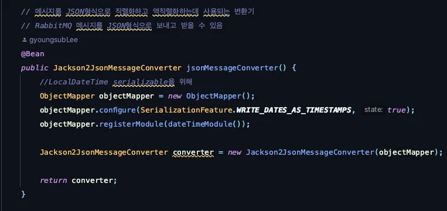

- 요청 받는 메세지에서 Null point, 타입 변환
    <a id="192eda9b0fe1807a83add7615ef278ee"></a>

     Null point 및 타입 변환 오류는 프론트 단에서 TypeScript를 사용하여 validation 처리 할 수 있었습니다&#46;  

    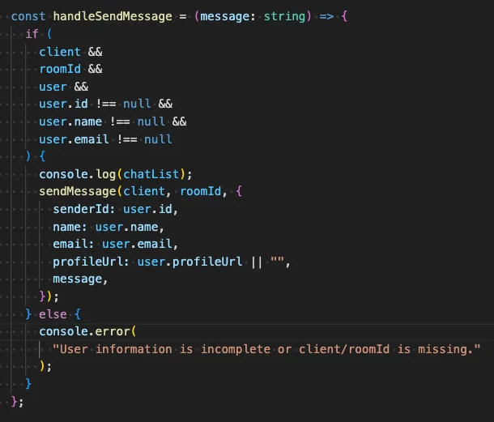

    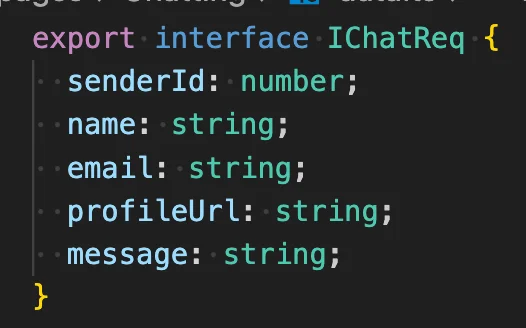

- 웹소캣 연결 소실
    - 웹소캣에 대한 연결 소실 오류는 프론트 단에서 재연결 시도를 통해 해결할 수 있었습니다&#46; 

    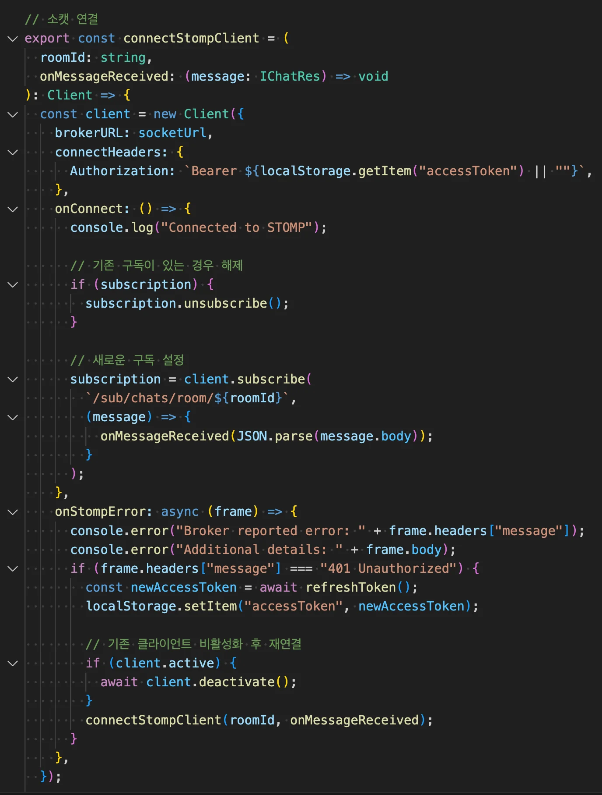

<a id="192eda9b0fe1801b8137f9254d6bc2c7"></a>

따라서 Rabbit MQ에서 retry가 발생되는 상황을  <strong><u>네트워크 및 서버 장애</u></strong><strong>로 인한 메세지 전송 오류만을 가정했습니다&#46; 이는 일시적인 장애로 인한 오류 상황이기 때문에 실패된 메세지를 보관하여 재시도를 하면 된다고 가정하였고 </strong>가장 구현이 간단하고, 유지보수 측면이 낮은 <strong>3번째, 애플리케이션 설정 파일(</strong><strong><code>&#46;yml</code></strong><strong>, </strong><strong><code>&#46;properties</code></strong><strong>) 방식이 적절하다고 판단 하였습니다&#46; </strong>

<a id="192eda9b0fe180f8864ec40a95959133"></a>

### 구현

> 
> 
> - 설정 파일을 통해 retry에 대한 설정값을 정의하였습니다&#46; 
> 
> - Config를 통해 Dead Letter Queue, Exchange, routing Key를 생성하고 바인딩 처리 하였습니다&#46; <br>또한 chat Queue에서의 3번의 재시도 후, 자동으로 Dead Letter Queue로 이동하도록 정의했습니다&#46; 
> 
> - DeadLetter Retry 로직을 통해 Dead Letter Queue로 이동된 메세지를 chat Queue로 이동할 수 있도록 했습니다&#46; ( 오류 내용 수정 가능 )

<details>
<summary>application&#46;properties</summary>

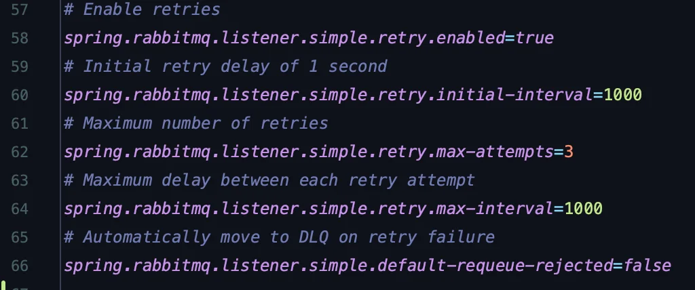

</details>

<details>
<summary>Config</summary>

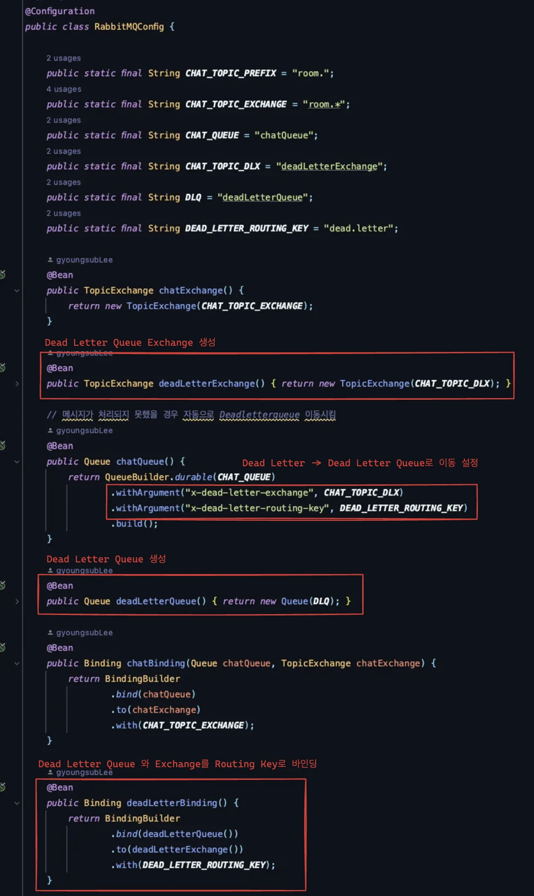

</details>

<details>
<summary>Subscriber</summary>

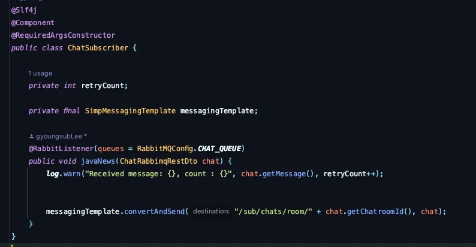

</details>

<details>
<summary>DeadLetter Retry 처리</summary>

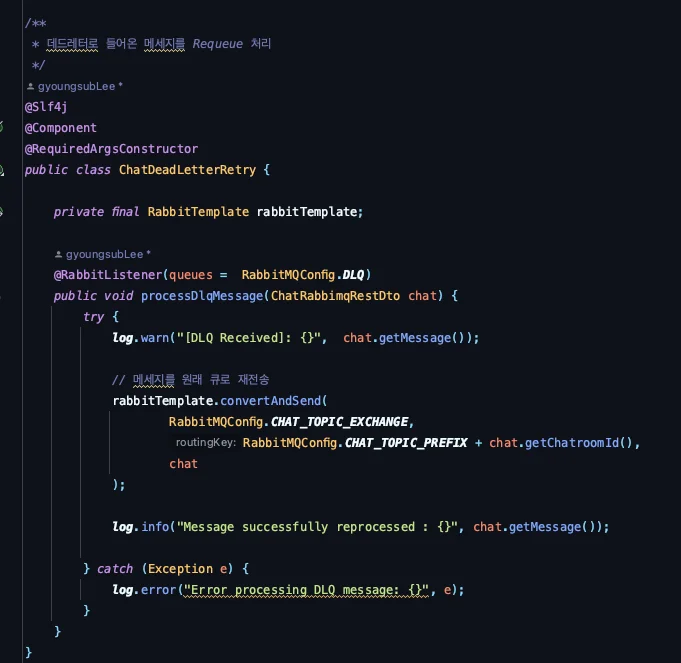

</details>

<a id="192eda9b0fe180caba4dc3b77527305a"></a>

### 확인

- Subscriber
    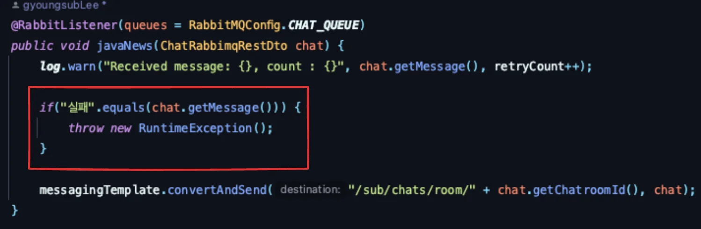

    <a id="192eda9b0fe180b4a6fbca8fe13b693c"></a>

    “실패” 라는 메세지가 전송되면 RuntimeException을 발생 시켜, retry 및 Dead Letter Queue 이동을 확인했습니다&#46;

- ChatDeadLetterRetry
    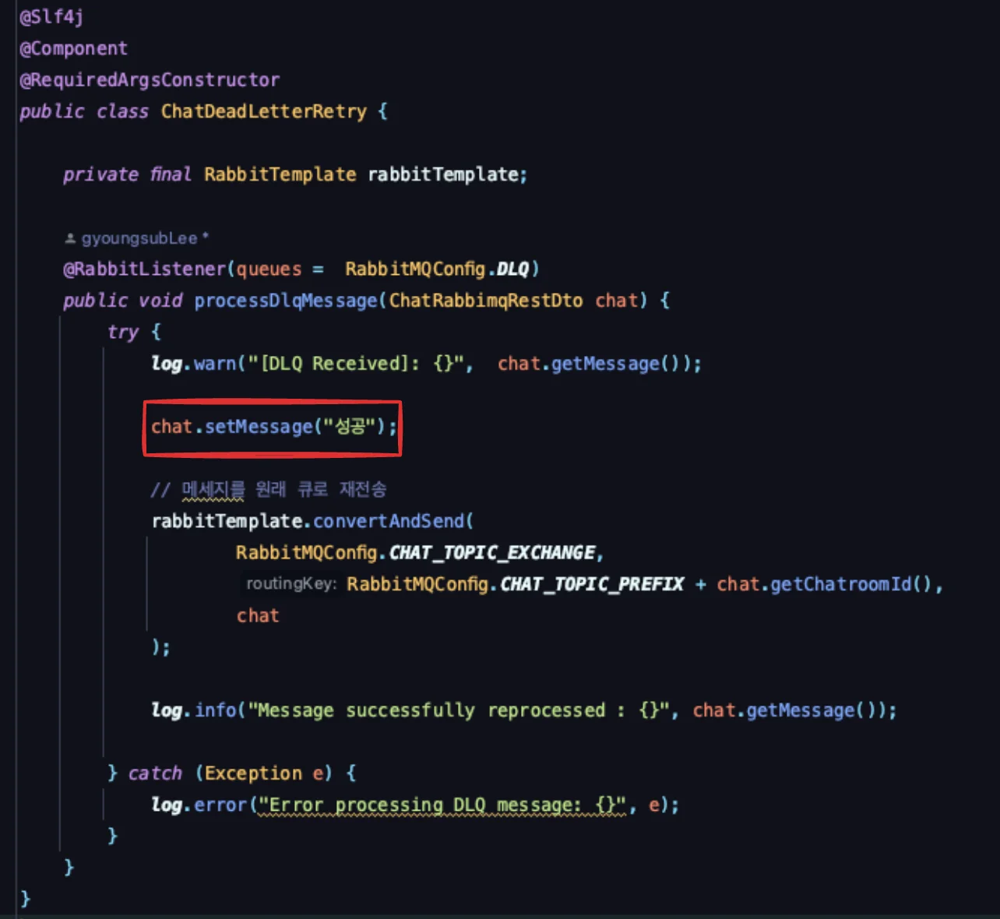

    <a id="192eda9b0fe180c9b9d6f2f4ad5eadcd"></a>

    Dead Letter Queue로 이동한 실패 케이스의 메세지를 정상처리 되도록 수정하여 requeue 처리 하였습니다&#46; 

- 클라이언트 성공 메세지 전송 화면 
    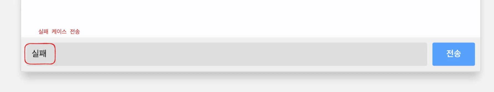

    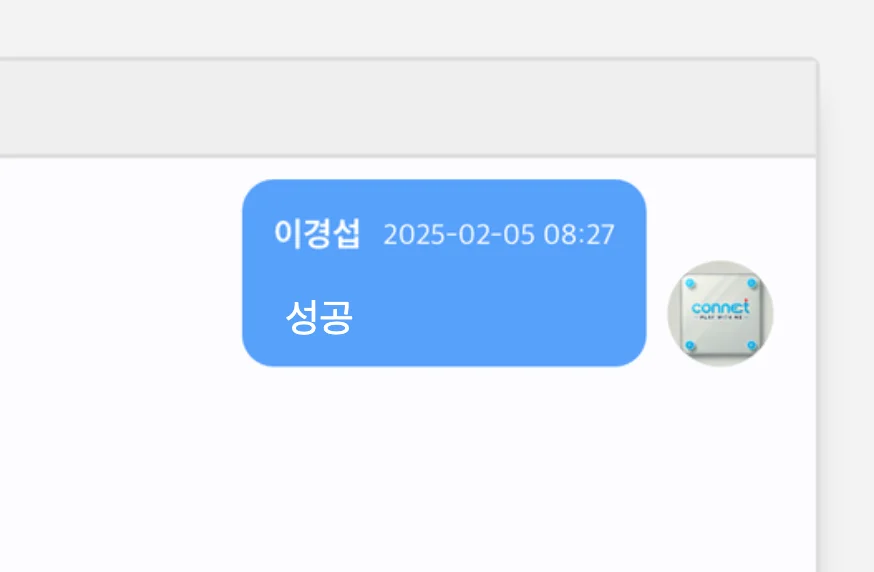

    - 위와 같이 실패 케이스(‘실패’)를 3번의 재시도 후, Dead Letter Queue로 이동 성공 케이스(’성공’)로 변경 후, 정상 처리하는 것을 확인할 수 있었습니다&#46;
