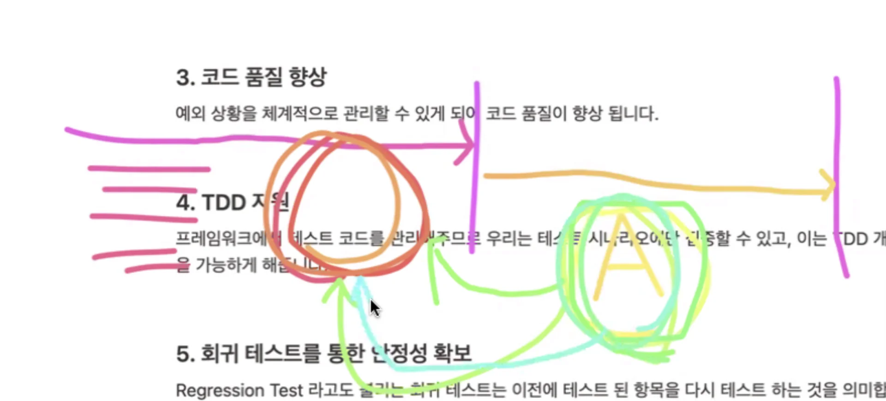

<details>
<summary>Reference</summary>

<a id="154eda9b0fe180439513f01cf5b08820"></a>

<a href="https://beautiful-college-c84.notion.site/7fe3f99376cf4455994c707b5ff21f77">페이지</a> 

<a id="154eda9b0fe1805aaedddc80a0e5ddf0"></a>

‣

<a id="154eda9b0fe180c6949fe5942b5919a4"></a>

‣

<a id="154eda9b0fe180b9a039fff66673264a"></a>

‣

<a id="154eda9b0fe180f4a4c0dc4382f68cb0"></a>

‣

</details>

<a id="151eda9b0fe1805796c2c128675e3f6d"></a>

### QA분들의 도움이 필요하다&#46; 

<a id="151eda9b0fe1808a87a1ffc4fecb318d"></a>

테스트를 통해 다음과 같은 이득을 얻을 수 있다&#46;

- 코드의 신뢰성 보장

- 버그 조기 발견

- 리팩토링, 확장 시 안전성 보장

- 사용자에게 시스템에 대한 신뢰도 확보

- 멱등성 

<a id="151eda9b0fe1809c820bf09815ef1e9f"></a>

### 긴급 점검 뜨면 열받는다&#46; 

<a id="151eda9b0fe180cf9dd6d7ed102dae45"></a>

크라우드 스트라이크 회사서

<a id="151eda9b0fe180bfbb19d128b36d98cd"></a>

## 테스트 

<a id="151eda9b0fe1807da170d2abd7661734"></a>

매번 if &#45; else 문으로 검사를 하면 하드코딩이며, 

<a id="151eda9b0fe1800bae02ece1ceb7750c"></a>

## JUnit<br>

<a id="154eda9b0fe180b5aff5e53c61e3e74e"></a>

# 테스트 프레임워크

---

<a id="151eda9b0fe1805a8ee3efeb93bb5b89"></a>

### 1&#46; 테스트 자동화 

<a id="154eda9b0fe180138409ed0fae501349"></a>

앞서 살펴본 예와 같이 테스트 케이스가 많아지는 경우 관리 

<a id="151eda9b0fe1803eaea1fb8de94dcc22"></a>

### 2&#46; 테스트 결과의 신뢰성 

<a id="151eda9b0fe180b1a9fcdaeba20750ca"></a>

### 3&#46; 코드 품질 향상

<a id="151eda9b0fe180a4a2fcdcb38ee93640"></a>

예외 상황을 체계적으로 관리할 수 있게 되어 코드 품질이 향상된다&#46; 

<a id="151eda9b0fe18063982edd5c39a4fa70"></a>

### 4&#46; TDD 지원

<a id="151eda9b0fe180fa91f5d5efb73246e5"></a>

프레임워크에서 테스트 코드를 관리해주므로 테스트 시나리오에만 집중할 수 있고, 이는 TDD 개발을 가능케 한다&#46; 

<a id="151eda9b0fe180d9a237ff732faeff93"></a>

### 5&#46; 회귀 테스트를 통한 안정성 확보

- 실제 회사에서 가장 중요함

<a id="151eda9b0fe180448cc0ed63b1382192"></a>

지난 번에 배포한 버전을  

- 신규 기능 &#124; 원래 기능 &#124; 새로 기능 A
    - 기존의 기능을 건드린 개발

    - 기존의 테스트를 통과한 부분도 다시 테스트 한다&#46; 

    - 
        

<a id="151eda9b0fe18007b99ffd0801d26f23"></a>

## 회귀 테스트 과정

---

<a id="151eda9b0fe180b58f5dcc8492aae4e3"></a>

예전에는 사람이 직접 했다&#46; 

<a id="151eda9b0fe18069ba3cdcaf08448106"></a>

이를 매번 하는 것은 매우 번거롭고, 힘들다&#46;

<a id="151eda9b0fe180af9682c371c9878c28"></a>

Junit은 테스트 자동화를 통해 매번 회구 테스트를 실행할 수 있다&#46; 

- 물론 사람이 시나리오를 잘 짜야한다&#46; 

<a id="151eda9b0fe1807e92decdc4769c739a"></a>

### 6&#46; 표준화된 테스트 방식 제공

<a id="151eda9b0fe1804892ffdeb4302d52e3"></a>

개발자마다 각자의 테스트 방식을 사용하면 협업이나 유지보수가 쉽지 않습니다&#46; 

<a id="151eda9b0fe180c2aa39c6347b411715"></a>

JUnit은

<a id="151eda9b0fe180799e63d7d10b6cc84b"></a>

### Junit 버전&#33; 체크 아주 중요

<a id="151eda9b0fe18048a606d6dce8322177"></a>

<strong>JUnit 4 와 JUnit 5는 서로 호환되지 않는다&#46; </strong>

> 스프링부트 3&#46;X를 쓰고 있으면 JUnit 5기본이다&#46; 

- 회사가면 레거시 코드도 많이 사용하기 때문에, 버전4도 사용법을 알아야 한다&#46; 

<a id="151eda9b0fe1808a9888d6a595cb977d"></a>

버전이 많다, 잘 체크해야 한다&#46; 

<a id="151eda9b0fe180bba697ebc8ea7bbb7b"></a>

assert 시리즈가 패키지마다 여러개 있다&#46; 

<a id="151eda9b0fe18073a792f85290c16b70"></a>

어떤 부분이 익숙한지 잘 알아햐 한다&#46; 

<a id="151eda9b0fe1802a8341d1f7c662790f"></a>

내가 쓰는 패키지가 정확하게 뭔지 잘 인지해야 한다&#46; 

<a id="151eda9b0fe180b8a2b7d426a2f66519"></a>

## BDD, TDD

---

<a id="151eda9b0fe180a1b882c0bf57b5782b"></a>

Test Driven Development

<a id="151eda9b0fe180f3be4ec47dc6270905"></a>

### 1&#46; Red&#58;  실패하는 테스트 작성

<a id="151eda9b0fe1802cac7cca6281203292"></a>

```java


```

<a id="151eda9b0fe180bcb005e3880ebff95d"></a>

테스트 코드 작성 시 단위 테스트를 잘 작성해야 한다고 많이 들었는데,<br>여기서 단위는 하나의 API라고 정의해도 되나요?

<a id="151eda9b0fe180959cb6e8c6ed99a02e"></a>

## Mock

---

<a id="151eda9b0fe180c58b0ed7c5b5e8f0c6"></a>

테스트 시에만 사용할 가짜 객체(Fake Object)이다&#46; 

<a id="151eda9b0fe180909e4de28db3f2b90d"></a>

테스트 하려는 메서드는 반드시 public이어야 하는데

<a id="151eda9b0fe180ceac79e012e0584397"></a>

아주 가끔 private 메서드를 테스트할 경우가 있다&#46; 

<a id="151eda9b0fe1800f8df4d5b5aa27dacb"></a>

→ 

<a id="151eda9b0fe180b88a6ed0771e8eb12b"></a>

→ Mockit는 JUnit5, 최신 버전 자바와 호환성이 좋고, 또한 스프링 부트의 기본 라이브러리로 들어있기 때문에  Mockito를 사용하는 것이 좋다&#46; 

- 리플렉션 유틸, 스프링에서 자동으로 제공해준다&#46;

- 과거에 PowerMock을 많이 썻다, 레거시 코드를 보면 PowerMock으로 테스트를 작성한 부분을 인지해야한다&#46; 

<a id="151eda9b0fe180a0babff1c90d915bef"></a>

단순 CRUD만으로는 

<a id="151eda9b0fe18095a43ffcf75e108145"></a>

## 테스트 주의 사항

---

<a id="151eda9b0fe180d59829ef2a3489ff81"></a>

### 1&#46; <u>실제 DB</u>에 <u>데이터를 삽입, 삭제 변경하지 말 것</u>

<a id="154eda9b0fe1806c8f76ccd304196c2e"></a>

테스트 코드에 의해서 실제 데이터가 조작된다면 그것 곧 장애가 된다&#46; 

<a id="154eda9b0fe1804aafcdfe485ecd58db"></a>

따라서 테스트 코드에서 실제 DB 데이터를 조작하는 행위를 해서는 안된다&#46; 

<a id="154eda9b0fe180008ec3c5117047e1b5"></a>

이를 위해서 우리는 Mock 객체를 사용하여 실제 DB에 영향이 가지 않도록 작성한다&#46; 

- DB의 데이터를 저장하는 <code>save()</code>의경우, 테스트 하지 않는다&#46; 
    - 운영 데이터가 변경되어 문제가 생길 수 있다&#46;

<a id="151eda9b0fe180b38d2ddf30423a1a29"></a>

### 2&#46; 외부 시스템과 <u>의존성을 가지지 말 것</u>

<a id="154eda9b0fe18003a8a9c06f9328f3be"></a>

외부 APi를 호출하여 그 결과를 바탕으로 테스트를 구현해두었다면,

<a id="154eda9b0fe18000b272f40b8c0c814e"></a>

네트워크 문제나 외부 API 서버의 장애 상황으로 인해 테스트 코드가 영향으로 테스트 실패

<a id="154eda9b0fe1809ea108dfeecf950848"></a>

이 때도 역시나 외부 API는 Mock 객체로 선언하여 테스트 케이스에 맞는 결과를 반환하는 세팅해야 한다&#46; 

<a id="151eda9b0fe180618fb5f4d3c23916b3"></a>

### 3&#46; 운영 환경에 절대 배포 금지

<a id="154eda9b0fe18032ab95ec6fd5adfff5"></a>

1번과 비슷한 내용으로 테스트 코드가 운영 환경에 실행되면 데이터 삭제나 변경으로 인해 장애를 유발 할 수 있습니다&#46; 테스트 코드는 반드시 별도의 테스트 환경에서 실행되도록 설정되어야 한다&#46; 

<a id="154eda9b0fe180caa610de59d7279f34"></a>

최근에는 이 문제를 해결하기 위해 Docker, H2 Database 활용하기도 한다&#46; 

<a id="151eda9b0fe1805dbf59c7d288d037c8"></a>

### 4&#46; 테스트 간 공유 리소스 사용 금지

<a id="154eda9b0fe18082afe0c26d83ddb19c"></a>

여러 테스트가 동일한 리소스(DB, 캐시 등)를 공유하면, 테스트 실행 순서에 따라 결과가 달라질 수 있다&#46; 

<a id="154eda9b0fe1803c8fa1fee2191be5e7"></a>

따라서 하나의 테스트 메서드의 실행은 독립된 작업으로 진행되어야 한다&#46; 

<a id="154eda9b0fe1803da287e2a711e40f69"></a>

이는 테스트 코드에 &#64;Transactional 어노테이션을 적용하여 해결 할 수 있습니다&#46;

<a id="154eda9b0fe180a598dbe275c0db23c2"></a>

테스트 메서드에 적용된 &#64;Transaction은 테스트 완료 후 자동 롤백을 시켜줍니다&#46; 

<a id="154eda9b0fe1807aa3e8c1555e618195"></a>

다만 앞서 업급한대로 가능한 DB를 조작하는 테스트는 만들지 않는 것이 좋다&#46; 

<a id="151eda9b0fe180cba025ec112ce0c29e"></a>

### 5&#46; 테스트를 위해 private를 public으로 변경 금지

<a id="154eda9b0fe180b293e7cba7cdfa2daf"></a>

private 메서드는 캡슐화에 의해 내부 구현을 감추기 위해 사용하는 것이다&#46;

<a id="154eda9b0fe180b2b059f27b56813495"></a>

이는 <u>해당 메서드를 의도적으로 숨기는 것</u>으로, 테스트를 위해 <code>public</code> 변경하는 것은 지양해야 한다&#46; 

<a id="151eda9b0fe180c9a968f1d150e43a1c"></a>

### 추가 학습 키워드

- 단위 테스트, 통합 테스트

- FIRST 원칙

- Right &#45; BICEP

- CORRECT 조건

<a id="151eda9b0fe180078d85d1146d0b6bc3"></a>

### 질문

---

<a id="151eda9b0fe18083a331fd311f709a82"></a>

독립적인 단위는 각 api의 비지니스 로직 단위 인가요? 아니면 특정 메서드 단위인가요?

- 메소드 단위라고 보시면 됩니다&#46; &#64;Transactional과 같은 어노테이션으로 독립적인 수준으로 처리할 수 있습니다&#46;

<a id="151eda9b0fe180c8aae3d5e676b6c9f8"></a>

<br>
