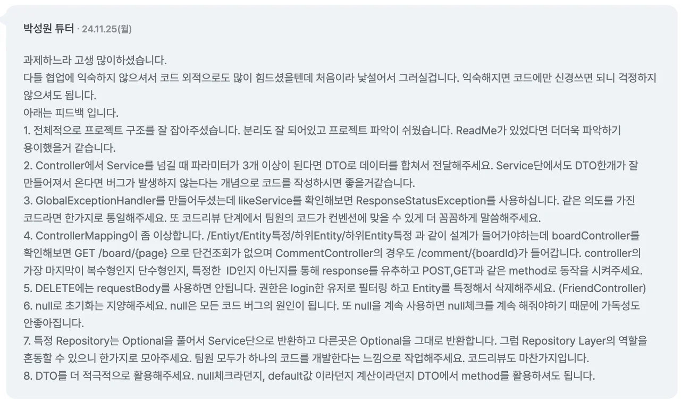

- 파라미터 데이터 3개 이상 사용 → DTO가 더 권장된다&#46; 
    - Service 단에서도 DTO 한개가 잘 만들어져 온다면 버그 가능성이 낮아진다&#46; 

    - 파라미터 순서에 따라 변수에 잘못된 데이터가 할당될 수 있다&#46;

- HTTP 리소스 설계
    - <code>/Entity/Entity특정/하위Enity/하위Entity특정</code>

    - 복수형, 단수형, 특정한 ID 등을 통해 reponse를 추측한다&#46;  따라서 컨벤션으로 잘 논의해야 한다&#46; 

- 컨벤션 맞추기
    - Exception

    - 리소스 명칭

    - Optional 처리

- null 초기화 지양
    - null은 모든 코드 버그의 원인이 된다&#46;

- README 작성하기
