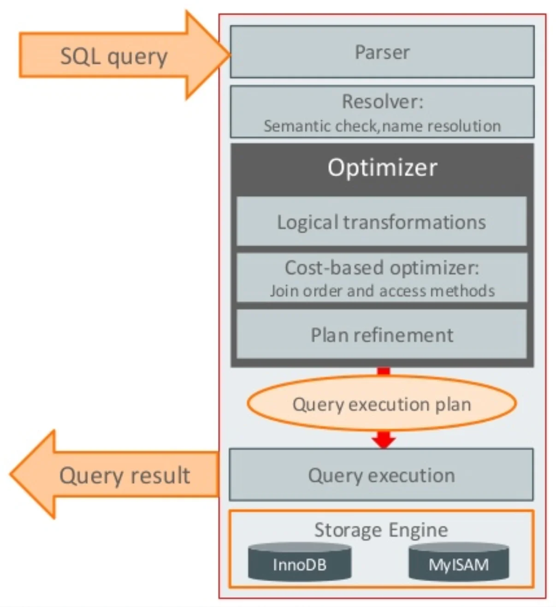
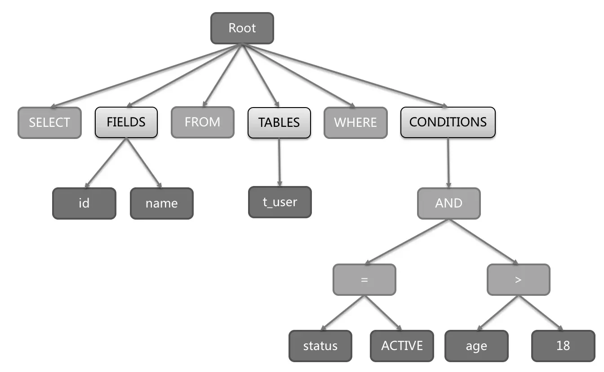
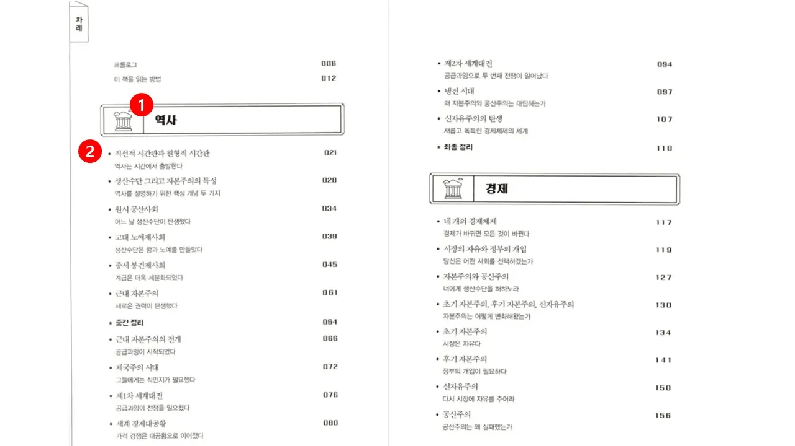
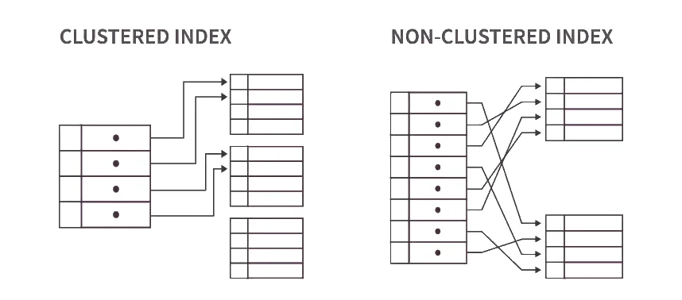
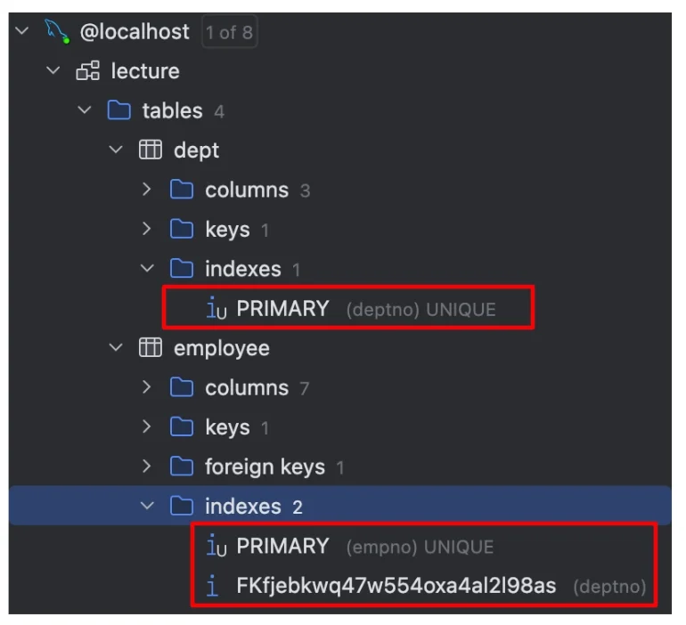

> 📌 
> 
> <a id="152eda9b0fe181188c59c07d6f4b1234"></a>
> 
> CS 특강 &#45; 제목
> 
> - 진행&#58; 이태현 튜터님
> 
> - 기간&#58; 24&#46;12&#46;04(수) 
> 
> - 자료&#58; <a href="https://beautiful-college-c84.notion.site/b23145b3d0404a378f0ec096d42e410f">페이지</a> 
>     [[241204]  CS특강 - 데이터베이스 [이태현 튜터님]](#/post/18feda9b-0fe1-80af-8268-ca01e5bfd882)

<a id="152eda9b0fe1809bb082f7e9fe64de1b"></a>

## 1&#46;  SQL 실행 절차

---

> 📖 
> 
> <a id="24aeda9b0fe180968f87ff2401a59465"></a>
> 
> SQL은 아래와 같은 <strong><u>SQL 실행 절차</u></strong>를 거처 해석되고 출력된다&#46;

<a id="24aeda9b0fe180f8b132e999e213c95f"></a>

### DB 내부 실행 절차



1. <code>Parser</code>
    

    - <u>쿼리 문장을 쪼개</u>서 <u>MySQL이 이해할 수 있</u>도록 <u>세분화</u>하여 tree 형태로 만든다&#46;

1.  <code>Resolver</code>
    - 쪼개진 문장을 체크한다&#46;

1.  <code>Optimizer</code>
    - tree를 탐색하며 무슨 테이블을 읽을지, 조건은 무엇인지, 어떤 인덱스를 사용할지 혹은 사용하지 않을지 선별하여 최적화 시킨 후 실행 계획을 만든다&#46; 

1. <strong><code>Query execution</code></strong>
    - 최적화된 실행 계획을 기반으로 스토리지 엔진으로부터 데이터 가져온다&#46; 

<a id="158eda9b0fe180189190ea331f469688"></a>

### 쿼리 실행 절차

> ✏️ 
> 
> <a id="152eda9b0fe1809999b8e3687e61848e"></a>
> 
> 실제로 쿼리가 수행되는 절(Clause) 단위 수행 절차는 아래와 같다&#46;

<a id="152eda9b0fe180c9ad3ee49dd1db272f"></a>

```sql
5.  SELECT department_id, 
       COUNT(*) AS employee_count, 
       AVG(salary) AS average_salary
1.  FROM employees
2.  WHERE
       hire_date >= '2020-01-01' 
       AND status = 'ACTIVE'
3.  GROUP BY department_id
4.  HAVING COUNT(*) > 5
6.  ORDER BY average_salary DESC
7.  LIMIT 10;
```

| <strong>순서</strong> | <strong>절(Clause)</strong> | <strong>설명</strong> |
| --- | --- | --- |
| <strong>1</strong> | <code>FROM</code> | 주 테이블 선택합니다&#46; |
| <strong>2</strong> | <code>WHERE</code> | 기본 데이터를 필터링합니다&#46; |
| <strong>3</strong> | <code>GROUP BY</code> | 기본 데이터를 집계합니다&#46; |
| <strong>4</strong> | <code>HAVING</code> | 집계된 데이터를 필터링합니다&#46; |
| <strong>5</strong> | <code>SELECT</code> | 최종 데이터를 반환합니다&#46; |
| <strong>6</strong> | <code>ORDER BY</code> | 최종 데이터를 정렬합니다&#46; |
| <strong>7</strong> | <code>LIMIT</code> | 반환되는 데이터를 행 수로 제한합니다&#46; |

<a id="158eda9b0fe1805b89bad60ecc16e4ab"></a>

## 2&#46; Index ( 인덱스 )

---

> 📖 
> 
> <a id="bcd1cc458de2466fbcde91165037d62a"></a>
> 
> <strong><code>Index(인덱스)</code></strong>는 <u>데이터베이스에 저장된 테이블 레코드를 빠르게 탐색하기 위한 자료구조</u>를 말한다&#46; 
> 
> - 레코드를 빠르게 탐색할 수 있는 이유는 <u>미리 </u><strong><u><code>정렬</code></u></strong><u>이 되어있기 때문</u>이다&#46;
> 
> - 반면 <strong><u>record의 쓰기(생성, 수정, 삭제)이 일</u></strong>어나면 <strong><u>재정렬</u></strong><strong>하거나 </strong><strong><u>인덱스를 추가</u></strong>해주는 작업이 필요하기 때문에 <strong><u>오히려 성능이 떨어질 수 있</u></strong>다&#46;
> 
> - 따라서 무계획적인 인덱스 생성 보다는<strong> </strong><strong><u>SQL문을 효율적으로 작성 한후 인덱스 사용을 고려</u></strong>해야 한다&#46; 

> ✏️ 
> 
> <a id="24aeda9b0fe18038ae2ed1218ba4eb2b"></a>
> 
> 우리가 책에 내용을 찾을 때 순서대로 나열된 목차를 보고 내용을 찾듯이<br>데이터베이스도 <strong><u>레코드를 검색할 때 index를 통해 찾</u></strong>게 되면 <strong><u>더 빠르게 찾</u></strong>을 수 있다&#46;<br>  →  검색(조회)이 빨라진다&#46;
> 
> 

<a id="338eda9b0fe18033bc50c35f7a4b6ebf"></a>

### Index 종류

<a id="338eda9b0fe1808696d7c6ef1de6c903"></a>

### CLUSTERD INDEX, NON&#45;CLUSTERD INDEX



|  | <strong>Clustered Index</strong> | <strong>Non&#45;Clustered(Secondary) Index</strong> |
| --- | --- | --- |
| 스토리지 | <strong><u>데이터 행은 인덱스와 동일한 순서로 정렬되고 저장됨</u></strong> | <strong><u>인덱스 행과 데이터 행은 별도로 저장</u></strong> |
| 주요 칼럼 | 일반적으로 <code>고유한 열</code> <br>(primary key) | 쿼리에서 자주 사용하는 <code>모든 열 가능</code> |
| 크기 | <strong><u>모든 데이터 행</u></strong> | <strong><u>인덱스 키 값, 데이터 행에 대한 포인터</u></strong> |
| 변경 | 기본 키 열이 변경되면 전체 인덱스를 다시 작성 | 영향을 받는 인덱스 페이지만 업데이트 |
| 성능 | 순차적 데이터의 <code>광범위한 검색</code>을 하는데 더 빠름 | <code>소규모 데이터 집합을 검색</code>하거나 데이터를 정렬하고 집계하는 데 더 빠름 |
| 주 사용처 | <code>primary key</code>, <code>foreign key</code> | <code>unique key</code>, <code>일반적인 index</code> |



- 기본적으로 <strong><code>PK</code></strong>, <strong><code>FK</code></strong>, <strong><code>UK</code></strong>의 경우 index를 자동 생성

<a id="338eda9b0fe180e39897ed6847494796"></a>

### <strong>Covering Index </strong>

<a id="338eda9b0fe180dd813ec80c4c2f869b"></a>

### 

<a id="158eda9b0fe18017b71ecb95edf24f6b"></a>

### 

<a id="24aeda9b0fe18098b7e3fbd7400207ac"></a>

하나, 하나 인덱스를 적용하는 것이 아닌, 복합적인 형태로 인덱스를 적용하느 경우가 훨씬 많다&#46; 

<a id="24aeda9b0fe18065ae9cdca8d714f9b7"></a>

→ 복합 인덱스

<a id="24aeda9b0fe180f4a12ae7f507abba1d"></a>

3개 이상의 컬럼을 사용한 복합 인덱스는 지양해야 한다&#46; 

<a id="24aeda9b0fe1800da905d75c4327604c"></a>

중복이 되지 않게 인덱스를 지정해주는 것이 중요하다&#46; 

<a id="24aeda9b0fe18016adaff65353c4cf25"></a>

인덱스에 실제 대입하는 값을 

<a id="24aeda9b0fe180d9b20cdbc4bd223745"></a>

직접 변경이 아닌 주입 변경을 해야 인덱스를 찾을 수 있다&#46; 

<a id="152eda9b0fe18042b943c204a71f5285"></a>

## 3&#46;   데이터 검색

---

<a id="152eda9b0fe180bfb45ee1d2346e9a42"></a>

옵티마이저가 읽어야 하는 레코드(행)이 20 &#126; 25% 가 넘어가면, 테이블을 직접 읽는 것이 효율적이라 생각하여 

<a id="152eda9b0fe18023b7fdc377e2bfed93"></a>

full scan을 통해 전체 데이터를 조회하여 가져온다&#46; 

<a id="152eda9b0fe180b48b8ad0d0aeaae1da"></a>

### 1&#46; Full Table Scaen ( 지양 )

<a id="152eda9b0fe180aebaa1e7e71407572c"></a>

index나 where 조건으로 조건으 명시하지 않는 경우, 테이블 전체를 가져와 탐색한다&#46;  → 비효율적

<a id="152eda9b0fe18073b256dba55cbfba04"></a>

```sql
SELECT * FROM Employees;
```

<a id="152eda9b0fe180e69d61c55103f90092"></a>

<br>

<a id="152eda9b0fe180fbb0a9e8f7c078b74f"></a>

### 2&#46; Full Index Scan

- Full Index Scan 은 인덱스의 모든 엔트리를 순차적으로 읽는 방법이다&#46; 
    <a id="152eda9b0fe180ada523e7be63fb2ee6"></a>

    테이블 전체를 읽는 것 보다 빠를 수 있지만, 여전히 인덱스의 모든 항목을 읽어야 하기 때문에 비효율적이다&#46; 

<a id="152eda9b0fe18087b457f20a214bf45f"></a>

### 3&#46; Full Range Scan

<a id="152eda9b0fe1807a8392f06226800b3a"></a>

조회 시 범위르 줄여서 가져오는 것이 성능적으로 중요하다&#46; 

<a id="152eda9b0fe180c49cadc9a2bd2838a7"></a>

### 4&#46; Index Unique Scan

<a id="152eda9b0fe18002b2ebec40ad7c66e4"></a>

유니크한 이퀄 값을 가져오는 게 가장 효율적이다&#46; 

<a id="152eda9b0fe18021a061e3180af0d716"></a>

### 6&#46; Index Skip Scan

<a id="152eda9b0fe1807bba9ff28a0ad81636"></a>

## 5&#46; SQL 실행 계획  ( MySQL&#46; ) 

<a id="152eda9b0fe180c192bbe3607b1ad9e1"></a>

## 6&#46; JOIN 방식

---

<a id="152eda9b0fe180be8bc4edcdb34e1b17"></a>

옵티마이저가 어떤 경우를 주 테이블로 할지는 실제 값을 찍어봐야 알 수 있는 경우가 많다&#46;

<a id="152eda9b0fe18087914fde75f5cf82a6"></a>

## 6&#46;1 Nested Loop Join ( 중첩된 루프 조인 )

---

<a id="152eda9b0fe18019860af9afd724b2ac"></a>

### 6&#46;2  Hash Join ( 해시 조인  )

[CS 특강 - 디자인 패턴 2 ( 정리 전 )](#/post/14beda9b-0fe1-8017-9a4e-c4161c8713a1)

[CS 특강 - 운영체제 ( 정리 중 )](#/post/164eda9b-0fe1-8045-8afa-f7f337b19a14)
