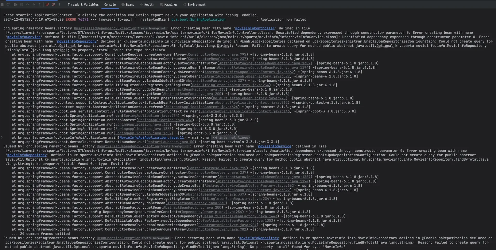
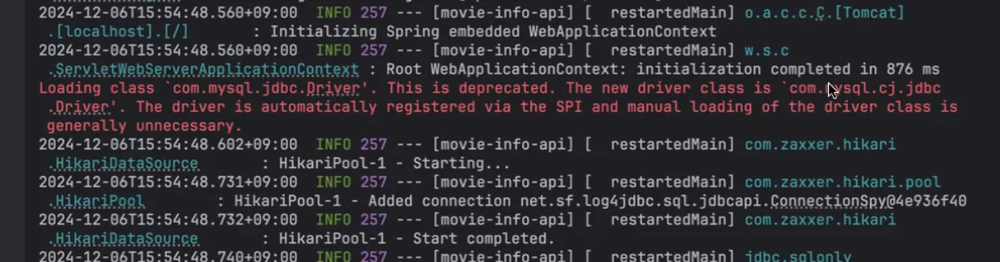
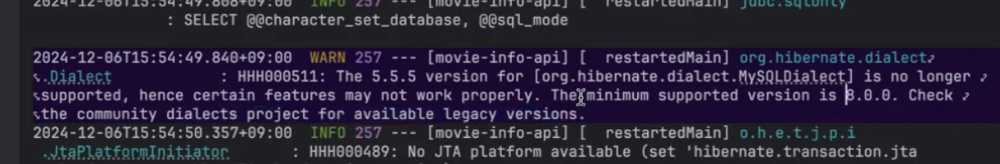
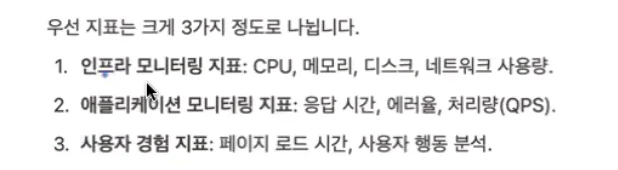

<details>
<summary>Reference</summary>

<a id="154eda9b0fe180c3bd94d6e77df7d640"></a>

<a href="https://beautiful-college-c84.notion.site/24f468ab7bc94bfdad449fcc918b5478">페이지</a> 

</details>

<a id="154eda9b0fe1801997fce123419cbceb"></a>

### 학습목표

---

- Log

- 모니터링

- 어떤 것들을 고려해야 하는지 알아본다&#46;

<a id="154eda9b0fe18053b9e4ed5c4fa3c8e8"></a>

## Log

---

> 📖 
> 
> <a id="aff5596c30db41b39ed386f47d9ef54b"></a>
> 
> Log는 과거 선박이 항해할 때 속도와 항로를 기록한 일지였다&#46;
> 
> 
> 
> <a id="154eda9b0fe18081a077cfdf489853d7"></a>
> 
> 이 기록에는 배의 현재 위치, 날씨, 항로, 그리고 주요 사건들을 포함하고 있었는데, <br>이에 유래하여 컴퓨터에서도 발생되는 모든 것에 대해 로그(기록)을 남긴다&#46; 
> 
> - <u>시스템 이벤트, 사용자 활동, 네트워크 트래픽, 프로그램 동작 </u>등 

<a id="154eda9b0fe18010ad95d612a465a509"></a>

로그는 매우 여러 형태로 기록이 되지만 대체적으로 아래와 같은 형태를 사용한다&#46; 

<a id="154eda9b0fe180df8b9cfca9c9c0a333"></a>

```groovy
2024-11-27 15:42:05, ERROR, Database connection failed
```

<a id="154eda9b0fe180abb0dbea3b867bdc8d"></a>

## Log의 중요성

---

<a id="154eda9b0fe1804cbc8edf812f27cf09"></a>

로그는 많은 정보를 우리에게 전달한다&#46; 

<a id="154eda9b0fe18091ae21d8f2449ab4de"></a>

일반적인 동작부터 오류가 발생했을 때, 단서가 될만한 많은 정보를 제공한다&#46;



<a id="154eda9b0fe180dca676c2f8e79ecc73"></a>

### 로그와 모니터링 

---

<a id="154eda9b0fe180beb32be0f31d150a8e"></a>

로그를 통해 디버깅을 할 수 있다&#46; 

<a id="154eda9b0fe18090b779d61401cfb5fd"></a>

모든게 다 정상인데, 

<a id="154eda9b0fe180909a45d5498a2e48ec"></a>

###  스프링에서의 log

---

<a id="154eda9b0fe1806dbfe5efd0bbcc94df"></a>

3개의 구현체가 있는데, 모두 다른 장단점이 있다&#46; 

<a id="154eda9b0fe18023a423f08a17fa1bf8"></a>

오픈 소스의 프레임워크를 사용 시, 항상 여러개의 장단점을 비교하여 

<a id="154eda9b0fe180bb9aaae48f42b7b3b7"></a>

스프링에서는 기본적으로 logback을 사용한다&#46;  

<a id="154eda9b0fe180b89f1ce586484b5c33"></a>

log4j2로 변경 시, 

<a id="154eda9b0fe180e4a1aefe9697ec0e47"></a>

유루

<a id="154eda9b0fe18024b7aeff633c3247c8"></a>

### Log 남기는 방법

---

- trace &#45; 구체적으로 봐야할
    - 키면 개발할 때 엄청 느려진다&#46; 

- debug &#45; 디버그 시에만 사용(출력)됨

- Info 정보성 추적

- warn &#45; 주의해야할 부분, 

- error &#45; 오류 발생 

- fatal &#45; 서버가 갔다&#46; 여유가 없다&#46;

<a id="154eda9b0fe1804b93eec2c561bf844a"></a>

### 출력 로그 레벨 변경

---

<a id="154eda9b0fe180f1934fdae17829cc5c"></a>

일반적으로 어떤 로그를 남기는 것이 좋은가?

---

1. 실패하는 상황의 로그
    - 앞서 살펴본 가상의 사례처럼 고객이 원인을 문의하는 경우가 잦다&#46; 

    - 따라서 이때 요청된 데이터를 로그로 남겨두면 문의가 왔을 때, 어떤 문제를 분석할 수 있는 자료가 된다&#46;

1. 실제로 발생하면 안되는 예외 상황의 로그 ( 정책 위반으로 인한 예외는 제외 )
    - 정책을 위반한 예외는 의도한 예외이므로 정상 케이스 이다&#46; 이런 경우 로그를 남길 필요가 없다&#46;

    - 하지만 진짜 발생하면 안되는 예외를 로그로 남기지 않으면 나중에 원인을 분석할 수가 없다&#46; 

1. Slow Query
    - 별도 DB 관리 팀이 없다면, 느린 쿼리에 대해 로그를 남겨야 한다&#46; 
        - ex) 3 &#126; 5초 이상 걸리는 경우 Slow Query

    - 슬포우 쿼리는 고객 겸험에 부정적인 영향을 주므로 이탏할 가능성을 높인다&#46; 
        - ex) 온라인 게임을 하는데 

1. 외부 서비스 호출 실패
    - API와 같은 외부 서비스 호출 실패도 로그를 남기는 것이 좋다&#46; 

    - 요즘은 MSA와 같은 구조가 흔하다&#46; MSA는 API 호출이 빈번하기 때문에 호출 실패 가능성이 상대적으로 높다&#46; API 호출은 통상적으로 1 &#126; 2회 정도 발생할 수 있지만, 만약 짧은 시간에ㅔ 호출 실패 

1. 잦은 문의 케이스
    - 고객들은 의외로 본인의 실수를 시스템의 장애라고 판단하는 경우가 굉장히 많다&#46; 

    - 예를 들어 ‘내

    - 실제로 이런 경우, 로그보다는 DB 데이터를 확인하는 편이다&#46; 

    - 다만, 이런 문의가 자주 되면, DB만으로 원인 파악이 어려운 경우 로그를 추가할 수 있다&#46;
        - 로그로 증빙 자료를 남길 수 있다&#46; 

        - 실제 고객 

<a id="154eda9b0fe1805ca877e5283e9c5abc"></a>

## Log 주의점

---

<a id="154eda9b0fe18090a074c114170e15af"></a>

### 1&#46; 로그도 리소스를 소비한다&#46; 

<a id="154eda9b0fe18090a6c1cbad22d3cd10"></a>

로그를 생성하는 작업은 역시나 CPU, 디스크 I/O 리소스를 소모하는 일이다&#46; 

<a id="154eda9b0fe180a3807ee62f80d6daee"></a>

그래서 실제로 테스트용 서버는 DEBUG, INFO 정도로 로그 레벨을 설정

<a id="154eda9b0fe18061a422cf612aac4ea2"></a>

### 2&#46; &#43; 대신 <code>,</code> 를 써라

<a id="154eda9b0fe1805c990cc073ada0f541"></a>

```groovy

```

> 🧐 
> 
> <a id="d479253d49a34c33b442cf33118b99e8"></a>
> 
> 플러스 연산이 메모리를 더 쓴다 &#46; new Plus<br>시간은 비슷하다&#46; 

<a id="154eda9b0fe180258839c55234d7d92d"></a>

### 3&#46; 민감한 데이터는 로그로 남기면 안 된다&#46; 

<a id="154eda9b0fe180c38b22ddca9b723afd"></a>

개인 정보와 같은 민간한 데이터는 로그로 남기는 경우 해킹에 의한 탈취 문제가 발생할 수 있다&#46; 

<a id="154eda9b0fe180db90b9c743f35628ca"></a>

꼭 해킹이 아니더라도 개인정보가 사라지지 않은 채로 로그로 남는다면 개인정보보호법에 의해 법적인 문제가 생길 수 있으니 주의해야 한다&#46; 

<a id="154eda9b0fe180c08b02d79f3829ca4f"></a>

### 4&#46; 불필요한 DEBUG, INFO 로그

<a id="154eda9b0fe180959015d67b7b18d93b"></a>

## Log를 잘 읽자&#46;

---

<a id="154eda9b0fe180b09e5cc688395b7397"></a>

## 

<a id="154eda9b0fe180a899a5c12bfdcd55ba"></a>

로그에 오류가 떳지만, 요청 시 정상 응답이 호출된다면 그냥 넘어가면 안된다&#46; 

- 내가 정의한 오류

- 스프링에서 기본적으로 정의한 오류 or 경고 (info<code>&#46;error</code>, info&#46;<code>warn</code>)

<a id="154eda9b0fe1805d9255ebe4db7a2957"></a>

숨겨진 폭탄과 같다&#46; 뜨면 바로 해결해야된다&#46; 

<a id="154eda9b0fe180b9847ff4d1f08268af"></a>

안 잡을 거면, 계획을 세우든지, 팀원들과 공유해야 한다&#46; 

- 잘 모르겠으면, 무조건 공유해야한다&#46; 





<a id="154eda9b0fe180789737dd9d59d1686a"></a>

# 모니터링

---

<a id="154eda9b0fe1802887e5c79a9a6edbb7"></a>

모나터링은 시스템이 잘 동작하고 있는지 각종 지표를 통해 지속적으로 관찰하는 것을 말한다&#46; 

<a id="154eda9b0fe18000b77fc382ac9709d1"></a>

특히나 베포 직후, 큰 이벤트나 프로모션 진행 시

<a id="154eda9b0fe1807d8580c964bb92dcee"></a>

## 모니터링 지표

---

- 백엔드에서는 3번은 다룰 일이 없다&#46; 



- 애플리케이션 모니터링 지료&#58; 응답 시간, 에러율, 처리량(QPS)

<a id="154eda9b0fe18096a6b4e6378994491f"></a>

### 모니터링 툴

---

<a id="154eda9b0fe180daa9edf97d503ebaf0"></a>

APM, 시각화 플랫폼

<a id="154eda9b0fe18058b888c483b91b15f9"></a>

서버 인프라 모니

<a id="154eda9b0fe180159b64dd85ec26df99"></a>

시각화 모니터링에는 물리적인 서버의 지표를 확인할 수 있다&#46; 

<a id="154eda9b0fe180738c88d79597a9552e"></a>

에러 로그를 보통 슬랙이랑 연동해서 뿌려줄 수 있다&#46; 

<a id="154eda9b0fe180a691eadbcd3e209c80"></a>

APM 의 경우 애픞리
