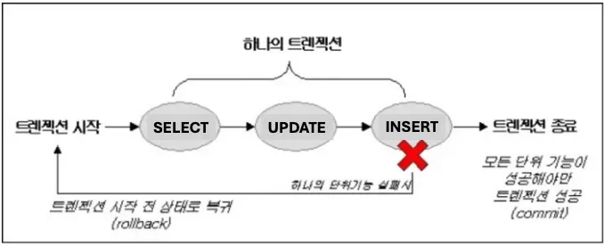
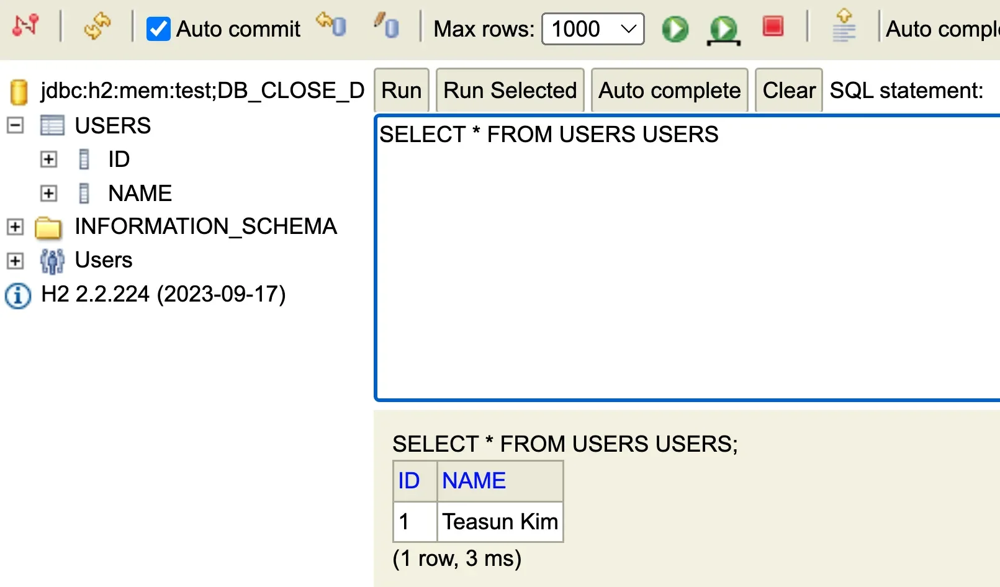

<a id="158eda9b0fe1813ca200dde1b509bbb4"></a>

## SQL

---

> 📖 
> 
> <a id="158eda9b0fe181c18822c1cb8bcfa6a0"></a>
> 
> SQL은 데이터베이스 시스템을 조작하는 데 사용하는 언어이다&#46; <br>SQL은 <code>DDL</code>(데이터 정의 언어), <code>DML</code>(데이터 조작 언어), <code>DCL</code>(데이터 제어 언어)로 나뉜다&#46;

<details>
<summary><code>DDL</code> &#45; 테이블 조작</summary>

- <code>CREATE TABLE</code> &#45; 테이블 생성

- <code>ALTER TABLE</code> &#45; 테이블 수정

- <code>DROP TABLE</code> &#45; 테이블 삭제

</details>

<details>
<summary><code>DML</code> &#45; 데이터(컬럼) 조회</summary>

- <code>SELECT</code>&#58; 조회
    - <code>WHERE</code>&#58; 특정 조건을 만족하는 데이터 설정

    - <code>ORDER BY</code>&#58;  순서대로 정렬

    - <code>GROUP BY</code>&#58; 특정 컬럼으로 그룹지어서 표현

    - <code>JOIN</code>&#58; 테이블 합침

</details>

<details>
<summary><code>DML</code> &#45; 데이터(레코드) 삭제 및 제거</summary>

- <code>INSERT INTO</code>&#58; 새로운 데이터(레코드) 추가

- <code>UPDATE</code>&#58; 기존의 데이터(레코드) 수정

- <code>DELETE FROM</code>&#58; 기존의 데이터(레코드) 제거

</details>

<a id="158eda9b0fe18032936df45fa347858d"></a>

## 트랜잭션

---

> 📖 
> 
> <a id="b532e0b5339d4dc9829b8c2ace551eb9"></a>
> 
> 트랜잭션은 데이터베이스의 상태를 변화시키기 위해서 수행하는 작업 단위를 말한다&#46; 

<details>
<summary>트랜잭션</summary>



<a id="158eda9b0fe180e68d92c1b2ec34c8c4"></a>

데이터들을 <u>조회 및 생성/수정/삭제</u> 후 최종 결과값이 수행되기까지의 하나의 작업을 트랜잭션으로 관리하며,<u> 중간 과정 중 문제가 발생</u>하면 해당 과정을 처음으로 되돌려(<code>rollback</code>)하여 오류가 발생되 값이 DB에 반영되는 것을 막도록 해준다&#46; 

</details>

<details>
<summary>트랜잭션의 3가지 특징</summary>

- <strong><code>원자성  (All or Nothing)</code></strong>
    - 트랜잭션이 데이터베이스에 모두 반영되거나, 아에 반영되지 않아야 한다&#46; 
        - 오류가 발생되는 경우, rollback 처리 

    - 트랜잭션은 <strong><u>사람이 설계한 논리적인 작업 단위</u></strong>로서, 일처리는 작업단위 별로 이루어져야 사람이 다루는데 무리가 없다&#46;

    - 만약 트래잭션 단위로 데이터가 처리되지 않는다면, 설계한 사람은 데이터 처리 시스템을 이해하기 힘들 뿐만 아니라, 오작동 했을 시 원인을 찾기가 매우 힘들다&#46; 

- <strong><code>일관성 (Keeps Data Correct)</code></strong>
    - 트랜잭션의 작업 처리 결과는 항상 일관성이 있어야 한다&#46; 

    - 트랜잭션이 진행되는 동안은 그 사이 DB가 변경되어 업데이트가 되어도, 처음 트랜잭션 시작 시 참조한 DB로 진행되어야 한다&#46; 
        - 입금 • 송금 같은 경우, 어떻게 숫자 값을 유지하지? 

        - 송금 도중 입금이 되어 계죄의 잔액이 늘어난 경우, 트랜잭션을 중간에 업데이트 해야하지 않나?

- <strong><code>독립성 (Independent)</code></strong>
    - 둘 이상의 트랜잭션이 동시에 실행되고 있는 경우, <strong><u>한 트랜잭션이 다른 트랜젝션의 연산에 끼어들 수 없</u></strong>다&#46;

</details>

<a id="158eda9b0fe180ddba59f4ac98cd9ef3"></a>

## <strong>트랜잭션 관리와 보안 (DCL)</strong>

---

> 📖 
> 
> <a id="e3ca1dd81f2d4f429daf309aeb5251c6"></a>
> 
> 잘못된 상태값(데이터)가 DB에 반영되는 것을 방지하기 위해  <strong><code>BEGIN</code></strong>, <strong><code>COMMIT</code></strong>, <strong><code>ROLLBACK</code></strong>으로 트랜잭션을 관리한다&#46;

<details>
<summary>트랜잭션 관리 &#45; <strong><code>BEGIN</code></strong>, <strong><code>COMMIT</code></strong>, <strong><code>ROLLBACK</code></strong></summary>

- <code>BEGIN</code>
    - <code>START TRANSACTION</code> 과 동일

    - 새로운 트랜잭션을 생성 및 시작

- <code>COMMIT</code>
    - 하나의 트랜잭션이 성공적으로 끝났고, 데이터베이스가 일관성있는 상태에 있을 때, <br>하나의 트랜잭션이 끝났다라는 것을 알려주기위해 사용하는 연산

    - COMMIT을 수행하면 트랜잭션의 작업이 로그에 확정 기록되며, <br>이후 ROLLBACK은 commit되지 않은 트랜잭션 단위로만 수행될 수 있도록 한다&#46;

- <code>ROLLBACK</code>
    - <strong>하나의 트랜잭션 처리가 비정상적으로 종료</strong>되어 <u>트랜잭션의 원자성이 깨진 경우,</u><br><strong><u>트랜잭션을 처음부터 다시 시작</u></strong>하거나, <strong><u>트랜잭션의 부분적으로만 연산된 결과를 다시 취소</u></strong>한다&#46;

</details>

<details>
<summary>접근 권한 설정 &#45; <strong><code>GRANT</code></strong><strong>,</strong> <strong><code>REVOKE</code></strong></summary>

- <strong><code>GRANT</code></strong>&#58; 사용자에게 권한을 부여

- <strong><code>REVOKE</code></strong>&#58; 사용자로부터 권한을 회수

</details>

<a id="158eda9b0fe1807abbd6d9c3b21ddaca"></a>

## 실습

---

<details>
<summary>간단한 쿼리 실습</summary>



<details>
<summary>테이블 생성 &#45; <code>DDL</code> </summary>

<a id="158eda9b0fe180db9e50c7ddd5ae3e9e"></a>

```sql
CREATE TABLE users (id SERIAL, name VARCHAR(255));

DROP TABLE users
```

</details>

<details>
<summary>데이터 추가 &#45; <code>DML</code> </summary>

<a id="158eda9b0fe180b38126c41247116485"></a>

```sql
INSERT INTO users (name) VALUES (?)
```

</details>

<details>
<summary>데이터 조회 &#45; <code>DML</code></summary>

<a id="158eda9b0fe180a5b892edd452a71bc3"></a>

```sql
SELECT name FROM users WHERE id = ?
```

</details>

<details>
<summary>데이터 수정 &#45; <code>DML</code></summary>

<a id="158eda9b0fe18041986ffaf6b022498b"></a>

```sql
UPDATE users SET name = ? WHERE id = ?
```

</details>

<details>
<summary>트랜잭션 커밋/롤백 &#45; <code>DCL</code></summary>

<a id="158eda9b0fe180259980fd450e658b19"></a>

```sql
COMMIT

ROLLBACK
```

</details>

</details>

<details>
<summary>복잡한 쿼리 실습</summary>

<details>
<summary>1&#46;  테이블 확장</summary>

<a id="158eda9b0fe180fca00fccdac1c593b1"></a>

기존 테이블

<a id="158eda9b0fe180c48005ec61374899e2"></a>

```sql
CREATE TABLE users (
    id SERIAL,
    name VARCHAR(255)
);
```

<a id="158eda9b0fe180b39288c13317976f3c"></a>

컬럼 추가

- email&#58; 사용자 이메일 주소

- created&#95;at&#58; 계정 생성 날짜

- status&#58; 계정 상태 ( 활성 / 비활성 )

<a id="5a145d7bafc2400d8b560213395ac1b1"></a>

```sql
ALTER TABLE users
ADD COLUMN email VARCHAR(255);

ALTER TABLE users
ADD COLUMN created_at TIMESTAMP DEFAULT CURRENT_TIMESTAMP;

ALTER TABLE users
ADD COLUMN status ENUM('active', 'inactive') DEFAULT 'active';
```

<a id="158eda9b0fe18097a1e5cc516d44913b"></a>

추가 테이블 생성

- orders&#58; 사용자 주문 정보 저장 테이블

- products 상품 정보 저장 테이블

<a id="d303e725e1b844269e4d1a5eb9d51657"></a>

```sql
CREATE TABLE products (
    id SERIAL,
    name VARCHAR(255),
    price DECIMAL(10, 2),
    PRIMARY KEY (id)
);

CREATE TABLE orders (
    id SERIAL,
    user_id BIGINT,
    product_id BIGINT,
    quantity INT,
    order_date TIMESTAMP DEFAULT CURRENT_TIMESTAMP
);
```

</details>

<details>
<summary>2&#46; 데이터 삽입</summary>

<a id="158eda9b0fe1803e9670c7d2035287de"></a>

users 테이블 &#45; 데이터 삽입

<a id="158eda9b0fe1803b9279ef7e325ff717"></a>

```sql
INSERT INTO users (name, email, status) VALUES
('Alice', 'alice@example.com', 'active'),
('Bob', 'bob@example.com', 'inactive'),
('Charlie', 'charlie@example.com', 'active');
```

<a id="158eda9b0fe180f7844ac88388f9fbf2"></a>

products 테이블 &#45; 데이터 삽입

<a id="7a76171a8b2e408e842412df912c2840"></a>

```sql
INSERT INTO products (name, price) VALUES
('Laptop', 1000.00),
('Phone', 500.00),
('Tablet', 300.00);

```

<a id="12b65d2ebba9492aaef871f1fff4fa0c"></a>

orders 테이블 &#45; 데이터 삽입

<a id="158eda9b0fe18039a6f9d739e70b4599"></a>

```sql
INSERT INTO orders (user_id, product_id, quantity) VALUES
(1, 1, 1),
(1, 2, 2),
(2, 3, 1),
(3, 1, 3);
```

</details>

<details>
<summary>3&#46; 쿼리 실습</summary>

<a id="158eda9b0fe18083a67ee57298fca9cb"></a>

<code>WHERE</code> 절 

<a id="158eda9b0fe180e98236e1ac3c37615e"></a>

활성 상태(<code>active</code>) 인 사용자만 조회

<a id="158eda9b0fe1805eb8fcdf5d69ef563a"></a>

```sql
SELECT * FROM users
WHERE status = 'active';
```

<a id="158eda9b0fe18077a66eedb39ed5ce29"></a>

 <code>JOIN</code>

<a id="1a3698d71e3448d8a1d70d32fd101c11"></a>

사용자, 주문 내역을 함께 조회

- JOIN … ON <code>FK =  PK</code>

<a id="0f7b83dad860470a87dd973087939510"></a>

```sql
SELECT users.name, orders.id AS order_id, products.name AS product_name, orders.quantity, orders.order_date
FROM orders
JOIN users ON orders.user_id = users.id
JOIN products ON orders.product_id = products.id;
```

<a id="158eda9b0fe1807f8123fe3ba6225ada"></a>

<code>GROUP BY</code>

<a id="48568c10493f486d85c117fc155ecd1c"></a>

사용자별 주문 개수 집계

<a id="0e9421da7bf44e75a9ce09ff0bdcb257"></a>

```sql
SELECT users.name, COUNT(orders.id) AS total_orders
FROM orders
JOIN users ON orders.user_id = users.id
GROUP BY users.name;
```

<a id="158eda9b0fe180fa99f6c757efd03963"></a>

<code>ORDER BY</code>

<a id="aa71cb3290f4458c96cb2247ee7c6a6f"></a>

사용자 이름으로 정렬하여 조회

<a id="b233bf15a9484fd193d37e93593d7a8a"></a>

```sql
SELECT * FROM users
ORDER BY name;
```

<a id="916181a825b64033a48d255036b80254"></a>

주문 내역을 주문 날짜 순으로 내림차순 정렬하여 조회

<a id="158eda9b0fe180c68ee8cb0b8cbfaa38"></a>

```sql
SELECT users.name, products.name AS product_name, orders.quantity, orders.order_date
FROM orders
JOIN users ON orders.user_id = users.id
JOIN products ON orders.product_id = products.id
ORDER BY orders.order_date DESC;
```

</details>

<details>
<summary>4&#46; 데이터 리셋 &#45; <code>TRUNCATE TABLE</code></summary>

<a id="158eda9b0fe1802a9ae2effb2b9aea90"></a>

```sql
TRUNCATE TABLE orders;
TRUNCATE TABLE products;
TRUNCATE TABLE users;
```

- 데이터 초기화를 원할 경우, 다음 쿼리로 테이블 내용을 지울 수 있다&#46;

</details>

<details>
<summary>5&#46; 추가 연습 문제</summary>

- 특정 날짜 이후에 생서된 계정을 가진 사용자 조회
    <a id="158eda9b0fe1802aa0a6ca0306ab1904"></a>

    ```sql
    SELECT * FROM users
    WHERE created_at > '2023-01-01';
    ```

-  각 사용자별 총 주문 금액 조회
    <a id="158eda9b0fe1807b863fce381f4ff695"></a>

    ```sql
    SELECT u.name, SUM(p.price * o.quantity) AS total_spen
    FROM orders o
    JOIN users u ON o.user_id = u.id
    JOIN products p ON o.product_id = p.id
    GROUP BY u.name;
    ```

</details>

</details>
