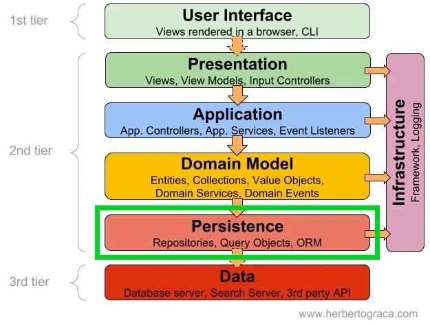
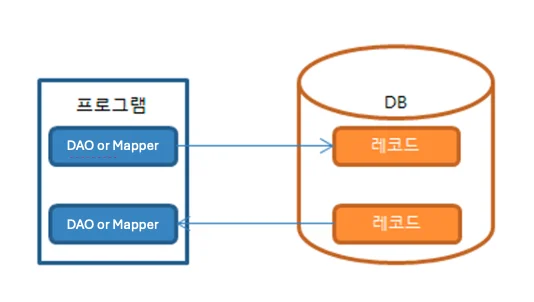
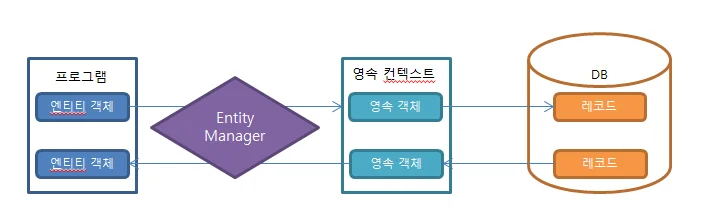
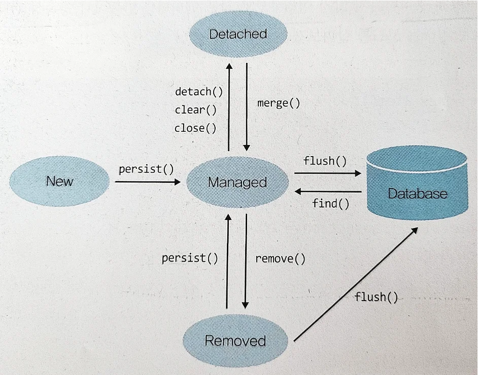

<a id="43acb78d821b4239be75f7e2a83343ce"></a>

## 쿼리 코드 만들기 (JpaRepository)

---

> 📖 
> 
> <a id="86211e2a07d04bab84421f399cc3dcf4"></a>
> 
> Annotation을 사용하여 SQL 쿼리를 클래스나 메소드에 직접 정의하는 방법을 배운다&#46;
> 
> <a id="338eda9b0fe1801ea72ece85cc19d0ce"></a>
> 
> 이를 통해 동적 쿼리 생성과 실행 과정을 이해한다&#46;

<a id="e5168f3cc81e43efbacd5db220934f00"></a>

### QueryMapper 의 DB의존성 및 중복 쿼리 문제 → ORM 탄생



- RM 은 DB의 주도권을 뺏어왔다고 표현해도 과언이 아니다&#46;

- ORM 은 DAO 또는 Mapper 를 통해서 조작하는것이 아니라 <strong>테이블을 아예 하나의 객체(Object)와 대응</strong>시켜 버린다&#46;
    - 객체지향(Object) 을 관계형 데이터베이스(Relation) 에 매핑(Mapping) 한다는건 정말 많은 난관이 있었다&#46; 

    - 해당 내용 아래에 다룬다&#46;

<a id="338eda9b0fe180ba835fe01605ed8998"></a>

### ORM 이 해결해야하는 문제점 과 해결책

<details>
<summary><strong>문제점1&#58; </strong><strong><code>상속</code></strong></summary>

- 문제점
    - 객체 &#58; 객체간에 멤버변수나 상속관계를 맺을 수 있다&#46;

    - RDB &#58; 테이블들은 상속관계가 없고 모두 독립적으로 존재한다&#46;

- 해결
    - 매핑정보에 상속정보를 넣어준다&#46;

    - <code>&#64;OneToMany</code>, <code>&#64;ManyToOne</code>

</details>

<details>
<summary><strong>문제점2&#58; </strong><strong><code>관계</code></strong></summary>

- 문제점
    - 객체 &#58; 참조를 통해 관계를 가지며 방향을 가진다&#46; (다대다 관계도 있음)

    - RDB &#58; 외래키(FK)를 설정하여 Join 으로 조회시에만 참조가 가능하다&#46; (즉, 다대다는 매핑 테이블 필요)

- 해결
    - 매핑정보에 방향정보를 넣어준다&#46;

    - <code>&#64;JoinColumn</code>, <code>&#64;MappedBy</code>

</details>

<details>
<summary><strong>문제점3&#58; </strong><strong><code>탐색</code></strong></summary>

- 문제점
    - 객체 &#58; 참조를 통해 다른 객체로 순차적 탐색이 가능하며 콜렉션도 순회한다&#46;

    - RDB &#58; 탐색시 참조하는 만큼 추가 쿼리나, Join 이 발생하여 비효율적이다&#46;

- 해결
    - 매핑/조회 정보로 참조탐색 시점을 관리한다&#46;

    - <code>&#64;FetchType</code>, <code>fetchJoin()</code>

</details>

<details>
<summary><strong>문제점4&#58; </strong><strong><code>밀도</code></strong></summary>

- 문제점
    - 객체 &#58; 멤버 객체크기가 매우 클 수 있다&#46;

    - RDB &#58; 기본 데이터 타입만 존재한다&#46;

- 해결
    - 크기가 큰 멤버 객체는 테이블을 분리하여 상속으로 처리한다&#46;

    - <code>&#64;embedded</code>

</details>

<details>
<summary><strong>문제점5&#58; </strong><strong><code>식별성</code></strong></summary>

- 문제점
    - 객체 &#58; 객체의 hashCode 또는 정의한 equals() 메소드를 통해 식별

    - RDB &#58; PK 로만 식별

- 해결
    - PK 를 객체 Id로 설정하고 EntityManager는 해당 값으로 객체를 식별하여 관리 한다&#46;

    - <code>&#64;Id</code>,<code>&#64;GeneratedValue</code>

</details>

<a id="338eda9b0fe18022b230c47fb1a1bd6c"></a>

### 해결책 &#45; <strong>영속성 컨텍스트(1차 캐시)를 활용한 쓰기지연</strong>

> ✏️ 
> 
> <a id="338eda9b0fe180658e63ec48b7fc90ab"></a>
> 
> <strong><code>영속성</code></strong><strong>이란?</strong>
> 
> - 데이터를 생성한 <strong><u>프로그램이 종료되어도 사라지지 않는 데이터의 특성</u></strong>을 말한다&#46;
> 
> - 영속성을 갖지 않으면 데이터는 메모리에서만 존재하게 되고 프로그램이 종료되면 해당 데이터는 모두 사라지게 된다&#46;
> 
> - 그래서 우리는 데이터를 파일이나 DB에 영구 저장함으로써 데이터에 영속성을 부여한다&#46;





<details>
<summary>영속성 4가지 상태 ( <code>비영속</code> &#62; <code>영속</code> &#62; <code>준영속</code> &#124; <code>삭제</code>)</summary>

> ✏️ 
> 
> - <code>비영속(new/transient)</code> 
>     - 엔티티 객체가 만들어져서 아직 저장되지 않은 상태로, 영속성컨텍스트와 전혀 관계가 없는 상태
> 
> - <code>영속(managed)</code>
>     - 엔티티가 영속성 컨텍스트에 저장되어, 영속성 컨텍스트가 관리할 수 있는 상태
> 
> - <code>준영속(detached)</code>
>     - 엔티티가 영속성 컨텍스트에 저장되어 있다가 분리된 상태로, 영속성컨텍스트가 더 이상 관리하지 않는 상태
> 
> - <code>삭제(removed)</code> 
>     - 엔티티를 영속성 컨텍스트와 데이터베이스에서 삭제하겠다고 표시한 상태



- 객체의 영속성 상태는 Entity Manager 의 메소드를 통해 전환된다&#46;

-  Raw JPA 관점
    - <code>new</code>&#58; 비영속상태

    - <code>persist(),merge()</code>&#58; 영속성 컨텍스트에 저장된 상태

    - <code>flush()</code>&#58; DB에 쿼리가 전송된 상태

    - <code>commit()</code>&#58; DB에 쿼리가 반영된 상태

<details>
<summary>예제 코드</summary>

<a id="338eda9b0fe18087aa76f124aa8fc414"></a>

```java
Item item = new Item();		// 1
item.setItemNm("테스트 상품");	

EntityManager em = entityManagerFactory.createEntityManager();	// 2
EntityTransaction transaction = em.getTransaction();		// 3
	
transaction.begin();		
em.persist(item);		// 4-1
em.flush(item).     // 4-2 (DB에 SQL 보내기/commit시 자동수행되어 생략 가능함)
transaction.commit();		// 5

em.close();			// 6
```

1.  영속성 컨텍스트에 담을 상품 엔티티 생성

1. 엔티티 매니저 팩토리로부터 엔티티 매니저를 생성

1. 데이터 변경 시 무결성을 위해 트랜잭션 시작

1. 영속성 컨텍스트에 저장된 상태, 아직 DB에 INSERT SQL 보내기 전

1. 트랜잭션을 DB에 반영, 이 때 실제로 INSERT SQL 커밋 수행

1. 엔티티 매니저와 엔티티 매니저 팩토리 자원을 close() 호출로 반환

</details>

</details>

<details>
<summary>쓰기 지연이 발생하는 시점</summary>

- 쓰기 지연이 발생하는 시점
    - <code>flush()</code> 동작이 발생하기 전까지 최적화한다&#46;

    - <code>flush()</code> 동작으로 전송된 쿼리는 더이상 쿼리 최적화는 되지 않고, 이후 <code>commit()</code>으로 반영만 가능하다&#46;

- 쓰기 지연 효과
    - 여러개의 객체를 생성할 경우 모아서 한번에 쿼리를 전송한다&#46;

    - 영속성 상태의 객체가 생성 및 수정이 여러번 일어나더라도 해당 트랜잭션 종료시 쿼리는 1번만 전송될 수 있다&#46; 

    - 영속성 상태에서 객체가 생성되었다 삭제되었다면 실제 DB에는 아무 동작이 전송되지 않을 수 있다&#46;

    - 즉, 여러가지 동작이 많이 발생하더라도 쿼리는 트랜잭션당 최적화 되어 최소쿼리만 날라가게된다&#46;

> ❗ 키 생성전략이 <code>generationType&#46;IDENTITY</code> 로 설정 되어있는 경우 생성쿼리는 쓰기지연이 발생하지 못한다&#46;
> 
> - why? 단일 쿼리로 수행함으로써 외부 트랜잭션에 의한 중복키 생성을 방지하여 단일키를 보장한다&#46;

<details>
<summary>쓰기지연 실습코드</summary>

<a id="338eda9b0fe180e2b066e0c6085bf5ae"></a>

```java
@Getter
@Entity
public class Team {

    @Id @GeneratedValue 
    private Long id;
    
    private String name;

    // Setter methods
}

@Getter
@Entity
public class Member {

    @Id @GeneratedValue 
    private Long id;
    
    private String name;

    @ManyToOne(fetch = FetchType.LAZY)
    @JoinColumn(name = "team_id")
    private Team team;

    // Setter methods
}

```

<a id="338eda9b0fe18074a016e6810fe0cf3c"></a>

```java
Team teamA = new Team();
teamA.setName("TeamA");
em.persist(teamA);

Team teamB = new Team();
teamB.setName("TeamB");
em.persist(teamB);

Member member_A = new Member();
member_A.setName("memberA");
member_A.setTeam(teamA);

em.persist(member_A);

// em.flush();

Member findMember = em.find(Member.class, member_A.getId());
Team findTeam= findMember.getTeam();

System.out.println(findTeam.getName());
```

<a id="338eda9b0fe18060b01fca14ef76755e"></a>

```java
flush가 있는 경우

create member
create team
insert team      // flush로 인해 쓰기지연이 발생하지 않음
insert member    // flush로 인해 쓰기지연이 발생하지 않음
print "TeamA" (memberA.getTeam())
```

<a id="338eda9b0fe1804f81fcd4a58a1d622f"></a>

```java
flush가 없는 경우

create member
create team
print "TeamA" (memberA.getTeam()) // 쓰기 지연이 발생하더라도 영속성 컨텍스트에서 조회해옴
insert team      // 쓰기 지연이 발생한 부분
insert member    // 쓰기 지연이 발생한 부분
```

</details>

</details>

<a id="338eda9b0fe180229e76c56ae47c8759"></a>

### ORM 을 사용하는 가장 쉬운 방법 &#58; JpaRepository

<details>
<summary><strong>&#91;비교&#93; Repository vs JpaRepository</strong></summary>

- <strong><code>기존 Repository</code></strong>
    - <strong><code>&#64;Repository</code></strong> 을 클래스에 붙인다&#46;

    - <strong><code>&#64;Component</code></strong> 어노테이션을 포함하고 있어서 앱 실행시 생성 후 Bean으로 등록된다&#46;

    - 앞서배운 Repository 기본 기능만 가진 구현체가 생성된다&#46; (DB별 예외처리 등)

- <strong><code>JpaRepository</code></strong>
    - <strong>JpaRepository&#60;Entity,ID&#62;</strong> 인터페이스를 인터페이스에 extends 붙인다&#46;
        - <strong><code>&#64;NoRepositoryBean</code></strong><strong> </strong>된<strong> </strong>상위 인터페이스들의 기능을 포함한 구현체가 프로그래밍된다&#46; (<strong><code>&#64;NoRepositoryBean</code></strong><strong> </strong>= 빈생성 막음 →상속받으면 생성돼서 사용가능)
            - <strong>JpaRepository (마스터 셰프)&#58;</strong> 데이터 액세스를 위한 핵심 기능의 종합적인 요리책(기능) 을 제공합니다&#46;

            - <strong><code>&#64;NoRepositoryBean</code></strong><strong> 인터페이스 (셰프)&#58;</strong> 각 인터페이스는 특정 데이터 액세스 방법을 제공하는 전문적인 기술 또는 레시피를 나타냅니다&#46;

            - <strong>JpaRepository 상속&#58;</strong> 마스터 셰프의 요리책과 셰프의 전문성을 얻습니다&#46;

        - SpringDataJpa 에 의해 엔티티의 CRUD, 페이징, 정렬 기능 메소드들을 가진 빈이 등록된다&#46; (상위 인터페이스들의 기능)

</details>

<details>
<summary>&#91;코드 비교&#93;  <strong>Repository vs JpaRepository</strong></summary>

<a id="338eda9b0fe180d69f71d618660ea90d"></a>

```java
// UserRepository.java
@Repository
public class UserRepository {

  @PersistenceContext
  EntityManager entityManager;

  public User insertUser(User user) {
    entityManager.persist(user);
    return user;
  }

  public User selectUser(Long id) {
    return entityManager.find(User.class, id);
  }
}
```

<a id="338eda9b0fe180f7ba7bf2232b47fbc7"></a>

```java
// UserRepository.java
public interface UserRepository extends JpaRepository<User, Long> {
  // 기본 메서드는 자동으로 만들어짐
}
```

</details>
