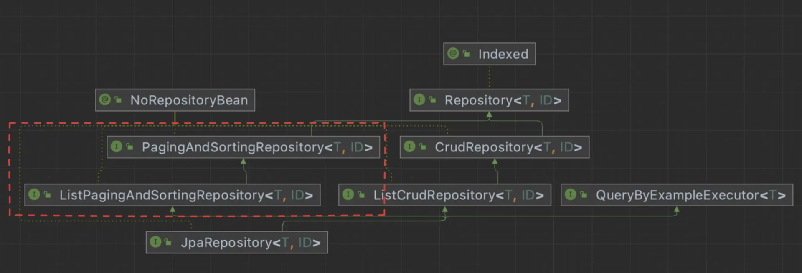

<a id="159eda9b0fe181dc81f1c1b1883ce3bb"></a>

## 테이블 객체 페이지 조회 

---

> 📖 
> 
> <a id="15aeda9b0fe1806c9019f2d0e30fb86c"></a>
> 
> 페이지네이션을 사용하여 대량의 데이터를 효율적으로 조회 가능하다&#46;<br>Spring Data JPA에서 제공하는 Pageable 인터페이스 편리하게 데이터 처리 성능을 최적화할 수 있다&#46; 

<details>
<summary>Paging repository</summary>

> JpaRepository → ListPagingAndSortingRepository → PagingAndSortingRepository

- PagingAndSortingRepository 해당 인터페이스에서 paging &#38; sorting 기능을 제공한다&#46; 



</details>

<details>
<summary>페이징 처리 프로세스</summary>

1. <u>PageRequest 를 사용</u>하여 <u><code>Pageable</code></u><u>에 페이징 정보를 담아 객체화</u>한다&#46; 

1. Pageable을 JpaRepository가 상속된 인터페이스의 메서드에 <code>T</code>(Entity)와 함께 파라미터로 전달한다 &#46;

1. return 값으로 <u><code>Page&#60;T&#62;</code></u><u>를 응답</u>한다&#46; 

1. 응답된 <code>Page&#60;T&#62;</code>에 담겨진 Page 정보를 바탕으로 로직 처리를 한다&#46; 

</details>

<details>
<summary>페이징 요청/응답 클래스</summary>

<details>
<summary>요청&#58; <code>Pageable</code></summary>

> <code>org&#46;springframework&#46;data&#46;domain&#46;Pageable</code>

- 페이징을 제공하는 인터페이스

<details>
<summary>Pageable 생성 &#45; <code>PageRequest&#46;of(&#46;&#46;&#46;)</code></summary>

> <code>PageRequest&#46;of(페이지 번호, 페이징 사이즈, &#46;&#46;&#46;)</code>

- 0부터 시작하는 <u>페이지 번호</u>와 <u>개수</u>&#46; 정렬이 지정되지 않음
    <a id="15beda9b0fe180e697f5f66b7f9f908b"></a>

    ```java
    PageRequest.of(int page, int size)
    ```

- 페이지 번호와 개수, <u>정렬</u> 관련 정보
    <a id="15beda9b0fe18008881acc1a2ff66c04"></a>

    ```java
    PageRequest.of(int page, int size, Sort sort)
    ```

- 0부터 시작하는 페이지 번호와 개수, <u>정렬의 방향과 정렬 기준 필드</u>들
    <a id="15beda9b0fe180108577c85cabe58ae4"></a>

    ```java
    PageRequest.of(int page int size, Sort sort, Direction direction, String ... props)
    ```

</details>

<details>
<summary>Pageable 메서드</summary>

<a id="15beda9b0fe1805e9f8ecf397969edac"></a>

```java
pageable.getTotalPages() : 총 페이지 수
pageable.getTotalElements() : 전체 개수
pageable.getNumber() : 현재 페이지 번호
pageable.getSize() : 페이지 당 데이터 개수
pageable.hasnext() : 다음 페이지 존재 여부
pageable.isFirst() : 시작페이지 여부
pageable.getContent(), PageRequest.get() : 실제 컨텐츠를 가지고 오는 메서드. getContext는 List<Entity> 반환, get()은 Stream<Entity> 반환
```

</details>

</details>

<details>
<summary>응답&#58; <code>Page</code></summary>

> <code>org&#46;springframework&#46;data&#46;domain&#46;Page</code>

- 페이징의 findAll() 의 기본적인 반환 메서드로 여러 반환 타입 중 하나이다&#46;

<details>
<summary>Paging 응답 예시 </summary>

<a id="15beda9b0fe180bdab2acaf7bc338fd5"></a>

```java
{
    "content": [
        {"id": 1, "username": "User 0", "address": "Korea", "age": 0},
        ...
        {"id": 5, "username": "User 4", "address": "Korea", "age": 4}
    ],
    "pageable": {
        "sort": {
            "sorted": false, // 정렬 상태
            "unsorted": true,
            "empty": true
        },
        "pageSize": 5, // 페이지 크기
        "pageNumber": 0, // 페이지 번호 (0번 부터 시작)
        "offset": 0, // 해당 페이지의 첫번째 요소의 전체 순번 (다음 페이지에서는 5)
        "paged": true,
        "unpaged": false
    },
    "totalPages": 20, // 페이지로 제공되는 총 페이지 수
    "totalElements": 100, // 모든 페이지에 존재하는 총 원소 수
    "last": false,  // 마지막 페이지 여부
    "number": 0,
    "sort": {
        "sorted": false,    // 정렬 사용 여부
        "unsorted": true,
        "empty": true
    },
    "size": 5,       // Contents 사이즈
    "numberOfElements": 5,  // Contents 의 원소 수
    "first": true,   // 첫페이지 여부
    "empty": false   // 공백 여부
}
```

</details>

</details>

</details>

<details>
<summary>페이지 반환 타입</summary>

<details>
<summary>1&#46; <code>Page&#60;T&#62;</code> 타입</summary>

- <strong>게시판 형태의 페이징</strong>에서 사용된다&#46;

- 전체 요소 갯수도 함께 조회한다&#46; (<code>totalElements</code>)

- 응답은 위와 동일

</details>

<details>
<summary>2&#46; <code>Slice&#60;T&#62;</code> 타입</summary>

- 더보기 형태의 페이징에서 사용된다&#46;

- 전체 요소 갯수 대신 <code>offset</code> 필드로 조회할 수 있다&#46;
    - 따라서 count 쿼리가 발생되지 않고 limit&#43;1 조회를 한다&#46; (offset 은 성능이 안좋아서 현업에서 안씁니다)

</details>

<details>
<summary>3&#46; <code>List&#60;T&#62;</code> 타입</summary>

- 전체 목록보기 형태의 페이징에서 사용된다&#46;

- 기본 타입으로 count 조회가 발생하지 않는다&#46;

</details>

</details>

<details>
<summary>정렬</summary>

<details>
<summary>1&#46; 컬럼 값으로 정렬  &#45; <code>Sort</code> 클래스</summary>

- Sort 클래스를 사용한 정렬
    - Sort 클래스를 통해 정렬할 정보를 생성 후, <code>PageRequest&#46;of()</code>에 해당 정보를 넘긴다&#46;

    <a id="15beda9b0fe1809c9f2ae3621d13faa1"></a>

    ```java
    Sort sort1 = Sort.by("name").descending();     // 내림차순
    Sort sort2 = Sort.by("password").ascending();  // 오름차순
    Sort sortAll = sort1.and(sort2);      // 2개이상 다중정렬도 가능하다
    Pageable pageable = PageRequest.of(0, 10, sortAll);  // pageable 생성시 추가
    ```

</details>

<details>
<summary>2&#46; 컬럼이 아닌값으로 정렬 &#45; <code>&#64;Query &#45; Alias</code></summary>

- Repository Layer
    <a id="15beda9b0fe18020b9f6f8d645234778"></a>

    ```java
    // 아래와 같이 AS user_password 로 Alias(AS) 를 걸어주면
    @Query("SELECT u.user_name, u.password AS user_password FROM user u WHERE u.username = ?1")
    List<User> findByUsername(String username, Sort sort);
    ```

- Service Layer
    <a id="15beda9b0fe18054b04ffabff6d6d6a0"></a>

    ```java
    // 이렇게 해당 user_password 를 기준으로 정렬할 수 있다.
    List<User> users = findByUsername("user", Sort.by("user_password"));
    ```

</details>

<details>
<summary>3&#46; SQL 함수를 사용 &#45; <code>JpaSort</code> </summary>

- Repository Layer
    <a id="d40b1fe6a1134c3287083d354cda81c1"></a>

    ```java
    // JpaRepository에서 자동생성 해주므로 아래 쿼리 생략
    	// @Query("SELECT u FROM user u WHERE u.username = ?1") 
    List<User> findByUsername(String username, Sort sort);
    ```

- Service Layer
    <a id="27255738049c49b293161388d609cede"></a>

    ```java
    // 이렇게 쿼리함수 LENGTH() 조건을 걸어서 password 문자길이 기준으로 정렬할 수 있다.
    List<User> users = findByUsername("user", JpaSort.unsafe("LENGTH(password)"));
    ```

</details>

</details>
