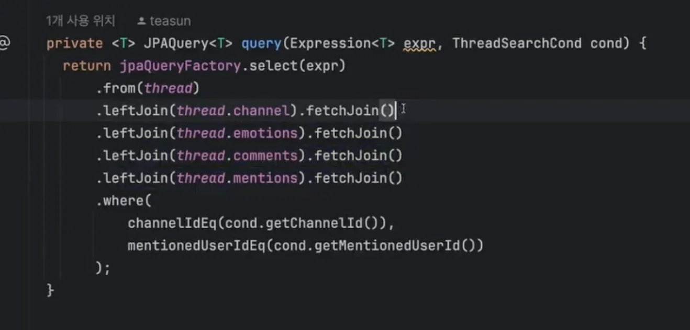

<a id="159eda9b0fe1812f858ce0d2e467226f"></a>

## QueryDSL

---

> 📖 
> 
> <a id="159eda9b0fe181f0b36bfb0edc0861e8"></a>
> 
> 자세한 내용은 아래 정리 참고
> 
> <a id="160eda9b0fe180e0b1a4c93eed87ee1c"></a>
> 
> → <a href="#/post/1c3eda9b-0fe1-8156-b449-f8e742a95d76">페이지</a> 

<details>
<summary>의존성 추가</summary>

- annotationProcessor 까지 적용이 되어야 실제 Q클래스가 생성된다&#46; 

<a id="159eda9b0fe180e6bdfbd188778f9a0e"></a>

```java
// 9. QueryDSL 적용을 위한 의존성 (SpringBoot3.0 부터는 jakarta 사용해야함)
implementation 'com.querydsl:querydsl-jpa:5.0.0:jakarta'
annotationProcessor "com.querydsl:querydsl-apt:${dependencyManagement.importedProperties['querydsl.version']}:jakarta"
annotationProcessor "jakarta.annotation:jakarta.annotation-api"
annotationProcessor "jakarta.persistence:jakarta.persistence-api"
```

</details>

<details>
<summary>config 설정</summary>

- 해당 config를 통해 JPAQueryFactory를 빈으로 등록해야지 QueryDSL을 사용할 수 있다&#46;

<a id="159eda9b0fe18041b347d307db42ee63"></a>

```java
@Configuration
public class JPAConfiguration {

  @PersistenceContext
  private EntityManager entityManager;

  @Bean
  public JPAQueryFactory jpaQueryFactory() {
    return new JPAQueryFactory(entityManager);
  }
}
```

</details>

<details>
<summary>QueryDSL 문법</summary>

- QueryDSL의 장점인 Pageable을 사용하여 조회를 한다&#46;
    - 연관관계를 통해 조회 ❌, QueryDSL에서의 Query를 통해 조회를 한다&#46;

- fetchJoin() 사용
    - fetchJoin을 사용하여 한번에 조회함



</details>

<details>
<summary>실습 &#45; QueryDSL</summary>

>  QueryDSL 전, <u>의존성 및 config를 통해 JPAQueryFactory를 빈으로 등록</u> 해야한다&#46;

1. QueryDSL을 사용한 메서드를 정의할 인터페이스 생성
    <a id="159eda9b0fe18037be8dc6576d2eeef7"></a>

    ```java
    public interface UserRepositoryCustom {
        List<User> findByNameWithQueryDSL(String name);
        Stream<User> streamAllUsers();
    }
    ```

1. 정의한 인터페이스를 상속하는 구현체 생성
    <a id="159eda9b0fe18007a421db5b46927c1e"></a>

    ```java
    @Repository
    public class UserRepositoryImpl implements UserRepositoryCustom {

        private final JPAQueryFactory queryFactory;

        public UserRepositoryImpl(JPAQueryFactory queryFactory) {
            this.queryFactory = queryFactory;
        }

        @Override
        public List<User> findByNameWithQueryDSL(String name) {
            QUser user = QUser.user;

            return queryFactory
                .selectFrom(user)
                .where(user.name.eq(name))
                .fetch();
        }

        @Override
        public Stream<User> streamAllUsers() {
            QUser user = QUser.user;

            return queryFactory
                .selectFrom(user)
                .fetch()
                .stream();
        }
    }
    ```

1. JpaRepository를 상속하는 해당 도메인 repository에 상속 처리
    <a id="159eda9b0fe18021a013cd61c7d22389"></a>

    ```java
    public interface UserRepository extends JpaRepository<User, Long>, UserRepositoryCustom {
    }
    ```

1. Service 단에서 사용
    <a id="159eda9b0fe180de9a91c7689c9f9cc8"></a>

    ```java
    @Service
    public class UserService {

        private final UserRepository userRepository;

        public UserService(UserRepository userRepository) {
            this.userRepository = userRepository;
        }

        // 일반 데이터 조회
        public List<User> getUsersByName(String name) {
            // 비즈니스 로직 처리 후 Repository 호출
            if (name == null || name.isEmpty()) {
                throw new IllegalArgumentException("Name cannot be null or empty");
            }
            return userRepository.findByName(name);
        }

        // 스트림 처리
        public void processUsersWithNameNotNull() {
            try (Stream<User> userStream = userRepository.readAllByNameNotNull()) {
                userStream.forEach(user -> {
                    // 사용자 데이터 처리 로직
                    System.out.println("Processing user: " + user.getName());
                });
            } catch (Exception e) {
                // 예외 처리
                e.printStackTrace();
            }
        }
    }
    ```

</details>

<details>
<summary>🧐 QueryDSL을 구현한 구현체 클래스가 아닌, <u>인터페이스를 상속 처리</u>하는데, <br>어떻게 구현 메서드를 사용 가능한가? &#45; <code>사용자 정의 리포지토리 통합 방법</code></summary>

[사용자 정의 리포지토리 통합 방법](#/post/159eda9b-0fe1-806d-a0b0-dbce1fb747c0)

</details>
