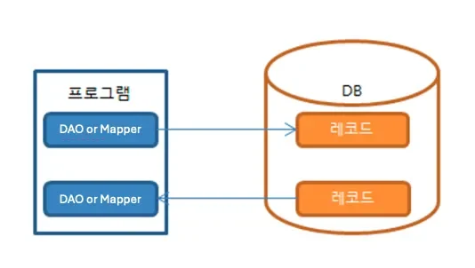
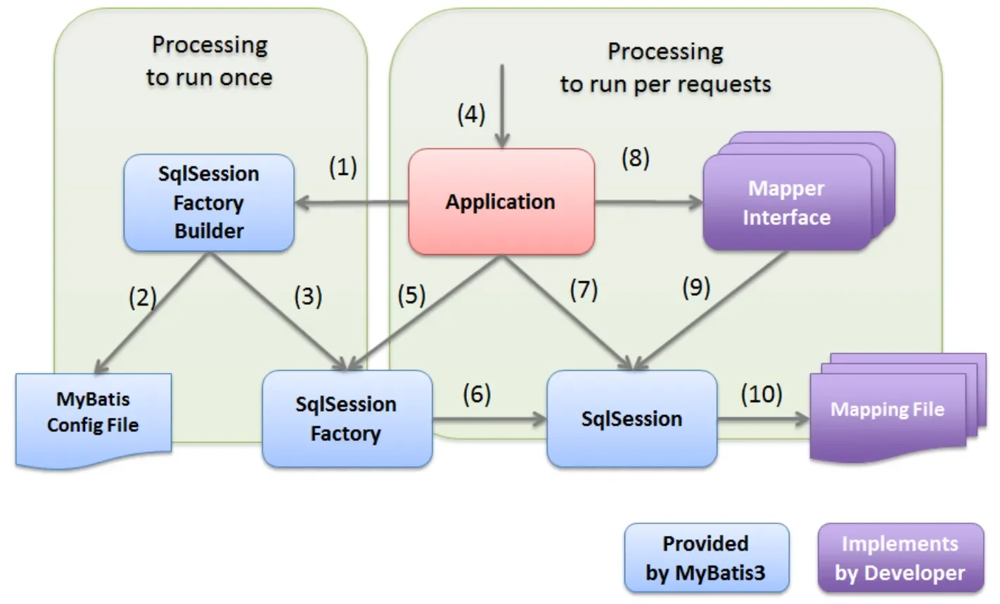

<a id="e97ae1042dd44e30804fd29f87c99060"></a>

## MyBatis

---

> 📖 
> 
> <a id="15beda9b0fe180ca8ea9c67d530a85a5"></a>
> 
> MyBatis 는 <strong><u>RowMapper </u></strong><u>가 가지고있는 단점</u>인 <strong>반복되는 코드</strong>를 줄이고 <strong>함께 있던 </strong><strong><u>프로그램 코드</u></strong><strong>와 </strong><strong><u>쿼리 코드</u></strong><strong>를 </strong><strong>분리</strong><strong>하여 관리</strong>하기 위해서 만들어졌다&#46; 

<a id="338eda9b0fe18006884ece4985009499"></a>

### MyBatis 설명

- SQL Mapper 두번째 주자로 MyBatis 탄생
    - 반복적인 JDBC 프로그래밍을 단순화 하고싶다&#46;

    - SQL 쿼리들을 XML 파일에 작성하여 코드와 SQL 을 분리 하고싶다&#46;

- MyBatis 특징
    

    - jdbc로 처리하는 <strong><u>코드의 설정(Connection) 부분을 줄</u></strong>이고 <strong><u>실제 sql문에 연결</u></strong>함으로서 <br><strong>빠른 개발이 가능</strong>하게 한다&#46; (SQL Mapper 특징)

    - MyBatis 코드는 map 인터페이스(또는 클래스)와 SQL 쿼리와 ResultSet 매핑을 위한 xml 및 annotation을 사용한다&#46;

    - 다른 방식에 비해 객체자체보다 <strong><u>쿼리에 집중</u></strong>할 수 있다&#46; 

- MyBatis 한계점
    - 결국 SQL을 직접 작성하는것은 피곤하다&#46;
        <a id="338eda9b0fe180b9b5b5db395b2b3ac6"></a>

        → DB 기능에 종속적

    - 테이블마다 비슷한 CRUD 반복, DB타입 및 테이블에 종속적이다&#46; 

<a id="ea3b9681355148a687a3ac65da287628"></a>

### MyBatis 의 동작



<details>
<summary>실행 순서 </summary>

> (1) &#126; (3) 은 응용 프로그램 시작 시 수행되는 프로세스이다&#46;

- (1) &#45;  응용 프로그램이 <code>SqlSessionFactoryBuilder</code>를 위해 <code>SqlSessionFactory</code>를 빌드하도록 요청

- (2) &#45; <code>SqlSessionFactoryBuilder</code>는 <code>SqlSessionFactory</code>를 생성하기 위한 Mybatis 구성 파일을 읽는다&#46;

- (3) &#45;  <code>SqlSessionFactoryBuilder</code>는 Mybatis 구성 파일의 정의에 따라 <code>SqlSessionFactory</code>를 생성한다&#46;

> (4) &#126; (10) 은 클라이언트의 각 요청에 대해 수행되는 프로세스이다&#46;

- (4) &#45; 클라이언트가 응용 프로그램에 대한 프로세스를 요청한다&#46;

- (5) &#45; 응용 프로그램은 <code>SqlSessionFactoryBuilder</code>를 사용하여 빌드된 <code>SqlSessionFactory</code>에서 <code>SqlSession</code>을 가져온다&#46;

- (6) &#45; <code>SqlSessionFactory</code>는 <code>SqlSession</code>을 생성하고 이를 애플리케이션에 반환한다&#46;

- (7) &#45; 응용 프로그램이 <code>SqlSession</code>에서 매퍼 인터페이스의 구현 개체를 가져온다&#46;

- (8) &#45; 응용 프로그램이 매퍼 인터페이스 메서드를 호출한다&#46;

- (9) &#45; 매퍼 인터페이스의 구현 개체가 <code>SqlSession</code> 메서드를 호출하고 <code>SQL 실행</code>을 요청한다&#46;

- (10) &#45; <code>SqlSession</code>은 매핑 파일에서 실행할 SQL을 가져와 SQL을 실행한다&#46;

</details>

---

<details>
<summary>SqlSession Factory Builder<strong>  &#45; (1), (2), (3)</strong></summary>

- MyBatis 설정 파일을 읽어와서

- 설정정보 기반으로 SqlSession Factory 를 생성하는 빌더 객체

</details>

<details>
<summary><strong>MyBatis Config File (2)</strong></summary>

- 매핑해줄 객체가 들어있는 패키지 경로와

- Mapping File 목록을 지정해주는 설정 파일

<a id="15beda9b0fe180d8827dcecf4b4ab775"></a>

```xml
<!-- /resources/mybatis-config.xml -->
<!DOCTYPE configuration
        PUBLIC "-//mybatis.org//DTD Config 3.0//EN"
        "http://mybatis.org/dtd/mybatis-3-config.dtd">
<configuration>
    <typeAliases>
        <package name="com.thesun4sky.querymapper.domain"/>
    </typeAliases>
    <mappers>
        <mapper resource="mapper/UserMapper.xml"/>
    </mappers>
</configuration>
```

</details>

<details>
<summary>SqlSession Factory (3), (5), (6)</summary>

- 설정에 맞게 SqlSession 을 생성하여 들고있는 객체

</details>

<details>
<summary><strong>SqlSession</strong><strong> (6), (7), (9), (10)</strong></summary>

- Mapping File 에서 쿼리를 조회해서 쿼리를 수행하고 응답을 받아올 수 있는 세션 객체

</details>

<details>
<summary><strong>Mapper Interface</strong><strong> (8), (9)</strong></summary>

- DB 에서 조회하는 객체와 Java 프로그램의 객체간에 인터페이스를 정의하는 객체

<details>
<summary><strong>방법1&#46; Dao 클래스 정의</strong></summary>

- SqlSession 를 직접적으로 사용하는 방법

- SqlSession 멤버 변수로 사용하며 쿼리파일 수행 요청

<a id="15beda9b0fe180bca369c2934d893dff"></a>

```java
// UserDao.java
import org.apache.ibatis.session.SqlSession;
import org.springframework.stereotype.Component;

import com.thesun4sky.querymapper.domain.User;

@Component
public class UserDao {

  // SqlSession 멤버 변수로 사용하며 쿼리파일 수행 요청
  private final SqlSession sqlSession;

  public UserDao(SqlSession sqlSession) {
    this.sqlSession = sqlSession;
  }

  public User selectUserById(long id) {
    return this.sqlSession.selectOne("selectUserById", id);
  }
}
```

- <strong>장점</strong>
    - 쿼리문 실행 전에 넣어줄 매개변수와 쿼리 결과값의 변형을 정의할 수 있다&#46;

    - Namespace를 내 마음대로 둘 수 있다&#46;

    - &#46;xml 파일의 쿼리문 id와 mapper 메소드명을 일치시킬 필요가 없다&#46;

- <strong>단점</strong>
    - Sqlsession 객체를 주입받아야 하며, 쿼리문 실행 시 항상 호출해야 한다&#46;

    - 쿼리문 호출 시 sqlsession에 &#46;xml 파일의 namespce와 쿼리문 id를 매개변수로 넘겨야한다&#46;

</details>

<details>
<summary><strong>방법2&#46; Mapper Interface 정의</strong></summary>

- SqlSession 를 간접적으로 사용하는 방법

- ibatis 에서 구현해주는  <code>org&#46;apache&#46;ibatis&#46;annotations&#46;Mapper</code> 어노테이션을 사용하면 sqlSession 를 사용하여 자동으로 호출해줌

<a id="1ccbb4ced1ff43cc87c1d8c3aea52ad9"></a>

```java
// UserMapper.java
@Mapper
public interface UserMapper {

  User selectUserById(@Param("id") Long id);

}
```

- <strong>장점</strong>
    - 메소드의 내부 구현이 불필요하다&#46;

    - Sqlsession 객체 주입이 불펼요하다&#46;

    - &#46;xml 파일의 쿼리문 id와 mapper 메소드 명이 일치한다&#46;

- <strong>단점</strong>
    - &#46;xml의 Namespace가 실제 Mapper&#46;java 위치를 가르켜야 한다&#46;

    - 메소드 내부 정의가 불가능하다&#46;

</details>

</details>

<details>
<summary><strong>Mapping File</strong><strong> (10)</strong></summary>

- SqlSession 가 실행하는 쿼리가 담긴 파일

<a id="15beda9b0fe1801faff1c3aa7730f9c4"></a>

정의된 인터페이스에 기반해서 수행할 쿼리를 담아두고

<a id="15beda9b0fe18015b280f058b3308d47"></a>

쿼리 수행결과를 어떤 인터페이스 매핑할지 정의해놓은 파일

<a id="15beda9b0fe180f79b1ed3c206d54879"></a>

```xml
<!-- UserMapper.xml -->
<!DOCTYPE mapper
        PUBLIC "-//mybatis.org//DTD Mapper 3.0//EN"
        "http://mybatis.org/dtd/mybatis-3-mapper.dtd">
<mapper namespace="com.thesun4sky.querymapper.mapper.UserMapper">
    <select id="selectUserById" resultType="User">
        select id, name from users where id = #{id}
    </select>
</mapper>
```

</details>

<a id="15beda9b0fe1809bb095fca3e6e6dc1c"></a>

### 실습 코드

[GitHub &#45; thesun4sky/query&#45;mapper at query&#45;file&#45;mapper]()

<details>
<summary>DAO&#58; <code>UserDao&#46;class</code></summary>

<a id="338eda9b0fe180729641f6f1f9c85b82"></a>

```java
package com.thesun4sky.querymapper.dao;

import org.apache.ibatis.session.SqlSession;
import org.springframework.stereotype.Component;

import com.thesun4sky.querymapper.domain.User;

@Component
public class UserDao {

  private final SqlSession sqlSession;

  public UserDao(SqlSession sqlSession) {
    this.sqlSession = sqlSession;
  }

  public User selectUserById(long id) {
    return this.sqlSession.selectOne("selectUserById", id);
  }
}
```

</details>

<details>
<summary>domain&#58; <code>User&#46;class</code></summary>

<a id="338eda9b0fe180908fccf73fe2c434b5"></a>

```java
package com.thesun4sky.querymapper.domain;

import java.io.Serializable;

public class User implements Serializable {

  private static final long serialVersionUID = 1L;

  private Long id;

  private String name;

  public Long getId() {
    return this.id;
  }

  public void setId(Long id) {
    this.id = id;
  }

  public String getName() {
    return this.name;
  }

  public void setName(String name) {
    this.name = name;
  }

  @Override
  public String toString() {
    return getId() + "," + getName();
  }

}
```

</details>

<details>
<summary>mapper</summary>

<a id="338eda9b0fe18065a2cce652922baff8"></a>

```java
package com.thesun4sky.querymapper.mapper;

import org.apache.ibatis.annotations.Mapper;
import org.apache.ibatis.annotations.Param;

import com.thesun4sky.querymapper.domain.User;

@Mapper
public interface UserMapper {

  User selectUserById(@Param("id") Long id);

}
```

</details>

- App
    <a id="338eda9b0fe1807b9b6dee2b7bf14e84"></a>

    ```java
    @SpringBootApplication
    public class QueryMappingApplication {
    	public static void main(String[] args) {
    		// 어플리케이션 실행 컨텍스트 생성
    		var context = SpringApplication.run(QueryMappingApplication.class, args);

    		// 데이터 조회 DAO 클래스 빈 조회
    		var dao = context.getBean(UserDao.class);
    		// DAO 를 통해 유저정보 조회
    		System.out.println("User by dao : " + dao.selectUserById(1L)); // data.sql 에서 미리 저장된것이 하나 있어서 2번

    		// 데이터 조회 Mapper 클래스 빈 조회
    		var mapper = context.getBean(UserMapper.class);
    		// FileMapper 를 통해 유저정보 조회
    		System.out.println("User by fileMapper: " + mapper.selectUserById(1L)); // data.sql 에서 미리 저장된것이 하나 있어서 2번
    	}

    }
    ```

- resources
    [query&#45;mapper/src/main/resources at query&#45;file&#45;mapper · thesun4sky/query&#45;mapper]()
