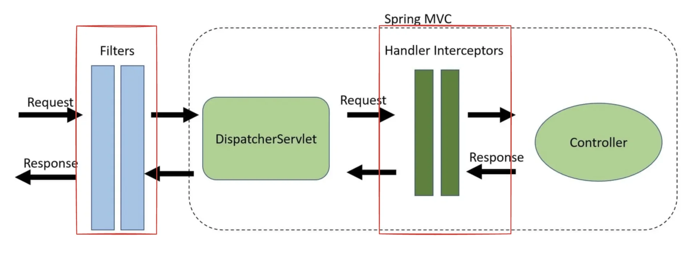

<a id="160eda9b0fe180e89496da36d247a6c2"></a>

특강 &#45; 인증 인가 구현 ( 정리 전 )

> 📌 
> 
> <a id="4f8ddd66d5e74da1ab9ca8d2b3dc4de1"></a>
> 
> CS 특강 &#45; 제목
> 
> - 진행&#58; 황석규 튜터님
> 
> - 기간&#58; 24&#46;12&#46;02

<details>
<summary>reference</summary>

<a id="158eda9b0fe1802cb1eeef5d0749bdd3"></a>

<a href="https://beautiful-college-c84.notion.site/aa9770a761384c0f8261eddf0b351ecb">페이지</a> 

<a id="158eda9b0fe18075b47be2633b0eb186"></a>

‣

</details>

> ⚠️ 
> 
> <a id="b6f458857c4d4b4684ff71f85da4cb29"></a>
> 
> <em><code>Filter</code></em>로 <code>&#64;ExceptionHandler</code>를 이용해서 <code>request</code>가 <code>Controller</code>에 도착하기 전에 예외를 처리하는 방법은 안티 패턴이다&#46; 
> 
> - 왜 안티 패턴인가?

<a id="160eda9b0fe180fbb475cc9cda0f8182"></a>

## 1&#46;  <u>인증</u>과 <u>인가</u>를 <u>어디에 구현</u>하면 좋은가?

---

- 유저는 인증, 인가 과정을 거쳐야 한다&#46; 이것으로 인해 유저에게 안전한 서비스를 제공할 수 있다&#46; 

- 인증과 인가는 모든 API에서 항상 먼저 거치도록 구현해야 한다&#46; <br>그리고 이는 API를 처리하는 <strong><u>Controller 앞 단</u></strong>에서 <strong><u>검증</u></strong>을 하면 된다&#46; 



<a id="160eda9b0fe1808db028c38eb95d7133"></a>

<code>Filter</code>와 <code>Interceptor</code>는 모두<u> request가 </u><u><code>Controller</code></u><u>에 도착하기 전에 실행</u>되는 공통점을 갖고 있지만, 아래와 같은 차이점이 있다&#46;

<details>
<summary><code>Filter</code>, <code>Interceptor</code> 차이점</summary>

- <code>Filter</code>
    - request가 <code>DispatcherServlet</code>에 도달하기 전에 가로챈다&#46;

    - Web Context에서 실행된다&#46;
        - <strong><code>&#64;ExceptionHandler</code></strong>를 이용한 <u>에러 핸들링을 할 수 없</u>다

- <code>Interceptor</code>
    - request가 <code>DispatcherServlet</code>를 지나 <code>Controller</code>에 도달하기 전에 가로챈다&#46;

    - Spring Context에서 실행된다&#46;
        - <u><code>&#64;ExceptionHandler</code></u>를 이용한 에러 핸들링 가능

</details>

<details>
<summary>Filter, HandlerInterceptor<strong> </strong>상황에 적용 예시</summary>

<details>
<summary><strong>Filter</strong></summary>

- 인증

- 로깅, 검증

- 이미지와 데이터 압축

- Spring MVC에서 분리하고 싶은 기능

</details>

<details>
<summary><strong>HandlerInterceptor</strong></summary>

- <a href="https://ko.wikipedia.org/wiki/%ED%9A%A1%EB%8B%A8_%EA%B4%80%EC%8B%AC%EC%82%AC">횡단 관심사</a> 처리 (e&#46;g&#46; 애플리케이션 로깅)

- 세부적인 인가 검사

- Spring Context 또는 모델 조작

</details>

</details>

<a id="160eda9b0fe180d89da9f4d30e5b9678"></a>

## 2&#46;  HandlerInterceptor

<details>
<summary>공식문서</summary>

[HandlerInterceptor (Spring Framework 6&#46;2&#46;0 API)]()

</details>

<details>
<summary>특징</summary>

- <code>HandlerInterceptor</code>는  Spring Context 내에 존재한다&#46;
    - <code>&#64;GlobalException</code>를 사용한 에러 처리 가능

-  <code>DispatcherServlet</code>과 <code>Controller</code> 사이에서 request를 가로챌 수 있다&#46;

- <code>HandlerInterceptor</code>는 인터페이스이며, 이 인터페이스를 클래스로 구현해서 사용할 수 있다&#46;

</details>

<details>
<summary>내부 메서드 </summary>

> ✏️ 
> 
> - <code>preHandle()</code>&#58; <u>Controller 처리 이전</u>에 수행
>     - <code>true</code>를 리턴하면 체인에 의해 다음 interceptor를 실행
> 
> - <code>postHandle()</code>&#58; <u>Controller 처리 이후</u> 수행
> 
> - <code>afterCompletion()</code>&#58; request 처리가 완료되고 <u>뷰 렌더링 이후</u> 수행

<details>
<summary>ex)</summary>

<a id="160eda9b0fe180cfa18ff048c5b88a66"></a>

```java
public class LogInterceptor implements HandlerInterceptor {

    private Logger logger = LoggerFactory.getLogger(LogInterceptor.class);

    @Override
    public boolean preHandle(HttpServletRequest request, HttpServletResponse response, Object handler) 
      throws Exception {
        logger.info("preHandle");
        return true;
    }

    @Override
    public void postHandle(HttpServletRequest request, HttpServletResponse response, Object handler, ModelAndView modelAndView) 
      throws Exception {
        logger.info("postHandle");
    }

    @Override
    public void afterCompletion(HttpServletRequest request, HttpServletResponse response, Object handler, Exception ex) 
      throws Exception {
        logger.info("afterCompletion");
    }
}
```

</details>

</details>

<details>
<summary>추가 예제</summary>

[spring-session-authn-authz-sample](https://github.com/ssk910/spring-session-authn-authz-sample)

</details>

<a id="168eda9b0fe18074a184e0dc3e49c6aa"></a>

### 추가 예시 &#45; 과제 

> <a href="#/post/162eda9b-0fe1-80b4-8a97-cf1450e43aa7">페이지</a> 


<details>
<summary><code>Filter</code>, <code>Interceptor</code> 차이점</summary>

- <code>Filter</code>
    - request가 <code>DispatcherServlet</code>에 도달하기 전에 가로챈다&#46;

    - Web Context에서 실행된다&#46;
        - <strong><code>&#64;ExceptionHandler</code></strong>를 이용한 <u>에러 핸들링을 할 수 없</u>다

- <code>Interceptor</code>
    - request가 <code>DispatcherServlet</code>를 지나 <code>Controller</code>에 도달하기 전에 가로챈다&#46;

    - Spring Context에서 실행된다&#46;
        - <u><code>&#64;ExceptionHandler</code></u>를 이용한 에러 핸들링 가능

</details>

---

<a id="d16b0d00762848499ba4839f0c1921b7"></a>

이전 코드에서는 Filter 와 Interceptor를 동시에 사용해서 중복으로 인증/인가 처리가 되었다&#46; <br>이를 I<strong><u>nterceptor</u></strong><strong><u>만을 사용</u></strong>한 <strong>인증/인가</strong> 처리로 리펙토링 하였다&#46; 

<a id="08969c9daa7e4d0eaa26d0e0a9256948"></a>

또한 중복된 코드들을 메서드화 및 클래스 통합 처리를 하였다&#46;

<details>
<summary>Intercepter</summary>

> ✏️ 
> 
> <a id="1f7eda9b0fe180c683ddcb1e964ae2a1"></a>
> 
> <code>RoleIntercepter</code>로 통합 후, 빈 등록 시에 생성자(constructor)로 유저의 권한 상태 값을 초기화 했다&#46; 
> 
> - <code>UserRoleIntercepter</code>, <code>AdminRoleIntercepter</code> → <code>RoleIntercepter</code>
> 
> - Role 필드 추가 및 생성자로 <strong><u>빈 등록 시</u></strong>에 <strong>유저 권한 상태값 할당</strong>
> 
> - Interceptor 등록 시, 사용되는 <u>중복되는 로직을 메서드로 분리</u> 및 <u>빈 수동 등록</u> 로직을 추가함

<a id="59d704ce248b408ea457b361c5f62a56"></a>

### 코드

<details>
<summary>&#91; 코드 &#93; RoleInterceptor</summary>

<a id="e941ad0ecbeb4693a498a21d2691e715"></a>

```java
@RequiredArgsConstructor
public class RoleFilter implements CommonAuthFilter {

    private final Role role;

    @Override
    public void doFilter(ServletRequest servletRequest, ServletResponse servletResponse, FilterChain filterChain)
            throws IOException, ServletException {

        HttpSession session = findHttpSession(servletRequest);

        Authentication authentication = (Authentication) session.getAttribute(GlobalConstants.USER_AUTH);

        if (authentication == null) {
            throw new UnauthorizedException(HttpStatus.UNAUTHORIZED, "세션이 존재하지 않습니다. 로그인 해주세요.");
        }

        Role clientRole = authentication.getRole();

        if (clientRole != this.role) {
            throw new UnauthorizedException(HttpStatus.UNAUTHORIZED, role.getName() + " 권한이 필요합니다.");
        }

        filterChain.doFilter(servletRequest, servletResponse);
    }
}
```

</details>

<details>
<summary>&#91; 코드 &#93; InterceptorConfig</summary>

<a id="afa2c1a83ae34ad2acd9f284c45eb39c"></a>

```java
@Configuration
public class InterceptorConfig {
    @Bean
    public AuthInterceptor authInterceptor() {
        return new AuthInterceptor();
    }

    @Bean
    public RoleInterceptor userRoleInterceptor() {
        return new RoleInterceptor(Role.USER);
    }

    @Bean
    public RoleInterceptor adminRoleInterceptor() {
        return new RoleInterceptor(Role.ADMIN);
    }
}
```

</details>

<details>
<summary>&#91; 코드 &#93; WebConfig</summary>

<a id="909edaa6a7c24cc4aea90d045ce081ff"></a>

```java
@Configuration
@RequiredArgsConstructor
public class WebConfig implements WebMvcConfigurer {
    private static final String[] AUTH_REQUIRED_PATH_PATTERNS = {"/users/logout"};
    private static final String[] ADMIN_ROLE_REQUIRED_PATH_PATTERNS = {"/admins/*", "/items/**"};
    private static final String[] USER_ROLE_REQUIRED_PATH_PATTERNS = {"/reservations/**"};

    private final AuthInterceptor authInterceptor;
    private final RoleInterceptor userRoleInterceptor;
    private final RoleInterceptor adminRoleInterceptor;

    @Override
    public void addInterceptors(InterceptorRegistry registry) {
        registerInterceptor(registry, authInterceptor, AUTH_REQUIRED_PATH_PATTERNS, Ordered.HIGHEST_PRECEDENCE);
        registerInterceptor(registry, adminRoleInterceptor, ADMIN_ROLE_REQUIRED_PATH_PATTERNS, Ordered.HIGHEST_PRECEDENCE + 1);
        registerInterceptor(registry, userRoleInterceptor, USER_ROLE_REQUIRED_PATH_PATTERNS, Ordered.HIGHEST_PRECEDENCE + 2);
    }

    private void registerInterceptor(InterceptorRegistry registry,
                                     HandlerInterceptor interceptor,
                                     String[] pathPatterns,
                                     int order) {
        registry.addInterceptor(interceptor)
                .addPathPatterns(pathPatterns)
                .order(order);
    }
}
```

</details>

</details>

<details>
<summary>&#43;) Fiter</summary>

> ✏️ 
> 
> <a id="1f7eda9b0fe180ec84aad2d6b0d6bc2c"></a>
> 
> 필터를 사용하지는 않지만, 같이 리펙토링 처리하였다&#46; 
> 
> - config 에서 <code>&#64;Configuration</code>을 주석 처리,  설정 정보가 등록되지 않도록 처리함
> 
> - 중복되는 필터 등록 로직을 메서드로 분리함

<a id="1f7eda9b0fe180bea118c3e47562cfc7"></a>

### 코드

<details>
<summary>&#91; 코드 &#93; FiterConfig</summary>

<a id="56133ca3639e4320b20c908a1908af3c"></a>

```java
// @Configuration
public class FiterConfig implements WebMvcConfigurer {

    private static final String[] AUTH_REQUIRED_PATH_PATTERNS = {"/users/logout"};
    private static final String[] ADMIN_ROLE_REQUIRED_PATH_PATTERNS = {"/admins/*", "/items/*"};
    private static final String[] USER_ROLE_REQUIRED_PATH_PATTERNS = {"/reservations/*"};

    // filter 방식
    @Bean
    public FilterRegistrationBean authFilter() {
        return buildFilterRegistration(new AuthFilter(), Ordered.HIGHEST_PRECEDENCE, AUTH_REQUIRED_PATH_PATTERNS);
    }

    @Bean
    public FilterRegistrationBean adminRoleFilter() {
        return buildFilterRegistration(new RoleFilter(Role.ADMIN), Ordered.HIGHEST_PRECEDENCE + 1, ADMIN_ROLE_REQUIRED_PATH_PATTERNS);
    }

    @Bean
    public FilterRegistrationBean userRoleFilter() {
        return buildFilterRegistration(new RoleFilter(Role.USER), Ordered.HIGHEST_PRECEDENCE + 2, USER_ROLE_REQUIRED_PATH_PATTERNS);
    }

    private FilterRegistrationBean buildFilterRegistration(CommonAuthFilter filter, int order, String[] pathPatterns) {
        FilterRegistrationBean<Filter> filterRegistrationBean = new FilterRegistrationBean<>();
        filterRegistrationBean.setFilter(filter);
        filterRegistrationBean.setOrder(order);
        filterRegistrationBean.addUrlPatterns(pathPatterns);
        return filterRegistrationBean;
    }
}
```

</details>

- filters
    <details>
    <summary>&#91; 코드 &#93; &#60; interface &#62; CommonAuthFilter</summary>

    <a id="da76048ab00f4b20b131c948e68b0807"></a>

    ```java
    public interface CommonAuthFilter extends Filter {

        default HttpSession findHttpSession(ServletRequest request) {
            HttpServletRequest httpServletRequest = (HttpServletRequest) request;
            return Optional.of(httpServletRequest.getSession(false))
                    .orElseThrow(() -> new UnauthorizedException(HttpStatus.UNAUTHORIZED, "로그인 필요"));
        }
    }
    ```

    </details>

    <details>
    <summary>&#91; 코드 &#93; AuthFilter</summary>

    <a id="7cdf500fdec64d2f91502e4c043df290"></a>

    ```java
    public class AuthFilter implements CommonAuthFilter {

        @Override
        public void doFilter(ServletRequest servletRequest, ServletResponse servletResponse, FilterChain filterChain)
                throws IOException, ServletException {
            findHttpSession(servletRequest);
            filterChain.doFilter(servletRequest, servletResponse);
        }
    }
    ```

    </details>

    <details>
    <summary>&#91; 코드 &#93; RoleFilter</summary>

    <a id="95b5857dca2c4ca28fdca7c2b5dd1f4d"></a>

    ```java
    @RequiredArgsConstructor
    public class RoleFilter implements CommonAuthFilter {

        private final Role role;

        @Override
        public void doFilter(ServletRequest servletRequest, ServletResponse servletResponse, FilterChain filterChain)
                throws IOException, ServletException {
            HttpSession session = findHttpSession(servletRequest);

            Authentication authentication = (Authentication) session.getAttribute(GlobalConstants.USER_AUTH);

            if (authentication == null) {
                throw new UnauthorizedException(HttpStatus.UNAUTHORIZED, "세션이 존재하지 않습니다. 로그인 해주세요.");
            }

            Role clientRole = authentication.getRole();

            if (clientRole != this.role) {
                throw new UnauthorizedException(HttpStatus.UNAUTHORIZED, role.getName() + " 권한이 필요합니다.");
            }

            filterChain.doFilter(servletRequest, servletResponse);
        }
    }
    ```

    </details>

</details>
