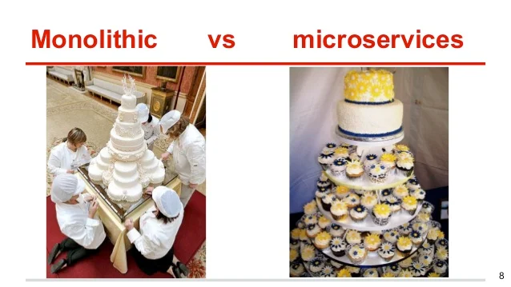
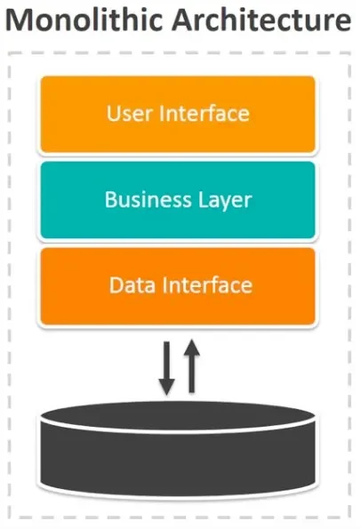
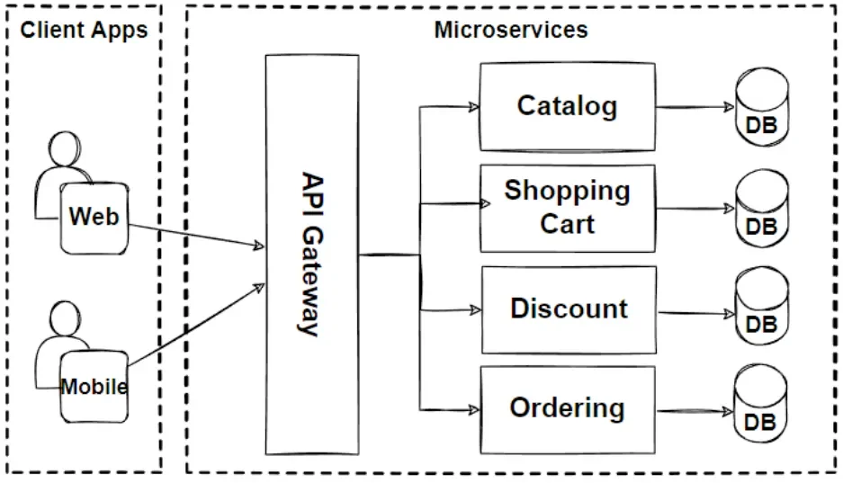
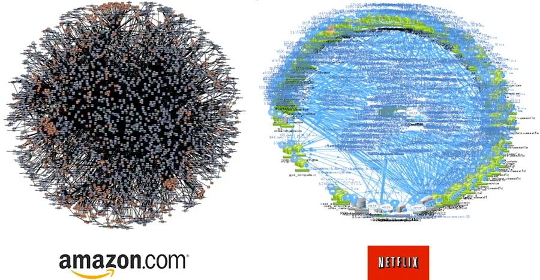
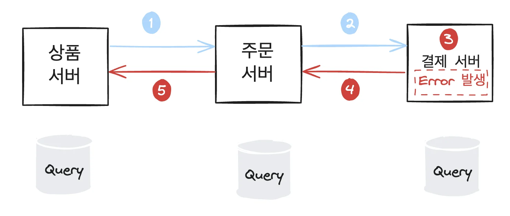
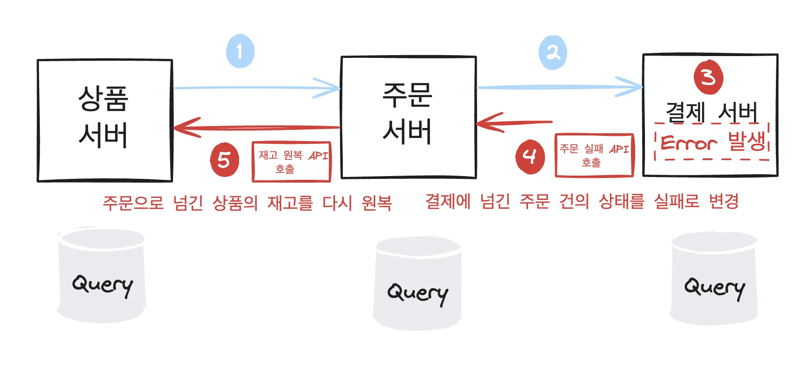

> ✏️ 
> 
> <a id="e3d9c601310443dda614346a89b12ce4"></a>
> 
> 학습목표
> 
> - MSA란 무엇인가
> 
> - 서버끼리 어떻게 데이터를 주고 받는가
> 
> - MSA에서 트랜젝션 처리

<details>
<summary>Reference</summary>

<a id="158eda9b0fe1806ea2ebc65cfb55dfea"></a>

<a href="https://beautiful-college-c84.notion.site/4847e2af4bb24614bf8c9e3bedd627a4">페이지</a> 

</details>

<details>
<summary>모놀리식, MSA &#45; 케익 비유 </summary>



</details>

<a id="158eda9b0fe180b585b8d8c385761811"></a>

## MSA

---

> 📖 
> 
> <a id="1362e39e7a5c4f4eb5461c1ce42ee7a2"></a>
> 
> SA는 Micro Service Achitecture의 약자로 위와 같이 도메인 별로 서비스를 나눠진 구조를 말한다&#46; 


<a id="158eda9b0fe180ec8dfddeb2df6d36cc"></a>

위 이미지에서 보듯 카테고리, 카트, 할인, 주문과 같은 도메인을 각각 따로 서버로 구현한다&#46; 

<a id="158eda9b0fe18059af81da30177b2c83"></a>

각 도메인은 별도의 DB를 가지고 있고, 다른 도메인의 데이터를 조회할 때 API를 통해서만 접근이 가능하다&#46; 

<a id="158eda9b0fe1808b8685cf074c4d2450"></a>

## Monolithic Architecture

---

> 📖 
> 
> <a id="ab3a1f4530f54f979e03af2ffcdd86bc"></a>
> 
> MSA 구조를 사용 전, 주로 사용된 구조인 <u>모놀로식 아키텍처</u>는 하나의 서버에서 모든 도메인을 처리하는 구조를 말한다&#46; 



<a id="158eda9b0fe1808188accdc7828b6995"></a>

모놀리식 아키텍처는 위 이미지와 같이 하나의 서버에 모든 도메인을 처리하는 형태를 말하며,<br>지금까지 내배캠 &#45; 과제 구현에서 사용한 아키텍처 모두 모놀리식이라고 보면 된다&#46;

<a id="158eda9b0fe18094997bf7b1b96f486a"></a>

또한 모든 비지니스 로직이 일반적으로 1대의 DB만 사용한다&#46; 

<a id="158eda9b0fe180b7b2d3d1e7975990c1"></a>

MSA가 대세가 된 지금 모놀리식은 부적정인 평가가 많지만, 그럼에도 모놀리식이 가지는 장점이 있는데, 아래와 같다&#46; 

> ✏️ 
> 
> <a id="395e0ca320e54dc993ba5cfd486ff583"></a>
> 
> <strong>모놀리식의 장점</strong>
> 
> - 구조 단순
>     - 모든 코드가 프로젝트 하나에 위치
> 
> - 빠른 개발 속도
>     - 다른 팀과 API 협의 필요 없이 바로 데이터에 접근 가능
> 
>     - 빠른  신규 기능 개발 가능 
> 
> - 동일한 DB 사용
>     - 모든 도메인이 동일한 DB 사용하므로 필요 데이터 바로 조회 가능
> 
> - 베포 간편
>     - 기능 전체를 한 번에 베포할 수 있어, 과정이 단순하고 오류 발생 가능성이 낮다&#46;
> 
> - 일관된 개발 환경
>     - 개발 환경이 모두 일관적이라 관리가 쉽다&#46;
> 
> - 네트워크 오버헤드 ❌
>     - 단일 서버이므로 API 호출에 따른 네트워크 오버헤드가 없다&#46;

<a id="158eda9b0fe180888873c60c2b9d809f"></a>

## Monolithic Architecture 단점

---

<a id="158eda9b0fe180c9971bcb19de6f9867"></a>

위와 같은 작은 서비스에서의 효율적으로 서비스를 운영할 수 있다는 장점이 있지만, 여러 단점이 존재하는데, 그 중 가장 대표적인 문제는 <u>하나의  도메인에서 장애가 발</u>생하면 <u>서비스 전체가 작동 불가능</u>해지는 문제이다&#46; 

- ex)
    - 쇼핑몰 배송 조회 기능에 크리티컬한 장애 발생

    - 모놀리식 아키텍처에서는 이 장애로 인해 서비스 전체가 동작하지 않는다&#46; 

    - 따라서 고객이 주문하려고 해도, 주문과 관련 없는 배송 도메인에서의 오류 때문에 주문 도메인까지 동작이 되지 않는다&#46; 

    - 또한 서비스 전체가 장애를 겪기 때문에 쇼핑몰 자체에 접근조차 불가능해질 수 있다&#46; 

<a id="158eda9b0fe18066884ff90731f63a2b"></a>

위 예외 와 같이 하나의 도메인에서 장애 발생 시, 모든 서비스가 영향을 받게 된다&#46; 

<a id="158eda9b0fe180469e86f3d6df51d9c7"></a>

서비스를 운영하다보면 <u>크고 작은 장애들이 빈번히 발생</u>되는데, <u>그럴 때마다  모든 서비스에 영향을 준</u>다면 <u>유저 경험에 부정적인 영향을 주고 결국 유저 이탈 현상이 빈번히 발생</u>될 것이다&#46; 

> ✏️ 
> 
> <a id="0088536daf0d4a1d90fe23b6b8117f7f"></a>
> 
> 모놀리식의 단점
> 
> - 부분 장애가 전체에 영향을 준다&#46; 
>     - 병목 현상 발생
> 
> - 단순한 변경 하나에 전체를 빌드해야 한다&#46; 
> 
> - 모든 코드가 하나의 프로젝트에 있어 작은 코드 변경이 다른 도메인에 영향을 줄 수 있다&#46; 
> 
> - 전체 서비스가 동일 기술 스펙하에 있어 각 도메인 별로 적절한 기술을 사용할 수 없다&#46;

<a id="158eda9b0fe1807e88f1d4d5c7ef941d"></a>

## MSA 장점

---

> 📖 
> 
> <a id="b1508722085a4bd8a3afa4d18e361e32"></a>
> 
> 모놀리식 아키텍처의 위와 같은 단점들 떄문에 MSA가 주목을 받게 되었다&#46; 
> 
> <a id="158eda9b0fe180e19fb2e1ad7410c6f0"></a>
> 
> <strong><code>MSA</code></strong>는 <u>도메인 별로 작은 서버스를 나눠 각각 API를 통해 데이터를 주고 받</u>아 모놀리식 아키텍처의 단점을 해결한다&#46; 

> ☝🏻 
> 
> <a id="8e68e2b160ff48fd9879b0e56b8a9892"></a>
> 
> MSA는 API를 통해 각 도메인별 서버와 통신한다&#46; ( 이때 RESTful 규약을 따른다)<br>따라서 MSA는 API를 통한 개발 방식을 따르며, 이는 <u>API에 대한 커뮤니케이션의 중요하다</u>는 의미를 뜻 한다&#46;  즉, <u>API 명세서를 잘 작성해야 된다&#46; </u>



<a id="158eda9b0fe1801c8dbce57e67a5414f"></a>

위에서 설명했듯, 모놀리식의 단점을 보완한 것이 MSA의 장점이다&#46; <br>특히 가장 큰 장점은 <u>한 서비스에서의 장애가 전체 서비스로 전체되지 않는다</u>는 점이다&#46; 

<a id="158eda9b0fe1805eab94ebd211d1892c"></a>

이로 인해 일부 서비스에서 장애가 발생되어도 나머지 서비스는 정상 동작하므로 <u>사용자들에게 부정적인 경험을 줄 수 있는 가능성을 줄일 수 있다&#46;</u> 

> ✏️ 
> 
> <a id="158eda9b0fe180efa066c4ad28b57005"></a>
> 
> <strong>MSA 장점</strong>
> 
> - <code>격리된 장애</code>
>     - 한 서비스의 장애가 전체 시스템에 영향을 미치지 않는다&#46; → 신뢰성, 안정성 ↑
> 
> - <code>독립적 베포</code>
>     - 각 서비스가 독립적으로 베포되어, 신속하고 빈번한 베포가 가능하다&#46; 
> 
> - <code>확장성</code>
>     - 특정 서비스만 독립적으로 확장할 수 있어 효율적인 자원 사용과 성능 향상이 가능하다&#46;
> 
> - <code>유연한 기술 스택</code>
>     - 각 서비스별로 가장 적합한 기술 스택을 선택할 수 있어 유연성이 높다&#46; 
> 
> - <code>향상된 유지 보수성</code>
>     - 서비스가 작고 독립적이어서 이해하기 쉽고 유비보수 및 디버깅이 용이하다&#46; 
> 
> - <code>팀별 독립성</code>
>     - 각 서비스가 독립적으로 개발되고 운영될 수 있어, 팀 단위 &#45; 특정 서비스 작업이 가능하다&#46; 

<a id="158eda9b0fe180cdabd0e41559ff1468"></a>

## MSA 단점

---

<a id="158eda9b0fe1801c8023da74333a9dd5"></a>

위와 같은 장점들이 많지만, 모든 것에 양면성이 있듯이 MSA도 아래와 같은 단점이 있다&#46;

<a id="158eda9b0fe180c498f0c82bd848fd5c"></a>

물론 장점이 더 많아 기술적인 이득이 더 크기 때문에, 대부분의 서비스는 MSA 아키텍처를 선택하고 있다&#46; 

<a id="158eda9b0fe180349783d8f7999d27ea"></a>

그러므로 MSA 단점은 해당 아키텍처 구축 시, 고려해야 할 사항으로 인지하고 있어야 한다&#46; 

> ❗ 
> 
> <a id="158eda9b0fe180a09aa8c06f45fcc716"></a>
> 
> <strong>MSA 단점</strong>
> 
> - <strong><code>복잡한 관리</code></strong>
>     - 많은 서비스가 존재하여 서비스 간의 통신과 배포, 모니터링, 로깅 등 관리가 복잡해진다&#46;
> 
> - <strong><code>네트워크 오버헤드</code></strong>
>     - 서비스 간의 통신에 의한 네트워크 오버헤드와 지연 시간이 발생할 수 있다&#46;
> 
> - <strong><code>데이터 일관성 문제</code></strong>
>     - <u>각 서비스가 독립적인 데이터베이스를 가질 수 있</u>어 데이터 일관성을 유지하는데 많은 리소스가 소모 된다&#46; 
> 
>     - <strong>트랜잭션 이슈</strong>
> 
> - <strong><code>개발 및 테스트 복잡성</code></strong>
>     - 분산된 아키텍처로 인해 개발 및 테스트 환경 설정이 복잡해진다&#46;
> 
> - <strong><code>서비스 간 통합 문제</code></strong>
>     - 각 서비스 간의 통합과 협력이 복잡해져 서비스 경계를 명확히 정의하고 유지하는 것이 어렵다&#46;
> 
> - <strong><code>초기 설정 비용</code></strong>
>     - 초기 설정과 인프라 구축에 많은 시간과 비용이 들 수 있다&#46;

<details>
<summary>아마존과 넷플릿스의 MSA</summary>



</details>

---

<a id="158eda9b0fe18006ae0ff552562aac33"></a>

## API 호출

---


<a id="158eda9b0fe1807dba35e1be24db6fb7"></a>

지금까지의 과제에서 테스트 및 시연 영상 촬영을 위해 API 호출 시, 포스트맨을 많이 사용했다&#46; 

<a id="158eda9b0fe18079a314c11ce29fa277"></a>

그러나 포스트맨은 API 호출( HTTP 호출)을 쉽게 할 수 있는 <u>보조 프로그램</u>이다&#46; 

<a id="158eda9b0fe180dca8d4f7a9788123c4"></a>

위 MSA에서의 각 도메인 분산 서버들끼리 API 호출 시 사용하려면 스프링 내부에서 프로그래밍적인 방법으로 코드를 통해 API를 호출해야 한다&#46; 

<a id="158eda9b0fe180cdb35ee30c47570028"></a>

이전 챕터 로그에서 log4j, log4j2, logback과 같이 여러 라이브러리를 통해 로그를 처리할 수 있었듯이 스프링에서는 아래와 같이 <u>여러 라이브러리를 통해 스프링 내부에서 API 호출 처리를 할 수 있</u>다&#46;

> ✏️ 
> 
> 1. <strong><u>WebClient (WebFlux)</u></strong>
> 
> 1. RestTemplate &#45; 레거시
>     - 이전에 해당 방법으로 naver api 처리함
> 
> 1. OpenFeign &#45; 최근 새롭게 나온 방식 (Netflix가 만들고 오픈소스 진영으로 프로젝트를 넘김
> 
> 1. OkHttpClient &#45; 안드로이드 진영
> 
> 1. Apache HttpClient &#45; 안드로이드 진영

<a id="158eda9b0fe180ada6f7c4a713a62b3c"></a>

이 중 WebClient를 사용하는 방법을 배우며, 이를 통해 하나의 API 서버에서 다른 서버의 API를 호출하는 방법을 학습한다&#46; 

<a id="158eda9b0fe180508564da12caec6b9f"></a>

## API 호출 &#45; 실습

> ex) 영화 정보 API

<details>
<summary>영화 정보 API 명세</summary>

- 영화 정보 API &#58; <a href="http://14.39.87.120:8083/swagger-ui/index.html">http&#58;//14&#46;39&#46;87&#46;120&#58;8083/swagger&#45;ui/index&#46;html</a>

<details>
<summary><strong>영화 정보 전체 조회</strong></summary>

- Method&#58; <strong>GET</strong>

- URI&#58; /v1/movies

- Swagger (Dev) &#58; <a href="http://14.39.87.120:8083/swagger-ui/index.html#/movie-info-controller/getAllMovies">http&#58;//14&#46;39&#46;87&#46;120&#58;8083/swagger&#45;ui/index&#46;html&#35;/movie&#45;info&#45;controller/getAllMovies</a>

<details>
<summary>Request &#58; 없음</summary>


</details>

<details>
<summary>Response</summary>

| &#35; | 이름 (Depth 1) | 이름 (Depth 2) | 타입 | Nullable | 설명 |
| --- | --- | --- | --- | --- | --- |
| 1 | List&#60;&#62; |  | List | X | 영화 정보 리스트 |
| 2 |  | id | Long | X | 영화 ID |
| 3 |  | title | String | X | 영화 제목 |
| 4 |  | originalTitle | String | X | 원제 |
| 5 |  | year | Integer | X | 제작연도 |
| 6 |  | country | String | X | 제작 국가 |
| 7 |  | ageRatings | String | X | 관람등급 ex) “12세 관람가” |
| 8 |  | genre | String | X | 장르 |
| 9 |  | runtime | Integer | X | 상영시간 (분단위) |
| 10 |  | releaseDate | LocalDate | X | 개봉일 |
| 11 |  | director | String | X | 감동 |
| 12 |  | description | String | X | 설명 |
| 13 |  | actors | String | X | 출연배우 ex) “최민식, 김고은, 류준열” |

<a id="101f4146d1ad4164a18195cfbe85ad2d"></a>

&#60;예제&#62;

<a id="eab3b7d843a749d98e7faffeabadfdd7"></a>

```json
[
  {
    "id": 1,
    "title": "혹성탈출: 새로운 시대",
    "originalTitle": "Kingdom of the Planet of the Apes",
    "year": 2024,
    "country": "미국",
    "ageRatings": "12세 이상 관람가",
    "genre": "SF, 모험, 액션",
    "runtime": 145,
    "releaseDate": "2024-05-08",
    "director": "웨스 볼",
    "description": "진화한 유인원과 퇴화된 인간들이 살아가는 땅. 유인원 리더 프록시무스는 완전한 군림을 위해 인간들을 사냥하며 자신의 제국을 건설한다. 한편, 또 다른 유인원 노아는 우연히 숨겨진 과거의 이야기와 시저의 가르침을 듣게 되고 인간과 유인원이 함께 할 새로운 세상을 꿈꾼다. 어느 날 그의 앞에 나타난 의문의 한 인간 소녀. 노아는 그녀와 함께 자유를 향한 여정을 시작하게 되는데…",
    "actors": "오웬 티그, 프레이아 앨런, 케빈 듀랜드, 피터 메이컨, 윌리엄 H. 메이시, 이카 다빌"
  },
  {
    "id": 2,
    "title": "범죄도시3",
    "originalTitle": "범죄도시3",
    "year": 2023,
    "country": "대한민국",
    "ageRatings": "15세 이상 관람가",
    "genre": "액션, 범죄, 코미디, 스릴러",
    "runtime": 105,
    "releaseDate": "2023-05-31",
    "director": "차우진",
    "description": "베트남 납치 살해범 검거 후 7년 뒤, 마석도는 새로운 팀원들과 함께 살인사건을 조사한다. 사건 조사 중 마석도는 신종 마약 사건이 연루되었음을 알게 되고 수사를 확대한다. 한편 마약 사건의 배후인 주성철은 계속해서 판을 키워가고, 약을 유통하던 일본 조직과 리키까지 한국에 들어오며 사건의 규모는 점점 더 커져가는데...",
    "actors": "마동석, 이준혁, 아오키 무네타카, 이범수, 김민재, 이지훈, 김도건"
  },
  ......................... 이하 반복 ............................
]
```

</details>

<details>
<summary>Exception (Response Header) &#58; 없음</summary>


</details>

</details>

<details>
<summary><strong>영화 단건 조회</strong></summary>

- Method&#58; <strong>GET</strong>

- URI&#58; /v1/movies/{movieNo}

- Swagger (Dev) &#58; <a href="http://14.39.87.120:8083/swagger-ui/index.html#/movie-info-controller/getMovieInfo">http&#58;//14&#46;39&#46;87&#46;120&#58;8083/swagger&#45;ui/index&#46;html&#35;/movie&#45;info&#45;controller/getMovieInfo</a>

<details>
<summary>Request </summary>

<details>
<summary>PathVariable</summary>

| &#35; | 이름 | 타입 | 설명 |
| --- | --- | --- | --- |
| 1 | movieNo | Long | 영화 ID |

</details>

<details>
<summary>RequestBody &#58; 없음</summary>


</details>

</details>

<details>
<summary>Response</summary>

| &#35; | 이름 (Depth 2) | 타입 | Nullable | 설명 |
| --- | --- | --- | --- | --- |
| 1 | id | Long | X | 영화 ID |
| 2 | title | String | X | 영화 제목 |
| 3 | originalTitle | String | X | 원제 |
| 4 | year | Integer | X | 제작연도 |
| 5 | country | String | X | 제작 국가 |
| 6 | ageRatings | String | X | 관람등급 ex) “12세 관람가” |
| 7 | genre | String | X | 장르 |
| 8 | runtime | Integer | X | 상영시간 (분단위) |
| 9 | releaseDate | LocalDate | X | 개봉일 |
| 10 | director | String | X | 감독 |
| 11 | description | String | X | 설명 |
| 12 | actors | String | X | 출연배우 ex) “최민식, 김고은, 류준열” |

<a id="94c1b38bde1b4884b4be62ddfb109082"></a>

&#60;예제&#62;

<a id="a5cd8cbb5c4544c78fc897e4dda5f702"></a>

```json
{
    "id": 3,
    "title": "듄: 파트 2",
    "originalTitle": "Dune: Part Two",
    "year": 2024,
    "country": "미국",
    "ageRatings": "12세 이상 관람가",
    "genre": "SF, 모험",
    "runtime": 167,
    "releaseDate": "2024-02-28",
    "director": "존 스페이츠",
    "description": "황제의 모략으로 멸문한 가문의 유일한 후계자 폴. 어머니 레이디 제시카와 간신히 목숨만 부지한 채 사막으로 도망친다. 그곳에서 만난 반란군들과 숨어 지내다 그들과 함께 황제의 모든 것을 파괴할 전투를 준비한다. 한편 반란군들의 기세가 높아질수록 불안해진 황제와 귀족 가문은 잔혹한 암살자 페이드 로타를 보내 반란군을 몰살하려 하는데…",
    "actors": "티모시 샬라메, 젠데이아, 레베카 퍼거슨, 하비에르 바르뎀, 조쉬 브롤린, 오스틴 버틀러, 플로렌스 퓨"
  }
```

</details>

<details>
<summary>Exception (Response Header)</summary>

| &#35; | Status | Message |
| --- | --- | --- |
| 1 | 204 (No Content) | No data found {movieNo&#58; 1} |

</details>

</details>

</details>

<a id="158eda9b0fe180c8b5e4e3f01896995c"></a>

위 API를 이용하여 영화 개인화 API를 만든다고 가정한다&#46;

<a id="158eda9b0fe180b1ae05d9daf32f2649"></a>

그에 따른 요구사항은 아래와 같다&#46;

> 요구사항

- 사용자가 장르를 입력하면 그에 맞는 영화 리스트를 뽑는다&#46; 

<a id="158eda9b0fe180569b78ecea415ea1bf"></a>

<code>영화 개인화 API</code>는 <u>영화 API를 이용</u>하여 장르 정보를 뽑아 사용자에게 전달해야 된다&#46; 

<a id="158eda9b0fe18015bd63f139fb7c76ce"></a>

이떄 영화 API를 <strong><u>WebClient</u></strong>를 통해 아래와 같이 호출한다&#46; 

<a id="158eda9b0fe180d5975ff6d35b841b4c"></a>

```java
@Slf4j
@Service
public class RecommendService {

    private final WebClient.Builder webClientBuilder;
    private WebClient webClient;

    public RecommendService(WebClient.Builder webClientBuilder) {
        this.webClientBuilder = webClientBuilder;
    }

    @PostConstruct
    private void init() {
        this.webClient = webClientBuilder.build();
    }

    public List<MovieDto> getMoviesByGenre(MovieGenre movieGenre) {
		    // 상대 서버의 API 주소
        final String movieInfoUri = "http://localhost:8083/v1/movies";

        List<MovieDto> allMovies = webClient.get()
                .uri(movieInfoUri)
                .retrieve()
                .bodyToFlux(MovieDto.class)
                .collectList()
                .block();

        if (null == allMovies) {
            log.warn("movie-info-api not responded. Request info : [ genre = {} ]", movieGenre);
            throw new IllegalStateException("movie-info-api not responded. Request info : [ genre = " + movieGenre + "]");
        }

        return allMovies.stream()
                .filter(movieDto -> movieDto.getGenre().contains(movieGenre.getKorean()))
                .toList();
    }
}
```

- <a href="https://github.com/suncheolKim/movie-peronalize-api">프로젝트</a> 
    - Config
        <details>
        <summary>&#91; 코드 &#93; WebClientConfig</summary>

        <a id="158eda9b0fe1806c81a5d44e242a0d1c"></a>

        ```java
        package kr.sparta.movieperonalize.config;

        import io.netty.channel.ChannelOption;
        import org.springframework.context.annotation.Bean;
        import org.springframework.context.annotation.Configuration;
        import org.springframework.http.client.reactive.ReactorClientHttpConnector;
        import org.springframework.http.codec.ClientCodecConfigurer;
        import org.springframework.web.reactive.function.client.WebClient;
        import org.springframework.web.util.DefaultUriBuilderFactory;
        import reactor.netty.http.client.HttpClient;
        import reactor.netty.resources.ConnectionProvider;

        import java.time.Duration;

        @Configuration
        public class WebClientConfig {
            DefaultUriBuilderFactory factory = new DefaultUriBuilderFactory();

            HttpClient httpClient = HttpClient.create()
                    .option(ChannelOption.CONNECT_TIMEOUT_MILLIS, 10000); // 10초

            @Bean
            public WebClient webClient() {
                factory.setEncodingMode(DefaultUriBuilderFactory.EncodingMode.VALUES_ONLY);
                return WebClient.builder()
                        .uriBuilderFactory(factory)
                        .codecs(ClientCodecConfigurer::defaultCodecs)
                        .clientConnector(new ReactorClientHttpConnector(httpClient))
                        .build();
            }

            @Bean
            public ConnectionProvider connectionProvider() {
                return ConnectionProvider.builder("http-pool")
                        .maxIdleTime(Duration.ofMillis(1000L))
                        .build();
            }
        }
        ```

        </details>

        <details>
        <summary>&#91; 코드 &#93; SwaggerConfig</summary>

        <a id="906eaafe49c643ff9d3dbd63815936de"></a>

        ```java
        package kr.sparta.movieperonalize.config;

        import io.swagger.v3.oas.models.ExternalDocumentation;
        import io.swagger.v3.oas.models.OpenAPI;
        import io.swagger.v3.oas.models.info.Info;
        import org.springdoc.core.models.GroupedOpenApi;
        import org.springframework.context.annotation.Bean;
        import org.springframework.context.annotation.Configuration;

        @Configuration
        public class SwaggerConfig {
            @Bean
            public GroupedOpenApi publicApi() {
                return GroupedOpenApi.builder()
                        .group("v1")
                        .packagesToScan("kr.sparta.movieperonalize")
                        .pathsToMatch("/**")
                        .build();
            }

            @Bean
            public OpenAPI springOpenApi() {
                return new OpenAPI()
                        .info(new Info()
                                .title("MoviePersonalizeAPI")
                                .version("v0.0.1")
                                .description("Movie Personalize API"))
                        .externalDocs(new ExternalDocumentation()
                                .description("Movie Personalize API Documentation"));
            }
        }

        ```

        </details>

    <details>
    <summary>&#91; 코드 &#93; <code>dto</code> &#58; MovieDto</summary>

    <a id="fcf36bb54f9c45c8b0c0c1372e2f01c3"></a>

    ```java
    package kr.sparta.movieperonalize.recommand.dto;

    import lombok.Getter;

    @Getter
    public class MovieDto {
        private Long id;
        private String title;
        private String originalTitle;
        private String year;
        private String country;
        private String ageRatings;
        private String genre;
        private String runtime;
        private String releaseDate;
        private String director;
        private String description;
        private String actors;
    }

    ```

    </details>

    <details>
    <summary>&#91; 코드 &#93; <code>enum</code>&#58; MovieGenre</summary>

    <a id="6149090f5f654a6f933630477eb0c173"></a>

    ```java
    package kr.sparta.movieperonalize.recommand.enumtype;

    import lombok.Getter;

    @Getter
    public enum MovieGenre {
        ACTION("액션"),
        ADVENTURE("모험"),
        ANIMATION("애니메이션"),
        COMEDY("코미디"),
        CRIME("범죄"),
        DISASTER("재난"),
        DRAMA("드라마"),
        FAMILY("가족"),
        FANTASY("판타지"),
        GROWTH("성장"),
        HISTORICAL("역사"),
        HORROR("공포"),
        MYSTERY("미스터리"),
        ROMANCE("로맨스"),
        SF("SF"),
        SEKAI("세카이"),
        THRILLER("스릴러");

        private final String korean;

        MovieGenre(String korean) {
            this.korean = korean;
        }
    }

    ```

    </details>

    <details>
    <summary>&#91; 코드 &#93; <code>controller</code>&#58; RecommendController</summary>

    <a id="0d6f4fca76e9454a85ac37d1d4cfc8cd"></a>

    ```java
    package kr.sparta.movieperonalize.recommand;

    import kr.sparta.movieperonalize.recommand.dto.MovieDto;
    import kr.sparta.movieperonalize.recommand.enumtype.MovieGenre;
    import org.springframework.web.bind.annotation.GetMapping;
    import org.springframework.web.bind.annotation.PathVariable;
    import org.springframework.web.bind.annotation.RequestMapping;
    import org.springframework.web.bind.annotation.RestController;

    import java.util.List;

    @RestController
    @RequestMapping("/v1")
    public class RecommendController {
        private final RecommendService recommendService;

        public RecommendController(RecommendService recommendService) {
            this.recommendService = recommendService;
        }

        @GetMapping("/movies/genre/{genre}")
        public List<MovieDto> getMoviesByGenre(@PathVariable MovieGenre genre) {
            return recommendService.getMoviesByGenre(genre);
        }
    }

    ```

    </details>

    <details>
    <summary>&#91; 코드 &#93; <code>service</code>&#58; RecommendService</summary>

    <a id="3ee4b53ad21d4a078a6149cc6d69a949"></a>

    ```java
    package kr.sparta.movieperonalize.recommand;

    import jakarta.annotation.PostConstruct;
    import kr.sparta.movieperonalize.recommand.dto.MovieDto;
    import kr.sparta.movieperonalize.recommand.enumtype.MovieGenre;
    import lombok.extern.slf4j.Slf4j;
    import org.springframework.beans.factory.annotation.Value;
    import org.springframework.stereotype.Service;
    import org.springframework.web.reactive.function.client.WebClient;
    import org.springframework.web.util.UriComponents;
    import org.springframework.web.util.UriComponentsBuilder;
    import reactor.util.retry.Retry;

    import java.time.Duration;
    import java.util.List;

    @Slf4j
    @Service
    public class RecommendService {
        @Value("${api.movie-info-api}")
        private String movieInfoApiUrl;

        private final WebClient.Builder webClientBuilder;

        private WebClient webClient;
        private UriComponents movieInfoApiUriComponent;

        public RecommendService(WebClient.Builder webClientBuilder) {
            this.webClientBuilder = webClientBuilder;
        }

        @PostConstruct
        private void init() {
            this.webClient = webClientBuilder.build();
            this.movieInfoApiUriComponent = UriComponentsBuilder
                    .fromUriString(movieInfoApiUrl)
                    .path("/movies")
                    .build();
        }

        public List<MovieDto> getMoviesByGenre(MovieGenre movieGenre) {
            final String movieInfoByGenreUri = movieInfoApiUriComponent.toUriString();

            List<MovieDto> allMovies = webClient.get()
                    .uri(movieInfoByGenreUri)
                    .retrieve()
                    .bodyToFlux(MovieDto.class)
                    .retryWhen(Retry.backoff(3, Duration.ofMinutes(500)))
                    .timeout(Duration.ofSeconds(3))
                    .collectList()
                    .block();

            if (null == allMovies) {
                log.warn("movie-info-api not responded. Request info : [ genre = {} ]", movieGenre);
                throw new IllegalStateException("movie-info-api not responded. Request info : [ genre = " + movieGenre + "]");
            }

            return allMovies.stream()
                    .filter(movieDto -> movieDto.getGenre().contains(movieGenre.getKorean()))
                    .toList();
        }
    }
    ```

    </details>

<a id="158eda9b0fe180a7918de438d368e83e"></a>

### API 호출 &#45; 도전

- 자료 fork 해옴
    [movie-peronalize-api](https://github.com/gyungsubLee/movie-peronalize-api)

- 영화 정보 API (Dev) &#58; <a href="http://14.39.87.109:8083/swagger-ui/index.html">http&#58;//14&#46;39&#46;87&#46;109&#58;8083/swagger&#45;ui/index&#46;html</a>

<details>
<summary>API 명세</summary>

<details>
<summary><strong>영화 정보 전체 조회</strong></summary>

- Method&#58; <strong>GET</strong>

- URI&#58; /v1/movies

- Swagger (Dev) &#58; <a href="http://14.39.87.120:8083/swagger-ui/index.html#/movie-info-controller/getAllMovies">http&#58;//14&#46;39&#46;87&#46;120&#58;8083/swagger&#45;ui/index&#46;html&#35;/movie&#45;info&#45;controller/getAllMovies</a>

<details>
<summary>Request &#58; 없음</summary>

<details>
<summary>PathVariable &#58; 없음</summary>


</details>

<details>
<summary>RequestBody &#58; 없음</summary>


</details>

</details>

<details>
<summary>Response</summary>

| &#35; | 이름 (Depth 1) | 이름 (Depth 2) | 타입 | Nullable | 설명 |
| --- | --- | --- | --- | --- | --- |
| 1 | List&#60;&#62; |  | List | X | 영화 정보 리스트 |
| 2 |  | id | Long | X | 영화 ID |
| 3 |  | title | String | X | 영화 제목 |
| 4 |  | originalTitle | String | X | 원제 |
| 5 |  | year | Integer | X | 제작연도 |
| 6 |  | country | String | X | 제작 국가 |
| 7 |  | ageRatings | String | X | 관람등급 ex) “12세 관람가” |
| 8 |  | genre | String | X | 장르 |
| 9 |  | runtime | Integer | X | 상영시간 (분단위) |
| 10 |  | releaseDate | LocalDate | X | 개봉일 |
| 11 |  | director | String | X | 감동 |
| 12 |  | description | String | X | 설명 |
| 13 |  | actors | String | X | 출연배우 ex) “최민식, 김고은, 류준열” |

<a id="f503728b07b3477abced463ac8b48f5f"></a>

&#60;예제&#62;

<a id="f44efe8b71244b8b99a463192a958924"></a>

```json
[
  {
    "id": 1,
    "title": "혹성탈출: 새로운 시대",
    "originalTitle": "Kingdom of the Planet of the Apes",
    "year": 2024,
    "country": "미국",
    "ageRatings": "12세 이상 관람가",
    "genre": "SF, 모험, 액션",
    "runtime": 145,
    "releaseDate": "2024-05-08",
    "director": "웨스 볼",
    "description": "진화한 유인원과 퇴화된 인간들이 살아가는 땅. 유인원 리더 프록시무스는 완전한 군림을 위해 인간들을 사냥하며 자신의 제국을 건설한다. 한편, 또 다른 유인원 노아는 우연히 숨겨진 과거의 이야기와 시저의 가르침을 듣게 되고 인간과 유인원이 함께 할 새로운 세상을 꿈꾼다. 어느 날 그의 앞에 나타난 의문의 한 인간 소녀. 노아는 그녀와 함께 자유를 향한 여정을 시작하게 되는데…",
    "actors": "오웬 티그, 프레이아 앨런, 케빈 듀랜드, 피터 메이컨, 윌리엄 H. 메이시, 이카 다빌"
  },
  {
    "id": 2,
    "title": "범죄도시3",
    "originalTitle": "범죄도시3",
    "year": 2023,
    "country": "대한민국",
    "ageRatings": "15세 이상 관람가",
    "genre": "액션, 범죄, 코미디, 스릴러",
    "runtime": 105,
    "releaseDate": "2023-05-31",
    "director": "차우진",
    "description": "베트남 납치 살해범 검거 후 7년 뒤, 마석도는 새로운 팀원들과 함께 살인사건을 조사한다. 사건 조사 중 마석도는 신종 마약 사건이 연루되었음을 알게 되고 수사를 확대한다. 한편 마약 사건의 배후인 주성철은 계속해서 판을 키워가고, 약을 유통하던 일본 조직과 리키까지 한국에 들어오며 사건의 규모는 점점 더 커져가는데...",
    "actors": "마동석, 이준혁, 아오키 무네타카, 이범수, 김민재, 이지훈, 김도건"
  },
  ......................... 이하 반복 ............................
]
```

</details>

<details>
<summary>Exception (Response Header) &#58; 없음</summary>


</details>

</details>

<details>
<summary><strong>영화 단건 조회</strong></summary>

- Method&#58; <strong>GET</strong>

- URI&#58; /v1/movies/{movieNo}

- Swagger (Dev) &#58; <a href="http://14.39.87.120:8083/swagger-ui/index.html#/movie-info-controller/getMovieInfo">http&#58;//14&#46;39&#46;87&#46;120&#58;8083/swagger&#45;ui/index&#46;html&#35;/movie&#45;info&#45;controller/getMovieInfo</a>

<details>
<summary>Request </summary>

<details>
<summary>PathVariable</summary>

| &#35; | 이름 | 타입 | 설명 |
| --- | --- | --- | --- |
| 1 | movieNo | Long | 영화 ID |

</details>

<details>
<summary>RequestBody &#58; 없음</summary>


</details>

</details>

<details>
<summary>Response</summary>

| &#35; | 이름 (Depth 2) | 타입 | Nullable | 설명 |
| --- | --- | --- | --- | --- |
| 1 | id | Long | X | 영화 ID |
| 2 | title | String | X | 영화 제목 |
| 3 | originalTitle | String | X | 원제 |
| 4 | year | Integer | X | 제작연도 |
| 5 | country | String | X | 제작 국가 |
| 6 | ageRatings | String | X | 관람등급 ex) “12세 관람가” |
| 7 | genre | String | X | 장르 |
| 8 | runtime | Integer | X | 상영시간 (분단위) |
| 9 | releaseDate | LocalDate | X | 개봉일 |
| 10 | director | String | X | 감독 |
| 11 | description | String | X | 설명 |
| 12 | actors | String | X | 출연배우 ex) “최민식, 김고은, 류준열” |

<a id="f4f1aa4ee3bb400c99fa811be5773561"></a>

&#60;예제&#62;

<a id="0710115a4cc14f98b3c066e271e23290"></a>

```json
{
    "id": 3,
    "title": "듄: 파트 2",
    "originalTitle": "Dune: Part Two",
    "year": 2024,
    "country": "미국",
    "ageRatings": "12세 이상 관람가",
    "genre": "SF, 모험",
    "runtime": 167,
    "releaseDate": "2024-02-28",
    "director": "존 스페이츠",
    "description": "황제의 모략으로 멸문한 가문의 유일한 후계자 폴. 어머니 레이디 제시카와 간신히 목숨만 부지한 채 사막으로 도망친다. 그곳에서 만난 반란군들과 숨어 지내다 그들과 함께 황제의 모든 것을 파괴할 전투를 준비한다. 한편 반란군들의 기세가 높아질수록 불안해진 황제와 귀족 가문은 잔혹한 암살자 페이드 로타를 보내 반란군을 몰살하려 하는데…",
    "actors": "티모시 샬라메, 젠데이아, 레베카 퍼거슨, 하비에르 바르뎀, 조쉬 브롤린, 오스틴 버틀러, 플로렌스 퓨"
  }
```

</details>

<details>
<summary>Exception (Response Header)</summary>

| &#35; | Status | Message |
| --- | --- | --- |
| 1 | 204 (No Content) | No data found {movieNo&#58; 1} |

</details>

</details>

</details>

---

<a id="158eda9b0fe180fbb863f1f22b068361"></a>

## MSA 트랜잭션

<details>
<summary>ex) 쇼핑몰  &#45; 도메인</summary>

- 업체

- 상품

- 주문

- 결제 

- 배송

</details>

<a id="158eda9b0fe1807584a2fcf67d76fcfa"></a>

<strong>&#91; 상품 → 주문 → 결제 &#93; </strong>과정 중 마지막 결제 과정에서 오류가 발생된다면

<a id="158eda9b0fe18075b6c5c26981509f5e"></a>

단일 서버에서 처리하는 <u>모놀리식</u>에서는 <code>&#64;Transctional</code>을 통해 <u>하나의 트랙젠션으로 관리</u>할 수 있었다&#46; 따라서 <u>오류 발생 시, 롤백</u> 처리가 된다&#46; 

<a id="158eda9b0fe18001af87cf52fa7de7ad"></a>

그러나 <u>MSA 환경에서는 </u><strong><u>동일 서버 내에 동작이 아니므로 트랜잭션 처리를 할수 없</u></strong>다&#46; 

<a id="158eda9b0fe18085a484f658224bd036"></a>

### I 🧐 그럼 이러한 환경에서 <u>트랜잭션 처리</u>는 어떻게 해야하는가?

<details>
<summary>🤬<strong> 실패 시나리오 </strong></summary>

<a id="158eda9b0fe1809b95dcd677d3c96cb3"></a>

상품의 재고가 딱 1개 남은 상품이 있다&#46;

<a id="158eda9b0fe1809d9594fcff7746dc07"></a>

어떤 고객이 이를 구매하려 한다&#46;

<a id="158eda9b0fe1805c9f1de526b9d842fa"></a>

상품 주문하기를 누른다&#46; (상품)

<a id="158eda9b0fe18099808cdde65bde0e22"></a>

주문서를 모든 정보를 작성하고 결제 버튼을 누른다&#46; (주문)

<a id="158eda9b0fe180a59cf8da7de8e51a7c"></a>

신용카드 정보를 입력하고 결제 버튼을 누른다&#46; (결제)

<a id="158eda9b0fe18093a4cccdcd9582df9c"></a>

⇒  <strong><u>결제 실패</u></strong><strong> </strong>발생



- 상품
    - 고객이 주문하기를 눌렀기 때문에, 1개 남은 재고를 차감하여 0개로 만들고 품절 처리 진행 ( Query )

    - 상품 정보를 잘 묶어 주문 서버에 정보 전달 <code>(1)</code>

- 주문
    - 상품 정보를 전달 받아 주문서 생성

    - 결제 버튼을 누르면 주문 정보를 주문 DB에 저장 ( Query )

    - 결제 서버에 결제 정보를 전달 <code>(2)</code>

- 결제
    - 상품 서버로 부터 전달받은 정보를 토대로 결제 정보를 생성 ( Query )

    - 각 결제 타입에 따라 PG, VAN, 페이 등의 서비스로 결제 요청  ( 3 &#58; 오류 발생 )

</details>

<a id="158eda9b0fe18044ac25cf57e2e7ffe8"></a>

위와 같은 상황을 처리하려면 <u>각 API들이 실패</u> 했을 경우 <u>호출할 수 있는 API들</u>을 사전에 미리 만들어 두어야 한다&#46;



<a id="158eda9b0fe180b3bd2cf799935e1d97"></a>

결제 서버는 실패하는 시점에 반드시 <code>주문 실패 API</code> 호출 해야하며,

<a id="158eda9b0fe180668969d64d96cdfd18"></a>

주문 서버는 결제 실패를 전달 받은 경우, 반드시 상품 서버에 <code>재고 원복 API</code>를 호출해주어야 한다&#46;

<a id="158eda9b0fe18062be19f1a34ce4cb20"></a>

즉, 각각 실패의 경우 처리해야하는 API들을 <strong><u>직접</u></strong> 호출해주어야 한다&#46;

> ☝🏻 
> 
> <a id="fb5eabdecd984886aab59f7cc0695e44"></a>
> 
> <strong>실패 케이스를 처리할 수 있는 API를 생성해  </strong><strong><u>직접</u></strong><strong> 호출해야 한다&#46; </strong>
> 
> - 주문 &#45; <code>주문 실패 API</code>
>     - 결제에 넘긴 주문 건의 상태를 실패로 변경하는 API
> 
> - 상품 &#45; <code>재고 원복 API</code>
>     - 주문으로 넘긴 상품의 재고를 다시 원복 시키는 API
