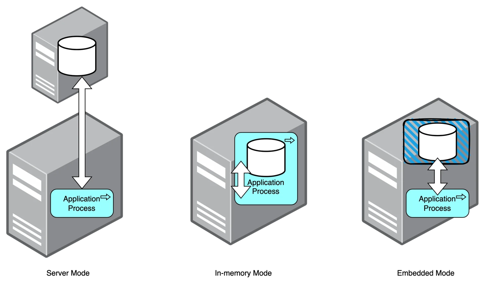
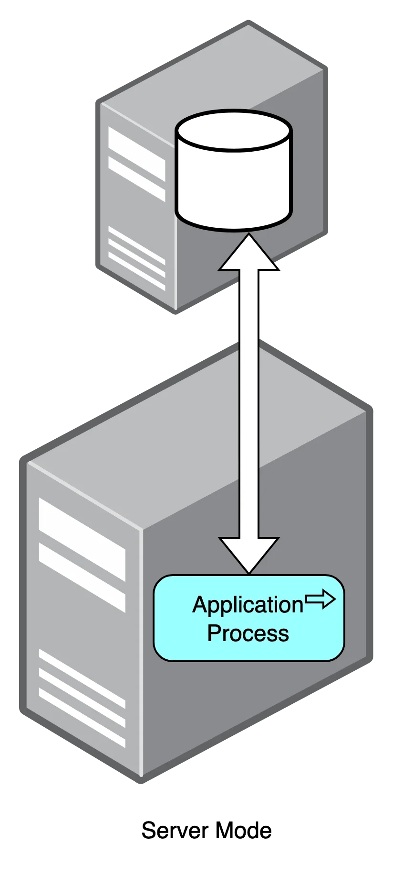
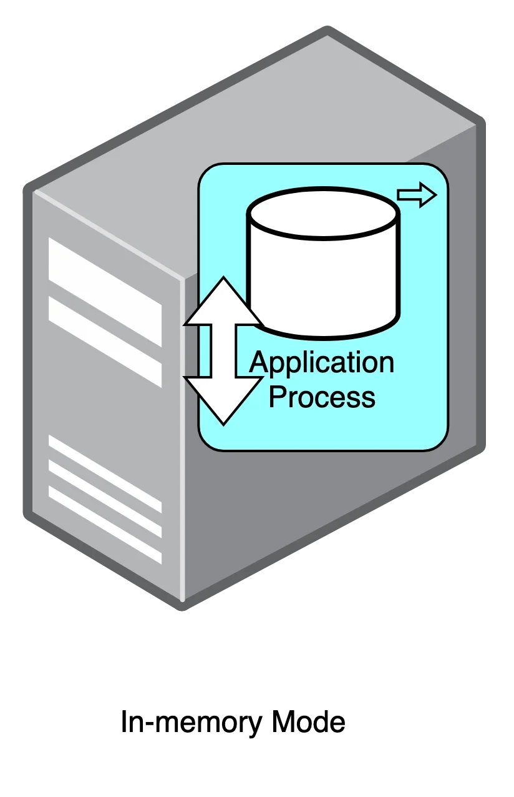
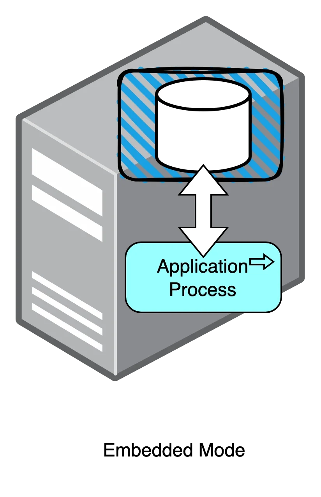
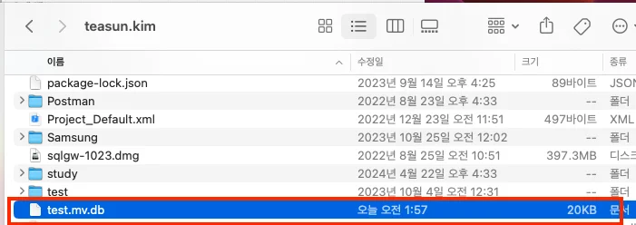
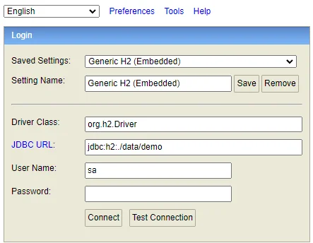
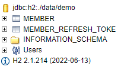

<a id="158eda9b0fe181229af9d1b42618b2f4"></a>

## <strong>DB(H2) 사용 방식 3가지</strong>

---

> 📖 
> 
> <a id="158eda9b0fe18159bd39c7d830415b9c"></a>
> 
> H2는 <code>Server Mode</code>, <code>In&#45;memory Mode</code>, <code>Embeded Mode</code> 라는 세가지 방식으로 사용 가능하다&#46; 
> 
> 
> 
> | Mode | H2 다운로드 여부 | 실행 주체 | DB 저장 위치 | 사용 용도 |
> | --- | --- | --- | --- | --- |
> | Server Mode | O | 외부 | 로컬(파일 시스템) | 배포 용도 |
> | In&#45;Memory Mode | X | 스프링 | 메모리 | 테스트 용도 |
> | Embedded Mode | X | 스프링 | 로컬(파일 시스템) | 개발 용도 |

<details>
<summary><strong>Server Mode</strong></summary>



- 직접 엔진을 설치하여 사용하는 방식&#46;

- 애플리케이션과 상관 없는 <strong><u>외부에서 DB 엔진이 구동</u></strong>된다&#46;
    - 애플리케이션과 DB가 분리되어 있기 때문에 여러 애플리케이션에서 동일한 DB를 사용하기에 적합

- <strong><u>데이터가 애플리케이션 외부에 저장</u></strong>되므로 <strong>애플리케이션을 종료해도 데이터가 사라지지 않</strong>는다&#46;

- 2 DBMS는 아래 공식 사이트에서 다운로드 가능
    [H2 Database Engine]()

</details>

<details>
<summary><strong>In&#45;memory Mode</strong></summary>



- 엔진을 설치하지 않고 <strong><u>애플리케이션 내부의 엔진을 사</u></strong>용하는 방식&#46;

- 애플리케이션을 실행하면 DB 엔진이 함께 실행되고 애플리케이션을 종료하면 DB 엔진이 함께 종료된다&#46;

- <strong><u>데이터가 애플리케이션의 메모리에 저장</u></strong>되기 때문에 <strong>애플리케이션을 종료하면 데이터가 사라진</strong>다&#46;
    - 이러한 특징으로 인해 단위 테스트 등에서 많이 사용

<details>
<summary><code>build&#46;gradle</code> 및 <code>application&#46;properties</code> 설정 &#45; 인메모리 모드</summary>

<a id="338eda9b0fe180fc8f58fe656fb48c54"></a>

```yaml
# application.yml
spring:  
    datasource:    
        driver-class-name: org.h2.Driver
        url: jdbc:h2:mem:{DB 이름}
        username: sa
        password:
```

<a id="338eda9b0fe18081b166d0abc45f86a7"></a>

```yaml
# application.properties
spring.datasource.driver-class-name=org.h2.Driver
spring.datasource.url=jdbc:h2:mem:{DB 이름}
spring.datasource.username=sa
spring.datasource.password=
```

- datasource의 url에는 일반적으로 DB 서버의 호스트와 포트 번호, DB 이름 등의 접속 정보 기재하지만,

-  <strong><u>H2에서는 여기에 </u></strong><strong><u><code>mem</code></u></strong><strong><u>을 기재</u></strong>하여 DB를  <strong><u>메모리 자체에서 사용</u></strong>하겠다고 설정

</details>

</details>

<details>
<summary>Embedded Mode</summary>



- 엔진을 설치하지 않고 <strong><u>애플리케이션 내부의 엔진을 사용</u></strong>하는 방식
    - 임베디드(내장) 모드는 인메모리 모드와 동일하게 애플리케이션에 DB 엔진이 내장되어 애플리케이션과 함께 실행되고 종료됨

- <strong><u>데이터가 애플리케이션 외부에 저장</u></strong>되므로 <strong>애플리케이션을 종료해도 데이터가 사라지지 않</strong>는다&#46;

<details>
<summary><code>build&#46;gradle</code> 및 <code>application&#46;properties</code> 설정 &#45; 임베디드 모드</summary>

<a id="338eda9b0fe18060b913de8713efe278"></a>

```yaml
# application.yml
spring:
  datasource:
      driver-class-name: org.h2.Driver
      url: jdbc:h2:{DB가 저장될 경로}    
      username: sa    
      password:
```

<a id="338eda9b0fe1808e82f2c469f9f5f2d9"></a>

```yaml
# application.properties
spring.datasource.driver-class-name=org.h2.Driver
spring.datasource.url=jdbc:h2:{DB가 저장될 경로}
spring.datasource.username=sa
spring.datasource.password=
```

- 인메모리 모드와 차이점
    - <code>mem</code>이 아닌 <code>jdbc&#58;h2&#58;</code> 입력

    - 이후 바로 DB가 저장될 경로 입력

</details>

</details>

<details>
<summary>실습 &#45; H2 <code>Embedded Mode</code></summary>

> ☝🏻 
> 
> <a id="338eda9b0fe1802185caea8a6851bd65"></a>
> 
> OS 환경에 따라 생성 경로 값
> 
> - 윈도우 환경
>     - 현재 사용자의 이름이 &#34;user&#34;라면 데이터베이스 파일의 경로는 <strong><code>C&#58;&#92;Users&#92;user&#92;test&#46;mv&#46;db</code></strong>가 될 수 있다&#46;
> 
> - 리눅스나 macOS 환경
>     -  <strong><code>/home/username/test&#46;mv&#46;db</code></strong> 또는 
> 
>     - <strong><code>/Users/username/test&#46;mv&#46;db</code></strong>의 형태

<details>
<summary>H2 DB 셋업</summary>

<a id="338eda9b0fe180efaeb9d3ae28083902"></a>

```yaml
# application.yml
spring:
  datasource:
      driver-class-name: org.h2.Driver
      url: jdbc:h2:~/test
      username: {유저 이름}
      password: {유저 비밀번호}
```

<a id="338eda9b0fe1804da2badd9863475165"></a>

```yaml
# application.properties
spring.datasource.driver-class-name=org.h2.Driver
spring.datasource.url=jdbc:h2:~/test
spring.datasource.username={위와 동일한 유저 이름}
spring.datasource.password={위와 동일한 유저 비밀번호}
```

- 적절한 DB 이름(파일명), 유저명, 비밀번호 설정



- 이와 같이 설정하고 애플리케이션을 실행하면 H2 데이터베이스 파일은 사용자의 홈 디렉토리 아래에 <strong><code>test&#46;mv&#46;db</code></strong> 파일로 저장된다&#46; 
    - <strong><code>&#126;</code></strong><strong>&#58; </strong>현재 사용자의 홈 디렉토리

</details>

<details>
<summary>생성된 DB 접속</summary>


- 이 파일을 별도로 삭제하지 않는 이상 애플리케이션의 실행 여부와 관계 없이 데이터가 사라지지 않는다&#46;

- 브라우저에서 H2 콘솔에 접속하는 방법은 인메모리 모드와 동일하다&#46;





- Driver Class, JDBC URL, User Name, Password를 위의 설정 그대로 입력하면 접속되는 것을 볼 수 있다&#46;

- application 설정과 동일한 정보로 H2 콘솔에 접속 가능 (Embedded Mode)

</details>

<details>
<summary><strong>&#91;🤬 오류&#93;</strong><strong> In&#45;memory Mode 를 사용하는데 h2&#45;console 로 데이터 조회 안됨</strong></summary>

<a id="338eda9b0fe180e6b1d0f2608b1213d9"></a>

<strong>Embedded Mode</strong> 가 아닌 <strong>In&#45;memory Mode </strong>를 사용하고 싶은데 h2&#45;console 에서 데이터 조회가 안될 수 있다&#46; 

- H2 콘솔에서 데이터를 조회할 때 데이터가 보이지 않는 문제는 애플리케이션이 생성하는 데이터베이스 인스턴스와 H2 콘솔이 접근하는 데이터베이스 인스턴스가 서로 다를 때 발생

<a id="338eda9b0fe180eb912bd74fbb56a545"></a>

이 경우, 애플리케이션과 H2 콘솔이 같은 데이터베이스 인스턴스를 사용하도록 in&#45;memory mode 상태에서 h2 설정을 아래와 같이 바꿔준다

<a id="338eda9b0fe1804499e9e33c82b359e0"></a>

```yaml
url: 'jdbc:h2:mem:test;DB_CLOSE_DELAY=-1;DB_CLOSE_ON_EXIT=FALSE'
```

- <strong><code>DB&#95;CLOSE&#95;DELAY=&#45;1</code></strong>
    - 이 옵션은 데이터베이스를 열린 상태로 유지한다&#46;

    - <strong><code>DB&#95;CLOSE&#95;DELAY</code></strong> 설정은 데이터베이스가 언제 닫힐지를 제어합한다&#46;

    - <code>&#45;</code><strong><code>1</code></strong> 값은 애플리케이션이 실행되는 동안 데이터베이스가 계속 열려 있도록 한다&#46;

- <strong><code>DB&#95;CLOSE&#95;ON&#95;EXIT=FALSE</code></strong>
    - 이 옵션은 애플리케이션이 종료될 때 데이터베이스의 자동 종료를 방지한다&#46;

</details>

</details>
