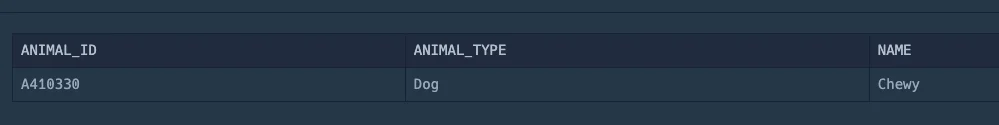

<a id="158eda9b0fe181adb511d64616a35462"></a>

## 문제

<a id="158eda9b0fe18051bc18db18afb25000"></a>

### <strong>문제 설명</strong>

<a id="158eda9b0fe180f6b9caf819f7001dcc"></a>

<code>ANIMAL&#95;INS</code> 테이블은 동물 보호소에 들어온 동물의 정보를 담은 테이블입니다&#46; <code>ANIMAL&#95;INS</code> 테이블 구조는 다음과 같으며, <code>ANIMAL&#95;ID</code>, <code>ANIMAL&#95;TYPE</code>, <code>DATETIME</code>, <code>INTAKE&#95;CONDITION</code>, <code>NAME</code>, <code>SEX&#95;UPON&#95;INTAKE</code>는 각각 동물의 아이디, 생물 종, 보호 시작일, 보호 시작 시 상태, 이름, 성별 및 중성화 여부를 나타냅니다&#46;

|  |  |  |
| --- | --- | --- |
| NAME | TYPE | NULLABLE |
| ANIMAL&#95;ID | VARCHAR(N) | FALSE |
| ANIMAL&#95;TYPE | VARCHAR(N) | FALSE |
| DATETIME | DATETIME | FALSE |
| INTAKE&#95;CONDITION | VARCHAR(N) | FALSE |
| NAME | VARCHAR(N) | TRUE |
| SEX&#95;UPON&#95;INTAKE | VARCHAR(N) | FALSE |

<a id="158eda9b0fe1807fb46dd154f448e55e"></a>

<code>ANIMAL&#95;OUTS</code> 테이블은 동물 보호소에서 입양 보낸 동물의 정보를 담은 테이블입니다&#46; <code>ANIMAL&#95;OUTS</code> 테이블 구조는 다음과 같으며, <code>ANIMAL&#95;ID</code>, <code>ANIMAL&#95;TYPE</code>, <code>DATETIME</code>, <code>NAME</code>, <code>SEX&#95;UPON&#95;OUTCOME</code>는 각각 동물의 아이디, 생물 종, 입양일, 이름, 성별 및 중성화 여부를 나타냅니다&#46; <code>ANIMAL&#95;OUTS</code> 테이블의 <code>ANIMAL&#95;ID</code>는 <code>ANIMAL&#95;INS</code>의 <code>ANIMAL&#95;ID</code>의 외래 키입니다&#46;

|  |  |  |
| --- | --- | --- |
| NAME | TYPE | NULLABLE |
| ANIMAL&#95;ID | VARCHAR(N) | FALSE |
| ANIMAL&#95;TYPE | VARCHAR(N) | FALSE |
| DATETIME | DATETIME | FALSE |
| NAME | VARCHAR(N) | TRUE |
| SEX&#95;UPON&#95;OUTCOME | VARCHAR(N) | FALSE |

<a id="158eda9b0fe18025bdd6c4cb7931c585"></a>

보호소에서 중성화 수술을 거친 동물 정보를 알아보려 합니다&#46; 보호소에 들어올 당시에는 중성화<a href="https://school.programmers.co.kr/learn/courses/30/lessons/59045#fn1">1</a>되지 않았지만, 보호소를 나갈 당시에는 중성화된 동물의 아이디와 생물 종, 이름을 조회하는 아이디 순으로 조회하는 SQL 문을 작성해주세요&#46;

<a id="158eda9b0fe180448c82de1f5541234b"></a>

### 예시

<a id="158eda9b0fe180e2b20bf533c76c1359"></a>

예를 들어, <code>ANIMAL&#95;INS</code> 테이블과 <code>ANIMAL&#95;OUTS</code> 테이블이 다음과 같다면

<a id="158eda9b0fe180af9c5ed31d87773a26"></a>

<code>ANIMAL&#95;INS</code>

|  |  |  |  |  |  |
| --- | --- | --- | --- | --- | --- |
| ANIMAL&#95;ID | ANIMAL&#95;TYPE | DATETIME | INTAKE&#95;CONDITION | NAME | SEX&#95;UPON&#95;INTAKE |
| A367438 | Dog | 2015&#45;09&#45;10 16&#58;01&#58;00 | Normal | Cookie | Spayed Female |
| A382192 | Dog | 2015&#45;03&#45;13 13&#58;14&#58;00 | Normal | Maxwell 2 | Intact Male |
| A405494 | Dog | 2014&#45;05&#45;16 14&#58;17&#58;00 | Normal | Kaila | Spayed Female |
| A410330 | Dog | 2016&#45;09&#45;11 14&#58;09&#58;00 | Sick | Chewy | Intact Female |

<a id="158eda9b0fe1808191daeffd01ce2739"></a>

<code>ANIMAL&#95;OUTS</code>

|  |  |  |  |  |
| --- | --- | --- | --- | --- |
| ANIMAL&#95;ID | ANIMAL&#95;TYPE | DATETIME | NAME | SEX&#95;UPON&#95;OUTCOME |
| A367438 | Dog | 2015&#45;09&#45;12 13&#58;30&#58;00 | Cookie | Spayed Female |
| A382192 | Dog | 2015&#45;03&#45;16 13&#58;46&#58;00 | Maxwell 2 | Neutered Male |
| A405494 | Dog | 2014&#45;05&#45;20 11&#58;44&#58;00 | Kaila | Spayed Female |
| A410330 | Dog | 2016&#45;09&#45;13 13&#58;46&#58;00 | Chewy | Spayed Female |

- Cookie는 보호소에 들어올 당시에 이미 중성화되어있었습니다&#46;

- Maxwell 2는 보호소에 들어온 후 중성화되었습니다&#46;

- Kaila는 보호소에 들어올 당시에 이미 중성화되어있었습니다&#46;

- Chewy는 보호소에 들어온 후 중성화되었습니다&#46;

<a id="158eda9b0fe1803ea9e0f82e67942c8b"></a>

따라서 SQL문을 실행하면 다음과 같이 나와야 합니다&#46;

|  |  |  |
| --- | --- | --- |
| ANIMAL&#95;ID | ANIMAL&#95;TYPE | NAME |
| A382192 | Dog | Maxwell 2 |
| A410330 | Dog | Chewy |

<a id="158eda9b0fe1813d953ad576a2b971a6"></a>

## 풀이

<a id="158eda9b0fe180d9bec6dafafcd371a6"></a>

### 1차 풀이 &#45; fail

<a id="158eda9b0fe18049a270eca18c6fe3f9"></a>

```sql
SELECT 
    I.ANIMAL_ID, 
    I.ANIMAL_TYPE, 
    I.NAME
FROM
    ANIMAL_INS I
JOIN
    ANIMAL_OUTS O
ON
    I.ANIMAL_ID = O.ANIMAL_ID
WHERE
    I.SEX_UPON_INTAKE LIKE 'Intact%' 
    AND O.SEX_UPON_OUTCOME LIKE 'Spayed%';
```

- 결과 값
    

- 원인 및 해결
    <a id="158eda9b0fe180e6a34cf9a99f83b657"></a>

     중성화 시, 수컷은  <code>Neutered Male</code>, 암컷은 <code>Spayed Female</code> 으로 표현됨

    <a id="158eda9b0fe180cb96b5f46f8b399c9e"></a>

    여기서 수컷의 경우가 생략됨

    <a id="158eda9b0fe180359fdaf21b8fa3706f"></a>

    → <code>O&#46;SEX&#95;UPON&#95;OUTCOME LIKE &#39;Neutered%</code> 추가

<a id="158eda9b0fe180cbba9aef0ca46f2bbd"></a>

```sql
SELECT I.ANIMAL_ID, I.ANIMAL_TYPE, I.NAME
FROM ANIMAL_INS I
JOIN ANIMAL_OUTS O ON O.ANIMAL_ID = I.ANIMAL_ID
WHERE I.SEX_UPON_INTAKE LIKE 'Intact%' 
    AND ( O.SEX_UPON_OUTCOME LIKE 'Spayed%'
    OR O.SEX_UPON_OUTCOME LIKE 'Neutered%' )
ORDER BY I.ANIMAL_ID
```
