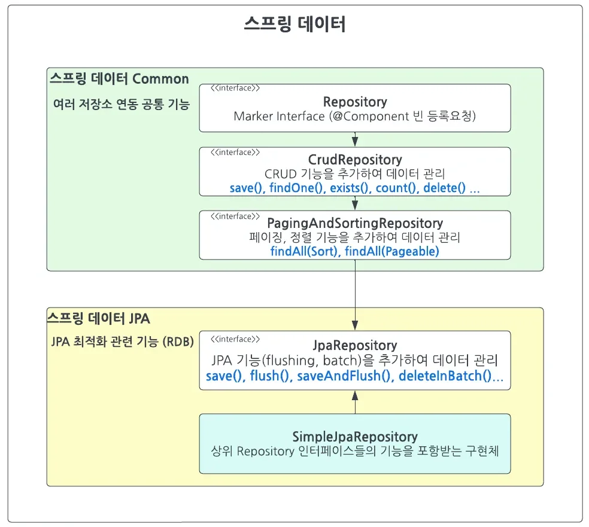

<a id="159eda9b0fe181d79463e3c896bdb2c5"></a>

## JpaRepository 쿼리 기능

---

> 📖 
> 
> <a id="159eda9b0fe1813c8cc7f5ba2c326cfc"></a>
> 
> SprintData Common 의 <code>CRUDRepository</code> &#43; <code>PagingAndSortingRepository</code> 이 쿼리기능을 제공한다&#46;

<details>
<summary>스프링 데이터 Common &#43; </summary>



- Repository 는 MarkerInterface 로 특별한 기능은 없다&#46;

- Repository &#126; JpaRepository 까지는 <strong><code>&#64;NotRepositoryBean</code></strong> 이 붙어있는 인터페이스이다&#46;

- JpaRepository&#60;Entity,ID&#62; 붙이면  <strong><code>SimpleJpaReository</code></strong> 사용한 구현체를 자동으로 생성하고  빈으로 등록한다&#46;
    -  <strong><code>&#64;SpringBootApplication</code></strong> 을 통해 자동으로 붙여지는 <strong><code>&#64;EnableJpaRepositories</code></strong> 의 <strong>JpaRepositoriesRegistrar</strong> 를 통해서 등록된다&#46;

    - <strong>JpaRepositoriesRegistrar 는 ImportBeanDefinitionRegistrar</strong> 의 구현체이다&#46;

    - <strong>ImportBeanDefinitionRegistrar</strong> 는 프로그래밍을 통해 빈을 주입해준다&#46;

</details>

<a id="159eda9b0fe180da8fc3e62684a9397f"></a>

## JpaRepository 쿼리 사용 방법 &#45; QueryMethod

---

> 📖 
> 
> <a id="6c72e7085c674a4f8987439a18f490a3"></a>
> 
> Spring Data JPA에서는 메서드 이름을 사용하여 쿼리를 정의할 수 있다&#46; &#45; <code>QueryMethod</code>

<details>
<summary>QueryMethod 문법 </summary>

> ✏️ 
> 
> <a id="1d95180586314782996ac73dd3e9ec21"></a>
> 
> <code>리턴타입</code> {<code>접두어</code>}{<code>도입부</code>}By{<code>프로퍼티 표현식</code>}(<code>조건식</code>)&#91;(And&#124;Or){<code>프로퍼티 표현식</code>}(<code>조건식</code>)&#93;(OrderBy{<code>프로퍼티</code>}Asc&#124;Desc) (<code>매개변수</code>&#46;&#46;&#46;)

|  |  |
| --- | --- |
| 접두어 | Find, Get, Query, Count, &#46;&#46;&#46; |
| 도입부 | Distinct, First(N), Top(N) |
| 프로퍼티 표현식 | Person&#46;Address&#46;ZipCode =&#62; find(Person)ByAddress&#95;ZipCode(&#46;&#46;&#46;) |
| 조건식 | IgnoreCase, Between, LessThan, GreaterThan, Like, Contains, &#46;&#46;&#46; |
| 정렬 조건 | OrderBy{프로퍼티}Asc&#124;Desc |
| 리턴 타입 | E, Optional&#60;E&#62;, List&#60;E&#62;, Page&#60;E&#62;, Slice&#60;E&#62;, Stream&#60;E&#62; |
| 매개변수 | Pageable, Sort |

</details>

<details>
<summary>실습 코드 ( Query &#43; SQL, JPQL, QueryDSL )</summary>

<details>
<summary>Case 1)  기본</summary>

<a id="159eda9b0fe1803087faf7051680659f"></a>

```java
// QueryMethod
List<User> findByNameAndPassword(String name, String password);

// SQL 
SELECT * FROM user u WHERE u.name = ? AND u.password = ?;

// JPQL
@Query("SELECT u FROM User u WHERE u.name = :name AND u.password = :password")
List<User> findByNameAndPassword(@Param("name") String name, @Param("password") String password);

// QueryDSL
QUser user = QUser.user;
List<User> users = queryFactory
    .selectFrom(user)
    .where(user.name.eq(name).and(user.password.eq(password)))
    .fetch();
```

</details>

<details>
<summary>Case 2)  distinct (중복제거)</summary>

<a id="abab7ab93eff45268ad13f6ac48371d5"></a>

```java
// QueryMethod
List<User> findDistinctUserByNameOrPassword(String name, String password);
List<User> findUserDistinctByNameOrPassword(String name, String password);

// SQL 
SELECT DISTINCT * FROM user u WHERE u.name = ? OR u.password = ?;

// JPQL
@Query("SELECT DISTINCT u FROM User u WHERE u.name = :name OR u.password = :password")
List<User> findDistinctUserByNameOrPassword(@Param("name") String name, @Param("password") String password);

// QueryDSL
QUser user = QUser.user;
List<User> users = queryFactory
    .selectDistinct(user)
    .where(user.name.eq(name).or(user.password.eq(password)))
    .fetch();
```

</details>

<details>
<summary>Case 3)  ignoring case (대소문자 무시)</summary>

<a id="ad4c5a0c2e144606b34e1eac7e7f8ee4"></a>

```java
// QueryMethod
List<User> findByNameIgnoreCase(String name);
	// AllIgnoreCase를 통해 모든 인자 대소문자 무시 
List<User> findByNameAndPasswordAllIgnoreCase(String name, String password);

// SQL 
SELECT * FROM user u WHERE LOWER(u.name) = LOWER(?);

// JPQL
@Query("SELECT u FROM User u WHERE LOWER(u.name) = LOWER(:name)")
List<User> findByNameIgnoreCase(@Param("name") String name);

// QueryDSL
QUser user = QUser.user;
List<User> users = queryFactory
    .selectFrom(user)
    .where(user.name.equalsIgnoreCase(name))
    .fetch();
```

</details>

<details>
<summary>Case 4)  정렬 ( <code>ORDER BY</code> )</summary>

- <code>ASC</code>&#58; 오름차순 정렬

- <code>DESC</code>&#58; 내림차순 정렬

<a id="cf1f713a7bf2409280ffc4bfa3957609"></a>

```java
// QueryMethod
List<Person> findByNameOrderByNameAsc(String name);
List<Person> findByNameOrderByNameDesc(String name);

// SQL 
SELECT * FROM person p WHERE p.name = ? ODER BY p.name ASC (DESC)

// JPQL
@Query("SELECT p FROM Person p WHERE p.name = :name ORDER BY p.name ASC (DESC)")
List<User> findByNameAndPassword(@Param("name") String name);

// QueryDSL
QPerson person = QPerson.person;
List<Person> persons = queryFactory
    .selectFrom(person)
    .where(person.name.eq(name))
    .orderBy(person.name.asc())
    .fetch();
```

</details>

<details>
<summary>Case 5)  페이징 <strong>(Pageable / Slice)</strong></summary>

<a id="4c0b2cd65a854997acc07bc39fc71c9c"></a>

```java
// QueryMethod
Page<User> findByName(String name, Pageable pageable);

// SQL 
SELECT * FROM user u WHERE u.name = ? LIMIT ? OFFSET ?;
	// Page 사용 시, 카운트 쿼리도 자동 수행됨
SELECT COUNT(*) FROM user u WHERE u.name = ?;

// JPQL
@Query("SELECT u FROM User u WHERE u.name = :name")
Page<User> findByName(@Param("name") String name, Pageable pageable);

// QueryDSL
QUser user = QUser.user;
List<User> users = queryFactory
    .selectFrom(user)
    .where(user.name.eq(name))
    .offset(pageable.getOffset())
    .limit(pageable.getPageSize())
    .fetch();

long total = queryFactory
    .selectFrom(user)
    .where(user.name.eq(name))
    .fetchCount();
```

</details>

<details>
<summary>Case 6)  스트림</summary>

> ⚠️ 
> 
> <a id="6d47b81dc1504350b80b51827f5d94ad"></a>
> 
> <strong>스트림 자원 관리</strong>
> 
> <a id="159eda9b0fe180f59947e2d01227a261"></a>
> 
> 스트림은 사용 후 <u>자원을 반드시 해제</u>해야 하므로 <strong>try&#45;with&#45;resources</strong>를 사용하는 것을 추천

<a id="4c4a1cf6e26e4724956fd3467fd54234"></a>

```java
// QueryMethod
	// stream 다쓴후 자원 해제 해줘야하므로 try with resource 사용추천
Stream<User> readAllByNameNotNull();

// SQL 
	// SQL 자체로는 스트림 처리에 대한 직접적인 지원이 없다.
SELECT * FROM user u WHERE u.name IS NOT NULL;

// JPQL
@Query("SELECT u FROM User u WHERE u.name IS NOT NULL")
Stream<User> readAllByNameNotNull();

// QueryDSL
QUser user = QUser.user;
Stream<User> userStream = queryFactory
    .selectFrom(user)
    .where(user.name.isNotNull())
    .stream();
```

</details>

<details>
<summary>🧐 QueryDSL로 정의한 SQL 메서드들은 service 단에서 어떻게 처리되는가?</summary>

- 질문을 수정함

> 🧐 Repository에서 정의하는 QueryDSL은 어떻게 메서드에 사용되는가?

- Repository &#45; QueryDSL 예시
    <a id="159eda9b0fe18085b024ec3dc8e9d3c2"></a>

    ```java
    @Repository
    public class UserRepositoryImpl implements UserRepositoryCustom {

        private final JPAQueryFactory queryFactory;

        public UserRepositoryImpl(JPAQueryFactory queryFactory) {
            this.queryFactory = queryFactory;
        }
    		
        @Override
        public List<User> findByName(String name) {
            QUser user = QUser.user;

            return queryFactory
                .selectFrom(user)
                .where(user.name.eq(name))
                .fetch();
        }

        @Override
        public Stream<User> readAllByNameNotNull() {
            QUser user = QUser.user;

            return queryFactory
                .selectFrom(user)
                .where(user.name.isNotNull())
                .stream();
        }
    }
    ```

<details>
<summary>Service 사용 예시</summary>

<a id="159eda9b0fe1808e89f3ec29811606c2"></a>

```java
@Service
public class UserService {

    private final UserRepository userRepository;

    public UserService(UserRepository userRepository) {
        this.userRepository = userRepository;
    }

    // 일반 데이터 조회
    public List<User> getUsersByName(String name) {
        // 비즈니스 로직 처리 후 Repository 호출
        if (name == null || name.isEmpty()) {
            throw new IllegalArgumentException("Name cannot be null or empty");
        }
        return userRepository.findByName(name);
    }

    // 스트림 처리
    public void processUsersWithNameNotNull() {
        try (Stream<User> userStream = userRepository.readAllByNameNotNull()) {
            userStream.forEach(user -> {
                // 사용자 데이터 처리 로직
                System.out.println("Processing user: " + user.getName());
            });
        } catch (Exception e) {
            // 예외 처리
            e.printStackTrace();
        }
    }
}
```

</details>

</details>

</details>

<a id="159eda9b0fe1808785b3eb5cf7884594"></a>

## JpaRepository 효율적인 사용법

---

> 📖 
> 
> <a id="71df1d39454e4c25a69bfec82e2560d3"></a>
> 
> Spring Data JPA 사용하여  repository를 정의 시, JpaRepsoitory  인터페이스를 상속한 엔티티 repositroy 인터페이스를 만들어서 처리한다&#46; <br>이때, <u><code>default</code></u><u> 키워드를 사용</u>하여 <u>interface 레이어</u>에서 아래와 같이 정의 시, 더 효율적으로 코드를 작성 및 관리할 수 있다&#46; 

<details>
<summary>1&#46; <strong><u>Optional 제거</u></strong> &#45; <code>default</code>로 인터페이스에서 Exception 정의</summary>

- Spring Data JPA의 <code>findByXX</code> 메서드는 <u>기본적으로 Optional을 반환</u>한다&#46;

- 이로 인해 비지니스 로직에서 Optional 처리를 위한 추가적인 작업이 필요하는데, <br>이를 <code>default</code> 메서드를 활용하면 <u><code>interface</code></u><u>에서 처리</u>할 수 있다&#46;
    - <u>비지니스 로직</u>에서 <u>Optional 처리 로직을 중복 작성</u> 문제 해결

<a id="159eda9b0fe180b786f9efd0241f30f3"></a>

```java
public interface UserRepository extends JpaRepository<User, Long> {

		// Default 메소드를 사용하여 findById의 Optional을 내부적으로 처리
		default User findUserByIdOrElseThrow(Long id) {
        return findById(id)
		        .orElseThrow(() -> new DataNotFoundException("User not found with id: " + id));
    }
}
```

</details>

<details>
<summary>2&#46; 메서드명 간소화 &#45; <code>default</code>를 통한 <u>간소화한 호출 메서드</u> 생성</summary>

- Spring Data JPA를 사용하다 보면 복잡한 쿼리 때문에 메서드명이 길어져 가독성을 해치는 경우가 있다&#46; 

- 이럴 때, <u><code>default</code></u><u> 메서드를 활용</u>하면 긴 <u>메서드명을 간결하고 명확하게 표현</u>할 수 있다&#46;
    - <code>findAllByCategoryAndPriceGreaterThanEqualAndPriceLessThanEqualOrderByPriceAsc</code>
        <a id="159eda9b0fe1808d8264cbd984f9fa4e"></a>

        → <code>findProductsByCategoryAndPriceRange</code>

<a id="159eda9b0fe1800faf69e431c039838d"></a>

```java
public interface ProductRepository extends JpaRepository<Product, Long> {

		// 기존의 긴 쿼리 메소드
		List<Product> findAllByCategoryAndPriceGreaterThanEqualAndPriceLessThanEqualOrderByPriceAsc(String category, BigDecimal minPrice, BigDecimal maxPrice);
		
		// Default 메소드를 사용하여 간결한 메소드명 제공
		default List<Product> findProductsByCategoryAndPriceRange(String category, BigDecimal minPrice, BigDecimal maxPrice) {
        return findAllByCategoryAndPriceGreaterThanEqualAndPriceLessThanEqualOrderByPriceAsc(category, minPrice, maxPrice);
    }
}
```

</details>

<details>
<summary>3&#46; 비지니스 로직 통합 (그냥 참고만)</summary>

- 여러 기본 제공 메서드를 하나의 고차 작업으로 결합할 수도 있다&#46;

- 그러나 Spring Data JPA의 Repository는 <u>Data Access Layer의 일부</u>로, <u>데이터베이스와의 상호작용만을 담당하는 것이 일반적</u>이기 때문에 이 부분은 <u>보통 서비스 레이어에서 처리</u>한다&#46;
    - 단일 책임 원칙 (SRP)

<a id="159eda9b0fe180f8b7c9f73a324acd7f"></a>

```java
public interface UserRepository extends JpaRepository<User, Long> {

		// 사용자 ID로 사용자를 찾고, 존재할 경우 연락처 정보를 업데이트하는 메소드
		default void updateUserContact(Long userId, String newContact) {
        findById(userId).ifPresent(user -> {
            user.setContact(newContact);
            save(user);
        });
    }
}
```

</details>
