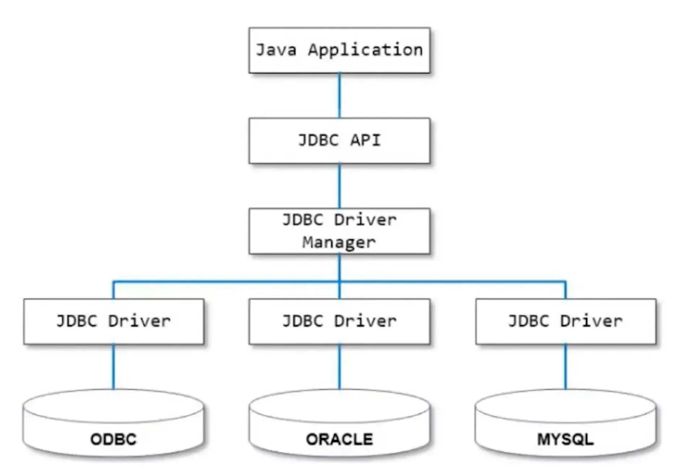
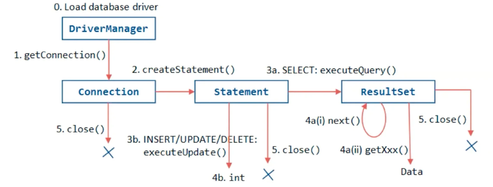

## <strong> 데이터베이스 Driver 역할 및 종류</strong>

---

> 📖 
> 
> 
> 
> <code>데이터베이스 드라이버 DB Driver)</code>는 <strong><u>애플리케이션과 데이터베이스 간의 통신을 중개</u></strong>하는 역할한다&#46;
> 
> - <strong><u>애플리케이션 요청</u></strong>을 <strong>DB가 이해할 수 있는 언어로 변환</strong>하여 처리

드라이버의 종류

- 다양한 DB 시스템 마다 호환되는 드라이버가 있다&#46; 
    - <code>Oracle</code>, <code>MySQL</code>, <code>PostgreSQL</code> 등 각 <strong><u>DB 제품에 맞는 특정 드라이버가 필요</u></strong>함

## 데이터베이스 Driver 동작

---

> 📖 
> 
> 
> 
> <code>DB Driver</code>는 <strong><u>애플리케이션과  데이터베이스 간의 데이터 교환을 조절하고 관리</u></strong>하는 역할을 한다&#46; 

> ✏️ <strong><u>JDBC Driver Manager</u></strong>는 애플리케이션이 실행되고 있는 <strong><u>런타임 시점</u></strong> 아래와 같은 동작을 한다&#46; 
> 
> 
> 
> 1. <code>Connection(연결)</code>을 생성하여 <strong><u>쿼리를 요청할 수 있는 상태</u></strong>로 만듬
> 
> 1. <code>Statement(상태)</code>를 생성하여 <strong><u>쿼리를 요청</u></strong>함
> 
> 1. <code>ResultSet(결과셋)</code>을 생성해 <strong><u>쿼리 결과를 받</u></strong>아올 수 있도록함

Driver 동작 방식

1&#46; 연결 초기화

- 요청 수신
    - 애플리케이션은 데이터베이스 작업을 시작하기 위해 드라이버에 연결을 요청한다&#46; 

    - 이는 마치 항공편이 이륙 허가를 받기 위해 관제탑에 요청하는 것과 유사하다&#46; 

- 연결 설정
    - 드라이버는 데이터베이스 서버에 로그인하고 필요한 설정을 수행하여 연결을 완료한다&#46; 

    - 이 과정은 네트워크 정보, 인증 자격 증명 등을 사용하여 이루어진다&#46; 

2&#46; SQL 전송 및 실행

- SQL 명령 변환
    - 애플리케이션에서 발송된 SQL 명령을 받은 드라이버는 <strong><u>해당 명령을 데이터베이스가 이해할 수 있는 형태로 변환</u></strong>한다&#46; 

- 명령 처리
    - 변환된 명령은 데이터베이스 서버로 전송되어 실행된다&#46;

    - 데이터베이스는 쿼리를 처리하고, 요구된 데이터를 검색하거나 데이터에 변화를 준다&#46;

3&#46; 결과 처리

- 결과 수신
    - 데이터베이스에서 작업의 결과를 보내면, 드라이버는 이 결과를 받아 애플리케이션에서 실행할 수 있는 형태로 변환한다&#46; 

- 결과 전달
    - 최종적으로, 드라이버는 이 결과를 애플리케이션에 전달한다&#46; 

    - 애플리케이션은 이 정보를 사용자에게 표시하거나 다음 작업을 진행한다&#46; 

4&#46; 연결 종료

- 연결 해제
    - 작업이 완료되면, 드라이버는 데이터베이스 서버와의 연결을 종료한다&#46; 

    - 자원을 정리하고 다음 세션을 위해 시스템을 초기화합니다&#46;

