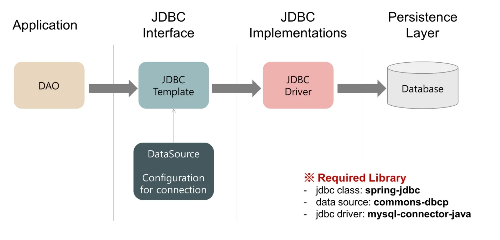

<a id="158eda9b0fe18163b9d4edabb88186f5"></a>

## 데이터베이스 데이터를 외부에서 다루기 (JDBC)

---

> 📖 
> 
> <a id="158eda9b0fe181039241e1deb4d39e6f"></a>
> 
> DBC를 통해 Java 애플리케이션에서 데이터베이스 데이터를 직접 다루는 방법을 학습한다&#46; 
> 
> - Connection, Statement, ResultSet 객체의 사용법을 배우며, 간단한 CRUD 작업을 실습

<a id="158eda9b0fe18178a9bcf48e0329698f"></a>

### <strong>Spring Boot 의 JDBC 라이브러리</strong>

> ✏️ 
> 
> <a id="338eda9b0fe18001a886cf51c6605348"></a>
> 
> <strong>Spring Boot와 JDBC</strong>
> 
> <a id="338eda9b0fe18065bd01d0f4d04a20fc"></a>
> 
> Spring Boot는 데이터베이스 연결을 쉽게 구성할 수 있도록 다양한 JDBC 드라이버를 지원한다&#46; 이를 통해 개발자는 복잡한 설정 없이 데이터베이스와의 연결을 쉽게 구성할 수 있다&#46;

<details>
<summary><strong><code>spring&#45;boot&#45;starter&#45;jdbc</code></strong></summary>

- Spring Boot 프로젝트에서 JDBC를 통해 데이터베이스와 상호작용하기 위해 사용되는 스타터 패키지이다&#46;

- 이 스타터 패키지는 데이터베이스 작업을 수행하는 데 필요한 주요 의존성과 자동 구성 기능을 제공한다&#46;
    - 데이터베이스와의 연결을 쉽고 빠르게 구성할 수 있도록 도와주는 브릿지 역할

<a id="338eda9b0fe18075a35bf9f4c1a9578a"></a>

<strong>주요 내용</strong>

- <strong><code>JDBC API 지원</code></strong>
    - JDBC API를 통해 SQL 데이터베이스에 접근하고 작업을 수행할 수 있다&#46;

- <strong><code>DataSource 구성</code></strong>
    - 데이터 소스 연결을 위한 기본적인 설정을 자동으로 구성

    - 이는 데이터베이스 연결을 관리하는 데 필수적인 요소이다&#46;

- <strong><code>JdbcTemplate</code></strong>
    - <strong><code>JdbcTemplate</code></strong>은 Spring의 핵심 클래스 중 하나로, JDBC 작업의 많은 번거로움을 줄여 준다&#46;

    - SQL 쿼리 실행, 결과 세트 처리, 예외 처리 등을 단순화한다&#46;

<a id="338eda9b0fe1803e9d6fd9201e8de779"></a>

<strong>주요 장점</strong>

- <strong><code>간소화된 데이터베이스 연결</code></strong>
    - <strong><code>DataSource</code></strong> 설정과 <strong><code>JdbcTemplate</code></strong> 사용을 통해 복잡한 JDBC 코드를 간소화할 수 있다&#46;

- <strong><code>자동 구성</code></strong>
    - Spring Boot의 자동 구성 기능은 개발자가 데이터베이스 연결에 필요한 대부분의 구성을 자동으로 처리할 수 있도록 한다&#46;

- <strong><code>효율적인 예외 처리</code></strong>
    - Spring의 <strong><code>DataAccessException</code></strong>을 통해 JDBC에서 발생하는 예외를 Spring의 일관된 예외 체계로 변환한다&#46;

</details>

<a id="338eda9b0fe18002bf64edcf1aa60565"></a>

### <strong> JDBC</strong>

[GitHub &#45; thesun4sky/jdbc at jdbc]()

- <code>build&#46;gradle</code>
    <a id="158eda9b0fe1813fb1bdfeb6a4f358fc"></a>

    ```groovy
    ...

    dependencies {
        // 애플리케이션이 종료되지 않고 웹 서버를 띄울 수 있도록 도와줍니다. (H2 Console 웹페이지 띄우기)
        implementation 'org.springframework.boot:spring-boot-starter-web'

        // 스프링 부트 애플리케이션에서 JDBC를 사용하기 위한 모든 필수 의존성을 포함하고 있습니다.
        // JDBC API를 통해 데이터베이스와의 연결 및 SQL 쿼리 실행을 쉽게 할 수 있도록 도와줍니다.
        implementation 'org.springframework.boot:spring-boot-starter-jdbc'

        // H2는 자바 기반의 인메모리 데이터베이스로,
        // 로컬 개발 및 테스트 환경에서 DB 서버를 별도로 구축하지 않고 사용할 수 있게 해 줍니다.
        // 빠르고 경량이며 설정이 간단하다는 장점이 있습니다.
        runtimeOnly 'com.h2database:h2'
    }
    ```

- <code>resources/application&#46;yml</code>
    <a id="338eda9b0fe180aba6afe87aaa4b8ff5"></a>

    ```yaml
    spring:
      application.name: jdbc
      # H2 Database 설정
      datasource:
        driver-class-name: org.h2.Driver
        #url: 'jdbc:h2:mem:test'   # H2 DB 연결 주소 (In-Memory Mode)
        url: 'jdbc:h2:~/test'    # H2 DB 연결 주소 (Embedded Mode)
        username: sa        # H2 DB 접속 ID (사용자 지정)
        password:        # H2 DB 접속 PW (사용자 지정)

      # H2 Console 설정
      h2:
        console: # H2 DB를 웹에서 관리할 수 있는 기능
          enabled: true           # H2 Console 사용 여부
          path: /h2-console       # H2 Console 접속 주소
    ```

- <code>JdbcApplication&#46;java</code>
    <a id="338eda9b0fe180f9853aea9f7620aaea"></a>

    ```java
    package com.thesun4sky.jdbc;

    import java.sql.Connection;
    import java.sql.DriverManager;
    import java.sql.PreparedStatement;
    import java.sql.SQLException;

    import org.springframework.boot.SpringApplication;
    import org.springframework.boot.autoconfigure.SpringBootApplication;

    @SpringBootApplication
    public class JdbcApplication {

    	public static void main(String[] args) throws SQLException {
    		// 어플리케이션 실행 컨텍스트 생성
    		SpringApplication.run(JdbcApplication.class, args);

    		// 데이터베이스 연결정보
    		String url = "jdbc:h2:mem:test"; 	// spring.datasource.url
    		String username = "sa";				// spring.datasource.username

    		try (Connection connection = DriverManager.getConnection(url, username, null)) {
    			try {
    				// 테이블 생성
    				String creatSql = "CREATE TABLE USERS (id SERIAL, username varchar(255))";
    				try (PreparedStatement statement = connection.prepareStatement(creatSql)) {
    					statement.execute();
    				}

    				// 데이터 추가
    				String insertSql = "INSERT INTO USERS (username) VALUES ('teasun kim')";
    				try (PreparedStatement statement = connection.prepareStatement(insertSql)) {
    					statement.execute();
    				}

    				// 데이터 조회
    				String selectSql = "SELECT * FROM USERS";
    				try (PreparedStatement statement = connection.prepareStatement(selectSql)) {
    					var rs = statement.executeQuery();
    					while (rs.next()) {
    						System.out.printf("%d, %s", rs.getInt("id"), rs.getString("username"));
    					}
    				}
    			} catch (SQLException e) {
    				if (e.getMessage().equals("ERROR: relation \"account\" already exists")) {
    					System.out.println("USERS 테이블이 이미 존재합니다.");
    				} else {
    					throw new RuntimeException();
    				}
    			}
    		}
    	}
    }
    ```

<a id="338eda9b0fe180c1b5c2cbaab19048ba"></a>

### JDBC Template (QueryMapper)

> ❗ 
> 
> <a id="338eda9b0fe180c0b719d59f660c5106"></a>
> 
> JDBC 로 직접 SQL을 작성했을때의 문제
> 
> - SQL 쿼리 요청시 중복 코드 발생
> 
> - DB별 예외에 대한 구분 없이 Checked Exception (SQL Exception) 처리
> 
> - Connection, Statement 등&#46;&#46; 자원 관리를 따로 해줘야함
>     - 자원 해제 안해주면 메모리 꽉차서 서버가 죽음

> ✏️ 
> 
> <a id="338eda9b0fe18014bfa8d50388efd270"></a>
> 
> 이러한 문제 해결을 위해 Persistence Framewor가 등장했다&#46; 
> 
> - <strong><code>SQL Mappe</code></strong><strong>r</strong> &#58; JDBC Template, MyBatis 
> 
> - <strong><code>ORM</code></strong> &#58; JPA, Hibernate

<details>
<summary><strong>JDBC Template (RowMapper)</strong></summary>



- QL Mapper 첫번째 주자로 JDBCTemplate 에 <strong>RowMapper </strong>탄생
    - 쿼리 수행 결과와 객채 필드 매핑

    - <strong>RowMapper</strong> 로 응답필드 매핑코드 재사용

    - Connection, Statement, ResultSet 반복적 처리 대신 해줌

- But, 결과값을 객체 인스턴스에 매핑하는데 여전히 많은 코드가 필요함

</details>

<details>
<summary>실습 1 &#45; <strong>JDBCTemplate</strong></summary>

[GitHub &#45; thesun4sky/jdbc]()

- <code>JdbcApplication</code><strong><code>&#46;java</code></strong><strong>  &#45; 앱 실행</strong>
    <a id="338eda9b0fe180978f73dfd41c92441f"></a>

    ```java
    package com.thesun4sky.jdbc;

    import org.springframework.boot.SpringApplication;
    import org.springframework.boot.autoconfigure.SpringBootApplication;

    @SpringBootApplication
    public class JdbcApplication {

    	public static void main(String[] args) {
    		// 어플리케이션 실행 컨텍스트 생성
    		var context = SpringApplication.run(JdbcApplication.class, args);
    		// 데이터 조회 클래스 빈 조회
    		var repository = context.getBean(DataRepository.class);

    		// 테이블 생성
    		repository.createTable();
    		// 유저정보 추가
    		repository.insertUser("Teasun Kim");
    		// 유저정보 조회
    		System.out.println("User Name: " + repository.findUserNameById(1L));
    	}
    }
    ```

- <strong><code>DataRepository&#46;java</code></strong><strong>  &#45; JdbcTemplate</strong>
    <a id="338eda9b0fe18075903cd6392add0a7c"></a>

    ```java
    package com.thesun4sky.jdbc;

    import org.springframework.beans.factory.annotation.Autowired;
    import org.springframework.jdbc.core.JdbcTemplate;
    import org.springframework.stereotype.Repository;

    @Repository
    public class DataRepository {

    	@Autowired
    	private JdbcTemplate jdbcTemplate;

    	// 테이블 생성
    	public void createTable() {
    		jdbcTemplate.execute("CREATE TABLE IF NOT EXISTS users (id SERIAL, name VARCHAR(255))");
    	}

    	// 사용자 추가 (Create)
    	public void insertUser(String name) {
    		jdbcTemplate.update("INSERT INTO users (name) VALUES (?)", name);
    	}

    	// 사용자 ID로 이름 조회 (Read)
    	public String findUserNameById(Long id) {
    		return jdbcTemplate.queryForObject(
    			"SELECT name FROM users WHERE id = ?",
    			new Object[]{id},
    			String.class
    		);
    	}

    	// 사용자 이름 변경 (Update)
    	public void updateUser(Long id, String newName) {
    		jdbcTemplate.update("UPDATE users SET name = ? WHERE id = ?", newName, id);
    	}

    	// 사용자 삭제 (Delete)
    	public void deleteUser(Long id) {
    		jdbcTemplate.update("DELETE FROM users WHERE id = ?", id);
    	}
    }
    ```

</details>

<details>
<summary>실습 2 &#45; <strong>JDBCTemplate </strong> <strong>RowMappe</strong></summary>

> ✏️ 
> 
> - <strong><code>RowMapper&#46;mapRow</code></strong><strong> </strong>
>     - RowMapper 를 상속받아 mapRow() 메서드를 구현
> 
>     - JDBCTemplate 에서 row 응답을 mapRow() 메서드에 rs 파라미터로 넘겨주어 객체에 매핑하기 쉽도록 도와준다&#46;
> 
> - <strong><code>findUserById</code></strong>
>     - jdbcTemplate&#46;queryForObject() 메서드에서는 두번쨰 인자로 <strong>RowMapper </strong>를 넣어줄 경우 해당 <strong>RowMapper </strong>의<strong> mapRow() </strong>메서드를 사용하여 응답을 하도록 동작한다&#46;

[GitHub &#45; thesun4sky/jdbc at jdbc&#45;template]()

- <code>UserRowMapper&#46;java</code>
    <a id="338eda9b0fe1801aa41dce4b478512bc"></a>

    ```java
    // UserRowMapper.java
    import java.sql.ResultSet;
    import java.sql.SQLException;

    import org.springframework.jdbc.core.RowMapper;


    public class UserRowMapper implements RowMapper<User> {

    	// JDBCTemplate 에서 row 응답을 mapRow() 메서드에 rs 파라미터로 넘겨주어 객체에 매핑하기 쉽도록 도와준다.
      @Override
      public User mapRow(ResultSet rs, int rowNum) throws SQLException {
        var user = new User();
        user.setId(rs.getInt("ID"));
        user.setName(rs.getString("NAME"));
        return user;
      }
    }
    ```

- <strong><code>DataRepository&#46;java</code></strong><strong>  &#45; JdbcTemplate</strong>
    <a id="338eda9b0fe18086a761dd38838aa190"></a>

    ```java
     ...

    // 사용자 ID로 User 조회 (Read)
    public User findUserById(Long id) {
    	return jdbcTemplate.queryForObject(
    		"SELECT * FROM users WHERE id = ?",
    		new UserRowMapper(),  // 이자리에 매퍼를 생성자로 넣어주면 됨
    		id
    	);
    }
    ```

</details>
