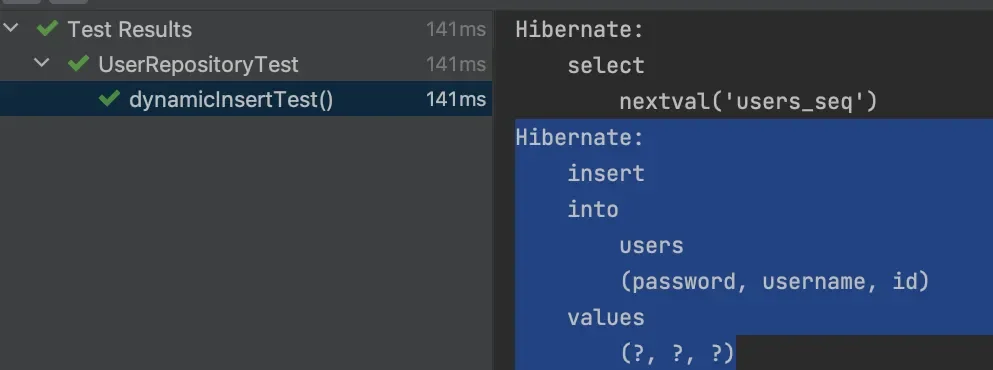
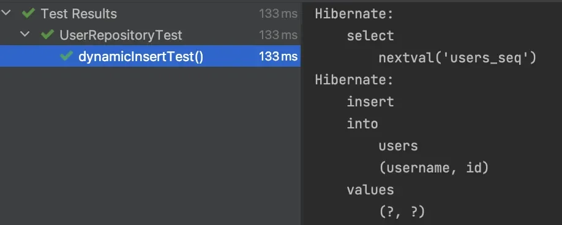
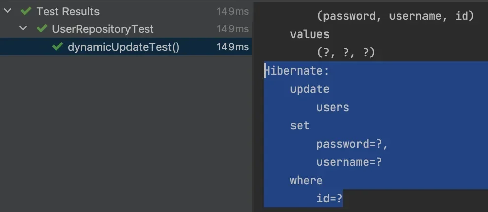
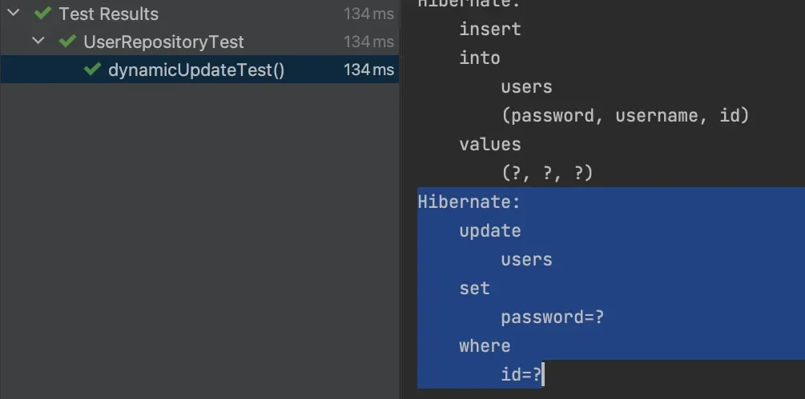

<a id="159eda9b0fe181e6978cd2e860abe660"></a>

## &#64;DynamicInsert

---

> 📖 
> 
> <a id="159eda9b0fe18107878cf42e2e9db116"></a>
> 
> <code>&#64;DynamicInsert</code>를  엔티티에 적용 시, <code>Insert</code> 쿼리를 날릴 때 <u>null 인 값은 제외</u>하고 <u>쿼리문 생성</u>된다&#46; 

<details>
<summary>적용 방법</summary>

- Entity 에 <strong><code>&#64;DynamicInsert</code></strong> 어노테이션 설정
    <a id="159eda9b0fe180419f92fdaec46ec248"></a>

    ```java
    @DynamicInsert
    	public class User {
      ...
    }
    ```

</details>

<details>
<summary>테스트 </summary>

<details>
<summary>&#91; 테스트 코드 &#93;</summary>

<details>
<summary>엔티티 &#45; User</summary>

<a id="159eda9b0fe180948d63fc65b8595411"></a>

```java
@Entity
public class User {
		@Id
		@GenerateValue(sterag = ... )
		private Long id;
		
		private String username;
		
		private String password;
		
		@Builder
		public User(String name, String password) {
				this.name = name;
				this.password = password;
		}
}
```

</details>

<a id="159eda9b0fe18092a3adfec0b07413b1"></a>

```java
@Test
  void dynamicInsertTest() {
    // given
	    // password 설정을 하지 않음 -> password = null 
    var newUser = User.builder().username("user").build();

    // when
    userRepository.save(newUser);

    // then
    // 부분 생성 쿼리
  }
```

</details>

<details>
<summary><code>&#64;DynamicInsert</code> 적용 전</summary>

- null 값인 password도 같이 포함해서 쿼리 날림
    <a id="159eda9b0fe180fbb79fdeb5c789f7d3"></a>

    ```java
    Hibernate: 
        insert 
        into
            users
            (password, username, id) 
        values
            (?, ?, ?)  // 141ms 소요
    ```



</details>

<details>
<summary><code>&#64;DynamicInsert</code> 적용 후</summary>

- null 값인 password를 제외한 쿼리를 날림
    <a id="f1c8593a59694a36a3312160466bbb08"></a>

    ```java
    Hibernate: 
        insert 
        into
            users
            (username, id) 
        values
            (?, ?)  // 133ms 소요
    ```



</details>

</details>

> ✏️ 
> 
> <a id="21db71f207634fc6b7d6f0aed5707435"></a>
> 
> <code>&#64;DynamicInsert</code> 적용 시, Null에 해당되는 필드를 무시할 수 있어, 처리 속도에서 이점이 있다&#46; 
> 
> - 위 예시의 경우 필드 차이가 1개밖에 안되서 10ms 정도밖에 차이가 안나지만 필드가 많아질수록 속도에 더큰 이점을 얻을 수 있따&#46; 

<a id="159eda9b0fe18055b7e7fded000a6d35"></a>

## <strong>&#64;DynamicUpdate</strong>

---

> 📖 
> 
> <a id="5ad936b1e3f54a5d90f01282315f45f6"></a>
> 
> <code>&#64;DynamicUpdate</code>를  엔티티에 적용 시, <code>Updat</code> 쿼리를 날릴 때 <u>null 인 값은 제외</u>하고 <u>쿼리문 생성</u>이 가능하다&#46;

<details>
<summary>적용 방법</summary>

- 적용하려는 엔티티에 <code>&#64;DynamicUpdate</code> Annotation 선언

<a id="159eda9b0fe1808c91f8d98ec08fe378"></a>

```java
@DynamicUpdate
public class User {
  ...
}
```

</details>

<details>
<summary>테스트 </summary>

<details>
<summary>&#91; 테스트 코드 &#93;</summary>

<details>
<summary>엔티티 &#45; User</summary>

<a id="6c2381cb4bfa4b808405400ed2e5889a"></a>

```java
@Entity
public class User {
		@Id
		@GenerateValue(sterag = ... )
		private Long id;
		
		private String username;
		
		private String password;
		
		@Builder
		public User(String name, String password) {
				this.name = name;
				this.password = password;
		}
		
		public void updatePassword(String password) {
				this.password = password;
		}
}
```

</details>

<a id="82cd1fa756944bd28a28856bd6a171bd"></a>

```java
@Test
  void dynamicUpdateTest() {
    // given
    var newUser = User.builder().username("user").password("password").build();
    userRepository.save(newUser);

    // when
	    // save 이후 update 시에는 password 필드에만 변화가 생긴다. 
		  // 즉, 변화가 없는 username 필드는 null과 동일하다고 판단한다. 
    newUser.updatePassword("new password");
    userRepository.save(newUser);

    // then
    // 부분 수정 쿼리
  }
```

</details>

<details>
<summary><code>&#64;DynamicUpdate</code> 적용 전</summary>

- 변화가 없는 username 필드도 같이 update 처리가 된다&#46; 

<a id="c9753e55143f433b97bf2abd6e8a2275"></a>

```java
Hibernate: 
    update
        users 
    set
        password=?,
        username=? 
    where
        id=?  // 149ms
```



</details>

<details>
<summary><code>&#64;DynamicUpdate</code> 적용 후</summary>

- 업데이트가 되지  않은 username 필드가 제외된 update 쿼리를 날린다&#46; 

<a id="78d7f03c52654b01bb9f6543ee28edde"></a>

```java
Hibernate: 
    update
        users 
    set
        password=? 
    where
        id=?  // 134ms
```



</details>

</details>
