> 📌 
> 
> <a id="158eda9b0fe181fd9325dd004e67b56b"></a>
> 
> 내일배움캠프&#95;스프링 7기  &#45; 7주차 개인 프로젝트
> 
> > 기간&#58; 24년 12월 10일 &#126; 12월 20일
> 
> - 팀 노션&#58; <a href="https://beautiful-college-c84.notion.site/1582dc3ef51481b3908df5f7fdc77244">페이지</a> 
> 
> - 발제&#58; <a href="https://beautiful-college-c84.notion.site/c57246ba11c946d38d69251eed0cf5a0">페이지</a> 

<a id="158eda9b0fe18158a0f0c3d925b1928f"></a>

### 이번주 학습 내용

<a id="158eda9b0fe18143bbeff588a2257f62"></a>

<a href="#/post/158eda9b-0fe1-8083-a08b-e1249279d10f">페이지</a> 

<a id="338eda9b0fe180cea8e5de293b181728"></a>

<a href="#/post/1c3eda9b-0fe1-8156-b449-f8e742a95d76">페이지</a> 

<a id="338eda9b0fe1803ba33ee675a9a28f98"></a>

<a href="#/post/1c3eda9b-0fe1-81b0-b5b3-cdd0065097a4">페이지</a> 

<a id="338eda9b0fe1800fb040f70a0e12b82c"></a>

<a href="#/post/1c3eda9b-0fe1-8115-b158-c17d844ab16c">페이지</a> 

<a id="158eda9b0fe180a88962d5d0534070ed"></a>

<a href="#/post/158eda9b-0fe1-80e4-9ed4-fbb6c1a12b3b">페이지</a> 

<a id="338eda9b0fe180dbbca3ea24ba5f99d5"></a>

### 과제

<details>
<summary>요구사항 정의 및 해결</summary>

<details>
<summary>필수 </summary>

- [x] 1&#46; 트랜잭션  이해
    <details>
    <summary>문제</summary>

    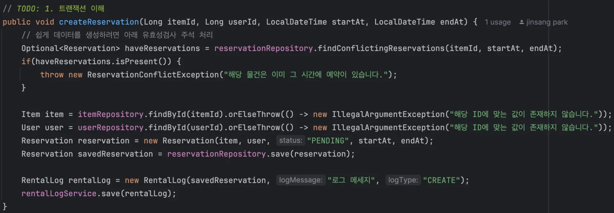

    - 설명
        - <code>createReservation</code> 함수 40&#126;43번째 유효성 검사 로직

        -  데이터를 쉽게 생성 → 해당 유효성 검사 코드를 주석처리

    - 현재 조건
        - <code>createReservation</code> 함수는 Reservation, RentalLog 총 2번 저장을 수행

        - <code>rentalLogService&#46;save</code> 함수는 무조건 <code>RuntimeException</code>이 발생

        - 그럼에도 Reservation 저장 가능

    - 개선
        - <code>createReservation</code> 함수 내에서
            - 하나라도 에러가 발생하면 모두 저장되지 않도록 수정

            - 하나라도 에러가 발생하지 않으면 모두 저장되도록 수정

            - All or Nothing

    </details>

    <details>
    <summary>해결</summary>

    <a id="160eda9b0fe1805696c4cae48cb5ef01"></a>

    ```java
    @Transactional
    public void createReservation(Long itemId, Long userId, LocalDateTime startAt, LocalDateTime endAt) {

        // 쉽게 데이터를 생성하려면 아래 유효성검사 주석 처리
        // 예약 충돌 검사
        List<Reservation> haveReservations = reservationRepository.findConflictingReservations(itemId, startAt, endAt);
        if(!haveReservations.isEmpty()) {
            throw new ReservationConflictException("해당 물건은 이미 그 시간에 예약이 있습니다.");
        }

        Item item = itemRepository.findById(itemId).orElseThrow(() -> new IllegalArgumentException("해당 ID에 맞는 값이 존재하지 않습니다."));
        User user = userRepository.findById(userId).orElseThrow(() -> new IllegalArgumentException("해당 ID에 맞는 값이 존재하지 않습니다."));
        Reservation reservation = new Reservation(item, user, "PENDING", startAt, endAt);
        Reservation savedReservation = reservationRepository.save(reservation);
        reservationRepository.flush();

        RentalLog rentalLog = new RentalLog(savedReservation, "로그 메세지", "CREATE");
        rentalLogService.save(rentalLog);
    }
    ```

    <a id="160eda9b0fe180c19a86fe7ca24b4e15"></a>

    상위 메서드(<code>createReservation</code>)에 <code>&#64;Transacional</code> 선언 후, 하위 메서드<code>rentalLogService&#46;save()</code>에 영속성 전이를 발생 시켜 하나의 트랜잭션으로 관리한다&#46;

    <a id="160eda9b0fe180159cc1ebf4abc3a1bb"></a>

    따라서 하위 메서드에서 에러 발생 시, 상위 메서드까지 트랜잭션이 전파되어 같이 롤백 처리된다&#46;

    - 결과 확인
        - 트랜잭션 적용 전
            - <u><code>RentalLog</code></u><u> 저장에 실패</u>해도 예약 정보는 DB에 저장됨
                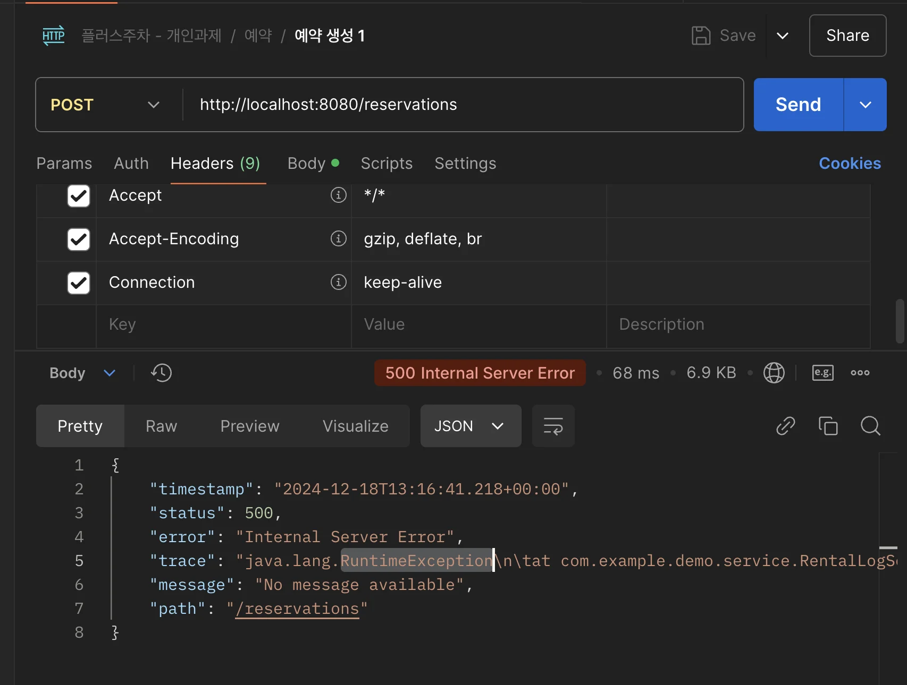

                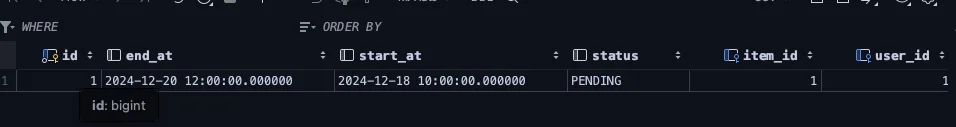

        - 하나의 트랜잭션으로 묶은 후
            - <code>RentalLog</code> 저장 실패 시, 같이 롤백 처리되어 예약 정보도 저장되지 않음
                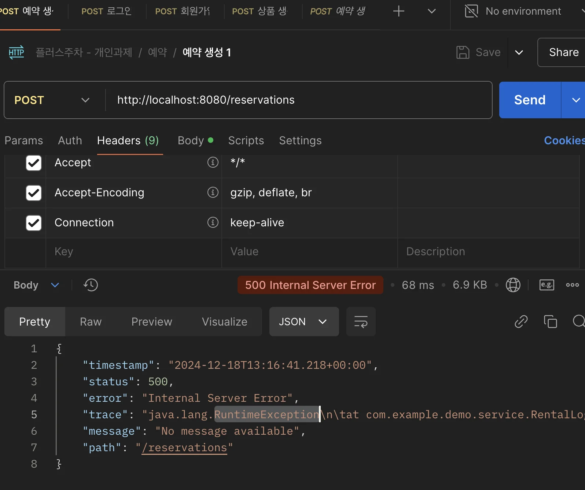

                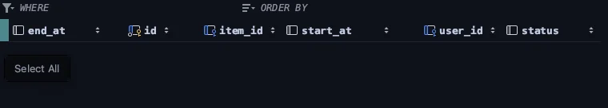

    </details>

- [x] 2&#46; 인가 이해
    <details>
    <summary>문제</summary>

    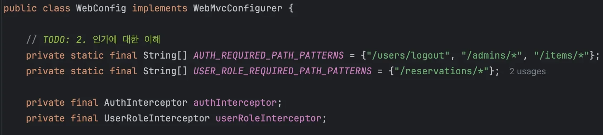

    - <em><code>AUTH&#95;REQUIRED&#95;PATH&#95;PATTERNS</code></em>&#58; 사용하기 위해 인증이 필요한 API 

    - <em><code>USER&#95;ROLE&#95;REQUIRED&#95;PATH&#95;PATTERNS</code></em>&#58; 사용하기 위해 USER 권한이 필요한 API

    - <code>AuthInterceptor</code>&#58; 로그인 여부를 확인하는 Interceptor

    - <code>UserRoleInterceptor</code>&#58; USER 권한을 확인하는 Interceptor 

    - 현재 조건
        - <code>/admins</code> 시작하는 URL을 로그인 한 사용자는 모두가 요청할 수 있다&#46;

    - 개선
        - <code>/admins</code> 들어오는 요청은 ADMIN 권한을 만들어서 해당 권한이 아니면 요청할 수 없게 만든다&#46;

    </details>

    <details>
    <summary>해결</summary>

    <details>
    <summary>&#91; 코드 &#93; GlobalConstants</summary>

    <a id="eda59c24d9634a5fa501533f3ca388db"></a>

    ```java
    package com.example.demo.constants;

    public abstract class GlobalConstants {
        public static final String USER_AUTH = "USER_AUTH";
        public static final String ADMIN_AUTH = "ADMIN_AUTH";
    }

    ```

    </details>

    <details>
    <summary>&#91; 코드 &#93;  AdminRoleInterceptor</summary>

    <a id="160eda9b0fe18024b8e9dd7b29e66582"></a>

    ```java
    package com.example.demo.interceptor;

    import com.example.demo.constants.GlobalConstants;
    import com.example.demo.dto.Authentication;
    import com.example.demo.entity.Role;
    import com.example.demo.exception.UnauthorizedException;
    import jakarta.servlet.http.HttpServletRequest;
    import jakarta.servlet.http.HttpServletResponse;
    import jakarta.servlet.http.HttpSession;
    import org.springframework.http.HttpStatus;
    import org.springframework.stereotype.Component;
    import org.springframework.web.servlet.HandlerInterceptor;

    @Component
    public class AdminRoleInterceptor implements HandlerInterceptor {

        @Override
        public boolean preHandle(HttpServletRequest request, HttpServletResponse response, Object handler) throws UnauthorizedException {

            HttpSession session = request.getSession(false);

            if (session == null) {
                throw new UnauthorizedException(HttpStatus.UNAUTHORIZED, "세션이 끊어졌습니다.");
            }

            Authentication authentication = (Authentication) session.getAttribute(GlobalConstants.ADMIN_AUTH);

            Role role = authentication.getRole();

            if (role != Role.ADMIN) {
                throw new UnauthorizedException(HttpStatus.UNAUTHORIZED, "Admin 권한이 필요합니다.");
            }

            return true;
        }
    }

    ```

    </details>

    <details>
    <summary>&#91; 코드 &#93; WebConfig</summary>

    <a id="5584eab74a3e4b9695e0f0d925eb429b"></a>

    ```java
    package com.example.demo.config;

    import com.example.demo.entity.Role;
    import com.example.demo.filter.AuthFilter;
    import com.example.demo.filter.RoleFilter;
    import com.example.demo.interceptor.AdminRoleInterceptor;
    import com.example.demo.interceptor.AuthInterceptor;
    import com.example.demo.interceptor.UserRoleInterceptor;
    import jakarta.servlet.Filter;
    import lombok.RequiredArgsConstructor;
    import org.springframework.boot.web.servlet.FilterRegistrationBean;
    import org.springframework.context.annotation.Bean;
    import org.springframework.context.annotation.Configuration;
    import org.springframework.core.Ordered;
    import org.springframework.web.servlet.config.annotation.InterceptorRegistry;
    import org.springframework.web.servlet.config.annotation.WebMvcConfigurer;

    @Configuration
    @RequiredArgsConstructor
    public class WebConfig implements WebMvcConfigurer {

        // TODO: 2. 인가에 대한 이해
        private static final String[] AUTH_REQUIRED_PATH_PATTERNS = {"/users/logout"};

        private static final String[] ADMIN_ROLE_REQUIRED_PATH_PATTERNS = {"/admins/*", "/items/*"};

        private static final String[] USER_ROLE_REQUIRED_PATH_PATTERNS = {"/reservations/*"};

        private final AuthInterceptor authInterceptor;
        private final AdminRoleInterceptor adminRoleInterceptor;
        private final UserRoleInterceptor userRoleInterceptor;
        
        @Override
        public void addInterceptors(InterceptorRegistry registry) {
            registry.addInterceptor(authInterceptor)
                    .addPathPatterns(AUTH_REQUIRED_PATH_PATTERNS)
                    .order(Ordered.HIGHEST_PRECEDENCE);

            registry.addInterceptor(adminRoleInterceptor)
                    .addPathPatterns(ADMIN_ROLE_REQUIRED_PATH_PATTERNS)
                    .order(Ordered.HIGHEST_PRECEDENCE + 1);

            registry.addInterceptor(userRoleInterceptor)
                    .addPathPatterns(USER_ROLE_REQUIRED_PATH_PATTERNS)
                    .order(Ordered.HIGHEST_PRECEDENCE + 2);
        }

        @Bean
        public FilterRegistrationBean authFilter() {
            FilterRegistrationBean<Filter> filterRegistrationBean = new FilterRegistrationBean<>();
            filterRegistrationBean.setFilter(new AuthFilter());
            filterRegistrationBean.setOrder(Ordered.HIGHEST_PRECEDENCE);
            filterRegistrationBean.addUrlPatterns(AUTH_REQUIRED_PATH_PATTERNS);
            return filterRegistrationBean;
        }

        @Bean
        public FilterRegistrationBean adminRoleFilter() {
            FilterRegistrationBean<Filter> filterRegistrationBean = new FilterRegistrationBean<>();
            filterRegistrationBean.setFilter(new RoleFilter(Role.ADMIN));
            filterRegistrationBean.setOrder(Ordered.HIGHEST_PRECEDENCE + 1);
            filterRegistrationBean.addUrlPatterns(ADMIN_ROLE_REQUIRED_PATH_PATTERNS);
            return filterRegistrationBean;
        }

        @Bean
        public FilterRegistrationBean userRoleFilter() {
            FilterRegistrationBean<Filter> filterRegistrationBean = new FilterRegistrationBean<>();
            filterRegistrationBean.setFilter(new RoleFilter(Role.USER));
            filterRegistrationBean.setOrder(Ordered.HIGHEST_PRECEDENCE + 2);
            filterRegistrationBean.addUrlPatterns(USER_ROLE_REQUIRED_PATH_PATTERNS);
            return filterRegistrationBean;
        }
    }
    ```

    </details>

    </details>

    <details>
    <summary>🤬 오류 &#45; 관리자(ADMIN) 로그인(인가)</summary>

    - 오류
        <details>
        <summary><code>ADMIN&#95;AUTH = &#34;ADMIN&#95;AUTH&#34;</code>  추가 시,  <code>관리자(ADMIN) </code>오류 발생</summary>

        <details>
        <summary>&#91; 코드 &#93; GlobalConstants</summary>

        <a id="3a5f8860cb1f46488f957fbdad525331"></a>

        ```java
        package com.example.demo.constants;

        public abstract class GlobalConstants {
            public static final String USER_AUTH = "USER_AUTH";
            public static final String ADMIN_AUTH = "ADMIN_AUTH";
        }

        ```

        </details>

        <details>
        <summary>&#91; 코드 &#93;  AdminRoleInterceptor</summary>

        <a id="c52f7637756c4a2fba262a27ba0ccf8f"></a>

        ```java
        package com.example.demo.interceptor;

        import com.example.demo.constants.GlobalConstants;
        import com.example.demo.dto.Authentication;
        import com.example.demo.entity.Role;
        import com.example.demo.exception.UnauthorizedException;
        import jakarta.servlet.http.HttpServletRequest;
        import jakarta.servlet.http.HttpServletResponse;
        import jakarta.servlet.http.HttpSession;
        import org.springframework.http.HttpStatus;
        import org.springframework.stereotype.Component;
        import org.springframework.web.servlet.HandlerInterceptor;

        @Component
        public class AdminRoleInterceptor implements HandlerInterceptor {

            @Override
            public boolean preHandle(HttpServletRequest request, HttpServletResponse response, Object handler) throws UnauthorizedException {

                HttpSession session = request.getSession(false);

                if (session == null) {
                    throw new UnauthorizedException(HttpStatus.UNAUTHORIZED, "세션이 끊어졌습니다.");
                }

                Authentication authentication = (Authentication) session.getAttribute(GlobalConstants.ADMIN_AUTH);

                Role role = authentication.getRole();

                if (role != Role.ADMIN) {
                    throw new UnauthorizedException(HttpStatus.UNAUTHORIZED, "Admin 권한이 필요합니다.");
                }

                return true;
            }
        }

        ```

        </details>

        ---

        - 오류 발생 코드 &#45; RoleFilter
            <a id="160eda9b0fe180afbf29cf2d189598ce"></a>

            ```java
            @RequiredArgsConstructor
            public class RoleFilter implements CommonAuthFilter {

                private final Role role;

                @Override
                public void doFilter(ServletRequest servletRequest, ServletResponse servletResponse, FilterChain filterChain)
                        throws IOException, ServletException {
                    HttpSession session = findHttpSession(servletRequest);

                    Authentication authentication = (Authentication) session.getAttribute(GlobalConstants.USER_AUTH);

                    Role clientRole = authentication.getRole();

                    if (clientRole != this.role) {
                        throw new UnauthorizedException(HttpStatus.UNAUTHORIZED, role.getName() + " 권한이 필요합니다.");
                    }

                    filterChain.doFilter(servletRequest, servletResponse);
                }
            }
            ```

            <a id="160eda9b0fe180299d23c8faed194dd4"></a>

            위 필터에서 <code>GlobalConstants&#46;USER&#95;AUTH</code> 키 값으로 조회한 세션이 존재하지 않으면, 인가 오류를 발생 시킴

            - 관리자, 유저 유무를 파악하기 전이기 때문에, <code>GlobalConstants</code> &#45; <code>USER&#95;AUTH</code>, <code>ADMIN&#95;AUTH</code> 케이스를 나눠서 적용할 수 없음

        </details>

    - 해결 
        > 📌 
        > 
        > - 방법 1) 처음과 동일하게 <code>GlobalConstants&#46;USER&#95;AUTH</code>를 통해서민 세션 생성
        > 
        > - 방법 2) 오류가 발생되는 필터 제거

        <a id="160eda9b0fe1804aa2c2c91d43640eb0"></a>

        <code>Intercepter</code>로 인가 처리를하기 때문에 방법 2도 고민했으나, 원래 코드를 수정하지 않기 위해서 그냥 방법1을 사용하여 문제 해결함

        <details>
        <summary>&#91; 코드 &#93; GlobalConstants</summary>

        - ADMIN 상수 삭제

        <a id="605f0f021ded4dea953ba8972ebdcd0d"></a>

        ```java
        package com.example.demo.constants;

        public abstract class GlobalConstants {
            public static final String USER_AUTH = "USER_AUTH";
        }

        ```

        </details>

        <details>
        <summary>&#91; 코드 &#93;  AdminRoleInterceptor</summary>

        - 세션을 가져올 때, <code>USER&#95;AUTH</code> 키 값으로 사용해서 가져옴

        <a id="212ccf6481b446c4816a32b99313ee0a"></a>

        ```java
        package com.example.demo.interceptor;

        import com.example.demo.constants.GlobalConstants;
        import com.example.demo.dto.Authentication;
        import com.example.demo.entity.Role;
        import com.example.demo.exception.UnauthorizedException;
        import jakarta.servlet.http.HttpServletRequest;
        import jakarta.servlet.http.HttpServletResponse;
        import jakarta.servlet.http.HttpSession;
        import org.springframework.http.HttpStatus;
        import org.springframework.stereotype.Component;
        import org.springframework.web.servlet.HandlerInterceptor;

        @Component
        public class AdminRoleInterceptor implements HandlerInterceptor {

            @Override
            public boolean preHandle(HttpServletRequest request, HttpServletResponse response, Object handler) throws UnauthorizedException {

                HttpSession session = request.getSession(false);

                if (session == null) {
                    throw new UnauthorizedException(HttpStatus.UNAUTHORIZED, "세션이 끊어졌습니다.");
                }

                Authentication authentication = (Authentication) session.getAttribute(GlobalConstants.USER_AUTH);

                Role role = authentication.getRole();

                if (role != Role.ADMIN) {
                    throw new UnauthorizedException(HttpStatus.UNAUTHORIZED, "Admin 권한이 필요합니다.");
                }

                return true;
            }
        }

        ```

        </details>

        - 아래와 같이 로그인 및 로그아웃 정상 처리됨
            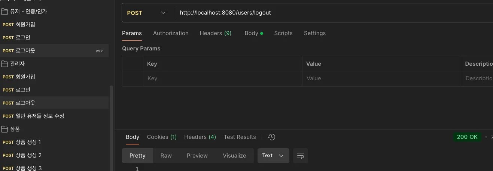

    </details>

- [x] 3&#46; N&#43;1에 대한 이해 
    <details>
    <summary>문제 </summary>

    

    - 설명
        - 모든 예약을 조회하는 기능

        -  사용자와 물건에 대한 정보를 가져오기 위해 별도로 접근하고 있다&#46;

    - 현재 조건
        - 모든 예약을 조회할 때 연관된 테이블에 있는 정보를 가져오면서 <code>N&#43;1 문제</code> 발생
            - findAll() 메서드로 모든 Reservation 엔티티를 가져온다&#46; 

            - 그 후, <code> getUser()</code>와 <code>getItem()</code> 메서드를 호출하여 각각의 사용자와 아이템 정보를 가져오는데 <br>이때, <strong><u>각 호출은 데이터베이스에 추가 쿼리를 발생</u></strong>한다&#46;  →  <code>N&#43;1 문제</code>
                <details>
                <summary>쿼리 확인</summary>

                -  select 문 3번 발생 &#45; reservation, user, item

                <a id="160eda9b0fe18029890fd1fda14ac8f4"></a>

                ```java
                Hibernate: 
                    select
                        r1_0.id,
                        r1_0.end_at,
                        r1_0.item_id,
                        r1_0.start_at,
                        r1_0.status,
                        r1_0.user_id 
                    from
                        reservation r1_0
                Hibernate: 
                    select
                        u1_0.id,
                        u1_0.email,
                        u1_0.nickname,
                        u1_0.password,
                        u1_0.role,
                        u1_0.status 
                    from
                        user u1_0 
                    where
                        u1_0.id=?
                Hibernate: 
                    select
                        i1_0.id,
                        i1_0.description,
                        m1_0.id,
                        m1_0.email,
                        m1_0.nickname,
                        m1_0.password,
                        m1_0.role,
                        m1_0.status,
                        i1_0.name,
                        o1_0.id,
                        o1_0.email,
                        o1_0.nickname,
                        o1_0.password,
                        o1_0.role,
                        o1_0.status,
                        i1_0.status 
                    from
                        item i1_0 
                    left join
                        user m1_0 
                            on m1_0.id=i1_0.manager_id 
                    left join
                        user o1_0 
                            on o1_0.id=i1_0.owner_id 
                    where
                        i1_0.id=?
                ```

                </details>

    </details>

    <details>
    <summary>해결</summary>

    - fetch Join 활용
        - repository
            <a id="160eda9b0fe18001aa57f205a4a01a3b"></a>

            ```java
            @Query("SELECT r FROM Reservation r JOIN FETCH r.user JOIN FETCH r.item")
            List<Reservation> findAllWithUserAndItem();
            ```

        - Service
            <a id="160eda9b0fe1800e8daac002a6fa7531"></a>

            ```java
            public List<ReservationResponseDto> getReservations() {
            		  List<Reservation> reservations = reservationRepository.findAllWithUserAndItem();
            		
            		  return reservations.stream().map(reservation -> {
            		      User user = reservation.getUser();
            		      Item item = reservation.getItem();
            		
            		      return new ReservationResponseDto(
            		              reservation.getId(),
            		              user.getNickname(),
            		              item.getName(),
            		              reservation.getStartAt(),
            		              reservation.getEndAt()
            		      );
            		  }).collect(Collectors.toList());
            }
            ```

        - 쿼리 확인
            - 아래와 같이 join을 사용하여 한번에 가져오는 것을 확인할 수 있다&#46;

            <a id="160eda9b0fe180328109fb19730a6f08"></a>

            ```java
            Hibernate: 
                select
                    r1_0.id,
                    r1_0.end_at,
                    i1_0.id,
                    i1_0.description,
                    i1_0.manager_id,
                    i1_0.name,
                    i1_0.owner_id,
                    i1_0.status,
                    r1_0.start_at,
                    r1_0.status,
                    u1_0.id,
                    u1_0.email,
                    u1_0.nickname,
                    u1_0.password,
                    u1_0.role,
                    u1_0.status 
                from
                    reservation r1_0 
                join
                    user u1_0 
                        on u1_0.id=r1_0.user_id 
                join
                    item i1_0 
                        on i1_0.id=r1_0.item_id
            ```

    </details>

- [x] 4&#46; DB 접근 최소화 &#45; 최적화 <code>IN</code>
    <details>
    <summary>문제</summary>

    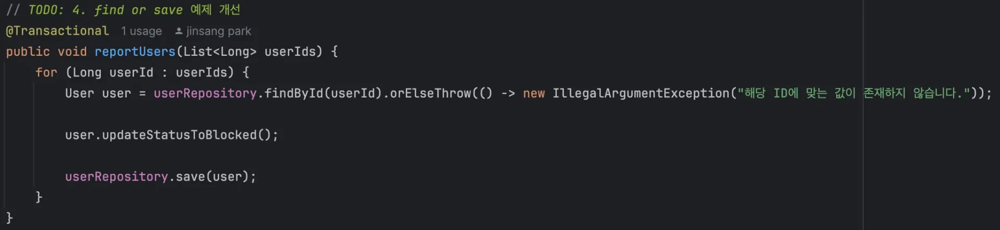

    - 설명
        - 여러 사용자에 대한 신고 기능

        -  사용자가 가진 상태를 한번에 여러 건을 변경할 수 있다&#46;

    - 현재 조건
        - 위 기능을 수행하기 위해 사용자를 하나씩 찾고 저장하고 있다&#46;

        - 데이터가 작을 때는 문제가 되지 않지만 데이터가 많아지면 DB 접근도 함께 증가한다&#46;

    - 개선
        - DB 접근을 최소화하는 방향으로 수정

    </details>

    <details>
    <summary>🧐 시도 ) <code>IN 문법</code>을 통해 한번의 쿼리로 업데이트 </summary>

    - Repository
        - IN 연산을 사용하여, 조건의 id값들을 where 절로 넘겨 한번에 조회 처리한다&#46; 

        <a id="160eda9b0fe18077983dff99768c46be"></a>

        ```java
        // 방법 1)  In 연산을 통한 조회 최적화
        List<User> findByIdIn(List<Long> userIds);
        ```

    <a id="160eda9b0fe180698f53efdf4495df09"></a>

    그러나 조회 이후 일일이 업데이트 처리를 해야 한다&#46; 

    <a id="160eda9b0fe180589a03d4056ebc03df"></a>

     결국 최적회 시, 벌크 연산을 사용해야 하기 때문에 조회 없이 인자로 받는 Id 값들로 바로 업데이트가 가능하다 &#46;

    <a id="160eda9b0fe180d4b444f9c38c6ce4ee"></a>

    따라서 벌크 업데이트로 최적화하였다&#46;

    </details>

    <details>
    <summary>해결1)  Querydsl 벌크 연산 사용</summary>

    - <code>AdminService&#46;reportUsers()</code>
        <a id="160eda9b0fe18037a8a4d5c3a3ec3fd1"></a>

        ```java
        @Transactional
        public void reportUsers(List<Long> userIds) {

            /**
             * 방법 2) Querydsl 벌크 연산 사용
             * 사용 시, 영속성 컨텍스트 와 DB 불인치 문제 주의 필요
             */
            long count = queryFactory
                    .update(user)
                    .set(user.status, "BLOCKED")
                    .where(user.id.in(userIds)) // userIds에 포함된 사용자 ID로 필터링
                    .execute();

            log.info("유저 status 'BLOKED' 처리한 유저 수: {}", count);
        }
        ```

    <details>
    <summary>테스트</summary>

    - API 호출 
        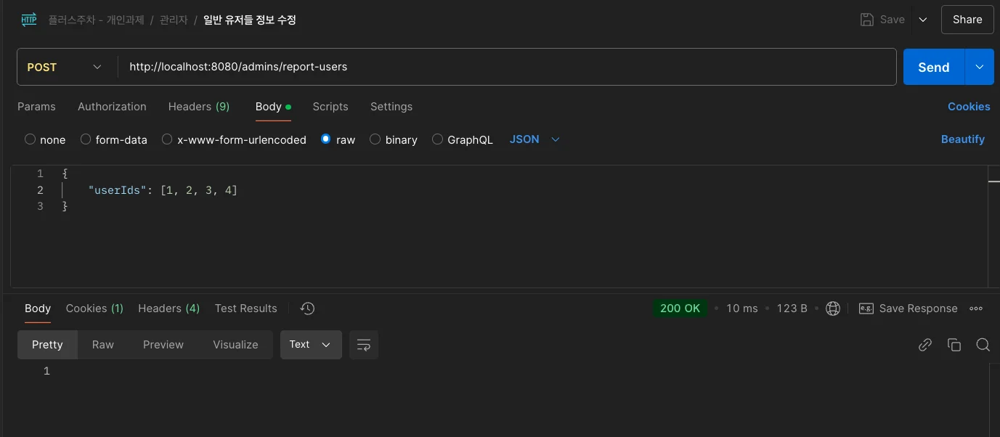

    - 쿼리 확인
        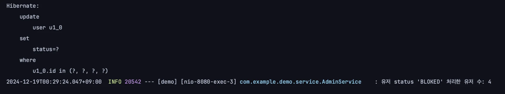

    </details>

    </details>

    <details>
    <summary>해결2) Spring Data JPA &#45; <code>&#64;Modifying</code></summary>

    - repository
        <a id="160eda9b0fe180e292e9e0baec8bd2dd"></a>

        ```java
        Repository
        public interface UserRepository extends JpaRepository<User, Long> {

            @Modifying
            @Query("UPDATE User u SET u.status = 'BLOCKED' WHERE u.id IN :userIds")
            int bulkUpdateUsersStatusBLoked(@Param("userIds") List<Long> userIds);
        }
        ```

    - service
        <a id="160eda9b0fe180d6b11ad69ca2bf5e5e"></a>

        ```java
        @Transactional
        public void reportUsers(List<Long> userIds) {

        		int count = userRepository.bulkUpdateUsersStatusBLoked(userIds);
        		log.info("유저 status 'BLOKED' 처리한 유저 수: {}", count);
        }
        ```

    <details>
    <summary>결과 확인</summary>

    - Api 호출
        - POST http&#58;//localhost&#58;8080/admins/report&#45;users

        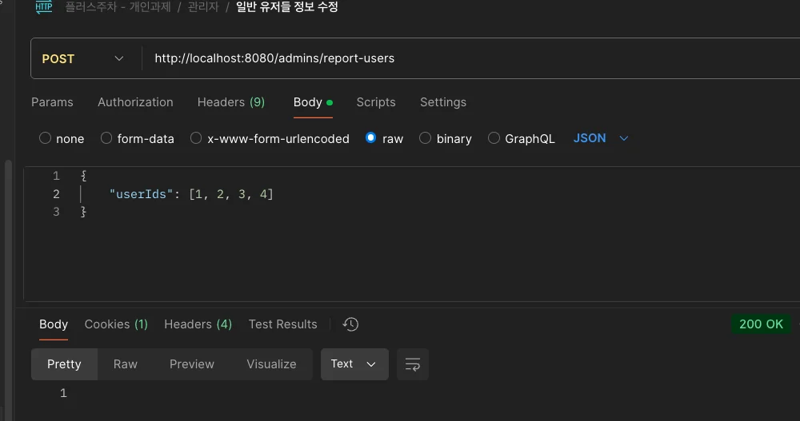

    - 쿼리  확인
        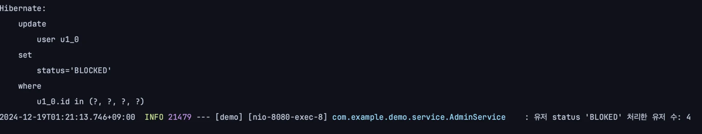

    - 테이블 확인
        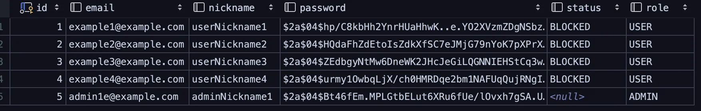

    </details>

    </details>

- [x] 5&#46; 동적 쿼리 &#45; QueryDSL
    <details>
    <summary>문제 </summary>

    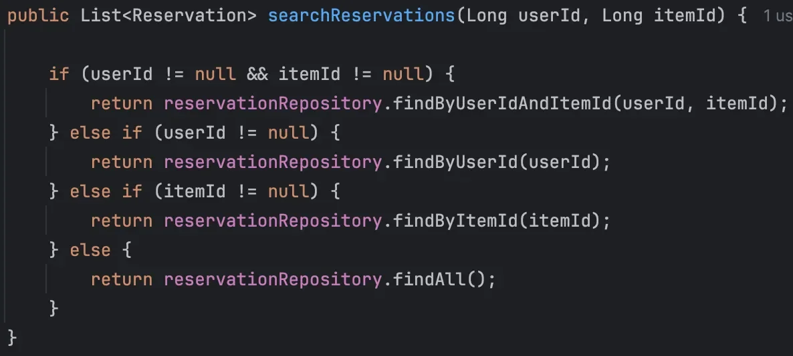

    - 설명
        - <code>userId</code>, <code>itemId</code> 조건 데이터 존재 여부에 따라 동적으로 검색을 수행한다&#46;

    - 현재 조건
        - 데이터 존재 여부에 따라 다른 JPA가 각각 호출되고 있다&#46;

    - 개선
        - <code>QueryDSL</code>을 활용하여 동적 쿼리를 적용

        - N&#43;1 문제가 발생하지 않도록 한다&#46;

    </details>

    <details>
    <summary>🤬 오류 &#45; <code>N&#43;1 </code>문제 발생</summary>

    <a id="160eda9b0fe18077a9bdcebfdb372cb2"></a>

    동적 쿼리 조회에서 itemId 조건을 추가하여 조회 시, <code>N&#43;1</code> 문제가 발생됨

    <details>
    <summary>쿼리 확인</summary>

    <a id="160eda9b0fe180339b53f3d897051976"></a>

    ```java
    Hibernate: 
        select
            r1_0.id,
            r1_0.end_at,
            i1_0.id,
            i1_0.description,
            i1_0.manager_id,
            i1_0.name,
            i1_0.owner_id,
            i1_0.status,
            r1_0.start_at,
            r1_0.status,
            u1_0.id,
            u1_0.email,
            u1_0.nickname,
            u1_0.password,
            u1_0.role,
            u1_0.status 
        from
            reservation r1_0 
        join
            user u1_0 
                on u1_0.id=r1_0.user_id 
        join
            item i1_0 
                on i1_0.id=r1_0.item_id
    Hibernate: 
        select
            u1_0.id,
            u1_0.email,
            u1_0.nickname,
            u1_0.password,
            u1_0.role,
            u1_0.status 
        from
            user u1_0 
        where
            u1_0.id=?
    Hibernate: 
        select
            u1_0.id,
            u1_0.email,
            u1_0.nickname,
            u1_0.password,
            u1_0.role,
            u1_0.status 
        from
            user u1_0 
        where
            u1_0.id=?

    ```

    </details>

    <a id="160eda9b0fe18057958ccb9025d496d1"></a>

    Item 엔티티를 확인해보니 아래와 같이 <u>즉시로딩</u>으로 설정되어 있었음

    - <code>&#64;ManyToOne</code>의 기본 설정은 즉시 로딩(<code>EAGER</code>)이다,

    <details>
    <summary>&#91; 코드 &#93; Item</summary>

    <a id="160eda9b0fe18056a991c70291ae64f1"></a>

    ```java
    @Entity
    @Getter
    public class Item {
        @Id
        @GeneratedValue(strategy = GenerationType.IDENTITY)
        private Long id;

        private String name;

        private String description;

        @ManyToOne
        @JoinColumn(name = "owner_id")
        private User owner;

        @ManyToOne
        @JoinColumn(name = "manager_id")
        private User manager;

        @Column(nullable = false) // columnDefinition = "varchar(20) default 'PENDING'"
        private String status = "PENDING";

        public Item(String name, String description, User manager, User owner) {
            this.name = name;
            this.description = description;
            this.manager = manager;
            this.owner = owner;
        }

        public Item() {}
    }

    ```

    </details>

    <a id="160eda9b0fe1809baf61dc786121f437"></a>

    <br>따라서 아래와 같이 지연로딩(<code>LAZY</code>)을 적용시킴

    <a id="160eda9b0fe180738e42cff05fe75b6d"></a>

    ```java
    ublic class Item {
        @Id
        @GeneratedValue(strategy = GenerationType.IDENTITY)
        private Long id;

        private String name;

        private String description;

        @ManyToOne(fetch = FetchType.LAZY)
        @JoinColumn(name = "owner_id")
        private User owner;

        @ManyToOne(fetch = FetchType.LAZY)
        @JoinColumn(name = "manager_id")
        private User manager;

        @Column(nullable = false) // columnDefinition = "varchar(20) default 'PENDING'"
        private String status = "PENDING";

        public Item(String name, String description, User manager, User owner) {
            this.name = name;
            this.description = description;
            this.manager = manager;
            this.owner = owner;
        }

        public Item() {}
    }
    ```

    <a id="160eda9b0fe1803aae04c782943f2b92"></a>

    지연 로딩 적용 후, 조회  →  아래와 같이  한 번의 쿼리만 조회, <u>N&#43;1 문제 해결</u>

    <details>
    <summary>쿼리 확인</summary>

    <a id="160eda9b0fe18040af97c5ef4da8500c"></a>

    ```java
    Hibernate: 
        select
            r1_0.id,
            r1_0.end_at,
            i1_0.id,
            i1_0.description,
            i1_0.manager_id,
            i1_0.name,
            i1_0.owner_id,
            i1_0.status,
            r1_0.start_at,
            r1_0.status,
            u1_0.id,
            u1_0.email,
            u1_0.nickname,
            u1_0.password,
            u1_0.role,
            u1_0.status 
        from
            reservation r1_0 
        join
            user u1_0 
                on u1_0.id=r1_0.user_id 
        join
            item i1_0 
                on i1_0.id=r1_0.item_id
    ```

    </details>

    </details>

    <details>
    <summary>해결 &#45;  QueryDSL &#45; Where 절 파라미터 </summary>

    <details>
    <summary>config &#45; JPAQueryFactory</summary>

    <a id="160eda9b0fe18065ac77dca518cd2e4d"></a>

    ```java
    @Configuration
    public class JPAConfiguration {

        @PersistenceContext
        private EntityManager entityManager;

        @Bean
        public JPAQueryFactory jpaQueryFactory() {
            return new JPAQueryFactory(entityManager);
        }
    }
    ```

    </details>

    <details>
    <summary>DTO 반환을 위한 <code>&#64;QueryProjection</code> 적용</summary>

    - DTO에 Querydsl을 종속적으로 만든다는 단점이 있지만, 해당 프로젝트에서는 간단한 연습으로 사용하기 때문에 <code>&#64;QueryProjection</code>을 사용하여 바로 반환함

    <a id="160eda9b0fe1806c8fb6cd1b67bcba9e"></a>

    ```java
    package com.example.demo.dto;

    import com.querydsl.core.annotations.QueryProjection;
    import lombok.Getter;

    import java.time.LocalDateTime;

    @Getter
    public class ReservationResponseDto {
        private Long id;
        private String nickname;
        private String itemName;
        private LocalDateTime startAt;
        private LocalDateTime endAt;

        @QueryProjection
        public ReservationResponseDto(Long id, String nickname, String itemName, LocalDateTime startAt, LocalDateTime endAt) {
            this.id = id;
            this.nickname = nickname;
            this.itemName = itemName;
            this.startAt = startAt;
            this.endAt = endAt;
        }
    }
    ```

    - 만약 하부 기술 변경 및 DTO에 의존성을 제거하고 싶다면, Projection&#46;&#91; <code>bean</code>, <code>fields</code>, <code>constructor</code>&#93; 중 하나로 리펙토링 처리

    </details>

    <details>
    <summary>service &#45;Querydsl 동적 쿼리</summary>

    - Querydsl &#45; <code>where 파라미터</code>로  통해 동적 쿼리 처리

    <a id="160eda9b0fe18058acfef65ddc2783b0"></a>

    ```java
    @Service
    @RequiredArgsConstructor
    public class ReservationService {

    		. . .
    		
    		private final JPAQueryFactory queryFactory;


    		public List<ReservationResponseDto> searchAndConvertReservations(Long userId, Long itemId) {
    		
    		    return queryFactory
    		            .select(new QReservationResponseDto(
    		                    reservation.id,
    		                    user.nickname,
    		                    item.name,
    		                    reservation.startAt,
    		                    reservation.endAt
    		            ))
    		            .from(reservation)
    		            .join(reservation.user, user)
    		            .join(reservation.item, item)
    		            .where(
    		                userIdEq(userId),
    		                itemIdEq(itemId)
    		            )
    		            .fetch();
    		}
    		
    		private BooleanExpression userIdEq(Long userId) {
    		    return userId != null ? user.id.eq(userId) : null;
    		}
    		
    		private BooleanExpression itemIdEq(Long itemId) {
    		    return itemId != null ? item.id.eq(itemId) : null;
    		}
    ```

    </details>

    </details>

- [x] 6&#46; 필요한 부분만 갱신
    <details>
    <summary>문제</summary>

    - 설명
        - <code>Item</code> 엔티티 <code>status</code> 컬럼  <code>nullable = false</code>

    - 현재 조건
        - <code>status</code>에 대한 값을 전달하지 않을 때 <code>null</code> 값이 들어감
            - <code>Column &#39;status&#39; cannot be null</code> 에러가 발생

    - 개선
        - <code>DynamicInsert</code> 활용하여 데이터를 보내지 않은 경우 기본값이 입력되도록 수정

    </details>

    <details>
    <summary>해결</summary>

    - columnDefinition은 이미 생성된 테이블에 영향을 주지 않는다&#46;<br>따라서 중간에 설정 시, 테이블을 다시 생성해야 한다&#46;

    - &#91; 코드 &#93; Item 
        - <code>&#64;DynamicInsert</code> 와 <code>columnDefinition</code>을 활용해서 null이 들어올 경우, 기본값 설정

        <a id="160eda9b0fe180ce94a0e5eeb27f4901"></a>

        ```java
        @Entity
        @Getter
        @DynamicInsert
        public class Item {
            @Id
            @GeneratedValue(strategy = GenerationType.IDENTITY)
            private Long id;

            private String name;

            private String description;

            @ManyToOne(fetch = FetchType.LAZY)
            @JoinColumn(name = "owner_id")
            private User owner;

            @ManyToOne(fetch = FetchType.LAZY)
            @JoinColumn(name = "manager_id")
            private User manager;

            @Column(nullable = false, columnDefinition = "VARCHAR(20) DEFAULT 'PENDING'")
            private String status;

            public Item(String name, String description, User manager, User owner) {
                this.name = name;
                this.description = description;
                this.manager = manager;
                this.owner = owner;
            }

            public Item() {}
        }

        ```

    </details>

- [x] 7&#46; 리펙토링
    <details>
    <summary>문제</summary>

    - 현재 조건
        <details>
        <summary>1&#46; <code>updateReservationStatus</code> if&#45;else 과다하게 사용 중</summary>

        <a id="160eda9b0fe18005a1f3f5b5f614553a"></a>

        ```java
        // TODO: 7. 리팩토링
        @Transactional
        public void updateReservationStatus(Long reservationId, String status) {
            Reservation reservation = reservationRepository.findById(reservationId).orElseThrow(() -> new IllegalArgumentException("해당 ID에 맞는 데이터가 존재하지 않습니다."));

            if ("APPROVED".equals(status)) {
                if (!"PENDING".equals(reservation.getStatus())) {
                    throw new IllegalArgumentException("PENDING 상태만 APPROVED로 변경 가능합니다.");
                }
                reservation.updateStatus("APPROVED");
            } else if ("CANCELED".equals(status)) {
                if ("EXPIRED".equals(reservation.getStatus())) {
                    throw new IllegalArgumentException("EXPIRED 상태인 예약은 취소할 수 없습니다.");
                }
                reservation.updateStatus("CANCELED");
            } else if ("EXPIRED".equals(status)) {
                if (!"PENDING".equals(reservation.getStatus())) {
                    throw new IllegalArgumentException("PENDING 상태만 EXPIRED로 변경 가능합니다.");
                }
                reservation.updateStatus("EXPIRED");
            } else {
                throw new IllegalArgumentException("올바르지 않은 상태: " + status);
            }
        }
        ```

        </details>

        - [x] 2&#46; 컨트롤러 응답 데이터 타입 <code>void</code>

        - [x] 3&#46; <code>findById</code>가 중복되어 사용 중

        - [x] 4&#46; 상태 값이 <code>String</code>으로 관리 중

    - 개선
        1. 필요하지 않은 <code>else</code> 구문 리펙토링

        1. 컨트롤러 응답 데이터 타입을 적절하게 변경

        1. 재사용 비중이 높은 <code>findById</code> 함수들을 <code>default</code> 메소드로 선언

        1. 상태 값을 명확하게 <code>enum</code>으로 관리&#46;

        1. 첫번째 Transactional 문제를 해결했다면 <br><code>RentalLogService</code> save 함수 내 19&#126;21번째 코드를 삭제 <br>or 주석처리하여 기능이 동작하도록 수정

    </details>

    <details>
    <summary>해결</summary>

    <details>
    <summary>&#91; 코드 &#93; ItemTest</summary>

    <a id="9c9e86d770434ba48acab4b116e6784d"></a>

    ```java
    package com.example.demo.entity;

    import com.example.demo.repository.ItemRepository;
    import org.junit.jupiter.api.DisplayName;
    import org.junit.jupiter.api.Test;
    import org.springframework.beans.factory.annotation.Autowired;
    import org.springframework.boot.test.autoconfigure.orm.jpa.DataJpaTest;

    import static org.assertj.core.api.Assertions.assertThat;

    @DataJpaTest
    class ItemTest {

        @Autowired
        ItemRepository itemRepository;

        @Test
        @DisplayName("Item 저장 시, Status가 NULL 일때 기본값 설정 확인")
        void ItemDynamicInsertTest() {

            // given
            String defaultStatus = "PENDING";

            String role = "admin";
            String email = "test@email.com";
            String nickname = "nickname1";
            String password = "password1";

            User user = new User(role, email, nickname, password);
            // item.status = null
            Item item = new Item("name1", "description1", user, user);

            // when
            Item saveItem = itemRepository.save(item);

            // then
            assertThat(saveItem).isNotNull();
            assertThat(saveItem).isEqualTo(defaultStatus);
        }
    }
    ```

    </details>

    </details>

- [x] 8&#46; 테스트 코드 
    <details>
    <summary>문제</summary>

    - [x] <strong>PasswordEncoder 단위 테스트</strong>
        - <code>&#64;Test</code> 를 사용해서 PasswordEncoder에 존재하는 메서드들에 대해서 “<strong>단위 테스트” </strong>를 추가

    - [x] <strong>Item Entity Test 추가하기</strong>
        - <code>&#64;Test</code> 를 사용해서 Item Entity에 대한 “<strong>단위 테스트”</strong> 를 추가

        - Item Entity에서 status 값이 <code>nullable = false</code> 이므로 해당 제약 조건이 동작하는지 테스트

    </details>

    <details>
    <summary>해결</summary>

    <details>
    <summary>&#91; 코드 &#93; ItemTest</summary>

    <a id="164eda9b0fe180eea426d0d182e83160"></a>

    ```java
    package com.example.demo.entity;

    import com.example.demo.repository.ItemRepository;
    import org.junit.jupiter.api.DisplayName;
    import org.junit.jupiter.api.Test;
    import org.springframework.beans.factory.annotation.Autowired;
    import org.springframework.boot.test.autoconfigure.orm.jpa.DataJpaTest;

    import static org.assertj.core.api.Assertions.assertThat;

    @DataJpaTest
    class ItemTest {

        @Autowired
        ItemRepository itemRepository;

        @Test
        @DisplayName("Item 저장 시, Status가 NULL 일때 기본값 설정 확인")
        void ItemDynamicInsertTest() {

            // given
            String defaultStatus = "PENDING";

            String role = "admin";
            String email = "test@email.com";
            String nickname = "nickname1";
            String password = "password1";

            User user = new User(role, email, nickname, password);
            // item.status = null
            Item item = new Item("name1", "description1", user, user);

            // when
            Item saveItem = itemRepository.save(item);

            // then
            assertThat(saveItem).isNotNull();
            assertThat(saveItem).isEqualTo(defaultStatus);
        }
    }
    ```

    </details>

    <details>
    <summary>&#91; 코드 &#93; PasswordEncoderTest</summary>

    <a id="961d8986a0cf438fb16a10fd19ca3d24"></a>

    ```java
    package com.example.demo.util;

    import org.junit.jupiter.api.DisplayName;
    import org.junit.jupiter.api.Test;
    import org.springframework.transaction.annotation.Transactional;

    import static org.assertj.core.api.Assertions.assertThat;
    import static org.junit.jupiter.api.Assertions.*;


    class PasswordEncoderTest {

        @Test
        @DisplayName("PasswordEncoder 비밀번호 암화화")
        void encode(){
            // given
            String password = "teastPassword12";

            // when
            String encodePassword = PasswordEncoder.encode(password);

            // then
            assertThat(PasswordEncoder.encode(password)).isEqualTo(encodePassword);
        }

        @Test
        @DisplayName("PasswordEncoder 비밀번호 검증")
        void matches(){
            // given
            String rawPassword = "teastPassword12";
            String encodePassword = PasswordEncoder.encode(rawPassword);

            // when
            boolean matches = PasswordEncoder.matches(rawPassword, encodePassword);

            // then
            assertThat(matches).isTrue();
        }
    }
    ```

    </details>

    </details>

</details>

<details>
<summary>도전 ( 진행 X )</summary>

- [ ] <strong>9&#46; 테스트 코드</strong>
    - [ ] <strong>Controller Test 추가하기</strong>
        - <code>&#64;WebMvcTest</code> 를 사용하여 Controller Test 를 추가합니다&#46;

        - Reservation Controller 에 대해서 테스트를 추가합니다&#46;

        - 특정 상황에 예외가 정상적으로 발생하고 있는지도 테스트 합니다&#46;

    - [ ] <strong>Service Test 추가하기</strong>
        - <code>&#64;ExtendWith</code> 를 사용하여 Service Test 를 추가합니다&#46;

        - Reservation Service 에 대해서 <strong>“통합 테스트”</strong> 를 추가합니다&#46;

        - 단순 DB CRUD 와 별개로 코드 레벨에서의 비즈니스 로직에 대한 테스트가 필요한 경우라면 “<strong>단위 테스트</strong>”를 추가합니다&#46;
            - ex) 비밀번호가 암호화 되었는가

        - 특정 상황에 예외가 정상적으로 발생하고 있는지도 테스트 합니다&#46;

    - [ ] JaCoCo 를 추가하여 프로젝트 코드 커버리지 (테스트 코드 적용률)를 측정 후 퍼센티지를 60% 까지 올려주세요&#46;
        [&#91;Spring&#93; JaCoCo 적용하여 테스트 커버리지 체크하기]()

    - [ ] <strong>통합 테스트 참고자료</strong>
        [Spring Boot &#45; 스프링 부트 통합테스트 방법과 팁(Spring boot Integration Test)]()

<a id="160eda9b0fe180cc8f4ac24e7b37508f"></a>

<strong>10&#46; 테스트 환경 분리</strong>

- Local 환경용 DB 와 Test 환경용 DB 를 따로 둡니다&#46; 
    - 각 환경에 해당하는 yml 혹은 properties 설정파일 생성 필요

- 간편한 테스트를 위해 Test DB 내에 초기 데이터를 세팅해줍니다

- 참고&#58; ‣

<a id="160eda9b0fe180ef86b9d1a22ff3ccb0"></a>

<strong>11&#46; AWS 활용 마스터</strong>

> 👉 EC2, RDS, S3를 사용해서 프로젝트를 관리하고 배포합니다&#46;<br>각 AWS 서비스 간 보안 그룹을 적절히 구성하여 보안에 신경써주세요&#33;

<a id="160eda9b0fe180b19086f88065605444"></a>

<strong>공통사항</strong>

- 각 AWS 서비스의 콘솔에서 내가 만든 서비스들의 설정 화면을 캡쳐하여 <code>README&#46;md</code>에 첨부하세요&#46;

<a id="160eda9b0fe180aaaac5cccbd082a7c1"></a>

<strong>11&#45;1&#46; EC2</strong>

- EC2 인스턴스에서 어플리케이션을 실행하세요&#46;
    - 수동 배포 or Docker CI/CD를 활용합니다&#46;

- 탄력적 IP를 설정해서 외부에서도 접속할 수 있도록 해주세요&#46;

- 서버 접속 및 Live 상태를 확인할 수 있는 health check API를 만들고 <code>README&#46;md</code> 에 기재하세요&#46;
    - health check API는 누구나 접속 가능해야 해요&#46;

    - API path는 편하게 정해도 괜찮습니다&#46;

<a id="160eda9b0fe1801f96a9c437ba071422"></a>

<strong>11&#45;2&#46; RDS</strong>

- RDS에 데이터베이스를 구축하고, EC2에서 실행되는 어플리케이션에 연결하세요&#46;


<a id="160eda9b0fe180aeb22cc558b3e9c74f"></a>

<strong>11&#45;3&#46; S3</strong>

- S3 버킷을 생성하여 유저의 프로필 이미지 업로드 및 관리 API를 구현하세요&#46;

</details>

</details>

<details>
<summary>구현 &#45; Github</summary>

[plus_week](https://github.com/gyungsubLee/plus_week)

</details>

<details>
<summary>코드 추가 정리 내용</summary>

<details>
<summary>0&#46; 환경변수 설정</summary>

<details>
<summary><code>&#46;env</code> 파일 생성</summary>

<a id="160eda9b0fe180c9b184e1c31a1713da"></a>

```java
DATABASE_URL=spring.datasource.url=jdbc:mysql://localhost:3306/{...}
DATABASE_USERNAME={...}
DATABASE_PASSWORD={...}
```

</details>

<details>
<summary><code>application&#46;properties</code>에 path 추가</summary>

<a id="160eda9b0fe1806da855e055f4399fef"></a>

```java
spring.config.import= optional:file:.env[.properties]

// DB 설정 
spring.datasource.driver-class-name=com.mysql.cj.jdbc.Driver
spring.datasource.url=${DATABASE_URL}
spring.datasource.username=${DATABASE_USERNAME}
spring.datasource.password=${DATABASE_PASSWORD}
```

</details>

</details>

<details>
<summary>Dto 내부에서 Entity 바로 반환</summary>

<a id="160eda9b0fe180d8b68acf1e18a62b36"></a>

```java
userRepository.save(userRequestDto.toEntity());
```

<a id="160eda9b0fe18020a0bac036a8f2b013"></a>

```java

@Getter
public class UserRequestDto {
    private String email;
    private String nickname;
    private String password;
    private String role;
    
       . . . 
		
		// 2. DTO로 내부 필드 값을 User 생성 및 넘기면서 바로 반환
		public User toEntity() {
		    return new User(
		            this.role,
		            this.email,
		            this.nickname,
		            this.password
		    );
		}
		
		// 1. 비밀번호 해시화 후, DTO로 업데이트 
    public void updatePassword(String encryptedPassword) {
        this.password = encryptedPassword;
    }
}
```

</details>

<details>
<summary>로그인 API &#45; 인가 시, <code>Authentication</code> 객체 리턴 및 Session에 담기 </summary>

<details>
<summary>Authentication 객체</summary>

<a id="160eda9b0fe1801f9a92c1334cd4f54d"></a>

```java
@Getter
public class Authentication {

    private final Long id;
    private final Role role;

    public Authentication(Long id, Role role) {
        this.id = id;
        this.role = role;
    }
}
```

</details>

<details>
<summary>Controller</summary>

<a id="160eda9b0fe1801da399eba1bf6e65f6"></a>

```java
@PostMapping("/login")
public void loginWithEmail(@RequestBody LoginRequestDto loginRequestDto, HttpServletRequest request) {
		
		// 로그인 인증
    Authentication authentication = userService.loginUser(loginRequestDto);
    
    // 인가 처리
	    // 세션 생성 or 조회
    HttpSession session = request.getSession();
    
	    // 세션에 유저 상태 정보 저장
    session.setAttribute(GlobalConstants.USER_AUTH, authentication);
}
```

</details>

<details>
<summary>Service</summary>

<a id="160eda9b0fe1803eade0ceae505189e0"></a>

```java
public Authentication loginUser(LoginRequestDto loginRequestDto) {
    User user = userRepository.findByEmail(loginRequestDto.getEmail());
    
    if (user == null || !PasswordEncoder.matches(loginRequestDto.getPassword(), user.getPassword())) {
        throw new ResponseStatusException(HttpStatus.UNAUTHORIZED, "유효하지 않은 사용자 이름 혹은 잘못된 비밀번호");
    }
    
    return new Authentication(user.getId(), user.getRole());
}
```

</details>

</details>

<details>
<summary>Handler Interceptors<em> </em>인가 처리</summary>

<details>
<summary><code>UnauthorizedException</code> &#45; 커스텀 예외 </summary>

<a id="160eda9b0fe1800ba5e9f3d0b8799b7c"></a>

```java
package com.example.demo.exception;

import org.springframework.http.HttpStatusCode;
import org.springframework.web.server.ResponseStatusException;

public class UnauthorizedException extends ResponseStatusException {
    public UnauthorizedException(HttpStatusCode status, String reason) {
        super(status, reason);
    }
}

```

</details>

<details>
<summary><code>Authentication</code> &#45; 세션에 저장할 상태 정보 </summary>

<a id="e5df95689b2b4e60b695cc2f4869fff3"></a>

```java
@Getter
public class Authentication {

    private final Long id;
    private final Role role;

    public Authentication(Long id, Role role) {
        this.id = id;
        this.role = role;
    }
}
```

</details>

- <strong><u>Handler Interceptors</u></strong>
    > <a href="#/post/158eda9b-0fe1-804a-a2e7-efe36de496cd">페이지</a> 

    <details>
    <summary>🧐 두 Interceptor 중 어느 것이 우선순위를 갖는가?,  어떻게 체이닝 되는가?</summary>

    <a id="161eda9b0fe180ccab5ef8309a44945c"></a>

    Config에서 Order(순서) 설정

    <details>
    <summary>&#91; 코드 &#93; <code>WebConfig</code></summary>

    <a id="161eda9b0fe1806eb2edf630c5fc5c75"></a>

    ```java
    @RequiredArgsConstructor
    public class WebConfig implements WebMvcConfigurer {

        // TODO: 2. 인가에 대한 이해
        private static final String[] AUTH_REQUIRED_PATH_PATTERNS = {"/users/logout"};

        private static final String[] ADMIN_ROLE_REQUIRED_PATH_PATTERNS = {"/admins/*", "/items/*"};

        private static final String[] USER_ROLE_REQUIRED_PATH_PATTERNS = {"/reservations/*"};

        private final AuthInterceptor authInterceptor;
        private final UserRoleInterceptor userRoleInterceptor;
        private final AdminRoleInterceptor adminRoleInterceptor;

        @Override
        public void addInterceptors(InterceptorRegistry registry) {
            registry.addInterceptor(authInterceptor)
                    .addPathPatterns(AUTH_REQUIRED_PATH_PATTERNS)
                    .order(Ordered.HIGHEST_PRECEDENCE);

            registry.addInterceptor(adminRoleInterceptor)
                    .addPathPatterns(ADMIN_ROLE_REQUIRED_PATH_PATTERNS)
                    .order(Ordered.HIGHEST_PRECEDENCE + 1);

            registry.addInterceptor(userRoleInterceptor)
                    .addPathPatterns(USER_ROLE_REQUIRED_PATH_PATTERNS)
                    .order(Ordered.HIGHEST_PRECEDENCE + 2);
        }

        @Bean
        public FilterRegistrationBean authFilter() {
            FilterRegistrationBean<Filter> filterRegistrationBean = new FilterRegistrationBean<>();
            filterRegistrationBean.setFilter(new AuthFilter());
            filterRegistrationBean.setOrder(Ordered.HIGHEST_PRECEDENCE);
            filterRegistrationBean.addUrlPatterns(AUTH_REQUIRED_PATH_PATTERNS);
            return filterRegistrationBean;
        }

        @Bean
        public FilterRegistrationBean adminRoleFilter() {
            FilterRegistrationBean<Filter> filterRegistrationBean = new FilterRegistrationBean<>();
            filterRegistrationBean.setFilter(new RoleFilter(Role.ADMIN));
            filterRegistrationBean.setOrder(Ordered.HIGHEST_PRECEDENCE + 1);
            filterRegistrationBean.addUrlPatterns(ADMIN_ROLE_REQUIRED_PATH_PATTERNS);
            return filterRegistrationBean;
        }

        @Bean
        public FilterRegistrationBean userRoleFilter() {
            FilterRegistrationBean<Filter> filterRegistrationBean = new FilterRegistrationBean<>();
            filterRegistrationBean.setFilter(new RoleFilter(Role.USER));
            filterRegistrationBean.setOrder(Ordered.HIGHEST_PRECEDENCE + 2);
            filterRegistrationBean.addUrlPatterns(USER_ROLE_REQUIRED_PATH_PATTERNS);
            return filterRegistrationBean;
        }

    ```

    </details>

    </details>

    <details>
    <summary><code>GlobalConstants</code> &#45; 상수 관리</summary>

    - UserController &#45; 로그인 API

    <a id="160eda9b0fe1801195cbefdbc31e894c"></a>

    ```java
    session.setAttribute(GlobalConstants.USER_AUTH, authentication);
    ```

    <a id="160eda9b0fe180b195dbd861b76fbc25"></a>

    ```java
    // 세션에 유저 상태 정보 저장 시, key 값으로 사용
    public abstract class GlobalConstants {
        public static final String USER_AUTH = "USER_AUTH";
    }
    ```

    </details>

    <details>
    <summary><code>AuthInterceptor</code> &#45; 인가 검증 ( 세션이 있는지, 유저 상태 정보가 있는지 확인 )</summary>

    <a id="160eda9b0fe18025a755c3bf99cc4e23"></a>

    ```java
    @Component
    public class AuthInterceptor implements HandlerInterceptor {
    		
    		// Controller 이전에 실행
    				// 세션을 확인 후 예외처리 
    				// @GlobalException 사용 가능
        @Override
        public boolean preHandle(HttpServletRequest request, HttpServletResponse response, Object handler)throws UnauthorizedException {
        
            HttpSession session = request.getSession(false);
            
            if (session == null) {
                throw new UnauthorizedException(HttpStatus.UNAUTHORIZED, "로그인이 필요합니다.");
            }

            if (session.getAttribute(GlobalConstants.USER_AUTH) == null) {
                throw new UnauthorizedException(HttpStatus.UNAUTHORIZED, "로그인이 필요합니다.");
            }

            return true;
        }
    }
    ```

    </details>

    <details>
    <summary><code>UserRoleInterceptor</code> &#45; 유저의 인가 검증 ( 세션이 있는지, 상태 정보에서 <code>Role = User</code> 인지 검증 )</summary>

    <a id="3130500d93f94345883945ad63236ffe"></a>

    ```java
    package com.example.demo.interceptor;

    import com.example.demo.constants.GlobalConstants;
    import com.example.demo.dto.Authentication;
    import com.example.demo.entity.Role;
    import com.example.demo.exception.UnauthorizedException;
    import jakarta.servlet.http.HttpServletRequest;
    import jakarta.servlet.http.HttpServletResponse;
    import jakarta.servlet.http.HttpSession;
    import org.springframework.http.HttpStatus;
    import org.springframework.stereotype.Component;
    import org.springframework.web.servlet.HandlerInterceptor;

    @Component
    public class UserRoleInterceptor implements HandlerInterceptor {
    		
    		// (모든) API 호출 시 컨트롤러 전에서 세션 정보를 검증
        @Override
        public boolean preHandle(HttpServletRequest request, HttpServletResponse response, Object handler) throws UnauthorizedException {
            
            // 세션 조회
            HttpSession session = request.getSession(false);
            
            // 예외처리 - 세션 없는 경우 
            if (session == null) {
                throw new UnauthorizedException(HttpStatus.UNAUTHORIZED, "세션이 끊어졌습니다.");
            }

    				// 세션에서 유저 상태정보(Authentication) 조회
            Authentication authentication = (Authentication) session.getAttribute(GlobalConstants.USER_AUTH);
            
            // 세션에서 가져온 유저의 상태정보(Authentication)에서 Role 조회
            Role role = authentication.getRole();
    				
    				// 예외처리 - Role이 User가 아닌 경우
            if (role != Role.USER) {
                throw new UnauthorizedException(HttpStatus.UNAUTHORIZED, "user 권한이 필요합니다.");
            }
    				
    				// 다음 Intercepter로 넘김
            return true;
        }
    }

    ```

    </details>

</details>

<details>
<summary>벌크업 연산</summary>

[벌크 연산 ( 업데이트 )](#/post/160eda9b-0fe1-80b5-b64f-f4d74c1fe4ff)

</details>

</details>

<details>
<summary>트러블 슈팅</summary>

[데드락 발생](#/post/160eda9b-0fe1-80d1-8f62-f853829943d1)

[@RequestBody - 단일 필드 역직렬화 오류](#/post/160eda9b-0fe1-80b5-9879-f7e1f5bc042b)

</details>

<a id="158eda9b0fe181b4b51cca63c8c7cb0f"></a>

### 회고

[피드백 정리](#/post/162eda9b-0fe1-80b4-8a97-cf1450e43aa7)

<details>
<summary>이번 주 회고 </summary>

<a id="165eda9b0fe1809f9cc1f76eeedc5605"></a>

이번 주는 새로 배우는 기술들이 너무 많았다&#46;

<a id="168eda9b0fe180a1af25c483dc96be38"></a>

2주 안에 해당 기술들을 모두 이해하기는 개인 실력적으로 많이 부족했던 것 같다 &#46;

<a id="168eda9b0fe18065a006ed448d7cf1ec"></a>

그래도 QueryDSl에 대해선 구현 가능할 정도까지는 학습을 한 것 같다 &#46;

<a id="168eda9b0fe180cf8b5af9792035858a"></a>

도커나 CI/CD, AWS 에 대하나 부분은 많이 미흡하다&#46; 

<a id="168eda9b0fe18008b201e28bbeea3170"></a>

또한 테스트코드도 그렇다&#46; 

<a id="168eda9b0fe180c98e97d17c186528d7"></a>

그래도 학습의 속도가 어느 정도 붙은 것 같아 만족스러운 것도 있지만, 아직 배우고 싶은 기술도, 해야할 공부도 너무 많은 것 같아 재밌기도하고 힘들기도 하다&#46; 

<a id="168eda9b0fe180d68f48fc9f7ca0944d"></a>

그래도 나름 재밌었다&#46; 화이팅하자 

</details>
