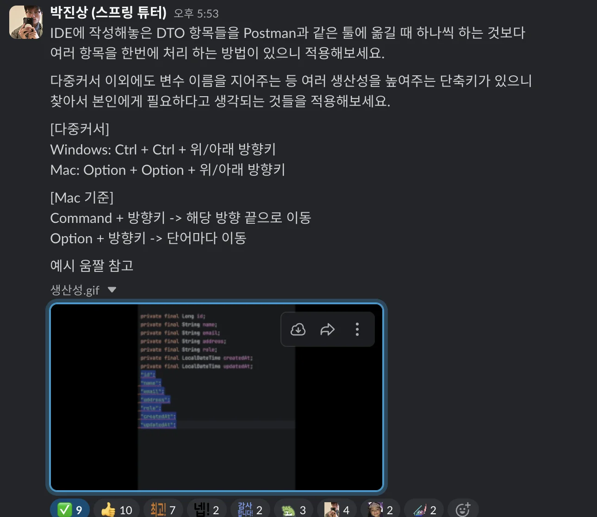
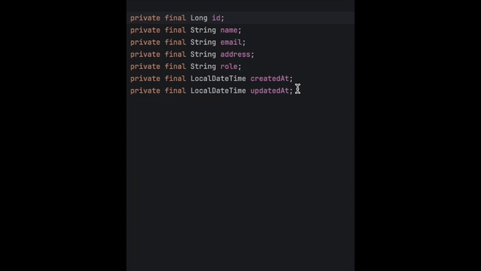
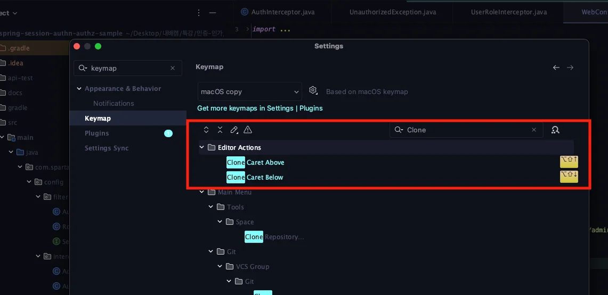

해당 설정을 위해 단축키 설정 변경이 필요함

> setting &#45; keymap &#45; clone 검색

- Clone Carets Above (위쪽 블록에 커서 추가)

- Clone Carets Below (아래쪽 블록에 커서 추가)

Shift &#43; alt &#43; ↑ 에 기본 설정이 있는 경우, 고려해서 제거 후 사용

- Move Line … 항목이 기본설정임

아니면 다른 단축키 지정
