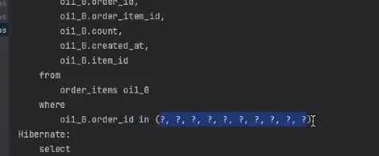
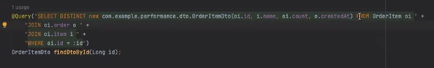
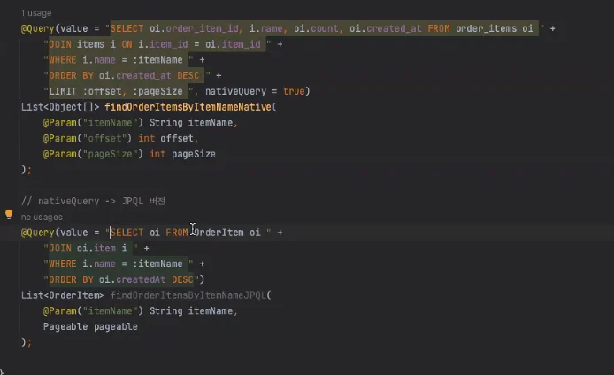
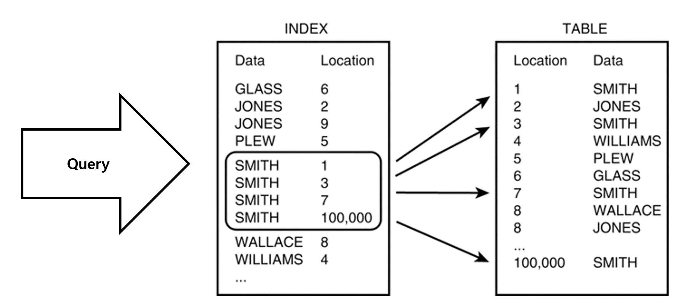
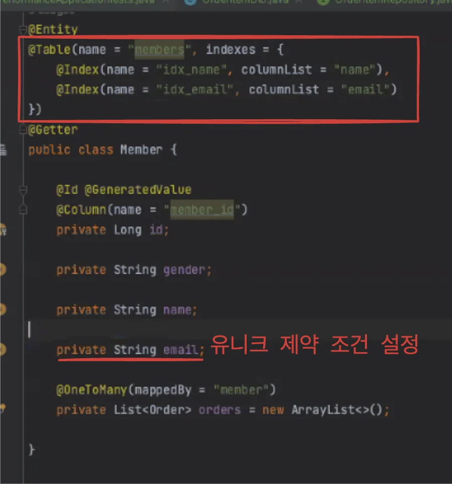
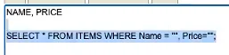
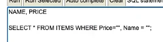

> 📌 
> 
> <a id="15aeda9b0fe181d39115da00e4d66cfe"></a>
> 
> CS 특강 &#45; 제목
> 
> - 진행&#58; 김재연 튜터님
> 
> - 기간&#58; 24&#46;12&#46;12(수) 
> 
> <details>
> <summary>reference</summary>
> 
> <a id="194eda9b0fe1808a8e6dd875d0d06f67"></a>
> 
>  <a href="https://beautiful-college-c84.notion.site/fb78dd02bcb94b449891fcf2aea433f7">페이지</a> 
> 
> <a id="194eda9b0fe18011860df7c316d3cb4e"></a>
> 
> ‣
> 
> </details>

> ☝🏻 
> 
> > 성능최적화 시 가장 중요한 점은 <strong><u>네트워크 통신을 줄</u></strong>여야 한다는 점이다&#46; 
> 
> <a id="194eda9b0fe1801a9d7bd0e62cea658e"></a>
> 
> <strong><u>SQL 쿼리를 날</u></strong>리는데, <strong>DB와 서버에서 네트워크 통신이 발생</strong>한다&#46; 
> 
> <a id="194eda9b0fe180699399ff584431bd57"></a>
> 
> 이때, <strong><u>이 통신 비용을 줄</u></strong>이는 것이 <strong><u>성능 최적화</u></strong>에 가장 주된 점이다&#46;
> 
> <a id="194eda9b0fe1805683f2dc3e53b155c0"></a>
> 
> 즉, 5번의 쿼리를 날려 조회하는 것이 아닌, <strong><u>한번에 모든 쿼리를 날려 조회</u></strong><u>하는 것이</u> 성능 최적화의 중점이다&#46;
> 
> - <code>fetch join </code>

<a id="194eda9b0fe1805f8009ec64564ccd94"></a>

### <strong>1&#46; Optimization(</strong>최적화)

---

- 주워진 자원(시간, 하드웨어 등)과 제약조건 내에서 최선의 결과(속도 향상, 비용 감소 등)도출하도록 전체 시스템 또는 코드 구조를 재설계하거나 개선하는 과정을 의미

- 성능을 고려한 설계 및 개발을 포함하며 주로 큰 변화나 근본적인 개선을 목표로 한다&#46;

- 특정 부분의 성능을 개선하여 전체 성능 향상을 목표로 한다&#46; 

<a id="194eda9b0fe18011a093e01eb2b73a2c"></a>

### 2&#46; 최적화를 해야하는 이유

---

> ❓ 
> 
> <a id="194eda9b0fe18010aa29f357a2bba595"></a>
> 
> <strong>구글 리서치 자료에 따르면 3초 이상 걸리면 53%의 사용자가 떠나며, 표시 속도가 1초에서 7초로 늘어난다면 이탈률은 113%가 된다고 한다&#46;</strong>

<a id="194eda9b0fe180259151f2eb2c03a886"></a>

<strong>1&#46; 성능 향상</strong>

- <strong><code>응답 시간 단축</code></strong>&#58; 사용자 요청에 대한 서버의 응답 시간을 줄여 빠르고 원활한 사용자 경험을 제공

- <strong><code>처리량 증가</code></strong><strong>&#58; </strong>더 많은 요청을 처리할 수 있게 되어 시스템의 효율성과 성능을 극대화

<a id="194eda9b0fe18094a1cfe7bde0da993f"></a>

<strong>2&#46; 자원 효율성</strong>

- <strong><code>서버 자원 절약</code></strong>&#58; CPU, 메모리, 디스크 I/O와 같은 서버 자원을 효율적으로 사용 → <strong>비용 절감</strong>

- <strong><code>인프라 확장성</code></strong>&#58; 동일한 자원으로 더 많은 사용자를 처리할 수 있어, 필요시 수평 확장이 더 용이하다&#46;

1. <strong>안정성 및 신뢰성 향상</strong>

- <strong><code>부하 관리</code></strong>&#58; 높은 트래픽 상황에서도 시스템이 안정적으로 작동하도록 하여 다운타임을 줄임

- <strong><code>오류 감소</code></strong><strong>&#58; 시</strong>스템 부하로 인한 오류나 타임아웃 문제를 최소화하여 신뢰성을 높인다&#46;

1. <strong>비용 절감</strong>

- <strong><code>인프라 비용 절감</code></strong>&#58; 최적화를 통해 서버 및 네트워크 자원의 효율성을 높이면, 클라우드 사용 비용이나 서버 유지보수 비용을 절감할 수 있음

- <strong><code>운영 비용 절감</code></strong>&#58; 효율적인 코드와 데이터 처리로 유지보수성을 높이고 전반적인 운영 비용을 줄일 수 있음

<a id="194eda9b0fe180758449cd6e8ed8dcb8"></a>

## 3&#46;  쿼리 성능 최적화

---

> ❓ 
> 
> <a id="194eda9b0fe180c3976ef57fd29e9f1d"></a>
> 
> Spring Data JPA에서 <strong>쿼리 성능</strong>을 높이기 위한 방법은 여러 가지가 있다&#46;
> 
> - <code>퀴리 최적화</code>, <code>N&#43;1 문제</code>, <code>캐시 활용</code> 

<details>
<summary>&#91; 실습 코드 &#93; Entity</summary>

<details>
<summary>Member</summary>

<a id="194eda9b0fe18082af67d480c47088fd"></a>

```java
@Entity
@Table(name = "members")
@Getter
public class Member {

    @Id @GeneratedValue
    @Column(name = "member_id")
    private Long id;

    private String name;
    
    private String email;

    @OneToMany(mappedBy = "member")
    private List<Order> orders = new ArrayList<>();
}
```

</details>

<details>
<summary>Item</summary>

<a id="194eda9b0fe180069a4de5a3912ff99f"></a>

```java
@Entity
@Getter
@Table(name = "items")
public class Item {

    @Id @GeneratedValue
    @Column(name = "item_id")
    private Long id;

    private String name;
    private int price;
    private int stockQuantity;
}
```

</details>

<details>
<summary>OrderItem</summary>

<a id="194eda9b0fe1800a97dec02193a341dd"></a>

```java
@Entity
@Getter
@Table(name = "order_items")
public class OrderItem {

    @Id @GeneratedValue
    @Column(name = "order_item_id")
    private Long id;

    @ManyToOne(fetch = FetchType.LAZY)
    @JoinColumn(name = "item_id")
    private Item item;

    @ManyToOne(fetch = FetchType.LAZY)
    @JoinColumn(name = "order_id")
    private Order order;

    private int count;
}
```

</details>

<details>
<summary>Order</summary>

<a id="194eda9b0fe180f5bee3e426cd95f869"></a>

```java
@Entity
@Table(name = "orders")
@Getter
public class Order {

    @Id @GeneratedValue
    @Column(name = "order_id")
    private Long id;

    @ManyToOne(fetch = FetchType.LAZY)
    @JoinColumn(name = "member_id")
    private Member member;

//    @BatchSize(size = 10)
    @OneToMany(mappedBy = "order", cascade = CascadeType.ALL)
    private List<OrderItem> orderItems = new ArrayList<>();

    private LocalDateTime createdAt;
}
```

</details>

</details>

<a id="194eda9b0fe18039ba19e6236eddcea9"></a>

### <strong>N&#43;1 문제 해결</strong><strong> ( Fetch 전략 )</strong>

> ✏️ 
> 
> <a id="194eda9b0fe18041b01cc3ebcb956fb8"></a>
> 
> <strong><code>N&#43;1 문제</code></strong>
> 
> <a id="194eda9b0fe18054a836c6184b4ddc78"></a>
> 
> <strong><code>OneToMany</code></strong>나 <strong><code>ManyToMany</code></strong> 관계에서 흔히 발생하는 성능 문제이다&#46;
> 
> <a id="194eda9b0fe1802089c2e477da57d173"></a>
> 
> <strong><u>부모 엔티티를 조회</u></strong>할 때 <strong>자식 엔티티</strong>를 <strong>조회</strong>하는<strong> </strong><strong>쿼리가 추가</strong>로 <strong><u>N번 실행</u></strong>되어 <strong><u>성능이 크게 저하</u></strong>된다&#46;
> 
> - 연관관계 <strong>지연로딩(</strong><strong><code>FetchType&#46;LAZY</code></strong>) 설정<br>→ 프록시 패턴을 통해 실제 사용할 때, 값을 가져온다&#46;

<a id="194eda9b0fe1807d9bb2df9a70f4b309"></a>

연관된 엔티티가 있는 엔티티를 조회할 때 <strong><code>&#64;OneToMany</code></strong><strong>, </strong><strong><code>&#64;ManyToOne</code></strong> 등에 대해 적절한 <strong><code>지연 로딩( Lazy )</code></strong>과 <strong><code>즉시로딩( Eager )</code></strong> 설정

- <strong><u>기본</u></strong>적으로 <strong><u><code>FetchType&#46;LAZY</code></u></strong> 사용

- <strong><u>필요할 때</u></strong>만 <strong><u>명</u></strong><strong><u>시적</u></strong>으로 <strong><u>데이터를 가져</u></strong>와 <strong>N&#43;1 문제 해결</strong>

<a id="194eda9b0fe180e79192fa7372dc7633"></a>

### 해결

---

<details>
<summary>1&#46; <strong><code>JOIN FETCH</code></strong> 사용</summary>

- <strong>ex 1)</strong>
    <a id="194eda9b0fe1800f9349d8e57c860403"></a>

    ```sql
    @Query("SELECT o FROM Order o JOIN FETCH o.orderItems oi WHERE o.id = :id")
    Order findByIdWithFetchJoin(@Param("id") Long id);
    ```

- ex 2) 다중 연관관계일 경우
    <a id="194eda9b0fe180af8186e06506e54547"></a>

    ```sql
    @Query("SELECT o FROM Order o " +
        "JOIN FETCH o.orderItems oi " +
        "JOIN FETCH oi.item " +
        "JOIN FETCH o.member " +
        "WHERE o.id = :id")
    Order findByIdWithFetchJoin(@Param("id") Long id);
    ```

</details>

<details>
<summary><strong>2&#46; </strong><strong><code>&#64;EntityGraph</code></strong><strong> 사용</strong></summary>

- <strong>ex 1)</strong>
    <a id="194eda9b0fe180fc8b3de7f604b4d277"></a>

    ```sql
    public interface OrderRepository extends JpaRepository<Order, Long> {
        
        @EntityGraph(attributePaths = {"orderItems"})
        Optional<Order> findById(Long id);
    }
    ```

- ex 2) <strong><u>다중 연관관계</u></strong>일 경우
    <a id="194eda9b0fe1809a87f8f93d08ef087b"></a>

    ```sql
    public interface OrderRepository extends JpaRepository<Order, Long> {

        @EntityGraph(attributePaths = {"orderItems", "member", "orderItems.item"})
        Optional<Order> findById(Long id);
    }
    ```

- ex 3) <code>&#64;Query</code> 와 함께 사용
    <a id="194eda9b0fe18021a687c896f217fec7"></a>

    ```sql
    public interface OrderRepository extends JpaRepository<Order, Long> {

        @EntityGraph(attributePaths = {"orderItems", "orderItems.item", "member"})
        @Query("SELECT o from Order o WHERE o.id = :id")
        Optional<Order> findByIdWithEntityGraph(Long id);
    }
    ```

</details>

<details>
<summary><strong>3&#46; </strong><strong><code>&#64;BatchSize</code></strong><strong> 사용</strong></summary>

> ✏️ 
> 
> <a id="194eda9b0fe180909d52c15f8d324b63"></a>
> 
> 데이터를 한번에 조건문으로 가져온다&#46; <br>yml 파일에 기본 값으로 설정 변경하여, 모든 entity에 적용할 수도 있다&#46;

- <code>Entity</code>&#58; Order 
    <a id="194eda9b0fe180ecb6fad28dc76e91e2"></a>

    ```sql
    @Entity
    @Table(name = "orders")
    @Getter
    public class Order {

        @BatchSize(size = 50)
        @OneToMany(mappedBy = "order", cascade = CascadeType.ALL)
        private List<OrderItem> orderItems = new ArrayList<>();
    }
    ```

- <code>application&#46;yml</code>
    <a id="194eda9b0fe180138903f217298de63c"></a>

    ```yaml
    spring:
      jpa:
        properties:
          hibernate:
            default_batch_fetch_size: 50
    ```

- ex)  <code>&#64;BatchSize(size = 10 )</code>
    

</details>

<details>
<summary>4&#46; DTO로 필요한 데이터만 조회</summary>

> ✏️ 
> 
> - 불필요한 데이터 로딩 방지를 위하여 Entity 가 아닌 Dto 로 치환하여 조회
> 
> - JPQL에서만 지원
>     - Native Query 지원 ❌

<a id="194eda9b0fe1804ab4d9ff3f0b9a3aaa"></a>

```java
public interface OrderItemRepository extends JpaRepository<OrderItem, Long> {

		@Query("SELECT DISTINCT new com.example.performance.dto.OrderItemDto(o.id, i.name, oi.count, o.createdAt) FROM OrderItem oi " +
        "JOIN oi.order o " +
        "JOIN oi.item i " +
        "WHERE oi.id = :id")
    OrderItemDto findDtoById(Long id);
}
```



- 사용하고자하는 컬럼을 가져져올 수 있는 DTO 생성

- DTO를 JPQL에서 생성

<a id="194eda9b0fe1806292d1d90d59d2e405"></a>

<strong>가장 미미한 최적화</strong>이다&#46; <strong><u>컬럼을 줄</u></strong>이는 것이<strong><u> 크게 이점이 있지는 않</u></strong>다&#46; 

<a id="194eda9b0fe180b3a028c9ddfe87ee73"></a>

  → 그냥 있다는 정도만 알면 됨

</details>

<a id="194eda9b0fe18028ab73ec29b9980710"></a>

### Native Query

> ✏️ 
> 
> <a id="194eda9b0fe1806b837bc437bc7d4a62"></a>
> 
> ### Native Query 장점
> 
> 1. <strong><code>복잡한 쿼리</code></strong>
>     - JPA의 JPQL로 표현하기 어려운 복잡한 SQL 쿼리를 직접 작성 가능&#46;
> 
> 1. <strong><code>성능 최적화</code></strong>
>     - MySQL의 쿼리 최적화를 직접 조정할 수 있음 (예&#58; <code>LIMIT</code>, 인덱스 힌트)&#46;
> 
> 1. <strong><code>특정 데이터베이스 기능 활용</code></strong>
>     - MySQL의 전용 기능(예&#58; <code>JSON</code>, <code>FULLTEXT SEARCH</code>, <code>MATCH</code> 등)을 사용할 때 적합&#46;

<details>
<summary>&#91; 코드 &#93; <strong>Native Query</strong></summary>

<details>
<summary>JPQL 버전</summary>

<a id="194eda9b0fe180cfa67cd54cd4e28f5b"></a>

```java
@Query(value = "SELECT oi FROM OrderItem oi " +
        "JOIN oi.item i " +
        "WHERE i.name = :itemName " +
        "ORDER BY oi.createdAt DESC")
List<OrderItem> findOrderItemsByItemNameJPQL(
    @Param("itemName") String itemName,
    Pageable pageable  // JPQL에서는 LIMIT, OFFSET을 직접 사용할 수 없음.
);
```

</details>

<a id="194eda9b0fe18098bc65d6490bfef3e6"></a>

```java
@Query(value = "SELECT oi.order_item_id, i.name, oi.count, oi.created_at FROM order_items oi " +
        "JOIN items i ON i.item_id = oi.item_id " +
        "WHERE i.name = :itemName " +
        "ORDER BY oi.created_at DESC " +
        "LIMIT :offset, :pageSize ", nativeQuery = true)
List<Object[]> findOrderItemsByItemNameNative(
    @Param("itemName") String itemName,
    @Param("offset") int offset,
    @Param("pageSize") int pageSize
);
```

</details>

> ☝🏻 
> 
> <a id="194eda9b0fe180ee8d37f3987dde0955"></a>
> 
> Native SQL(<code>nativeQuery = true</code>)는 JPQL을 우회하고 데이터베이스에 직접 쿼리를 전달하기 때문에 <strong><u>DTO 생성자 호출</u></strong> 같은<strong> JPQL 전용 기능을 사용할 수 없</strong>다&#46;
> 
> <a id="194eda9b0fe180c09c58c2520cefbead"></a>
> 
> 쿼리 결과는 DTO가 아닌 <strong><u><code>Object&#91;&#93;</code></u></strong><strong><u> 또는 매핑된 엔티티로 반환</u></strong>되며, <strong><u>DTO 생성</u></strong>은 JPA가 아닌 <strong><u>애플리케이션 코드에서 처리</u></strong>해야 한다&#46;

<a id="194eda9b0fe18053b071ecf255bad7d0"></a>

### <strong>JPQL, Native Query 비교</strong>

| <strong>비교 항목</strong> | <strong>JPQL</strong> | <strong>Native Query</strong> |
| --- | --- | --- |
| <strong>쿼리 변환 오버헤드</strong> | SQL로 변환하느라 약간의 오버헤드 발생 | 변환 없이 바로 실행 → 오버헤드 없음 |
| <strong>데이터 반환</strong> | 엔티티 또는 DTO 반환 (추가 변환 작업 필요) | 특정 필드만 조회 가능 (Object&#91;&#93; 또는 엔티티 반환) |
| <strong>데이터베이스 의존성</strong> | 데이터베이스 독립적 | 데이터베이스에 특화된 기능 활용 가능 (LIMIT, JSON&#95;EXTRACT 등) |
| <strong>페이지네이션 처리</strong> | Pageable 지원 | SQL의 LIMIT과 OFFSET 직접 사용 |
| <strong>JPA 캐싱 활용</strong> | 가능 (1차 캐시 및 관리 기능 활용) | 불가능 (JPA 관리 대상 외부 데이터) |
| <strong>복잡한 로직 관리</strong> | 엔티티 매핑 및 관계를 활용해 간결하게 작성 가능 | SQL을 직접 작성해야 하므로 관리 복잡도 증가 |

<a id="194eda9b0fe18098915fe95dce072043"></a>

### 결론

- <strong>성능 차이</strong>는 주로 <strong>쿼리의 복잡성</strong>과 <strong>데이터베이스 고유 기능 활용 여부</strong>에 따라 발생된다&#46;

- 만약 <code>MySQL의 최적화된 기능</code>(<code>LIMIT</code>, <code>JSON</code>, <code>FULLTEXT</code> 등)이 <strong><u>필요 없</u></strong>다면, <br><strong><u>JPQL로 작성하여 JPA의 이점을 활용</u></strong>하는 것이 더 <strong><u>효율적</u></strong>이고 <strong><u>유지보수하기 쉽</u></strong>다&#46;

<details>
<summary>이전</summary>

<a id="15aeda9b0fe180d48163e2d54aac8ae6"></a>

### 5&#46; Native Query

---

> 데이터베이스로부터 독립적이지 않다&#46;

- 실제 데이터베이스 테이블의 컬럼명을 명시해야 한다&#46;  



- JPQL 에서의 Pageable 과 동일하다&#46; 

<a id="15aeda9b0fe180b6a61dc60b1a8171ae"></a>

DB마다 Inner Join, left join 등 join 방식이 다르다&#46; 

<a id="15aeda9b0fe180f7b561cd1b2ae475d0"></a>

DB에 맞게 변환하는 과정에서 리소스가 든다&#46; 

- 성능 최적화가 미미하다&#46; 

<a id="15aeda9b0fe18088bc71ce4e57d54edd"></a>

1차 캐시를 활용하여 DB에서 조회하는 것이 아닌, 캐싱을 통해 조회한다&#46; 

</details>

<a id="194eda9b0fe1800f80c0f941a5250398"></a>

### 인덱싱

---


<a id="194eda9b0fe180928f7acf3395fd8d50"></a>

Member 테이블에 100만개의 데이터가 존재할 경우, ’김재연’ 이라는 사람이 들어있는 데이터를 찾을 때 

<a id="194eda9b0fe1803fb2a5f8eb2f41e754"></a>

컴퓨터는 처음부터 끝까지 데이터를 검색하게 됩니다&#46; (FULL SCAN) 

<a id="194eda9b0fe180819dcece4393f9b84e"></a>

만약 초반부에 ‘김재연’ 이라는 데이터가 있다면 다행이겠지만, 후반부에 존재한다면 검색에 오랜 시간이 걸립니다&#46;

<a id="194eda9b0fe18014a2a0e1e684dc5c34"></a>

인덱스는 이러한 상황에서 테이블의 특정 컬럼(또는 컬럼 집합)에 대해 <strong>검색 속도를 향상</strong>시키기 위해 사용하는 데이터 구조입니다&#46;

<a id="194eda9b0fe1808e9cf1c04cc8f35990"></a>

책의 목차처럼, 데이터를 효율적으로 찾을 수 있는 경로를 제공하여 쿼리 성능을 크게 개선할 수 있습니다&#46;

<a id="194eda9b0fe180d3b3d2c4045696d9f4"></a>

### 장•단점

- 장점
    - 테이블의 조회 속도를 향상 (검색 위치 &#43; 정렬)

- 단점
    - <strong><u>인덱스를 저장</u></strong>하기 위해 <strong><u>DB의 </u></strong><strong><u>약 10%</u></strong>에 해당하는 <strong><u>저장공간 사용</u></strong>

    - 수정이 빈번한 속성에 인덱스를 사용할 경우 <strong><u>성능이 오히려 저하</u></strong>될 수 있음
        - 쓰기 작업이 자주 일어나는 경우, 계속 인덱스 테이블에서 수정이 되어야 한다&#46; 
            <a id="194eda9b0fe1808dbfc5ee20031fa8e6"></a>

            → 1의 쓰기 작업에, 쓰기 작업 2배 리소스가 든다&#46; 

    - 인덱스를 관리하기 위한 추가 작업이 필요

> ☝🏻 
> 
> <a id="194eda9b0fe180d19b5dea70786eee72"></a>
> 
> 인덱스는 항상 데이터를 빠르게 검색하기 위해 <strong><u>가장 최근 버전 데이터들</u></strong>이 <strong><u>정렬된 상태로 유지</u></strong>되어야 한다&#46; <br>즉, 인덱스가 적용된 컬럼에 <code>INSERT</code>, <code>UPDATE</code>, <code>DELETE</code>가 수행된다면 <strong><u>원본 테이블 뿐만 아니라 </u></strong><strong><u>인덱스</u></strong>에도 <strong><u>추가 작업을 수행</u></strong>해줘야 한다&#46;
> 
> 
> 
> - <code>INSERT</code>&#58; 새로운 데이터를 인덱스에 추가
> 
> - <code>DELETE</code>&#58;  삭제할 데이터의 인덱스 제거
> 
> - <code>UPDATE</code>&#58;  기존 인덱스 제거 및 갱신된 데이터를 새로운 인덱싱 처리

> ✏️ 
> 
> <a id="194eda9b0fe18053a024de8a691e77b9"></a>
> 
> <strong>인덱스를 사용하기 좋은 컬럼</strong>
> 
> - <code>INSERT</code>, <code>UPDATE</code>, <code>DELETE</code>가 <strong><u>자주 발생하지 않</u></strong>는 컬럼
> 
> - <code>JOIN</code>, <code>WHERE</code>, <code>ORDER BY</code>가 <strong><u>자주 사용</u></strong>되는 컬럼
> 
> - 데이터의 <strong><u>중복도가 낮</u></strong>은 컬럼
> 
> - 전체 데이터 중 <code>10 &#126; 15%</code> 정도 <strong><u>분량의 데이터를 검색</u></strong>해야하는 경우

- ex) 
    <details>
    <summary>단일 컬럼 인덱싱</summary>

    <a id="194eda9b0fe18065a0cbf2ce07ddd4ee"></a>

    ```java
    @Entity
    @Table(name = "members", indexes = {
        @Index(name = "idx_name", columnList = "name"),
        @Index(name = "idx_email", columnList = "email", unique = true)
    })
    @Getter
    public class Member {

        @Id @GeneratedValue
        @Column(name = "member_id")
        private Long id;

        private String name;

    		@Column(unique = true)
        private String email;

        @OneToMany(mappedBy = "member")
        private List<Order> orders = new ArrayList<>();
    }
    ```

    </details>

    <details>
    <summary>다중 컬럼 인덱싱</summary>

    <a id="194eda9b0fe1805587c6fc0074740a31"></a>

    ```java
    @Table(name = "orders", indexes = {
        @Index(name = "idx_customer_product", columnList = "customer_id, product_id")
    })
    public class Order {

        @Id
        @GeneratedValue(strategy = GenerationType.IDENTITY)
        private Long id;

        @Column(name = "customer_id", nullable = false)
        private Long customerId;

        @Column(name = "product_id", nullable = false)
        private Long productId;
    }
    ```

    </details>

<details>
<summary>ㅇㅁㄹㄷ</summary>

<a id="15aeda9b0fe180b5b520f21164185707"></a>

### 6&#46;  인덱싱

---

> 쿼리 최적화 시, 인덱싱이 중요하다&#46; 

<a id="15aeda9b0fe180c69889f01d66f858c0"></a>

단점

<a id="15aeda9b0fe180239b00e69648b59ab0"></a>

인덱스는 항상 데이터를 빠르게 검색하기 위해 가장 최근 버전 데이터들이 정렬 상태로 유지되어야 한다&#46; 

<a id="15aeda9b0fe180b18bf6d523cc957ef8"></a>

즉, 인덱스가 적용된 컬럼에 INSERT, UPDAT

- 인덱스가 사용되기 좋은 컬럼
    - 가능하면, 중복도가 낮은 컬럼을 인덱싱 해야한다&#46; 
        - ex) 주민번호, 이메일, 

        - 중복도가 높은 경우, 식별자로써의 역할을 할 수 없다&#46; 
            - 

    - 전체 데이터 중 10 &#126; 15% 정도 분량의 데이터를 검색해야 하는 경우
        - 큰 범위로 조회 시, 전체 테이블을 조회하는 것과 큰 차이가 없다&#46;
            - 세부적으로 더 설정을 해야하기 때문에, 더 많은 리소스를 사용한다&#46; 

- 정렬은 생각보다 부하가 많이 걸린다&#46;

- 인덱싱 사용 시, 정렬을 생략할 수 있다&#46; 
    

- 컬럼 인덱싱에 

- 컬
    

<a id="15aeda9b0fe1809fb653cca1604db2a7"></a>

인덱싱 처리 시, 어떤 알고리즘을 사용하여 처리해야 하는지 의문점이 듭니다&#46; 

- 인덱싱 순서에 맞게 조회하는 것이 중요하다&#46; 

<a id="15aeda9b0fe180808b10f4279f36c640"></a>

name&#95;price

<a id="15aeda9b0fe180119df8ef344912da82"></a>

Name 다음 Price, 이렇게 조회 시, 인덱싱을 사용하여 조회한다&#46; 





- 중복도가 낮은 값을 앞으로 설정하는 것이 더 효율적으로 검색 처리를 할 수 있다&#46; 

- 인덱싱  


</details>

---

<a id="194eda9b0fe1809aa1ebc2ad3754426e"></a>

### 실습 코드

<details>
<summary>dto</summary>

<details>
<summary>&#91; 코드 &#93; OrderItemDto</summary>

<a id="194eda9b0fe180869dbfe63def064d9b"></a>

```java
@Getter
@ToString
@AllArgsConstructor
public class OrderItemDto {

    private Long id;
    private String itemName;
    private int count;
    private LocalDateTime createdAt;
}
```

</details>

</details>

- entity &#91; <code>index</code> &#93;
    <details>
    <summary>&#91; 코드 &#93; Item</summary>

    <a id="194eda9b0fe180efa090c5d68c0981aa"></a>

    ```java
    @Entity
    @Getter
    @Table(name = "items", indexes = {
        @Index(name = "idx_name_price", columnList = "name, price")
    })
    public class Item {

        @Id @GeneratedValue
        @Column(name = "item_id")
        private Long id;

        private String name;
        private int price;
        private int stockQuantity;
    }
    ```

    </details>

    <details>
    <summary>&#91; 코드 &#93; Member</summary>

    <a id="194eda9b0fe180d195dae79859650b26"></a>

    ```java
    @Entity
    @Table(name = "members", indexes = {
        @Index(name = "idx_name", columnList = "name"),
        @Index(name = "idx_email", columnList = "email", unique = true)
    })
    @Getter
    public class Member {

        @Id @GeneratedValue
        @Column(name = "member_id")
        private Long id;

        private String name;

        @Column(unique = true)
        private String email;

        @OneToMany(mappedBy = "member")
        private List<Order> orders = new ArrayList<>();

    }
    ```

    </details>

    <details>
    <summary>&#91; 코드 &#93; Order</summary>

    <a id="194eda9b0fe180ebbd8cec3bd622e848"></a>

    ```java
    @Entity
    @Table(name = "orders")
    @Getter
    public class Order {

        @Id @GeneratedValue
        @Column(name = "order_id")
        private Long id;

        @ManyToOne(fetch = FetchType.LAZY)
        @JoinColumn(name = "member_id")
        private Member member;

        @BatchSize(size = 10)
        @OneToMany(mappedBy = "order", cascade = CascadeType.ALL)
        private List<OrderItem> orderItems = new ArrayList<>();

        private LocalDateTime createdAt;
    }
    ```

    </details>

    <details>
    <summary>&#91; 코드 &#93; OrderItem</summary>

    <a id="194eda9b0fe18009b53ad8342df6f30b"></a>

    ```java
    @Entity
    @Getter
    @Table(name = "order_items")
    public class OrderItem {

        @Id @GeneratedValue
        @Column(name = "order_item_id")
        private Long id;

        @ManyToOne(fetch = FetchType.LAZY)
        @JoinColumn(name = "item_id")
        private Item item;

        @ManyToOne(fetch = FetchType.LAZY)
        @JoinColumn(name = "order_id")
        private Order order;

        private int count;

        private LocalDateTime createdAt;
    }
    ```

    </details>

- repository &#91; <code>Paging</code>&#58; Native Query, JPQL &#93;
    > Item, Member &#45; 기본 

    <details>
    <summary>&#91; 코드 &#93; OrderItemRepository</summary>

    <a id="194eda9b0fe18081a172fa3cd32d8bd8"></a>

    ```java
    public interface OrderItemRepository extends JpaRepository<OrderItem, Long> {

        @Query("SELECT DISTINCT new com.example.performance.dto.OrderItemDto(o.id, i.name, oi.count, o.createdAt) FROM OrderItem oi " +
            "JOIN oi.order o " +
            "JOIN oi.item i " +
            "WHERE oi.id = :id")
        OrderItemDto findDtoById(Long id);

        @Query(value = "SELECT oi.order_item_id, i.name, oi.count, oi.created_at FROM order_items oi " +
            "JOIN items i ON i.item_id = oi.item_id " +
            "WHERE i.name = :itemName " +
            "ORDER BY oi.created_at DESC " +
            "LIMIT :offset, :pageSize ", nativeQuery = true)
        List<Object[]> findOrderItemsByItemNameNative(
            @Param("itemName") String itemName,
            @Param("offset") int offset,
            @Param("pageSize") int pageSize
        );

        // nativeQuery -> JPQL 버전
        @Query(value = "SELECT oi FROM OrderItem oi " +
            "JOIN oi.item i " +
            "WHERE i.name = :itemName " +
            "ORDER BY oi.createdAt DESC")
        List<OrderItem> findOrderItemsByItemNameJPQL(
            @Param("itemName") String itemName,
            Pageable pageable
        );

    }
    ```

    </details>

    <details>
    <summary>&#91; 코드 &#93; OrderRepository</summary>

    <a id="194eda9b0fe1800484ffc955e168aac1"></a>

    ```java
    public interface OrderRepository extends JpaRepository<Order, Long> {

        @EntityGraph(attributePaths = {"orderItems", "orderItems.item", "member"})
        @Query("SELECT o from Order o WHERE o.id = :id")
        Optional<Order> findByIdWithEntityGraph(Long id);

        @Query("SELECT o FROM Order o " +
            "JOIN FETCH o.orderItems oi " +
            "JOIN FETCH oi.item " +
            "JOIN FETCH o.member " +
            "WHERE o.id = :id")
        Order findByIdWithFetchJoin(@Param("id") Long id);
    }

    ```

    </details>

- resources
    <details>
    <summary>application&#46;yml</summary>

    <a id="194eda9b0fe180cf8eb2ff9fba88ac47"></a>

    ```yaml
    spring:
      h2:
        console:
          enabled: true # H2 콘솔 활성화
          path: /h2-console # 콘솔 접속 경로
      datasource:
        driver-class-name: org.h2.Driver
        url: jdbc:h2:mem:test
        username: username
        password:
      jpa:
        hibernate:
          ddl-auto: create
        show-sql: true
        properties:
          hibernate:
            format_sql: true
    #        default_batch_fetch_size: 50
    ```

    </details>

    <details>
    <summary>import&#46;sql</summary>

    <a id="194eda9b0fe180749e5ad62899468055"></a>

    ```sql
    INSERT INTO members(member_id, name, email) VALUES (1, '김재연', 'jae518@naver.com');
    INSERT INTO members(member_id, name, email) VALUES (2, '스파르타', 'sparta@naver.com');

    INSERT INTO items(item_id, name, price, stock_quantity) VALUES (1, '팽이버섯', 1000, 100);
    INSERT INTO items(item_id, name, price, stock_quantity) VALUES (2, '백목이버섯', 2000, 200);
    INSERT INTO items(item_id, name, price, stock_quantity) VALUES (3, '목이버섯', 3000, 300);
    INSERT INTO items(item_id, name, price, stock_quantity) VALUES (4, '새송이버섯', 4000, 400);

    INSERT INTO orders(order_id, member_id, created_at) VALUES (1, 1, '2024-12-10 10:00:00');

    INSERT INTO order_items(order_item_id, order_id, item_id, count, created_at) VALUES (1, 1, 1, 10, '2024-12-10 10:00:00');
    INSERT INTO order_items(order_item_id, order_id, item_id, count, created_at) VALUES (2, 1, 2, 20, '2024-12-10 10:00:00');
    INSERT INTO order_items(order_item_id, order_id, item_id, count, created_at) VALUES (3, 1, 3, 30, '2024-12-10 10:00:00');
    INSERT INTO order_items(order_item_id, order_id, item_id, count, created_at) VALUES (4, 1, 4, 40, '2024-12-10 10:00:00');

    INSERT INTO orders(order_id, member_id, created_at) VALUES (2, 2, '2024-12-10 10:00:00');

    INSERT INTO order_items(order_item_id, order_id, item_id, count, created_at) VALUES (5, 2, 1, 10, '2024-12-11 10:00:00');
    INSERT INTO order_items(order_item_id, order_id, item_id, count, created_at) VALUES (6, 2, 2, 20, '2024-12-11 10:00:00');
    INSERT INTO order_items(order_item_id, order_id, item_id, count, created_at) VALUES (7, 2, 3, 30, '2024-12-11 10:00:00');
    INSERT INTO order_items(order_item_id, order_id, item_id, count, created_at) VALUES (8, 2, 4, 40, '2024-12-11 10:00:00');
    ```

    </details>
