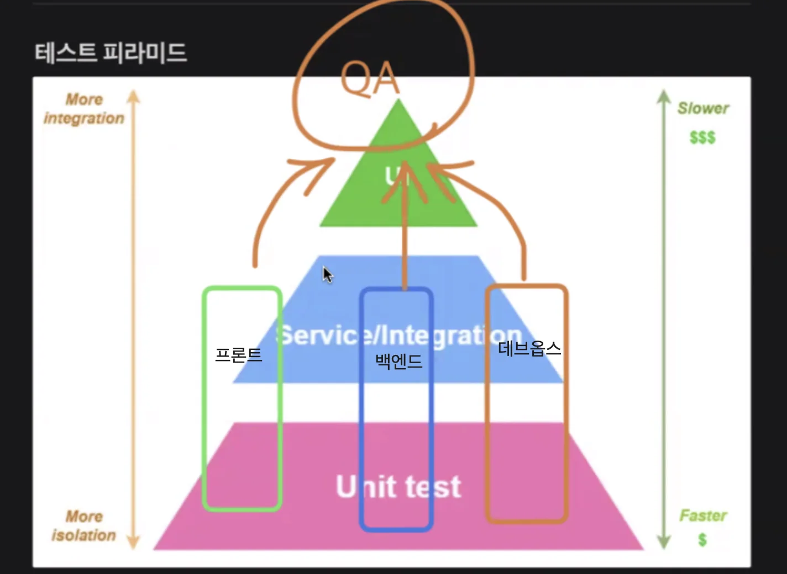

> 📌 
> 
> 
> 
> CS 특강 &#45; 제목
> 
> - 진행&#58; 이태현 튜터님
> 
> - 기간&#58; 24&#46;11&#46;27(수) 

## 테스트 코드 

---

소프트웨어를 개발하는 것은 살아있는 유기체와 같다&#46; 

소프트웨어는 필연적으로 변경되고 이러한 변경점으로 인해 이전에 정상적으로 작동되었던 기능들이 오작동 할 가능성이 높아진다&#46;

또한 특정 기능이 변경됨에 따라 해당 기능 외, 다른 기능에 문제가 발생하는 일이 비일비재한다&#46; 

이 현상을 회귀 오류라고 한다&#46; 회규 오류는 소프트웨어가 지속됨에 따라 발생할 확률이 높아진다&#46; 

### 왜 테스트 해야 할까?

- 예측 불가능한 사용자 행동&#58; 실제 사용자들은 ㄴ

- 복잡한 비지니스 로직&#58; 조건 분기가 많은 로직은 예상치 못한 오류를 일으킨다&#46; 

- 변경, 확장&#58; 새로운 기능 추가, 리펙토링 과정에서 기존 기능이 망가질 수 있으며, 이를 사전에 방지하려면 안정적인 테스트가 필요하다&#46; 

테스트를 통해 조기에 버그를 발견하고, 신뢰성을 확복할 수 있으며, 이는 곧 제품 품질 향상과 유지보수 비용 절감으로 이어진다&#46; 

## 테스트 코드 이점

---

테스트 코드 작성은 추가적인 비용처럼 보일 수 있지만, 장기적으로는 개발 효율성과 안정성을 극대화하낟&#46; 

- 장애 예방

- 유지보수 비용 절감
    - 초기 단계에서 버그를 발견하면 사후 수정 비용보다 엄청나게 저렴하게 처리할 수 있다 &#46;
        - 테스트 코드가 없는 경우 복잡한 코드의로직을 추적하고 수정하는데 큰 리소스가 소모된다&#46; 

- 효율적인 협업 도구
    - 테스트 코드는 팀 내 개발자 간의 지식 공유 도구로 사용된다&#46; 

    - 코드 리뷰와 신규 개발자 온보딩 과정에서 테스트 코드가 해당 기능의 동작 방식을 명확히 설명할 수 있다&#46; 

- 베포 안정성 확보
    - 테스트 코드를 통해 베포 전에 애플리케이션의 안정성을 철저히 검증하다&#46; 

    - 특히, 자동화된 회귀 테스트는 베포 직전에도 전체 시스템의 품질을 보장한다&#46;

ex)

새로 개발자로 입사함 

2만명 정도 쓰는 유저에서, 해외 결제 서비스 연동 PayPal 연동

- 새로운 프로젝트를 파악하는 것까지 시간이 얼마나 걸리나? 

- 3000개 정도 테스트 코드가 있는데, 해당 부분을 다 통과하면 베포 가능하다&#46; 
    - 사전에 오류를 어느 정도 검증하고 처리하기 때문에, 이후 작업이 원활하다&#46;

- 테스트 코드 없이 베포 하면 베포 이후 에러를 발견하며, 수정 후 다시 오류가 발생되고&#46;&#46; 무한 반복된다&#46;

### 테스트 코드 작성 시와 미작성 시의 비교

- 버그 수정, 내부적 / 베포 전에 처리한다&#46; 

- 제품 품질 ↑ 

- 

번외 &#45; 

- 스타트업 

- Product, dev 레벨로 나

## 소프트웨어 테스트의 7원칙 

- 테스트는 결함이 존재함을 밝히는 활동이다&#46; 
    - 정상 기능 동작 뿐만 아니라

    - 안되는 case들도 잘 동작을 하는지, 태스트해야 한다&#46; 

- 완벽한 테스팅은 불가능하다&#46; 
    

    매우 단순한 소프트웨어가 아닌 이상 내부 조건, 입력값, 타이밍에 대한 모든 조합을 확인할 수 없다&#46; 

    

    따라서 테스트 대상으 리스크 분석 후, 가장 중요한 부분을 중점으로 테스팅 리소스를 투입해야 한다&#46; 

- 요구 사항 분석 및 설계 단계에서부터 테스트를 진행하는 경우, 문서상의 결합을 확인할 수 있다&#46; 
    

    코딩 작업 이후에 발견되는 결함에 비해, 훨씬 간단하게 해결할 수 있다&#46; 

    

    또한 조기에 텍스트 설계를 마친 경우, 코딩잉 완료되자마자 테스트 케이스를 레벨별로 실해할 수 있어 전체 시간을 단축할 수 있다&#46; 

    - 파라미터, 리턴값, 

- 결함 집중
    

    대다수의 결함은 소수의 특정 모듈에 집중되는 경향이 있다&#46; 이러한 결합은 장애 발생 확률이 높다&#46; 

    - 자체적으로 복잡한 구조를 가지고 있는 모듈

    - 소프트웨어의 다른 부분과 복잡한 상호 작용을 하는 모듈

    - 개발 난이도가 높거나 최신 기술을 사용한 모듈

    - 기존의 것을 사용하지 않고 새롭게 개발한 모듈

    - 크기가 큰 모듈

    - 경험이 미흡한 개발팀에서 개발한 모듈

- 살충제 패러독스
    - 새로운 기법, 다른 시각에서 테스트 케이스를 정기적으로 변경하고 추가해야 한다&#46; 

- 테스팅은 정황에ㅐ 따라 이루어져야 한다&#46; 
    - 소프트웨어의 종류나 목표 등에 따라 해당 소프트웨어에 맞는 테스트 방식이 적용되어야 한다&#46; 

- 오류 부재의 귀변
    - 거의 모든 결함을 확인 후 제거하였다고 해도 사용자의 요ㅛ구 또는 비지니스 목적을 충족시키지 못하는 경우
        - 기능 개발이 우선이다&#46; 그 이후 테스트코드다&#46; 

## FIRST 원칙

---

좋은 테스트는 FIRST 원칙을 따라야 한다&#46; 

1. FiST(빠르게)&#58; 테스트는 짧은 시간 안에 실행되어야 한다&#46; 

1. Independent(ehrflq

유닛의 단위가 핵심 비지니스 메서드를 말씀하시는 건가요? 

API 

## 테스트 피라미드

---

## 단위 테스트 

ex)

- 서비스 메서드만

-  레포지토리 메서드만 

- 엔티티 내부 메서드만 

 

## TDD, BDD

---

### BDD

- 시나리오 정의 

## Spring Boot 환경에서의 테스트 방법

- &#64;SpringBootTest
    - 실제 애플리케이션 컨텍스트를 로드하여 통합 테스트 진행

- &#64;WebMvcTest &#45; 단위 테스트 
    - 실제 repository가 동작하지 않는다&#46; 

    - 가상의 객체(Mock)을 가져와 처리한다&#46; 

- controller, service, repository , DTO 테스트 방법 &#45; 월요일에 진행

## 번외  &#45; 테스트 

### 코드가 잘 동작하는가?  vs 코드가 안정적인가?

### 코드가 잘 동작하는가? → 기능이 정확히 동작하는가?

### 코드가 안정적인가? → 복원력이 좋은가?

정합성이 중요한 로직인 경우, 트랜잭션 단위로 테스트를 해야할 것 같은데, 이런 경우 어떻게 테스트 해야하나요?  

동작을 더 중요시 한다&#46; 

안정성은 욕심이다&#46;
