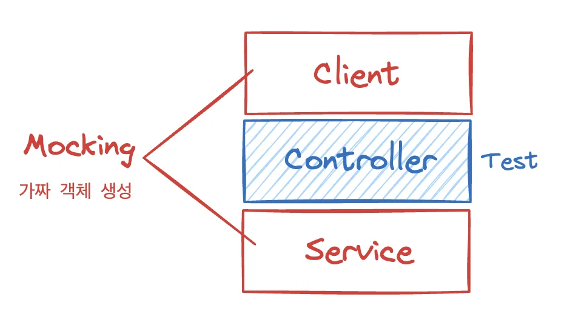
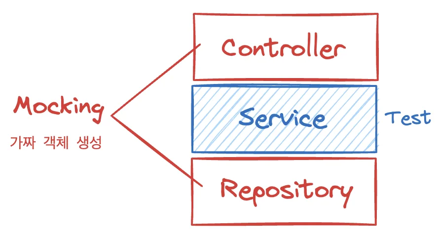

> 📌 
> 
> <a id="15eeda9b0fe1813bac8ad51a026082ac"></a>
> 
> CS 특강 &#45; 제목
> 
> - 진행&#58; 박성원 튜터님
> 
> - 기간&#58; 24&#46;12&#46;16(월)
> 
> - reference&#58; <a href="https://beautiful-college-c84.notion.site/3787a520e2434e5ea471c2c75deffe03">페이지</a> 

<a id="15feda9b0fe18025aa7cde61379f43ae"></a>

## Mocking이란?

---

- Mocking은 <strong>테스트 코드</strong> 작성 시, <u>실제 객체나 외부 의존성을 흉내 내는 가짜 객체(Mock 객체)를 만</u>들어 사용하는 기법이다&#46;

- <strong>가짜 서비스</strong>를 통해 <strong><u>외부 의존성과 분리</u></strong><strong><u>된 환경</u></strong>에서 <strong><u>코드의 동작을 검증</u></strong>하며, 이는 주로 <strong>단위 테스트(Unit Test)</strong>에서 사용된다&#46; 

<a id="15feda9b0fe18022ac2ced9a09e2c527"></a>

## Mocking의 필요성

---

1. <strong>외부 자원 의존성 제거</strong>
    - 실제 <strong>DB, 외부 API</strong>와 같은 자원을 사용하지 않고, 독립적인 테스트 환경을 구축할 수 있다&#46;

    - ex) DB 연결 없이도, 데이터 저장 기능이 올바르게 동작하는지 확인 가능

1. <strong>독립적이고 빠른 테스트</strong>
    - 외부 시스템의 상태나 네트워크 환경에 영향을 받지 않으므로 테스트가 항상 일관된 결과값을 가진다&#46; 

    - 테스트 실행 속도가 빨라지고, 빠른 피드백을 제공한다&#46;

1. <strong>복잡성 감소</strong>
    - 외부 시스템의 복잡성을 제거하고, <strong>테스트 대상 로직</strong>에만 집중할 수 있다&#46;

    - ex) 외부 API 응답 대기 없이, 특정 입력에 대한 예상 결과만 검증 가능

1. <strong>비즈니스 로직 검증</strong>
    - Mock을 사용하면 외부 의존성에 신경 쓰지 않고, 애플리케이션의 <strong>핵심 로직</strong>만 테스트할 수 있다&#46;

    - ex) ‘상품 가격 계산 로직’에서 Mock을 통해 할인 정책 서비스 결과를 고정해 검증 가능

<a id="15feda9b0fe1801b8605ca732b0748dd"></a>

## Mocking의 장점

---

- <strong>빠르고 독립적인 테스트</strong>
    - 외부 환경과 무관하게 코드를 테스트하므로 빠르고 간편&#46;

- <strong>테스트 작성 용이성</strong>
    - 예상 시나리오(성공/실패 등)에 따라 Mock의 동작을 설정할 수 있어 유연&#46;

- <strong>유지 보수 편리</strong>
    - 외부 자원 변경 시, 테스트 코드에 직접적인 영향 없음&#46;

- <strong>설계 개선</strong>
    - Mock을 사용하면 인터페이스 기반 설계와 낮은 결합도를 자연스럽게 유도&#46;

<a id="15feda9b0fe18049b2a7d46f38314025"></a>

## Mocking 사용 시 주의사항

---

1. <strong>과도한 Mock 남발</strong>
    - 모든 의존성을 Mock으로 대체하면, 실제 코드와 동작 차이를 놓칠 수 있다&#46;

    - Mock만 사용하는 테스트는 <u>&#34;실제 동작&#34;을 검증하지 않</u>으므로, <strong><u>통합 테스트와 병행</u></strong>해야 한다&#46;

1. <strong>Mock 객체의 잘못된 설정(Over&#45;stubbing)</strong>
    - <u>지나치게 많은 </u><u><code>when()</code></u><u> 설정</u>은 테스트가 <u>특정 구현에 의존적이게 만</u>든다

    - <u>리팩토링</u> 시 <u>Mock 설정 부분이 깨질</u> 가능성이 높아진다&#46;

1. <strong>테스트 코드 유지 보수</strong>
    - <u>Mock 설정이 복잡</u>하면, &#34;실제 코드&#34;보다 <u>&#34;Mock 시뮬레이션&#34;만 검증하는 상황</u>이 될 수 있다&#46;

    - <strong><u>Mock과 실제 동작 간의 차이</u></strong><strong>를 </strong><strong><u>주기적으로 점검</u></strong>해야 한다&#46;

1. <strong>정확한 Mock 네이밍</strong>
    - <code>MockUserRepository</code>, <code>StubPaymentService</code>와 같이 <u>명시적으로 이름을 작성</u>하면, <br>읽는 사람이 &#34;가짜(Mock) 구현체&#34;라는 것을 인지하기 쉽다&#46; 

<a id="15feda9b0fe1804d8baac273699855a7"></a>

##  <strong>Spring에서 모킹 적용</strong>

---

- Mockito 라이브러리를 주로 사용

- Spring Boot 환경에서는 테스트 DB로 H2 Database를 설정해 외부 DB 의존성을 제거

- <code>&#64;Mock</code>, <code>&#64;InjectMocks</code>, <code>&#64;MockitoBean</code> 등의 어노테이션 활용&#46;

> ☝🏻 
> 
> <a id="f1628f22b89a43fbaa53b43de7ae662f"></a>
> 
> <code>&#64;Mock</code>은 예전 버전의 <strong>Mockito에서 </strong>사용한 Annotation으로 현재는 <code>&#64;MockitoBean</code> 을 사용한다&#46; 

<a id="15feda9b0fe1805fa3a3da33cb7cfc82"></a>

## Test Double 용어 정리

> ✏️ 
> 
> <a id="1dceda9b0fe180a38753c243fb4725aa"></a>
> 
> 해당 용어는 스턴트 더블(stunt double)에서 차용한 것으로 <strong><u>테스트 중인 시스템</u></strong><strong>의 </strong><strong><u>일부분이 완전히 준비되지 않</u></strong><strong>았거나 </strong><strong><u>테스트하기 어려운 상황</u></strong><strong>에서 그 대안으로 사용될 수 있는 &#39;가짜&#39; 컴포넌트를 의미한다&#46;<br></strong>테스트 더블은 <strong><u>실제 객체의 행동을 모방</u></strong>하며, 테스트가 특정 조건과 상호작용을 쉽게 재현하고 검증할 수 있도록 한다&#46;

| 종류 | 정의 | 설명 | 예시 |
| --- | --- | --- | --- |
| <code>Dummy</code> | 아무 역할도 수행하지 않고, 자리 채우기 용도로만 사용 | 메서드 시그니처가 특정 타입 인자를 필요로 하지만 실제 사용하지 않을 때 | <code>new DummyUser()</code> 객체를 넘기기만 하고, 내부 필드나 메서드는 전혀 사용하지 않음 |
| <code>Fake</code> | 실제 구현과 유사하지만 프로덕션 품질은 아닌 간이 구현 | 실제 DB 대신 In&#45;memory DB 사용 등, 실제처럼 동작하지만 간단한 대체물 | 테스트 시 H2 인메모리 DB를 사용해 Repository 테스트 |
| <code>Stub</code> | 호출에 대해 미리 정해진 답변을 반환하는 객체 | 특정 상황을 가정하여 결과 값을 고정시킴 | <code>stubRepository&#46;findUser()</code> 호출 시 항상 같은 <code>User</code> 반환 |
| <code>Spy</code> | Stub &#43; 호출 기록까지 관찰 가능한 객체 | 실제 로직 흐름을 따르면서, 호출 횟수, 파라미터 등을 관찰 | 반환은 하되, 호출 이력까지 추적 (로깅, 호출 확인 등) |
| <code>Mock</code> | 호출 과정에 대한 기대치를 미리 설정하고 검증하는 객체 | 외부 의존성을 대체하고 행위 기반 검증을 함 | Mockito의 <code>when()</code>, <code>verify()</code> 사용 |

<details>
<summary>설명 ( 원본 )</summary>

<a id="15feda9b0fe18042b999c33797de4bd8"></a>

### <code>Dummy</code>

- <strong>정의</strong>&#58; 아무 역할도 수행하지 않고, 오직 ‘자리 채우기’ 용도로만 사용&#46;

- <strong>설명</strong>&#58; 메서드 시그니처가 특정 타입의 인자를 필요로 하지만, 그 인자를 실제로는 전혀 사용하지 않을 때&#46;예&#58; <code>new DummyUser()</code> 객체를 넘기기만 하고, 실제론 해당 객체의 필드나 메서드를 전혀 사용하지 않을 때&#46;

<a id="15feda9b0fe18088b7a5e886b04a7c7f"></a>

### <code>Fake</code>

- <strong>정의</strong>&#58; 실제 구현과 유사하지만, 프로덕션 품질 수준은 아닌 간이 구현&#46;

- <strong>설명</strong>&#58; 실제 DB 대신 In&#45;memory DB 사용, 실제 캐시 대신 메모리 기반 자료구조 사용 등예&#58; H2 인메모리 DB를 사용하는 Repository 테스트는 실제 DB는 아니지만, DB처럼 동작하도록 구현한 Fake를 사용하는 것과 유사함&#46;

<a id="15feda9b0fe18014b0fdd07293f28cf3"></a>

### <code>Stub</code>

- <strong>정의</strong>&#58; 호출에 대해 미리 정해진 답변을 반환하도록 설정된 객체&#46; <u>특정 상황을 가정</u>해서 <strong><u>결과 값을 고정</u></strong>시켜두는 것&#46;

- <strong>설명</strong>&#58; 외부 의존성의 복잡한 로직을 테스트에서 분리하고, “고정된 응답”을 반환하도록 세팅할 때

- ex) <code>stubRepository&#46;findUser()</code> 호출 시 항상 특정 <code>User</code> 객체를 반환하게끔 설정&#46;

<a id="15feda9b0fe180dc9c27fc7bc7d6b72d"></a>

### <code>Spy</code>

- <strong>정의</strong>&#58; Stub의 기능(미리 정해진 답변 반환) &#43; “어떤 메서드가 몇 번 호출되었는지, 어떤 파라미터로 호출되었는지” 기록까지 함께 해주는 객체

- <strong>설명</strong>&#58; 실제 로직 흐름을 그대로 따르면서, “호출 이력”을 관찰해야 할 때

- ex) 특정 결괏값을 반환하되, 중간에 로깅/호출 횟수 확인 등 부수적 확인이 필요한 경우

<a id="15feda9b0fe1800cbafdfee09e309f32"></a>

### <code>Mock</code>

- <strong>정의</strong>&#58; 호출 과정(함수 호출 횟수, 파라미터, 순서 등)에 대한 기대치(Expectation)를 미리 설정하고, 실제로 그렇게 호출됐는지 검증할 수 있는 객체

- <strong>설명</strong>&#58; 외부 의존성을 완전히 대체하고, 행위 기반 검증(Behavior Verification)을 할 때 많이 사용

- ex) Mockito의 <code>when()</code>, <code>verify()</code> 등

</details>

<a id="15feda9b0fe1805c9fb8fa7f89408378"></a>

## 실습

<a id="338eda9b0fe180328109c3ee7184cdf2"></a>

### 기본 셋업

<details>
<summary>의존성</summary>

- Spring Boot 3&#46;x

- JUnit 5 (Jupiter)

- Mockito, Spring Test, H2 Database

- Lombok

</details>

<details>
<summary>예제 프로젝트 &#45; 기본 코드 </summary>

<details>
<summary>build&#46;gradle</summary>

<a id="9dd415473b4d4fa29b51590630ae2bbc"></a>

```groovy
plugins {
    id 'java'
    id 'org.springframework.boot' version '3.4.0'
    id 'io.spring.dependency-management' version '1.1.6'
}

group = 'com.sparta'
version = '0.0.1-SNAPSHOT'

java {
    toolchain {
        languageVersion = JavaLanguageVersion.of(21)
    }
}

repositories {
    mavenCentral()
}

dependencies {
    // JPA & H2
    implementation 'org.springframework.boot:spring-boot-starter-data-jpa'
    runtimeOnly 'com.h2database:h2'

    // Web
    implementation 'org.springframework.boot:spring-boot-starter-web'

    // Lombok
    compileOnly 'org.projectlombok:lombok'
    annotationProcessor 'org.projectlombok:lombok'

    // Test
    testImplementation 'org.springframework.boot:spring-boot-starter-test'
    testImplementation 'org.mockito:mockito-core'
    testImplementation 'org.assertj:assertj-core'
}

tasks.named('test') {
    useJUnitPlatform()
}
```

</details>

<details>
<summary>Entity</summary>

<a id="c4a36875ce3244b4a760ca5030930b1c"></a>

```java
package com.sparta.testcode.entity;

import jakarta.persistence.*;
import lombok.AllArgsConstructor;
import lombok.Getter;
import lombok.NoArgsConstructor;

@Entity
@Getter
@NoArgsConstructor
@AllArgsConstructor
public class User {
    @Id
    @GeneratedValue(strategy = GenerationType.IDENTITY)
    private Long id;
    private String name;
    private String email;

    public User(String name, String email) {
        this.name = name;
        this.email = email;
    }
}
```

</details>

<details>
<summary>Repository</summary>

<a id="1e2e75735e1142bab37d5cdcbe2fffe0"></a>

```java
package com.sparta.testcode.repository;

import com.sparta.testcode.entity.User;
import org.springframework.data.jpa.repository.JpaRepository;

import java.util.Optional;

public interface UserRepository extends JpaRepository<User, Long> {
    Optional<User> findByEmail(String email);
}
```

</details>

<details>
<summary>Service</summary>

<a id="3562d14a7dc942c691636dbd1afaea07"></a>

```java
package com.sparta.testcode.service;

import com.sparta.testcode.entity.User;
import com.sparta.testcode.repository.UserRepository;
import lombok.RequiredArgsConstructor;
import org.springframework.stereotype.Service;

import java.util.List;

@Service
@RequiredArgsConstructor
public class UserService {
    private final UserRepository userRepository;

    public User createUser(String name, String email) {
        return userRepository.save(
                new User(name,email)
        );
    }

    public User getUserByEmail(String email) {
        return userRepository.findByEmail(email)
                .orElseThrow(() -> new IllegalArgumentException("User not found"));
    }

    public List<User> getAllUsers() {
        return userRepository.findAll();
    }
}
```

</details>

<details>
<summary>Controller</summary>

<a id="4e2878584c094f249bfe42674ddfa7cb"></a>

```java
package com.sparta.testcode.controller;

import com.sparta.testcode.entity.User;
import com.sparta.testcode.service.UserService;
import lombok.RequiredArgsConstructor;
import org.springframework.web.bind.annotation.*;

import java.util.List;

@RestController
@RequestMapping("/api/users")
@RequiredArgsConstructor
public class UserController {
    private final UserService userService;

    @PostMapping
    public User createUser(@RequestParam String name, @RequestParam String email) {
        return userService.createUser(name, email);
    }

    @GetMapping("/{email}")
    public User getUser(@PathVariable String email) {
        return userService.getUserByEmail(email);
    }

    @GetMapping
    public List<User> getAllUsers() {
        return userService.getAllUsers();
    }
}
```

</details>

</details>

<a id="15feda9b0fe1801a9530ec44ff2e1b3d"></a>

## 테스트 코드 작성

<a id="15feda9b0fe1804897add255770b7633"></a>

### Controller



- Controller를 테스트 시, MVC를 모킹해서 사용해야 한다&#46;
    - <strong><code>&#64;Autowired private </code></strong><strong><code>MockMvc</code></strong><strong><code> mockMvc;</code></strong>

<details>
<summary><strong><code>&#64;WebMvcTest</code></strong><strong><code>(xxxController&#46;class))</code></strong></summary>

- 역할
    - Spring Boot Test에서 제공하는 <strong>슬라이스 테스트(Slice Test)</strong> 어노테이션 중 하나

    - 컨트롤러(Web 레이어)만 집중적으로 테스트하기 위해 사용

- 특징
    - <code>&#64;WebMvcTest</code>는 <u>Web과 관련된 컴포넌트(</u><u><code>&#64;Controller,</code></u><u> </u><u><code>&#64;ControllerAdvice</code></u> 등)만을 로드하여 테스트 환경을 구성한다&#46;

    - <strong><u>Service</u></strong><strong>나 </strong><strong><u>Repository</u></strong> 등의 <u>빈은 자동으로 로드되지 않</u>으므로, <strong><u>테스트에 필요한 다른 레이어의 빈은 직접 Mocking</u></strong>(<code>&#64;MockBean</code>, <u><code>&#64;MockitoBean</code></u> 등)하여 주입해야 한다&#46; 

</details>

<details>
<summary><strong><code>&#64;MockitoBean</code></strong></summary>

- 스프링 컨텍스트 내에서 웹과 관련 없는 레이어 빈 ( service, repositroy …)을  Mock 객체로 등록 시킨다&#46; 

- 보통은 Spring Boot Test에서 <code>&#64;MockBean</code>을 많이 쓰지만,  곧 deprecated로 사용이 중지되는 관계로<strong><u><code>&#64;MockitoBean</code></u></strong><u>을 사용</u>한다&#46;

> 📌 
> 
> <a id="76125c8682444e5b8611272964158352"></a>
> 
> <code>org&#46;springframework&#46;boot&#46;test&#46;mock&#46;mockito&#46;MockBean<br></code>⇒ <code>org&#46;springframework&#46;test&#46;context&#46;bean&#46;override&#46;mockito&#46;MockitoBean;</code>

- 이렇게 Mocking된 빈(<code>service</code>, <code>repository</code> …)은 실제 구현체 대신 <strong>가짜 객체</strong>(Mock)로 등록되어 <strong><u>테스트 시 원하는 동작을 정의</u></strong>(<code>given(&#46;&#46;&#46;)&#46;willReturn(&#46;&#46;&#46;))</code>할 수 있다&#46;

</details>

<details>
<summary><strong><code>static org&#46;mockito&#46;</code></strong><strong><code>BDDMockito&#46;given</code></strong></summary>

- Mocking 한 객체는 가짜 객체이다&#46; 따라서 테스트 코드 내부에서 실제 동작과 동일한 동작에 대한 정의가 필요한데, 그를 <code>BDDMockito</code>를 통해<u> BDD 스타일로 객체를 동작을 정의</u>해 테스트 한다&#46; 
    - <code>given()</code>은 BDD 스타일(BDD&#58; Behavior&#45;Driven Development)로 Mock 객체의 동작을 정의할 때 사용하는 메서드이다&#46; 
        <a id="15feda9b0fe180b084b0ea71e2ccd69b"></a>

        ```java
        given(userService.getUserByEmail(email)).willReturn(user);
        ```

        - <code>getUserByEmail(email)</code> 메서드가 호출되었을 때, <code>user</code>를 반환하라&#34;고 미리 설정

</details>

<details>
<summary>Controller API 테스트</summary>

<a id="15feda9b0fe180dfb600fe59b9e8d7c9"></a>

```java
mockMvc.perform(get("/api/users/{email}", email))
		.andExpect(status().isOk())  // Then: 결과 확인 - JSON 결과 확인
    .andExpect(jsonPath("$.name").value(equalTo("name")) )
    .andExpect(jsonPath("$.email").value(equalTo(email)));
```

- api 호출
    - <code>mockMvc&#46;perform()</code>

    - <code>method&#91;get, post …&#93;(url, path variables)</code>,

- 응답 값 비교
    - <code>andExpect()</code>
        - 상태코드 비교&#58; <code>status()</code>

        - JSON 데이터 비교
            - <code>jsonPath(key)</code>,  key = <code>“&#36;&#46;keyName”</code> 

            - <code>&#46;value(equalTo(value 값))</code>

</details>

---

<details>
<summary>&#91; 코드 &#93; UserControllerTest</summary>

<a id="15feda9b0fe18014b9c3e4125135264a"></a>

```java
package com.sparta.testcode.controller;

import com.sparta.testcode.entity.User;
import com.sparta.testcode.service.UserService;
import org.junit.jupiter.api.DisplayName;
import org.junit.jupiter.api.Test;
import org.springframework.beans.factory.annotation.Autowired;
import org.springframework.boot.test.autoconfigure.web.servlet.WebMvcTest;
import org.springframework.test.context.bean.override.mockito.MockitoBean;
import org.springframework.test.web.servlet.MockMvc;

import static org.hamcrest.Matchers.equalTo;
import static org.mockito.BDDMockito.given;
import static org.springframework.test.web.servlet.request.MockMvcRequestBuilders.get;
import static org.springframework.test.web.servlet.result.MockMvcResultMatchers.status;
import static org.springframework.test.web.servlet.result.MockMvcResultMatchers.jsonPath;


@WebMvcTest(UserController.class)
class UserControllerTest {

    @Autowired
    private MockMvc mockMvc;

    @MockitoBean
    UserService userService;

    @Test
    @DisplayName("이메일로 사용자 조회 시 성공적으로 JSON 응답을 반환")
    void getUserByEmail_shouldReturnUser() throws Exception {
        // Given: 준비 - 특정 이메일을 가진 사용자가 존재한다고 가정
        String email = "test@example.com";
        User user = new User(1L,"name",email);
        given(userService.getUserByEmail(email)).willReturn(user);

        // When: 액션 - 해당 사용자를 조회하는 컨트롤러 호출
        mockMvc.perform(get("/api/users/{email}", email))
                .andExpect(status().isOk())  // Then: 결과 확인 - JSON 결과 확인
                .andExpect(jsonPath("$.name").value(equalTo("name")))
                .andExpect(jsonPath("$.email").value(equalTo(email)));
    }
}

```

</details>

<a id="15feda9b0fe180c8a116cc66d80786c3"></a>

### Service



<details>
<summary><strong><code>&#64;ExtendWith(MockitoExtension&#46;class)</code></strong></summary>

- JUnit 5 테스트 실행 시 Mockito 확장 기능을 사용하도록 설정

- MockitoExtension은 <strong><code>&#64;Mock</code></strong>, <strong><code>&#64;InjectMocks</code></strong> 등을 해석하여, <strong>Mock 객체 생성</strong> 및 <strong>주입</strong>을 자동으로 처리

- JUnit 4에서 사용하던 <code>&#64;RunWith(MockitoJUnitRunner&#46;class)</code>와 유사한 기능

</details>

<details>
<summary><strong><code>&#64;Mock</code></strong></summary>

-  Mockito에서 <strong>Mock 객체</strong>를 생성하기 위한 어노테이션

- Repository(<code>UserRepository</code>)가 실제 구현체 대신 가짜 객체(Mock)로 생성

- Mock 객체가 생성되면, 원하는 동작을 메서드 체이닝(<code>when(&#46;&#46;&#46;)</code>, <code>thenReturn(&#46;&#46;&#46;)</code>)으로 지정(Stubbing)할 수 있다&#46;

</details>

<details>
<summary><strong><code>&#64;InjectMocks</code></strong></summary>

- Mock으로 만든 객체(<code>&#64;Mock</code>으로 생성된 Repository 등)를 <strong>실제 클래스</strong>(UserService)의 필드에 자동 주입 처리해주는 Annotation

- 아래 코드에서는  Mock으로 만든 <code>UserRepository</code>를 주입 <code>UserService</code>에  주입해준다&#46; 
    - 실제로는 Reflection API 등을 통해 <code>UserService</code> 내 <code>UserRepository</code> 필드를 찾아서 주입한다&#46;

</details>

<details>
<summary><strong><code>static org&#46;mockito&#46;Mockito&#46;when</code></strong></summary>

<details>
<summary>Mockito에서 <strong><code>Stubbing</code></strong>을 정의할 때 쓰이는 정적 메서드</summary>

- <code>Stub</code>
    - 호출에 대해 미리 정해진 답변을 반환하도록 설정된 객체

    -  <u>특정 상황을 가정</u>해서 <strong><u>결과 값을 고정</u></strong>한다&#46;

</details>

<details>
<summary>ex) </summary>

<a id="15feda9b0fe1801aaa4de49e201d7b97"></a>

```java
when(userRepository.findByEmail(email)).thenReturn(Optional.of(mockUser));
```

- 특정 상황
    - userRepository의 <code>findByEmail(email)</code> 메서드가 호출되을 떄

- 고정 값 설정
    - <code>Optional&#46;of(mockUser)</code> 반환

</details>

</details>

<details>
<summary><strong><code>static org&#46;assertj&#46;core&#46;api&#46;Assertions&#46;assertThat</code></strong></summary>

-  AssertJ 라이브러리에서 제공하는 <strong>유창한(Fluent) API</strong> 형식의 테스트 검증 메서드

<details>
<summary>ex) </summary>

- <code>assertThat(foundUser)&#46;isNotNull();</code>
    - foundUser가 null이 아닌지 검사

- <code>assertThat(foundUser&#46;getEmail())&#46;isEqualTo(email);</code>
    -  foundUser&#46;getEmail()이 기대값(email)과 같은지 검사

</details>

</details>

<details>
<summary><strong><code>static org&#46;assertj&#46;core&#46;api&#46;Assertions&#46;assertThatThrownBy</code></strong><strong> </strong></summary>

- 특정 로직을 실행했을 때 예외(Exception)가 발생하는지 검증할 때 사용

<details>
<summary>ex)</summary>

- <code>&#46;isInstanceOf(IllegalArgumentException&#46;class)</code>
    - 발생한 예외가 <code>IllegalArgumentException</code> 종류인지 확인

- <code>&#46;hasMessage(&#34;User not found&#34;)</code>
    - 예외 객체의 메시지가 <code>&#34;User not found&#34;</code>와 동일한지 확인

</details>

</details>

---

<details>
<summary>&#91; 코드 &#93; UserServiceTest</summary>

<a id="4495eda7b61346389bedc3dc435bfca6"></a>

```java
package com.sparta.testcode.service;


import com.sparta.testcode.entity.User;
import com.sparta.testcode.repository.UserRepository;
import org.junit.jupiter.api.DisplayName;
import org.junit.jupiter.api.Test;
import org.junit.jupiter.api.extension.ExtendWith;
import org.mockito.InjectMocks;
import org.mockito.Mock;
import org.mockito.junit.jupiter.MockitoExtension;

import java.util.Optional;

import static org.assertj.core.api.Assertions.assertThat;
import static org.assertj.core.api.Assertions.assertThatThrownBy;
import static org.mockito.Mockito.when;

@ExtendWith(MockitoExtension.class)
class UserServiceTest {

    @Mock
    private UserRepository userRepository;

    @InjectMocks
    private UserService userService;

    @Test
    @DisplayName("존재하는 이메일로 사용자 조회 시 해당 사용자 반환")
    void getUserByEmail_whenUserExists() {
        String email = "existing@example.com";
        User mockUser = new User(1L,"user",email);

        // Stubbing
        when(userRepository.findByEmail(email)).thenReturn(Optional.of(mockUser));

        // Service 호출
        User foundUser = userService.getUserByEmail(email);

        // 검증
        assertThat(foundUser).isNotNull();
        assertThat(foundUser.getEmail()).isEqualTo(email);
    }

    @Test
    @DisplayName("존재하지 않는 이메일로 사용자 조회 시 예외 발생")
    void getUserByEmail_whenUserNotExists() {
        String email = "notfound@example.com";
        when(userRepository.findByEmail(email)).thenReturn(Optional.empty());

        assertThatThrownBy(() -> userService.getUserByEmail(email))
                .isInstanceOf(IllegalArgumentException.class)
                .hasMessage("User not found");
    }
}
```

</details>

<a id="15feda9b0fe180cba1f2e01654784b1d"></a>

### Repository  ( UnitTest &#45; <code>&#64;DataJpaTest </code>&#38; <code>H2</code> )

<details>
<summary> <code>&#64;DataJpaTest</code></summary>

- Spring Boot의 <strong>슬라이스 테스트 어노테이션</strong> 중 하나

- <strong>JPA와 관련된 구성 요소만 로드</strong>하여 테스트 환경을 구성해준다&#46;

- <code>&#64;DataJpaTest</code>는 기본적으로 <strong><u>인메모리 데이터베이스(H2)</u></strong>를 사용하도록 설정되어 있어서, 별도의 DB 설정 없이도 엔티티 매핑과 Repository 동작을 빠르게 테스트 할 수 있다&#46;
    - <strong>엔티티 스캔</strong>, <strong>JPA 관련 설정</strong>, <strong>Hibernate DDL 자동 생성</strong> 등

- <strong>Service나 Controller</strong> 레이어의 빈은 로드하지 않고, <strong><u>Repository 및 Entity만 테스트</u></strong>할 때 사용한다&#46;

</details>

---

<details>
<summary>&#91; 코드 &#93; UserRepositoryTest</summary>

<a id="f3a59840a24f4159aafac7903d385f17"></a>

```java
package com.sparta.testcode.repository;


import com.sparta.testcode.entity.User;
import org.junit.jupiter.api.DisplayName;
import org.junit.jupiter.api.Test;
import org.springframework.beans.factory.annotation.Autowired;
import org.springframework.boot.test.autoconfigure.orm.jpa.DataJpaTest;

import java.util.Optional;

import static org.assertj.core.api.Assertions.assertThat;

@DataJpaTest
public class UserRepositoryTest {

    @Autowired
    UserRepository userRepository;

    @Test
    @DisplayName("H2: 이메일로 사용자 검색 시 존재하는 사용자 반환")
    void findByEmail_success() {
        // Given
        User saved = userRepository.save(new User("user","parksw@naver.com"));


        // When
        Optional<User> found = userRepository.findByEmail("parksw@naver.com");

        // Then
        assertThat(found).isPresent();
        assertThat(found.get().getId()).isEqualTo(saved.getId());
        assertThat(found.get().getEmail()).isEqualTo("parksw@naver.com");
    }

    @Test
    @DisplayName("H2: 존재하지 않는 이메일 검색 시 빈 Optional 반환")
    void findByEmail_notFound() {
				// Given test@example.com을 주지 않음
        // When
        Optional<User> found = userRepository.findByEmail("test@example.com");

        // Then
        assertThat(found).isEmpty();
    }
}

```

</details>
