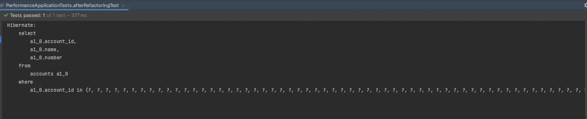
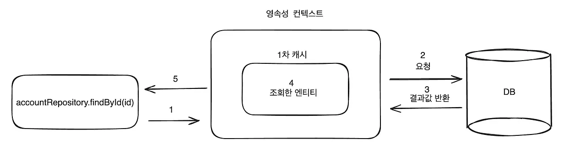
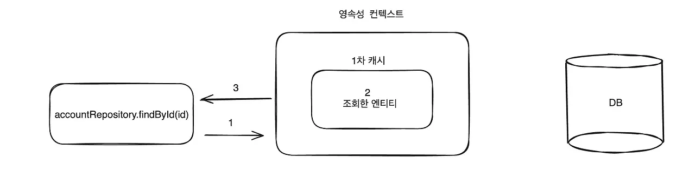
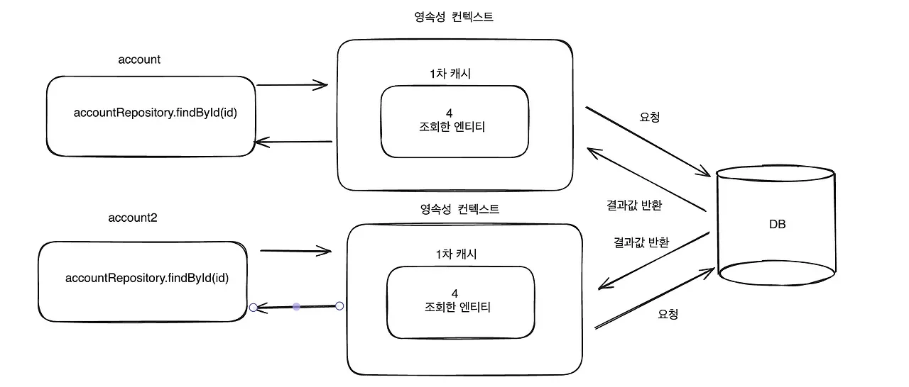
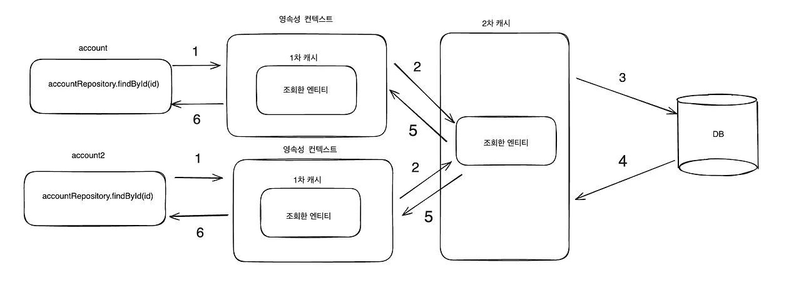
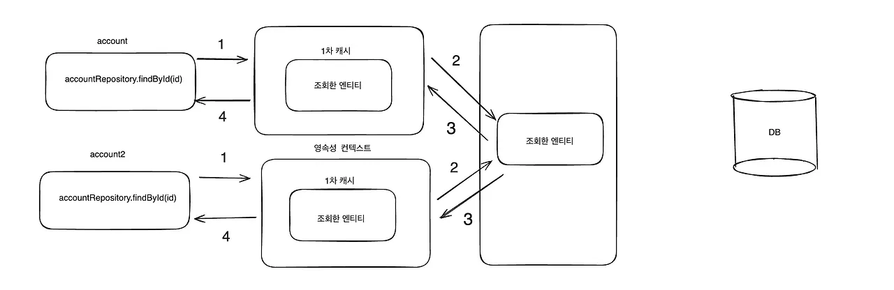

> 📌 
> 
> <a id="15feda9b0fe1815f9f49ce2ecd874833"></a>
> 
> CS 특강 &#45; 제목
> 
> - 진행&#58; 김재연 튜터님
> 
> - 기간&#58; 24&#46;12&#46;12(수) 

<details>
<summary>Reference</summary>

<a id="15feda9b0fe180f5bb05c88e693127c2"></a>

<a href="https://beautiful-college-c84.notion.site/16c3988a013d47c1b828f2126882f4a9">페이지</a> 

[performance 2.zip](fea58be6f5f1a14a.zip)

</details>

<a id="15feda9b0fe180cc9b47e99d1611a60b"></a>

## 1&#46; DB  접근 최소화 &#45; <code>IN</code> 

---

> 📖 
> 
> <a id="509e1827471841b4b7587a026449d003"></a>
> 
> <strong>간단한 코드 리팩토링만</strong>으로도 <u>DB 접근을 최소화</u>하여 <strong><u>애플리케이션 성능을 향상</u></strong>시킬 수 있다&#46;

<details>
<summary>Bad Case &#45; 최적화 전 </summary>

<a id="15feda9b0fe180ab813dfa6316da1b65"></a>

```java
void beforeRefactoringTest() {
    List<Long> accountIdList = new ArrayList<>();
    
    for (long i=1; i<50; i++) {
        accountIdList.add(i);
    }

    for (Long accountId : accountIdList) {
        Account account = accountRepository.findById(accountId).orElse(null);

        /**
         * account 관련 작업 수행
         */
    }
}
```

<a id="15feda9b0fe18061b839e7dfb8df51a3"></a>

만약 <code>accountIdList</code> 의 <code>size</code>가 1000이라면, for문으로 인해  <code>accountRepository&#46;findById(accountId)</code>가 1000번 수행이 되고, <u>쿼리도 1000개가 발생</u>된다&#46; 

</details>

<details>
<summary>최적화 &#45; <code>IN</code></summary>

> ✏️ 
> 
> <a id="e3d2cee325a04651a79b4be9e94503f4"></a>
> 
> 위 경우를, <code>In</code>  문법의 사용하여 <strong><u>1개의 쿼리</u></strong>로 <u>모든 데이터를 조회</u>할 수 있다&#46; 

- JPA Repository &#45; In 문법 메서드 정의 
    <a id="15feda9b0fe1809c9c6ae50a3bc949ed"></a>

    ```java
    public interface AccountRepository extends JpaRepository<Account, Long> {
        List<Account> findByIdIn(List<Long> accountIdList);
    }
    ```

- 테스트
    <a id="15feda9b0fe180e48e79dbf882c9fb08"></a>

    ```java
    void afterRefactoringTest() {
        List<Long> accountIdList = new ArrayList<>();
        for (long i=1; i<1000; i++) {
            accountIdList.add(i);
        }

        List<Account> accountList = accountRepository.findByIdIn(accountIdList);

        /**
         * account 관련 작업 수행
         */
    }
    ```

    - 실행 결과
        

</details>

<a id="15feda9b0fe18039a0f6ebd5ad01c4db"></a>

## 2&#46; 캐싱

<a id="15feda9b0fe18013a666c2c7b591029e"></a>

### 1차 캐시 

> ✏️ 
> 
> <a id="15feda9b0fe1802a9239f923db4fedf0"></a>
> 
> 영속성 컨텍스트의 특징 중 하나인 <strong>1차 캐시는</strong> <u>같은 영속성 컨텍스트 내에서 같은 엔티티를 조회</u>를 하면 <strong><u>데이터베이스에 접근하지 않</u></strong><strong>고 1</strong><strong><u>차 캐시에 있는 엔티티를 반환</u></strong>한다&#46;

<details>
<summary><strong>1차 캐시에 조회하려는 값이 </strong><strong><u>존재하지 않</u></strong><strong>을 경우</strong></summary>



1. id값으로 엔티티 조회

1. 조회하려는 엔티티가 1차 캐시에 존재하지 않으면 데이터베이스에 접근

1. 데이터베이스는 요청에 맞는 결과값 반환

1. 데이터베이스로부터 반환받은 값을 1차 캐시에 보관

1. 엔티티를 반환

</details>

<details>
<summary><strong>1차 캐시에 조회하려는 값이 </strong><strong><u>존재</u></strong><strong>하는 경우</strong></summary>



1. id값으로 엔티티 조회

1. 조회하려는 값이 1차 캐시에 존재

1. 1차 캐시에 엔티티가 있어 <u>데이터베이스에 접근하지 않</u>고<strong><u> 1차 캐시에서  해당하는 값 바로 반환</u></strong>

</details>

<a id="15feda9b0fe1806e8e05d7e7fbcf0e06"></a>

### 1차 캐시의 한계

<a id="15feda9b0fe18076a4ccdaaabbe2712e"></a>

```java
// Transactional 사용 X
public void firstCache() {
    accountRepository.findById(1L).get();   // 쿼리 발생
		accountRepository.findById(1L).get();   // 쿼리 발생
}
```

<a id="15feda9b0fe180e7af22c8923642070b"></a>

만약 <code>&#64;Transactional</code>을 사용하지 않고 위 코드를 실행시키면 <code>id</code>가 <code>1</code>인 <code>account</code>를 <u>조회하는 쿼리가 2번 발생</u>한다&#46;



<a id="15feda9b0fe1804b891ad65c66a0656f"></a>

그 이유는  메서드에 <code>&#64;Transaction</code> 선언을 하지 않으면 <u>내부 조회 메서드</u>는 각각의 트랜잭션으로 관리되고 따라서, <u>각자 다른 영속성 컨텍스트에 속</u>해 있어, <u>2번째 조회 시 해당 값이 1차 캐시에 없</u>어 DB에서 직접 가져오기 때문에<strong> </strong><strong><u>2번째 쿼리가 발생</u></strong>된다&#46; 

<a id="15feda9b0fe1801ca704ec0b9410bd93"></a>

### 2차 캐시 

> 📖 
> 
> <a id="a574f3fb1a1d4e5983e9e3df68556404"></a>
> 
> 애플리케이션 범위에서 공유하는 캐시를 <u>JPA에서 공유 캐시</u> 또는 <u>2차 캐시</u> 라고 부른다&#46;<br>2차 캐시는 <u>애플리케이션 종료 시까지 유지</u>된다&#46; 

<details>
<summary>실습 코드 </summary>

<details>
<summary>build&#46;gradle </summary>

<a id="15feda9b0fe18025b38ae7936d5ff36d"></a>

```java
// Cache
implementation 'org.springframework.boot:spring-boot-starter-cache'
implementation 'org.ehcache:ehcache'
implementation 'javax.cache:cache-api'

// JAXB
implementation 'com.sun.xml.bind:jaxb-core:2.3.0.1'
implementation 'com.sun.xml.bind:jaxb-impl:2.3.1'
implementation 'javax.xml.bind:jaxb-api:2.3.1'
```

</details>

<details>
<summary>application&#46;yml</summary>

<a id="15feda9b0fe180ff92add8e1806a6511"></a>

```java
# MySQL 연결 설정
spring:
  datasource:
    url: jdbc:mysql://localhost:3306/mydb
    username: root
    password: 1234
    driver-class-name: com.mysql.cj.jdbc.Driver

  # Hibernate 설정
  jpa:
    hibernate:
      ddl-auto: create
    properties:
      hibernate:
        dialect: org.hibernate.dialect.MySQL8Dialect
        format_sql: true
        show_sql: true  # 로그 설정 (SQL 쿼리 로그 보기)

  cache:
    jcache:
      config: classpath:ehcache.xml      # Ehcache 설정 파일 경로
```

</details>

<details>
<summary>AccountService</summary>

<a id="15feda9b0fe180369525c5f304f5fabe"></a>

```java
@Service
@RequiredArgsConstructor
public class AccountService {

    private final AccountRepository accountRepository;

    @Cacheable(value = "accountCache", key = "#id")
    public Account findById(Long id) {
        return accountRepository.findById(id).orElse(null);
    }
}
```

</details>

</details>

<details>
<summary><strong>2차 캐시에 조회하려는 엔티티가 없을 때</strong></summary>



1. account 엔티티를 조회하려고 시도

1. 영속성 컨텍스트의 1차 캐시를 보고 조회하려는 엔티티가 없으면 2차 캐시에 요청

1. 2차 캐시에서 조회하려는 엔티티가 없으면 데이터베이스에 접근

1. 데이터베이스에서 조회한 데이터를 반환

1. 2차 캐시는 데이터베이스에서 반환받은 데이터를 1차 캐시로 반환

1. 1차 캐시는 조회하려는 엔티티를 최종으로 반환

</details>

<details>
<summary><strong>2차 캐시에 조회하려는 엔티티가 있을 때</strong></summary>



1. account 엔티티를 조회하려고 시도

1. 영속성 컨텍스트의 1차 캐시를 보고 조회하려는 엔티티가 없으면 2차 캐시에 요청

1. 2차 캐시에 조회하려는 엔티티가 있으면, <u>데이터베이스에 접근하지 않</u>고 <u>2차 캐시에서 1차 캐시로 바로 반환</u>

1. 1차 캐시는 조회하려는 엔티티를 최종으로 반환

</details>

<details>
<summary>2차 캐시 사용 시, <u>이점</u> 및 <u>주의할 점</u></summary>

- 이점
    - 영속성 컨텍스트가 다르더라도 같은 엔티티를 조회할 때, 애플리케이션 범위를 가지는, 모든 조회 값을 저장하는 <strong><u>2차 캐시에서 가져올 수 있</u></strong>기 때문에, <strong><u>데이터베이스 접근 횟수를 줄</u></strong>일 수 있다&#46;

- 주의할 점
    - 만료 정책
        - 2차 캐시는 데이터를 캐시로 저장하므로, 만료 시간이 설정되어 있거나 데이터를 수동으로 만료해야 할 경우, 캐시의 만료 정책을 잘못 설정하면 성능이 떨어지거나, 최신 데이터가 제공되지 않는 문제가 발생될 수 있다&#46; 

    - <strong>메모리 부담</strong>
        - 2차 캐시를 사용하면 데이터베이스 대신 메모리나 외부 캐시 서버(예&#58; Redis, Ehcache 등)에 데이터를 저장하므로, 시스템에서 추가적인 메모리나 저장소 리소스를 소모하게 된다&#46; 이는 시스템의 성능이나 비용에 영향을 줄 수 있다&#46; 

    - <strong>캐시 저장소 관리</strong>
        -  캐시가 커질수록 저장소를 관리하는 데 비용이 들 수 있다&#46; <br>특히 디스크 기반 캐시의 경우 성능이 떨어질 수 있으먀, 메모리 기반 캐시도 과도하게 사용되면 시스템의 메모리 사용량이 증가한다&#46; 

> 결론 &#58; <u>조회</u>가 주로 이루어지며 <u>수정이 일어나지 않을 때 사용</u>하는 것이 적합하다&#46;

</details>

<a id="15feda9b0fe1804d929dd4b9674ac9c4"></a>

## 3&#46; Batch Insert / Update

---

> 📖 
> 
> <a id="97283e6593214d2a906c146bac6746bc"></a>
> 
> Batch Insert는 <u>여러 삽입 작업</u>을 <strong><u>한 번의 트랜잭션으로 묶</u></strong>어서 실행하는 방법이다&#46;<br>JPA는 기본적으로 한 엔티티 삽입마다 SQL 쿼리를 실행하지만,  Batch Insert를 통해 여러 엔티티를 하나의 SQL 명령으로 처리할 수 있다&#46;

<details>
<summary>JDBC &#45;Batch Insert</summary>

> ☝🏻 
> 
> <a id="309585983036496fa76560727a645a1b"></a>
> 
> <code>INSERT</code> 문이 <u>하루 100만건 이하</u> 정도면 JPA를 써도 무방하다&#46;

<details>
<summary>설정 </summary>

- MySQL에서는 JDBC 옵션으로 <code>rewriteBatchedStatements=true</code>를 설정해야 실제로 배치 작업이 단일 쿼리로 실행된다&#46;

<a id="15feda9b0fe1809da0eadc74d59a5529"></a>

```yaml
# MySQL 연결 설정
spring:
  datasource:
    url: jdbc:mysql://localhost:3306/mydb?rewriteBatchedStatements=true
    username: root
    password: 1234
    driver-class-name: com.mysql.cj.jdbc.Driver
```

</details>

<details>
<summary>JDBC &#45; Batch Insert</summary>

<a id="15feda9b0fe180f6bb80ee6f88b73dc8"></a>

```java
@Repository
@RequiredArgsConstructor
public class ProductJdbcRepositoryImpl implements ProductJdbcRepository {

    private final JdbcTemplate jdbcTemplate;

    @Transactional
    public void batchInsert(List<Product> productList) {
        String sql = "INSERT INTO products(`name`, `price`) VALUES (?, ?)";

        int size = productList.size();
        jdbcTemplate.batchUpdate(sql, productList, size,
            (PreparedStatement ps, Product product) -> {
                ps.setString(1, product.getName());
                ps.setInt(2, product.getPrice());
            }
        );
    }
}
```

</details>

<details>
<summary>사용 </summary>

<a id="fe2bec68d8e2436990c7236ef9326188"></a>

```java
@Service
@RequiredArgsConstructor
public class ProductService {

    private final ProductJdbcRepository productJdbcRepository;

    @Transactional
    public void batchInsert() {
        List<Product> productList = new ArrayList<>();
        for (int i=1; i<50; i++) {
            productList.add(new Product("상품 이름" + i, i * 100));
        }

        productJdbcRepository.batchInsert(productList);
    }
}
```

</details>

</details>
