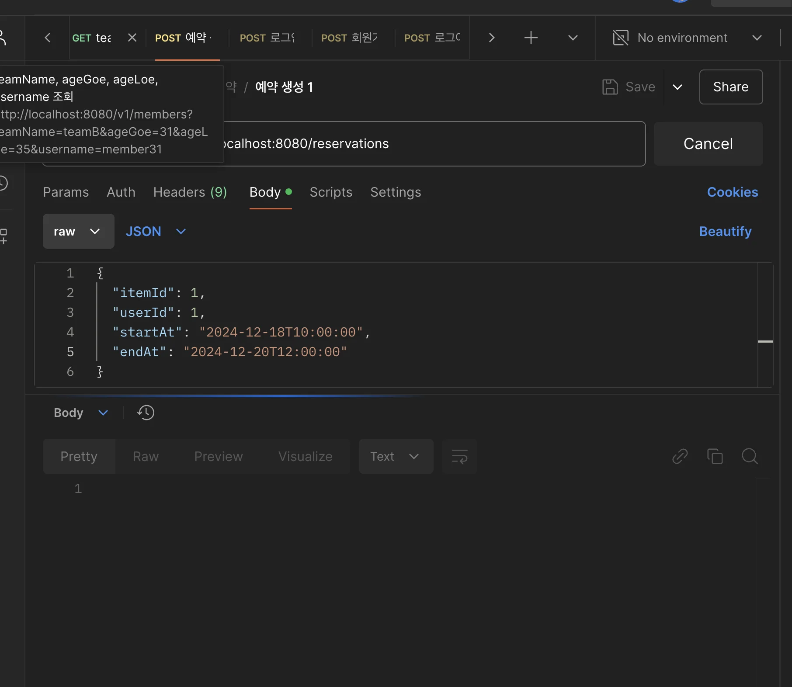

> 스프링 심화반에서 학습한 트랜잭션 전파에 대한 내용을 적용하기 위해 하위 메서드에 독릭적인 트랜잭션을 만들어 적용함 

<details>
<summary>문제 발생 코드</summary>

- <code>ReservationService&#46;createReservation()</code>
    <a id="160eda9b0fe18049b1c6e41e9d66a484"></a>

    ```java
    @Transactional
    public void createReservation(Long itemId, Long userId, LocalDateTime startAt, LocalDateTime endAt) {

        // 쉽게 데이터를 생성하려면 아래 유효성검사 주석 처리
        // 예약 충돌 검사
        List<Reservation> haveReservations = reservationRepository.findConflictingReservations(itemId, startAt, endAt);
        if(!haveReservations.isEmpty()) {
            throw new ReservationConflictException("해당 물건은 이미 그 시간에 예약이 있습니다.");
        }

        Item item = itemRepository.findById(itemId).orElseThrow(() -> new IllegalArgumentException("해당 ID에 맞는 값이 존재하지 않습니다."));
        User user = userRepository.findById(userId).orElseThrow(() -> new IllegalArgumentException("해당 ID에 맞는 값이 존재하지 않습니다."));
        Reservation reservation = new Reservation(item, user, "PENDING", startAt, endAt);
        Reservation savedReservation = reservationRepository.save(reservation);
       
        reservationRepository.flush();

        RentalLog rentalLog = new RentalLog(savedReservation, "로그 메세지", "CREATE");
        rentalLogService.save(rentalLog);
    }
    ```

- RentalLog
    <a id="160eda9b0fe18061af49ed836ae92bad"></a>

    ```java
    @Transactional(propagation = Propagation.REQUIRES_NEW)
    public void save(RentalLog rentalLog) {
        rentalLogRepository.save(rentalLog);
        if (rentalLog != null) {
            throw new RuntimeException();
        }
    }
    ```

</details>

<details>
<summary>설계 의도 </summary>

<a id="160eda9b0fe1809e8789dda5a090f8e7"></a>

해당 코드는 트랜잭션 전파가 되어 하위 렌탈 정보 저장(<code>rentalLogService&#46;save(rentalLog)</code>) 에서 오류가 발생 시,  예약 정보를 저장하는 로직(<code>reservationRepository&#46;save(reservation)</code>)까지 트랜잭션이 전파되어 같이 롤백처리 된다&#46; 

<a id="160eda9b0fe180119794d4217dcde1ff"></a>

따라서 트랜젝션을 독립적으로 선언하여 렌탈 정보에서 오류가 발생되어도 예약 정보를 정상적으로 저장할 수 있도록 한다&#46; 

- 트랜잭션 전파 &#45; 독립된 트랜잭션으로 관리
    - <code>&#64;Transactional(propagation = Propagation&#46;</code><u><code>REQUIRES&#95;NEW</code></u><code>)</code>

</details>

<details>
<summary>오류 &#45; <code>데드락</code> </summary>

> 하위 메서드에 트랜잭션을 독립적으로 관리하기 위해 <code>Propagation&#46;REQUIRES&#95;NEW</code> 적용 → API가 종료되지 않음, <code>데드락</code>



<details>
<summary>오류 메세지</summary>

<a id="160eda9b0fe1807abd52db9940139678"></a>

```java
{
    "timestamp": "2024-12-18T13:35:35.398+00:00",
    "status": 500,
    "error": "Internal Server Error",
    "trace": "org.springframework.dao.PessimisticLockingFailureException: could not execute statement [Lock wait timeout exceeded; try restarting transaction] [insert into rental_log (log_message,log_type,reservation_id) values (?,?,?)]; SQL [insert into rental_log (log_message,log_type,reservation_id) values (?,?,?)]\n\tat org.springframework.orm.jpa.vendor.HibernateJpaDialect.convertHibernateAccessException(HibernateJpaDialect.java:286)\n\tat org.springframework.orm.jpa.vendor.HibernateJpaDialect.translateExceptionIfPossible(HibernateJpaDialect.java:244)\n\tat org.springframework.orm.jpa.AbstractEntityManagerFactoryBean.translateExceptionIfPossible(AbstractEntityManagerFactoryBean.java:560)\n\tat org.springframework.dao.support.ChainedPersistenceExceptionTranslator.translateExceptionIfPossible(ChainedPersistenceExceptionTranslator.java:61)\n\tat org.springframework.dao.support.DataAccessUtils.translateIfNecessary(DataAccessUtils.java:343)\n\tat org.springframework.dao.support.PersistenceExceptionTranslationInterceptor.invoke(PersistenceExceptionTranslationInterceptor.java:160)\n\tat org.springframework.aop.framework.ReflectiveMethodInvocation.proceed(ReflectiveMethodInvocation.java:184)\n\tat org.springframework.data.jpa.repository.support.CrudMethodMetadataPostProcessor$CrudMethodMetadataPopulatingMethodInterceptor.invoke(CrudMethodMetadataPostProcessor.java:165)\n\tat org.springframework.aop.framework.ReflectiveMethodInvocation.proceed(ReflectiveMethodInvocation.java:184)\n\tat org.springframework.aop.framework.JdkDynamicAopProxy.invoke(JdkDynamicAopProxy.java:223)\n\tat jdk.proxy4/jdk.proxy4.$Proxy131.save(Unknown Source)\n\tat com.example.demo.service.RentalLogService.save(RentalLogService.java:20)\n\tat java.base/jdk.internal.reflect.DirectMethodHandleAccessor.invoke(DirectMethodHandleAccessor.java:103)\n\tat java.base/java.lang.reflect.Method.invoke(Method.java:580)\n\tat org.springframework.aop.support.AopUtils.invokeJoinpointUsingReflection(AopUtils.java:359)\n\tat org.springframework.aop.framework.ReflectiveMethodInvocation.invokeJoinpoint(ReflectiveMethodInvocation.java:196)\n\tat org.springframework.aop.framework.ReflectiveMethodInvocation.proceed(ReflectiveMethodInvocation.java:163)\n\tat org.springframework.transaction.interceptor.TransactionAspectSupport.invokeWithinTransaction(TransactionAspectSupport.java:380)\n\tat org.springframework.transaction.interceptor.TransactionInterceptor.invoke(TransactionInterceptor.java:119)\n\tat org.springframework.aop.framework.ReflectiveMethodInvocation.proceed(ReflectiveMethodInvocation.java:184)\n\tat org.springframework.aop.framework.CglibAopProxy$DynamicAdvisedInterceptor.intercept(CglibAopProxy.java:727)\n\tat com.example.demo.service.RentalLogService$$SpringCGLIB$$0.save(<generated>)\n\tat com.example.demo.service.ReservationService.createReservation(ReservationService.java:60)\n\tat java.base/jdk.internal.reflect.DirectMethodHandleAccessor.invoke(DirectMethodHandleAccessor.java:103)\n\tat java.base/java.lang.reflect.Method.invoke(Method.java:580)\n\tat org.springframework.aop.support.AopUtils.invokeJoinpointUsingReflection(AopUtils.java:359)\n\tat org.springframework.aop.framework.ReflectiveMethodInvocation.invokeJoinpoint(ReflectiveMethodInvocation.java:196)\n\tat org.springframework.aop.framework.ReflectiveMethodInvocation.proceed(ReflectiveMethodInvocation.java:163)\n\tat org.springframework.transaction.interceptor.TransactionAspectSupport.invokeWithinTransaction(TransactionAspectSupport.java:380)\n\tat org.springframework.transaction.interceptor.TransactionInterceptor.invoke(TransactionInterceptor.java:119)\n\tat org.springframework.aop.framework.ReflectiveMethodInvocation.proceed(ReflectiveMethodInvocation.java:184)\n\tat org.springframework.aop.framework.CglibAopProxy$DynamicAdvisedInterceptor.intercept(CglibAopProxy.java:727)\n\tat com.example.demo.service.ReservationService$$SpringCGLIB$$0.createReservation(<generated>)\n\tat com.example.demo.controller.ReservationController.createReservation(ReservationController.java:18)\n\tat java.base/jdk.internal.reflect.DirectMethodHandleAccessor.invoke(DirectMethodHandleAccessor.java:103)\n\tat java.base/java.lang.reflect.Method.invoke(Method.java:580)\n\tat org.springframework.web.method.support.InvocableHandlerMethod.doInvoke(InvocableHandlerMethod.java:255)\n\tat org.springframework.web.method.support.InvocableHandlerMethod.invokeForRequest(InvocableHandlerMethod.java:188)\n\tat org.springframework.web.servlet.mvc.method.annotation.ServletInvocableHandlerMethod.invokeAndHandle(ServletInvocableHandlerMethod.java:118)\n\tat org.springframework.web.servlet.mvc.method.annotation.RequestMappingHandlerAdapter.invokeHandlerMethod(RequestMappingHandlerAdapter.java:986)\n\tat org.springframework.web.servlet.mvc.method.annotation.RequestMappingHandlerAdapter.handleInternal(RequestMappingHandlerAdapter.java:891)\n\tat org.springframework.web.servlet.mvc.method.AbstractHandlerMethodAdapter.handle(AbstractHandlerMethodAdapter.java:87)\n\tat org.springframework.web.servlet.DispatcherServlet.doDispatch(DispatcherServlet.java:1088)\n\tat org.springframework.web.servlet.DispatcherServlet.doService(DispatcherServlet.java:978)\n\tat org.springframework.web.servlet.FrameworkServlet.processRequest(FrameworkServlet.java:1014)\n\tat org.springframework.web.servlet.FrameworkServlet.doPost(FrameworkServlet.java:914)\n\tat jakarta.servlet.http.HttpServlet.service(HttpServlet.java:590)\n\tat org.springframework.web.servlet.FrameworkServlet.service(FrameworkServlet.java:885)\n\tat jakarta.servlet.http.HttpServlet.service(HttpServlet.java:658)\n\tat org.apache.catalina.core.ApplicationFilterChain.internalDoFilter(ApplicationFilterChain.java:195)\n\tat org.apache.catalina.core.ApplicationFilterChain.doFilter(ApplicationFilterChain.java:140)\n\tat org.apache.tomcat.websocket.server.WsFilter.doFilter(WsFilter.java:51)\n\tat org.apache.catalina.core.ApplicationFilterChain.internalDoFilter(ApplicationFilterChain.java:164)\n\tat org.apache.catalina.core.ApplicationFilterChain.doFilter(ApplicationFilterChain.java:140)\n\tat org.springframework.web.filter.RequestContextFilter.doFilterInternal(RequestContextFilter.java:100)\n\tat org.springframework.web.filter.OncePerRequestFilter.doFilter(OncePerRequestFilter.java:116)\n\tat org.apache.catalina.core.ApplicationFilterChain.internalDoFilter(ApplicationFilterChain.java:164)\n\tat org.apache.catalina.core.ApplicationFilterChain.doFilter(ApplicationFilterChain.java:140)\n\tat org.springframework.web.filter.FormContentFilter.doFilterInternal(FormContentFilter.java:93)\n\tat org.springframework.web.filter.OncePerRequestFilter.doFilter(OncePerRequestFilter.java:116)\n\tat org.apache.catalina.core.ApplicationFilterChain.internalDoFilter(ApplicationFilterChain.java:164)\n\tat org.apache.catalina.core.ApplicationFilterChain.doFilter(ApplicationFilterChain.java:140)\n\tat com.example.demo.filter.RoleFilter.doFilter(RoleFilter.java:35)\n\tat org.apache.catalina.core.ApplicationFilterChain.internalDoFilter(ApplicationFilterChain.java:164)\n\tat org.apache.catalina.core.ApplicationFilterChain.doFilter(ApplicationFilterChain.java:140)\n\tat org.springframework.web.filter.CharacterEncodingFilter.doFilterInternal(CharacterEncodingFilter.java:201)\n\tat org.springframework.web.filter.OncePerRequestFilter.doFilter(OncePerRequestFilter.java:116)\n\tat org.apache.catalina.core.ApplicationFilterChain.internalDoFilter(ApplicationFilterChain.java:164)\n\tat org.apache.catalina.core.ApplicationFilterChain.doFilter(ApplicationFilterChain.java:140)\n\tat org.apache.catalina.core.StandardWrapperValve.invoke(StandardWrapperValve.java:167)\n\tat org.apache.catalina.core.StandardContextValve.invoke(StandardContextValve.java:90)\n\tat org.apache.catalina.authenticator.AuthenticatorBase.invoke(AuthenticatorBase.java:483)\n\tat org.apache.catalina.core.StandardHostValve.invoke(StandardHostValve.java:115)\n\tat org.apache.catalina.valves.ErrorReportValve.invoke(ErrorReportValve.java:93)\n\tat org.apache.catalina.core.StandardEngineValve.invoke(StandardEngineValve.java:74)\n\tat org.apache.catalina.connector.CoyoteAdapter.service(CoyoteAdapter.java:344)\n\tat org.apache.coyote.http11.Http11Processor.service(Http11Processor.java:397)\n\tat org.apache.coyote.AbstractProcessorLight.process(AbstractProcessorLight.java:63)\n\tat org.apache.coyote.AbstractProtocol$ConnectionHandler.process(AbstractProtocol.java:905)\n\tat org.apache.tomcat.util.net.NioEndpoint$SocketProcessor.doRun(NioEndpoint.java:1741)\n\tat org.apache.tomcat.util.net.SocketProcessorBase.run(SocketProcessorBase.java:52)\n\tat org.apache.tomcat.util.threads.ThreadPoolExecutor.runWorker(ThreadPoolExecutor.java:1190)\n\tat org.apache.tomcat.util.threads.ThreadPoolExecutor$Worker.run(ThreadPoolExecutor.java:659)\n\tat org.apache.tomcat.util.threads.TaskThread$WrappingRunnable.run(TaskThread.java:63)\n\tat java.base/java.lang.Thread.run(Thread.java:1583)\nCaused by: org.hibernate.PessimisticLockException: could not execute statement [Lock wait timeout exceeded; try restarting transaction] [insert into rental_log (log_message,log_type,reservation_id) values (?,?,?)]\n\tat org.hibernate.dialect.MySQLDialect.lambda$buildSQLExceptionConversionDelegate$3(MySQLDialect.java:1238)\n\tat org.hibernate.exception.internal.StandardSQLExceptionConverter.convert(StandardSQLExceptionConverter.java:58)\n\tat org.hibernate.engine.jdbc.spi.SqlExceptionHelper.convert(SqlExceptionHelper.java:108)\n\tat org.hibernate.engine.jdbc.internal.ResultSetReturnImpl.executeUpdate(ResultSetReturnImpl.java:197)\n\tat org.hibernate.id.insert.GetGeneratedKeysDelegate.performMutation(GetGeneratedKeysDelegate.java:116)\n\tat org.hibernate.engine.jdbc.mutation.internal.MutationExecutorSingleNonBatched.performNonBatchedOperations(MutationExecutorSingleNonBatched.java:47)\n\tat org.hibernate.engine.jdbc.mutation.internal.AbstractMutationExecutor.execute(AbstractMutationExecutor.java:55)\n\tat org.hibernate.persister.entity.mutation.InsertCoordinatorStandard.doStaticInserts(InsertCoordinatorStandard.java:194)\n\tat org.hibernate.persister.entity.mutation.InsertCoordinatorStandard.coordinateInsert(InsertCoordinatorStandard.java:132)\n\tat org.hibernate.persister.entity.mutation.InsertCoordinatorStandard.insert(InsertCoordinatorStandard.java:95)\n\tat org.hibernate.action.internal.EntityIdentityInsertAction.execute(EntityIdentityInsertAction.java:85)\n\tat org.hibernate.engine.spi.ActionQueue.execute(ActionQueue.java:682)\n\tat org.hibernate.engine.spi.ActionQueue.addResolvedEntityInsertAction(ActionQueue.java:293)\n\tat org.hibernate.engine.spi.ActionQueue.addInsertAction(ActionQueue.java:274)\n\tat org.hibernate.engine.spi.ActionQueue.addAction(ActionQueue.java:324)\n\tat org.hibernate.event.internal.AbstractSaveEventListener.addInsertAction(AbstractSaveEventListener.java:393)\n\tat org.hibernate.event.internal.AbstractSaveEventListener.performSaveOrReplicate(AbstractSaveEventListener.java:307)\n\tat org.hibernate.event.internal.AbstractSaveEventListener.performSave(AbstractSaveEventListener.java:223)\n\tat org.hibernate.event.internal.AbstractSaveEventListener.saveWithGeneratedId(AbstractSaveEventListener.java:136)\n\tat org.hibernate.event.internal.DefaultPersistEventListener.entityIsTransient(DefaultPersistEventListener.java:177)\n\tat org.hibernate.event.internal.DefaultPersistEventListener.persist(DefaultPersistEventListener.java:95)\n\tat org.hibernate.event.internal.DefaultPersistEventListener.onPersist(DefaultPersistEventListener.java:79)\n\tat org.hibernate.event.internal.DefaultPersistEventListener.onPersist(DefaultPersistEventListener.java:55)\n\tat org.hibernate.event.service.internal.EventListenerGroupImpl.fireEventOnEachListener(EventListenerGroupImpl.java:127)\n\tat org.hibernate.internal.SessionImpl.firePersist(SessionImpl.java:761)\n\tat org.hibernate.internal.SessionImpl.persist(SessionImpl.java:745)\n\tat java.base/jdk.internal.reflect.DirectMethodHandleAccessor.invoke(DirectMethodHandleAccessor.java:103)\n\tat java.base/java.lang.reflect.Method.invoke(Method.java:580)\n\tat org.springframework.orm.jpa.SharedEntityManagerCreator$SharedEntityManagerInvocationHandler.invoke(SharedEntityManagerCreator.java:320)\n\tat jdk.proxy4/jdk.proxy4.$Proxy121.persist(Unknown Source)\n\tat org.springframework.data.jpa.repository.support.SimpleJpaRepository.save(SimpleJpaRepository.java:623)\n\tat java.base/jdk.internal.reflect.DirectMethodHandleAccessor.invoke(DirectMethodHandleAccessor.java:103)\n\tat java.base/java.lang.reflect.Method.invoke(Method.java:580)\n\tat org.springframework.aop.support.AopUtils.invokeJoinpointUsingReflection(AopUtils.java:359)\n\tat org.springframework.data.repository.core.support.RepositoryMethodInvoker$RepositoryFragmentMethodInvoker.lambda$new$0(RepositoryMethodInvoker.java:277)\n\tat org.springframework.data.repository.core.support.RepositoryMethodInvoker.doInvoke(RepositoryMethodInvoker.java:170)\n\tat org.springframework.data.repository.core.support.RepositoryMethodInvoker.invoke(RepositoryMethodInvoker.java:158)\n\tat org.springframework.data.repository.core.support.RepositoryComposition$RepositoryFragments.invoke(RepositoryComposition.java:515)\n\tat org.springframework.data.repository.core.support.RepositoryComposition.invoke(RepositoryComposition.java:284)\n\tat org.springframework.data.repository.core.support.RepositoryFactorySupport$ImplementationMethodExecutionInterceptor.invoke(RepositoryFactorySupport.java:752)\n\tat org.springframework.aop.framework.ReflectiveMethodInvocation.proceed(ReflectiveMethodInvocation.java:184)\n\tat org.springframework.data.repository.core.support.QueryExecutorMethodInterceptor.doInvoke(QueryExecutorMethodInterceptor.java:174)\n\tat org.springframework.data.repository.core.support.QueryExecutorMethodInterceptor.invoke(QueryExecutorMethodInterceptor.java:149)\n\tat org.springframework.aop.framework.ReflectiveMethodInvocation.proceed(ReflectiveMethodInvocation.java:184)\n\tat org.springframework.data.projection.DefaultMethodInvokingMethodInterceptor.invoke(DefaultMethodInvokingMethodInterceptor.java:69)\n\tat org.springframework.aop.framework.ReflectiveMethodInvocation.proceed(ReflectiveMethodInvocation.java:184)\n\tat org.springframework.transaction.interceptor.TransactionAspectSupport.invokeWithinTransaction(TransactionAspectSupport.java:380)\n\tat org.springframework.transaction.interceptor.TransactionInterceptor.invoke(TransactionInterceptor.java:119)\n\tat org.springframework.aop.framework.ReflectiveMethodInvocation.proceed(ReflectiveMethodInvocation.java:184)\n\tat org.springframework.dao.support.PersistenceExceptionTranslationInterceptor.invoke(PersistenceExceptionTranslationInterceptor.java:138)\n\t... 79 more\nCaused by: com.mysql.cj.jdbc.exceptions.MySQLTransactionRollbackException: Lock wait timeout exceeded; try restarting transaction\n\tat com.mysql.cj.jdbc.exceptions.SQLError.createSQLException(SQLError.java:115)\n\tat com.mysql.cj.jdbc.exceptions.SQLExceptionsMapping.translateException(SQLExceptionsMapping.java:114)\n\tat com.mysql.cj.jdbc.ClientPreparedStatement.executeInternal(ClientPreparedStatement.java:988)\n\tat com.mysql.cj.jdbc.ClientPreparedStatement.executeUpdateInternal(ClientPreparedStatement.java:1166)\n\tat com.mysql.cj.jdbc.ClientPreparedStatement.executeUpdateInternal(ClientPreparedStatement.java:1101)\n\tat com.mysql.cj.jdbc.ClientPreparedStatement.executeLargeUpdate(ClientPreparedStatement.java:1467)\n\tat com.mysql.cj.jdbc.ClientPreparedStatement.executeUpdate(ClientPreparedStatement.java:1084)\n\tat com.zaxxer.hikari.pool.ProxyPreparedStatement.executeUpdate(ProxyPreparedStatement.java:61)\n\tat com.zaxxer.hikari.pool.HikariProxyPreparedStatement.executeUpdate(HikariProxyPreparedStatement.java)\n\tat org.hibernate.engine.jdbc.internal.ResultSetReturnImpl.executeUpdate(ResultSetReturnImpl.java:194)\n\t... 125 more\n",
    "message": "could not execute statement [Lock wait timeout exceeded; try restarting transaction] [insert into rental_log (log_message,log_type,reservation_id) values (?,?,?)]; SQL [insert into rental_log (log_message,log_type,reservation_id) values (?,?,?)]",
    "path": "/reservations"
}
```

</details>

> Lock wait timeout exceeded; try restarting transaction

<a id="160eda9b0fe18004937bf71da34029da"></a>

<strong>트랜잭션이 락(lock) 걸린 상태에서 대기 시간이 초과</strong>했음을 의미

- <code>원인</code>
    - <strong>데드락(deadlock)</strong>
        - <strong>긴 락 점유</strong>

        - <strong>동시에 접근하는 트랜잭션 간의 충돌</strong>

- <code>em&#46;flush()</code>를 통해 기존의 트랜잭션에 저장한 엔티티를 한번 업데이트
    - insert문 날라감

- 이후, 하위 메서드로 영속성 전이(트랜잭션 전파)

- 하위 메서드에서 엔티티 저장
    - insert 문 날라감

    - 이 이후 트랜잭션이 종료되지 않고 락이 지속되어 timeout 발생
        - <code>데드락</code> 

</details>

<details>
<summary>해결</summary>

- <strong><code>&#64;Async </code></strong>→ 해결안됨
    1. 별도 쓰레드 비동기로 동작해야 한다&#46;  
        <a id="161eda9b0fe180fda217f5cd7538e631"></a>

        Async 

- <strong>noRollbackFor</strong>
    <a id="161eda9b0fe1803189aae086c351e87b"></a>

    ```java
    @Transactional(rollbackFor = CustomException.class)
    public void performTask() throws CustomException {
        try {
            // 작업 실행
            throw new RuntimeException("Exception 발생");
        } catch (RuntimeException e) {
            throw new CustomException("커스텀 예외 발생", e);
        }
    }
    ```

    <a id="161eda9b0fe1809b9a48d8f9d636ca1a"></a>

     

</details>
