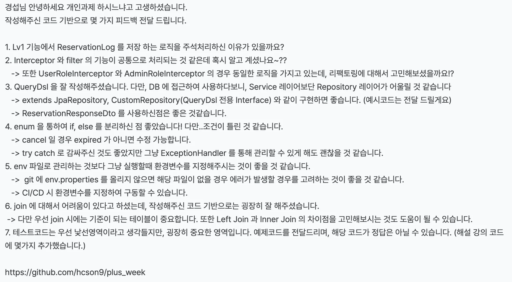
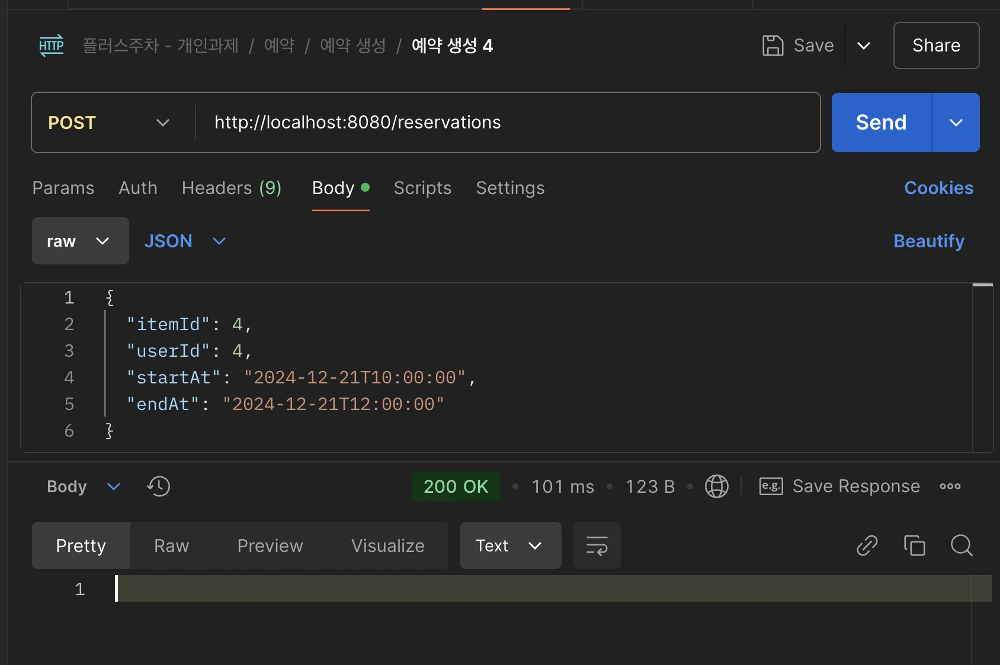
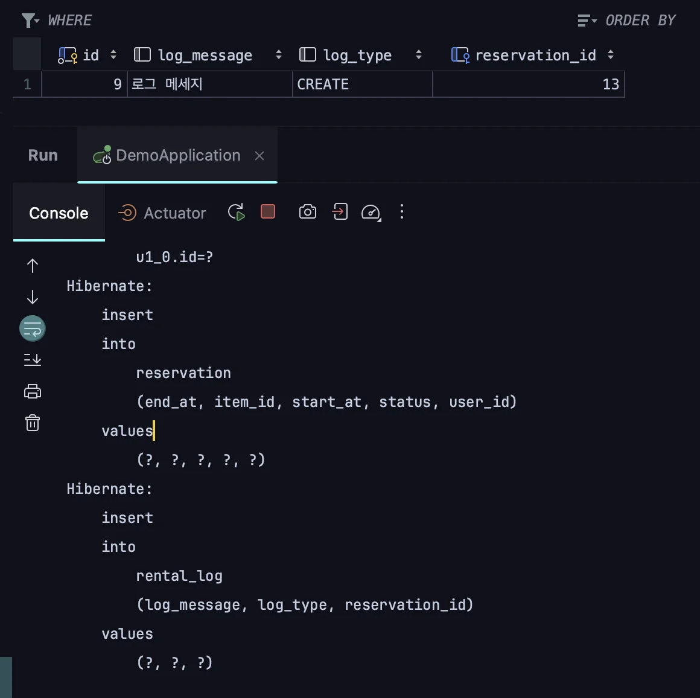
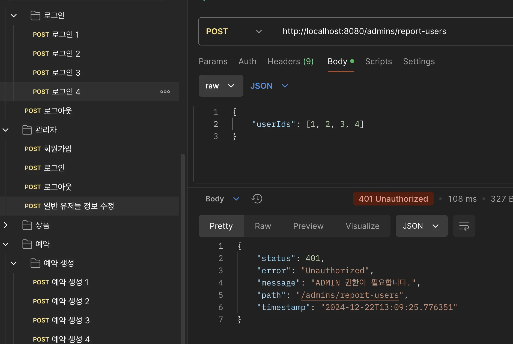
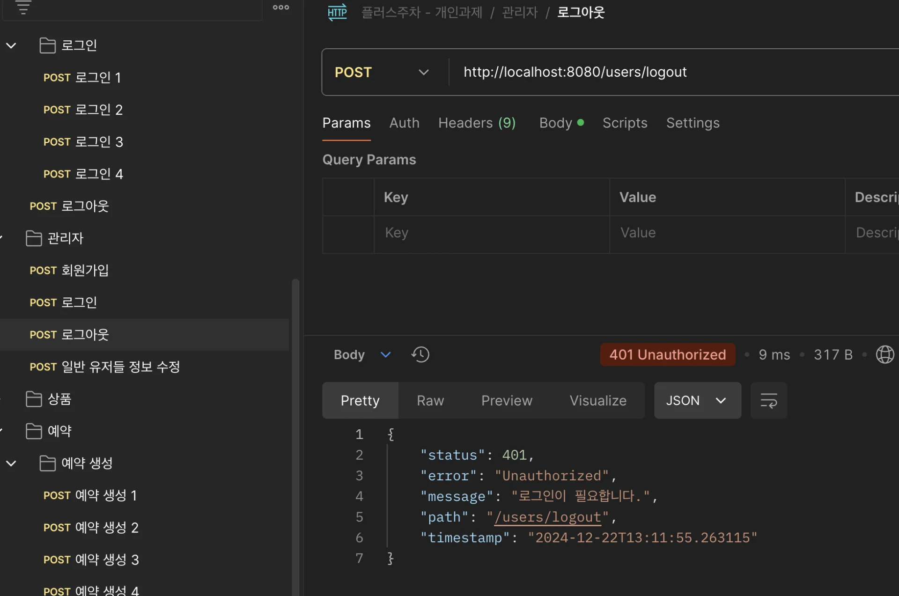
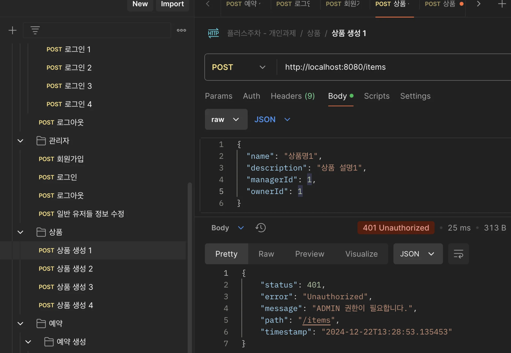
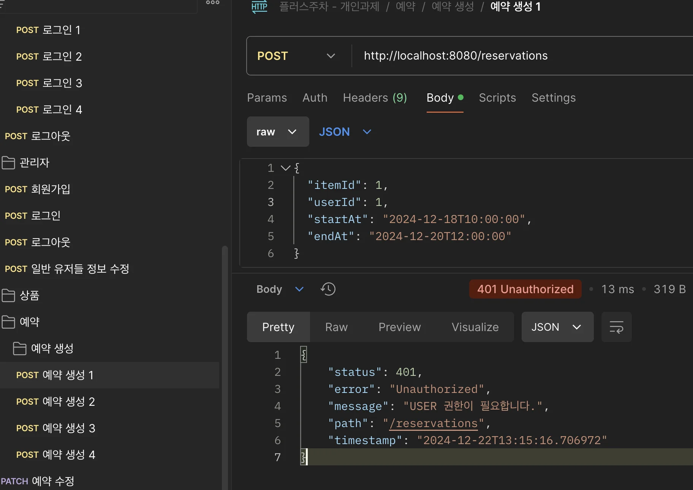
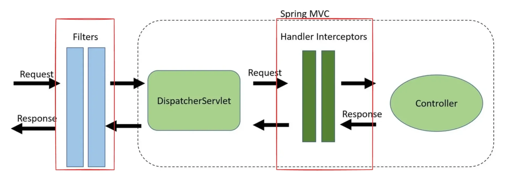
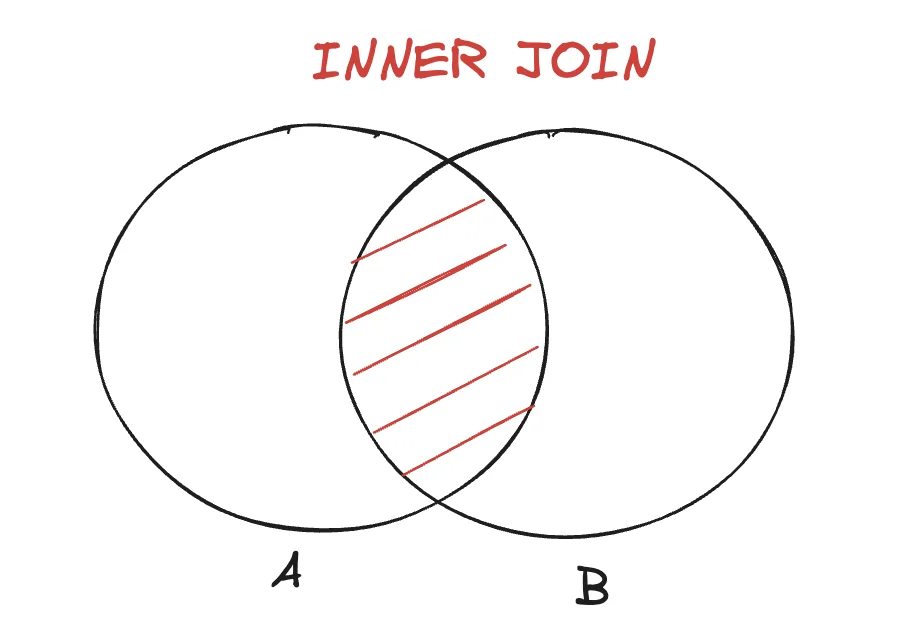
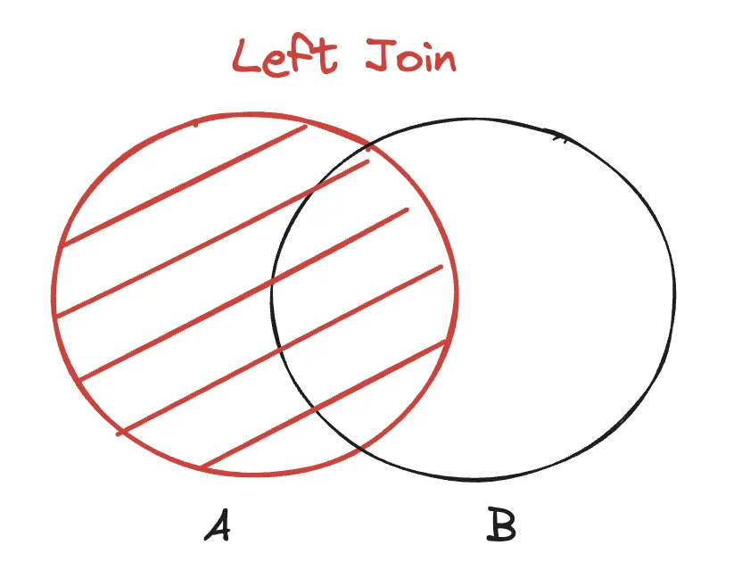

- 피드백 내용
    

- [x]  1&#46; ReservationLog
    - 과제에서 크게 다루지 않는 부분이라 생각해 주석 처리하고 진행

    <details>
    <summary>이전 코드</summary>

    <a id="163eda9b0fe180a497fddea40d80dd21"></a>

    ```sql
    @Transactional
    public void createReservation(Long itemId, Long userId, LocalDateTime startAt, LocalDateTime endAt) {
        // 쉽게 데이터를 생성하려면 아래 유효성검사 주석 처리
        List<Reservation> haveReservations = reservationRepository.findConflictingReservations(itemId, startAt, endAt);
        if(!haveReservations.isEmpty()) {
            throw new ReservationConflictException("해당 물건은 이미 그 시간에 예약이 있습니다.");
        }

        Item item = itemRepository.findByIdOrElseThrow(itemId);
        User user = userRepository.findByIdOrElseThrow(userId);
        Reservation reservation = new Reservation(item, user, ReservationStatus.PENDING, startAt, endAt);
        Reservation savedReservation = reservationRepository.save(reservation);

        RentalLog rentalLog = new RentalLog(savedReservation, "로그 메세지", "CREATE");

    //  rentalLogService.save(rentalLog);
    }
    ```

    </details>

    <details>
    <summary>수정 코드</summary>

    <a id="163eda9b0fe18099b6e2c9c265bb3f5e"></a>

    아래와 같이 예외(RuntimeException)가 발생되는 코드를 제거하고 RentalLog 저장 로직이 정상적으로 동작하도록 변경함

    - <code>ReservationService&#46;createReservation()</code>
        <a id="163eda9b0fe180d18a7ce32c9b49fd2b"></a>

        ```java
        @Transactional
        public void createReservation(Long itemId, Long userId, LocalDateTime startAt, LocalDateTime endAt) {
            // 쉽게 데이터를 생성하려면 아래 유효성검사 주석 처리
            List<Reservation> haveReservations = reservationRepository.findConflictingReservations(itemId, startAt, endAt);
            if(!haveReservations.isEmpty()) {
                throw new ReservationConflictException("해당 물건은 이미 그 시간에 예약이 있습니다.");
            }

            Item item = itemRepository.findByIdOrElseThrow(itemId);
            User user = userRepository.findByIdOrElseThrow(userId);
            Reservation reservation = new Reservation(item, user, ReservationStatus.PENDING, startAt, endAt);
            Reservation savedReservation = reservationRepository.save(reservation);

            RentalLog rentalLog = new RentalLog(savedReservation, "로그 메세지", "CREATE");

            rentalLogService.save(rentalLog);
        }
        ```

    - <code>RentalLogService&#46;save()</code>
        <a id="163eda9b0fe1803eae88d41aea5bcc06"></a>

        ```java
        @Service
        public class RentalLogService {
            private final RentalLogRepository rentalLogRepository;

            public RentalLogService(RentalLogRepository rentalLogRepository) {
                this.rentalLogRepository = rentalLogRepository;
            }

            @Transactional
            public void save(RentalLog rentalLog) {
                rentalLogRepository.save(rentalLog);
            }
        }
        ```

    - 실행 결과
        

        

    </details>

- [x] 2&#46; Intercepter, filter 중복된 인증, 인가 처리<br>    UserRoleIntercepter, AdminRoleInterceptor &#45; 중복 코드
    <details>
    <summary>이전 코드</summary>

    <details>
    <summary>filters</summary>

    <details>
    <summary>&#91; 코드 &#93; &#60; interface &#62; CommonAuthFilter</summary>

    <a id="ee456863f1a14b0da3b64058d3edabbf"></a>

    ```java
    public interface CommonAuthFilter extends Filter {

        default HttpSession findHttpSession(ServletRequest request) {
            HttpServletRequest httpServletRequest = (HttpServletRequest) request;
            return Optional.of(httpServletRequest.getSession(false))
                    .orElseThrow(() -> new UnauthorizedException(HttpStatus.UNAUTHORIZED, "로그인 필요"));
        }
    }
    ```

    </details>

    <details>
    <summary>&#91; 코드 &#93; AuthFilter</summary>

    <a id="2fb11662f2004f1ab5c0c8293b91a5c7"></a>

    ```java
    public class AuthFilter implements CommonAuthFilter {

        @Override
        public void doFilter(ServletRequest servletRequest, ServletResponse servletResponse, FilterChain filterChain)
                throws IOException, ServletException {
            findHttpSession(servletRequest);
            filterChain.doFilter(servletRequest, servletResponse);
        }
    }
    ```

    </details>

    <details>
    <summary>&#91; 코드 &#93; RoleFilter</summary>

    <a id="9b983b0c482948a596c3f04a2ede317e"></a>

    ```java
    @RequiredArgsConstructor
    public class RoleFilter implements CommonAuthFilter {

        private final Role role;

        @Override
        public void doFilter(ServletRequest servletRequest, ServletResponse servletResponse, FilterChain filterChain)
                throws IOException, ServletException {
            HttpSession session = findHttpSession(servletRequest);

            Authentication authentication = (Authentication) session.getAttribute(GlobalConstants.USER_AUTH);

            if (authentication == null) {
                throw new UnauthorizedException(HttpStatus.UNAUTHORIZED, "세션이 존재하지 않습니다. 로그인 해주세요.");
            }

            Role clientRole = authentication.getRole();

            if (clientRole != this.role) {
                throw new UnauthorizedException(HttpStatus.UNAUTHORIZED, role.getName() + " 권한이 필요합니다.");
            }

            filterChain.doFilter(servletRequest, servletResponse);
        }
    }
    ```

    </details>

    </details>

    <details>
    <summary>Intercepter</summary>

    <details>
    <summary>&#91; 코드 &#93; AuthInterceptor</summary>

    <a id="29f6227a49aa4f49a27bb44bfbd48d33"></a>

    ```java
    package com.example.demo.interceptor;

    import com.example.demo.constants.GlobalConstants;
    import com.example.demo.exception.UnauthorizedException;
    import jakarta.servlet.http.HttpServletRequest;
    import jakarta.servlet.http.HttpServletResponse;
    import jakarta.servlet.http.HttpSession;
    import org.springframework.http.HttpStatus;
    import org.springframework.stereotype.Component;
    import org.springframework.web.servlet.HandlerInterceptor;

    @Component
    public class AuthInterceptor implements HandlerInterceptor {

        @Override
        public boolean preHandle(HttpServletRequest request, HttpServletResponse response, Object handler)
                throws UnauthorizedException {
            HttpSession session = request.getSession(false);
            if (session == null) {
                throw new UnauthorizedException(HttpStatus.UNAUTHORIZED, "로그인이 필요합니다.");
            }

            if (session.getAttribute(GlobalConstants.USER_AUTH) == null) {
                throw new UnauthorizedException(HttpStatus.UNAUTHORIZED, "로그인이 필요합니다.");
            }

            return true;
        }
    }

    ```

    </details>

    <details>
    <summary>&#91; 코드 &#93; AdminRoleInterceptor</summary>

    <a id="163eda9b0fe1808c84bbfecc2d5c31f2"></a>

    ```java
    package com.example.demo.interceptor;

    import com.example.demo.constants.GlobalConstants;
    import com.example.demo.dto.Authentication;
    import com.example.demo.entity.enums.Role;
    import com.example.demo.exception.UnauthorizedException;
    import jakarta.servlet.http.HttpServletRequest;
    import jakarta.servlet.http.HttpServletResponse;
    import jakarta.servlet.http.HttpSession;
    import org.springframework.http.HttpStatus;
    import org.springframework.stereotype.Component;
    import org.springframework.web.servlet.HandlerInterceptor;

    @Component
    public class AdminRoleInterceptor implements HandlerInterceptor {

        @Override
        public boolean preHandle(HttpServletRequest request, HttpServletResponse response, Object handler) throws UnauthorizedException {

            HttpSession session = request.getSession(false);

            if (session == null) {
                throw new UnauthorizedException(HttpStatus.UNAUTHORIZED, "세션이 끊어졌습니다.");
            }

            Authentication authentication = (Authentication) session.getAttribute(GlobalConstants.USER_AUTH);

            Role role = authentication.getRole();

            if (role != Role.ADMIN) {
                throw new UnauthorizedException(HttpStatus.UNAUTHORIZED, "Admin 권한이 필요합니다.");
            }

            return true;
        }
    }
    ```

    </details>

    <details>
    <summary>&#91; 코드 &#93; UserRoleInterceptor</summary>

    <a id="1653a102ea2c4029bd606aba651e52b7"></a>

    ```java
    package com.example.demo.interceptor;

    import com.example.demo.constants.GlobalConstants;
    import com.example.demo.dto.Authentication;
    import com.example.demo.entity.enums.Role;
    import com.example.demo.exception.UnauthorizedException;
    import jakarta.servlet.http.HttpServletRequest;
    import jakarta.servlet.http.HttpServletResponse;
    import jakarta.servlet.http.HttpSession;
    import org.springframework.http.HttpStatus;
    import org.springframework.stereotype.Component;
    import org.springframework.web.servlet.HandlerInterceptor;

    @Component
    public class UserRoleInterceptor implements HandlerInterceptor {

        @Override
        public boolean preHandle(HttpServletRequest request, HttpServletResponse response, Object handler) throws UnauthorizedException {
                
            HttpSession session = request.getSession(false);
            if (session == null) {
                throw new UnauthorizedException(HttpStatus.UNAUTHORIZED, "세션이 끊어졌습니다.");
            }

            Authentication authentication = (Authentication) session.getAttribute(GlobalConstants.USER_AUTH);
            Role role = authentication.getRole();

            if (role != Role.USER) {
                throw new UnauthorizedException(HttpStatus.UNAUTHORIZED, "user 권한이 필요합니다.");
            }

            return true;
        }
    }

    ```

    </details>

    <a id="163eda9b0fe180bcacf2cfaf47ef34b3"></a>

    AdminRoleInterceptor, UserRoleInterceptor이 클래스명을 제외한 로직이 동일함

    </details>

    <details>
    <summary>config</summary>

    <details>
    <summary>&#91; 코드 &#93; WebConfig</summary>

    <a id="7ce565609b6a44019f6720b9e8f22b51"></a>

    ```java
    package com.example.demo.config;

    import com.example.demo.entity.enums.Role;
    import com.example.demo.filter.AuthFilter;
    import com.example.demo.filter.RoleFilter;
    import com.example.demo.interceptor.AdminRoleInterceptor;
    import com.example.demo.interceptor.AuthInterceptor;
    import com.example.demo.interceptor.UserRoleInterceptor;
    import jakarta.servlet.Filter;
    import lombok.RequiredArgsConstructor;
    import org.springframework.boot.web.servlet.FilterRegistrationBean;
    import org.springframework.context.annotation.Bean;
    import org.springframework.context.annotation.Configuration;
    import org.springframework.core.Ordered;
    import org.springframework.web.servlet.config.annotation.InterceptorRegistry;
    import org.springframework.web.servlet.config.annotation.WebMvcConfigurer;

    @Configuration
    @RequiredArgsConstructor
    public class WebConfig implements WebMvcConfigurer {

        // TODO: 2. 인가에 대한 이해
        private static final String[] AUTH_REQUIRED_PATH_PATTERNS = {"/users/logout"};

        private static final String[] ADMIN_ROLE_REQUIRED_PATH_PATTERNS = {"/admins/*", "/items/*"};

        private static final String[] USER_ROLE_REQUIRED_PATH_PATTERNS = {"/reservations/*"};

        private final AuthInterceptor authInterceptor;
        private final UserRoleInterceptor userRoleInterceptor;
        private final AdminRoleInterceptor adminRoleInterceptor;

        @Override
        public void addInterceptors(InterceptorRegistry registry) {
            registry.addInterceptor(authInterceptor)
                    .addPathPatterns(AUTH_REQUIRED_PATH_PATTERNS)
                    .order(Ordered.HIGHEST_PRECEDENCE);

            registry.addInterceptor(adminRoleInterceptor)
                    .addPathPatterns(ADMIN_ROLE_REQUIRED_PATH_PATTERNS)
                    .order(Ordered.HIGHEST_PRECEDENCE + 1);

            registry.addInterceptor(userRoleInterceptor)
                    .addPathPatterns(USER_ROLE_REQUIRED_PATH_PATTERNS)
                    .order(Ordered.HIGHEST_PRECEDENCE + 2);
        }

        @Bean
        public FilterRegistrationBean authFilter() {
            FilterRegistrationBean<Filter> filterRegistrationBean = new FilterRegistrationBean<>();
            filterRegistrationBean.setFilter(new AuthFilter());
            filterRegistrationBean.setOrder(Ordered.HIGHEST_PRECEDENCE);
            filterRegistrationBean.addUrlPatterns(AUTH_REQUIRED_PATH_PATTERNS);
            return filterRegistrationBean;
        }

        @Bean
        public FilterRegistrationBean adminRoleFilter() {
            FilterRegistrationBean<Filter> filterRegistrationBean = new FilterRegistrationBean<>();
            filterRegistrationBean.setFilter(new RoleFilter(Role.ADMIN));
            filterRegistrationBean.setOrder(Ordered.HIGHEST_PRECEDENCE + 1);
            filterRegistrationBean.addUrlPatterns(ADMIN_ROLE_REQUIRED_PATH_PATTERNS);
            return filterRegistrationBean;
        }

        @Bean
        public FilterRegistrationBean userRoleFilter() {
            FilterRegistrationBean<Filter> filterRegistrationBean = new FilterRegistrationBean<>();
            filterRegistrationBean.setFilter(new RoleFilter(Role.USER));
            filterRegistrationBean.setOrder(Ordered.HIGHEST_PRECEDENCE + 2);
            filterRegistrationBean.addUrlPatterns(USER_ROLE_REQUIRED_PATH_PATTERNS);
            return filterRegistrationBean;
        }
    }
    ```

    </details>

    </details>

    </details>

    <details>
    <summary>🤬 오류 &#45; 순환 참조</summary>

    <details>
    <summary>오류 메세지</summary>

    <a id="9d0a6e83f0764f1686a1d2e682fa9d46"></a>

    ```java
    ***************************
    APPLICATION FAILED TO START
    ***************************

    Description:

    The dependencies of some of the beans in the application context form a cycle:

    ┌──->──┐
    |  interceptorConfig defined in file [/Users/igyeongseob/Desktop/내배캠/project/plus-week/build/classes/java/main/com/example/demo/config/InterceptorConfig.class]
    └──<-──┘


    Action:

    Relying upon circular references is discouraged and they are prohibited by default. Update your application to remove the dependency cycle between beans. As a last resort, it may be possible to break the cycle automatically by setting spring.main.allow-circular-references to true.


    Process finished with exit code 0

    ```

    </details>

    <details>
    <summary>원인</summary>

    1. <code>&#64;Bean</code>  메서드와 <code>&#64;Configuration</code> 의 Proxy 문제
        <a id="164eda9b0fe1809d96abd61ab2b34e36"></a>

        Spring Boot는 &#64;Configuraion 클래스를 CGLIB Proxy로 관리한다&#46; <br>여기서 IntereptorConfig 내부에서 <code>&#64;Bean </code>메서드 호출 시, Proxy를 통해 호출되는 것을 간접적인 순환 참조로 간주한다&#46;

    1. Spring 초기화 순서 문제
        <a id="164eda9b0fe18062be09e71d17da6598"></a>

        <code>AuthInterceptor</code>, <code>RoleInterceptor</code>는 <code>&#64;Bean</code>으로 등록되지만, 해당 빈들이 초기화되기 전에 InterceptorConfig가 초기화 되면서 의존성 문제가 발생된다&#46; 

    ---

    <details>
    <summary>&#91; 코드 &#93; InterceptorConfig</summary>

    <a id="5ad6d731c03b47579580e2e3a7e38145"></a>

    ```java
    @Configuration
    @RequiredArgsConstructor
    public class InterceptorConfig implements WebMvcConfigurer {
        private static final String[] AUTH_REQUIRED_PATH_PATTERNS = {"/users/logout"};

        private static final String[] ADMIN_ROLE_REQUIRED_PATH_PATTERNS = {"/admins/*", "/items/*"};

        private static final String[] USER_ROLE_REQUIRED_PATH_PATTERNS = {"/reservations/*"};

        private final AuthInterceptor authInterceptor;
        private final RoleInterceptor userRoleInterceptor;
        private final RoleInterceptor adminRoleInterceptor;

        // Interceptor 방식
        @Override
        public void addInterceptors(InterceptorRegistry registry) {
            registerInterceptor(registry, authInterceptor, AUTH_REQUIRED_PATH_PATTERNS, Ordered.HIGHEST_PRECEDENCE);
            registerInterceptor(registry, adminRoleInterceptor, ADMIN_ROLE_REQUIRED_PATH_PATTERNS, Ordered.HIGHEST_PRECEDENCE + 1);
            registerInterceptor(registry, userRoleInterceptor, USER_ROLE_REQUIRED_PATH_PATTERNS, Ordered.HIGHEST_PRECEDENCE + 2);
        }

        private void registerInterceptor(InterceptorRegistry registry,
                                         HandlerInterceptor interceptor,
                                         String[] pathPatterns,
                                         int order) {
            registry.addInterceptor(interceptor)
                    .addPathPatterns(pathPatterns)
                    .order(order);
        }

        // Intercepters 빈 등록
        @Bean
        public AuthInterceptor authInterceptor() {
            return new AuthInterceptor();
        }

        @Bean
        public RoleInterceptor userRoleInterceptor() {
            return new RoleInterceptor(Role.USER);
        }

        @Bean
        public RoleInterceptor adminRoleInterceptor() {
            return new RoleInterceptor(Role.ADMIN);
        }
    }
    ```

    </details>

    </details>

    <details>
    <summary>해결</summary>

    - <strong><code>InterceptorConfig</code></strong><strong>와 </strong><strong><code>WebMvcConfigurer</code></strong><strong> 역할 분리</strong>
        <a id="164eda9b0fe180b6b3a6e0b8462dd902"></a>

        InterceptorConfig가 WebMvcConfigurer 역할을 동시에 하면서 발생하는 문제이기 때문에, <br>두 역할을 아래와 같이 분리하여 해결하였다&#46; 

        <details>
        <summary>&#91; 코드 &#93; InterceptorConfig</summary>

        <a id="164eda9b0fe18040916dfe924fafeea2"></a>

        ```java
        @Configuration
        public class InterceptorConfig {
            @Bean
            public AuthInterceptor authInterceptor() {
                return new AuthInterceptor();
            }

            @Bean
            public RoleInterceptor userRoleInterceptor() {
                return new RoleInterceptor(Role.USER);
            }

            @Bean
            public RoleInterceptor adminRoleInterceptor() {
                return new RoleInterceptor(Role.ADMIN);
            }
        }
        ```

        </details>

        <details>
        <summary>&#91; 코드 &#93; WebConfig</summary>

        <a id="164eda9b0fe180dab17cd0376730381b"></a>

        ```java
        @Configuration
        @RequiredArgsConstructor
        public class WebConfig implements WebMvcConfigurer {
            private static final String[] AUTH_REQUIRED_PATH_PATTERNS = {"/users/logout"};
            private static final String[] ADMIN_ROLE_REQUIRED_PATH_PATTERNS = {"/admins/*", "/items/*"};
            private static final String[] USER_ROLE_REQUIRED_PATH_PATTERNS = {"/reservations/*"};

            private final AuthInterceptor authInterceptor;
            private final RoleInterceptor userRoleInterceptor;
            private final RoleInterceptor adminRoleInterceptor;

            @Override
            public void addInterceptors(InterceptorRegistry registry) {
                registerInterceptor(registry, authInterceptor, AUTH_REQUIRED_PATH_PATTERNS, Ordered.HIGHEST_PRECEDENCE);
                registerInterceptor(registry, adminRoleInterceptor, ADMIN_ROLE_REQUIRED_PATH_PATTERNS, Ordered.HIGHEST_PRECEDENCE + 1);
                registerInterceptor(registry, userRoleInterceptor, USER_ROLE_REQUIRED_PATH_PATTERNS, Ordered.HIGHEST_PRECEDENCE + 2);
            }

            private void registerInterceptor(InterceptorRegistry registry,
                                             HandlerInterceptor interceptor,
                                             String[] pathPatterns,
                                             int order) {
                registry.addInterceptor(interceptor)
                        .addPathPatterns(pathPatterns)
                        .order(order);
            }
        }
        ```

        </details>

    </details>

    </details>

    <details>
    <summary>🤬 오류 &#45; 상품,예약에서 인증/인가 처리 안됨</summary>

    <details>
    <summary>오류 발생 코드</summary>

    <a id="164eda9b0fe1801aa764c8b7766faf69"></a>

    이전 fiter를 통한 중복 인증/인가 처리를 <br>Interceptor를 통한 인증/인가로 수정함

    <a id="164eda9b0fe180d0be65c277fa6560d2"></a>

    그러나 API 호출 시,<strong><u> 인증 및 인가 처리 없</u></strong>이 상품 및 예약 생성 됨

    ---

    <details>
    <summary>&#91; 코드 &#93; WebConfig</summary>

    <a id="bf959a5ea6fb4916bdc4f9e44b06e836"></a>

    ```java
    @Configuration
    @RequiredArgsConstructor
    public class WebConfig implements WebMvcConfigurer {
        private static final String[] AUTH_REQUIRED_PATH_PATTERNS = {"/users/logout"};
        private static final String[] ADMIN_ROLE_REQUIRED_PATH_PATTERNS = {"/admins/*", "/items/*"};
        private static final String[] USER_ROLE_REQUIRED_PATH_PATTERNS = {"/reservations/*"};

        private final AuthInterceptor authInterceptor;
        private final RoleInterceptor userRoleInterceptor;
        private final RoleInterceptor adminRoleInterceptor;

        @Override
        public void addInterceptors(InterceptorRegistry registry) {
            registerInterceptor(registry, authInterceptor, AUTH_REQUIRED_PATH_PATTERNS, Ordered.HIGHEST_PRECEDENCE);
            registerInterceptor(registry, adminRoleInterceptor, ADMIN_ROLE_REQUIRED_PATH_PATTERNS, Ordered.HIGHEST_PRECEDENCE + 1);
            registerInterceptor(registry, userRoleInterceptor, USER_ROLE_REQUIRED_PATH_PATTERNS, Ordered.HIGHEST_PRECEDENCE + 2);
        }

        private void registerInterceptor(InterceptorRegistry registry,
                                         HandlerInterceptor interceptor,
                                         String[] pathPatterns,
                                         int order) {
            registry.addInterceptor(interceptor)
                    .addPathPatterns(pathPatterns)
                    .order(order);
        }
    }
    ```

    </details>

    </details>

    <details>
    <summary>원인</summary>

    <details>
    <summary>로그아웃과 Amind 권한을 통한 유저 정보 수정 시에는 정상적으로 동작함</summary>

    - 관리자 계정에서의 일반 유저 정보 수정
        - 관리자 계정 로그인 없이 유저 정보 수정 요청 → 정상적으로 인가 &#45;예외처리 됨
            

    - 로그아웃 
        - 로그인을 하지않아 세션이 생성되지 않음 → 정상적으로 인가 &#45; 예외처리  확인
            

    </details>

    <a id="164eda9b0fe180b786e4cbeaa96edb6b"></a>

    위 사실로 아래의 내용을 확인 가능하다&#46;

    - Interceptor의 인증, 인가 처리에서 특정 url path에서는 정상적으로 동작한다
        - 정상 동작&#58; <code>&#34;/users/logout&#34;</code>, <code>&#34;/admins/&#42;</code>, 

        - 🤬 오류&#58; <code>&#34;/reservations/&#42;&#34;</code>, <code>&#34;/items/&#42;&#34;</code>

    >  따라서 Interceptor에서의 예외처리 시 <u>상품, 예약 도메인</u>의 <code>path</code> 설정 문제라는 가정할 수 있다&#46; 

    <a id="164eda9b0fe180cc9e2fd0d4cf6e0795"></a>

    ```java
    private static final String[] ADMIN_ROLE_REQUIRED_PATH_PATTERNS = {"/admins/*", "/items/*"};
    private static final String[] USER_ROLE_REQUIRED_PATH_PATTERNS = {"/reservations/*"}
    ```

    </details>

    <details>
    <summary>해결 &#45; <code>/&#42;</code> → <code>/&#42;&#42;</code></summary>

    <a id="164eda9b0fe180708c8df17825e050b8"></a>

    위 내용을 근거로 찾아보니 <code>/&#42;</code> 패턴은 <strong><u>하위 경로 한 레벨만 매칭</u></strong>한다는 것을 알게 되었다&#46; 

    - ex) <code>&#34;/items/&#42;&#34;</code> 
        - &#91; <strong>O </strong>&#93; <code>&#34;/items/123&#34;</code> 

        ---

        - &#91; ❌<strong> </strong>&#93; <code>&#34;/items/&#34;</code>  

        - &#91; ❌<strong> </strong>&#93; <code>&#34;/items/123/details&#34;</code> 

    <a id="164eda9b0fe180b79c2fc66d6600bfdc"></a>

    따라서 <code>/&#42;&#42;</code> 패턴으로 변경하여 모든 경로가 포함되는 것으로 수정하였다 &#46;

    - <code>/item/&#42;&#42;</code>
        - &#91; <strong>O </strong>&#93; <code>/item</code>

        - &#91; <strong>O </strong>&#93; <code>/item/1</code>

        - &#91; <strong>O </strong>&#93; <code>/item/1/2</code>

    - <code>/reservations/&#42;&#42;</code>
        - &#91; <strong>O </strong>&#93; <code>/reservations</code>

        - &#91; <strong>O </strong>&#93; <code>/reservations/1</code>

        - &#91; <strong>O </strong>&#93; <code>/reservations/1/2</code>

    - 결과 확인 
        <a id="164eda9b0fe1805fbe00ea49956d124f"></a>

        아래와 같이 <u>정상적으로 인가 처리</u>가 되는 것을 확인할 수 있다&#46;

        - 관리자 계정 로그인 없이 상품 생성
            

        - 유저 계정 로그인 없이 예약 생성
            

    </details>

    </details>

    <details>
    <summary>수정 코드</summary>

    

    <details>
    <summary><code>Filter</code>, <code>Interceptor</code> 차이점</summary>

    - <code>Filter</code>
        - request가 <code>DispatcherServlet</code>에 도달하기 전에 가로챈다&#46;

        - Web Context에서 실행된다&#46;
            - <strong><code>&#64;ExceptionHandler</code></strong>를 이용한 <u>에러 핸들링을 할 수 없</u>다

    - <code>Interceptor</code>
        - request가 <code>DispatcherServlet</code>를 지나 <code>Controller</code>에 도달하기 전에 가로챈다&#46;

        - Spring Context에서 실행된다&#46;
            - <u><code>&#64;ExceptionHandler</code></u>를 이용한 에러 핸들링 가능

    </details>

    ---

    <a id="164eda9b0fe1803185c2f3ea07a8da09"></a>

    이전 코드에서는 Filter 와 Interceptor를 동시에 사용해서 중복으로 인증/인가 처리가 되었다&#46; <br>이를 I<strong><u>nterceptor</u></strong><strong><u>만을 사용</u></strong>한 <strong>인증/인가</strong> 처리로 리펙토링 하였다&#46; 

    <a id="164eda9b0fe18099846ac7d4d00aeb98"></a>

    또한 중복된 코드들을 메서드화 및 클래스 통함 처리를 하였다&#46;

    <details>
    <summary>Intercepter</summary>

    > <code>RoleIntercepter</code>로 통합 후, 빈 등록 시에 생성자(constructor)로 유저의 권한 상태 값을  넣어줌

    - <code>UserRoleIntercepter</code>, <code>AdminRoleIntercepter</code> → <code>RoleIntercepter</code>

    - Interceptor 등록 시, 사용되는 <u>중복되는 로직을 메서드로 분리</u> 및 <u>빈 수동 등록</u> 로직을 추가함
        - Role 필드 추가 및 생성자로 <strong><u>빈 등록 시</u></strong>에 <strong>유저 권한 상태값 할당</strong>

    ---

    <details>
    <summary>&#91; 코드 &#93; RoleInterceptor</summary>

    <a id="7ce49fcb5c094f7a8bc8f232edb398fd"></a>

    ```java
    @RequiredArgsConstructor
    public class RoleFilter implements CommonAuthFilter {

        private final Role role;

        @Override
        public void doFilter(ServletRequest servletRequest, ServletResponse servletResponse, FilterChain filterChain)
                throws IOException, ServletException {

            HttpSession session = findHttpSession(servletRequest);

            Authentication authentication = (Authentication) session.getAttribute(GlobalConstants.USER_AUTH);

            if (authentication == null) {
                throw new UnauthorizedException(HttpStatus.UNAUTHORIZED, "세션이 존재하지 않습니다. 로그인 해주세요.");
            }

            Role clientRole = authentication.getRole();

            if (clientRole != this.role) {
                throw new UnauthorizedException(HttpStatus.UNAUTHORIZED, role.getName() + " 권한이 필요합니다.");
            }

            filterChain.doFilter(servletRequest, servletResponse);
        }
    }
    ```

    </details>

    <details>
    <summary>&#91; 코드 &#93; InterceptorConfig</summary>

    <a id="25c43299e99341929cc4b621b1a068e8"></a>

    ```java
    @Configuration
    public class InterceptorConfig {
        @Bean
        public AuthInterceptor authInterceptor() {
            return new AuthInterceptor();
        }

        @Bean
        public RoleInterceptor userRoleInterceptor() {
            return new RoleInterceptor(Role.USER);
        }

        @Bean
        public RoleInterceptor adminRoleInterceptor() {
            return new RoleInterceptor(Role.ADMIN);
        }
    }
    ```

    </details>

    <details>
    <summary>&#91; 코드 &#93; WebConfig</summary>

    <a id="84399c95120645138e00a9e97cda33f0"></a>

    ```java
    @Configuration
    @RequiredArgsConstructor
    public class WebConfig implements WebMvcConfigurer {
        private static final String[] AUTH_REQUIRED_PATH_PATTERNS = {"/users/logout"};
        private static final String[] ADMIN_ROLE_REQUIRED_PATH_PATTERNS = {"/admins/*", "/items/**"};
        private static final String[] USER_ROLE_REQUIRED_PATH_PATTERNS = {"/reservations/**"};

        private final AuthInterceptor authInterceptor;
        private final RoleInterceptor userRoleInterceptor;
        private final RoleInterceptor adminRoleInterceptor;

        @Override
        public void addInterceptors(InterceptorRegistry registry) {
            registerInterceptor(registry, authInterceptor, AUTH_REQUIRED_PATH_PATTERNS, Ordered.HIGHEST_PRECEDENCE);
            registerInterceptor(registry, adminRoleInterceptor, ADMIN_ROLE_REQUIRED_PATH_PATTERNS, Ordered.HIGHEST_PRECEDENCE + 1);
            registerInterceptor(registry, userRoleInterceptor, USER_ROLE_REQUIRED_PATH_PATTERNS, Ordered.HIGHEST_PRECEDENCE + 2);
        }

        private void registerInterceptor(InterceptorRegistry registry,
                                         HandlerInterceptor interceptor,
                                         String[] pathPatterns,
                                         int order) {
            registry.addInterceptor(interceptor)
                    .addPathPatterns(pathPatterns)
                    .order(order);
        }
    }
    ```

    </details>

    </details>

    <details>
    <summary>&#43;) Fiter</summary>

    <a id="164eda9b0fe180a79a4eeb006d41ccf7"></a>

    필터를 사용하지는 않지만, 같이 리펙토링 처리하였다&#46; 

    - config 에서 <code>&#64;Configuration</code>을 주석 처리,  설정 정보가 등록되지 않도록 처리함

    <a id="94e9ef0ae56b4cdeb392c3bb1c7b5fc9"></a>

    중복되는 필터 등록 로직을 메서드로 분리함

    <details>
    <summary>&#91; 코드 &#93; FiterConfig</summary>

    <a id="e52e4bdda09a4b4aa16453581bb6c852"></a>

    ```java
    // @Configuration
    public class FiterConfig implements WebMvcConfigurer {

        private static final String[] AUTH_REQUIRED_PATH_PATTERNS = {"/users/logout"};
        private static final String[] ADMIN_ROLE_REQUIRED_PATH_PATTERNS = {"/admins/*", "/items/*"};
        private static final String[] USER_ROLE_REQUIRED_PATH_PATTERNS = {"/reservations/*"};

        // filter 방식
        @Bean
        public FilterRegistrationBean authFilter() {
            return buildFilterRegistration(new AuthFilter(), Ordered.HIGHEST_PRECEDENCE, AUTH_REQUIRED_PATH_PATTERNS);
        }

        @Bean
        public FilterRegistrationBean adminRoleFilter() {
            return buildFilterRegistration(new RoleFilter(Role.ADMIN), Ordered.HIGHEST_PRECEDENCE + 1, ADMIN_ROLE_REQUIRED_PATH_PATTERNS);
        }

        @Bean
        public FilterRegistrationBean userRoleFilter() {
            return buildFilterRegistration(new RoleFilter(Role.USER), Ordered.HIGHEST_PRECEDENCE + 2, USER_ROLE_REQUIRED_PATH_PATTERNS);
        }

        private FilterRegistrationBean buildFilterRegistration(CommonAuthFilter filter, int order, String[] pathPatterns) {
            FilterRegistrationBean<Filter> filterRegistrationBean = new FilterRegistrationBean<>();
            filterRegistrationBean.setFilter(filter);
            filterRegistrationBean.setOrder(order);
            filterRegistrationBean.addUrlPatterns(pathPatterns);
            return filterRegistrationBean;
        }
    }
    ```

    </details>

    <details>
    <summary>filters</summary>

    <details>
    <summary>&#91; 코드 &#93; &#60; interface &#62; CommonAuthFilter</summary>

    <a id="4984d08c17e44a8c9b2d5efc42212f3d"></a>

    ```java
    public interface CommonAuthFilter extends Filter {

        default HttpSession findHttpSession(ServletRequest request) {
            HttpServletRequest httpServletRequest = (HttpServletRequest) request;
            return Optional.of(httpServletRequest.getSession(false))
                    .orElseThrow(() -> new UnauthorizedException(HttpStatus.UNAUTHORIZED, "로그인 필요"));
        }
    }
    ```

    </details>

    <details>
    <summary>&#91; 코드 &#93; AuthFilter</summary>

    <a id="9309064c3d654b639731e9a45d487af7"></a>

    ```java
    public class AuthFilter implements CommonAuthFilter {

        @Override
        public void doFilter(ServletRequest servletRequest, ServletResponse servletResponse, FilterChain filterChain)
                throws IOException, ServletException {
            findHttpSession(servletRequest);
            filterChain.doFilter(servletRequest, servletResponse);
        }
    }
    ```

    </details>

    <details>
    <summary>&#91; 코드 &#93; RoleFilter</summary>

    <a id="4c81d0ed341547a8b2b7cb092658d928"></a>

    ```java
    @RequiredArgsConstructor
    public class RoleFilter implements CommonAuthFilter {

        private final Role role;

        @Override
        public void doFilter(ServletRequest servletRequest, ServletResponse servletResponse, FilterChain filterChain)
                throws IOException, ServletException {
            HttpSession session = findHttpSession(servletRequest);

            Authentication authentication = (Authentication) session.getAttribute(GlobalConstants.USER_AUTH);

            if (authentication == null) {
                throw new UnauthorizedException(HttpStatus.UNAUTHORIZED, "세션이 존재하지 않습니다. 로그인 해주세요.");
            }

            Role clientRole = authentication.getRole();

            if (clientRole != this.role) {
                throw new UnauthorizedException(HttpStatus.UNAUTHORIZED, role.getName() + " 권한이 필요합니다.");
            }

            filterChain.doFilter(servletRequest, servletResponse);
        }
    }
    ```

    </details>

    </details>

    </details>

    </details>

- [x] 3&#46; QueryDSL Repository 계층으로 분리
    <details>
    <summary>이전 코드 &#45; QueryDsl을  Service 계층에서 처리</summary>

    - <code>ReservationService&#46;searchAndConvertReservations()</code>
        <a id="162eda9b0fe18059af1bdefbdf35e3eb"></a>

        ```java
        package com.example.demo.service;

        import com.example.demo.dto.QReservationResponseDto;
        import com.example.demo.dto.ReservationResponseDto;
        import com.example.demo.entity.*;
        import com.example.demo.entity.enums.ReservationStatus;
        import com.example.demo.exception.InvalidReservationStatusException;
        import com.example.demo.exception.ReservationConflictException;
        import com.example.demo.repository.ItemRepository;
        import com.example.demo.repository.ReservationRepository;
        import com.example.demo.repository.UserRepository;
        import com.querydsl.core.types.dsl.BooleanExpression;
        import com.querydsl.jpa.impl.JPAQueryFactory;
        import jakarta.persistence.EntityManager;
        import lombok.RequiredArgsConstructor;
        import lombok.extern.slf4j.Slf4j;
        import org.springframework.beans.factory.annotation.Autowired;
        import org.springframework.scheduling.annotation.Async;
        import org.springframework.stereotype.Service;
        import org.springframework.transaction.annotation.Transactional;

        import java.time.LocalDateTime;
        import java.util.List;

        import static com.example.demo.entity.QItem.item;
        import static com.example.demo.entity.QReservation.reservation;
        import static com.example.demo.entity.QUser.user;


        @Slf4j
        @Service
        @RequiredArgsConstructor
        public class ReservationService {
        		
        		 . . .
        		
        		
        		public List<ReservationResponseDto> searchAndConvertReservations(Long userId, Long itemId) {
                return queryFactory
                        .select(new QReservationResponseDto(
                                reservation.id,
                                user.nickname,
                                item.name,
                                reservation.startAt,
                                reservation.endAt
                        ))
                        .from(reservation)
                        .join(reservation.user, user)
                        .join(reservation.item, item)
                        .where(
                            userIdEq(userId),
                            itemIdEq(itemId)
                        )
                        .fetch();
            }
        ```

    </details>

    <details>
    <summary>수정 코드 &#45; 동적 쿼리 처리 로직(<code>QueryDSL</code>) <u>Repository 계층으로 분리</u></summary>

    <details>
    <summary><u>서비스</u>에서의 <u>동적 쿼리 처리 로직(</u><u><code>QueryDSL</code></u><u>)</u>  제거</summary>

    - <code>Service</code>&#58; <code>ReservationService&#46;searchAndConvertReservations()</code>
        <a id="f1fe61e83e16441d84f31bee214c5d02"></a>

        ```java
        package com.example.demo.service;

        import com.example.demo.dto.ReservationResponseDto;
        import com.example.demo.entity.*;
        import com.example.demo.entity.enums.ReservationStatus;
        import com.example.demo.exception.InvalidReservationStatusException;
        import com.example.demo.exception.ReservationConflictException;
        import com.example.demo.repository.ItemRepository;
        import com.example.demo.repository.ReservationRepository;
        import com.example.demo.repository.UserRepository;
        import lombok.RequiredArgsConstructor;
        import lombok.extern.slf4j.Slf4j;
        import org.springframework.stereotype.Service;
        import org.springframework.transaction.annotation.Transactional;

        import java.time.LocalDateTime;
        import java.util.List;


        @Slf4j
        @Service
        @RequiredArgsConstructor
        public class ReservationService {

            private final ReservationRepository reservationRepository;
            private final ItemRepository itemRepository;
            private final UserRepository userRepository;
            private final RentalLogService rentalLogService;

        				.  .  .
          
            public List<ReservationResponseDto> searchAndConvertReservations(Long userId, Long itemId) {
                return reservationRepository.searchAndConvertReservations(userId, itemId);
            }
        }

        ```

    </details>

    <details>
    <summary><u>사용자 정의 Repository 생성</u>  및 동적 쿼리 처리 로직(<code>QueryDSL</code>) <u>Repository 계층으로 분리</u></summary>

    <details>
    <summary>1&#46; 사용자 정의 repository 인터페이스 생성 &#45; <code>ReservationRepositoryCustom</code></summary>

    <a id="bd9c6b71bfc74445a463c72d18b2f25c"></a>

    ```java
    public interface ReservationRepositoryCustom {

        public List<ReservationResponseDto> searchAndConvertReservations(Long userId, Long itemId);
    }
    ```

    </details>

    <details>
    <summary>2&#46; 사용자 정의 repository  구현 &#45; <code>ReservationRepositoryImp</code></summary>

    - 동적 쿼리 처리 로직(<code>QueryDSL</code>) <u>Repository 계층으로 분리</u>

    <a id="99614b5dd0234ba084b408ad3164e25a"></a>

    ```java
    package com.example.demo.repository;

    import com.example.demo.dto.QReservationResponseDto;
    import com.example.demo.dto.ReservationResponseDto;
    import com.example.demo.entity.Reservation;
    import com.querydsl.core.types.dsl.BooleanExpression;
    import com.querydsl.jpa.impl.JPAQueryFactory;
    import lombok.RequiredArgsConstructor;

    import java.util.List;
    import java.util.stream.Collectors;

    import static com.example.demo.entity.QItem.item;
    import static com.example.demo.entity.QReservation.reservation;
    import static com.example.demo.entity.QUser.user;

    @RequiredArgsConstructor
    public class ReservationRepositoryImp implements ReservationRepositoryCustom {

        private final JPAQueryFactory queryFactory;

        @Override
        public List<ReservationResponseDto> searchAndConvertReservations(Long userId, Long itemId) {

            return queryFactory
                    .select(new QReservationResponseDto(
                            reservation.id,
                            user.nickname,
                            item.name,
                            reservation.startAt,
                            reservation.endAt
                    ))
                    .from(reservation)
                    .join(reservation.user, user)
                    .join(reservation.item, item)
                    .where(
                            userIdEq(userId),
                            itemIdEq(itemId)
                    )
                    .fetch();
        }
        
        private BooleanExpression userIdEq(Long userId) {
            return userId != null ? user.id.eq(userId) : null;
        }

        private BooleanExpression itemIdEq(Long itemId) {
            return itemId != null ? item.id.eq(itemId) : null;
        }
    }
    ```

    </details>

    <details>
    <summary>3&#46; 사용자 정의 Repository 인터페이스 상속  &#45; <code>ReservationRepository</code> </summary>

    <a id="fb06a9d4721c466fad5518b7179adaa5"></a>

    ```java
    @Repository
    public interface ReservationRepository 
    			extends JpaRepository<Reservation, Long>, ReservationRepositoryCustom {
    ```

    </details>

    </details>

    </details>

    <details>
    <summary>리렉토링 &#45; 단일 책임 원칙, DTO에 Querydsl 의존성 제거</summary>

    > ✏️ 
    > 
    > - 단일 책임 원칙 준수를 위해, DTO 변환 로직과,  reservation 동적 조회 로직을 분리함
    > 
    > -  DTO에  <code>&#64;QueryProjection</code>을 제거함으로써 <code>Querydls</code>에 대한  의존성을 제거함

    ---

    <details>
    <summary>&#91; 코드 &#93; <code>DTO</code>&#58; <code>ReservationResponseDto</code> &#45; <code>&#64;QueryProjection</code> 제거</summary>

    <a id="164eda9b0fe18028a6dce4f23591f7b8"></a>

    ```java
    package com.example.demo.dto;

    import lombok.Getter;

    import java.time.LocalDateTime;

    @Getter
    public class ReservationResponseDto {
        private Long id;
        private String nickname;
        private String itemName;
        private LocalDateTime startAt;
        private LocalDateTime endAt;

        public ReservationResponseDto(Long id, String nickname, String itemName, LocalDateTime startAt, LocalDateTime endAt) {
            this.id = id;
            this.nickname = nickname;
            this.itemName = itemName;
            this.startAt = startAt;
            this.endAt = endAt;
        }
    }
    ```

    </details>

    <details>
    <summary>&#91; 코드 &#93; <code>사용자 정의 Repository 구현</code>&#58; ReservationRepositoryImp &#45; 단일 책임 원칙 준수</summary>

    - 단일 책임 원칙 준수를 위해, DTO 변환 로직과, DB 조회 로직을 아래와 같이 분리함

    <a id="8b6f9ff018d34042adcab313fbd446b2"></a>

    ```java
    @RequiredArgsConstructor
    public class ReservationRepositoryImp implements ReservationRepositoryCustom {

        private final JPAQueryFactory queryFactory;

        @Override
        public List<ReservationResponseDto> searchAndConvertReservations(Long userId, Long itemId) {

            return convertToResponseDtos(searchReservations(userId, itemId));
        }

        // reservation 동적 쿼리 조회
        @Override
        public List<Reservation> searchReservations(Long userId, Long itemId) {
            return queryFactory
                    .selectFrom(reservation)
                    .join(reservation.user, user)
                    .join(reservation.item, item)
                    .where(
                            userIdEq(userId),
                            itemIdEq(itemId)
                    )
                    .fetch();
        }

        // dto 변환
        @Override
        public List<ReservationResponseDto> convertToResponseDtos(List<Reservation> reservations) {
            return reservations.stream()
                    .map(reservation -> new ReservationResponseDto(
                            reservation.getId(),
                            reservation.getUser().getNickname(),
                            reservation.getItem().getName(),
                            reservation.getStartAt(),
                            reservation.getEndAt()
                    ))
                    .collect(Collectors.toList());
        }

        private BooleanExpression userIdEq(Long userId) {
            return userId != null ? user.id.eq(userId) : null;
        }

        private BooleanExpression itemIdEq(Long itemId) {
            return itemId != null ? item.id.eq(itemId) : null;
        }
    }
    ```

    </details>

    ---

    <details>
    <summary>2차 수정 &#45; DTO 변환 로직, Service 계층으로 리펙토링</summary>

    - DTO로 변환하는 로직은 DB와의 데이터 처리를 담당하는 Repsoitory 계층의 책임에 포함되지 않는다&#46; 

    - 따라서 해당 로직은 비지니스 로직으로 분류하고 Service 계층에서 처리하였다&#46;


    </details>

    </details>

- [x] 4&#46; Enum 조건 수정, GlobalException 추가
    <details>
    <summary>이전 코드 </summary>

    - ReservationStatus
        - <em><strong>CANCELED </strong></em>에서 조건이 틀림
            - <em><strong>APPROVED, PENDING </strong></em>인 경우  수정 가능

        <a id="1d917cb066f14cd9b3f27ebc34eb6d9c"></a>

        ```sql
        public enum ReservationStatus {
            PENDING {
                @Override
                public boolean canTransitionTo(ReservationStatus targetStatus) {
                    return targetStatus == APPROVED || targetStatus == CANCELED || targetStatus == EXPIRED;
                }
            },
            APPROVED {
                @Override
                public boolean canTransitionTo(ReservationStatus targetStatus) {
                    return false; // APPROVED 상태에서는 변경 불가
                }
            },
            CANCELED {
                @Override
                public boolean canTransitionTo(ReservationStatus targetStatus) {
                    return false; // CANCELED 상태에서는 변경 불가
                }
            },
            EXPIRED {
                @Override
                public boolean canTransitionTo(ReservationStatus targetStatus) {
                    return false; // EXPIRED 상태에서는 변경 불가
                }
            };

            public abstract boolean canTransitionTo(ReservationStatus targetStatus);
        }
        ```

    </details>

    <details>
    <summary>수정 코드 </summary>

    <details>
    <summary>Enum 조건 수정</summary>

    <details>
    <summary>예외 정의 &#45; <code>InvalidReservationStatusException</code></summary>

    <a id="164eda9b0fe180009625d902d51f1bde"></a>

    ```java
    public class InvalidReservationStatusException extends RuntimeException {

        public InvalidReservationStatusException(String message) {
            super(message);
        }
    }
    ```

    </details>

    <details>
    <summary>Reservation&#46;status 업데이트 &#45; <code>Reservation&#46;updateStatus()</code></summary>

    - Reservation&#46;status 상태 값 업데이트 시, Enum을 통해 유효한 값인지 판별

    <a id="164eda9b0fe180e99337d5cc54f1e34d"></a>

    ```java
    @Entity
    @Getter
    @NoArgsConstructor(access = AccessLevel.PROTECTED)
    public class Reservation {
        @Id
        @GeneratedValue(strategy = GenerationType.IDENTITY)
        private Long id;

        @ManyToOne(fetch = FetchType.LAZY)
        @JoinColumn(name = "item_id")
        private Item item;

        @ManyToOne(fetch = FetchType.LAZY)
        @JoinColumn(name = "user_id")
        private User user;

        private LocalDateTime startAt;

        private LocalDateTime endAt;

        @Enumerated(EnumType.STRING)
        private ReservationStatus status;

        public Reservation(Item item, User user, ReservationStatus status, LocalDateTime startAt, LocalDateTime endAt) {
            this.item = item;
            this.user = user;
            this.status = status;
            this.startAt = startAt;
            this.endAt = endAt;
        }

        public void updateStatus(ReservationStatus targetStatus) {
            if (!this.status.canTransitionTo(targetStatus)) {
                throw new InvalidReservationStatusException(
                        "상태 변경 불가능: " + this.status + " -> " + targetStatus
                );
            }
            this.status = targetStatus;
        }
    }
    ```

    </details>

    - Enum &#45; <code>ReservationStatus</code>
        <details>
        <summary>🧐 <code>상태별 행동 패턴 (State Pattern)</code>  </summary>

        > or <code>열거형 기반 상태 패턴 (Enum&#45;based State Pattern)</code>

        - <strong>State Pattern</strong>
            - 해당 객체가 여러 상태를 가질 수 있고, 상태에 따라 객체들이 행동이 달라질 수 있다&#46; 

            - 이를 통해 조건문을 줄이고, 상태별 로직을 각 상태 객체 내에서 관리할 수 있다&#46; 

        - Enum을 이용한 상태 패턴
            - <code>enum</code>을 사용하여 상태를 관리하고, 각 상태에 대한 구체적인 동작을 오버라이드된 메서드로 구현한다&#46; 
                - <code>State Pattern</code>을 <code>enum</code>의 각 상수로 구현

        - 장점
            - <strong>코드 가독성</strong>
                - 각 상태별로 다른 동작을 오버라이드하여 처리하므로, 코드가 깔끔하고 이해하기 쉽다&#46;

            - <strong>확장성</strong>
                - 새로운 상태가 추가될 때, 각 상태에 맞는 동작을 쉽게 추가할 수 있다&#46;

            - <strong>유지보수</strong>
                - 상태별로 관련된 로직이 각 상태 내부에 캡슐화되어 있어, 유지보수가 용이하다&#46;

        </details>

        <a id="cb1e66ce08864be7b89da4f01c875b8b"></a>

        ```java
        public enum ReservationStatus {
            PENDING {
                @Override
                public boolean canTransitionTo(ReservationStatus targetStatus) {
                    return targetStatus == APPROVED || targetStatus == CANCELED || targetStatus == EXPIRED;
                }
            },
            APPROVED {
                @Override
                public boolean canTransitionTo(ReservationStatus targetStatus) {
                    return false; // APPROVED 상태에서는 변경 불가
                }
            },
            CANCELED {
                @Override
                public boolean canTransitionTo(ReservationStatus targetStatus) {
                    return targetStatus == APPROVED || targetStatus == PENDING;  // EXPIRED를 제외하고 수정 가능
                }
            },
            EXPIRED {
                @Override
                public boolean canTransitionTo(ReservationStatus targetStatus) {
                    return false; // EXPIRED 상태에서는 변경 불가
                }
            };

            public abstract boolean canTransitionTo(ReservationStatus targetStatus);
        }
        ```

    </details>

    <details>
    <summary>try &#45; cath 리펙토링 </summary>

    <a id="164eda9b0fe180678605e16f9b8fd61f"></a>

    ```java
    @Slf4j
    @Service
    @RequiredArgsConstructor
    public class ReservationService {

    		.  .  .

    		@Transactional
    		public void updateReservationStatus(Long reservationId, String status) {
    		    Reservation reservation = reservationRepository.findByIdOrElseThrow(reservationId);
    		
    		    ReservationStatus targetStatus = convertToReservationStatus(status);
    		
    		    log.info("Updating reservation {} to status: {}", reservationId, targetStatus);
    		
    		    reservation.updateStatus(targetStatus);
    		}
    		
    		private ReservationStatus convertToReservationStatus(String status) {
    		    try {
    		        return ReservationStatus.valueOf(status.toUpperCase());
    		    } catch (IllegalArgumentException ex) {
    		        throw new InvalidReservationStatusException("유효하지 않은 상태: " + status);
    		    }
    		}
    }
    ```

    </details>

    <details>
    <summary> GlobalException 적용</summary>

    <details>
    <summary>1&#46; 에러 응답 구조를 담을 ErrorResponse 클래스 정의</summary>

    <a id="163eda9b0fe18013844ec869b134f6d8"></a>

    ```java
    @Getter
    @AllArgsConstructor
    public class ErrorResponse {
        private int status;
        private String error;
        private String message;
        private String path;
        private LocalDateTime timestamp;
    }
    ```

    </details>

    <details>
    <summary><strong>2&#46; 예외 정의 &#45; </strong>UnauthorizedException, ForbiddenException …</summary>

    <a id="163eda9b0fe180d4a975ed7521ce197d"></a>

    ```java
    @Getter
    public class UnauthorizedException extends ResponseStatusException {

        private final HttpStatus HttpStatus;

        public UnauthorizedException(HttpStatus status, String reason) {
            super(status, reason);
            this.status = status;
        }
    }

    ```

    <a id="163eda9b0fe180febed9dcc0cacc301e"></a>

    ```java
    @Getter
    public class ForbiddenException extends ResponseStatusException {

        private final HttpStatus status;

        public ForbiddenException(HttpStatus status, String reason) {
            super(status, reason);
            this.status = status;
        }
    }
    ```

    </details>

    <details>
    <summary>3&#46; GlobalExceptionHandler</summary>

    <a id="163eda9b0fe180958bd2fba85138f0b1"></a>

    ```java
    @Slf4j
    @RestControllerAdvice
    public class GlobalExceptionHandler {

        @ExceptionHandler(UnauthorizedException.class)
        public ResponseEntity<ErrorResponse> handleUnauthorizedException(
                UnauthorizedException ex, HttpServletRequest request) {

            // 로그 기록
            log.error("Unauthorized access attempt: URI={}, Message={}",
                    request.getRequestURI(), ex.getReason());

            // 응답 생성
            ErrorResponse errorResponse = new ErrorResponse(
                    ex.getStatus().value(),
                    ex.getStatus().getReasonPhrase(),
                    ex.getReason(),
                    request.getRequestURI(),
                    LocalDateTime.now()
            );

            return ResponseEntity.status(ex.getStatusCode()).body(errorResponse);
        }

        @ExceptionHandler(ForbiddenException.class)
        public ResponseEntity<ErrorResponse> handleForbiddenException(
                ForbiddenException ex, HttpServletRequest request) {

            // 로그 기록
            log.error("Forbidden access attempt: URI={}, Message={}",
                    request.getRequestURI(), ex.getReason());

            // 응답 생성
            ErrorResponse errorResponse = new ErrorResponse(
                    ex.getStatus().value(),
                    ex.getStatus().getReasonPhrase(),
                    ex.getReason(),
                    request.getRequestURI(),
                    LocalDateTime.now()
            );

            return ResponseEntity.status(ex.getStatusCode()).body(errorResponse);
        }

        @ExceptionHandler(InvalidReservationStatusException.class)
        public ResponseEntity<ErrorResponse> handleInvalidReservationStatusException(
                Exception ex, HttpServletRequest request) {

            final HttpStatus status = HttpStatus.BAD_REQUEST;

            // 예상치 못한 예외를 로깅
            log.error("Invalid Reservation Status error occurred: URI={}, Message={}",
                    request.getRequestURI(), ex.getMessage(), ex);

            // 응답 생성InvalidReservationStatusException
            ErrorResponse errorResponse = new ErrorResponse(
                    status.value(),
                    status.getReasonPhrase(),
                    ex.getMessage(),
                    request.getRequestURI(),
                    LocalDateTime.now()
            );

            return ResponseEntity.status(HttpStatus.INTERNAL_SERVER_ERROR).body(errorResponse);
        }

        @ExceptionHandler(ReservationConflictException.class)
        public ResponseEntity<ErrorResponse> handleInvalidReservationConflictException(
                Exception ex, HttpServletRequest request) {

            final HttpStatus status = HttpStatus.BAD_REQUEST;

            // 예상치 못한 예외를 로깅
            log.error("Invalid Reservation Conflict error occurred: URI={}, Message={}",
                    request.getRequestURI(), ex.getMessage(), ex);

            // 응답 생성InvalidReservationStatusException
            ErrorResponse errorResponse = new ErrorResponse(
                    status.value(),
                    status.getReasonPhrase(),
                    ex.getMessage(),
                    request.getRequestURI(),
                    LocalDateTime.now()
            );

            return ResponseEntity.status(HttpStatus.INTERNAL_SERVER_ERROR).body(errorResponse);
        }

        @ExceptionHandler(Exception.class)
        public ResponseEntity<ErrorResponse> handleGeneralException(
                Exception ex, HttpServletRequest request) {

            // 예상치 못한 예외를 로깅
            log.error("Unexpected error occurred: URI={}, Message={}",
                    request.getRequestURI(), ex.getMessage(), ex);

            // 응답 생성
            ErrorResponse errorResponse = new ErrorResponse(
                    HttpStatus.INTERNAL_SERVER_ERROR.value(),
                    HttpStatus.INTERNAL_SERVER_ERROR.getReasonPhrase(),
                    "Internal Server Error",
                    request.getRequestURI(),
                    LocalDateTime.now()
            );

            return ResponseEntity.status(HttpStatus.INTERNAL_SERVER_ERROR).body(errorResponse);
        }


    }
    ```

    </details>

    <details>
    <summary>4&#46; &#46; 응답 예시</summary>

    - <strong>인증 실패 예시 응답 (UnauthorizedException)</strong>
        <a id="163eda9b0fe18063b9bef6287122be19"></a>

        ```java
        {
          "status": 401,
          "error": "Unauthorized",
          "message": "로그인이 필요합니다.",
          "path": "/users/logout",
          "timestamp": "2024-12-21T12:34:56"
        }
        ```

    - <strong>인가 실패 예시 응답 (ForbiddenException)</strong>
        <a id="163eda9b0fe1804c9c10fe80aada7efe"></a>

        ```java
        {
          "status": 403,
          "error": "Forbidden",
          "message": "Admin 권한이 필요합니다.",
          "path": "/admins/dashboard",
          "timestamp": "2024-12-21T12:35:12"
        }
        ```

    </details>

    <details>
    <summary>&#43;) 로깅 </summary>

    <a id="163eda9b0fe180169ef2f6315b823639"></a>

    ```java
    log.error("Unauthorized access attempt to {} - {}", request.getRequestURI(), ex.getMessage());
    ```

    </details>

    </details>

    </details>

- [x] 5&#46; 환경 변수
    <details>
    <summary>이전 방식 &#45; <code>&#46;env</code> 파일을 통해 환경 변수를 지정함</summary>


    </details>

    - <a href="https://beautiful-college-c84.notion.site/168eda9b0fe1804a9bf0d96f95829c6b">페이지</a> 

    - <a href="https://beautiful-college-c84.notion.site/16eeda9b0fe180488097d0d7b4859d22">페이지</a> 

- [x] 6&#46; 엔티티  join  &#45; <strong>INNER JOIN, LEFT JOIN 학습 및 정리</strong>
    <a id="163eda9b0fe180c08ee3d091315f8080"></a>

    join 시에는 기준이 되는 테이블이 중요하다&#46;

    <details>
    <summary><strong><code>INNER JOIN</code></strong></summary>

    - <code>INNER JOIN</code>은 두 테이블 간에 일치하는 행만 반환한다&#46;
        

    </details>

    <details>
    <summary><strong><code>LEFT JOIN</code></strong><code> </code>(or <strong><code>LEFT OUTER JOIN</code></strong>)</summary>

    - <code>LEFT JOIN</code>은 왼쪽 테이블(첫 번째 테이블)의 모든 행을 반환하고, 오른쪽 테이블(두 번째 테이블)에서 일치하는 행을 찾는다&#46;

    - 만약 오른쪽 테이블에 일치하는 행이 없으면, 오른쪽 테이블의 칼럼에는 <code>NULL</code>이 반환된다&#46;
        

    </details>

    <details>
    <summary>예시 </summary>

    <details>
    <summary>테이블 &#45; employees </summary>

    | employee&#95;id | name | department&#95;id |
    | --- | --- | --- |
    | 1 | Alice | 101 |
    | 2 | Bob | 102 |
    | 3 | Charlie | NULL |
    | 4 | David | 103 |
    | 5 | Eve | NULL |

    </details>

    <details>
    <summary>테이블 &#45; departments</summary>

    | department&#95;id | name |
    | --- | --- |
    | 101 | HR |
    | 102 | IT |
    | 103 | Sales |
    | 104 | Marketing |

    </details>

    ---

    <details>
    <summary><strong>INNER JOIN</strong></summary>

    <a id="164eda9b0fe18096b393fa5bbc7bacb7"></a>

    ```sql
    SELECT employees.name AS employee_name, departments.name AS department_name
    FROM employees
    INNER JOIN departments
        ON employees.department_id = departments.department_id;
    ```

    - 결과
        | employee&#95;name | department&#95;name |
        | --- | --- |
        | Alice | HR |
        | Bob | IT |
        | David | Sales |

    </details>

    <details>
    <summary><strong>LEFT JOIN</strong> </summary>

    <a id="164eda9b0fe18053bb5ec38c265dbcba"></a>

    ```sql
    SELECT employees.name AS employee_name, departments.name AS department_name
    FROM employees
    LEFT JOIN departments
        ON employees.department_id = departments.department_id;
    ```

    - 결과
        | employee&#95;name | department&#95;name |
        | --- | --- |
        | Alice | HR |
        | Bob | IT |
        | Charlie | <code>NULL</code> |
        | David | Sales |
        | Eve | <code>NULL</code> |

    </details>

    </details>

- [x] 7&#46; 테스트 코드 
    <details>
    <summary>reference </summary>

    [docs: 주석 변경](https://github.com/hcson9/plus_week/commits/main/)

    </details>

- [x] 8&#46; S3 테스트를 위한 <code>mino</code> 사용
    > ✏️ 
    > 
    > <a id="1baeda9b0fe180cbbeaff5854837d35b"></a>
    > 
    > 로컬에서 S3 사용 및 테스트 시, 실제 S3를 이용하면 비용이 발생되기 때문에
    > 
    > <a id="1baeda9b0fe180e8bec3c9dbfbca4bd3"></a>
    > 
    > <code>mino</code>를 사용하여 로컬에서 테스트 진행

    <details>
    <summary>build&#46;gradle</summary>

    <a id="1baeda9b0fe1803d8a6af42d11a83558"></a>

    ```groovy
    dependencies {
    		// Replace the following with the starter dependencies of specific modules you wish to use
        implementation 'io.awspring.cloud:spring-cloud-aws-s3:3.2.1'
    ```

    </details>

    <details>
    <summary>docker compose&#58; <code>mino</code></summary>

    <a id="1baeda9b0fe18080b32dff28f8003360"></a>

    ```yaml
    version: "3"

    services:
      minio:
        image: minio/minio:latest
        container_name: minio
        # restart: always
        ports:
          - '9000:9000'
          - '9001:9001'
        environment:
          - MINIO_ROOT_USER=minio
          - MINIO_ROOT_PASSWORD=minio123
        command: server --address ":9000" --console-address ":9001" /data
        volumes:
          - ~/docker-repo/minio:/var/lib/minio

    volumes:
      minio_data:
        external: true
    ```

    </details>

    <details>
    <summary>applicaion&#46;yml</summary>

    <a id="1baeda9b0fe1801e9c84ec518a82d90e"></a>

    ```yaml
    spring:
    	application:
    		name: demo
    		
    	datasource:
    		driver-class-name: com.mysql.cj.jdbc.Driver
    		url: jdbc:mysql://localhost:3306/demo
    		username: root
    		password: password
    	
    	jpa:
    		show-sql: true
    		database: mysql
    		hibernate:
    			ddl-auto: update     # create,  update, none, create-drop
    			naming.physical-strategy: org.hibernate.boot.model.naming.CamelCaseToUnderscroreNamingStrategy
    			generate-ddl: false
    			propertices:
    				hibernate:
    					format_sql: true
    					enable_lazy_load_no_trans: true
    			
    amazon:
    	s3:
    		region: us-east-1
    		url: http://localhost:9000
    		access-key: minio
    		secret-key: mino123
    		bucket: test
    		force-path: true  # S3: false, mino: true
    							
    ```

    > ☝🏻 
    > 
    > <a id="1baeda9b0fe180388df0d6f34e607a21"></a>
    > 
    > <code>s3</code>의 경우 <code>force&#45;path</code>를 사용하지 않기에 <code>false</code>지만,
    > 
    > <a id="1baeda9b0fe1806bbeeaf01b676524ba"></a>
    > 
    > <code>minio</code>는  <code>force&#45;path</code>를 사용하기 때문에 <code>true</code>로 설정

    </details>

    <details>
    <summary>&#91; 코드 &#93; S3Config</summary>

    [github.com](https://github.com/hcson9/plus_week/blob/main/src/main/java/com/example/demo/config/S3Config.java#L70)

    <a id="1baeda9b0fe1806bba41dc479c431d11"></a>

    ```java
    /*
     * Created by HoChan Son on 2024. 12. 12.
     *
     * Unauthorized copying of this file, via any medium is strictly prohibited
     * Proprietary and confidential
     */

    package com.example.demo.config;


    import com.example.demo.service.FileService;
    import org.springframework.beans.factory.annotation.Value;
    import org.springframework.context.annotation.Bean;
    import org.springframework.context.annotation.Configuration;
    import software.amazon.awssdk.auth.credentials.AwsBasicCredentials;
    import software.amazon.awssdk.auth.credentials.AwsCredentials;
    import software.amazon.awssdk.auth.credentials.StaticCredentialsProvider;
    import software.amazon.awssdk.regions.Region;
    import software.amazon.awssdk.services.s3.S3Client;

    import java.net.URI;
    import java.net.URISyntaxException;

    /**
     * create on 2024. 12. 12.
     * create by IntelliJ IDEA.
     *
     * <p> S3 관련 Configuration. </p>
     * <p> {@link FileService} 관련 클래스 </p>
     *
     * @author Hochan Son
     * @version 1.0
     */
    @Configuration
    public class S3Config {

      /**
       * Region.
       */
      @Value("${amazon.s3.region}")
      private String region;

      /**
       * minio or ncloud 등 사용시엔 url 지정.
       */
      @Value("${amazon.s3.url}")
      private String url;

      /**
       * accessKey.
       */
      @Value("${amazon.s3.access-key}")
      private String accessKey;


      /**
       * secretKey.
       */
      @Value("${amazon.s3.secret-key}")
      private String secretKey;

      /**
       * s3 path style access 타입 유무.
       * <br>
       * <a href="https://cloudpark.co.kr/7">관련링크</a>
       */
      @Value("${amazon.s3.force-path:false}")
      private boolean forcePath;

      /**
       * S3 관련 객체.
       * <pre>
       *   - forcePathStyle 의 경우 minio 의 경우에 필요하다.
       *   - {{bucketName}}.s3.amazonaws.com 이 현재 사용 기준
       *   - s3.amazonaws.com/{{bucketName}}/ 와 같은 방식은 예전기준 -> minio 에서 사용됨.
       * </pre>
       * @return S3Client
       */
      @Bean
      public S3Client getS3Client() {
        return S3Client.builder()
                .credentialsProvider(StaticCredentialsProvider.create(awsCredentials(accessKey, secretKey)))
                .forcePathStyle(forcePath) // 필요 시 경로 스타일 사용
                .endpointOverride(customEndpoint())
                .region(Region.of(region))
                .build();
      }

      /**
       * 계정 접속 정보 생성.
       *
       * @param accessKey accessKey
       * @param secretKey secretKey
       * @return {@code AwsCredentials}
       */
      private AwsCredentials awsCredentials(String accessKey, String secretKey) {
        return AwsBasicCredentials.builder()
                .accessKeyId(accessKey)
                .secretAccessKey(secretKey)
                .build();
      }

      /**
       * Minio or 다른 플랫폼 사용시 적용.
       *
       * @return URI or Null
       */
      private URI customEndpoint() {
        // customEndpoint가 설정되어 있으면 사용, 없으면 기본 설정
        try {
          return url != null ? new URI(url) : null;
        } catch (URISyntaxException e) {
          throw new IllegalArgumentException("Invalid endpoint URI", e);
        }
      }
    }
    ```

    </details>

1. QueryDSL &#45; Q class 설정
    <details>
    <summary>build&#46;gradle</summary>

    <details>
    <summary>&#91; 전체 &#93; build&#46;gradle</summary>

    <a id="1baeda9b0fe180979f17e1e80665c443"></a>

    ```groovy
    plugins {
        id 'java'
        id 'org.springframework.boot' version '3.4.0'
        id 'io.spring.dependency-management' version '1.1.6'
        id 'jacoco'
    }

    group = 'com.sparta'
    version = '0.0.1-SNAPSHOT'

    java {
        toolchain {
            languageVersion = JavaLanguageVersion.of(21)
        }
    }

    configurations {
        compileOnly {
            extendsFrom annotationProcessor
        }
    }

    repositories {
        mavenCentral()
    }

    dependencies {
        implementation 'org.springframework.boot:spring-boot-starter-data-jpa'
        implementation 'org.springframework.boot:spring-boot-starter-validation'
        implementation 'org.springframework.boot:spring-boot-starter-web'
        developmentOnly 'org.springframework.boot:spring-boot-devtools'
        runtimeOnly 'com.mysql:mysql-connector-j'
        testImplementation 'org.springframework.boot:spring-boot-starter-test'
        testRuntimeOnly 'org.junit.platform:junit-platform-launcher'
        implementation 'at.favre.lib:bcrypt:0.10.2'

        // QueryDSL
        implementation "com.querydsl:querydsl-jpa:5.0.0:jakarta"
        annotationProcessor "com.querydsl:querydsl-apt:5.0.0:jakarta"
        annotationProcessor "jakarta.annotation:jakarta.annotation-api"
        annotationProcessor "jakarta.persistence:jakarta.persistence-api"

        // H2 Database
        runtimeOnly 'com.h2database:h2'

        // Replace the following with the starter dependencies of specific modules you wish to use
        implementation 'io.awspring.cloud:spring-cloud-aws-s3:3.2.1'


        // lombok
        annotationProcessor 'org.projectlombok:lombok'
        compileOnly 'org.projectlombok:lombok'
    }

    tasks.named('test') {
        useJUnitPlatform()
    }

    //querydsl 추가 시작
    def querydslDir = 'src/querydsl/generated'

    // querydsl QClass 파일 생성 위치를 지정
    tasks.withType(JavaCompile) {
        options.getGeneratedSourceOutputDirectory().set(file(querydslDir))
    }

    jacoco {
        toolVersion = '0.8.12'
    }

    jacocoTestReport {
        dependsOn tasks.named('test')
        reports {
            xml.required = false
            csv.required = false
            html.outputLocation = layout.buildDirectory.dir('jacocoHtml')
        }

        // QueryDsl Q Class 제외
        def Qdomains = []
        for(qPattern in "**/QA" .. "**/QZ"){
            Qdomains.add(qPattern+"*")
        }

        // QueryDsl Q Class 제외
        afterEvaluate {
            getClassDirectories().setFrom(classDirectories.files.collect {
                fileTree(dir: it, exclude: ['**/*Application*',
                                            '**/*Exception*',
                                            '**/dto/**',
                                            "GlobalConstants"] + Qdomains)
            })
        }

        finalizedBy 'jacocoTestCoverageVerification' // 추가
    }

    // 커버리지 수준을 설정
    // rule 적용
    jacocoTestCoverageVerification {
        // QueryDsl Q Class 제외
        def Qdomains = []
        for (qPattern in "*.QA".."*.QZ") {  // qPattern = "*.QA","*.QB","*.QC", ... "*.QZ"
            Qdomains.add(qPattern + "*")
        } // 이부분을 지정

        violationRules {
            rule {
                enabled = true
                element = 'BUNDLE'
                limit {
                    counter = 'METHOD'
                    value = 'COVEREDRATIO'
                    minimum = 0.1
                }
                excludes = ['**/*Application*',
                            '**/*Exception*',
                            '**/dto/**',
                "GlobalConstants"] + Qdomains
            }
        }
    }
    ```

    </details>

    <a id="1baeda9b0fe180cca429f905080ebb9f"></a>

    ```groovy
    dependencies {

    		// QueryDSL
        implementation "com.querydsl:querydsl-jpa:5.0.0:jakarta"
        annotationProcessor "com.querydsl:querydsl-apt:5.0.0:jakarta"
        annotationProcessor "jakarta.annotation:jakarta.annotation-api"
        annotationProcessor "jakarta.persistence:jakarta.persistence-api"
        
    }

      .  .  .
      
    //querydsl 추가 시작
    def querydslDir = 'src/querydsl/generated'

    // querydsl QClass 파일 생성 위치를 지정
    tasks.withType(JavaCompile) {
        options.getGeneratedSourceOutputDirectory().set(file(querydslDir))
    }
    ```

    </details>

1. JaCoCo 설치 및 설정
    <details>
    <summary>build&#46;gradle</summary>

    <details>
    <summary>&#91; 전체 &#93; build&#46;gradle</summary>

    <a id="1baeda9b0fe18022b141caa93e041130"></a>

    ```groovy
    plugins {
        id 'java'
        id 'org.springframework.boot' version '3.4.0'
        id 'io.spring.dependency-management' version '1.1.6'
        id 'jacoco'
    }

    group = 'com.sparta'
    version = '0.0.1-SNAPSHOT'

    java {
        toolchain {
            languageVersion = JavaLanguageVersion.of(21)
        }
    }

    configurations {
        compileOnly {
            extendsFrom annotationProcessor
        }
    }

    repositories {
        mavenCentral()
    }

    dependencies {
        implementation 'org.springframework.boot:spring-boot-starter-data-jpa'
        implementation 'org.springframework.boot:spring-boot-starter-validation'
        implementation 'org.springframework.boot:spring-boot-starter-web'
        developmentOnly 'org.springframework.boot:spring-boot-devtools'
        runtimeOnly 'com.mysql:mysql-connector-j'
        testImplementation 'org.springframework.boot:spring-boot-starter-test'
        testRuntimeOnly 'org.junit.platform:junit-platform-launcher'
        implementation 'at.favre.lib:bcrypt:0.10.2'

        // QueryDSL
        implementation "com.querydsl:querydsl-jpa:5.0.0:jakarta"
        annotationProcessor "com.querydsl:querydsl-apt:5.0.0:jakarta"
        annotationProcessor "jakarta.annotation:jakarta.annotation-api"
        annotationProcessor "jakarta.persistence:jakarta.persistence-api"

        // H2 Database
        runtimeOnly 'com.h2database:h2'

        // Replace the following with the starter dependencies of specific modules you wish to use
        implementation 'io.awspring.cloud:spring-cloud-aws-s3:3.2.1'


        // lombok
        annotationProcessor 'org.projectlombok:lombok'
        compileOnly 'org.projectlombok:lombok'
    }

    tasks.named('test') {
        useJUnitPlatform()
    }

    //querydsl 추가 시작
    def querydslDir = 'src/querydsl/generated'

    // querydsl QClass 파일 생성 위치를 지정
    tasks.withType(JavaCompile) {
        options.getGeneratedSourceOutputDirectory().set(file(querydslDir))
    }

    jacoco {
        toolVersion = '0.8.12'
    }

    jacocoTestReport {
        dependsOn tasks.named('test')
        reports {
            xml.required = false
            csv.required = false
            html.outputLocation = layout.buildDirectory.dir('jacocoHtml')
        }

        // QueryDsl Q Class 제외
        def Qdomains = []
        for(qPattern in "**/QA" .. "**/QZ"){
            Qdomains.add(qPattern+"*")
        }

        // QueryDsl Q Class 제외
        afterEvaluate {
            getClassDirectories().setFrom(classDirectories.files.collect {
                fileTree(dir: it, exclude: ['**/*Application*',
                                            '**/*Exception*',
                                            '**/dto/**',
                                            "GlobalConstants"] + Qdomains)
            })
        }

        finalizedBy 'jacocoTestCoverageVerification' // 추가
    }

    // 커버리지 수준을 설정
    // rule 적용
    jacocoTestCoverageVerification {
        // QueryDsl Q Class 제외
        def Qdomains = []
        for (qPattern in "*.QA".."*.QZ") {  // qPattern = "*.QA","*.QB","*.QC", ... "*.QZ"
            Qdomains.add(qPattern + "*")
        } // 이부분을 지정

        violationRules {
            rule {
                enabled = true
                element = 'BUNDLE'
                limit {
                    counter = 'METHOD'
                    value = 'COVEREDRATIO'
                    minimum = 0.1
                }
                excludes = ['**/*Application*',
                            '**/*Exception*',
                            '**/dto/**',
                "GlobalConstants"] + Qdomains
            }
        }
    }
    ```

    </details>

    <a id="1baeda9b0fe18027833adc2226aed349"></a>

    ```groovy
    plugins {
        id 'java'
        id 'org.springframework.boot' version '3.4.0'
        id 'io.spring.dependency-management' version '1.1.6'
        id 'jacoco'
    }

      . . .

    jacoco {
        toolVersion = '0.8.12'
    }

    jacocoTestReport {
        dependsOn tasks.named('test')
        reports {
            xml.required = false
            csv.required = false
            html.outputLocation = layout.buildDirectory.dir('jacocoHtml')
        }

        // QueryDsl Q Class 제외
        def Qdomains = []
        for(qPattern in "**/QA" .. "**/QZ"){
            Qdomains.add(qPattern+"*")
        }

        // QueryDsl Q Class 제외
        afterEvaluate {
            getClassDirectories().setFrom(classDirectories.files.collect {
                fileTree(dir: it, exclude: ['**/*Application*',
                                            '**/*Exception*',
                                            '**/dto/**',
                                            "GlobalConstants"] + Qdomains)
            })
        }

        finalizedBy 'jacocoTestCoverageVerification' // 추가
    }

    // 커버리지 수준을 설정
    // rule 적용
    jacocoTestCoverageVerification {
        // QueryDsl Q Class 제외
        def Qdomains = []
        for (qPattern in "*.QA".."*.QZ") {  // qPattern = "*.QA","*.QB","*.QC", ... "*.QZ"
            Qdomains.add(qPattern + "*")
        } // 이부분을 지정

        violationRules {
            rule {
                enabled = true
                element = 'BUNDLE'
                limit {
                    counter = 'METHOD'
                    value = 'COVEREDRATIO'
                    minimum = 0.1
                }
                excludes = ['**/*Application*',
                            '**/*Exception*',
                            '**/dto/**',
                "GlobalConstants"] + Qdomains
            }
        }
    }
    ```

    </details>
