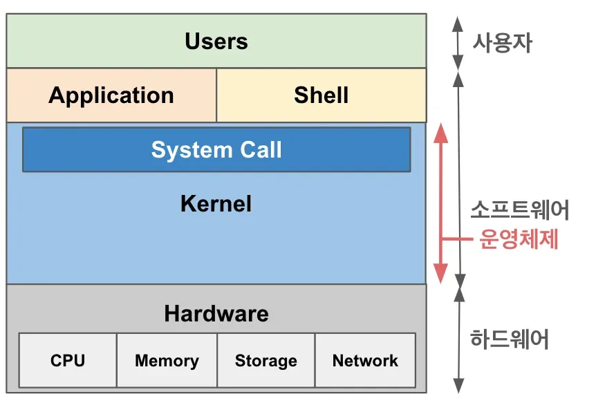
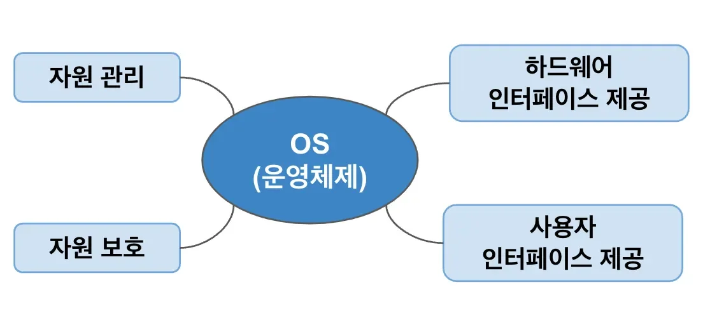
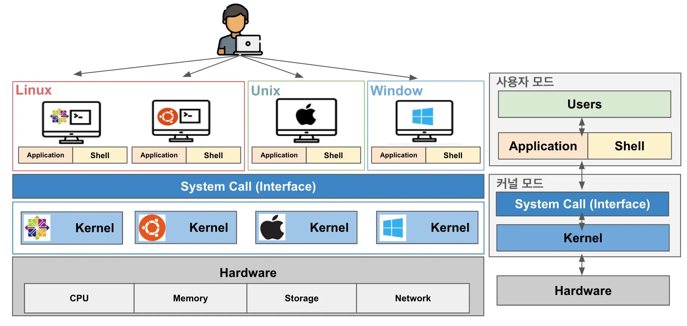

> 📌 
> 
> 
> 
> CS 특강 &#45; 운영체제
> 
> - 진행&#58; 이태현 튜터님
> 
> - 기간&#58; 24&#46;12&#46;18
> 
> - reference&#58; <a href="https://beautiful-college-c84.notion.site/09221dd796b94eb1903e00eb114ecf62">페이지</a> 

> ✏️ 
> 
> 
> 
> <strong>학습 목표</strong>
> 
> - 운영체제 기술면접에서 가장 많이 물어보는 <strong><code>프로세스</code></strong>, <strong><code>쓰레드</code></strong><strong> , </strong><strong><code>동기화</code></strong>에  대해서  학습
>     - 동시성 제어를 이해하기 위한 기본적인 CS 지식
> 
> - 추가 학습 내용
>     - <code>Linux</code> &#45;  <code>명령어</code>, <code>권한</code>, <code>파일(링크, 마운트)</code>, <code>스토리지</code> 등 

# 1&#46; 운영 체제

- <strong><code>OS(Operating System)</code></strong>
    - <strong><code>하드웨어와 프로그램들을 관리하고 운영</code></strong>하는 최상위 소프트웨어

    - <strong><code>사용자와 컴퓨터 간의 상호작용</code></strong>을 할 수 있도록 돕는 역할 수행

    

## 1&#46; 역할

### 1&#46; 자원 관리

> 운영체제는 컴퓨터 시스템 내의 <code>CPU</code>, <code>Memory</code>, <code>Stroage</code>, <code>Network</code> 등과 같은 하드웨어 및 <code>소프트웨어 자원</code>을 효율적으로 관리한다&#46; 
> 
> - 만약 운영체제가 존재하지 않는다면 <u>각 프로그램</u>이 얼마만큼 <code>CPU</code>를 사용할지, <code>메모리 공간</code>을 어느 정도 할당할지, 어떻게 어디에 데이터나 파일을 저잘지 결정할 수 없다&#46; 

- 프로세스 관리
    - CPU 시간을 여러 프로세스에 공평하게 분배하고, 스케줄링을 통해 실행 순서를 결정한다&#46; 

- 메모리 관리 
    - 프로그램 실행 시, 필요한 메모리 할당 및 해체, 가상 메모리 지원

- 디스크 관리 
    - 파일 시스템을 통해 데이터 저장, 검색, 삭제

- 네트워크 관리
    - 네트워크 연겨로가 데이터 전송을 관리

- 권한 관리
    - 프로그램에 접근할 수 있는 권한을 지정

### 2&#46; 자원 보호

> 운영체제는 시스템 자원을 비인가된 접근이나 악성 코드로 부터 보호한다&#46;

- 프로세스 격리
    - 프로세스 간 메모리 영역 접근을 차단하여 충돌 방지

- 사용자 권한 관리
    - 파일 및 프로그램에 대한 접근 권한 설정

- 보안 정책 적용
    - 데이터 암호화, 인증 절차, 방화벽 설정 등으로 시스템 보호

### 3&#46;  하드웨어 인터페이스 제공

### 4&#46; 사용자 인터페이스 제공

## 2&#46; 구성

## 3&#46; 종류

# 2&#46; 프로세스, 쓰레드

## 1&#46; 프로세스 ( Process )

### 1&#46; 프로세스의 실행 흐름

### 2&#46;  프로세스의 구조

### 3&#46; 프로세스의 계층 구조

### 4&#46; 프로세스의 상태

### 5&#46; 문맥 교환 ( Context Switching )

### 6&#46; 프로세스 스케쥴링

### 7&#46; 프로세스 간의 통신

## 2&#46; 쓰레드 ( Tread )

### 2&#46;1 &#45; 쓰레드의 상태

### 2&#46;2 &#45; 문맥 교환 ( Context Switching )

# 3&#46;  동기화

## 1&#46; 경합 조건 ( Race Condition )

### 1&#46; 뮤텍스 락 ( Mutex Lock &#45; Mutual Exclusion Lock )

### 2&#46; 세마포어 락(Semaphore Lock &#45; Semaphore Lock)

## 2&#46; 교착 상태 ( Deadlock )

### 1&#46; 교착 상태 예방

### 2&#46; 교착 상태 회피

### 3&#46; 교착 상태 회복
