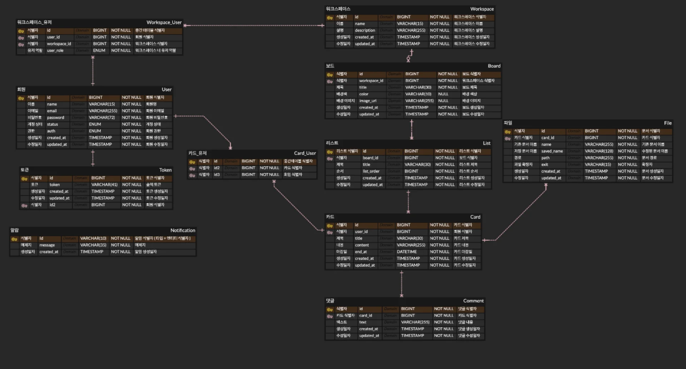
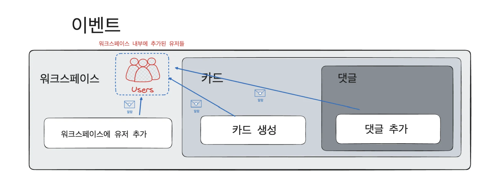
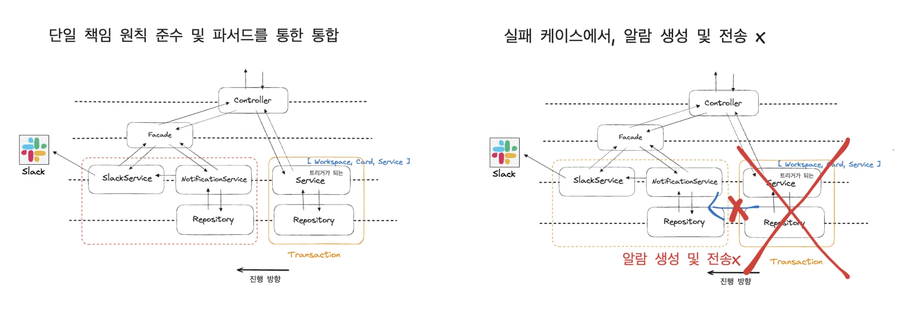
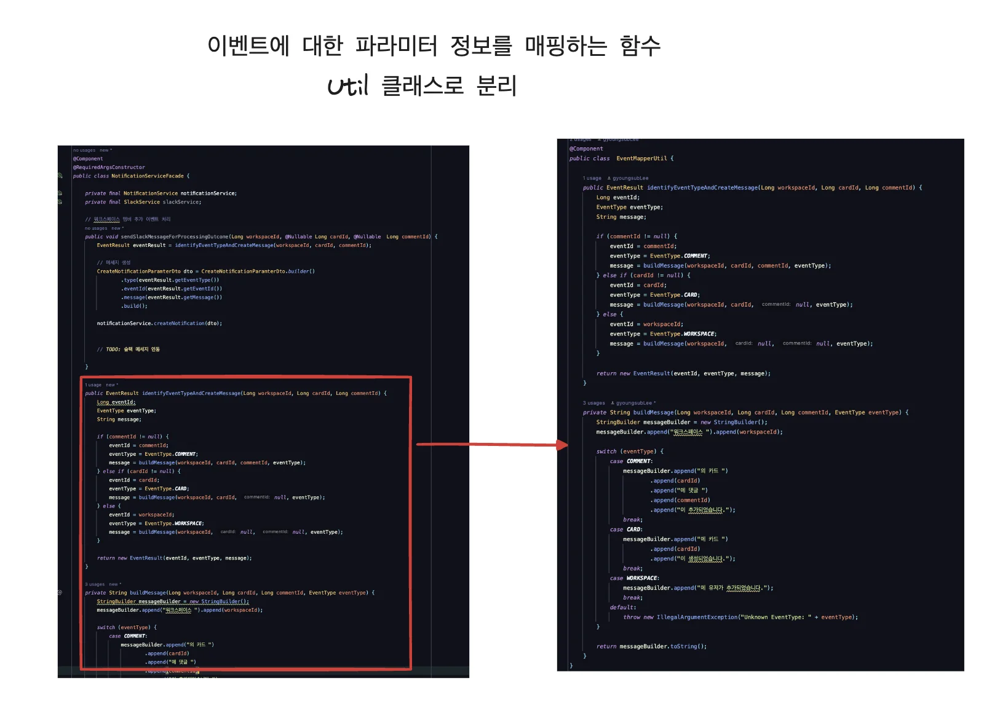
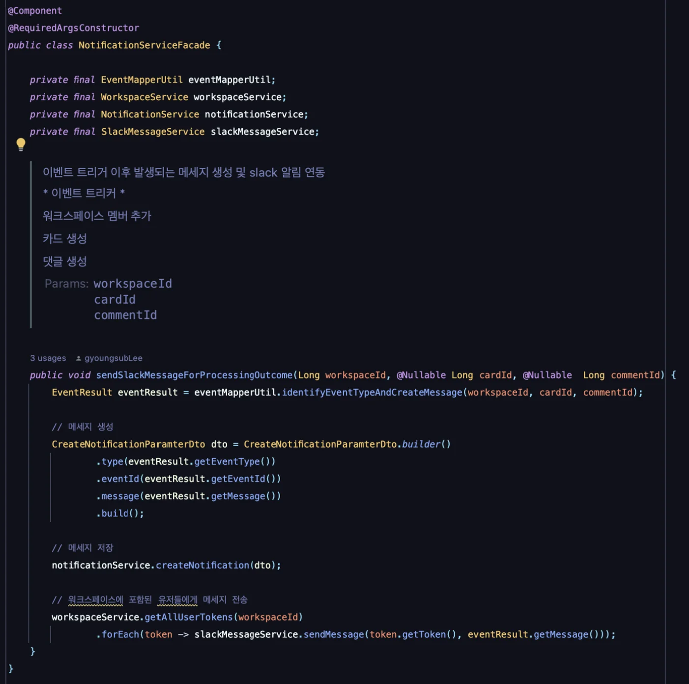
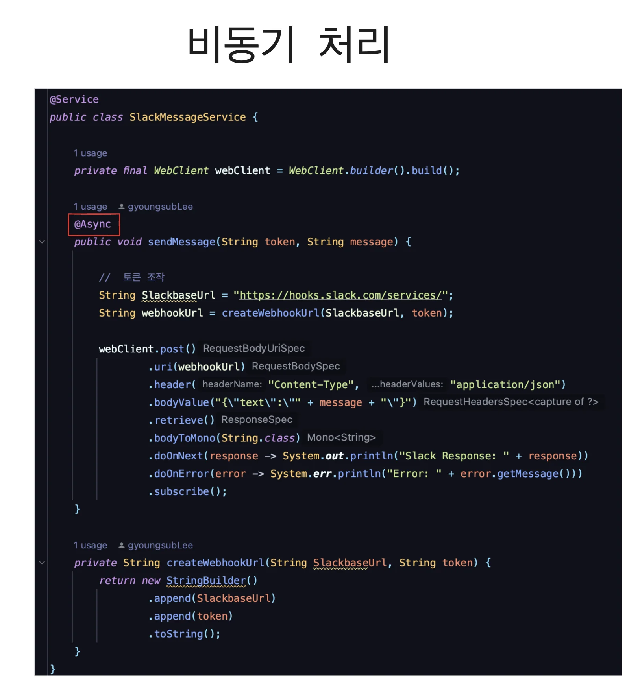
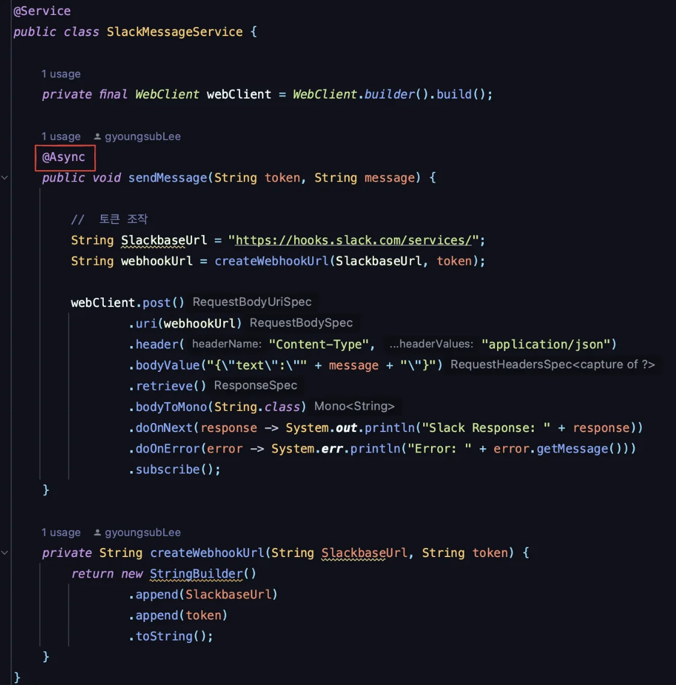
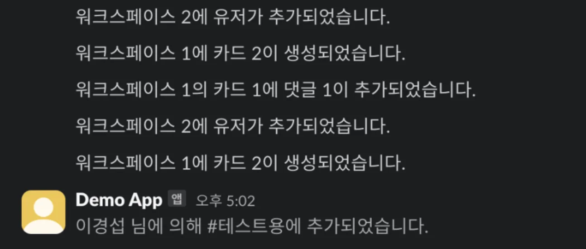

> 📌 
> 
> <a id="a039ae271d0c4751bc79b559e5cd86fa"></a>
> 
> 내일배움캠프&#95;스프링 7기  &#45; 7주차 개인 프로젝트
> 
> > 기간&#58; 24년 12월 23일 &#126; 12월 29일
> 
> - 팀 노션&#58; <a href="https://beautiful-college-c84.notion.site/1582dc3ef51481b3908df5f7fdc77244">페이지</a> 
> 
> - 발제&#58; <a href="https://beautiful-college-c84.notion.site/15a2dc3ef51480b98257f118c19614d9">페이지</a> 

<a id="538206db9f1f4defa97b2e4fac44a829"></a>

### 과제

[Trello-Project](https://github.com/Sparta-14/Trello-Project)

<details>
<summary>요구사항 </summary>

<details>
<summary><strong>1&#46; 회원가입/로그인</strong></summary>

- 회원가입
    - 유저 아이디
        - 유저 아이디는 이메일 형식이어야 합니다&#46;

    - 비밀번호
        - <code>Bcrypt</code>로 인코딩합니다&#46;

        - 대소문자 포함 영문 &#43; 숫자 &#43; 특수문자를 최소 1글자씩 포함합니다&#46; 

        - 비밀번호는 최소 8글자 이상이어야 합니다&#46;

    - 권한
        - 회원가입시 일반 유저(USER) 또는 관리자(ADMIN)으로 가입할 수 있습니다&#46;

        - 권한에 따라 사용할 수 있는 기능이 나뉘어집니다&#46;

    - <strong>⚠️ 예외처리</strong>
        - 중복된 <code>유저 아이디</code>로 가입하는 경우

        - <code>유저 아이디</code> 이메일과 비밀번호 형식이 올바르지 않은 경우

- 회원탈퇴
    - 조건
        - 탈퇴 처리 시 <code>비밀번호</code>를 확인한 후 일치할 때 탈퇴 처리합니다&#46;

        - 탈퇴한 유저의 아이디는 재사용할 수 없고, 복구할 수 없습니다&#46;

    - <strong>⚠️ 예외처리</strong>
        - <code>유저 아이디</code>와 <code>비밀번호</code>가 일치하지 않는 경우

        - 이미 탈퇴한 <code>유저 아이디</code>인 경우

- 로그인
    - 가입한 아이디와 비밀번호로 로그인 합니다&#46;

</details>

<details>
<summary><strong>2&#46; 멤버 및 역할 관리</strong></summary>

> 🚨 
> 
> <a id="661e54ca0a424930b8fc99cd4f5c9c21"></a>
> 
> 유저의 권한과 멤버의 역할은 구분됩니다&#33;
> 
> - 유저&#58; Trello 애플리케이션에 회원 가입한 모두
> 
> - 멤버&#58; 특정 워크스페이스에 초대된 유저

- <strong>유저 권한(목록)</strong>
    - 일반 유저(USER)

    - 관리자(ADMIN)
        - 워크스페이스를 생성할 수 있습니다&#46;

        - 일반 유저를 워크스페이스 관리자로 설정할 수 있습니다&#46;

- <strong>멤버 역할(목록)</strong>
    - 워크스페이스
        - 관리자(ADMIN) 유저에 의해 설정됩니다&#46;

        - 워크스페이스 생성을 제외한 나머지 기능들을 모두 사용할 수 있습니다&#46;

    - 보드
        - 워크스페이스 관련 기능을 제외한 나머지 기능들을 모두 사용할 수 있습니다&#46;

    - 읽기 전용
        - 모든 생성, 수정, 삭제가 불가능하며, 조회만 가능합니다&#46;

</details>

<details>
<summary><strong>3&#46; 워크스페이스(Workspace)</strong></summary>

- <strong>워크스페이스 생성</strong>
    - 워크스페이스는 ADMIN 권한을 가진 유저만 생성할 수 있습니다&#46;

    - 워크스페이스에는 이름과 설명을 설정할 수 있습니다&#46;

    - 워크스페이스는 여러 개의 보드를 포함할 수 있습니다&#46;

- <strong>워크스페이스 멤버</strong>
    - 워크스페이스에 다른 멤버를 초대하여 협업할 수 있습니다&#46;

    - 멤버 초대는 워크스페이스 역할을 가진 멤버만 가능합니다&#46;

    - 초대는 회원 가입한 이메일을 통해 이루어집니다&#46;

    - <strong>⚠️ 예외처리</strong>
        - 존재하지 않는 이메일로 초대하는 경우

        - 멤버 초대를 워크스페이스 역할이 아닌 멤버가 진행할 경우

- <strong>워크스페이스 조회</strong>
    - 유저가 멤버로 가입된 워크스페이스 목록을 볼 수 있습니다&#46;

- <strong>워크스페이스 수정 및 삭제</strong>
    - 워크스페이스의 수정 및 삭제는 워크스페이스 역할을 가진 멤버만 할 수 있습니다&#46;

    - 삭제 시 워크스페이스 내의 모든 보드와 데이터도 삭제됩니다&#46;

    - <strong>⚠️ 예외처리</strong>
        - 워크스페이스 역할이 없는 멤버가 워크스페이스를 삭제하려는 경우

</details>

<details>
<summary><strong>4&#46; 보드(Board)</strong></summary>

- <strong>보드 생성/수정</strong>
    - 멤버는 워크스페이스 내에서 새로운 보드를 생성할 수 있습니다&#46;

    - 보드에는 제목과 배경색 또는 이미지를 설정할 수 있습니다&#46;

    - <strong>⚠️ 예외처리</strong>
        - 로그인하지 않은 멤버가 보드를 생성하려는 경우

        - 제목이 비어 있는 경우

        - 읽기 전용 역할을 가진 멤버가 보드를 생성/수정하려는 경우

- <strong>보드 조회</strong>
    - 멤버는 자신이 속한 워크스페이스의 보드를 조회할 수 있습니다&#46;

    - 보드 단 건 조회 시 해당 보드의 리스트와 카드도 함께 볼 수 있습니다&#46;

- <strong>보드 삭제</strong>
    - 삭제 시 보드 내의 모든 리스트와 데이터도 삭제됩니다&#46;

    - <strong>⚠️ 예외처리</strong>
        - 읽기 전용 역할을 가진 멤버가 보드를 삭제하려는 경우

</details>

<details>
<summary><strong>5&#46; 리스트(List)</strong></summary>

- <strong>리스트 생성/수정</strong>
    - 보드 내에서 리스트를 생성하고 수정할 수 있습니다&#46;

    - 리스트는 제목을 가지고 있으며, 보드 내에서의 순서를 변경할 수 있습니다&#46;

    - <strong>⚠️ 예외처리</strong>
        - 읽기 전용 역할을 가진 멤버가 리스트를 생성/수정하려는 경우

- <strong>리스트 삭제</strong>
    - 리스트를 삭제하면 해당 리스트의 모든 카드와 데이터도 삭제됩니다&#46;

    - <strong>⚠️ 예외처리</strong>
        - 읽기 전용 역할을 가진 멤버가 리스트를 삭제하려는 경우

</details>

<details>
<summary><strong>6&#46; 카드(Card)</strong></summary>

- <strong>카드 생성/수정</strong>
    - 리스트 내에서 카드를 생성하고 수정할 수 있습니다&#46;

    - 카드에는 제목, 설명, 마감일, 담당자 멤버 등을 추가할 수 있습니다&#46;

    - <strong>⚠️ 예외처리</strong>
        - 읽기 전용 역할을 가진 멤버가 카드를 생성/수정하려는 경우

- <strong>카드 상세 조회</strong>
    - 카드 단 건 조회 시 상세 정보를 조회할 수 있습니다&#46;

    - 카드의 활동 내역, 댓글 등을 확인할 수 있습니다&#46;

- <strong>카드 삭제</strong>
    - 카드를 삭제하면 해당 카드와 데이터도 삭제됩니다&#46;

    - <strong>⚠️ 예외처리</strong>
        - 읽기 전용 역할을 가진 멤버가 카드를 삭제하려는 경우

</details>

<details>
<summary><strong>7&#46; 댓글(Comment)</strong></summary>

- <strong>댓글 작성</strong>
    - 카드 내에서 댓글을 작성할 수 있습니다&#46;

    - 댓글에는 텍스트와 이모지를 포함할 수 있습니다&#46;

    - <strong>⚠️ 예외처리</strong>
        - 읽기 전용 역할을 가진 멤버가 댓글을 생성하려는 경우

- <strong>댓글 수정/삭제</strong>
    - 댓글 작성자는 자신의 댓글을 수정하거나 삭제할 수 있습니다&#46;

    - <strong>⚠️ 예외처리</strong>
        - 댓글 작성자가 아닌 멤버가 댓글을 수정/삭제하려는 경우

</details>

<details>
<summary><strong>8&#46; 검색(Search)</strong></summary>

- <strong>검색 기능</strong>
    - 카드 검색 기능을 추가합니다&#46;

    - 카드의 제목, 내용, 마감일, 담당자 이름 등을 기준으로 페이징하여 검색합니다&#46;

    - 특정 보드에 속한 모든 카드를 검색할 수도 있습니다&#46;

</details>

<details>
<summary><strong>9&#46; 첨부파일(Attachment)</strong></summary>

- <strong>첨부파일 추가</strong>
    - 카드에 파일을 첨부할 수 있습니다&#46;

    - 지원되는 파일 형식&#58; 이미지(jpg, png), 문서(pdf, csv)

    - 최대 업로드 크기&#58; 5MB

    - <strong>⚠️ 예외처리</strong>
        - 지원되지 않는 파일 형식을 업로드하려는 경우

        - 파일 크기가 제한을 초과하는 경우

- <strong>첨부파일 조회/삭제</strong>
    - 첨부된 파일을 조회하고 삭제할 수 있습니다&#46;

    - <strong>⚠️ 예외처리</strong>
        - 읽기 전용 역할을 가진 멤버가 파일을 추가/삭제하려는 경우

</details>

<details>
<summary><strong>10&#46; 알림(Notification)</strong></summary>

- <strong>알림 설정</strong>
    - 알림 방식&#58; 슬랙 혹은 디스코드 알림

- <strong>실시간 알림</strong>
    - 멤버 추가, 카드 변경, 댓글 작성 등 주요 이벤트에 대한 실시간 알림이 제공됩니다&#46;

    - 원하는 알림 내용을 추가해도 무방합니다&#46; 

</details>

<details>
<summary><strong>11&#46; 최적화(Indexing)</strong></summary>

<a id="168eda9b0fe1800db1dace22956a9576"></a>

난이도&#58; <strong>★★★☆☆</strong>

<a id="168eda9b0fe180088a78f743201dbdc6"></a>

복잡도&#58; <strong>★★☆☆☆</strong>

<a id="168eda9b0fe1805999cdd8500274c05f"></a>

Trello에서 멤버는 특정 키워드로 카드를 검색하거나, 프로젝트별로 카드를 필터링하고 있습니다&#46; 하지만 데이터가 대량으로 축적됨에 따라 카드 검색 속도가 느려질 수 있습니다&#46; 카드 검색 속도를 향상시킬 수 있는 최적화 방법을 적용해주세요&#46; 

<a id="168eda9b0fe1800589a5eebbdc29d4c8"></a>

<strong>요구사항</strong>

- 카드 검색 속도를 향상시키기 위해 적절한 인덱스를 설계해주세요&#46;

- 자주 사용되는 조건에 맞는 컬럼에 인덱스를 적용하여 대용량 데이터에서도 빠른 검색을 지원하세요&#46;

<a id="168eda9b0fe180ee8c45f36ddd605ea5"></a>

<strong>발표 자료 준비</strong>

- 개선 대상 쿼리와 해당 쿼리를 선택한 이유

- 인덱스 설정 DDL 쿼리

- 쿼리 속도 비교(before, after)

</details>

<details>
<summary><strong>12&#46; 동시성 제어(Concurrency Control)</strong></summary>

<a id="168eda9b0fe180fb849ec035d07dc387"></a>

난이도&#58; <strong>★★★★☆</strong>

<a id="168eda9b0fe1800193c9d3593778a07b"></a>

복잡도&#58; <strong>★★★☆☆</strong>

<a id="168eda9b0fe1804b8585ebd5eebaddef"></a>

Trello는 여러 멤버가 동시에 같은 보드 내에서 같은 카드의 상태를 업데이트 할 수 있습니다&#46; 예를 들어, 두 명의 팀원이 같은 카드의 상태를 &#34;진행 중&#34;에서 &#34;완료&#34;로 변경하려고 할 때, 충돌이 발생할 수 있습니다&#46; 이 경우 한 멤버의 업데이트가 다른 멤버의 변경을 덮어쓰는 상황이 발생하여 데이터의 일관성이 깨지거나, 예상치 못한 결과를 초래하게 됩니다&#46;

<a id="168eda9b0fe1802eb74ec07e59b3b4de"></a>

<strong>요구사항</strong>

- 다음과 같은 트랜잭션 관리 방안 중 하나를 사용하여 여러 멤버가 동시에 카드를 업데이트할 때 데이터의 일관성과 무결성을 유지해주세요&#46;
    - 비관적 락 사용
        - 낙관적 락 사용

    - 분산 락 사용

<a id="168eda9b0fe18010a1fed92f2977d7c7"></a>

<strong>발표 자료 준비</strong>

- 각 락을 설정하는 방법과 장단점

- 최종 방안을 선택한 이유

- 동시성 문제 해결 전후의 테스트 결과를 비교 (그래프 등을 사용해서 시각적으로 보여주면 더 좋아요&#33;)

</details>

<details>
<summary><strong>13&#46; 캐싱(Caching)</strong></summary>

<a id="168eda9b0fe1807f9af6cde709ee10bc"></a>

난이도&#58; <strong>★★★★☆</strong>

<a id="168eda9b0fe1809bb4aacd5f1cc23940"></a>

복잡도&#58; <strong>★★☆☆☆</strong>

<a id="168eda9b0fe18071a180da15ec224138"></a>

Trello에서 멤버가 카드 단 건 정보를 조회할 때, 해당 카드의 조회수를 카운팅하여 오늘 가장 인기 있는 카드를 기준으로 랭킹을 생성하고자 합니다&#46; 조회수 카운팅을 효과적으로 관리하기 위해 캐시를 활용해주세요&#46;

<a id="168eda9b0fe180e3ae01f6347fc13a31"></a>

<strong>요구사항</strong>

- 카드 조회 시 해당 카드의 조회수를 카운팅합니다&#46;

- 조회수를 캐시에 저장하여 응답 속도를 높이는 방안을 제안하세요&#46;

- 조회수는 매일 자정에 리셋되어야 하며, 이를 관리하기 위한 캐시 전략을 구현해주세요&#46;

<a id="168eda9b0fe1800a9673e37d84cf4fac"></a>

<strong>조건</strong>

- 카드 조회 시 캐시에 저장된 조회수를 증가시킵니다&#46;

- 가장 인기 있는 카드를 조회할 수 있는 랭킹 정보를 캐시에 저장합니다&#46;

- 어뷰징 방지&#58; 동일한 유저가 조회수를 무제한적으로 올리는 것을 방지해주세요&#46;

<a id="168eda9b0fe1803d91efde94d6e5b6c1"></a>

<strong>발표 자료 준비</strong>

- 캐싱 DB를 활용하여 캐싱을 적용하는 방법과 전략

- 자정에 조회수가 자동으로 리셋되도록 설정한 방법

- 캐싱 적용 전후의 카드 조회 성능을 비교한 결과 (시각적 표, 그래프 등)

- 캐시를 적용함으로써 얻을 수 있었던 성능 향상과 시스템 부하 감소 효과

</details>

<details>
<summary><strong>14&#46; 배포와 CI/CD</strong></summary>

<a id="168eda9b0fe180a4a3d7f7595e8fde4b"></a>

난이도&#58; <strong>★★★★★</strong>

<a id="168eda9b0fe180d0a37cef6a81b84832"></a>

복잡도&#58; <strong>★★★★☆</strong>

<a id="168eda9b0fe1802ba5b7eeb31ec189e2"></a>

Trello의 안정적인 배포를 위해, 빌드, 테스트, 배포 과정을 자동화하는 CI/CD 파이프라인을 구성하려고 합니다&#46; 이를 통해 코드 변경 시마다 자동으로 빌드 및 테스트가 수행되며, 프로덕션 배포까지 한 번에 처리될 수 있도록 시스템을 구축합니다&#46;

<a id="168eda9b0fe180ec990afc55f8d937c9"></a>

<strong>요구사항</strong>

- 코드 변경 시, 자동으로 빌드 및 테스트를 수행하는 CI 파이프라인을 구성하세요&#46;

- 테스트가 성공적으로 완료되면 프로덕션에 자동 배포되도록 CD 파이프라인을 설정하세요&#46;

- AWS에 CICD 파이프라인을 올려보세요&#46;

<a id="168eda9b0fe180b79b82c87f04aa6380"></a>

<strong>조건</strong>

- CI/CD 관련 이슈를 해결하기 위해 다음을 고려해야 합니다&#46;
    - 테스트 커버리지 강화&#58; 배포 전 코드 안정성을 높이기 위해 테스트 커버리지를 강화해야 합니다&#46;

    - 보안&#58; 배포 과정에서 민감한 정보나 설정이 노출되지 않도록 보안 설정을 철저히 관리합니다&#46;

<a id="168eda9b0fe1801a8cb7d25370e5dacb"></a>

<strong>발표 자료 준비</strong>

- 자동 빌드 및 테스트, 배포 구성 과정

- 코드 변경 시 어떻게 자동으로 빌드 및 테스트가 수행되는지에 대한 배포 절차

- 수동 배포와 비교하여 CI/CD 파이프라인을 적용한 후의 효율성 차이와 느낀점 

</details>

</details>

<details>
<summary>ERD 설계 </summary>

<a id="16eeda9b0fe180638455d5a6fd28ccb5"></a>

‣



</details>

<details>
<summary>API 명세서</summary>

[API 명세서](#/post/166eda9b-0fe1-8079-b467-f92613dea6d8)

</details>

<details>
<summary>기능 구현</summary>

<a id="1c3eda9b0fe18040b57cd5012926666f"></a>

### 검색

- 단순 쿼리 문에 like 함수를 통한 키워드 서칭으로 구현함

<a id="1c3eda9b0fe180fa9539f6640116ee9a"></a>

### slack 알람 

[알람 기능](#/post/166eda9b-0fe1-8060-88b5-dc46e37bc912)

[Trello-Project](https://github.com/gyungsubLee/Trello-Project)

- 이벤트 트리거 
    

- 클래스 계층 설계
    

- util 클래스 분리
    

    

- 비동기 처리
    

    - <code>&#64;Async</code> 사용 시 해당 작업을 새로운 스레드에 할당함
        <details>
        <summary>비동기 처리</summary>

        <details>
        <summary>1차 구현 &#45; <code>&#64;Async</code></summary>

        - <code>&#64;Async</code> Annotation을 사용한 처리

        

        <details>
        <summary>&#91; 코드 &#93;  SlackMessageService</summary>

        <a id="16ceda9b0fe1801aa09ec47376c8b8f6"></a>

        ```java
        @Service
        public class SlackMessageService {

            private final WebClient webClient = WebClient.builder().build();

            @Async
            public void sendMessage(String token, String message) {

                //  토큰 조작
                String SlackbaseUrl = "https://hooks.slack.com/services/";
                String webhookUrl = createWebhookUrl(SlackbaseUrl, token);

                webClient.post()
                        .uri(webhookUrl)
                        .header("Content-Type", "application/json")
                        .bodyValue("{\"text\":\"" + message + "\"}")
                        .retrieve()
                        .bodyToMono(String.class)
                        .doOnNext(response -> System.out.println("Slack Response: " + response))
                        .doOnError(error -> System.err.println("Error: " + error.getMessage()))
                        .subscribe();
            }

            private String createWebhookUrl(String SlackbaseUrl, String token) {
                return new StringBuilder()
                        .append(SlackbaseUrl)
                        .append(token)
                        .toString();
            }
        }
        ```

        </details>

        </details>

        <details>
        <summary>2차 구현 &#45; Webclient에서의 비동기 처리 </summary>

        <a id="16eeda9b0fe180cf8f10d52c197022b0"></a>

        <a href="https://beautiful-college-c84.notion.site/168eda9b0fe18002927efec89a5a8b58">페이지</a> 

        </details>

        </details>

- 실행 화면
    

- 피드백
    - <strong><u>파라미터 validation을 꼭&#33; 필수로 구현</u></strong>해주시기 바랍니다&#46;

    <details>
    <summary>중복되는 고정 문자열 상수 처리 </summary>

    <a id="1c3eda9b0fe180308ffddbe79e11595b"></a>

    TokenDeserializer에 <strong><u>baseUrl은 이미 중복으로 사용</u></strong>되고 있는 것만 보더라도 <strong><u>설정파일로 빼거나 상수처리</u></strong>하는게 좋겠습니다&#46; 또한 if 안에서 return을 하는게 아니라 <u>i</u><strong><u>f 안에서 예외를 발생시키고 if에 해당하지 않으면 최종 return</u></strong>하는게 더 좋은 코드겠습니다&#46;

    <a id="1c3eda9b0fe180ac9f4ee664d392251b"></a>

    ```java
    if (!url.startsWith(baseUrl)) {
    	throw new IllegalArgumentException("Invalid Slack webhook URL");
    }
    return url.substring(baseUrl.length()); // 포맷 변경
    ```

    </details>

    <details>
    <summary>알람 읽기 동기화</summary>

    - Notification에 경우 workspace에 종속되어 생성되는 데이터인데 해당 workspace에 공지를 읽었는지 누가 언제 읽었는지 isRead하는게 어떻게 가능할까요? 예상이 가지 않네요&#46;

    </details>

    <details>
    <summary>util 클래스 및 객체 </summary>

    - NotificationServiceFacade에 경우<strong><u> evenMapperUtil을 통해 eventResult를 생성</u></strong>하는데 <strong><u>util 클래스에게 객체의 생성을 맡기는 것</u></strong>은 해당 클래스의<strong> </strong><strong><u>역할에 맞지 않는 설계 방법</u></strong>입니다&#46;

    -  <strong><u>util 클래스는 말그대로 구현의 편의를 위한 클래스</u></strong>이지 <strong><u>객체의 생명주기와 행동을 담당하는 클래스가 아닙니다</u></strong>&#46; 오히려 <strong><u>util 클래스의 난발은 객체지향 프로그래밍을 해체는 방식</u></strong>입니다&#46;

    - 또한 애써 만들어 놓은 eventReuslt는 현재 notification과 그 역할을 차이가 전혀 없습니다&#46; 두 객체는 동일한 객체라고 볼 수도 있습니다&#46;

    - 또한 <strong>알림 발송에 성공/실패했을 경우 </strong><strong><u>notification에 그 여부를 동기화</u></strong><strong> 해주어야지 </strong><strong><u>해당 공지가 발송되었는지 실패하였는지 추적할 수 있</u></strong>겠습니다&#46;

    </details>

    <details>
    <summary>URL 계층 설계</summary>

    <a id="1c3eda9b0fe18057beebdbe3990b4e21"></a>

    <strong><u>각 도메인 rest api url을 계층을 strict하게 정</u></strong>하셨는데<u> 상위 id가 필요치 않는 경우가 발</u>생하는게 보이셨을겁니다&#46; <strong><u>rest url을 설계할 때 너무 긴 혹은 너무 깊은 계층을 모두 표현하면 필요치 않은 값을 클라이언트에게 요구하게 되는 것이고 그만큼 클라이언트는 해당 값을 소유하고 유지해야하는 어려움을 겪게됩니다&#46; </u></strong>이 경험이 꼭 다음 프로젝트에 개선되었으면 좋겠네요&#46;

    </details>

</details>

<a id="4d2810a611224942b86c8a8c92aeaa45"></a>

### 피드백

[Trello 프로젝트 - 피드백 정리](#/post/1c3eda9b-0fe1-804e-9041-e8fa06046f59)

<a id="38503f44450547afb47bece57cc2eb54"></a>

#### 이번 주 회고 

<a id="498f3fb44e66480099ab7b39f5eb227a"></a>

<a href="#/post/16deda9b-0fe1-808f-b8d4-cb902c3bf395">페이지</a>
