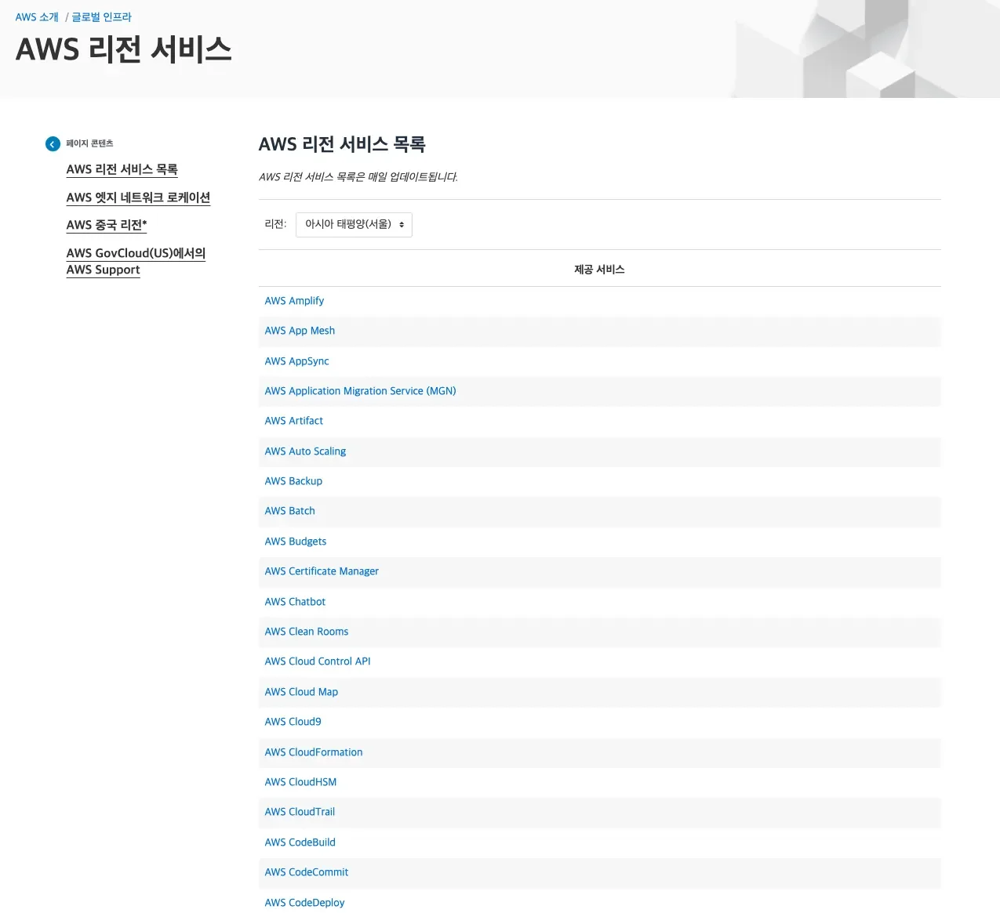
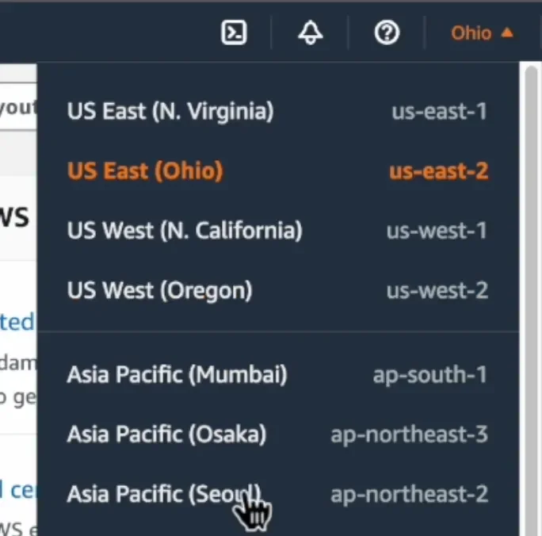

## ASW ( Amazon Web Services )

---

> 📖 
> 
> 
> 
> AWS는 아마존 닷컴이 제공하는 클라우드 컴퓨팅 플랫폼이다&#46;  전 세계에 분산된 데이터 센터에서 사용자에게 IT 인프라를 제공하며, 이를 사용하여 고객은 필요한 인프라를 빠르고 쉽게 설정 및 관리할 수 있다&#46; 

AWS 주요 서비스

> ✏️ 
> 
> - <code>Identity Access Management</code>&#58; 계정관리
> 
> - <code>Elastic Cloud Compute</code>&#58; 클라우드 위의 서버 
> 
> - <code>Elastic Load Balancer</code> &#58; 트래픽 관리
> 
> - <code>Relational Database Service</code> &#58; 클라우드 위의 DB
> 
> - <code>Route 53</code> &#58; 도메인(주소) 관리
> 
> - <code>Virtual Private Cloud</code> &#58; 클라우드 위의 나만의 네트워크
> 
> - <code>Simple Storage Service</code> &#58; 클라우드 위의 데이터저장소
> 
> - <code>Cloudfront</code> &#58; 세계각지에 캐시 서비스
> 
> - <code>Elastic Beanstalk</code> &#58; 많은 서비스들을 하나로

<strong>🧐 </strong><strong><code>스토리지</code></strong><strong> vs </strong><strong><code>DB</code></strong>

<strong>기본 개념</strong>

- <strong><code>스토리지</code></strong>
    - “바구니”처럼, 어떤 파일이든 담아둘 수 있는 공간

    - ex) 사진, 영상, 문서파일 저장

- <code>DB</code>
    - “도서관”처럼, 체계적인 규칙에 따라 책(데이터)을 정리, 검색, 수정, 삭제 가능

즉, 스토리지는 “덩어리”로 저장하는 공간이고, DB는 “내용”까지 체계적으로 관리하는 시스템이다&#46;

| <strong>항목</strong> | <strong>스토리지 (Storage)</strong> | <strong>DB (Database)</strong> |
| --- | --- | --- |
| <strong>정의</strong> | 데이터를 물리적으로 저장하는 공간 | 데이터를 체계적으로 관리하기 위한 소프트웨어 시스템 |
| <strong>주 목적</strong> | “데이터 보관”이 목적 (파일, 이미지 등) | “데이터 관리”가 목적 (CRUD, 조회 최적화, 트랜잭션 등) |
| <strong>예시</strong> | 하드디스크(HDD), SSD, AWS S3, Google Drive | MySQL, PostgreSQL, Oracle, MongoDB |

<strong>접근 방법 차이</strong>

- <code>스토리지</code>
    > 경로(URL) 기반 접근

    - 파일을 통째로 읽거나, 삭제 및 업로드함

    - <code>https&#58;//my&#45;bucket&#46;s3&#46;amazonaws&#46;com/image&#46;png</code>

- <code>DB</code>
    > 쿼리(SQL) 기반으로 접근 

    - 필요한 데이터만 부분적으로 읽거나 수정 가능

    - ex) <code>SELECT &#42; FROM user WRERE email = ‘test&#64;example&#46;com’;</code>

<strong>용도</strong>

| <strong>항목</strong> | <strong>스토리지</strong> | <strong>DB</strong> |
| --- | --- | --- |
| <strong>저장하는 데이터 타입</strong> | 대용량 파일(이미지, 영상, 로그 파일 등) | 텍스트 기반 구조화된 데이터(회원정보, 주문정보 등) |
| <strong>검색/조회</strong> | 느림 (파일명 검색 정도) | 빠르고 복잡한 검색 가능 (다중조건, 정렬, 집계) |
| <strong>변경/수정</strong> | 파일 단위로만 수정 (부분 수정 어려움) | 레코드/컬럼 단위 수정 가능 (아주 세밀하게 수정 가능) |

- 컴퓨팅&#58; <code>EC2</code>, <code>Elastic Beantalk</code> 등

- DB&#58; <code>RDS</code> 등

- 스토리지&#58; <code>S3</code>, <code>EBS</code> 등

- 네트워킹&#58; <code>VPC</code>, <code>CloudFront</code>, <code>Route 53</code> 등

- 보안&#58; <code>IAM</code> 등

<code>Onpremise</code> ↔ <code>Cloud</code>

> <code>Onpremise</code>

- On&#45;premise 서버는 클라우드 서버와 <u>대조적</u>이다&#46;

- On&#45;premise 서버는 조직 내부에 설치되고 유지보수 되는 서버이다&#46;  즉, 서버가 조직의 물리적인 위치에 있으며 조직 내IT 인프라를 관리하는 팀이 해당 서버를 관리 및 유지보수한다&#46; 

- 이러한 서버를 일반적으로 조직의 중요안 데이터, 애플리케이션을 호스팅하고 보호하기 위해 사용된다&#46; 

 

> <code>Cloud</code>

- 클라우드 서버스는 일반적으로 인터넷을 통해 액세스할 수 있는 외부 데이터 센터에서 호스팅된다&#46; 

- 클라우드 서버를 사용하면 조직은 자체 IT 인프라(서버)를 보유하지 않아도 된다&#46; 

- 클라우드 제공 업체가 서버를 관리하고 유지보수 한다&#46; 

<strong>Region</strong>, <strong>Availability Zone</strong>

🧐 고가용성

고가용성(High Availability)은 시스템이 예기치 않은 장애 또는 중단에도 불구하고 지속적으로 작동하는 능력을 말한다&#46;

> ✏️ 
> 
> - <code>AWS 리전(Region)</code>은 세계 각지에 있는 <strong><u>AWS 데이터 센터의 물리적인 위치</u></strong>를 의미한다&#46;
> 
> - 각 리전은 <u>여러 개의 가용 영역(Availability Zone, AZ)</u>으로 구성되어 있으며, 가용 영역은 독립적인 데이터 센터로 네트워크로 연결되어 있다&#46;
> 
> - <strong><u>여러개의 AZ를 씀</u></strong>으로써 데이터센터가 재해상황에 빠졌을때도 서비스를 유지할 수 있는 <strong>고가용성</strong> 확보가 가능하다&#46;

AWS 리저널 서비스 &#58; <a href="https://aws.amazon.com/ko/about-aws/global-infrastructure/regional-product-services/">AWS 리전 서비스 (amazon&#46;com)</a>

리전 선택 창

