<a id="1e6eda9b0fe180e0805bf6e5f6d1730a"></a>

### 기본 개념

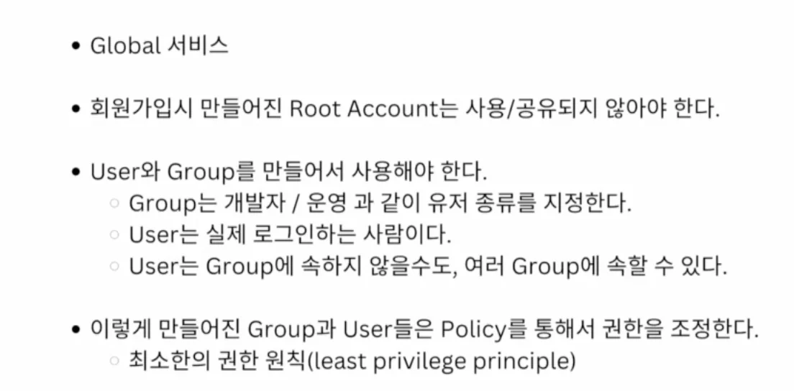

- Global 서비스 이다&#46; ( 리전 선택 불가 )

<a id="1e5eda9b0fe18058ae21d0c627af50c6"></a>

root 계정은 사용을 권장하지 않는다&#46;

- 권한이 너무 많기 때문에 해킹을 당했을 경우, 위험이 크다&#46;

- 카드 정보 등록 되어 있기 때문에, 해킹 시 수없이 많은 서버를 띄워서 채굴 등으로 리소스 사용할 수 있다&#46; 따라서 요금 폭탄을 맞을 수 있다&#46;  ( 실제 사례들이 많음 )

<a id="1e5eda9b0fe1803ab623e6bf9a1430a6"></a>

IAM 서비스에서 User 와 Group을 만들어서 사용한다&#46;

<a id="1e5eda9b0fe18052a244c680b76228c1"></a>

AWS에 접근할 수 있는 

<a id="1e5eda9b0fe1808db2ccfdd471487d73"></a>

하나의 회사라고 생각해서 AWS에서 론칭하는 것은 하나지만, 여기에 접근하는 User는 많을 수 있다&#46; 

- 백엔드 개발자

- 인프라 개발자 

- 프론트엔드, 디자이너 …

<a id="1e5eda9b0fe1802aad43f3d029f339cc"></a>

위와 같은 사람들에게 Root 계정을 주는 것은 보안적으로 매우 위험하다 &#46;

<a id="1e5eda9b0fe180f49423d8dccfcbb379"></a>

따라서 IAM 서비스에서 Group과 User 계정을 만들어 적절한 권한 설정을 부여 후, 사용할 수 있도록 한다&#46;

- 해당 Root 계정 내 서버스만 접근 가능, 

- 다른 계정과 독립적이지 않음

<a id="1e5eda9b0fe180779fa3e5f5c7647c6c"></a>

IAM key 관리 중요&#33;

- github에 올리거나 하면, 악용 가능하다&#46; 

- 공격자가 해당 키 탈취 후, 내 계정으로 컴퓨팅 서비스를 탈취해서 이용

<a id="1e6eda9b0fe1802fb0abf995ac3fa1ae"></a>

## IAM 

---

> 📖 
> 
> <a id="1e6eda9b0fe18043aaa3f646c68723e4"></a>
> 
> 회원 가입 시, 생성되는 Root 계정은 <u>너무 많은(모든) 권한 설정을 허용</u>하기 때문에 해킹 시, 악용의 위험성이 크다&#46; 따라서 AWS에서는 <code>IAM</code> ( <code>Identify and Access Management</code> ) 서비스를 제공한다&#46; 
> 
> <a id="1e6eda9b0fe180c2a7bff0d21ebc1c93"></a>
> 
> 이를 통해 <u>하위 계정들(Users)</u>을 생성하고 <strong><u>적절한 권한들을 부여</u></strong>하여 <strong><u>협업 및 보안에 대한 문제를 해결</u></strong>한다&#46; 
> 
> ---
> 
> - <code>Account</code>&#58; Root 계정
> 
> - <code>User</code>&#58; Account 계정에 접근하기 위한 하위 계정 
> 
> <details>
> <summary>IAM은 Global 서비스 이다&#46;</summary>
> 
> 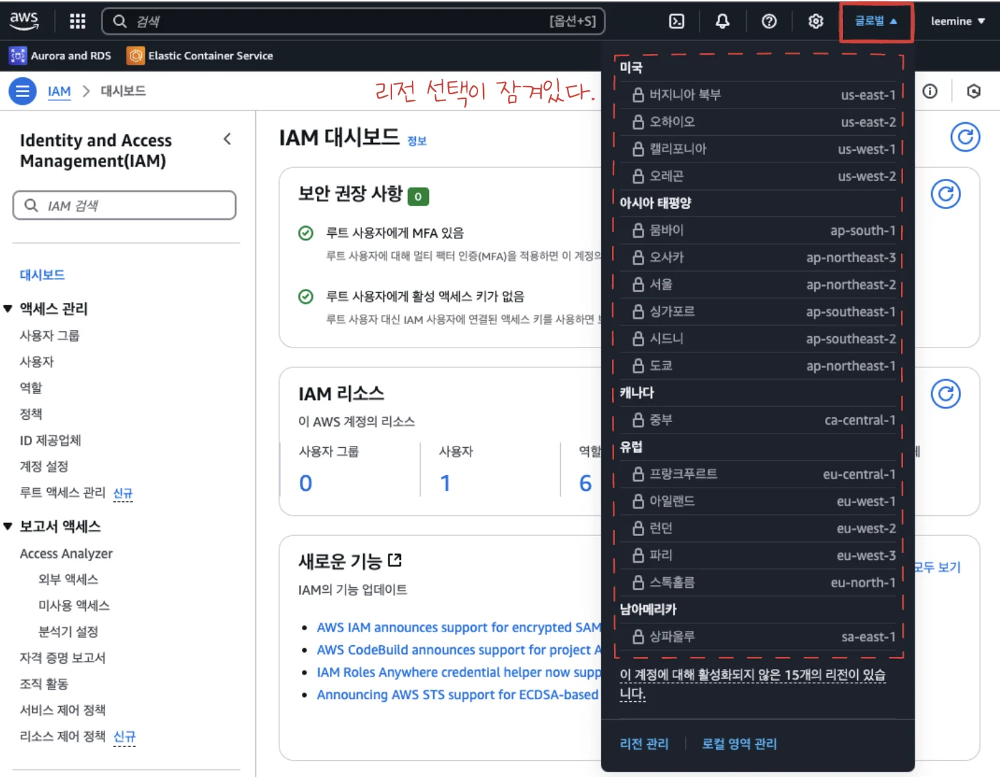
> 
> - 리전 선택이 잠겨 있는 것을 확인할 수 있다
> 
> </details>

<a id="1e6eda9b0fe1800398d2ce13c0c2d6dc"></a>

###  IAM &#45; user ( 사용자 ) 계정 생성

<details>
<summary>&#43;)  암호 자동 생성 및 첫 로그인 시 변경 가능</summary>

> ✏️ 
> 
> <a id="1e6eda9b0fe1801e8274e7704881baa3"></a>
> 
> 팀에서 새로운 팀원에게 IAM 계정을 생성하고 넘길 경우 사용한다&#46; 

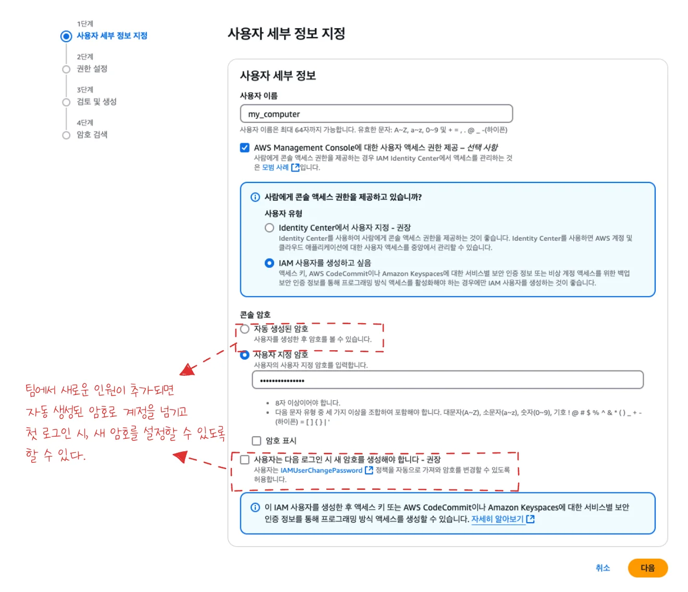

</details>

<details>
<summary><code>0단계</code>&#58; IAM &#45;  사용자 ( Users ) &#45; 사용자 생성 클릭</summary>

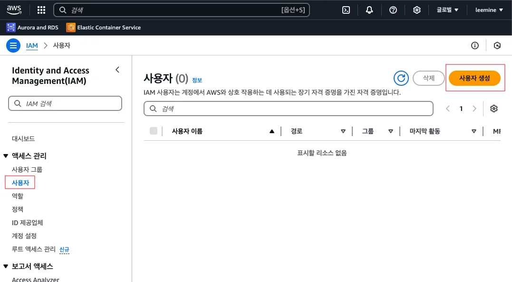

</details>

<details>
<summary><code>1단계</code>&#58; 사용자 세부 정보 지정</summary>

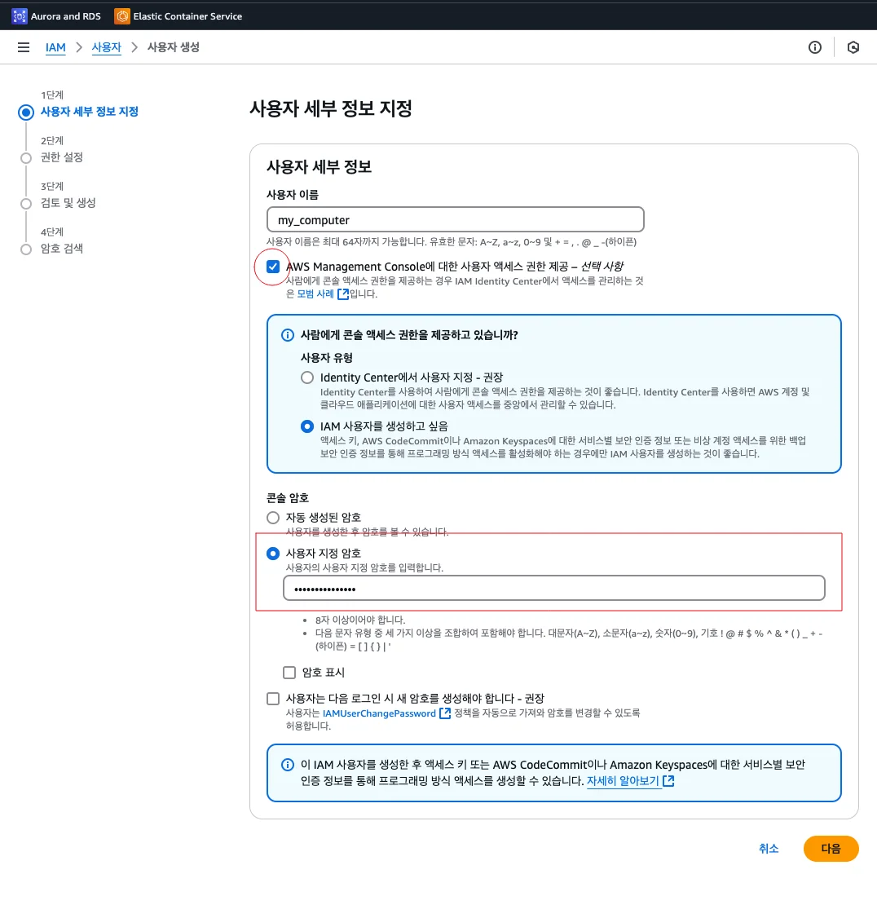

- 사용자 이름 

- AWS Management Console에 대한 사용자 엑세스 권한 제공

- IAM 사용자 생성

- 사용자 지정 암호 
    - 개인 계정이기 때문에 바로 생성해서 사용

</details>

<details>
<summary><code>2단계</code>&#58; 권한 설정</summary>

<details>
<summary>1&#46; 그룹 생성</summary>

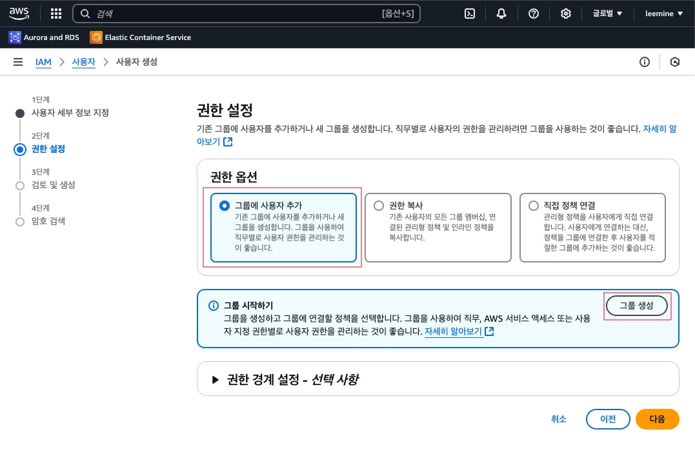

- 권한 옵션 &#45; 그룹에 사용자 추가 &#45; 그룹 생성

</details>

<details>
<summary>2&#46; 그룹에 권한 추가</summary>

> ✏️ 
> 
> <a id="1e6eda9b0fe18095bfb8e958eb242eaf"></a>
> 
> 웬만한 서비스에 대한 정책들은 다 만들어져 있다&#46; 
> 
> <a id="1e6eda9b0fe18039ba66f0bba6b16966"></a>
> 
> 따라서 그냥 가져다가 쓰면 된다&#46;

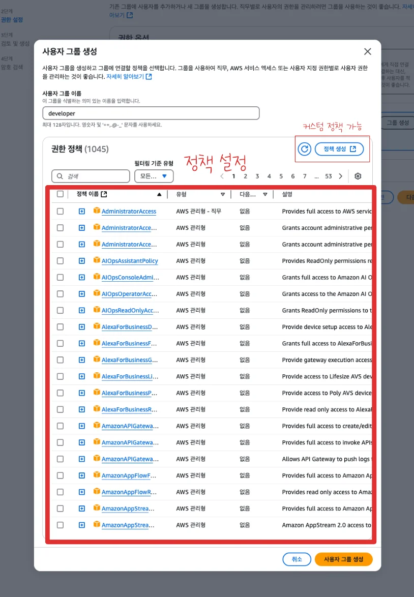

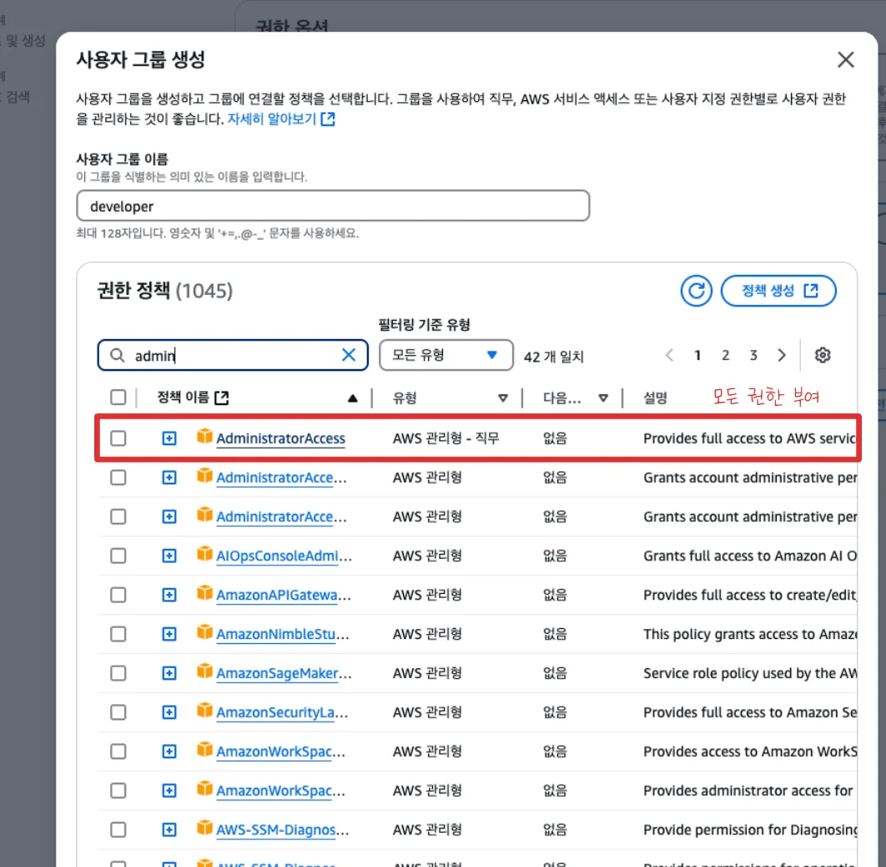

- <code>AdminstratorAccess</code> 
    - 해당 계정에<strong><u> 모든 권한을 부여</u></strong>한다&#46; 

    - 개인 개정용이기 때문에, 상관은 없으나 협업 시에는 세부적인 권한 설정이 필요하다&#46; 

</details>

<details>
<summary>3&#46; 그룹 생성 확인 후 다음 </summary>

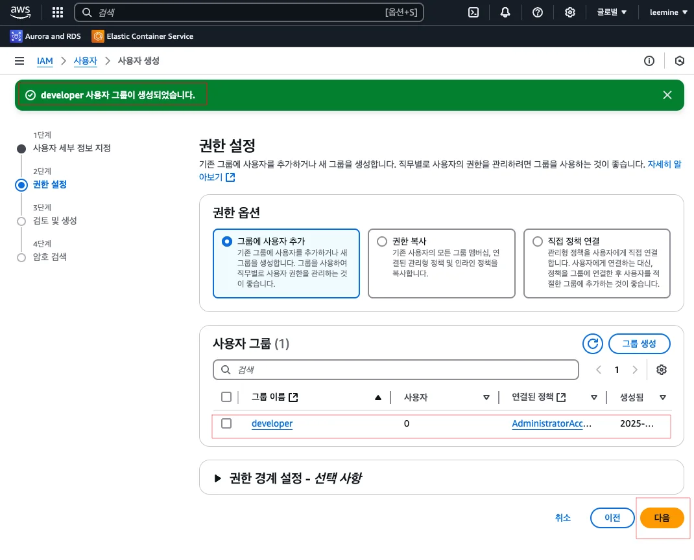

</details>

</details>

- <code>3단계</code>&#58; 검토 및 생성 &#45; 우선 패스

<details>
<summary><code>4단계</code>&#58; 암호 검색</summary>

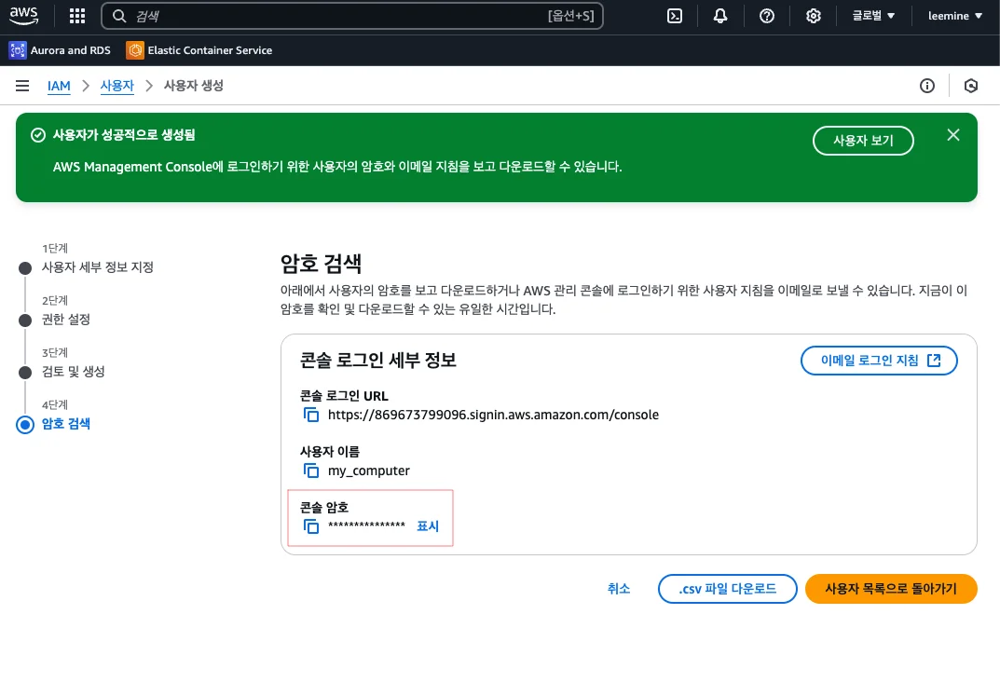

- 이메일 로그인 지침 
    - 새로운 유저(팀원)에게 알림 이메일 발송 가능하다&#46; 

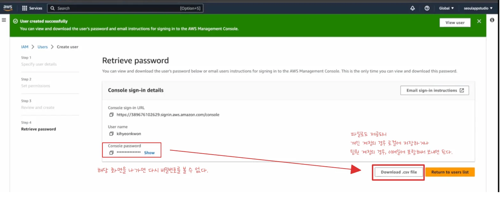

- 새로 생성한 계정의 비밀번호는 해당 화면 이후로 다시 볼수 없다&#46; <br>따라서 비밀번호를 잘 저장해야 한다&#46;

- 비밀번호를 파일 다운 가능하며, 해당 내용을 포함하여 email로 팀원에게 전송 가능하다&#46; 

</details>

<details>
<summary>&#43;) 지정한 권한은 JSON 형태로 관리된다&#46; ( 쓰기 가능 )</summary>

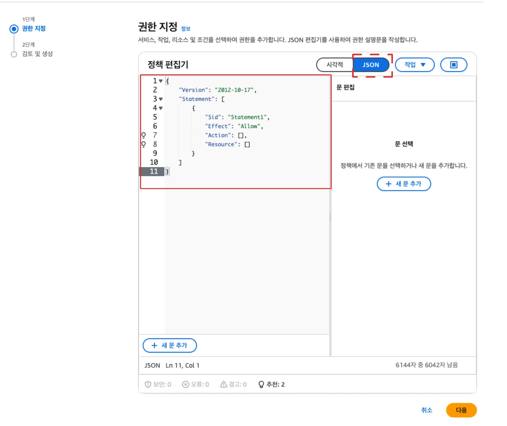

</details>

<details>
<summary>Accout ID ( root 계정 ID 확인 )</summary>

> ✏️ 
> 
> <a id="1e6eda9b0fe180109aeff9bddad66bfd"></a>
> 
> IAM 대시보드에 가면 아래와 같이 Root 계정의 ID 확인이 가능하다&#46; 
> 
> - 제공되는 url로 접속하면 IAM 로그인 화면으로 이동되고 자동으로 Accout ID가 입력된다&#46; 

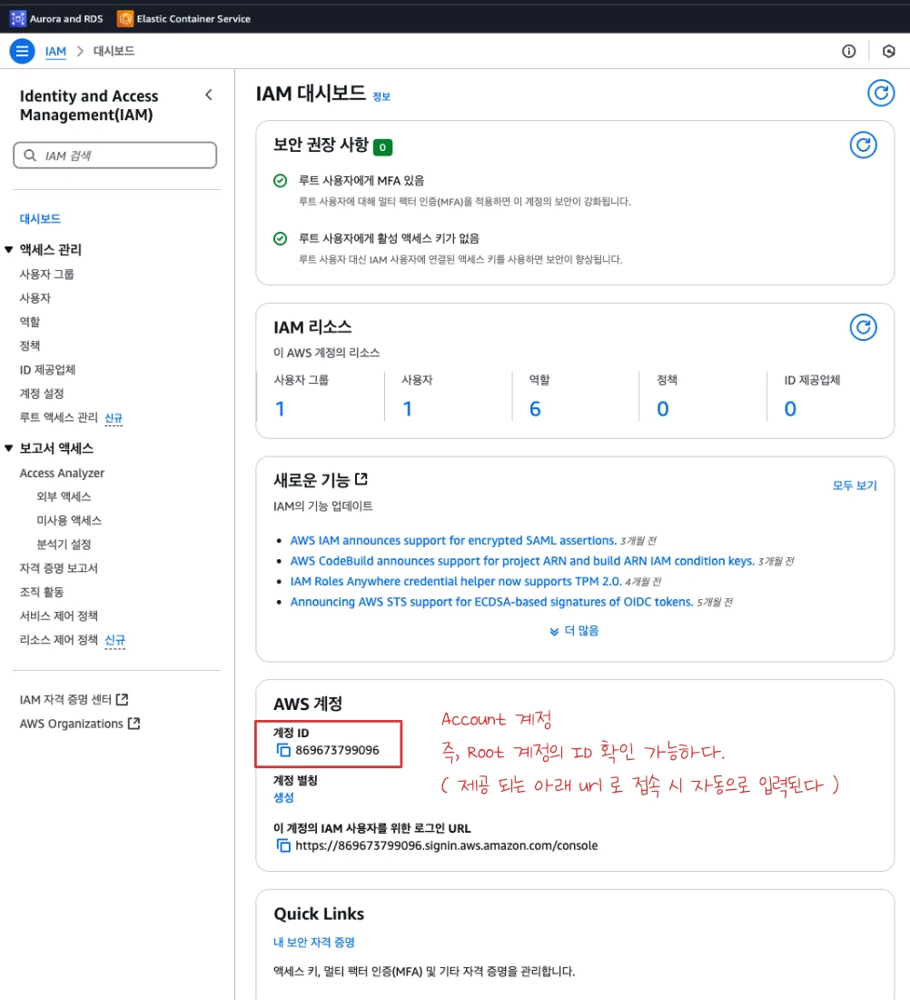

</details>

<details>
<summary>Account ID 에 별칭 지정 </summary>

> ✏️ 
> 
> <a id="1e6eda9b0fe18005bb0bd64cb0c5cc48"></a>
> 
> Account ID는 랜덤으로 생성되는 숫자 값이기 때문에 기억하기 어렵다&#46;<br>이를 별칭을 지정을 통해 해결할 수 있다&#46;

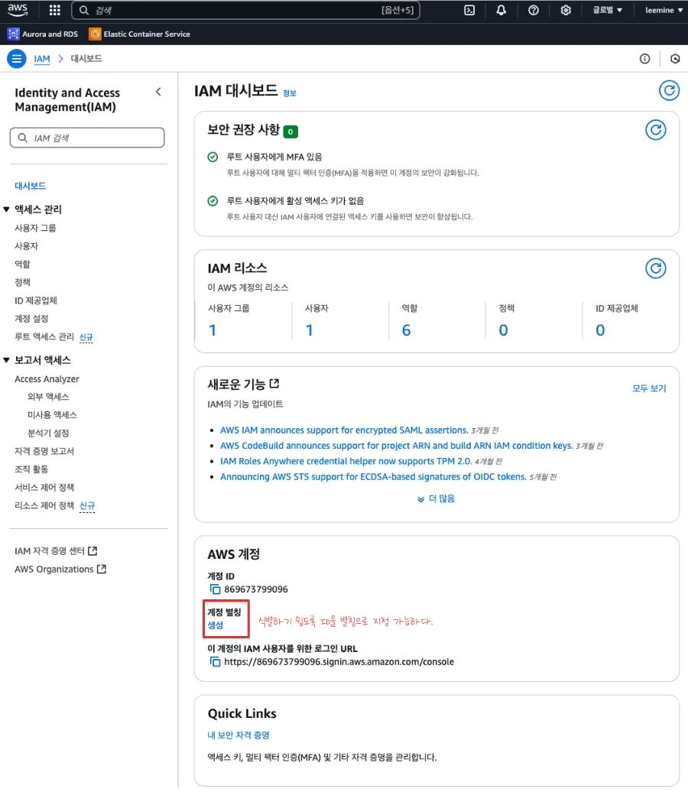

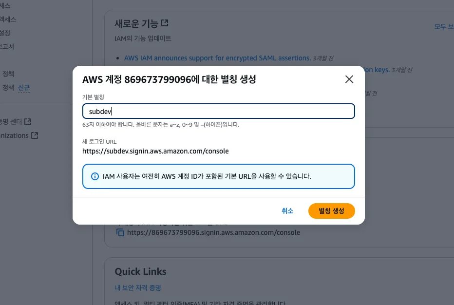

<a id="1e6eda9b0fe180c3b89ec377c14f0578"></a>

위와 같이 별칭을 지정하면 IAM 계정 로그인 시, Account 식별을 해당 별칭으로 할 수 있다&#46;

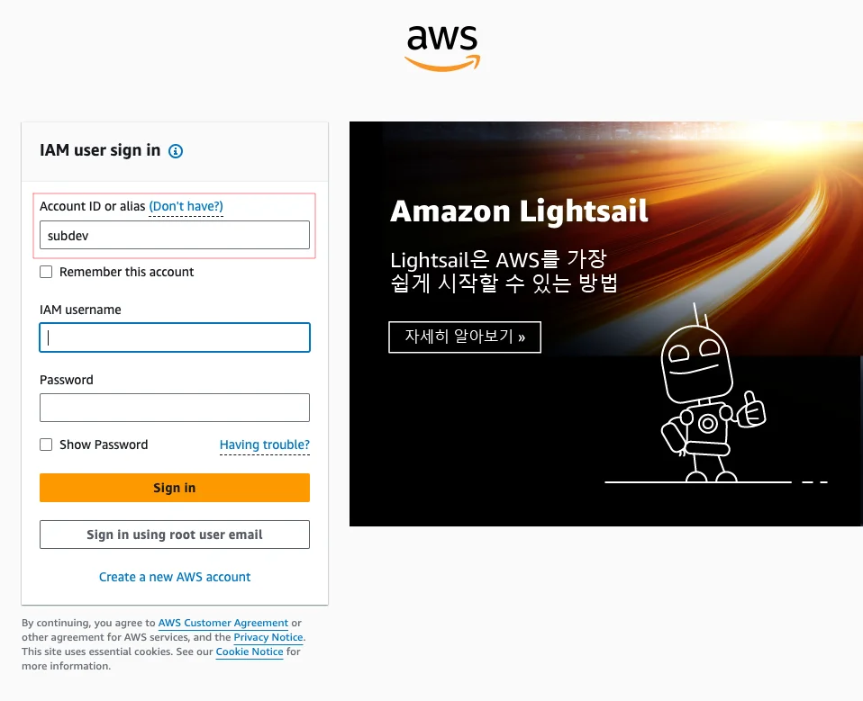

- 별칭(Alias)으로 Accout(Root 계정) 식별

</details>

<a id="1e6eda9b0fe180caa415e97829ff96ed"></a>

### IAM 정책 ( 포맷 )

<a id="1e6eda9b0fe180fa8dc8dbb4649bc779"></a>

```json
{
  "Version": "policy-version",
  "Statement": [
    {
      "Effect": "allow-or-deny",
      "Action": ["action-name"],
      "Resource": ["resource-arn"],
      "Condition": {
        "condition-operator": {
          "condition-key": "condition-value"
        }
      }
    }
  ]
}
```

- <strong><code>Version</code></strong>
    - 정책 버전  ( 현재는 &#34;2012&#45;10&#45;17&#34; 에서 고정됨 )

- <strong><code>Statement</code></strong>
    - 정책의 규칙

    - 배열 형태로 여러 개의 규칙 작성 가능

- <strong><code>Effect</code></strong>
    - 규칙의 적용 여부 

    - <code>&#34;allow&#34;</code> 또는 <code>&#34;deny&#34;</code> 중 하나 선택

- <strong><code>Action</code></strong>
    - 규칙이 적용되는 작업의 종류 

    - ex) <code>&#34;s3&#58;ListBucket&#34;</code>과 같은 형식으로 작성

- <strong><code>Resource</code></strong>
    - 규칙이 적용되는 리소스의 ARN (Amazon Resource Name)

    - ex) <code>&#34;arn&#58;aws&#58;s3&#58;&#58;&#58;my&#45;bucket/&#42;&#34;</code>과 같은 형식으로 작성

- <strong><code>Condition</code></strong>
    - 규칙이 적용되는 조건

    -  필수는 아니며, 필요한 경우 추가 가능

    -  다양한 조건 연산자를 사용 가능

    - ex) <code>&#34;IpAddress&#34;</code>조건 연산자를 사용
        <a id="1e6eda9b0fe1802e8bebffc92e1d28fe"></a>

              → 특정 IP 주소에서만 작업을 수행할 수 있도록 제한 가능

<a id="1e6eda9b0fe1809081b7c53bb65a702e"></a>

### MFA ( Multi Factor Authentication )

> 비밀번호 &#43; <code>something</code> = <code>multifactor</code>

> ✏️ 
> 
> <a id="1e6eda9b0fe180b3862acdf57a968c97"></a>
> 
> AWS에서는 여러 개의 MFA 보안을 지원한다&#46;
> 
> > <code>Root 계정</code>뿐만 아니라, <code>IAM 계정</code>까지도 MFA 설정하는 것을 권장한다&#46;
> 
> 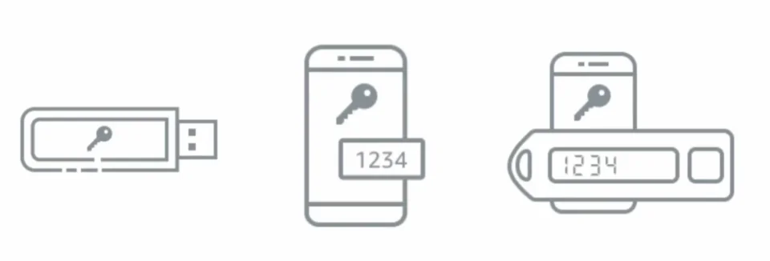
> 
> - USB 스틱 
> 
> - <strong>Virtual Authentication ( 핸드폰 )</strong>
> 
> - 미국 정부용 AWS 클라우드 ( 사용할 일 없음 )
>     - 은행 OTT 카드 비슷하게 하드웨어 토큰으로 진행
> 
> ---

<a id="1e6eda9b0fe18057b8f8cc9b040ecb7b"></a>

IAM 계정으로 로그인 후, IAM 대시보드로 접속 &#45; 직접 MFA 추가 

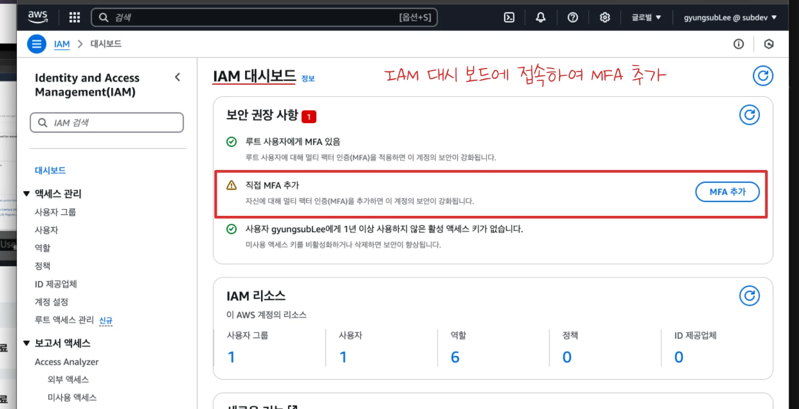

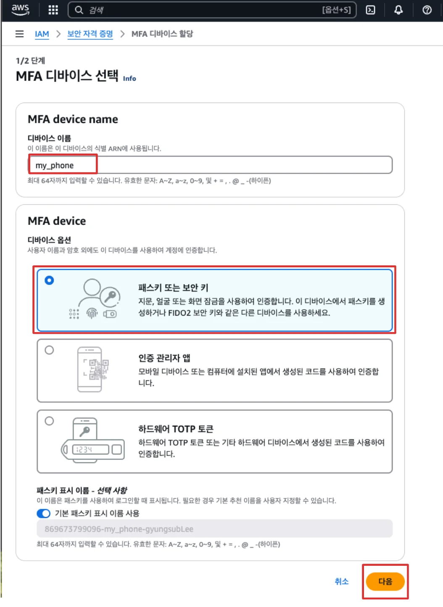

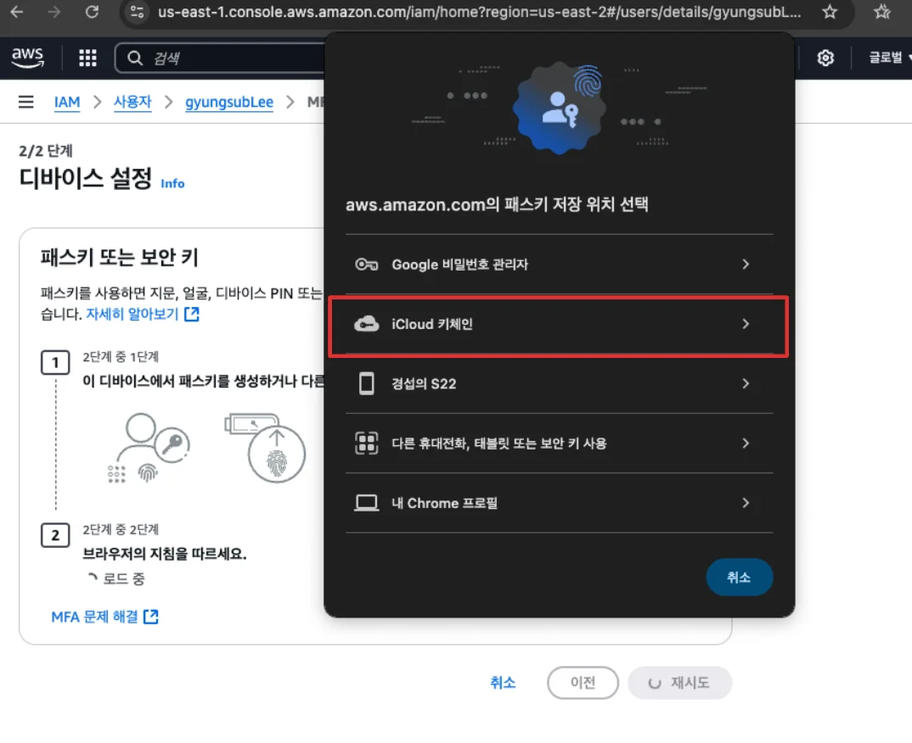

- iCloud 키체인(지문)으로 보안 설정
