<a id="166eda9b0fe181b09b87d5f08a7a4556"></a>

특강 &#45; 인증 인가 구현 ( 정리 전 )

> 📌 
> 
> <a id="166eda9b0fe18108bf2cead41e60a2c6"></a>
> 
> CS 특강 &#45; 제목
> 
> - 진행&#58; 황석규 튜터님
> 
> - 기간&#58; 25&#46;06&#46;17 ( 화 )

<details>
<summary>reference</summary>

<a id="215eda9b0fe18057ac17fb22b042f62b"></a>

‣

<a id="166eda9b0fe1817cb23fd8302ba5d68b"></a>

‣

<a id="215eda9b0fe180ff825efb63d2c9155a"></a>

<a href="https://beautiful-college-c84.notion.site/945a37e0810a4501a66c46f262e43c49">페이지</a> 

<a id="215eda9b0fe18088b7c6dd9af9d5e6c6"></a>

‣

</details>

- [ ] 그림 직접 그리기

<a id="166eda9b0fe181628668d4c199d409e8"></a>

## Spring Security

---

> 📖 
> 
> <a id="215eda9b0fe1807daca0d9fe9ef06abf"></a>
> 
> <code>Spring Security</code>는 인증과 접근 제어를 위해 <strong><u>세부적인 맞춤 구성이 가능</u></strong>한 강력한 프레임워크이다&#46; 
> 
> - 스프링 애플리케이션 보안을 적용하는 과정을 크게 간소화 할 수 있다&#46;
> 
> - Spring Security 의존성만 추가해도 애플리케이션에 보호가 적용된다&#46; 
>     - 사용하지 않는다면 의존성 제거

<a id="166eda9b0fe18098872ecd703969438a"></a>

### Spring Security 동작

<details>
<summary><code>Filter</code>, <code>Interceptor</code> </summary>

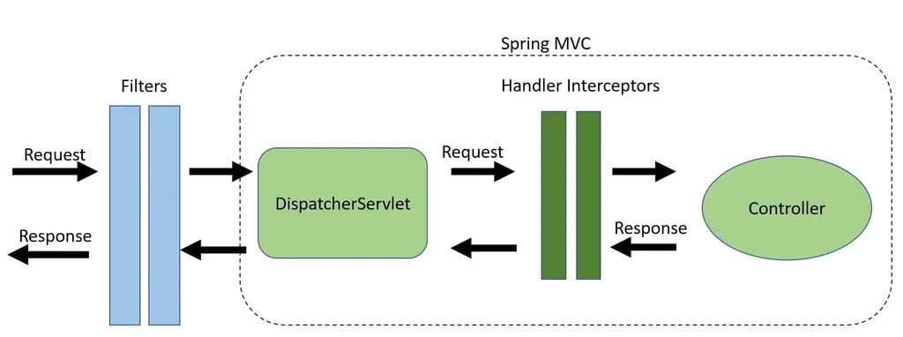

> ✏️ 
> 
> <a id="215eda9b0fe1802e867fdd8a9f3730f6"></a>
> 
> <code>Filter</code>와 <code>Interceptor</code>는 모두 request가 <code>Controller</code>에 도착하기 전에 실행되는 공통점을 갖고 있지만, 아래와 같은 차이점이 있다&#46;

<details>
<summary><strong>Filter</strong></summary>

- request가 <code>DispatcherServlet</code>에 도달하기 전에 가로챈다&#46;

- Web Context에서 실행된다&#46;
    - <code>&#64;ExceptionHandler</code>를 이용한 에러 핸들링을 할 수 없다&#46;

</details>

<details>
<summary><strong>HandlerInterceptor</strong></summary>

- request가 <code>DispatcherServlet</code>를 지나 <code>Controller</code>에 도달하기 전에 가로챈다&#46;

- Spring Context에서 실행된다&#46;
    - <code>&#64;ExceptionHandler</code>를 이용한 에러 핸들링이 가능하다&#46;

</details>

</details>

<details>
<summary><strong><code>DelegatingFilterProxy</code></strong></summary>

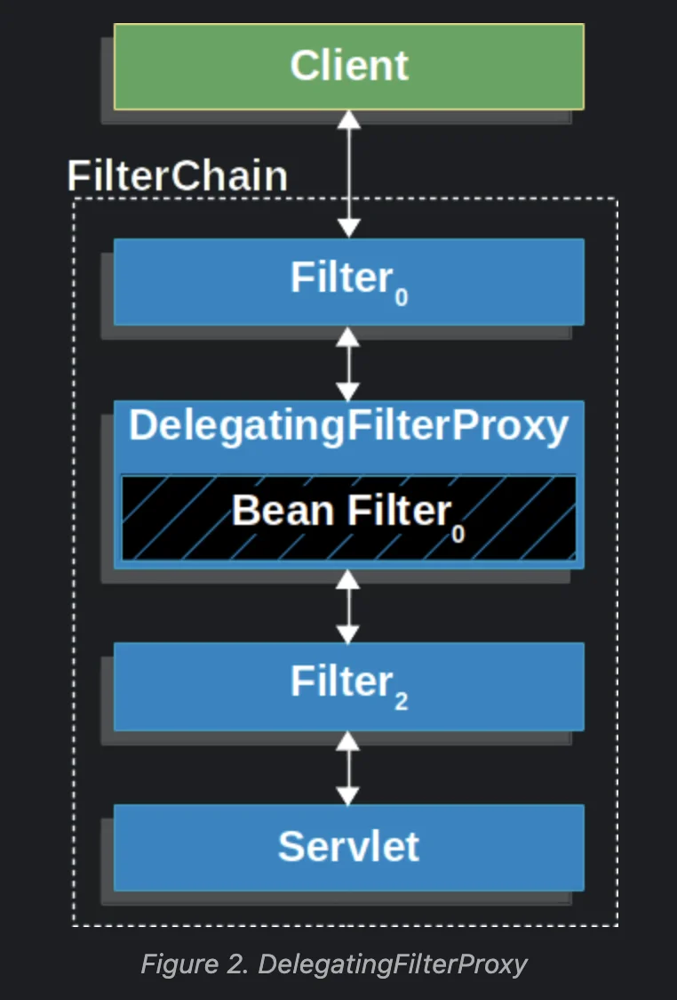

- Spring은 Servlet 컨테이너의 라이프사이클과 Spring의 ApplicationContext 간의 브리징을 허용하는 <code>DelegatingFilterProxy</code> 필터 구현체를 제공한다&#46;

- 서블릿 컨테이너는 자체 표준을 사용하여 필터 인스턴스를 등록할 수 있지만, Spring에서 정의한 빈은 인식하지 못한다&#46;

-  표준 서블릿 컨테이너 메커니즘을 통해 <code>DelegatingFilterProxy</code>를 등록할 수 있지만, 모든 작업은 필터를 구현하는 Spring 빈에 위임해야 한다&#46;

- <code>DelegatingFilterProxy</code>가 <code>Filter 인스턴스</code>와 <code>FilterChain</code>에 어떻게 적용되는지 보여주는 그림은 아래와 같다&#46;

</details>

<a id="215eda9b0fe1805f818ef87c91d1b1f2"></a>

### <strong>FilterChainProxy</strong>

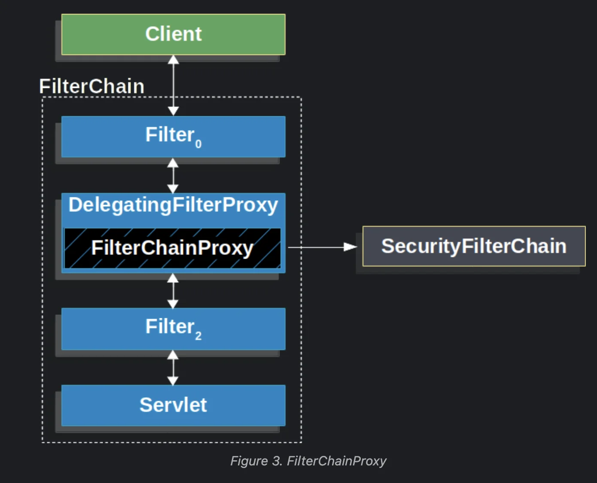

<a id="215eda9b0fe180f7805af2a1cbda10dd"></a>

<code>FilterChainProxy</code>는 스프링 시큐리티에서 제공하는 특별한 Filter이며, <br><code>SecurityFilterChain</code>을 통해 <strong>Filter로 위임이 가능</strong>하다&#46;

- 이렇게 스프링 시큐리티는 <strong><u>FilterChainProxy 안에서 서블릿을 지원</u></strong>한다&#46;

<a id="215eda9b0fe1805b8f12c0cef7925358"></a>

### SecurityFilterChain

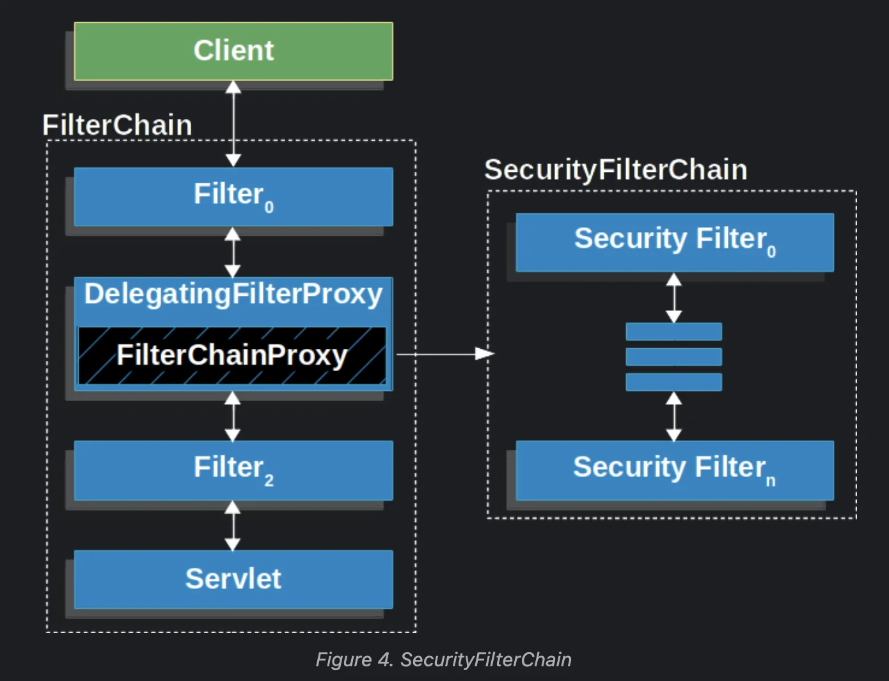

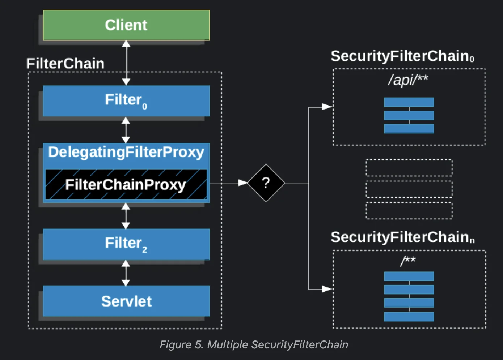

<a id="215eda9b0fe180af8bd5dfd53dbe3eb0"></a>

<code>SecurityFilterChain</code>에는 <u>여러 개의 Security Filter(보안 필터)</u>가 있다&#46;

- URL 패턴 등 설정에 따라 <code>SecurityFilterChain</code>을 여러 개 사용할 수도 있다

<details>
<summary><strong>Security Filter(보안 필터)의 종류와 순서</strong> (6&#46;4&#46;2 버전 기준)</summary>

> 출처&#58; <a href="https://github.com/spring-projects/spring-security/blob/6.4.2/config/src/main/java/org/springframework/security/config/annotation/web/builders/FilterOrderRegistration.java">spring&#45;security 공식 repo의 코드</a>

<a id="215eda9b0fe180a89921e1e1e8cdff5b"></a>

&#46; DisableEncodeUrlFilter

<a id="215eda9b0fe1805d9156e7abe0ac7321"></a>

2&#46; ForceEagerSessionCreationFilter

<a id="215eda9b0fe18018b3ecc8725d3c5d95"></a>

3&#46; ChannelProcessingFilter

<a id="215eda9b0fe1801bb326cfcfa55fe443"></a>

4&#46; WebAsyncManagerIntegrationFilter

<a id="215eda9b0fe18080b480d7775f92d6ac"></a>

5&#46; SecurityContextHolderFilter

<a id="215eda9b0fe180daa19bc414b0316a0e"></a>

6&#46; SecurityContextPersistenceFilter

<a id="215eda9b0fe180b6b9abe359be945ea3"></a>

7&#46; HeaderWriterFilter

<a id="215eda9b0fe18072b93fd1221286195e"></a>

8&#46; CorsFilter

<a id="215eda9b0fe18025ae15dc89968cef3b"></a>

9&#46; CsrfFilter

<a id="215eda9b0fe180eab646e2bc84eb316a"></a>

10&#46; LogoutFilter

<a id="215eda9b0fe18076a0c3f1b546059fac"></a>

11&#46; OAuth2AuthorizationRequestRedirectFilter

<a id="215eda9b0fe1800b87e3da58e7b5111f"></a>

12&#46; Saml2WebSsoAuthenticationRequestFilter

<a id="215eda9b0fe180d28c3ef528b9a3c9e1"></a>

13&#46; GenerateOneTimeTokenFilter

<a id="215eda9b0fe1806b9896f15a6c7166d2"></a>

14&#46; X509AuthenticationFilter

<a id="215eda9b0fe180fdb9f2e459a1c89c11"></a>

15&#46; AbstractPreAuthenticatedProcessingFilter

<a id="215eda9b0fe1802d8ddee0145285d6b9"></a>

16&#46; CasAuthenticationFilter

<a id="215eda9b0fe180889627de299dd947cb"></a>

17&#46; OAuth2LoginAuthenticationFilter

<a id="215eda9b0fe18034a74cd8cdb7d0acf4"></a>

18&#46; Saml2WebSsoAuthenticationFilter

<a id="215eda9b0fe180c09187c6f398f4ca19"></a>

19&#46; <code>UsernamePasswordAuthenticationFilter</code>

<a id="215eda9b0fe180dc8395ea137608d094"></a>

20&#46; DefaultResourcesFilter

<a id="215eda9b0fe1808fa6f8e91a3452d0cc"></a>

21&#46; DefaultLoginPageGeneratingFilter

<a id="215eda9b0fe180129571cad5b76d444d"></a>

22&#46; DefaultLogoutPageGeneratingFilter

<a id="215eda9b0fe180e0bff3f17ccf7223ce"></a>

23&#46; DefaultOneTimeTokenSubmitPageGeneratingFilter

<a id="215eda9b0fe18082b9c0c177470244c2"></a>

24&#46; ConcurrentSessionFilter

<a id="215eda9b0fe180579901ec5a297d672c"></a>

25&#46; DigestAuthenticationFilter

<a id="215eda9b0fe180218ab2c6e418ecbd1d"></a>

26&#46; BearerTokenAuthenticationFilter

<a id="215eda9b0fe18065b00be762919c7013"></a>

27&#46; BasicAuthenticationFilter

<a id="215eda9b0fe180df9d1bc3aab7ee6e17"></a>

28&#46; <code>AuthenticationFilter</code>

<a id="215eda9b0fe1801ba22cf915b9a3165d"></a>

29&#46; RequestCacheAwareFilter

<a id="215eda9b0fe1806693c4c12ea6f3484e"></a>

30&#46; SecurityContextHolderAwareRequestFilter

<a id="215eda9b0fe180fab2a8d3a4242f9471"></a>

31&#46; JaasApiIntegrationFilter

<a id="215eda9b0fe180789cd0d0803ea778c5"></a>

32&#46; RememberMeAuthenticationFilter

<a id="215eda9b0fe1805498d8cf2207b2f807"></a>

33&#46; AnonymousAuthenticationFilter

<a id="215eda9b0fe180a4a4dfea814589e03d"></a>

34&#46; OAuth2AuthorizationCodeGrantFilter

<a id="215eda9b0fe180189ea8d17c8cbe9d62"></a>

35&#46; SessionManagementFilter

<a id="215eda9b0fe180d7b560f1e17cdf3cb1"></a>

36&#46; <code>ExceptionTranslationFilter</code>

<a id="215eda9b0fe180e78d3ed4423a5eb89c"></a>

37&#46; FilterSecurityInterceptor

<a id="215eda9b0fe180308d54c2bf3d3cb89d"></a>

38&#46; <code>AuthorizationFilter</code>

<a id="215eda9b0fe1809b82f2d0385ce53dac"></a>

39&#46; SwitchUserFilter

</details>

<a id="215eda9b0fe180d298aff1f3bcb8273b"></a>

### Spring Security의 인증 프로세스

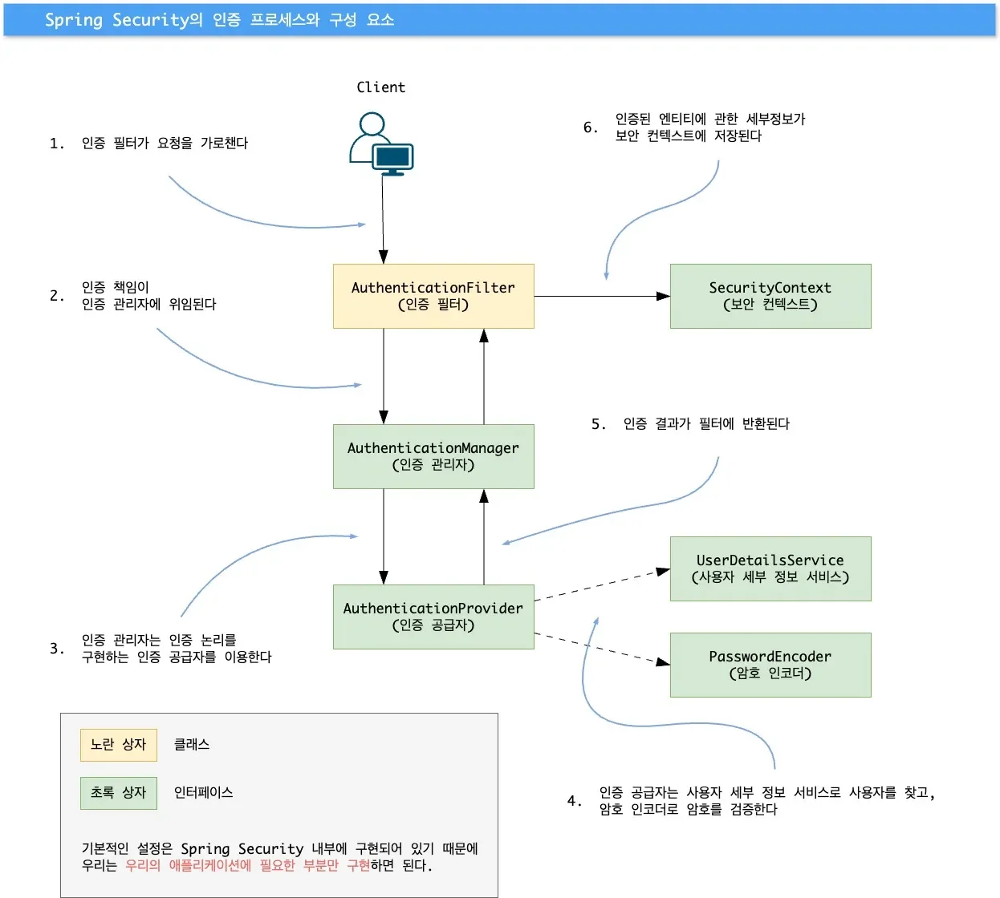

<a id="215eda9b0fe1809fa158d729373f9559"></a>

<strong>시큐리티의 기본 기능</strong>은 내부적으로 <strong><u>각 인터페이스 및 구현체로 제공</u></strong>된다&#46; 

<a id="215eda9b0fe1806ab13cde01294fed21"></a>

따라서 <strong><u>필요한 구성 요소만 재정의</u></strong>하여 <strong>맞춤 구성</strong>하면 된다&#46; 

<a id="215eda9b0fe18028be16c139981e09bb"></a>

### 사용자 관리 ( UserDetailsService )

<a id="215eda9b0fe1800bb9cbc5975ee8822a"></a>

<strong>프로세스</strong>

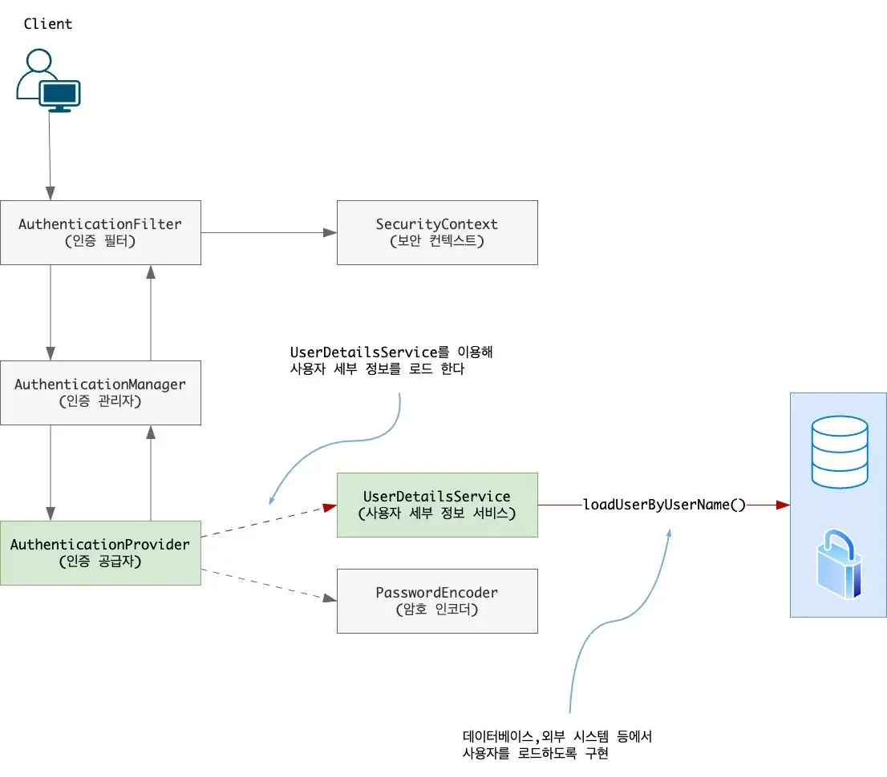

> Spring Secuirty의 전체 인증 프로세스 중에서 <strong><u>사용자 관리와 관련된 부분만</u></strong> 나타낸다&#46;

- <code>AuthenticationProvider</code>가 <u><code>UserDetailsService</code></u><u>에 사용자 관리에 대한 책임을 위임</u>하고 있다&#46;

<a id="215eda9b0fe1803987f8c6880f18f3fe"></a>

<strong>관련 인터페이스</strong>

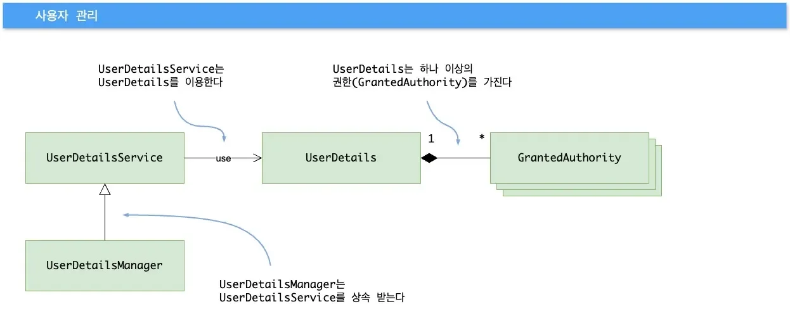

> 📌 
> 
> <a id="215eda9b0fe1808bb68cc5488306aeb5"></a>
> 
> <code>UserDetailsService</code> 으로 제공되는 것보다 세부 작업을 원한다면 <code>UserDetailsManager</code> 사용

- <code>UserDetailsService</code>&#58; 인증을 위해 사용자 탐색
    - <code>UserDetails</code>&#58; 사용자 기술

    - <code>GrantedAuthority</code>&#58; 사용자가 실행할 수 있는 작업(권한)을 정의
        - 읽기, 쓰기, 삭제 권한 등

    - <code>serDetailsManager</code>&#58; <code>UserDetailsService</code>에서 확장된 형태&#46; 
        - 사용자의 생성, 수정, 삭제 및 암호 수정 등의 작업을 지원

<a id="215eda9b0fe1803ca513f9d881c65ffe"></a>

### 암호 처리 ( PasswordEncoder )

<a id="215eda9b0fe18063a3cae2a3514fdeb6"></a>

<strong>프로세스</strong>

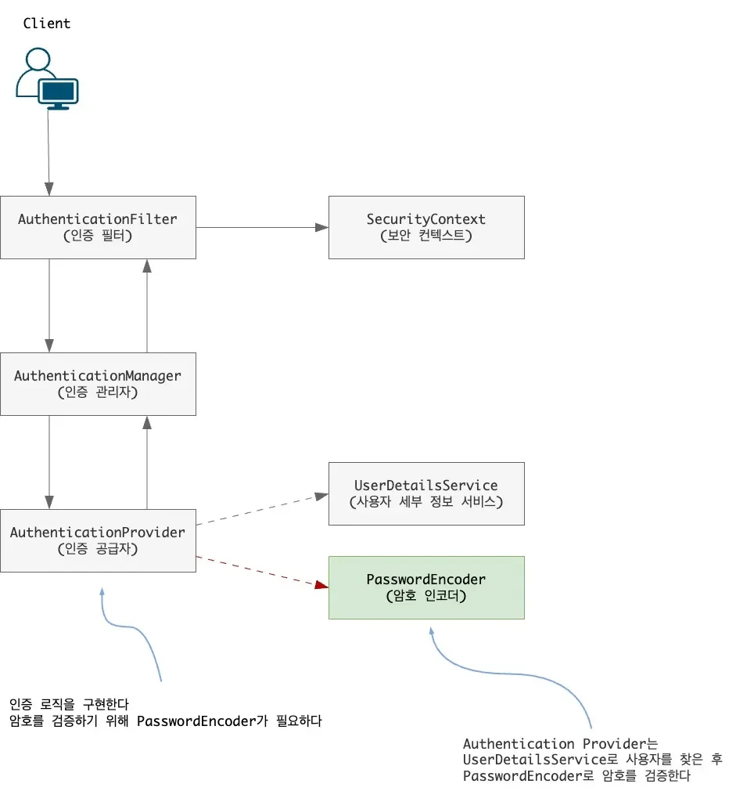

- <code>AuthenticationProvider</code>가 <code>PasswordEncoder</code>에 <strong><u>암호 검증에 대한 책임을 위임</u></strong>한다&#46;

<a id="215eda9b0fe1807d9cb6e0412793b200"></a>

<strong>관련 인터페이스</strong>

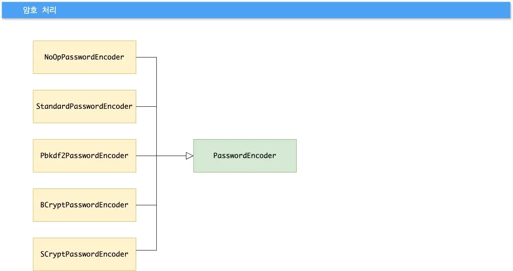

> ✏️ 
> 
> <a id="215eda9b0fe1809e8de1eb5b1fdda8e7"></a>
> 
> 주로 <code>BCryptPasswordEncoder</code>와 <code>SCryptPasswordEncoder</code>를 많이 사용한다&#46;
> 
> - 함께 사용하기도 한다&#46;

- <code>PasswordEncoder</code>&#58; 암호 검증
    - <code>NoOpPasswordEncoder</code>&#58; 인코딩 ❌ <strong>&#91; 실제 사용 X &#93;</strong>
        - <strong>NoOp는 No Operation을 의미</strong>

    - <code>StandardPasswordEncoder</code>&#58; <strong><u>SHA&#45;256</u></strong><strong> </strong>해싱 함수 사용
        - 강도가 약한 해싱 알고리즘을 사용하기 때문에 <strong><u>사용하지 않</u></strong>는 것을 권장

    - <code>Pbkdf2PasswordEncoder</code>&#58; <u>PBKDF2</u> 해싱 함수 사용

    - <code>CryptPasswordEncoder</code>&#58; <u>bcrypt</u> 해싱 함수 사용

    - <code>CryptPasswordEncoder</code>&#58; <u>scrypt</u> 해싱 함수 사용

> 🧐 
> 
> <a id="215eda9b0fe180f48a80c4db8c0e755c"></a>
> 
> <strong>비교</strong>
> 
> ---
> 
> > <code>scrypt</code>는 CPU와 메모리를 많이 사용한다&#46;
> 
> | <strong>알고리즘</strong> | <strong>주요 목적</strong> | <strong>보안 강도</strong> | <strong>병렬 공격 방어</strong> | <strong>주요 사용 사례</strong> |
> | --- | --- | --- | --- | --- |
> | <strong><code>SHA&#45;256</code></strong> | 데이터 무결성 검증 | 낮음 (빠른 연산 가능) | 낮음 | 파일 검증, <br>블록체인 |
> | <strong><code>PBKDF2</code></strong> | 비밀번호 해싱 및 키 파생 | 보통 (반복으로 강화) | 낮음 | 비밀번호 해싱, <br>키 파생 |
> | <strong><code>bcrypt</code></strong> | 비밀번호 해싱 | 높음 (Salt 및 cost factor) | 높음 | 비밀번호 저장 |
> | <strong><code>scrypt</code></strong> | 비밀번호 해싱 및 키 파생 | 매우 높음 (메모리 집약적) | 매우 높음 | 비밀번호 저장, <br>키 파생 |

> ⚙ 
> 
> <a id="215eda9b0fe180d3bab5e60509b26d57"></a>
> 
> <strong>키 생성기</strong>
> 
> ---
> 
> > ‣
> 
> - <code>BytesKeyGenerator</code>&#58; 특정 길이의 바이트 만큼의 키 생성
> 
> - <code>StringKeyGenerator</code>&#58; 인코딩된 문자열 키 생성

<a id="215eda9b0fe180ebbaa8dc09ef5041cf"></a>

### 인증 구현 ( AuthenticationProvider, SecurityContext )

<a id="215eda9b0fe180a4904bcf10272b521b"></a>

<strong>프로세스</strong>

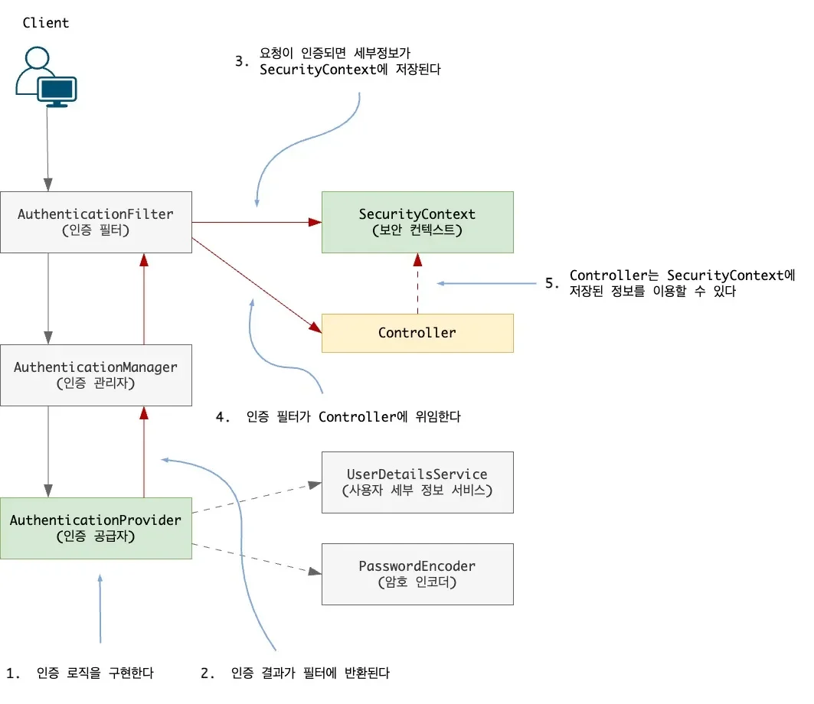

> /icons/refresh_blue.svg 
> 
> 1. <code>AuthenticationProvider</code>로 인증이 처리
> 
> 1. 인증 정보가 담긴 <code>Authentication</code> 객체를 <code>SecurityContext</code>에 저장
> 
> 1.  <code>Controller</code>에서 <code>SecurityContext</code>의 인증 정보 사용

<a id="216eda9b0fe18002b654d5ac0d9dab19"></a>

<strong>관련 인터페이스 </strong>

<a id="216eda9b0fe180fc9992c8e421012b7f"></a>

### AuthenticationProvider 인터페이스

<details>
<summary><strong>&#91; 이미지 &#93;</strong></summary>

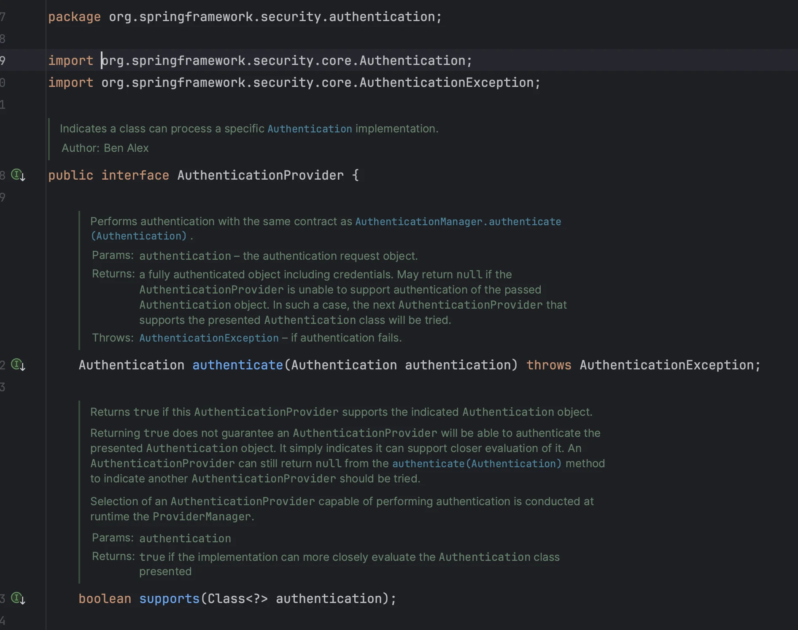

</details>

<a id="216eda9b0fe180d183a3eaf984ad599e"></a>

```java
public interface AuthenticationProvider {

		Authentication authenticate(Authentication authentication) throws AuthenticationException;
		
		boolean supports(Class<?> authentication);		
}
```

> <strong>인터페이스 정의 내용</strong>

- <code>AuthenticationProvider</code>&#58;  인증 로직 처리
    - 사용자 관리 책임은 <code>UserDetailsService</code>에 위임하고, <code>PasswordEncoder</code>에 암호 검증 책임을 위임한다&#46; 

- <code>Authentication</code>&#58; 인증 요청 이벤트
    - 접근을 요청한 엔티티의 세부 정보를 담는다&#46; 

> <strong>메서드</strong>

- <code>authenticate()</code>&#58; 인증 로직 정의 및 처리
    - 인증이 실패, <code>AuthenticationException</code>

    - 현재 <code>AuthenticationProvider</code> 구현에서 지원되지 않는 인증 객체를 받으면 <code>null</code>을 리턴
        - 여러 <code>Authentication</code> 형식을 사용한 경우

    - 완전히 인증된 객체를 나타내는 <code>Authentication</code> 인스턴스 리턴

- <code>supports()</code>&#58; 현재 AuthenticationProvider가 해당 Authentication을 지원하는지 확인
    - 

<a id="216eda9b0fe18050ba65cc07eba9eb4c"></a>

### SecurityContext 인터페이스

<a id="215eda9b0fe1805188bac39a71a9bbfd"></a>

<strong>관련 인터페이스</strong>

<a id="215eda9b0fe180e69d98f6bfe2872996"></a>

### 권한

<a id="215eda9b0fe180d0a7b8f0433bd3e677"></a>

### 권한에 따른 접근 제어

<a id="215eda9b0fe1806997cefe282d9831f4"></a>

### Security 예외 처리

<details>
<summary>reference</summary>

<a id="215eda9b0fe18090aa7cf8849570dd49"></a>

‣

</details>

> ❗ 
> 
> <a id="215eda9b0fe18053b47cf8d545145dec"></a>
> 
> Spring Security 내부에서 <code>AccessDeniedException</code>과 <code>AuthenticationException</code>이 발생할 수 있다&#46;
> 
> - <code>AuthenticationException</code>&#58; 인증되지 않은 경우
> 
> - <code>AccessDeniedException</code>&#58; 접근이 거부되는 경우

<a id="215eda9b0fe180068b79ee3173ac4a38"></a>

Spring Security는 <code>Filter</code>에서 동작하고, <code>Filter</code>에서 발생한 예외는 <code>&#64;ExceptionHandler</code>를 이용할 수 없다

<a id="215eda9b0fe180379ceaf74dde15fa42"></a>

이를 해결하기 위해, Security Filter 중에 <code>ExceptionTranslationFilter</code>는 위 예외를 해석해서 HTTP 응답으로 변환해준다&#46;

<a id="215eda9b0fe180d19f57e9acd3707b9f"></a>

이 과정에서 클라이언트에게 자격증명을 요청할 때 사용하는 <code>AuthenticationEntryPoint</code>가 사용된다&#46;

<a id="215eda9b0fe180889515f51faa2e5e87"></a>

따라서 <code>AuthenticationEntryPoint</code>를 커스텀하여 <code>&#64;ExceptionHandler</code>로 예외 핸들링이 가능하다&#46;

<a id="215eda9b0fe1801c98ffd5541a8dcc3e"></a>

## 예제 

> 📖 
> 
> <a id="215eda9b0fe180b0b0e8cb17b15fe6eb"></a>
> 
> JWT(JSON Web Token)를 이용한 Spring Security 인증/인가 처리

[nbcamp7-lecture-spring-security-h2](https://github.com/ssk910/nbcamp7-lecture-spring-security-h2)
