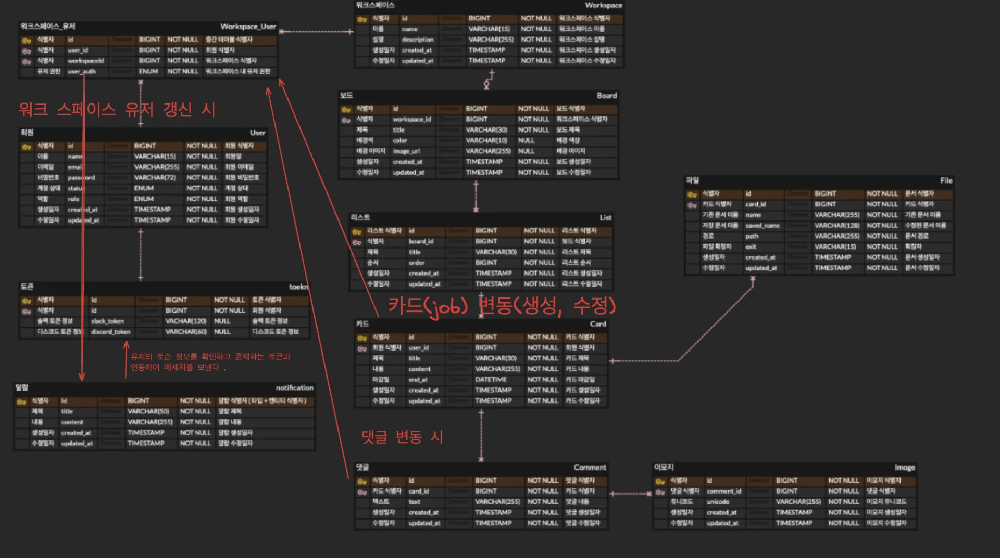
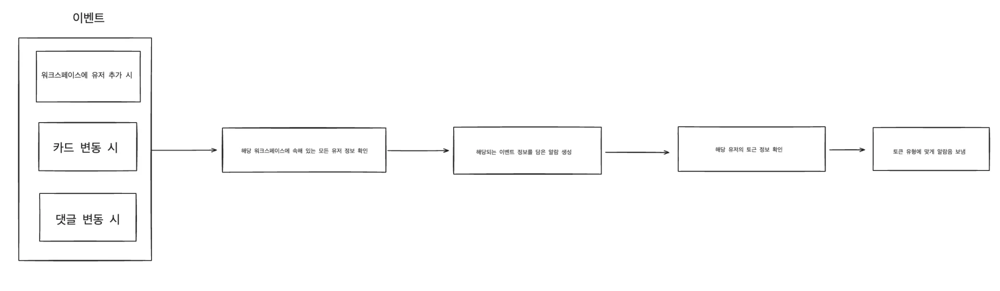
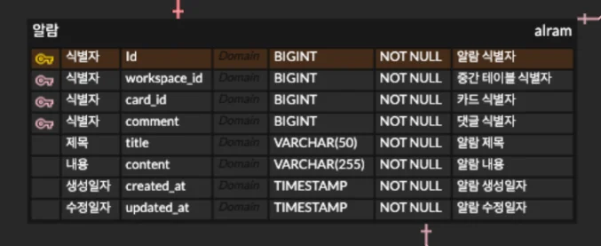
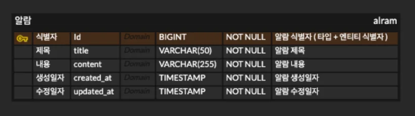
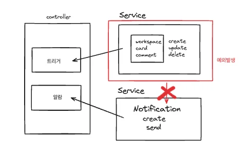
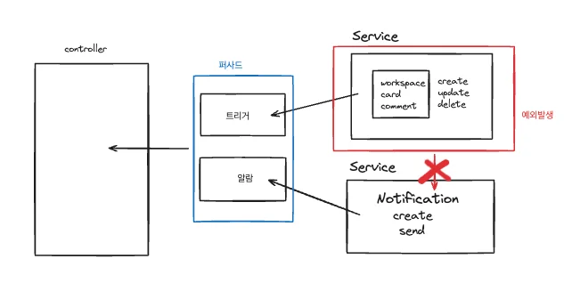

<a id="166eda9b0fe18061b2dfe5254a23ec37"></a>

### 알림 기능 동작 예상





1. 이벤트 발생
    - 워크스페이스에 유저 변동(추가, 제거)

    - 카드 변동(생성, 수정)

    - 댓글 변동(생성, 수정)

1. 해당 워크스페이스에 존재하는 모든 유저 정보 확인

1. 해당되는 이벤트 정보를 담은 알림 생성

1. 해당 유저의 토근 정보 확인

1. 토큰 유형에 맞게 알림을 보냄

<a id="166eda9b0fe18094bc34dd666773b0b9"></a>

 &#124;  위 3개에 해당되는 API 호출이 발생되었을 시, 해당 비지니스 로직에서 알람에 관련 로직을 호출하여 처리함

<a id="168eda9b0fe180eea025d359ab7bc75c"></a>

### 기능 구현 시, 고려 사항

<details>
<summary><del>알람 테이블 식별자; </del><del><code>타입 &#43; 해당 엔티티 식별자 </code></del></summary>



<a id="fa434922667c4ac9a31ae9db412faa9d"></a>

이전 설계 시, 알람 호출 케이스에 대한 정보를 저장하기 위해 해당되는 엔티티의 PK값을 테이블에 넣었다&#46;

- 워크스페이스에 유저 변동(추가, 제거) → workspace&#95;user pk 값

- 카드 변동(생성, 수정) → card의 pk 값

- 댓글 변동(생성, 수정) → comment의 pk 값

<a id="310d6719f2bd490bb24c300c91bb6909"></a>

그러나 이렇게  설계할 시, 해당하는 이벤트가 아니면 그 이외의 컬럼에  Null 값이 들어가게 된다&#46;

<a id="84be47a2f84d4bd1b9c3199b067f3002"></a>

결국 위 내용은 식별 즉, 구별을 하기위한 설계이기 때문에 튜터님의 피드백을 받고 아래와 같이 수정했다&#46; 



- 알람 테이블 식별자(PK)&#58;  <code>타입 &#43; 해당 엔티티 식별자 </code>

<a id="168eda9b0fe1803a8de8d8423bc490d4"></a>

```java
public Alram(EventType type, Long id, String title, String content) {
    if (type == null || id == null) {
        throw new IllegalArgumentException("Argument cannot be null");
    }
    this.id = String.format("%s-%d", type.getType(), id);
    this.title = title;
    this.content = content;
}
```

<a id="168eda9b0fe18025a880e3e4e9461444"></a>

위와 같이 알람 생성 시, 생성자에서 format을 변경하도록 개발했다&#46; 

<details>
<summary>&#91; 코드 &#93; Alram</summary>

<a id="f0c8eb5648ef48069983a692419f6681"></a>

```java
@Entity
@NoArgsConstructor(access = AccessLevel.PROTECTED)
public class Alram extends BaseEntity {

    /**
     * Represents the unique ID of an Alarm.
     * <p>
     * The ID is constructed using {@link EventType#getType()} and the corresponding Entity ID.
     * </p>
     * <ul>
     *     <li><b>EventType:</b> [ "workspace", "card", "comment" ]</li>
     *     <li><b>Entity:</b> [ workspace, card, comment ]</li>
     * </ul>
     */
    @Id
    private String id;

    @Column(nullable = false)
    private String title;

    @Column(nullable = false)
    private String content;


    /**
     * Creates an instance of Alram.
     *
     * @param type    the event type associated with the alarm, must not be null. See {@link EventType} for possible values.
     * @param id      the unique identifier for the alarm, must not be null.
     * @param title   the title of the alarm.
     * @param content the content or description of the alarm.
     * @throws IllegalArgumentException if type or id is null.
     */
    public Alram(EventType type, Long id, String title, String content) {
        if (type == null || id == null) {
            throw new IllegalArgumentException("Argument cannot be null");
        }
        this.id = String.format("%s-%d", type.getType(), id);
        this.title = title;
        this.content = content;
    }
```

</details>

</details>

<details>
<summary><del>실패 케이스 </del></summary>

<a id="1e6f83a775d74f21932c992b2ae9a988"></a>

해당하는 이벤트가 실패했을 시에는, 알람이 보내지면 안 된다&#46;

> 그러면 위에 대한 케이스를 어떻게 핸들링 할 것인가? 

- 컨트롤러 
    

- 퍼사드 
    

</details>

<details>
<summary><del>예외처리 </del></summary>

- 알람 식별자 생성 시, Null 값에 대한 검증

</details>

<details>
<summary>알람 삭제 시기</summary>

<a id="d3fd6c949e024f77a9bd509d009a0ebd"></a>

알람은 이후 추적을 위해 위와 같이 테이블을 생성해서 DB에 저장한다&#46; 

<a id="da859def652544498a57cd9ba756f0cc"></a>

그렇다면 아래와 같은 고려 사항이 생긴다&#46; 

- 알람 삭제의 기준을 무엇으로 할 것인가?
    - 이벤트
        - 어떤 이벤트 트리거를 통해 삭제할 것인가? 

    - 일정 기간
        - 어느 주기로 삭제를 진행할 것인가?

    - 스케줄러를 통해 특정 기간마다 삭제 

</details>

<a id="168eda9b0fe180669134dbe6759cd106"></a>

### 플로우

<a id="168eda9b0fe180a2bd67cc65f8998821"></a>

```java
[ Event Trigger ]  
        |
        v
[ Check Conditions ]
        |
        v
[ Generate Notification ]
        |
        v
[ Save to Database ]
        |
       / \
      /   \
     v     v
[ Send Notification ]  [ Push to Queue (Optional) ]
        |
        v
[ User Receives Notification ]
        |
        v
[ Update UI ]
        |
        v
[ Mark as Read ]
        |
        v
[ Save Read Status to DB ]
```

<a id="168eda9b0fe180b69078ccb358815ea9"></a>

1&#46;	<strong>시작</strong>

<a id="168eda9b0fe180b6b34bf6850fdd407f"></a>

•	이벤트가 발생 (예&#58; 댓글 작성, 작업 생성)&#46;

<a id="168eda9b0fe18043a7ddc50b3e21385b"></a>

2&#46;	<strong>알림 생성 조건 확인</strong>

<a id="168eda9b0fe18067968afdeef2de50bf"></a>

•	특정 조건(예&#58; 대상 사용자 설정, 이벤트 유형)을 기반으로 알림 생성 여부 결정&#46;

<a id="168eda9b0fe180a59c12c60bfc0a9eb5"></a>

3&#46;	<strong>알림 생성 및 저장</strong>

<a id="168eda9b0fe18060981fe7047c73e037"></a>

•	알림 객체를 생성하고 데이터베이스에 저장&#46;

<a id="168eda9b0fe180989768cd55569532c4"></a>

4&#46;	<strong>알림 전송</strong>

<a id="168eda9b0fe18090841bf2ec581bcfbc"></a>

•	SSE, WebSocket, 또는 푸시 알림을 통해 클라이언트에 실시간 알림 전송&#46;

<a id="168eda9b0fe18088b217d6f4b70cd1c1"></a>

5&#46;	<strong>클라이언트 UI 업데이트</strong>

<a id="168eda9b0fe18055a2f4e86f39b12f8f"></a>

•	클라이언트가 알림을 수신하고 화면에 표시&#46;

<a id="168eda9b0fe180b0a18cd3143cba00a5"></a>

6&#46;	<strong>알림 읽음 처리</strong>

<a id="168eda9b0fe1807f8a5afa597174d7ff"></a>

•	사용자가 알림을 읽은 경우, 상태를 “읽음”으로 업데이트&#46;

<a id="168eda9b0fe180818ee3d80e26589d29"></a>

7&#46;	<strong>종료</strong>

<a id="166eda9b0fe1800c8f05f7007965f413"></a>

### 필요한 기술

<details>
<summary>Open API</summary>

<details>
<summary>Open API 호출 </summary>

- restTemplate ( 레거시 )

- WebClient   ← 사용 예정

- OpenFeign   ← 최신 기술 ( 고려 중 )

</details>

<details>
<summary>Slack 메세지 호출에 대한 자료</summary>

<a id="166eda9b0fe180419cb0cdcdba2c8240"></a>

‣

<a id="166eda9b0fe1800784c8e9635341f44a"></a>

‣

<a id="166eda9b0fe18004b152fcdee5614bdf"></a>

‣

<a id="166eda9b0fe18023801fd143720302bd"></a>

‣

<a id="166eda9b0fe180219cefca5fe6250126"></a>

‣

</details>

</details>

<a id="168eda9b0fe18080bcd8f5ac36f582af"></a>

<a href="#/post/168eda9b-0fe1-80f8-b856-f9957114c07e">페이지</a> 

<a id="168eda9b0fe180bdadbfd887d76d0f4c"></a>

<a href="https://beautiful-college-c84.notion.site/168eda9b0fe18002927efec89a5a8b58">페이지</a> 

<a id="168eda9b0fe18001bc70f499fb7a905f"></a>

카드와 댓글에서 이벤트 발생 시, 해당 워크스페이스 안에 있는 유저 정보가 필요하다&#46; 

<a id="168eda9b0fe1803cae6df5c1c6eaa596"></a>

### 트러블 슈팅

<a id="168eda9b0fe180b39e43c70bce7d1cc2"></a>

### 기능 구현

<details>
<summary>&#91; 코드 &#93; <code>Entity</code>&#58; Alram</summary>

<a id="168eda9b0fe1801e80d4c70a01e8e912"></a>

```java
package com.spata14.trelloproject.alram.entity;

import com.spata14.trelloproject.common.BaseEntity;
import jakarta.persistence.Column;
import jakarta.persistence.Entity;
import jakarta.persistence.Id;
import lombok.AccessLevel;
import lombok.NoArgsConstructor;

@Entity
@NoArgsConstructor(access = AccessLevel.PROTECTED)
public class  Notification {

    /**
     * Represents the unique ID of an Alarm.
     * <p>
     * The ID is constructed using {@link EventType#getType()} and the corresponding Entity ID.
     * </p>
     * <ul>
     *     <li><b>EventType:</b> [ "workspace", "card", "comment" ]</li>
     *     <li><b>Entity:</b> [ workspace, card, comment ]</li>
     * </ul>
     */
    @Id
    private String id;

    @Column(nullable = false)
    private String title;

    @Column(nullable = false)
    private String content;
    
    


    /**
     * Creates an instance of Alram.
     *
     * @param type    the event type associated with the alarm, must not be null. See {@link EventType} for possible values.
     * @param id      the unique identifier for the alarm, must not be null.
     * @param title   the title of the alarm.
     * @param content the content or description of the alarm.
     * @throws IllegalArgumentException if type or id is null.
     */
    public Alram(EventType type, Long id, String title, String content) {
        if (type == null || id == null) {
            throw new IllegalArgumentException("Argument cannot be null");
        }
        this.id = String.format("%s-%d", type.getType(), id);
        this.title = title;
        this.content = content;
    }
}

```

</details>

<details>
<summary>&#91; 코드 &#93; <code>Enum</code>&#58; EventType</summary>

<a id="435fa4aaf1214aa3b49b62dbb619acfb"></a>

```java
package com.spata14.trelloproject.alram.entity;

/**
 * Enumeration representing various event types in the system.
 * <p>
 * Each event type is associated with a string identifier.
 * </p>
 */
public enum EventType {

    /**
     * Represents an event related to a workspace.
     */
    WORKSPACE("workspace"),

    /**
     * Represents an event related to a card.
     */
    CARD("card"),

    /**
     * Represents an event related to a comment.
     */
    COMMENT("comment");

    /**
     * The string identifier associated with the event type.
     */
    private String type;

    /**
     * Constructs an {@link EventType} with the specified string identifier.
     *
     * @param type the string identifier for the event type
     */
    EventType(String type) {
        this.type = type;
    }

    /**
     * Returns the string identifier of the event type.
     *
     * @return the string identifier of the event type
     */
    public String getType() {
        return type;
    }
}

```

</details>
