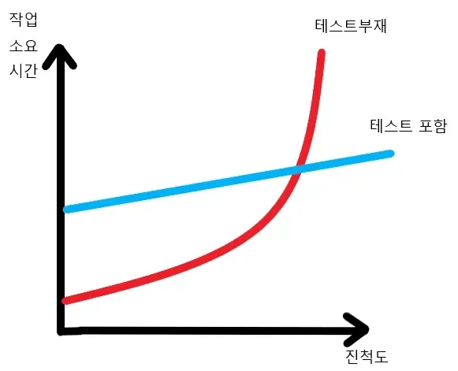
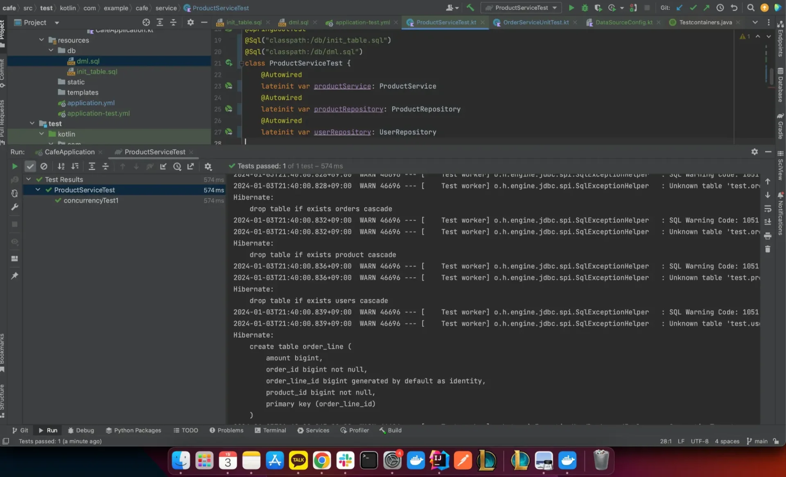
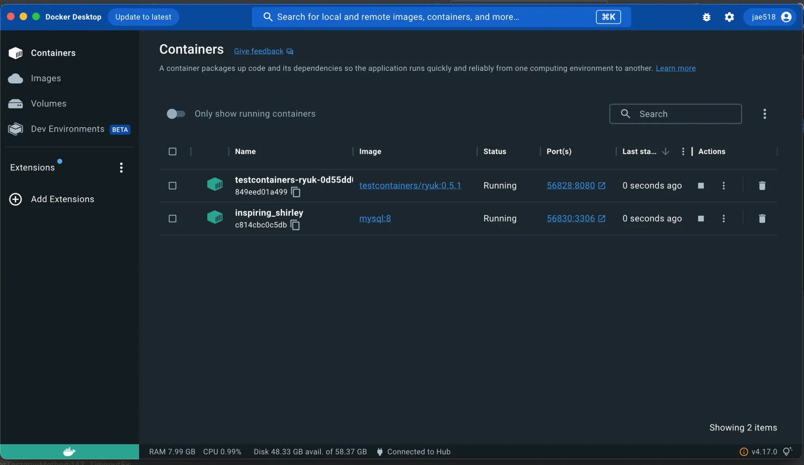
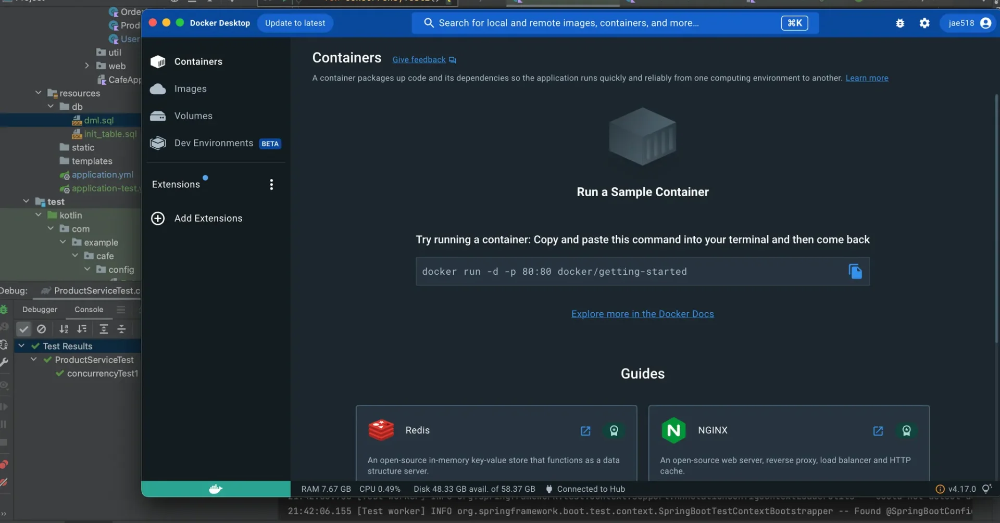
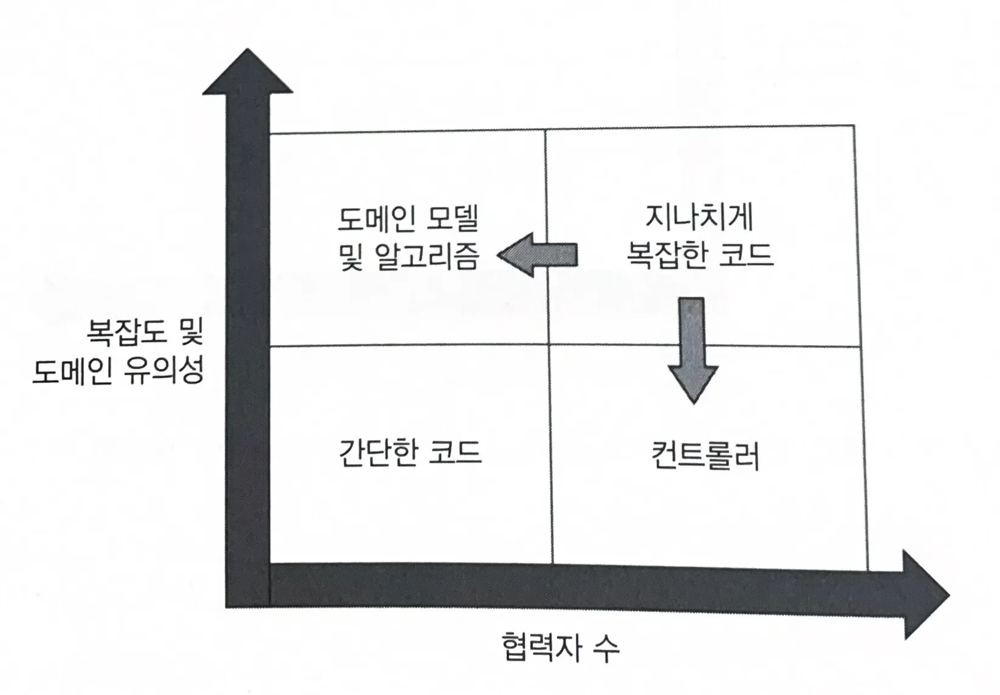
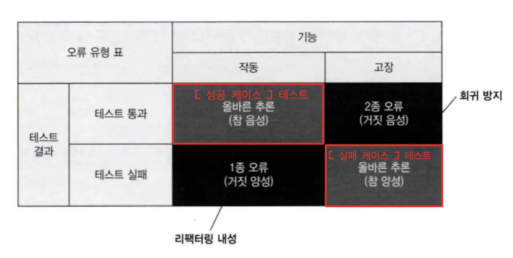
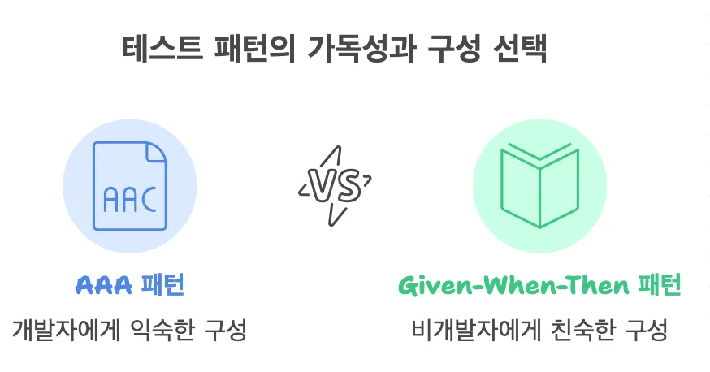
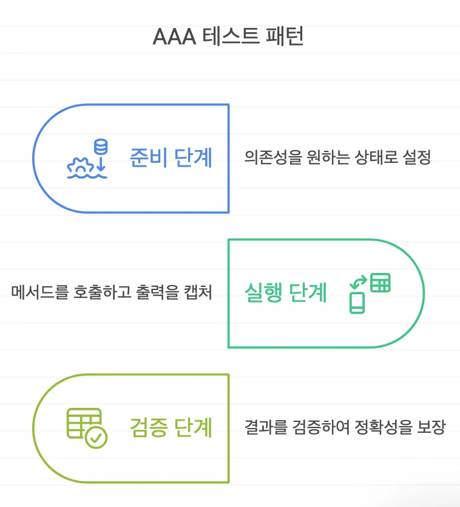
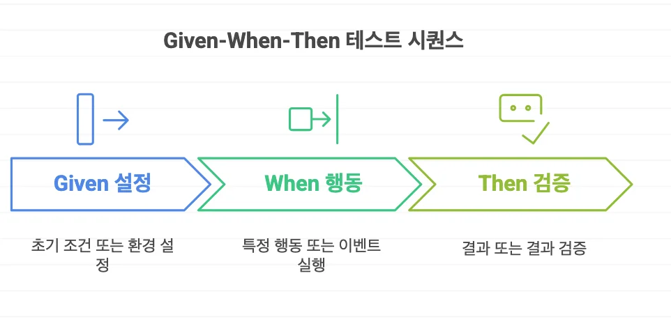
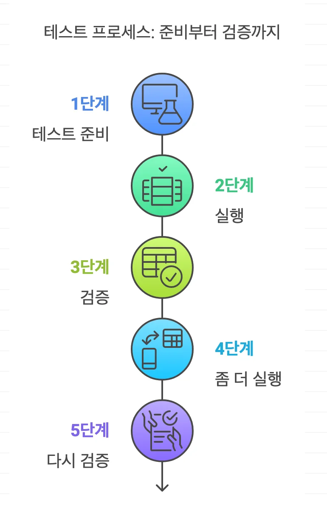

> 📌 
> 
> <a id="168eda9b0fe181a2a3cffdf423173b82"></a>
> 
> CS 특강 &#45; 테스트 코드 
> 
> - 진행&#58; 김재연 튜터님
> 
> - 기간&#58; 24&#46;12&#46;26(목) 
> 
> - reference&#58; <a href="https://beautiful-college-c84.notion.site/a47ebaaa426344f79ad46c662eb367f2">페이지</a> 

<a id="195eda9b0fe1807f9260cc1c63172d7d"></a>

### Notes

> ✏️ 
> 
> <a id="195eda9b0fe18050b30ffadb7735e8f0"></a>
> 
> 단순 CRUD 테스트할 가치 ❌

> ✏️ 
> 
> <a id="196eda9b0fe180a592a6c9ca6e3e71c4"></a>
> 
> 단순 CRUD를 하는 가치없는 코드를 주석 처리하면 테스트 해야할 핵심 코드를 판단할 수 있다&#46;

<a id="168eda9b0fe180a292eadc11d0a6caf6"></a>

## 테스트가 왜 중요한가?

---



> ✏️ 
> 
> <a id="168eda9b0fe180288f88f7bda8d9fa24"></a>
> 
> 테스트 작성 시, 처음에는 많은 리소스가 들지만 나중에는 더 개발 비용이 낮아진다&#46; <br>프로젝트 규모가 커질수록 간단한 기능 추가 또는 수정 시, 다른 곳에 어떤 영향을 끼칠 지 확신할 수 없고, <br>원래 잘 동작하던 기능에도 이상이 생길 수 있다&#46;

<a id="196eda9b0fe180f69d6fd324c632c9b4"></a>

### 테스트 부재

- 처음에는 발목을 잡을 것이 없으므로 프로젝트를 비교적 빠르게 진척해 나갈 수 있다&#46; 

- 프로젝트 규모가 커질수록 간단한 기능 추가 또는 수정 시 다른 곳에 어떤 영향을 끼칠 지 확신할 수 없고,

- 원래 잘 동작하던 기능에도 이상이 생길 수 있다&#46; ( 즉, 어떤 사이드 이펙트가 따라올 지 모른다&#46;  )

- 복잡한 기능일수록 내가 구현한 코드가 의도한대로 동작하는 지에 대한 검증이 필요하다&#46; 

<a id="168eda9b0fe1809b8203ef4e420c0c9b"></a>

### 테스트 포함

- 테스트가 프로젝트 안정망 역할을 하기 때문에 새로운 기능을 도입하거나 새로운 요구 사항에 더 잘 맞게 리펙토링한 후에도 기존 기능이 잘 작동하는지 확인하는 데에 도움이 된다&#46; 

- 이러한 테스트는 초반에 노력과 시간이 필요하다는 단점이 있지만, 장기적으로 봤을 때, 프로젝트를 후반까지 안전하게  &#43; 수월하게 잘 성장시킬 수 있다는 점에서 그 비용을 메울 수 있다&#46; 

> 📌 
> 
> <a id="196eda9b0fe1802581d4e60b9710a279"></a>
> 
> 요약
> 
> - 복잡한 기능일수록 내가 구현한 코드가 의도한대로 동작하는 지에 대한 검증이 필요하다&#46;
> 
> - 프로젝트 규모가 커질수록 간단한 기능 추가에도 어떤 사이드 이펙트가 따라올지 모릅니다&#46; 
> 
> - 이는 치명적인 결과를 유발할 수 있으며, Test를 잘 작성해 놓으면 이러한 상황들을 최소화 할 수 있다&#46; 

<details>
<summary>🧐 “그럼 모든 비지니스 로직에 대한 테스트 코드를 작성해야 하는가?”  </summary>

- 아니다

<a id="196eda9b0fe180149278e07251b0fd2c"></a>

테스트는 아주 중요하고 소프트웨어 품질에 매우 많은 기여를 하지만 그렇지 않는 테스트도 분명히 존재한다&#46; 

- 단위 테스트는 통합적인 앱 동작까지는 검증되지 않는다

- 통합 테스트는 필수로 진행되어야 한다&#46; 

- 통합테스트임에도 외부에서 받아오는 서비인 경우 Mocking 해도 된다&#46; 

- 서비스 로직은 통합 테스트를 통해 DB에서의 실제 값 확인이 진행되어야 한다&#46; 

</details>

<a id="168eda9b0fe1806391e8dba28e36cb0c"></a>

## 통합 테스트 

---

> ☝🏻 
> 
> <a id="196eda9b0fe180b9b1ece78bbc629aaa"></a>
> 
> 단위 테스트만으로는 시스템이 전체적으로 잘 동작하는지 확신할 수 없다&#46;
> 
> <a id="196eda9b0fe180a494b0d6dcfef6e6c1"></a>
> 
> 단위 테스트가 비지니스 로직을 확인하는 데에는 좋지만, 이를 외부 의존성과 단절된 상태로 확인하기 때문에 각 부분이 DB나 메세지 버스 등의<strong> </strong><strong><u>외부 시스템과 어떻게 통합 되는지 확인 해봐야 한다&#46;</u></strong>

<a id="196eda9b0fe1804aa6b0c370d94a8eff"></a>

### 통합 테스트란?

<a id="196eda9b0fe18069823dcc116b2df8be"></a>

전에 나왔던 단위 테스트의 세 가지 요구사항 중 하나라도 충족하지 못하는 테스트가 통합 테스트에 해당된다&#46; 

<a id="196eda9b0fe180a19affdf314164db5f"></a>

```plaintext
1. 작은 코드 조각(단위)을 검증하고,
2. 빠르게 수행되어야 하며,
3. 격리된 방식으로 처리하는 자동화된 테스트
```

<a id="196eda9b0fe180378080fe185a6b9239"></a>

주로 외부 의존성이 많은 컨트롤러, 서비스 Layer에 대한 테스트이다&#46;

- 외부 의존성과 함께  → 통합 테스트

- 외부 의존성으로부터 격리 → 단위 테스트

<a id="168eda9b0fe180d7aaa8d406b1107546"></a>

### 의존성의 2 가지 유형

> ✏️ 
> 
> 1. <code>관리 의존성</code>(전체를 제어할 수 있는 의존성)
>     - 해당 의존성과의 상호 작용을 외부 환경에서 볼 수 없다&#46;
> 
>     - ex) 데이터베이스, Redis, RabbitMQ 등
> 
> 1. <code>비관리 의존성</code> ( 전체를 제어할 수 없는 의존성)&#58; 해당 의존성의 상호 작용을 외부에서 볼 수 있다&#46; 
>     - ex) SMTP 서버, 메세지 버스 등

<a id="196eda9b0fe18084aad2d7e0d876fb5b"></a>

통합 테스트에서 mock처리를 해야 하는 것은 비관리 의존성이고, 관리 의존성은 실제 인스턴스를 사용해야 한다&#46; 

<a id="196eda9b0fe1800db338e21025400683"></a>

하지만 <code>데이터베이스</code>의 경우, <strong><u>실제 인스턴스를 사용하면서 테스트</u></strong>하기 때문에 기존에 사용하던 데이터가 오염될 수 있기 때문에, <strong><u>테스트용 DB 환경을 따로 구축</u></strong>해줘야 한다&#46;

<a id="196eda9b0fe180218cd3eea98e6b440c"></a>

### TEST용 DB 세팅 방법

<a id="196eda9b0fe1802094cccb8b2d071b4e"></a>

### 1&#46; Local 환경에 DB를 직접 설치해서 사용

<a id="196eda9b0fe1802bbbe4d3e717ac2157"></a>

### 2&#46; docker container에 DB를 올려 사용

<a id="196eda9b0fe180129918c79fb030086c"></a>

### 3&#46; H2 DB 사용

<a id="196eda9b0fe1802f8833f84d77fe23f7"></a>

H2는 Java 기반의 In&#45;memory RDBMS로 따로 설치할 필요없이 의존성만 추가해주면 되며, 표준 SQL을 대부분 지원 해준다&#46; 

<a id="196eda9b0fe1809fbb69d6a0a9e31948"></a>

용량도 약 2MB로 매우 가벼워 테스트 용도로 사용하기 적절하다&#46; 

- 장점
    - 설치할 필요가 없다&#46; 

    - 인메모리 기반이기 때문에 빠르다&#46; 

    - 브라우저 콘솔을 지원한다&#46; 

- 단점
    - 운영 DB에 필요한 문법을 100% 지원해주는 것은 아니다&#46; 

    - 따라서 특정 DB에 특화된 기능을 테스트하기 어렵다&#46; 

> ✏️ 
> 
> <a id="196eda9b0fe1806ab184fe655ee85d8a"></a>
> 
> 위 3가지 방식의 <strong><u>단점 요약</u></strong>하면 아래와 같다&#46;
> 
> > 📌 
> > 
> > <a id="196eda9b0fe180069da3cb29ba39f7de"></a>
> > 
> > <strong>단점</strong>
> > 
> > 1. 러닝 커브가 있다&#46;
> > 
> > 1. <strong>사전 작업이 번거롭다&#46;</strong>
> > 
> > 1. 멱등성 유지가 안된다&#46; 
> > 
> > 1. DB 특화 기능을 소화하지 못한다&#46;
> 
> <a id="196eda9b0fe18066af21f69e5988d69a"></a>
> 
> <br>이 중 2, 3번 단점이 가장 크리티컬 하다&#46; 
> 
> <a id="196eda9b0fe18058857ddf3f5b3ef043"></a>
> 
> 테스트는 정말 숨 쉬듯 돌려볼 수 있어야하는데, 테스트를 돌리는 과정이 귀찮다면 자연스럽게 테스트 작성을 생략하게 되고, 테스트하는 사람마다 다른 테스트 결과를 받는다면, 그 테스트 결과를 신뢰할 수 없기 때문이다&#46; 
> 
> <a id="196eda9b0fe180759c35c7196a32e0df"></a>
> 
> 따라서 프로젝트에 적용될 테스트 환경은 아래와 같은 조건들을 충족해야 한다&#46; 
> 
> > 📌 
> > 
> > <a id="196eda9b0fe18020aabac75f06e6df08"></a>
> > 
> > <strong>테스트 환경 충족 조건</strong>
> > 
> > 1. <strong><u>테스트하기 편</u></strong>해야 한다&#46; 
> >     - 시간이 적게 들고(빠른 피드백), 가벼우며, 명령어 하나로도 충분한 방법
> > 
> > 1. <strong><u>멱등성을 유지</u></strong>할 수 있어야 한다&#46;
> >     - 어디서 실행하든, 어떤 컴퓨터에서 실행하든 동일한 테스트 결과를 제공해야 한다&#46;
> > 
> > 1. <strong><u>DB 특화 기능을 소화</u></strong>할 수 있어야 한다&#46;
> >     - <strong><u>특정 DBMS에 종속적인 기능</u></strong>이라면 <strong><u>해당 기능이 지원되지 않</u></strong>을 경우, <u>프로젝트에 큰 영향을 미칠 수 있</u>다&#46;

<a id="196eda9b0fe1804c9ffdc4ec47ad1128"></a>

### 4&#46; Test Containers

> ✏️ 
> 
> <a id="196eda9b0fe1803bbe70d7744b82e106"></a>
> 
> <strong><code>Test Containers</code></strong>는 <strong><u>docker 컨테이너 외부 설정 없</u></strong>이 <u>Java 언어만으로 구축</u>할 수 있는 오픈소스 라이브러리이다&#46;
> 
> -  <strong><u>Docker 컨테이너</u></strong>를 <strong><u>자동 구축, 관리</u></strong>하는 Java 라이브러리이다&#46;
> 
> - <strong><code>Test Containers</code></strong>는 위 모든 환경 조건들을 충족한다&#46; 

<details>
<summary>Docs</summary>

[Testcontainers]()

</details>

<details>
<summary>의존성 추가 </summary>

<a id="196eda9b0fe1807ebdaef3446c1122de"></a>

```groovy
testImplementation 'org.testcontainers:testcontainers:1.18.3'  // TC 의존성
testImplementation 'org.testcontainers:mysql:1.19.3'  // MySQL 테스트 컨테이너 사용
testImplementation 'org.testcontainers:junit-jupiter:1.16.3'  // TC 의존성
testImplementation 'com.mysql:mysql-connector-j:8.2.0'
```

</details>

<details>
<summary>테스트 독립 환경 구축</summary>

<a id="196eda9b0fe18007aa59eab79fbaa875"></a>

실제 스프링 프로젝트에서는 자바 코드로 mysql 커넥션을 해주지 않아도 yml 설정만으로도 정상적으로 동작하는데, Testcontainers에서도 이와 같은 방식으로 구동이 가능하다&#46; 

<details>
<summary>test 프로필 생성</summary>

>  test 환경에서만 적용되는 DB 설정 적용

- application&#45;test&#46;yml
    <a id="196eda9b0fe180c5bcb7d92b7b438cae"></a>

    ```yaml
    spring:
      datasource:
        driver-class-name: org.testcontainers.jdbc.ContainerDatabaseDriver
        url: jdbc:tc:mysql:8:///

      jpa:
        hibernate:
          ddl-auto: create
        show-sql: true
    ```

</details>

</details>

<details>
<summary>통합 테스트 코드 작성</summary>

> 손님이 상품을 구매 했을 경우, 상품의 재고에 대한 동시성 이슈 발생을 막기 위해 통합테스트

<details>
<summary>&#91; 코드 &#93;  ProductServiceTest&#46;java</summary>

<a id="196eda9b0fe1809c86acd3a7a2aa5a10"></a>

```java
@ActiveProfiles("test")    // 1
@SpringBootTest            // 2
@Sql("classpath:/init_table.sql")   // 3
@Sql("classpath:/dml.sql")          // 4
public class ProductServiceTest {

    @Autowired                      // 5
    ProductService productService;
    @Autowired
    ProductRepository productRepository;

		@Test
    void 성공_동시성_이슈_테스트() throws InterruptedException {
        // given
        List<OrderLineRequest> orderLines = List.of(
            new OrderLineRequest(1L, 10L),
            new OrderLineRequest(2L, 20L)
        );
        OrderCreateRequest request = new OrderCreateRequest(orderLines, 10000L);
        int numberOfThreads = 4;
        ExecutorService executorService = Executors.newFixedThreadPool(numberOfThreads);
        CountDownLatch countDownLatch = new CountDownLatch(4);
        when(mailPlugin.send()).thenReturn(true);

        // when
        executorService.execute(() -> {
            orderService.create(request);
            countDownLatch.countDown();
        });
        executorService.execute(() -> {
            orderService.create(request);
            countDownLatch.countDown();
        });
        executorService.execute(() -> {
            orderService.create(request);
            countDownLatch.countDown();
        });
        executorService.execute(() -> {
            orderService.create(request);
            countDownLatch.countDown();
        });
        countDownLatch.await();

        // then
        Product product1 = productRepository.findById(1L).orElseThrow();
        Product product2 = productRepository.findById(2L).orElseThrow();

        assertThat(product1.getAmount()).isEqualTo(9960L);
        assertThat(product1.getSaleCount()).isEqualTo(40L);
        assertThat(product2.getAmount()).isEqualTo(19920L);
        assertThat(product2.getSaleCount()).isEqualTo(80L);
    }    
}
```

</details>

---

- <code>&#64;ActiveProfiles(”test”)</code>
    - TestContainers에서 만들 Dokcer MySql Container의 dataSource를 방금 작성한 application&#45;test&#46;yml의 값으로 설정하기 위한 어노테이션

- <code>&#64;SpringBootTest</code>
    - Service, Repository까지의 로직을 mock 처리없이 다루려면 의존성 주입을 해주어야 하는데, 그를 위해 붙여주는 어노테이션이다&#46;

- <code>&#64;Sql</code>
    - 쿼리문이 적혀있는 sql file 경로를 적어주면, 테스트 시작 전에 이를 수행한다&#46; 
        - 예제에선 table 생성 및 간단한 초기 데이터 삽입을 수행함

        <details>
        <summary>init&#95;table&#46;sql</summary>

        <a id="196eda9b0fe1806bb655c7d773382e15"></a>

        ```sql
        create table `order_line` (
                amount bigint,
                order_id bigint not null,
                order_line_id bigint not null auto_increment,
                product_id bigint not null,
                primary key (order_line_id)
        );

        create table `orders` (
                                created_at timestamp(6) not null,
                                order_id bigint not null auto_increment,
                                total_price bigint,
                                updated_at timestamp(6) not null,
                                primary key (order_id)
        );
            
        create table `product` (
                                 amount bigint,
                                 price bigint,
                                 product_id bigint not null auto_increment,
                                 sale_count bigint,
                                 category varchar(255) check (category in ('CAFFEINE','DECAFFEINE')),
                                 description varchar(255),
                                 name varchar(255),
                                 primary key (product_id)
        );
            
        create table `users` (
                               point bigint,
                               user_id bigint not null auto_increment,
                               name varchar(255),
                               password varchar(255),
                               role varchar(255) check (role in ('ROLE_USER','ROLE_ADMIN')),
                               username varchar(255) unique,
                               primary key (user_id)
        );
        ```

        </details>

        <details>
        <summary>dml&#46;sql</summary>

        <a id="196eda9b0fe180b5bd92c531f96c0948"></a>

        ```java
        insert into users(username, password, name, role, point, user_id)
            values("jae518@naver.com", "wodus123", "재연", "ROLE_USER", 1000000, 1);

        insert into users(username, password, name, role, point, user_id)
            values("jae5181@naver.com", "wodus123", "재연", "ROLE_USER", 1000000, 2);

        insert into product(name, category, description, price, amount, sale_count, product_id)
            values("상품1", "CAFFEINE", "", 1000, 10000, 0, 1)
        ```

        </details>

- <code>&#64;Autowired</code>
    - 의존성을 mock 처리하지 않고 <strong><u>실제 인스턴스를 사용</u></strong>하기 위해, 해당 어노테이션으로 <strong><u>빈 주입</u></strong>을 한다&#46; 

    - 동시성 테스트를 위한 쓰레드 4개를 생성하여 각 쓰레드가 동시에 구매를 진행한다&#46; 
        - 동시성 이슈 발생 시, 레이스 컨디션으로 인해 감소 횟수가 정상 동작하지 않음

</details>

<details>
<summary>테스트 결과 확인</summary>

1. <code>&#64;Sql</code> 어노테이션을 이용한 자동 테이블 생성
    

1. 테스트 시작 시, 자동으로 생성된 Mysql Dokcer Container
    

1. 생성된 컨테이너들은 테스트가 끝나면 자동으로 삭제된다&#46; ( <code>—rm</code> )
    - TestContainers 의 코어인 <a href="https://github.com/testcontainers/moby-ryuk">Ryuk Container</a> 가 테스트 끝에서 정지 작업을 처리해주기 때문이다&#46;

    

</details>

> 📌 
> 
> <a id="196eda9b0fe180dd89e2cddd1a92f968"></a>
> 
> <strong>개선점</strong>
> 
> - 테스트 메서드가 여러 개일 경우, 각 메서드마다 <code>&#64;Sql</code> 어노테이션으로 인한 테이블 재생성이 일어난다&#46; 따라서 통합 테스트 클래스가 여러 개이면, 각 클래스마다 TestContainer로 인해 MySql Container 가 매번 생성된다&#46;
> 
> - 이러한 현상으로 인해 메모리가 낭비되고, 테스트 시간 또한 오래 소요되게 된다&#46;
> 
> <a id="196eda9b0fe180a0a1e6c55a6236681e"></a>
> 
> 그렇기 때문에 테스트 로직을 통해 생성되는<strong><u> 데이터들이 서로 침범되지 않</u></strong>는다면, <strong><u>MySql 싱글톤 컨테이너</u></strong><strong>를 생성하는 것이 이상적</strong>이다&#46;

<a id="168eda9b0fe1802aa904c9d6180056ac"></a>

## 단위 테스트 

> ✏️ 
> 
> <a id="195eda9b0fe180628224d7c2759ff7dd"></a>
> 
> <strong>단위 테스트</strong>
> 
> - 작은 코드 조각(단위)을 검증
> 
> - 빠르게 수행
> 
> - 격리된 방식으로 처리, 자동화
> 
> <a id="195eda9b0fe18074940fd8e4515912fe"></a>
> 
>      ⇒  비지니스 로직을 외부 의존성으로부터 격리하여 테스트하는 것 

<a id="195eda9b0fe18019bed0fefc44f73cac"></a>

### 좋은 단위 테스트, 나쁜 단위 테스트

---



<a id="195eda9b0fe180ba8288e9e0fc561bd0"></a>

### <strong>좋은 단위 테스트</strong>

> 도메인 모델 및 알고리즘 ( = Dto, Entity, Util 클래스 )

- <strong><u>노력 대비</u></strong> 단위 테스트의 <strong><u>가치가 매우 높</u></strong>다&#46; 

- 해당 코드가 복잡하거나 중요한 로직을 수행해서 <strong><u>테스트의 회귀 방지</u></strong>가 된다&#46;

- <strong><u>외부 의존성이 없</u></strong>어서 테스트 <strong><u>유지비를 낮</u></strong>추기 때문에 <strong><u>저렴</u></strong>하다&#46; 

<a id="195eda9b0fe180dcac85dd63739167f4"></a>

### 나쁜 단위 테스트 

> <strong>간단한 코드</strong> ( = 간단한 로직의 DTO, Util 클래스 )

- 해당 테스트는 <strong><u>가치</u></strong>가 <code>0</code>에 가깝기  때문에 <strong><u>테스트할 필요가 전혀 없</u></strong>다&#46; 

> <strong>컨트롤러</strong>

- <code>엔드 투 엔드</code> 테스트가 적합하다&#46; 

- 단위 테스트 적용 ❌ &#91; 통합 테스트 &#93; ( <del>Rest Docs 사용할 때 제</del>외 )

> ☝🏻 
> 
> <a id="195eda9b0fe180069684e00bfbc87fe5"></a>
> 
> 가장 문제가 되는 코드 유형은 <code>지나치게 복잡한 코드</code> 이다&#46; 
> 
> - ex) <strong><u>복잡한 비지니스 로직</u></strong> 및 <strong><u>많은 의존성</u></strong>을 가지고 있는 컨트롤러
> 
> <a id="195eda9b0fe18057b79dcfc68a7a397e"></a>
> 
> 의존성이 많아 단위 테스트 작성이 어렵지만, 그렇다고 테스트 없이 내버려두기엔 너무 위험하다&#46;  때문에 위 그림(사분면)처럼 <strong><u>지나치게 복잡한 코드</u></strong>는 <strong><u>알고리즘 쪽으로 분할</u></strong>해야 할 필요가 있다&#46;

<a id="195eda9b0fe18045a3e2c36f4111c18c"></a>

### 좋은 단위 테스트의 4가지 특성

> ✏️ 
> 
> 1. <code>회귀 방지</code>&#58; 기능 오류를 방지해줌
> 
> 1. <code>리펙토링 내성</code>&#58;  리펙토링을 해도 테스트가 깨지지 않음
> 
> 1. <code>빠른 피드백</code>&#58; 빠른 테스트 속도
> 
> 1. <code>유지 보수성</code>&#58; 가독성과 재사용성이 좋고 실행되기 쉽게 작성되어야 함



1. <strong><u>회귀 방지를 높</u></strong>이는 방법은 <strong><u>테스트가 가능한 많은 코드를 실행</u></strong>하는 것을 목표로 하는 것이다&#46; 
    - ex) 테스트를 작성하기로 결정한 <code>method</code> 내<strong><u> 모든 분기 테스트 </u></strong>

1. <strong><u>리펙토링 내성을 높</u></strong>이는 방법은 구현 세부 사항 대신, <strong><u>최종 결과를 목표</u></strong>로 테스트를 작성하는 것이다&#46; 

> ☝🏻 
> 
> <a id="195eda9b0fe180928edaf2e478ac7112"></a>
> 
>  테스트 코드가<strong><u> 모든 기능 오류를 방지해주는 것은 아니다&#46;</u></strong>

---

<a id="195eda9b0fe180c69fb2e55ef283fc4c"></a>

### 빠른 피드백 &#91; <code>POJO 테스트</code> &#93;

> ✏️ 
> 
> <a id="195eda9b0fe18096a461ebc4d581644c"></a>
> 
> <code>POJO</code><strong>(Plain Old Java Object)</strong> 테스트 
> 
> -  스프링 프레임워크에 의존하지 않는 순수한 자바 객체를 테스트하는 방식
> 
> - 주로 단위 테스트를 작성하는데 사용
> 
> - 테스트<strong><u> 대상</u></strong><strong>이 되는 </strong><strong><u>클래스나 메서드</u></strong>를 <strong>직접 인스터스화</strong>하고 <strong>호출</strong>하여 테스트 
>     <a id="195eda9b0fe1800a93e3e917f22ec84c"></a>
> 
>     → <strong><u>외부 의존성</u></strong>은 <strong>모의 객체(Mock Objects</strong>)를 사용

- 의존성이 없는 코드에 대한 테스트 작성 ( <code>POJO</code> 테스트 )
    - ex) DTO, Entity, Utill 클래스

- <strong><u>의존성을 mock 처리</u></strong>하여 핵심 비지니스 로직에 대한 테스트 코드만을 작성
    - ex) 복잡한 비지니스 로직이 포함된 Service 클래스
        - 이때 의존성은 repository, Redis, Kafka, RabbitMQ 등이 될 수 있다&#46;

<a id="195eda9b0fe1805c82c5d168bc55c334"></a>

### 실습 <code>POJO 테스트</code> ) 최근 일주일 동안 가장 많이 판매된 상품 3가지를 내림차순으로 조회

- Entity
    <details>
    <summary>&#91; 코드 &#93; Order ( 주문 ) </summary>

    <a id="195eda9b0fe18042a06efebc1ddf7eff"></a>

    ```java
    @Getter
    @NoArgsConstructor
    @Entity
    @Table(name = "ORDERS")
    public class Order {

        @Id
        @GeneratedValue(strategy = GenerationType.IDENTITY)
        private Long id;  // 주문 PK

        @OneToMany(mappedBy = "order", cascade = CascadeType.ALL, orphanRemoval = true)
        private List<OrderLine> orderLines = new ArrayList<>();   // 주문 상세 리스트

        @Column(name = "total_price")
        private Long totalPrice;   // 총 주문 금액

        public Order(Long totalPrice) {
            this.totalPrice = totalPrice;
        }

    		// OrderLine 과 양방향 매핑
        public void addOrderline(OrderLine orderLine) {
            this.orderLines.add(orderLine);
        }
    }
    ```

    </details>

    <details>
    <summary>&#91; 코드 &#93; OrderLine ( 주문 상세 )</summary>

    <a id="195eda9b0fe1801dbd9ac6547d77ea3e"></a>

    ```java
    @Getter
    @NoArgsConstructor
    @Entity
    @Table(name = "ORDER_LINES")
    public class OrderLine {

        @Id
        @GeneratedValue(strategy = GenerationType.IDENTITY)
        private Long id;   // 주문 상세 PK

        @ManyToOne
        @JoinColumn(name = "order_id", nullable = false)
        private Order order;   // 주문

        @ManyToOne
        @JoinColumn(name = "product_id", nullable = false)
        private Product product;   // 상품

        @Column(name = "amount")
        private Long amount;   // 주문 개수

        public OrderLine(Order order, Product product, Long amount) {
            this.order = order;
            this.product = product;
            this.amount = amount;
            // Order <-> OrderLine 양방향 매핑
            this.order.addOrderline(this);
        }
    }
    ```

    </details>

    <details>
    <summary>&#91; 코드 &#93; Product ( 상품 )</summary>

    <a id="195eda9b0fe1805ead1ef16ad990fde4"></a>

    ```java
    @Getter
    @NoArgsConstructor
    @AllArgsConstructor
    @Entity
    @Table(name = "PRODUCTS")
    public class Product {
        @Id
        @GeneratedValue(strategy = GenerationType.IDENTITY)
        private Long id;   // 상품 PK

        @Column(name = "name")
        private String name;   // 상품명

        @Column(name = "description")
        private String description;   // 상품 설명

        @Column(name = "price")
        private Long price;   // 상품 가격

        @Column(name = "amount")
        private Long amount;  // 잔여 상품 개수 (재고)

        @Column(name = "sale_count")
        private Long saleCount;  // 판매 횟수

        // 상품 구매 시 재고 Down, 판매 횟수 Up
        public void purchased(Long amount) {
            if (this.amount < amount) {
                throw new RuntimeException(this.name + "의 상품 재고가 부족합니다.");
            }
            this.amount -= amount;
            this.saleCount += amount;
        }
    }
    ```

    </details>

<details>
<summary>Test 1) <code>Product&#46;purchased()</code></summary>

> 👉🏻 
> 
> <a id="195eda9b0fe180deb66dec4df2d7f1bc"></a>
> 
> <strong><code>테스트할 메서드</code></strong>&#58; Product Entity 내부에 선언한 <code>purchased()</code>
> 
> - 상품 구매 시 주문이 들어온 amount 만큼 상품의 재고를 감소시키고, 판매 횟수를 올려주는 로직
> 
> <a id="195eda9b0fe1806c8fedfb363feb4e56"></a>
> 
>     ⇒ 엔티티 내부에 작성된 순수 자바 코드 → <strong> </strong><strong><code>POJO 테스트 </code></strong>
> 
> - <strong>&#91; POJO 테스트는 언제나 옳다&#33; &#93;</strong>

<details>
<summary>&#91; 코드 &#93; ProductTest</summary>

> ✏️ 
> 
> - <strong><code>&#64;BeforeEach initProduct()</code></strong>
>     - 매 Test가 수행되기 전에 product 객체 초기화
> 
> - <strong><code>실패 테스트</code></strong>
>     - <strong><code>단위 테스트</code></strong>는 통합 테스트에 비해 <strong><u>테스트 유지비가 저렴</u></strong>하기 때문에 <strong>발생할 수 있는 모든 분기를 테스트하는 것 좋</strong>다&#46;

<a id="195eda9b0fe1805fb371ea555ac906f1"></a>

```java
package com.example.demo;

import com.example.demo.domain.entity.Product;
import org.junit.jupiter.api.BeforeEach;
import org.junit.jupiter.api.Test;

import static org.assertj.core.api.Assertions.assertThat;
import static org.junit.jupiter.api.Assertions.assertThrows;

public class ProductTest {

    Product product;    // 1

    @BeforeEach     
    void initProduct() {      // 2
        product = new Product(1L, "티셔츠", "무지 티 입니다.", 10000L, 100L, 0L);
    }

    @Test
    public void 성공_상품_구매() {
        // when
        product.purchased(10L);

        // then
        assertThat(product.getAmount()).isEqualTo(90L);
        assertThat(product.getSaleCount()).isEqualTo(10L);
    }

    @Test
    public void 실패_상품_재고를_초과하는_구매() {    // 3
        // when
        RuntimeException e = assertThrows(RuntimeException.class,
            () -> product.purchased(200L));

        // then
        assertThat(e.getMessage()).isEqualTo("티셔츠의 상품 재고가 부족합니다.");
    }
}
```

</details>

</details>

<details>
<summary>Test 2) <code>서비스 로직</code>&#58; <code>ProductService</code></summary>

> ✏️ 
> 
> <a id="195eda9b0fe18080b08fce4de79e565c"></a>
> 
> <code>클린 코드</code>&#58; 메서드 내 책임 분리, 클래스 분리 ( <strong><code>단일 책임 원칙</code></strong> 준수 ) 
> 
> <details>
> <summary>&#91; 코드 &#93; OrderRepository</summary>
> 
> <a id="195eda9b0fe180f5a93bdb847ec617de"></a>
> 
> ```java
> public interface OrderRepository extends JpaRepository<Order, Long> {
> 		
>     List<Order> findByCreatedAtIsAfter(LocalDateTime from);
> }
> ```
> 
> - <code>createdAt</code> 컬럼이 매개변수 <code>‘from’</code> 이후인 모든 주문 내역을 가져옴
> 
> </details>

<details>
<summary>변경 전) <code>ProductService</code></summary>

- &#91; 코드 &#93;  ProductService
    <a id="195eda9b0fe180e79174c4b4f26ce219"></a>

    ```java
    @Service
    @RequiredArgsConstructor
    public class ProductService {

    		private final ProductRepository productRepository;
        private final OrderRepository orderRepository;
        
        // 최근 일주일동안 가장 많이 팔린 상품 탑 쓰리 가져오기.
        public List<Product> findHit3Products() {
            // 조회 시작 기간 : 일주일 전
            LocalDateTime from = LocalDateTime.now().minusDays(7);

            // 최근 일주일 간 발생한 주문
            List<Order> orderList = orderRepository.findByCreatedAtIsAfter(from);

            // 상품 판매 횟수 맵 -> Key: 상품, Value: 해당 상품의 판매 횟수
    				Map<Product, Long> saleCountMap = new HashMap<>();

    				// order.OrderLine 을 확인하여 상품과 해당 상품의 주문량을 saleCountMap에 합산
            orderList.forEach(
                order -> order.getOrderLines().forEach(
                    ol -> saleCountMap.put(
                        ol.getProduct(),
                        saleCountMap.getOrDefault(ol.getProduct(), 0L) + ol.getAmount()
                    )
                )
            );
            
            return saleCountMap.entrySet().stream()  				// saleCountMap 에서 
                .sorted(Collections.reverseOrder(Map.Entry.comparingByValue()))   // Value 로 내림차순
                .limit(3)    // 그중 1, 2, 3번째를 가져옴 (탑 쓰리)
                .map(Map.Entry::getKey)   // 해당하는 맵의 Key 만 가져옴 (Product)
                .toList();    // 리스트로 변환 (List<Product>)
        }
    }
    ```

---

> /icons/push-pin_lightgray.svg 
> 
> <a id="195eda9b0fe180a69289e0909b9cf7b4"></a>
> 
> <code>‘탑 쓰리 상품 조회’</code> 를 담당하고 있는 <code>findHit3Products()</code>라는 메서드에 대한 <strong>단위 테스트 작성</strong>

1. <strong><u>의존성이 관여하는 로직</u></strong>이 <strong>테스트할 가치가 있</strong>는지 확인
    > ✏️ 
    > 
    > <a id="195eda9b0fe1806b912fe9078cd33e07"></a>
    > 
    > 단순 CRUD 테스트할 가치 ❌

    - ProductRepository

    - OrderRepository

1. 그 외에 테스트할 가치가 있는 로직이 있는 지 확인 ( ex&#46; 복잡한 비지니스 로직 )

<a id="195eda9b0fe180f78f12f47eabd0a881"></a>

⇒ 의존성이 관여하는 부분은 <strong><u>단순 조회</u></strong><u>(</u><u><code>findByCreatedAtIsAfter()</code></u><u>)</u>이므로<em><strong>  </strong></em><em><strong>테스트할 가치가 없</strong></em><em><strong> </strong></em>다&#46;

</details>

<details>
<summary>변경 1) <code>ProductService</code></summary>

<details>
<summary>&#91; 코드 &#93; <code>findHit3Products()</code></summary>

<a id="195eda9b0fe180ec897ee648729775f8"></a>

```java
public List<Product> findHit3Products() {

    // 조회 시작 기간 : 일주일 전
    // LocalDateTime from = LocalDateTime.now().minusDays(7);

    // 최근 일주일 간 발생한 주문
    // List<Order> orderList = orderRepository.findByCreatedAtIsAfter(from);

    // 상품 판매 횟수 맵 -> Key: 상품 ID, Value: 해당 상품의 판매 횟수
		Map<Product, Long> saleCountMap = new HashMap<>();

		// order.OrderLine 을 확인하여 상품과 해당 상품의 주문량을 saleCountMap에 합산
    orderList.forEach(
        order -> order.getOrderLines().forEach(
            ol -> saleCountMap.put(
                ol.getProduct(),
                saleCountMap.getOrDefault(ol.getProduct(), 0L) + ol.getAmount()
            )
        )
    );

    return saleCountMap.entrySet().stream()  				// saleCountMap 에서 
        .sorted(Collections.reverseOrder(Map.Entry.comparingByValue()))   // Value 로 내림차순
        .limit(3)    // 그중 1, 2, 3번째를 가져옴 (탑 쓰리)
        .map(Map.Entry::getKey)   // 해당하는 맵의 Key 만 가져옴 (Product)
        .toList();    // 리스트로 변환 (List<Product>)
}
```

</details>

---

<a id="195eda9b0fe180089395e4fafde85c11"></a>

테스트할 가치가 없는 단순 CRUD ( 조회) 로직을 주석 처리하면 위와 같다&#46; 

<a id="195eda9b0fe180188883f3ecd0d6d91d"></a>

해당 로직은 <strong><u> Order 리스트 로부터 Product 리스트를 추출</u></strong>하는 코드로 메서드로 추출하여 <u>조회 로직</u>과의 <strong><u>책임을 분리</u></strong>한다&#46; 

- 이를 통해 테스트할 가치가 있는 로직만 테스트할 수 있다&#46;

<a id="195eda9b0fe18017a1e5fcd4968f3b37"></a>

```java
@Service
@RequiredArgsConstructor
public class ProductService {

    private final OrderRepository orderRepository;
    private final ProductRepository productRepository;

    // 최근 일주일동안 가장 많이 팔린 상품 탑 쓰리 가져오기.
    public List<Product> findHit3Products() {
        // 조회 시작 기간 : 일주일 전
        LocalDateTime from = LocalDateTime.now().minusDays(7);

        // 최근 일주일 간 발생한 주문
        List<Order> orderList = orderRepository.findByCreatedAtIsAfter(from);

        // 주문 리스트로부터 탑 쓰리 상품 리스트 추출
        return extractFromOrderList(orderList);
    }

    private List<Product> extractFromOrderList(List<Order> orderList) {
        Map<Product, Long> saleCountMap = new HashMap<>();

        // order.OrderLine 을 확인하여 상품과 해당 상품의 주문량을 saleCountMap에 합산
        orderList.forEach(
            order -> order.getOrderLines().forEach(
                ol -> saleCountMap.put(
                    ol.getProduct(),
                    saleCountMap.getOrDefault(ol.getProduct(), 0L) + ol.getAmount()
                )
            )
        );

        return saleCountMap.entrySet().stream()  				// saleCountMap 에서 
            .sorted(Collections.reverseOrder(Map.Entry.comparingByValue()))   // Value 로 내림차순
            .limit(3)    // 그중 1, 2, 3번째를 가져옴 (탑 쓰리)
            .map(Map.Entry::getKey)   // 해당하는 맵의 Key 만 가져옴 (Product)
            .toList();    // 리스트로 변환 (List<Product>)
    }
}
```

<a id="195eda9b0fe180c7a812e9e65d141608"></a>

위와 같이 작성하는 경우,  <strong>‘탑 쓰리 상품 조회’ 기능에 대한 테스트</strong>는 <strong><u>어떠한 의존성도 개입하지 않는 순수한 비즈니스 로직</u></strong>으로 이루어진다&#46;

- <strong><code>extractFromOrderList()</code></strong> 에 대한 <strong><u>POJO 테스트</u></strong>가 된다&#46;

- <code>orderRepository&#46;findByCreatedAtIsAfter(from)</code> 은 <strong><u>테스트할 가치가 없</u></strong>는 단순 조회 로직이다&#46;

<a id="195eda9b0fe1801397b5f49adc047ddd"></a>

그러나 하나의 문제점이 있는데, 바로 <code>extractFromOrderList()</code> 를 <strong><u>private 으로 선언</u></strong>해서 해당 메서드만 따로 테스트할 수 없다는 점이다&#46;

<a id="195eda9b0fe180699583d0e734732424"></a>

해당 메서드는 ProductService 내에서만 쓸 것이기 때문에 굳이 public 보단 private 이 맞지만, 그렇다고 비즈니스 로직에 테스트를 위한 코드를 넣을 순 없다&#46;

- ex)  <code>private</code> → <code>public</code> 변경

<a id="195eda9b0fe180638820efc8af5f7ecb"></a>

여기서 해결책은 <strong><u>책임을 분리</u></strong>하는 것이다&#46; 

<a id="195eda9b0fe180dea717d572af7357f3"></a>

현재  ProductService는 두 가지 주요 책임을 갖고 있다&#46;

1.  OrderRepository 에서 데이터를 조회 
    1. <strong><code>&#46;findByCreatedAtIsAfter(from)</code></strong>

1. 조회된 데이터를 기반으로 적절하게 데이터를 추출 
    1. <strong><code>extractFromOrderList()</code></strong>

<a id="195eda9b0fe1801c9c37e365b968bc76"></a>

이를 <code>신규 협력 객체</code>를 만들어 책임을 분산 시킬 수 있다&#46; 

<a id="195eda9b0fe1801bb602da8e73c2f1e9"></a>

그리고 분산된 <code>협력 객체</code>는 해당 클래스에 다시 불러와 써야하기 때문에, public 접근자로 변경해야  한다&#46;

<a id="195eda9b0fe180f59eacc495a6e6cab8"></a>

 이를 통해 테스트에 종속적인 비지니스 로직의 변경이 아닌,  책임 분리를 통해 접근 제어자를 변경함으로써 올바른 설계를 할 수 있다&#46;

- 네이밍&#58; <code>&#45;Support</code>, <code>&#45;Utill</code> …

</details>

<details>
<summary>변경 <strong>Final</strong>) <code>ProductService</code>, <code>ProductServiceUtils</code></summary>

<a id="195eda9b0fe180e591e8f58e57b2061c"></a>

책임 분리를 통한 단일 책임 원칙 ( SRP ) 준수

---

<details>
<summary>&#91; 코드 &#93; <code>ProductService</code></summary>

<a id="195eda9b0fe180a4ba81df8e0fe1a8e2"></a>

```java
@Service
@RequiredArgsConstructor
public class ProductService {

    private final OrderRepository orderRepository;
    private final ProductRepository productRepository;

    // 최근 일주일동안 가장 많이 팔린 상품 탑 쓰리 가져오기.
    public List<Product> findHit3Products() {
        // 조회 시작 기간 : 일주일 전
        LocalDateTime from = LocalDateTime.now().minusDays(7);

        // 최근 일주일 간 발생한 주문
        List<Order> orderList = orderRepository.findByCreatedAtIsAfter(from);

        // 주문 리스트로부터 탑 쓰리 상품 리스트 추출
        return ProductServiceSupport.extractFromOrderList(orderList);
    }
}
```

</details>

<details>
<summary>&#91; 코드 &#93; <code>ProductServiceUtils</code></summary>

<a id="195eda9b0fe180679104de8f355a953b"></a>

```java
public class ProductServiceSupport {

    public static List<Product> extractFromOrderList(List<Order> orderList) {
        Map<Product, Long> saleCountMap = new HashMap<>();

        // order.OrderLine 을 확인하여 상품과 해당 상품의 주문량을 saleCountMap에 합산
        orderList.forEach(
            order -> order.getOrderLines().forEach(
                ol -> saleCountMap.put(
                    ol.getProduct(),
                    saleCountMap.getOrDefault(ol.getProduct(), 0L) + ol.getAmount()
                )
            )
        );

        return saleCountMap.entrySet().stream()  	// saleCountMap 에서
            .sorted(Collections.reverseOrder(Map.Entry.comparingByValue()))   // Value 로 내림차순
            .limit(3)    // 그중 1, 2, 3번째를 가져옴 (탑 쓰리)
            .map(Map.Entry::getKey)   // 해당하는 맵의 Key 만 가져옴 (Product)
            .toList();    // 리스트로 변환 (List<Product>)
    }
}

```

</details>

</details>

---

<details>
<summary>&#91; Test &#93; <code>ProductServiceSupportTest</code></summary>

<a id="195eda9b0fe180808293fef4012ca071"></a>

<strong><u>리펙토링</u></strong>을 통해 아래와 같이 <strong>유지비가 저렴한 POJO 테스트를 작성</strong>할 수 있다&#46; 

<a id="195eda9b0fe1807e8a2cd78f2f299617"></a>

```java

class ProductServiceSupportTest {


    @Test
    public void extractFromOrderList() {
        // given
        Product shirts = new Product(1L, "티셔츠", "무지 티 입니다.", 10000L, 100L, 0L);
        Product pants = new Product(2L, "바지", "긴 바지 입니다.", 15000L, 50L, 0L);
        Product shoes = new Product(3L, "신발", "컨버스 신발입니다.", 18000L, 200L, 0L);
        Product acc = new Product(4L, "악세서리", "목걸이입니다.", 1000L, 1000L, 0L);
        Order order = new Order(10000L);
        OrderLine orderLine1 = new OrderLine(order, shirts, 50L);  // 구매량 1등
        OrderLine orderLine2 = new OrderLine(order, pants, 30L);  // 구매량 3등
        OrderLine orderLine3 = new OrderLine(order, shoes, 10L);  // 꼴등
        OrderLine orderLine4 = new OrderLine(order, acc, 40L);  // 구매량 2등
        
        // when
        List<Product> products = ProductServiceSupport.extractFromOrderList(List.of(order));

        // then
        assertThat(products.size()).isEqualTo(3); // 상품 리스트 크기 검증
        assertThat(products.get(0).getId()).isEqualTo(1L); // 첫번째 상품이 구매량 1등인 shirts 인지 검증
        assertThat(products.get(1).getId()).isEqualTo(4L); // 두번째 상품이 구매량 2등인 acc 인지 검증
        assertThat(products.get(2).getId()).isEqualTo(2L); // 마지막 상품이 구매량 3등인 pants 인지 검증
    }
}
```

</details>

</details>

---

<a id="195eda9b0fe180689bf3cf903b240511"></a>

### Mock

> ✏️ 
> 
> <a id="195eda9b0fe1809a8ed1fa7a32c2555f"></a>
> 
> <code>Mock</code>은 테스트할 때 필요한 <strong><u>실제 객체와 동일한 모의 객체를 만</u></strong><strong>들어 테스트의 효용성을 높이기 위해 사용하는 ‘</strong><strong><code>가짜 객체’</code></strong><strong>이다</strong>&#46;
> 
> <a id="195eda9b0fe180148338eeec59442fb4"></a>
> 
> 단위 테스트에서 외부 의존성이 필요한 경우 사용한다&#46; 

<details>
<summary>사용 예시 </summary>

- 실제 객체를 만들기엔 비용과 시간이 많이 소요되는 경우

- 의존성이 길게 걸쳐져 있어 테스트를 제대로 구현하기 어려울 경우

- 테스트 작성을 위한 환경 구축이 어려운 경우

</details>

<details>
<summary>종류 및 사용 방법</summary>

> ✏️ 
> 
> - <code>mock()</code> &#58; 특정 클래스를 가짜 객체로 생성
> 
> - <code>&#64;Mock</code>&#58; 특정 클래스 위에 선언 → 해당 클래스를 가짜 객체로 생성ㄴ
> 
> - <code>&#64;InjectMocks</code>&#58; <code>&#64;Mock</code>으로 생성된 mock 객체를 자동으로 DI 처리하는 Annotation
> 
> ---
> 
> - <code>&#64;MockBean</code>&#58; 통합 테스트에서 사용, Spring Application Context 에 올라와 있는 Bean을 Mock 처리

<details>
<summary>ex) <code>&#64;ExtendWith</code>, <code>&#64;Mock</code>, <code>&#64;InjectMocks</code> </summary>

<a id="195eda9b0fe1801aa874c4e1812bf43a"></a>

```java
@ExtendWith(MockitoExtension.class) // Mock Application Context Load
public class OrderServiceTest {

    @Mock
    private OrderRepository orderRepository;
    @Mock
    private ProductRepository productRepository;
    @Mock
    private OrderLineRepository orderLineRepository;

    @InjectMocks
    private OrderService orderService;
 
 
    @Test
		void test() {
			...
		}
}   
```

</details>

<details>
<summary>번외)   <code>&#64;ExtendWith</code>, <code>&#64;Autowired</code>, <code>&#64;MockBean</code> &#91; 통합 테스트 &#93;</summary>

<a id="195eda9b0fe1808e9640f41406073120"></a>

```java
@ExtendWith(SpringExtension.class) // 실제 Application Context Load
public class OrderServiceTest {

    @Autowired
    private OrderService orderService;
    
    @Autowired
    private OrderRepository orderRepository;
    @Autowired
    private ProductRepository productRepository;
    @MockBean
    private OrderLineRepository orderLineRepository;
 
 
    @Test
		void test() {
			when(orderLineRepository.save(any())).thenReturn(...);
			...
		}
}   
```

</details>

> ☝🏻 
> 
> <a id="195eda9b0fe1803fb3ced8a0ba784916"></a>
> 
> ock() 과 &#64;Mock 은 기능적으로 완전히 똑같지만, <u><code>&#64;Mock</code></u><u> 을 사용</u>하기 위해선 꼭 Test 위에 <code>&#64;ExtendWith(MockitoExtension&#46;class)</code>를 선언해야 한다&#46;

</details>

<a id="195eda9b0fe18034baf7ec5efdd908bc"></a>

### 실습 1 &#91;<code>Mock 테스트</code>&#93;&#58; Mock 을 활용한 단위 테스트

<details>
<summary>Entity</summary>

<details>
<summary>&#91; 코드 &#93; Order ( 주문 ) </summary>

<a id="195eda9b0fe18089ba97d3256ec0b031"></a>

```java
@Getter
@NoArgsConstructor
@Entity
@Table(name = "ORDERS")
public class Order {

    @Id
    @GeneratedValue(strategy = GenerationType.IDENTITY)
    private Long id;  // 주문 PK

    @OneToMany(mappedBy = "order", cascade = CascadeType.ALL, orphanRemoval = true)
    private List<OrderLine> orderLines = new ArrayList<>();   // 주문 상세 리스트

    @Column(name = "total_price")
    private Long totalPrice;   // 총 주문 금액

    public Order(Long totalPrice) {
        this.totalPrice = totalPrice;
    }

		// OrderLine 과 양방향 매핑
    public void addOrderline(OrderLine orderLine) {
        this.orderLines.add(orderLine);
    }
}
```

</details>

<details>
<summary>&#91; 코드 &#93; OrderLine ( 주문 상세 )</summary>

<a id="195eda9b0fe18091aff5eb2b36824b92"></a>

```java
@Getter
@NoArgsConstructor
@Entity
@Table(name = "ORDER_LINES")
public class OrderLine {

    @Id
    @GeneratedValue(strategy = GenerationType.IDENTITY)
    private Long id;   // 주문 상세 PK

    @ManyToOne
    @JoinColumn(name = "order_id", nullable = false)
    private Order order;   // 주문

    @ManyToOne
    @JoinColumn(name = "product_id", nullable = false)
    private Product product;   // 상품

    @Column(name = "amount")
    private Long amount;   // 주문 개수

    public OrderLine(Order order, Product product, Long amount) {
        this.order = order;
        this.product = product;
        this.amount = amount;
        // Order <-> OrderLine 양방향 매핑
        this.order.addOrderline(this);
    }
}
```

</details>

<details>
<summary>&#91; 코드 &#93; Product ( 상품 )</summary>

<a id="195eda9b0fe1808eb55cdee91081c3f3"></a>

```java
@Getter
@NoArgsConstructor
@AllArgsConstructor
@Entity
@Table(name = "PRODUCTS")
public class Product {
    @Id
    @GeneratedValue(strategy = GenerationType.IDENTITY)
    private Long id;   // 상품 PK

    @Column(name = "name")
    private String name;   // 상품명

    @Column(name = "description")
    private String description;   // 상품 설명

    @Column(name = "price")
    private Long price;   // 상품 가격

    @Column(name = "amount")
    private Long amount;  // 잔여 상품 개수 (재고)

    @Column(name = "sale_count")
    private Long saleCount;  // 판매 횟수

    // 상품 구매 시 재고 Down, 판매 횟수 Up
    public void purchased(Long amount) {
        if (this.amount < amount) {
            throw new RuntimeException(this.name + "의 상품 재고가 부족합니다.");
        }
        this.amount -= amount;
        this.saleCount += amount;
    }
}
```

</details>

</details>

<details>
<summary>리펙토링 전) OrderService</summary>

<a id="196eda9b0fe1803a861ddb48b4929b44"></a>

```java
@Service
@RequiredArgsConstructor
public class OrderService {

    private final OrderRepository orderRepository;
    private final OrderLineRepository orderLineRepository;
    private final ProductRepository productRepository;


    @Transactional
    public Order create(OrderCreateRequest request) {
		    // 주문 데이터 생성
        Order order = orderRepository.save(new Order(request.getTotalPrice()));

        List<OrderLine> orderLineList = new ArrayList<>();
        for (OrderLineRequest olr : request.getOrderLines()) {
            Product product = productRepository.findById(olr.getProductId())
                .orElseThrow(() -> new RuntimeException("존재하지 않는 상품은 주문할 수 없습니다 !"));
            
            // 상품 구매 처리
            product.purchased(olr.getAmount());
            
            // 주문 상세 데이터 생성
            orderLineList.add(new OrderLine(order, product, olr.getAmount()));
        }
        orderLineRepository.saveAll(orderLineList);
        return order;
    }
}
```

<a id="196eda9b0fe180a0b331d280e44b4509"></a>

 🧐 ‘주문 생성’을 담당하고 있는 create()라는 메서드에 대한 단위 테스트는 어떻게 작성해야 하는가?

1. 의존성이 관여하는 로직이 테스트할 가치가 있는지 확인한다&#46; ( ex&#46; 단순 CRUD 면 테스트할 가치 X )
    - OrderRepository

    - OrderLineRepository

    - ProductRepository

1. 그 외에 테스트할 가치가 있는 로직이 있는 지 확인한다&#46;  ( ex &#45; 복잡한 비지니스 로직 )

<a id="196eda9b0fe180eda382fd0e8d16d8c4"></a>

여기서 의존성이 관여하는 부분은 모두 단순 CRUD이므로 (findById, save ) 테스트할 가치가 없다&#46; 

</details>

<details>
<summary>리펙토링 ) OrderService </summary>

<a id="196eda9b0fe18068a2e2f49396d44074"></a>

```java
@Transactional
public Order create(OrderCreateRequest request) {
    // 주문 데이터 생성
    // Order order = orderRepository.save(new Order(request.getTotalPrice()));

    List<OrderLine> orderLineList = new ArrayList<>();
    for (OrderLineRequest olr : request.getOrderLines()) {
        // Product product = productRepository.findById(olr.getProductId())
        //     .orElseThrow(() -> new RuntimeException("존재하지 않는 상품은 주문할 수 없습니다 !"));
        
        // 상품 구매 처리
        product.purchased(olr.getAmount());
        
        // 주문 상세 데이터 생성
        orderLineList.add(new OrderLine(order, product, olr.getAmount()));
    }
    // orderLineRepository.saveAll(orderLineList);
    // return order;
}
```

<a id="196eda9b0fe1803b853adda754d2a8db"></a>

테스트할 가치가 없는 <code>CRUD</code>를 주석 처리 하면 위와 같다&#46;

<a id="196eda9b0fe180a7ba94fde2e99c5013"></a>

주석 처리를 함으로써 <code>create</code> 메서드의 핵심 로직을 파악할 수 있는데, 이는 아래와 같다&#46; 

1. OrderCreateRequest에 부합하는 Order, OrderLines 생성

1. 주문 상품에 대해 <code>purchased()</code>호출

> ☝🏻 
> 
> <a id="196eda9b0fe18006aa03fe29e0a15be3"></a>
> 
>  중간에 <code>productRepository&#46;findById()</code>가  있어 <strong><u>POJO 테스트</u></strong>로는 온전히 <code>create()</code>를 테스트하기 힘들다&#46; 

<a id="196eda9b0fe180b797dcc30d62293221"></a>

중간에 껴있는 productRepository를 포함한 기능은 결국 OrderLine을 생성해주는 것이기 때문에, OrderLineService를 생성하여 createOrderLines() 라는 <strong><u>메서드 안으로 분리가 가</u></strong><u>능</u>하다&#46;

- OrderLineRepository, ProductRepository 의존성도 같이 변경

- 변경) OrderService
    <a id="196eda9b0fe18050b385fad9ad761222"></a>

    ```java
    @Service
    @RequiredArgsConstructor
    public class OrderService {

        private final OrderRepository orderRepository;
        private final OrderLineService orderLineService;

        @Transactional
        public Order create(OrderCreateRequest request) {
            // 주문 데이터 생성
            Order order = orderRepository.save(new Order(request.getTotalPrice()));

            // 주문 상세 데이터 생성
            orderLineService.createOrderLines(order, request.getOrderLines());
            
            return order;
        }
    }
    ```

</details>

<details>
<summary>&#91; 코드 &#93; OrderLineServiceTest</summary>

<details>
<summary>&#91; 코드 &#93; OrderLineService </summary>

<a id="196eda9b0fe180cd9dfdc736377eb72d"></a>

```java
@Service
@RequiredArgsConstructor
public class OrderLineService {

    private final ProductRepository productRepository;
    private final OrderLineRepository orderLineRepository;

    public List<OrderLine> createOrderLines(
        Order order,
        List<OrderLineRequest> orderLineRequests
    ) {
        List<OrderLine> orderLineList = new ArrayList<>();
        for (OrderLineRequest olr : orderLineRequests) {
            Product product = productRepository.findById(olr.getProductId())
                .orElseThrow(() -> new RuntimeException("존재하지 않는 상품은 주문할 수 없습니다 !"));

            // 상품 구매 처리
            product.purchased(olr.getAmount());

            // 주문 상세 데이터 생성
            orderLineList.add(new OrderLine(order, product, olr.getAmount()));
        }
        return orderLineRepository.saveAll(orderLineList);
    }
}
```

- 현재 OrderLineService&#46;createOrderLines()를 제외하곤, OrderService&#46;create()에서 테스트할 가치가 있는 코드는 없다&#46;  ( 단순 Save )

- createOrderLines() 에 있는 orderLineRepository&#46;saveAll(), productRepository&#46;findById() 마저도 테스트할 가치가 없는 단순 조회, 저장이다&#46;

- 하지만 그 외의 코드들은 테스트할 가치가 있기 때문에, 이럴 때는 <code>productRepository Mocking</code> 하여 단위 테스트를 아래와 같이 구현한다&#46;<br>

</details>

<a id="196eda9b0fe18087b7ced1801509836f"></a>

```java
@ExtendWith(MockitoExtension.class)
class OrderLineServiceTest {

    @Mock
    private ProductRepository productRepository;
    @Mock
    private OrderLineRepository orderLineRepository;
    @InjectMocks
    private OrderLineService orderLineService;


    @Test
    public void 성공_주문_상세_생성_및_상품_구매_처리() {
        // given
        List<OrderLineRequest> orderLineRequests = List.of(
            new OrderLineRequest(1L, 10L),
            new OrderLineRequest(2L, 20L)
        );
        Product product1 = new Product(1L, "productName1", "description1", 1000L, 100L, 0L);
        Product product2 = new Product(2L, "productName2", "description1", 1000L, 100L, 0L);
        Order order = new Order(10000L);
        List<OrderLine> orderLines = List.of(
            new OrderLine(order, product1, 10L),
            new OrderLine(order, product2, 20L)
        );
        given(productRepository.findById(1L)).willReturn(Optional.of(product1));
        given(productRepository.findById(2L)).willReturn(Optional.of(product2))

        // when
        orderLineService.createOrderLines(order, orderLineRequests);

        // then
        assertThat(product1.getAmount()).isEqualTo(90L); // product1 재고 검증
        assertThat(product1.getSaleCount()).isEqualTo(10L); // product1 판매 횟수 검증
        assertThat(product2.getAmount()).isEqualTo(80L); // product2 재고 검증
        assertThat(product2.getSaleCount()).isEqualTo(20L); // product2 판매 횟수 검증

    }
}
```

<a id="196eda9b0fe18001ba9ef648682f40a5"></a>

<code>orderLineService&#46;createOrderLines()</code> 의 return 은 <code>orderLineRepository&#46;saveAll()</code>이다&#46;

<a id="196eda9b0fe180829b03c79a8f34df93"></a>

또한 <code>orderLineService&#46;createOrderLines()</code> 의 return 은 <code>orderLineRepository&#46;saveAll()</code> 이다&#46;

<a id="196eda9b0fe180deab37d4985729de2b"></a>

OrderLineServiceTest 작성 시, Repository 와 같은 협력자들은 모두 Mock 처리했기 때문에, 사실상 위 단위 테스트에서 검증할만한건 Product의 재고량, 판매 횟수 검증 뿐이다&#46;

<a id="196eda9b0fe1800bb885d8935af2fe59"></a>

OrderLine 리스트가 잘 빌드 되었나 검증 하려면 주석처리한 코드를 이용하면 되지만, 큰 의미는 없다&#46;

<a id="196eda9b0fe1803c835dcbfadb451448"></a>

왜냐하면 검증하고 있는 <code>orderLineList</code> 는 결국 given 절에 작성한 코드로 인해 아래와  같은 플로우로 검증되기 때문이다&#46; 

<a id="196eda9b0fe18016b688ee5b301e9a4d"></a>

→ <code>given(orderLineRepository&#46;saveAll(any()))&#46;willReturn(orderLines);</code>

> 📌 
> 
> - <code>given</code>  →  orderLines  반환 설정
> 
> - <code>then</code>  →  orderLines  반환 검증

<a id="196eda9b0fe1801a9a74fdcca2fafe60"></a>

 

<a id="196eda9b0fe18024ab6ec08dc4285f11"></a>

위에 대한 테스트를 작성할 수 없다&#46; 따라서  의미없는 테스트 코드이다&#46;

</details>

<a id="196eda9b0fe180ff8826f5f2e3cc025f"></a>

### 실습 2 &#91;<code>단위 테스트</code>&#93;&#58; POJO 테스트 변환

> ✏️ 
> 
> <a id="196eda9b0fe180c89c4eef238f8fa6d8"></a>
> 
> Tip) 단순 CRUD를 하는 가치없는 코드를 주석 처리하면 테스트 해야할 핵심 코드를 판단할 수 있다&#46;

<details>
<summary>기존 코드</summary>

<a id="196eda9b0fe180448993d35d51d43ba1"></a>

```java
@Service
@RequiredArgsConstructor
public class OrderService {

    private final OrderRepository orderRepository;
    private final OrderLineRepository orderLineRepository;
    private final ProductRepository productRepository;

    @Transactional
    public Order create(OrderCreateRequest request) {
        // 주문 생성
				Order order = orderRepository.save(new Order(request.getTotalPrice()));
				
				// 주문 요청한 상품의 ID 리스트
		    List<Long> productIds = request.getOrderLines().stream()
            .map(OrderLineRequest::getProductId)
            .toList();

        // 주문 요청한 상품 리스트 조회
        List<Product> products = productRepository.findByIdIn(productIds);

        // DB에 존재하지 않는 상품 ID 가 있을 경우
        if (products.size() != productIds.size()) {
            throw new RuntimeException("존재하지 않는 상품은 주문할 수 없습니다 !");
        }
        
        List<OrderLine> orderLineList = new ArrayList<>();
        for (Product product : products) {
            for (OrderLineRequest olr : requests) {
                if (product.getId() == olr.getProductId()) {
				            // 상품 구매 처리 (판매 수 up, 재고 down)
                    product.purchased(olr.getAmount());
				            
				            // 주문 상세 내역 생성
                    orderLineList.add(new OrderLine(order, product, olr.getAmount()));
                }
            }
        }
        orderLineRepository.saveAll(orderLineList);
        
        return order;
    }
}
```

</details>

<details>
<summary>리펙토링 전) OrderService </summary>

<a id="196eda9b0fe1805791cec29c15499d7f"></a>

```java
@Transactional
public Order create(OrderCreateRequest request) {
    // 주문 생성
		// Order order = orderRepository.save(new Order(request.getTotalPrice()));
		
		// 주문 요청한 상품의 ID 리스트
    // List<Long> productIds = request.getOrderLines().stream()
    //    .map(OrderLineRequest::getProductId)
    //    .toList();

    // 주문 요청한 상품 리스트 조회
    // List<Product> products = productRepository.findByIdIn(productIds);

    // DB에 존재하지 않는 상품 ID 가 있을 경우
    if (products.size() != productIds.size()) {
        throw new RuntimeException("존재하지 않는 상품은 주문할 수 없습니다 !");
    }
    
    List<OrderLine> orderLineList = new ArrayList<>();
    for (Product product : products) {
        for (OrderLineRequest olr : requests) {
            if (Objects.equals(product.getId(), olr.getProductId())) {
		            // 상품 구매 처리 (판매 수 up, 재고 down)
                product.purchased(olr.getAmount());
		            
		            // 주문 상세 내역 생성
                orderLineList.add(new OrderLine(order, product, olr.getAmount()));
            }
        }
    }
    // orderLineRepository.saveAll(orderLineList);
    
    // return order;
}
```

- 테스트할 가치가 있는 로직은 <strong><u>OrderLine 리스트를 생성</u></strong>하는 부분이다&#46;

- 따라서 <code>buildOrderLines()</code> 라는 메서드를 선언하여 분리 시킨다&#46;


</details>

<details>
<summary>리펙토링 1 ) <code>buildOrderLines()</code>로 메서드 추출</summary>

<a id="196eda9b0fe180f78cf7ee870a5c63eb"></a>

```java
@Service
@RequiredArgsConstructor
public class OrderService {

    private final OrderRepository orderRepository;
    private final ProductRepository productRepository;
    private final OrderLineRepository orderLineRepository;


    @Transactional
    public Order create(OrderCreateRequest request) {
        // 주문 생성
        Order order = orderRepository.save(new Order(request.getTotalPrice()));

        // 주문 요청한 상품의 ID 리스트
        List<Long> productIds = request.getOrderLines().stream()
            .map(OrderLineRequest::getProductId)
            .toList();

        // 주문 요청한 상품 리스트 조회
        List<Product> products = productRepository.findByIdIn(productIds);
        List<OrderLine> orderLineList = buildOrderLines(products, request.getOrderLines(), order);
        orderLineRepository.saveAll(orderLineList);
        return order;
    }


    private List<OrderLine> buildOrderLines(
        List<Product> products,
        List<OrderLineRequest> orderLineRequests,
        Order order
    ) {
        if (products.size() != orderLineRequests.size()) {
            throw new RuntimeException("존재하지 않는 상품은 주문할 수 없습니다 !");
        }

        List<OrderLine> orderLines = new ArrayList<>();
        for (Product product : products) {
            for (OrderLineRequest olr : orderLineRequests) {
                if (Objects.equals(product.getId(), olr.getProductId())) {
                    product.purchased(olr.getAmount());
                    orderLines.add(new OrderLine(order, product, olr.getAmount()));
                }
            }
        }
        return orderLines;
    }
}
```

- 위와 같이 리펙토링 하는 경우, 테스트할 가치가 없는 단순 CRUD과 분리할 수 있다&#46;

- 따라서 <code>buildOrderLines()</code>의 경우, 어떠한 의존성도 개입하지 않는 순수한 비지니스 로직이 된다&#46; 

<a id="196eda9b0fe180798330f102dec619ed"></a>

하지만 문제점이 하나 있는데, <code>buildOrderLines()</code>를 <strong><u><code>private</code></u></strong><strong><u> 으로 선언</u></strong>해서 해당 메서드만 따로 테스트할 수 없다는 점이다&#46;

> ☝🏻 
> 
> <a id="196eda9b0fe180b7a50ecf4e950cb504"></a>
> 
> 테스트만을 위해 접근 제어자의 변경(<code>private</code> → <code>public</code>)은 좋은 방법이 아니다 &#91;<code>안티 패턴</code>&#93;

<a id="196eda9b0fe1808985dde518693a391a"></a>

신규 협력 객체(OrderServiceSupport&#46;class)를 만들어 책임을 분산시켜 해결한다&#46; 

- <code>util(support)</code>클래스로 리펙토링

> ✏️ 
> 
> <a id="196eda9b0fe1809db6dff284c56dde17"></a>
> 
> OrderService는 아래와 같이 2가지의 책임을 갖고 있다&#46; 
> 
> 1. 다양한 repository 에서 데이터를 조회, 저장
> 
> 1. 조회된 데이터를 기반으로 새롭게 저장할 주문 데이터를 빌드

</details>

<details>
<summary>리펙토링 2) 클래스 분리, POJO 테스트 </summary>

> ✏️ 
> 
> <a id="196eda9b0fe180618223ed7167d77e68"></a>
> 
> 아래와 같이 <code>리펙토링</code>을 통해 테스트할<strong> </strong><strong><u>가치가 있는 로직만을 따로 분리</u></strong>하여, <code>POJO</code> 테스트 할 수 있다&#46;

<details>
<summary>&#91; 코드 &#93; OrderService</summary>

<a id="196eda9b0fe180adb90ae7fc1db5dd08"></a>

```java
@Service
@RequiredArgsConstructor
public class OrderService {

    private final OrderRepository orderRepository;
    private final ProductRepository productRepository;
    private final OrderLineRepository orderLineRepository;


    @Transactional
    public Order create(OrderCreateRequest request) {
        // 주문 생성
        Order order = orderRepository.save(new Order(request.getTotalPrice()));

        // 주문 요청한 상품의 ID 리스트
        List<Long> productIds = request.getOrderLines().stream()
            .map(OrderLineRequest::getProductId)
            .toList();

        // 주문 요청한 상품 리스트 조회
        List<Product> products = productRepository.findByIdIn(productIds);
        List<OrderLine> orderLineList = OrderServiceSupport.buildOrderLines(products, request.getOrderLines(), order);
        orderLineRepository.saveAll(orderLineList);
        return order;
    }
}
```

</details>

<details>
<summary>&#91; 코드 &#93;  OrderServiceUtil</summary>

<a id="196eda9b0fe180a9af98e96d29d60ba0"></a>

```java
public class OrderServiceUtil {

    public static List<OrderLine> buildOrderLines(
        List<Product> products,
        List<OrderLineRequest> orderLineRequests,
        Order order
    ) {
        if (products.size() != orderLineRequests.size()) {
            throw new RuntimeException("존재하지 않는 상품은 주문할 수 없습니다 !");
        }

        List<OrderLine> orderLines = new ArrayList<>();
        for (Product product : products) {
            for (OrderLineRequest olr : orderLineRequests) {
                if (Objects.equals(product.getId(), olr.getProductId())) {
                    product.purchased(olr.getAmount());
                    orderLines.add(new OrderLine(order, product, olr.getAmount()));
                }
            }
        }
        return orderLines;
    }
}
```

</details>

<details>
<summary>&#91; 코드 &#93;  OrderServiceUtilTest</summary>

<a id="196eda9b0fe180b69292d58c26463edb"></a>

```java
class OrderServiceUtilTest {

    List<Product> productList;
    List<OrderLineRequest> orderLines;
    Order order;

    @BeforeEach
    void init() {
        productList = List.of(
            new Product(1L, "티셔츠", "무지 티 입니다.", 10000L, 100L, 0L),
            new Product(2L, "바지", "긴 바지 입니다.", 15000L, 50L, 0L),
            new Product(3L, "신발", "컨버스 신발입니다.", 18000L, 200L, 0L)
        );
        order = new Order(10000L);
    }

    @Test
    void 성공_주문_생성() {
        // given
        orderLines = List.of(
            new OrderLineRequest(1L, 10L),
            new OrderLineRequest(2L, 15L),
            new OrderLineRequest(3L, 20L)
        );

        // when
        List<OrderLine> result = OrderServiceSupport.buildOrderLines(productList, orderLines, order);

        // then
        assertThat(result.size()).isEqualTo(3);

        // product 1 - 티셔츠
        assertThat(result.get(0).getProduct().getAmount()).isEqualTo(90L);
        assertThat(result.get(0).getProduct().getSaleCount()).isEqualTo(10L);
        // product 2 - 바지
        assertThat(result.get(1).getProduct().getAmount()).isEqualTo(35L);
        assertThat(result.get(1).getProduct().getSaleCount()).isEqualTo(15L);
        // product 3 - 신발
        assertThat(result.get(2).getProduct().getAmount()).isEqualTo(180L);
        assertThat(result.get(2).getProduct().getSaleCount()).isEqualTo(20L);
    }

    @Test
    void 실패_존재하지_않는_상품_주문() {
        // given
        orderLines = List.of(
            new OrderLineRequest(1L, 10L),
            new OrderLineRequest(2L, 15L),
            new OrderLineRequest(3L, 20L),
            new OrderLineRequest(4L, 25L)   // 존재하지 않는 상품
        );

        //
        RuntimeException e = assertThrows(RuntimeException.class,
            () -> OrderServiceSupport.buildOrderLines(productList, orderLines, order));

        // then
        assertThat(e.getMessage()).isEqualTo("존재하지 않는 상품은 주문할 수 없습니다 !");
    }

    @Test
    void 실패_상품_재고를_초과하는_주문량() {
        // given
        orderLines = List.of(
            new OrderLineRequest(1L, 1000L),  // 티셔츠 상품 재고 초과
            new OrderLineRequest(2L, 15L),
            new OrderLineRequest(3L, 20L)
        );

        //
        RuntimeException e = assertThrows(RuntimeException.class,
            () -> OrderServiceSupport.buildOrderLines(productList, orderLines, order));

        // then
        assertThat(e.getMessage()).isEqualTo("티셔츠의 상품 재고가 부족합니다.");
    }
}
```

</details>

</details>

<a id="195eda9b0fe180e69655c4e8eeab0d4c"></a>

## 단위 테스트를 구성하는 방법 



<a id="195eda9b0fe180e280bfc8b894c59206"></a>

### 1&#46; AAA 패턴 사용

<a id="195eda9b0fe180f3a13ee0bb07af38ab"></a>

테스트를 작성할 시점에서 실행에서 무엇을 예상하는지 이미 알고 있으므로 준비 구절부터 시작하는 것이 좋다&#46;

<a id="195eda9b0fe180838b53dc587deaacf7"></a>

그러나 테스트 전에 제품 코드를 작성한다면(또는 이미 작성되어 있다면) 

<a id="195eda9b0fe180588a6cf81d05a45e3e"></a>

테스트를 작성할 때는 준비 구절로 시작하는 것이 자연스럽지만 TDD 를 적용한다면 프로덕션 코드 이전에 테스트를 작성한다면 <strong>검증 구절로 시작할 수도 있다&#46;</strong>

- AAA 패턴은 각 테스트를 준비(Arrange), 실행(Act), 검증(Assert) 이라는 세 부분으로 나눌 수 있다&#46;

- 이는 테스트들이 <strong>단순하고 균일한 구조</strong>를 갖는 데 도움이 된다&#46;

- 일단 익숙해지면 모든 테스트를 쉽게 읽을 수 있고 이해할 수 있기 때문에 결국 전체 테스트 스위트의 <strong>유지 보수 비용이 줄어든다&#46;</strong>
    <a id="195eda9b0fe180e69faaff6a392ca016"></a>

    ### 구조 

    

    1. 준비 구절
        1. <strong>테스트 대상 시스템(SUT&#58; System Under Test)</strong>과 관련된 의존성을 <strong>원하는 상태</strong>로 만든다&#46;

    1. 실행 구절
        1. SUT에서 메서드를 호출하고 준비된 <strong>의존성을 전달</strong>하며 <strong>출력 값을 캡처</strong>한다&#46;

    1. 검증 구절
        1. <strong>결과를 검증</strong>한다&#46; 결과는 반환 값이나 SUT와 협력자의 최종 상태, SUT가 <strong>협력자</strong>에 호출한 메서드 등으로 표시될 수 있다&#46;

---

<details>
<summary>ex) <code>Calculator</code></summary>

- <code>Calculator</code> 클래스
    <a id="195eda9b0fe180f391cce38cca84893d"></a>

    ```java
    public class Calculator {
    		public int sum(int firstNum, int secondNum) {
            return firstNum + secondNum;
    	  }
    }
    ```

- 해당 클래스의 동작을 검증하는<strong> 단위 테스트 코드</strong>
    <a id="195eda9b0fe180ad819ae57db7dfcf41"></a>

    ```java
    class CalculatorTest {

        @Test
        void sum_of_two_numbers() {  // 단위 테스트 이름
            // Arrange (준비 구절)
            int firstNum = 10;
            int secondNum = 20;
            Calculator calculator = new Calculator();

            // Act (실행 구절)
            int result = calculator.sum(firstNum, secondNum);

            // Assert (검증 구절)
            assertThat(result).isEqualTo(30);
        }
    }
    ```

</details>

<a id="195eda9b0fe180128612f2dff661b93b"></a>

### <strong>1&#46;2 Given&#45;When&#45;Then 패턴</strong>



<a id="195eda9b0fe18057b53ac746d4f52b4f"></a>

<strong>Given&#45;When&#45;Then 패턴</strong>

> AAA와 유사한 Given&#45;When&#45;Then 패턴에 대해 들어봤을텐데, 이 패턴도 테스트를 세 부분으로 나뉜다&#46;

- <code>Given</code> &#45; 준비 구절에 해당

- <code>When</code> &#45; 실행 구절에 해당

- <code>Then</code> &#45; 검증 구절에 해당

<a id="195eda9b0fe1805486b6dec0a3670dc6"></a>

테스트 구성 측면에서 두 패턴 사이에 차이는 없지만, <br>유일한 차이점은 <u>비개발자에게는 </u><u><code>Given&#45;When&#45;Then</code></u><u> 구조가 더 읽기 쉽다</u>는 점이다&#46;

<a id="195eda9b0fe1806bbc2ddcd3c59374ef"></a>

###  2&#46; 여러 개의 준비, 실행, 검증 구절 피하기

<a id="195eda9b0fe180709862da463c049bdd"></a>

때로는 준비, 실행 또는 검증 구절이 여러개 있는 테스트를 만날 수 있다



- 이는 <strong>여러 개의 동작 단위를 검증하는 테스트</strong>를 뜻한다&#46;

- 이러한 테스트는 더 이상 단위 테스트가 아니라 통합 테스트이므로, 해당 구조는 피하는 것이 좋다&#46;

- 실행이 하나면 테스트가 단위 테스트 범주에 있게끔 보장하고, 간단하고, 빠르며, 이해하기 쉽다&#46;

- 만약 이런 테스트를 보게 된다면 각 동작을 고유의 테스트로 도출하는 리팩터링을 해야한다&#46;

- Bad Case ( 리펙토링 아래 내용 확인 )
    <a id="195eda9b0fe180fab8bec42e4ca58fb8"></a>

    ```java
    	@Test
      void purchase_succeeds_when_enough_inventory() {
          // Given (준비 구절)
          Store store = new Store();
          store.AddInventory(Product.Shampoo, 10)
          Customer customer = new Customer();

          // When (실행 구절 1 -> 상품 구매)
          boolean success = customer.purchase(store, Product.Shampoo, 5);

          // Then (검증 구절 1)
          assertThat(success).isTrue();

          // When (실행 구절 2 -> 상품 재고 감소)
    			store.removeInventory(success, Product.shampoo, 5);

          // Then (검증 구절 2)
          assertThat(store.getInventory(Product.Shampoo)).isEqualTo(5);
      }
    ```

<a id="195eda9b0fe180018115d7b71a08cd56"></a>

### 3&#46; 테스트 내 if 문 피하기

<a id="195eda9b0fe18084912bc4346d066fb9"></a>

위의 연장선으로<code> </code><strong><u><code>if 문</code></u></strong><strong><u>이 있는 단위 테스트</u></strong>를 만날 수도 있는데, 이것도 <strong><u>안티 패턴</u></strong>이다&#46;

<a id="195eda9b0fe180a2b4d6f314c560d3a1"></a>

if 문은 테스트가 <strong><u>한 번에 너무 많은 것을 검증</u></strong>한다는 표시입니다&#46;

<a id="195eda9b0fe1803ca9c1ed36fabf8fdd"></a>

그러므로 <strong><u>반드시 여러 테스트로 나눠</u></strong>야 합니다&#46;

<a id="195eda9b0fe180bd9b4ecebc5fac70de"></a>

<strong><u>테스트에 분기가 있어서 얻는 이점은 없</u></strong>습니다&#46;

<a id="195eda9b0fe180729d58dfa3e7cdabd7"></a>

<code>if 문</code>은 테스트를 읽고 <strong>이해하는 것을 더 어렵게 만</strong>듭니다&#46;

<details>
<summary>ex)</summary>


</details>

<a id="195eda9b0fe180ef8d5ed70793826081"></a>

### 4&#46; 준비 구절과 실행 구절

<a id="195eda9b0fe180ca89c4ca46f59fc18a"></a>

### 🧐 AAA 패턴을 적용했을 때 <u>각 구절의 크기</u>와 <u>구성</u>은 어떻게 되는가?

<details>
<summary><strong>4&#46;1 준비 구절</strong></summary>

- 일반적으로 세 구절 중 가장 크며, 실행과 검증을 합친 만큼 클수도 있다&#46; 

- 그러나 이보다 훨씬 크면, 같은 테스트 클래스 내 비공개 메서드 또는 별로의 팩토리 클래스로 도출하는 것이 좋다&#46; 

- 준비 구절에서의 코드 재사용에 도움되는 패턴
    <details>
    <summary><code>Object Mother 패턴</code> </summary>

    > ✏️ 
    > 
    > <a id="195eda9b0fe1807cb881d23fb52c6399"></a>
    > 
    > <strong>Object Mother 패턴</strong>
    > 
    > > Object Mother 란 테스트를 위해 <strong><u>예제 객체를 생성</u></strong>하는데 도움을 주는 특별한 클래스이다&#46;
    > 
    > - <strong>재사용성 증가</strong>
    > 
    > <a id="195eda9b0fe1802c8bebc83dcfebe001"></a>
    > 
    > 해당 패턴의 핵심 아이디어는 <strong><u>테스트에 사용될 객체</u></strong>를<strong> </strong><strong><u>중앙화된 위치에서 생성하고 관</u></strong><u>리</u>하는 것이다&#46; 
    > 
    > - <strong>중복 로직 ( </strong><strong>반복적인 테스트 데이터 생성</strong><strong>) </strong><strong><u>제거</u></strong>
    > 
    > - <strong><u>일관성 있</u></strong><strong>게 </strong><strong><u>테스트 데이터 생성, 관리 </u></strong><strong>가능</strong>
    > 
    > <a id="195eda9b0fe1806795e9f859f0e55fc3"></a>
    > 
    > 테스트에 사용될 객체들이 필요로 하는 정보가 각각 다르기 때문에 생성해야할 테스트 객체는 점점 많아진다&#46; 이러한  data set을 test fixture라고 부른다&#46; 
    > 
    > <details>
    > <summary><strong><code>Easy Random</code></strong><strong>, </strong><strong><code>Fixture Monkey</code></strong><strong> 같은 도구를 사용하는 방법도 있음</strong></summary>
    > 
    > - ‣
    > 
    > - ‣
    > 
    > - ‣<strong><br></strong>
    > 
    > </details>
    > 
    > <details>
    > <summary>ex)  &#91; 코드 &#93; TestUsers</summary>
    > 
    > <a id="195eda9b0fe1809c917be00ce562085e"></a>
    > 
    > ```java
    > // Object Mother
    > public class TestUsers {
    > 
    >     public static User aRegularUser() {
    >         return new User("John Smith", "jsmith", "42xcc", "ROLE_USER");
    >     }
    >     
    >     public static User anAdmin() {
    >         return new User("James Smith", "jsmith", "42xcc", "ROLE_ADMIN");
    >     }
    > 		
    >     // other factory methods
    > 		// ...
    > }
    > 
    > // arrange
    > User user = TestUsers.aRegularUser();
    > User adminUser = TestUsers.anAdmin();
    > ```
    > 
    > </details>

    </details>

    <details>
    <summary><code>Test Data Builder 패턴</code></summary>

    > ✏️ 
    > 
    > <a id="195eda9b0fe18073be9ad82b143f7982"></a>
    > 
    > <strong>Test Data Builder 패턴</strong>
    > 
    > > Builder를 활용해서 테스트 데이터를 생성하는 패턴
    > 
    > <a id="195eda9b0fe180219819efbf783986ae"></a>
    > 
    > ```java
    > public class UserStubGenerator {
    > 
    > 	public static UserStub.BuildergenerateUserStub() {
    > 			return UserStub.builder()
    >               .loginId("tid1234")
    >               .password("password1234@");
    >   }
    > }
    > ```
    > 
    > <a id="195eda9b0fe180b1b96aff81111c0633"></a>
    > 
    > <br><br>위와 같은 <code>Builder</code>를 반환하는 클래스가 있다면 <u>해당 빌더를 재사용</u>해서 <strong><u>Entity를 생성</u></strong> 할 수 있다&#46; 
    > 
    > - 아래와 같이 필요한 경우 <strong><u>특정 필드만 수정</u></strong>해서 <strong>테스트 가능</strong>하다&#46;
    >     <a id="195eda9b0fe18060b615d1ab3e81bf7d"></a>
    > 
    >     ```java
    >     // 사용처 (loginId 특수문자가 있을 시 실패하는 케이스)
    >     User testUser = UserStubGenerator.generateUserStub()
    >                           .loginId("@#($*$(@)")
    >                           .toEntity();
    >     ```
    > 
    > <a id="195eda9b0fe180078a8eef67af01507a"></a>
    > 
    > <br>좋은 방법이지만, <strong>테스트 객체의 상태를 확인하기 어렵</strong>고 <strong>도메인 파익이 어렵</strong>다는 단점이 있다&#46;

    </details>

</details>

<details>
<summary>사용 예제) <strong><code>EasyRandom</code></strong></summary>

<details>
<summary>build&#46;gradle&#46;kts</summary>

<a id="195eda9b0fe18046afcfc922eb14f8f2"></a>

```java
testImplementation("org.jeasy:easy-random-core:4.0.0")
```

</details>

<details>
<summary>EasyRandomPlugin&#46;java → test package 내부에 생성</summary>

<a id="195eda9b0fe18089a007e30fba5eb695"></a>

```java
public class EasyRandomPlugin {

   
    private static EasyRandomParameters parameters = EasyRandomParameters()
        .collectionSizeRange(4, 4);

    private static EasyRandom generator = EasyRandom(parameters);

    public static List<Product> getRandomProducts() {
        return generator.objects(Product::class.java, 4)
            .collect(Collectors.toList());
    }

    public static Order getRandomOrder() {
        Order order = generator.nextObject(Order::class.java);
        order.orderLines = order.orderLines
            .distinctBy { it.product.productId }
            .sortedBy { it.amount }
            .toMutableList();
        return order;
    }

  public static List<Long> getRandomSortedNums() {
        return generator.objects(Long::class.java, 4)
            .collect(Collectors.toList())
            .sorted();
    }
}
```

</details>

<details>
<summary>TestCode</summary>

<a id="195eda9b0fe180f1b15fcfcef2acb436"></a>

```java
@Test
void 인기상품_탑쓰리_조회_WITH_EASY_RANDOM() {
    //given
    Order order = EasyRandomPlugin.getRandomOrder()
    int length = order.getOrderLines().size();
    given(orderRepository.findByCreatedAtIsAfter(any())).willReturn(List.Of(order))

    //when
    List<Product> results = orderService.findHit3Products();

    //then
    verify(orderRepository, times(1)).findByCreatedAtIsAfter(any());
    assertTrue(results.size() == 3);
    assertTrue(results.get(0).getProduct().getId() == order.getOrderLines().get([length-1]).getProduct().getId());
    assertTrue(results.get(0).getAmount() == order.getOrderLines().get([length-1]).getAmount());
    assertTrue(results.get(1).getProduct().getId() == order.getOrderLines().get([length-2]).getProduct().getId());
    assertTrue(results.get(1).getAmount() == order.getOrderLines().get([length-2]).getAmount());
    assertTrue(results.get(2).getProduct().getId() == order.getOrderLines().get([length-3]).getProduct().getId());
    assertTrue(results.get(2).getAmount() == order.getOrderLines().get([length-3]).getAmount());
}
```

</details>

</details>

<details>
<summary><strong>4&#46;2 실행 구절</strong></summary>

> ex) 고객(Customer)이 상점(Store)에서 물건(Product) 구매

<details>
<summary><strong>🤬 문제</strong> </summary>

> ☝🏻 
> 
> <a id="195eda9b0fe1807cb443f1061c4195db"></a>
> 
> 보통 코드 한 줄로 이루어져 있으며, <strong><u>두 줄 이상</u></strong><strong>인 경우 </strong><strong><u>SUT 구성에 문제가 </u></strong><strong>있을 수 있다&#46;</strong>

<a id="195eda9b0fe180d2954af763ccae2322"></a>

```java
@Test
void purchase_succeeds_when_enough_inventory() {
		// Given (준비 구절)
		Store store = new Store();
		store.AddInventory(Product.Shampoo, 10);
		Customer customer = new Customer();
		
		// When (실행 구절)
		boolean success = customer.purchase(store, Product.Shampoo, 5);  // 상품 구매
		store.removeInventory(success, Product.shampoo, 5);    // 재고 감소
		
		// Then  (검증 구절)
		assertThat(success).isTrue();
		assertThat(store.GetInventory(Product.Shampoo)).isEqualTo(5);
}
```

<a id="195eda9b0fe18085a709db7ab35608a4"></a>

위 실행 구절 ( When )에서 알 수 있는 내용은 다음과 같다&#46; 

1. 고객 샴푸 5개 구매

1. 구매(<code>purchase()</code>)가 성공하는 경우,  샴푸 재고 감소

<a id="195eda9b0fe180f29a9fc2416f2f1666"></a>

위와 같은 코드의 문제점은, <strong><u>단인 작업(구매 프로세스)을 수행</u></strong>하는 데, <u>두개의 메서드 호출이 필요</u>하는 것이다&#46; 

<a id="195eda9b0fe18039bc32cae72bc50a7c"></a>

물론 테스트 자체에는 문제가 되지 않지만, ‘구매 프로세스’라는 단일 동작 단위 검증을 하는 것이기 때문에 잘못된 클래스 설계이다&#46; 

<a id="195eda9b0fe18035b1d3f6b5ae32e677"></a>

예시처럼 <code>purchase()</code>, <code>removeInventory() </code>를 따로따로 호출해야 한다면, 

<a id="195eda9b0fe180f7a67dcd652d2d3dbd"></a>

첫 번째 메서드를 호출하고 두 번째 메서드를 호출하지 않았을 경우 모순이 생기게 된다

<a id="195eda9b0fe1807a996af1bf24b233d5"></a>

이러한 <strong><u>모순을 방지</u></strong>하기 위한 해결책은 <strong><u>코드 </u></strong><strong><u><code>캡슐화</code></u></strong><strong><u>를 항상 지키는 것</u></strong>이다&#46; 

- <code>‘고객의 제품 획득’</code>과 <strong><code>‘매장 재고 감소’</code></strong>라는 <strong><u>두 가지 결과는 동시에 도출</u></strong>되어야 하기 때문에 이러한 동작들은 <strong><u>단일한 메서드(purchase)</u></strong><strong><u>로 이루어져야 한다&#46;</u></strong>

</details>

<details>
<summary>🧐 해결&#58; 캡슐화</summary>

> ✏️ 
> 
> <a id="195eda9b0fe18051b150caf055cf41ec"></a>
> 
> <strong>캡슐화</strong>
> 
> <a id="195eda9b0fe18004a65aeac252c410ad"></a>
> 
> 고객이 ‘구매’ 라는 행위를 했을 때 <strong><u>매장의 재고가 감소</u></strong>되는 로직은 고객 입장에서 알 필요가 없기에 이를 <code>purchase()</code> 메서드 <strong><u>내부에 캡슐화</u></strong> 하는 것이 올바른 설계이다 &#46;

<details>
<summary>&#91; 코드 &#93; Test</summary>

<a id="195eda9b0fe180bea82efddc11beb9d5"></a>

```java
@Test
void purchase_succeeds_when_enough_inventory() {
    // Given (준비 구절)
    Store store = new Store();
    store.AddInventory(Product.Shampoo, 10);
    Customer customer = new Customer();

    // Act (실행 구절 -> 상품 구매)
    boolean success = customer.purchase(store, Product.Shampoo, 5);

    // Assert (검증 구절)
    assertThat(success).isTrue();
    assertThat(store.GetInventory(Product.Shampoo)).isEqualTo(5);
}
```

</details>

<details>
<summary>&#91; 코드 &#93; Customer&#46;java</summary>

<a id="195eda9b0fe180ebb66dfa610a06598e"></a>

```java
	
  	public boolean purchase(Store store, Product product, int amount) {
				try {
					customer.addInventory(product, amount);
					store.removeInventory(product, amount);
				} catch(e: Exception) {
            println(e);
            return false;
        }
				return true;
		}
```

</details>

> <code>장점</code>&#58; <strong>단위 테스트 작성은 프로덕션 코드의 리팩토링 신호를 파악할 수도 있다</strong>

> ✏️ 
> 
> <a id="195eda9b0fe180d292d9d7d18f69e090"></a>
> 
> 실행 구절을 한 줄로 하는 지침은 비즈니스 로직을 포함하는 대부분의 코드에 적용될 수 있지만 무조건적인 경우는 아니므로 “실행 구절이 두 줄 이상은 절대 안돼 &#33;&#33;” 라고는 할 수 없다&#46;
> 
> <a id="195eda9b0fe1802d90f7cc16208f0158"></a>
> 
> <strong>결론 &#58; 실행 구절이 2줄 이상일 경우 프로덕션 코드의 캡슐화 위반이 있는 지 살펴봅시다&#46;</strong>

</details>

</details>

<a id="195eda9b0fe180ffb3c7fb4def561fc7"></a>

### 5&#46; 검증 구절

<a id="195eda9b0fe1808f9ec1e914ef20bbaf"></a>

단위 테스트의 단위는 코드의 단위가 아닌 <strong><u>동작 단위</u></strong>이다&#46; 

<a id="195eda9b0fe180028f67e4142702948e"></a>

단위 동작은 <strong><u>여러 결과</u></strong><strong><u>를 낼 수 있</u></strong>다&#46;  따라서 <strong><u>하나</u></strong><strong><u>의 테스트로 그 </u></strong><strong><u>모든 결과를 평가</u></strong>하는 것이 좋다&#46; 

<a id="195eda9b0fe18085bed1c186652b8466"></a>

그러나 검증 구절이 너무 커지는 것은 경계해야 한다&#46;

<a id="195eda9b0fe1808da8c1e3c5f2e14464"></a>

테스트의 크기가 너무 커져버리면 코드를 한눈에 파악하기 어렵다&#46; 

<a id="195eda9b0fe180e89d76d227f867de9b"></a>

따라서 만약 <strong><u>검증해야하는 필드가 너무 많</u></strong>다면, SUT에서 반환되는 객체 내부에 모든 필드를 검증하는 대신,<strong><u> 객체 클래스 내에 </u></strong><strong><u>적절한 동등 멤버</u></strong><strong><u>를 정의</u></strong>하는 것이 좋다&#46; 

- <code>equals()</code>, <code>==</code> …

- ex) <code>단일 검증</code>문으로  객체를 기대값과 비교
    <a id="195eda9b0fe180a282ade4f15eeb9709"></a>

    ```java
    @Test
    fun purchase_succeeds_when_enough_inventory() {
        // Arrange (준비 구절)
        Store store = new Store();
        store.AddInventory(Product.Shampoo, 10);
        Customer customer = new Customer();

        Customer customer = new Customer(
    				id = 1L,
    				name = "스파르타", 
    				phone = "010-1234-1234",
    				budget = 10000, 
    				inventorySize = 0
    		);
    		Customer afterPurchase = new Customer(
    				id = 1L,
    				name = "스파르타", 
    				phone = "010-1234-1234",
    				budget = 5000, 
    				inventorySize = 5
    		);

        // Act (실행 구절 -> 상품 구매)
        boolean success = customer.purchase(store, Product.Shampoo, 5);

        // Assert v1
        assertThat(customer.getId()).isEqualTo(1L);
        assertThat(customer.getName()).isEqualTo("스파르타");
        assertThat(customer.getPhone()).isEqualTo("010-1234-1234");
        assertThat(customer.getBudget()).isEqualTo(5000);
        assertThat(customer.getInventorySize()).isEqualTo(5);

    		// Assert v2
        assertThat(customer.equals(afterPurchase)).isTrue();
    }
    ```

<a id="195eda9b0fe1808ba74cf6c96a7848f1"></a>

### 6&#46; SUT 구별

<a id="195eda9b0fe180718f84c0c345195783"></a>

SUT를 테스트에 사용되는 다른 클래스(협력자)들과 구분하는 것은 중요하다&#46; 

<a id="195eda9b0fe1805282d1f5452478191b"></a>

특히 테스트에 개입하는 클래스들이 많은 경우, 테스트 대상을 찾는 데 너무 많은 시간이 든다&#46; 

<a id="195eda9b0fe180f09935d89bb400e438"></a>

따라서 테스트하고 싶은 대상(클래스)의 변수명을 <code>sut</code>로 사용하는 것이 좋다&#46; 

<a id="195eda9b0fe180c99032d56ea91f4f86"></a>

```java
public class CalculatorTest {

    @Test
    void sum_of_two_numbers() {
        // Given
        int first = 10;
        int second = 20;
        Calculator sut = new Calculator();

        // When
        int result = sut.sum(first, second);

        // Then
        assertThat(result).isEqualTo(30);
    }
}
```

<a id="195eda9b0fe18011bfc5e8422de9e0d4"></a>

### 7&#46; 준비, 실행, 검증 주석 제거

<a id="195eda9b0fe180cfbd9ff9096c4de622"></a>

의존성에서 SUT를 구별하는 것이 중요하듯이

<a id="195eda9b0fe180a2bf1befef59dfb635"></a>

테스트 내에서 특정 부분이 어떤 구절에 속해 있는지 파악하는 데, 시간을 많이 들이지 않는 것도 중요하다&#46; 

<a id="195eda9b0fe180c1ad09cd132c4b164d"></a>

이를 위해 <strong><u>각 구절을 구분</u></strong> 해야한다&#46;

<a id="195eda9b0fe1809c8c8fc2a58c29fae8"></a>

한 가지 방법은 각 구절을 시작하기 전에 <code>// Arrange</code> 와 같은 주석을 다는 것이지만, 

<a id="195eda9b0fe180a2a08fec5464465a67"></a>

AAA 패턴에 익숙해졌다면 <strong><u>빈 줄로 분리</u></strong>하는 것이 <strong><u>가장 코드량이 적</u></strong>고 가<strong><u>독성도 좋</u></strong>다&#46;

<a id="195eda9b0fe180938b93c4a0a58b0e3a"></a>

```java
class CalculatorTest {

    @Test
    void sum_of_two_numbers() {
        int first = 10;
        int second = 20;
        Calculator sut = new Calculator();

        int result = sut.sum(first, second);

        assertThat(result).isEqualTo(30);
    }
}
```

> ✏️ 
> 
> <a id="196eda9b0fe1802287d4eea52847766b"></a>
> 
> <strong>테스트 커버리지 </strong>
> 
> <a id="196eda9b0fe1809891f3f6052343a071"></a>
> 
> 모든 함수들에 대해서 테스트 코드가 필요한 것은 아니다&#46; 
> 
> <a id="196eda9b0fe180dfbcfcee7e484ca5f3"></a>
> 
> 위에서도 이야기 했지만, 단순 생성의 경우 테스트를 할 필요가 없을 수 있다&#46; 
> 
> <a id="196eda9b0fe180179eeec7a48cc11b1a"></a>
> 
> Test Coverage를 높일 수 있으면 좋다&#46; 다만, 100%의 Test Coverage를 가지는 것이 좋은 설계가 되는 것인지는 의문이 든다&#46;
> 
> - ‣

<details>
<summary>이전 정리 내용</summary>

<a id="196eda9b0fe180bf81fff79195d30206"></a>

TestContinaer

1. yaml 설정

1. MySQLContainer 
    - RuckContainer 

    - 

- BeforeAll 선선
    <a id="196eda9b0fe18037b7bbeff1a778a6cb"></a>

    싱글톤으로 TestContinaer로 바로 진행 

- 초기 테이블 설정 필요 

<a id="196eda9b0fe1804dbfa8e1e3cf094b74"></a>

테스트 환경 분리

<a id="196eda9b0fe180828b74d4257626556d"></a>

통합 테스트를 통해 실제 의존성을 주입 받아 시용

<a id="196eda9b0fe18028b61cf791e835a50e"></a>

서비스, 레포짓토리 

<a id="196eda9b0fe180098ca4e01710a7d0ce"></a>

포조 테스트가 된다&#46; 

- POJO  Test

<a id="196eda9b0fe180818f3fc4c926d28247"></a>

모킹 없이 순수 자바 코드로만 이뤄진 것이다&#46; 

<a id="196eda9b0fe180e5ac68c8c1377c02ac"></a>

가성비가 좋다&#46; 

<a id="196eda9b0fe180c484c3d6dfdbb0547b"></a>

나쁜 단위 테스트 

<a id="196eda9b0fe180eca404e7a0c2aa8e3d"></a>

jacoco 테스트 지표가 크게 중요하지 않다&#46; 

<a id="196eda9b0fe1808cbed2e77860267719"></a>

왜냐하면 검증이 제대로 되지 않는 테스트가 테스트 성공으로 보기 때문에 

<a id="196eda9b0fe18033a62fc1f92993b992"></a>

통합 테스트 꼼꼼하게 진행 

<a id="196eda9b0fe1809f95ccc75b70b4e30c"></a>

분기 처리 한다&#46; 

<a id="196eda9b0fe1801fb5c6e27794295b16"></a>

통합 테스트 시, &#64;SpringBootTest를 하는데, 이게 실제 스프링을 올리고 컨테이너 생성하고 빈 등록하고를 반복한다&#46; 

<a id="196eda9b0fe1802683cddd1a537af9d4"></a>

→ 컴포넌트 스캔을 유발해서 

<a id="196eda9b0fe18024afc8f5b153e06dc9"></a>

그러면 서비스 로직에 대한 부분은 통합 테스트와 단위 테스트를  둘다 작성하는 것이 

<a id="196eda9b0fe1804e8135dca1992fb2aa"></a>

의존성이 관여하는 로직이 테스트할 가치가 있는지 확인한다&#46; 

<a id="196eda9b0fe1809cb0f1cae77e2a321b"></a>

개인적으로 이해했을 때, 서비스 로직에 대한 통합테스트하고 단위테스트하고 내용이 충돌이 있는 것 같습니다 &#46;

<a id="196eda9b0fe1804db208d3a28537b016"></a>

Mokcing을 하는 단위테스트가 &#64;SpringBootTest를 사용해서 스프링을 띄우는 것보다 빠르다 라고 이해를 했는데,

<a id="196eda9b0fe18055a6e6d0426930f570"></a>

이러한 앞선 통합테스트에,  테스트가 실제 전체 앱의 동작에서의 정상 동작 유무를 판단할 수 없다고 

<a id="196eda9b0fe1800eb1ecee562bc224db"></a>

&#64;Mocking을 빡세게하면 

<a id="196eda9b0fe1801f9c05ec40f3bec07f"></a>

그럼 최대 

<a id="196eda9b0fe18012afddf77a4107a32a"></a>

테스트를 위해 프로덕션을 코드를 pulic으로 변경하는 것은 안티 패턴이다&#46; 

<a id="196eda9b0fe180d5a84cc44787f2ff19"></a>

하나의 테스트가 검증된 테스트라고 판단을 하기 위해서는 어느 정도까지 데이터를 입력해야 되나요? 

<a id="196eda9b0fe180289827e94a7663016a"></a>

단위 테스트 → 분기 전부

<a id="196eda9b0fe1802eb43febada2aafd42"></a>

통합 테스트 → 정해진 것은 없다&#46; <br>엄청 많은 데이터를 복잡한 통게를 내야하는 경우가 있다&#46; 

<a id="196eda9b0fe180608d11ff36d6ac655c"></a>

이것들의 통계를 내야하는 경우가 있다&#46; 데이터가 많은 수록 좋다&#46; 

<a id="196eda9b0fe1805b9b40e1606df862e5"></a>

데이터에 대한 통계 값을 시간을 들여서 맞는지 확인을 한다&#46; 

<a id="196eda9b0fe180fba723c37f794a8411"></a>

최대한 많은 경우의 수를 커버할 수 있는 정도의 데이터를 

<a id="196eda9b0fe180edaafcf9295ccea63a"></a>

베포&#46; 테스트가 통과를 해야만 베포가 이뤄지도록 할 수 있다&#46; 

<a id="196eda9b0fe180a086eccc20041077a2"></a>

end &#45; to &#45; end 인 경우 테스트가 너무 오래걸린다&#46; 

<a id="196eda9b0fe180fa8a27cbf7bf40b92d"></a>

단위 테스트, PoJO 테스트 

- static 클래스로 util 처리를 해서 진행

<a id="196eda9b0fe180ca86c5d94ab6760960"></a>

컨트롤러 테스트

- 통합 테스트로 진행

<a id="196eda9b0fe1806cb008f4d08fef81d3"></a>

→  End to End , HTTP 요청 날리는 것임 

- 통합 테스트 진행이 어려운 경우 진행한다&#46; 

<a id="196eda9b0fe180d28210dc7142c1e34e"></a>

필터 인증 테스트 → 그냥 HTTP 요청 테스트 ( end to end ) 

<a id="196eda9b0fe180b4b84fe1432c3d650f"></a>

그냥 단순 여러 상황

</details>
