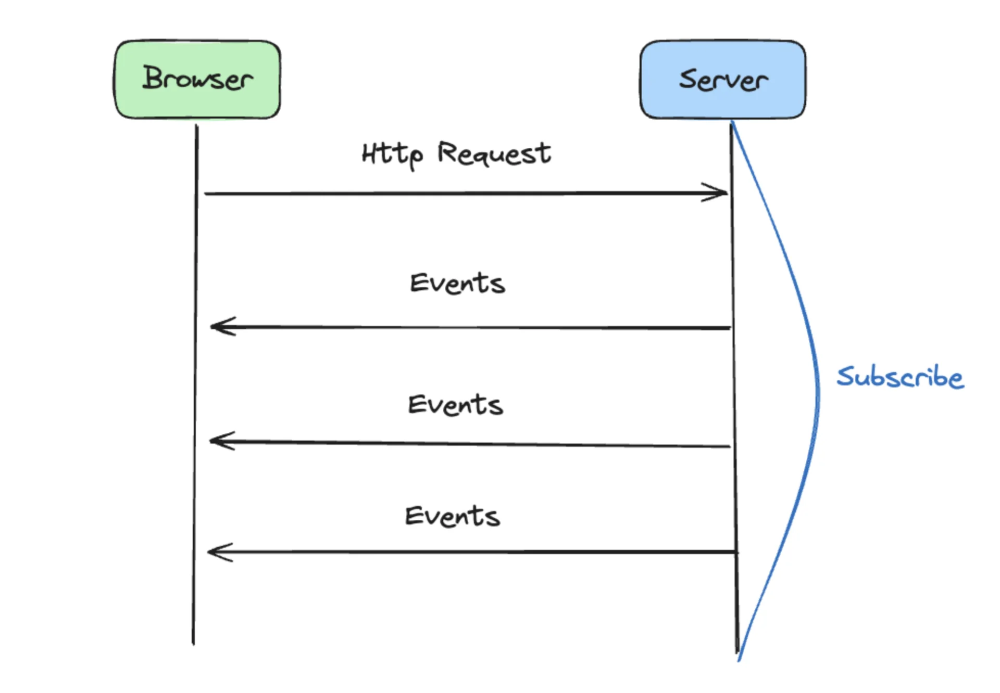
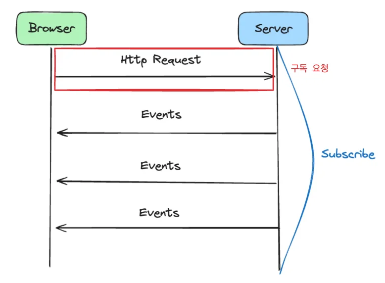
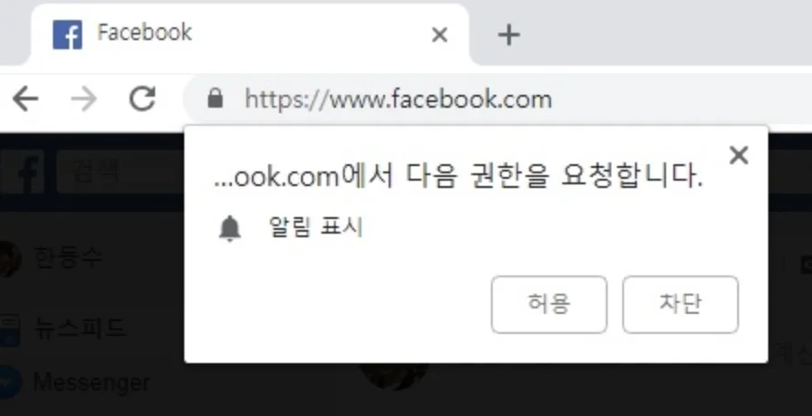
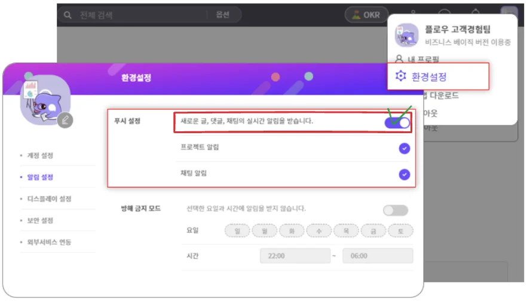

reference

‣

‣

서버에서 추가된 알람을 클라이언트에게 알려주는 방식은 크게 3가지가 존재한

- <strong><code>폴링 방식</code></strong> &#58; <u>클라이언트</u> 사이드에서 <u>주기적인 요청</u>을 통해 구현

- <code>웹소켓 방식</code>&#58; 효율적인 <u>양방향 실시간 통신</u>을 위해 새로운 프로토골을 사용하여 통신하는 웹소켓 방식

- SSE(Server&#45;Sent&#45;Events)&#58; 서버가 클라이언트로 실시간 정보를 자동으로 보낼 수 있도록 하는 기술

## SSE

이름 그대로 서버가 클라이언트로 실시간 정보를 자동으로 보낼 수 있도록 하는 기술이다&#46; 

첫 구독 정보를 갱신 후, 이후 클라이언트에서 요청이 없이 응답값을 전송할 수 있다&#46; 

이를 알람 기능에 사용한다면,  첫 구독 요청 이후 계속 connetion을 유지하여 트리거 설정한 이벤트가 발생 시 해당하는 알람 응답값을  클라이언트에서의 요청없이 보낼 수 있다&#46; 

그렇다면 여기서 아래와 같은 기술 구현에 있어서 고려해야 될 사항이 있는데,

- 어떻게 클라이언트로 부터 처음 구독 정보를 갱신 받는가?

- 어떤 이벤트를 트리거로써 다루는가?

- 어떤 메세지 정보를 생성해야 하는가?

- 어떻게, 언제까지 connection을 유지하는가? 

- 또한 이후 재요청은 어떤 방식으로 갱신되는가?  

>  비동기 통신에 대한 부분은 해당 기술에서 다룸  &#45; <a href="https://beautiful-college-c84.notion.site/168eda9b0fe18002927efec89a5a8b58">페이지</a> 

로 볼수 있다&#46; 

### 질문 1 &#45; 어떻게 클라이언트로 부터 첫 구독 정보를 갱신 받는가?

---

> 첫 구독에 대한 엔드포인트를 어떻게 생성하고 서버로 보내는가?

해당 의문점에 대해서 서칭해본 결과, 위와 같이<strong><u> 알람에 대한 요청을 허용</u></strong> 시,이를 구독에 대한 트리거로 판단하여

이후 클라이언트 측에서 엔드포인트 URL 과 키를 생성해서 서버로 보낸다고 한다&#46;
