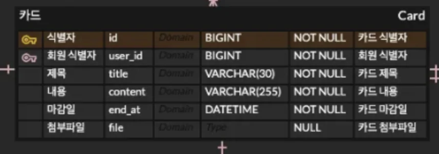

<a id="168eda9b0fe18168af25ce60c80ab4df"></a>

### 요청 응답 예시

- 요청 
    - Path Variable&#58; <code>카드 id</code>,  <code>카드 제목 키워드</code>

    |  | 타입 | Nullable |
    | --- | --- | --- |
    | <code>card&#95;id</code> | Long | <code>Nullable</code> |
    | <code>title</code> | String | <code>Nullable</code> |

    - body&#58; None

    <a id="168eda9b0fe1817b9d33d5ce3cd90f50"></a>

    ```java
    GET /search?user_id=1&card_title=작업
    ```

- 응답 &#45; <code>List&#60;CardResponseDto&#62;</code>
    - 간략한 카드 정보만을 보여줌
        <a id="168eda9b0fe1813ca232e412a46eaa41"></a>

        → 클릭 시, 해당하는 카드 상세페이지로 조회 요청 및 이동

    |  | 타입 | Nullable |
    | --- | --- | --- |
    | <code>id</code>  | Long | None |
    | <code>user&#95;id</code>  | Long | None |
    | <code>title</code> | String | None |

    ---

    <a id="168eda9b0fe1819c939ffc417af82ab7"></a>

    ```java
    {
    		0: {
    						Long id,
    						Long user_id,
    						String title,
    		},
    		1: {
    						Long id,
    						Long user_id,
    						String title,
    		}, ...
    		
    }
    ```
