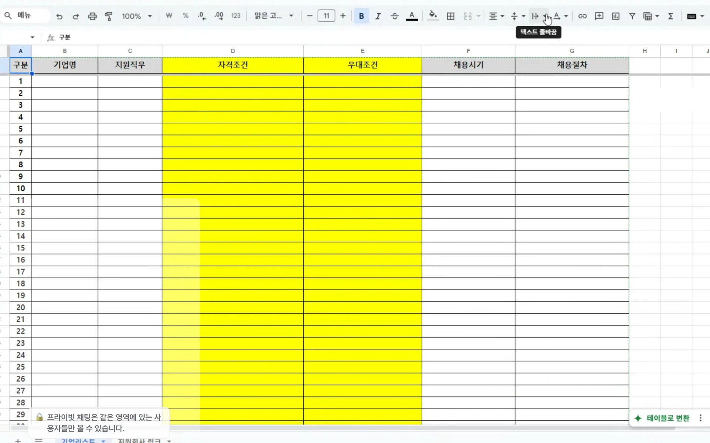

> ✏️ 
> 
> 
> 
> 기간&#58; 25&#46;1&#46;2
> 
> 
> 
> 멘토&#58; 이현중 코치님

- 기업에서는 불확실성을 싫어한다&#46;

- 긍정적인 마인드를 유지해야 한다&#46; 

해보지 않으면 모른다&#46; 

잘할 것 같을 지를 까봐야 알기 때문에, 

최대한 트라이를 하고,  

## 1&#46; 기업에 대한 채용 기준 파악

---

[docs.google.com](https://docs.google.com/spreadsheets/d/1EkVm8p1J--kl1SSXUb4otlDCU0kYVEix/edit?pli=1&gid=200663508#gid=200663508)

- 채용시장 &#45; 흐름 파악
    - 백엔드 기준은 달라지지 않는다&#46;

    - 잡코리아, 사람인 

    - 신입 채용만 확인한다&#46; 
        - 자격 조건, 우대사항

        - 기술 스택

    - 회사 자격 조건 정리하기 

    - 나만의 지원 리스트를 정리해야 한다&#46;
        - 교집합으로 원하는 것을 추려야 한다&#46;

        - 부합하거나, 보안이 필요한 부분을 파악할 수 있다&#46;
            - 보안&#58; 준비해야 될 계획들

    - 이렇게 정리하면, 기준이 명확해진다&#46; 
        - 다 자기만에 길이 다르기 때문에
            -  백엔드 개발자로 실무에 들어가는 것을 집중한다 &#46;

    - 회사엣서 요구하는 것이 이력서로만 보는 것 어렵다&#46; 
        - 포토폴리오 필요하다&#46; 

        - 아니어도 같이 내는 것이 좋다&#46; 

    - 인터넷에 찾아보면 백엔드 개발자 포토폴리오 참고해서 작성하는 것이 좋다&#46; 

    - 내가 어떤 강점이 있고, 어떤 기술스택을 사용했고, 
        - 어떤 팀프로젝트를 했는지, 
            - 어떤 성과, 회사에서의 직무 활용 방안, 느낀점 

    

    포토폴리오 레퍼런스 참고하고 찾아서 정리하긴

    

    ## 2&#46; 포토폴리오

    ---

    > ‣

    

    ### 3&#46; 소셜 멘토링  &#45; 잇다&#46;

    

    현직자 기반 멘토링 서비스 &#45; 무료 

    

    검색에 IT &#45; 멘토링 &#45; 답변 

    

    다른 사람들이 질문한 것에 대한 답변도 컨텐츠로 알수 있다&#46;

    

    ### 4번째 &#45; 글로벌 네트워크&#95; 링크드인 

    - 궁금한 분에게 메세지 진행 

    - 현직자 분들과 친해지면 좋겠다&#46; 
        - 커피챗
            - 온라인 줌, 구글 미트 

    - 네트워크를 자기가 만들어나가면 된다&#46; 

    - 현직자들이 굉장히 많다&#46; 

    - 오픈투워크 취준생 띠를 두를 수 있다&#46; 
        

    

    관계된 분들과 소통을 하는 것이 좋다&#46; 

    

    네트워킹이 중요하다&#46; 

    - 사람들이랑 같이 성장
