

Reference

- <a href="https://www.youtube.com/watch?v=7LotrjTLqRA">https&#58;//www&#46;youtube&#46;com/watch?v=7LotrjTLqRA</a>

- <a href="https://opentutorials.org/course/228/4894">https&#58;//opentutorials&#46;org/course/228/4894</a>

- <a href="https://www.youtube.com/watch?v=H6lpFRpyl14">https&#58;//www&#46;youtube&#46;com/watch?v=H6lpFRpyl14</a>

- <a href="https://velog.io/@code12/Spring-Security-SSLHTTPS">https&#58;//velog&#46;io/&#64;code12/Spring&#45;Security&#45;SSLHTTPS</a> 

> <a href="https://beautiful-college-c84.notion.site/116eda9b0fe180b3b20bfc7a98bf17e5">페이지</a> 

## HTTPS ( Hyper&#45;Text Transfer Protocol <strong>Secure</strong>)

---

> ❗ 
> 
> 
> 
> <strong><code>HTTPS</code></strong> 를 통해 모든 보안 문제가 해결되지는 않지만<strong> </strong><strong><u>운영 사이트를 </u></strong><strong><u>HTTPS</u></strong><u>로 설정</u>하는 것은 <strong><u>최소한의 필수요건</u></strong>이다&#46; 

### HTTP

> ✏️ 
> 
> 
> 
> <strong><code>HTTP</code></strong>는 <strong><u><code>H</code></u></strong><code>yper </code><strong><u><code>T</code></u></strong><code>ext </code><strong><u><code>T</code></u></strong><code>ransfer </code><strong><u><code>P</code></u></strong><code>rotocol</code> 의 약자로 
> 
> 
> 
> <code>Hypertext</code> 인 <code>HTML</code>을 전송하기 위한 통신 규약을 의미한다&#46;
> 
> - 웹 환경에서 서로 통신을 주고 받기 위한 프로토콜(약속) 이다&#46;

HTTP의 취약점

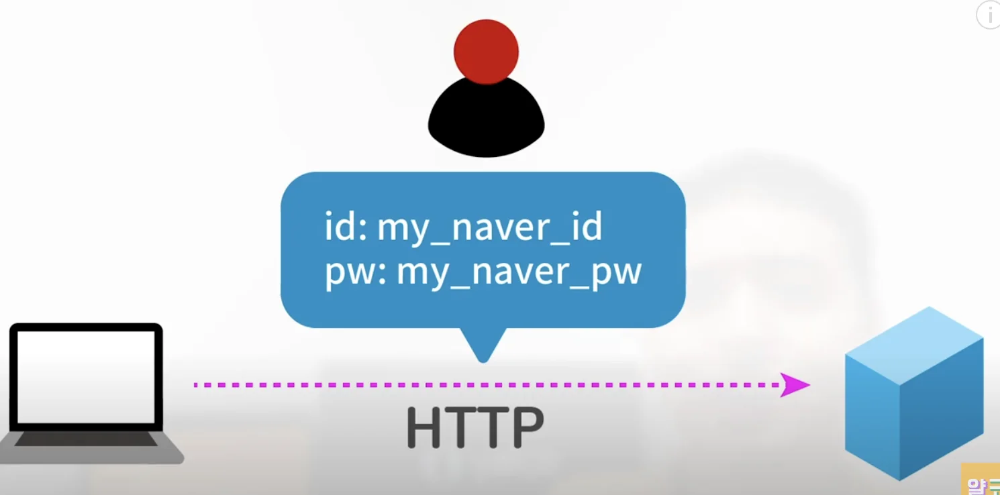

그런데 HTTP 통신을 하게  되면 주고 받는 <strong><u>데이터를 그대로 보내고 받</u></strong>기 때문에

해당 데이터를 중간에 탈취하는 경우 그대로 데이터가 넘어간다&#46; 

이러한 보안적인 취약점을 해결하기 위해 나온 기술이 HTTPS이다&#46; 

### HTTP<strong>S</strong>

> ✏️ 
> 
> 
> 
> <code>HTTP</code><strong><code>S</code></strong>에서 마지막 <code>S</code>는<code> Over </code><strong><code>Secure</code></strong><code> Socket Layer</code>의 약자로  기존의 HTTP 프로토콜에 <strong><u>SSL</u></strong><strong> </strong>이라는  <strong><u>Security Laye</u></strong><strong><u>r</u></strong><strong><u>를 한층 올린 통신 프로토콜</u></strong>이다&#46;
> 
> - <code>HTTP</code>  &#43; <strong><code>SSL(TLS)</code></strong>

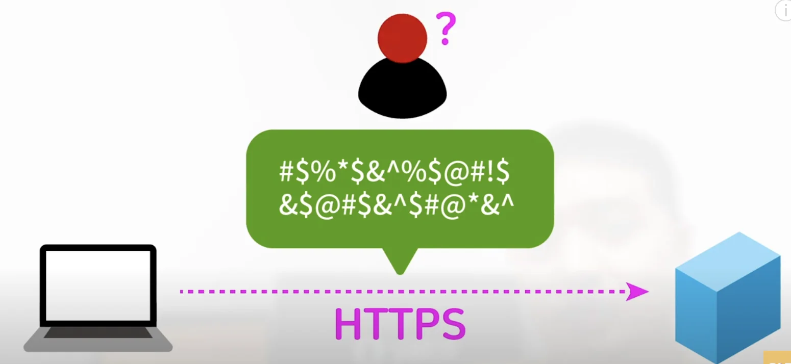

- HTTP 통신에 보안적인 기술을 더해 <u>통신하는 데이터를</u> <u><code>암호화</code></u>하여 주고 받는 기술이다&#46;  사용자가 사이트에 보내는 <strong><u>정보들을 암호화 처리</u></strong>하여 <strong><u>제 3자가 알아보지 못</u></strong>하게 한다&#46;

- 기관으로부터 검증된 사이트만 주소 HTTPS 사용이 허가되기 때문에,  피싱 사이트 등 안전하지 않은 사이트들을 걸러준다&#46; 즉, <strong><u>접속한 사이트가 믿을 만한 사이트인지 알</u></strong>려준다&#46;  
    

    
HTTP를 사용하는 사이트는 주소창에 ‘안전하지 않다’라고 표시된다&#46; 

    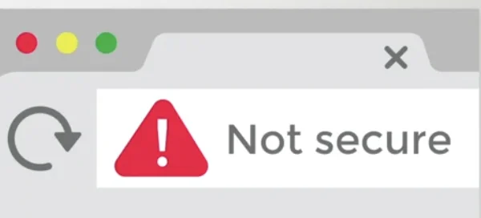

    

### 1) 암호화 &#58; <code>대칭키</code>, <code>비대칭키(공개키)</code> 

> ✏️ 
> 
> 
> 
> 통신 메세지의  <strong><u>데이터의 암호화 및 복호화</u></strong> 방식에는  <code>대칭키</code>, <code>비대칭키</code> 방식이 있다&#46;

<strong><code>대칭키</code></strong>

- 통신을 주고 받는 양쪽 모두 <strong><u>동일한 복호화 패턴 값(키</u></strong>)을 공유한다&#46; 
    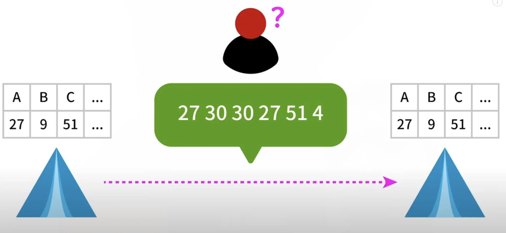

    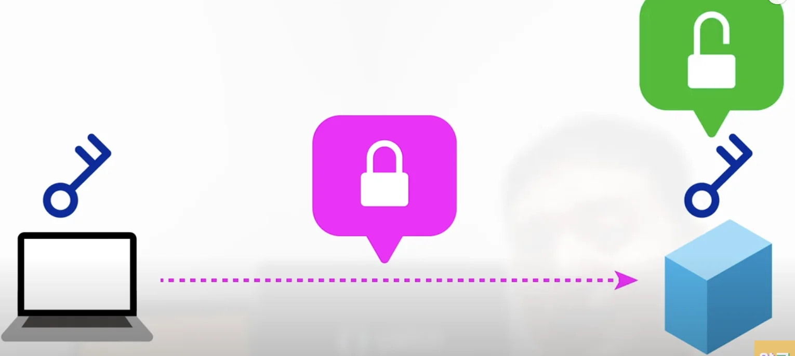

    - <strong><u>대칭</u></strong>으로 가지고 있다하여 <code>대칭키</code> 방식이다&#46;

- 아래와 같이 <u>대칭키</u>를 가지고 <u>암호화</u>하며 <u>복호화</u>한다&#46; 
    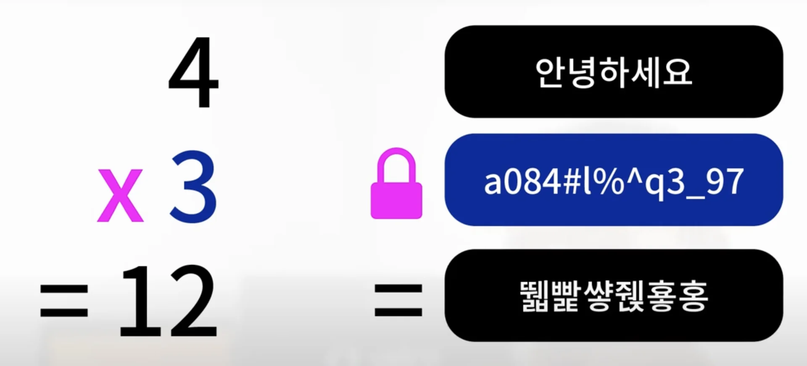

    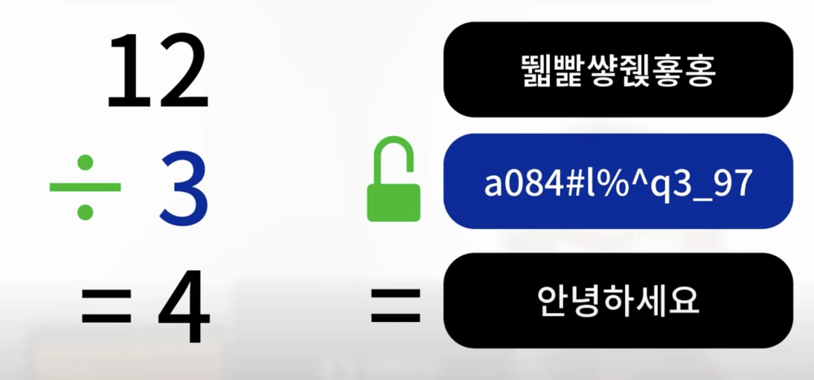

- 대칭기 방식의 취약점
    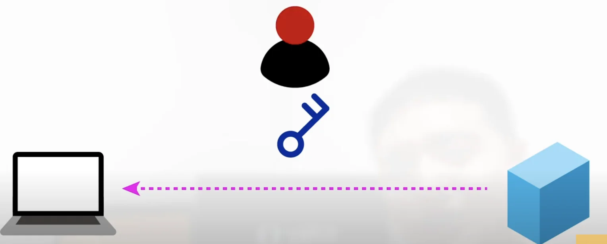

    - 데이터의 복호화를 위해서는 사용자 측에서도 키를 가지고 있어야 한다 &#46; 즉, 키에 대한 공유가 필요하다 &#46;

    - 키의 공유는  처음 handshake 과정에서 이뤄지는데, 이때 <strong><u>중간에 탈취 당할 위험</u></strong>이 있다&#46; 
        - 키 전달 시, 공격자가 해당 키를 탈취

    - 그러면<strong><u> 제 3자도 탈취한 대칭키를 통해 복호화하여 데이터를 알아볼 수 있</u></strong>기 때문에 결국 기존의 HTTP 통신과 동일하게 보안적인 취약점이 존재하게 된다&#46; 

    - 그래서 <u>이를 해결</u>하기 위해 나온 방식이 <strong>비대칭키</strong> 방식이다&#46; 

<strong><code>비대칭키(공개키)</code></strong>

> ✏️ 
> 
> 
> 
> 비대칭키 방식은 <strong><u>2개의 키를 사용</u></strong>하여 대칭키 방식의 취약점을 보안한다&#46; 
> 
> 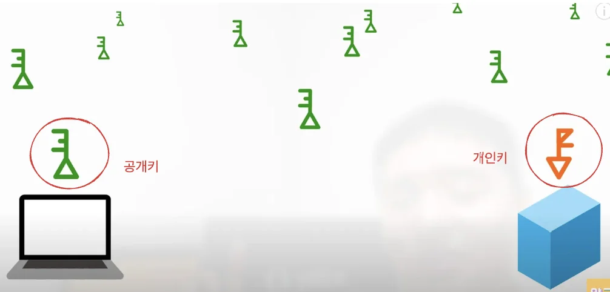
> 
> - <code>공개키</code>(<code>public key</code>)&#58; 하나의 키는 누구나 볼 수 있게 공개
> 
> - <code>개인키</code>(<code>private key</code>)&#58; 또 다른 키는 비밀로 보관

통신하는 양쪽이 서로 다른 키를 가지고 있다고 하여  <code>비대칭키</code> 방식이다&#46; 

키를 공개한다하여 <code>공개키</code> 방식으로도 불리운다&#46; 

- <code>공개키</code>로 <strong><u>암호화</u></strong>된 데이터는 <code>개인키</code>로  <strong><u>복호화</u></strong> 할 수 있으며

- <code>개인키</code>로 <strong><u>암호화</u></strong>된 데이터는 <code>공개키</code>로 <strong><u>복호화</u></strong> 할 수 있다&#46; 

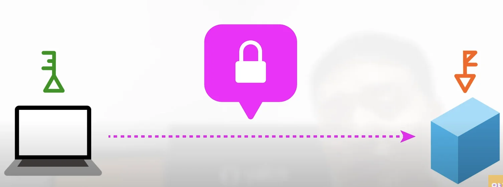

따라서 사용자는 공개키로 암호화하여 데이터를 보내고, 서버는 이를 개인키로 복호화하여 원본 데이터를 알아보고 처리한다&#46; 

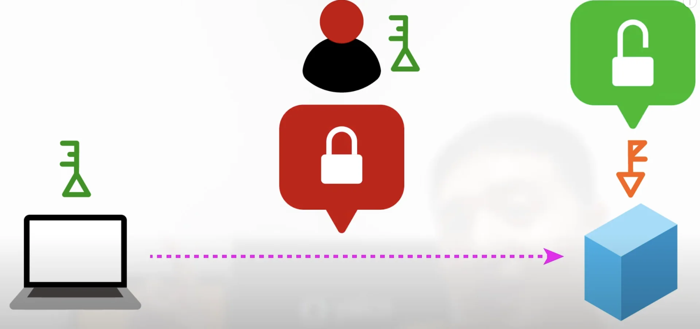

중간에 제 3자가 해당 통신 데이터를 탈취해 공개키를 가지고 원본 데이터를 알아보려고 해도(복호화), 서버가 가지고 있는 개인키를 통해서만 해당 데이터를 해석(복호화)할 수 있기 때문에 해당 데이터를 해석하지 못한다&#46;

이 원리로 사용자는 데이터를 안심하며 서버에 전송 할 수있다&#46;

### 2) 사이트 검증

해당 사이트가 검증된 사이트 인지 어떻게 증명하는가?

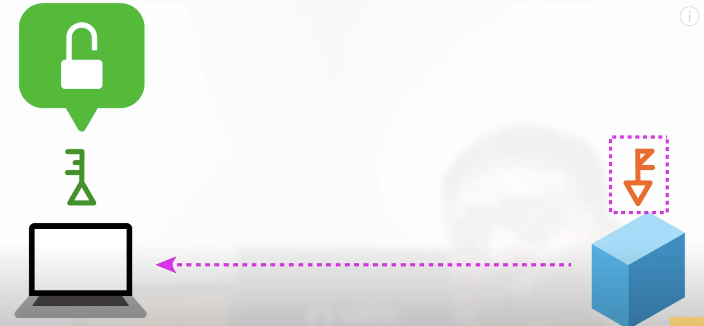

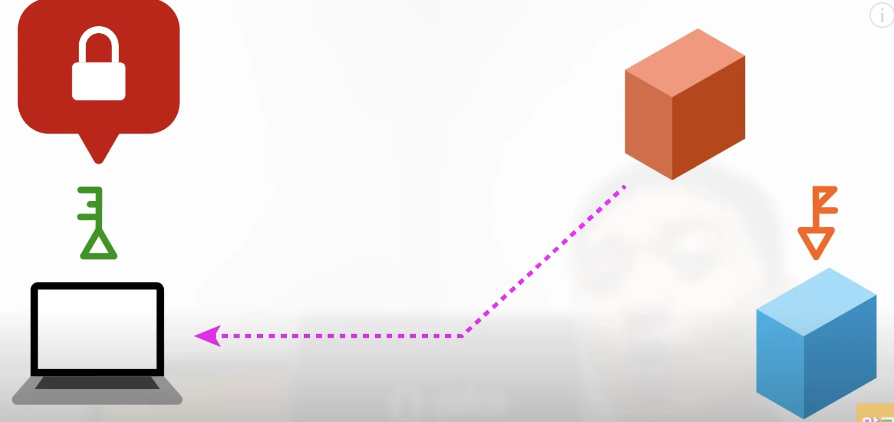

서버에서 제공되는 데이터는 서버에서 비밀리 보관하고 있는 <code>개인키</code>로 암호화 되어 보내진다&#46;  따라서 이 데이터를 공개키로 해석했을 때, 알맞은 데이터가 맞다면 해당 사이트는 해당되는 공개키에  알맞는 사이트인 것이 판별된다&#46; 

그러면 <code>공개키</code>만을 검증할 수 있다면 해당 사이트가 피싱 사이트인지, 검증된 사이트인지를 판별할 수 있다&#46; 

이러한 공개키 검증은 검증된 기관인 CA를 통해 이뤄진다&#46; 

🧐 CA ( Certificate Authority )

공개키를 인증해주는 공인된 민간기업으로 엄격한 인증과정을 거쳐 선정된다&#46; 

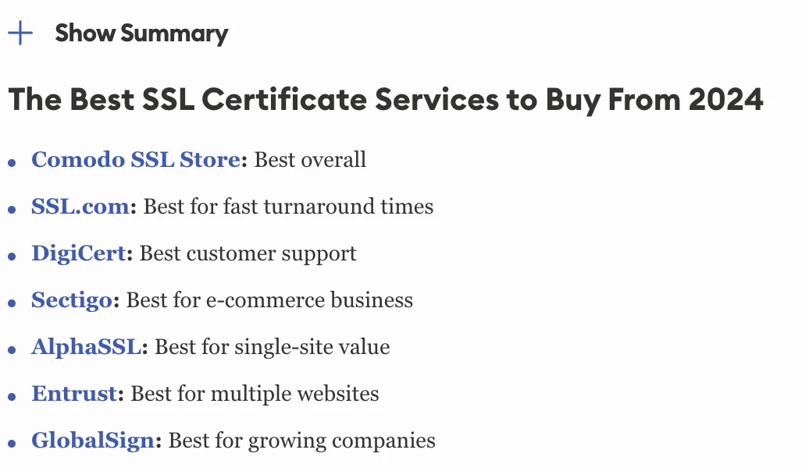

브라우저(크롬, 사파리, 파이어폭스&#46;&#46;)에는 CA들의 목록이 내장되어 있어 서버와 통신 시, 전달받은 인증서를 검증한다&#46;  

사이트( 서버 ) 인증 과정 

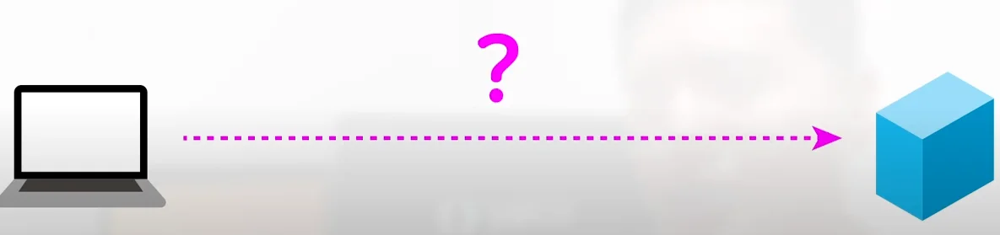

클라이언트는 서버를 신뢰하지 못하기 때문에 일종의 탐색 과정을 거친다&#46; 

이를  handshake, ‘약속’ 이라고 한다&#46; 

> 인증 과정

1&#46; 클라이언트는 먼저 랜던한 데이터를 생성해 서버에 보낸다&#46; 

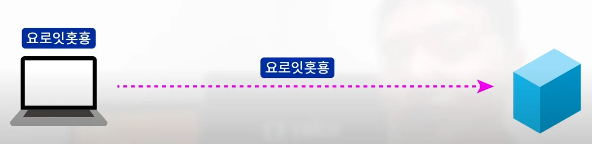

2&#46; 서버 측에서 생성한 무작위 데이터와 해당 서버의 인증서를 담아 보낸다&#46; 

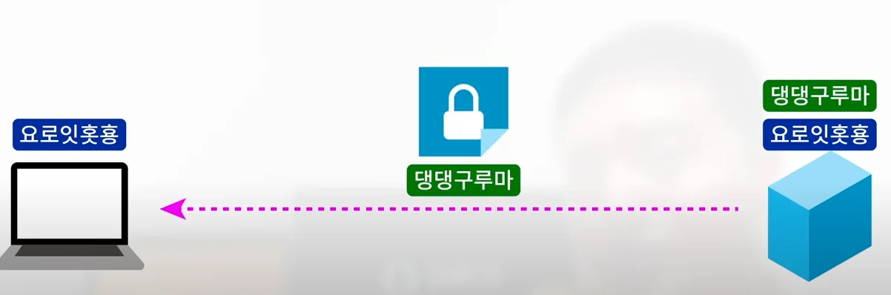

- 이를 통해 둘은 서로 데이터를 주고 받는 통신을 했고 이를 ‘악수(handshake)를 했다’고 표현한다&#46; 

3&#46; 받은 인증서를 브라우저에 내장된 CA들의 정보를 통해 확인한다&#46; 이때 <strong><u>비대칭키 방식</u></strong>을 사용한다&#46; 

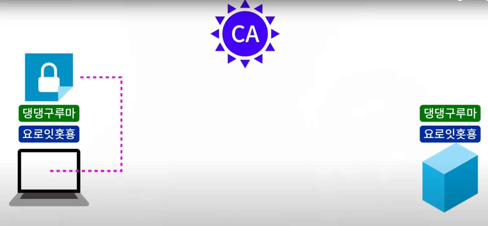

4&#46; CA에 인증을 받은 인증서들은 해<strong><u>당 CA의 개인키로 암호화</u></strong> 되어 있어  해당 인증서가 <strong><u>진짜</u></strong>일 경우 브<strong><u>라우저에 저장된 CA의 공개키로 복호화가 가능</u></strong>하다&#46;

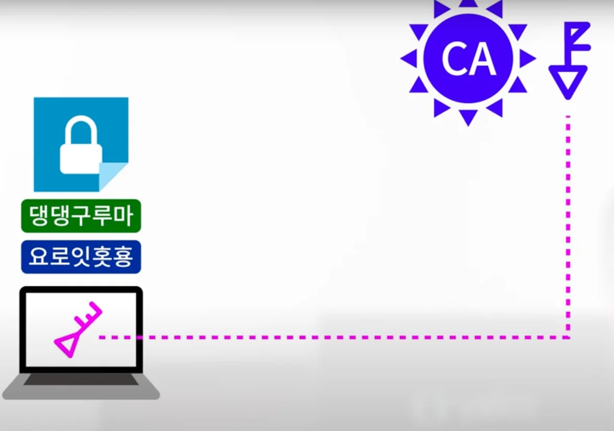

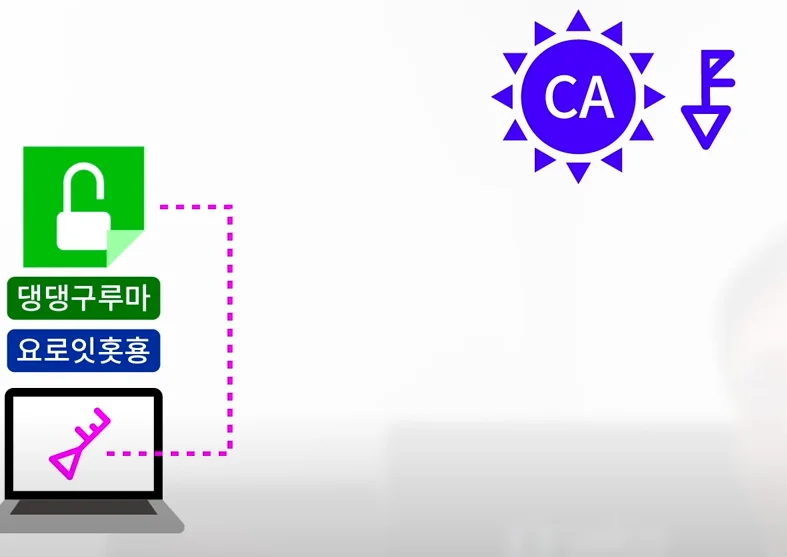

- 브라우저에 저장된 CA 공개키로 복호화 될 수 있는 인증서를 발급할 수 있는건  그에 대응되는 개인키를 가진 CA 뿐이다&#46; 

만약  브라우저에 저장된 CA 리스트 중에 인증서가 해당되지 않는 경우, 아래와 같이 브라우저의 주소창에 보안 경고 표시가 뜬다&#46; 

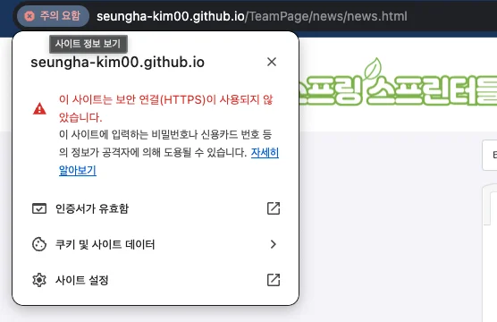

5&#46; 성공적으로 복호화된 경우,  복호화된 인증서에는 해당 서버의 공개키가 포함되어 있다&#46; 

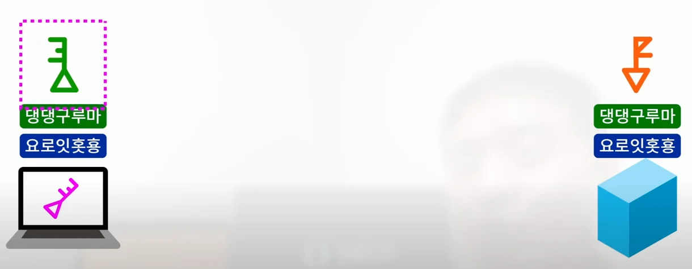

6&#46; 이렇게 인증이 끝난 경우, 비대칭키 방식은 많은 리소스를 사용하기 때문에 <strong><u>대칭키 방식이 혼합</u></strong>되어 통신이 이루어진다&#46;  

- <strong><u>비대칭키 방식</u></strong>으로 메세지를 암호화 및 복호화하는 것은 <strong><u>대칭키 방식보다 </u></strong><strong><u>컴퓨터에 훨씬 큰 부담</u></strong><strong><u>을 준</u></strong>다&#46; 따라서 사이트 이용 시, 주고 받을 다량의 데이터를 일일이 비대칭키 방식으로 통신하는 것은 큰 부하를 준다&#46; 

🧐  대칭키 방식에서 <strong><u>보안적 취약점(공개키 탈취)을 개선</u></strong>하기 위해 나온 것이  비대칭키(공개키) 기술인데,  어떻게 다시  대칭키  방식을 사용하여 통신한다는 것 인가?

---

> ✏️ 
> 
> 
> 
> 키 방식의 암호화에서 보안적인 취약점은 <strong><u>데이터 암호화할 때 사용한 키</u></strong> 이다&#46;
> 
> 
> 
> 해당 키를 통해 암호화된 데이터를 복호화한다&#46;
> 
> 
> 
> 즉,  <strong><u>키 값이 노출되지 않</u></strong>으면 <strong><u>암호화된 데이터가 복호화될 확률이 매우 낮</u></strong>아진다&#46; 
> 
> 
> 
> 따라서 handshake 과정에서 발생되는 <strong><u>인증서(키)의 교환</u></strong>을 <strong>비대칭키 방식</strong>으로 통신하여 보안성을 확보하고 이후, 대칭키 방식으로 통신하여 리소스의 부담을 줄인다&#46; 

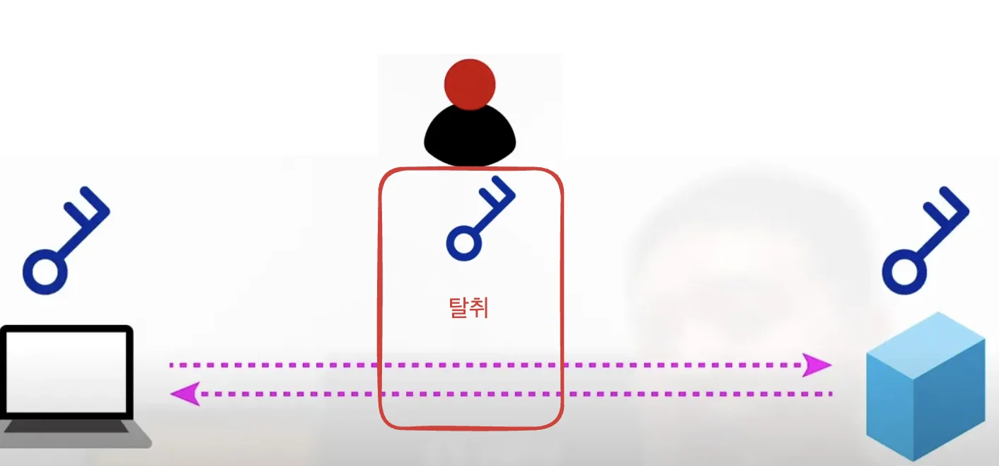

여기서는  <strong><u>대칭키를 공유</u></strong>할 때 <strong><code>비대칭키 방식</code></strong>을 사용하여 <strong><u>보안적 취약점을 해결</u></strong>한다&#46;

> 비대칭키를 사용한 대칭키 공유 과정

1&#46; 클라이언트는 인증을 위한 맨처음  handshake(악수)할 때 생성된 무작의 데이터들을 혼합하여 <strong><code>임시키</code></strong>를 만든다&#46; 

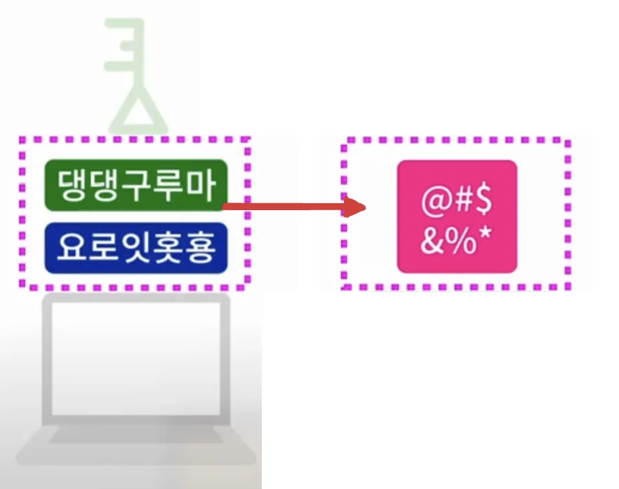

2&#46; 이 임시키는 서버의 공개키로 암호화 되어 서버로 보내진 다음 

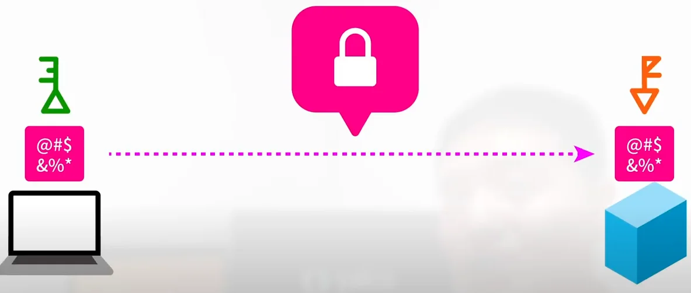

3&#46; 양쪽에서 일련의 과정을 거쳐 동일한 대칭키를 생성한다&#46; 

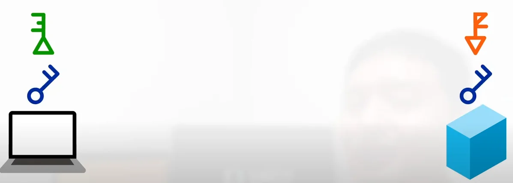

