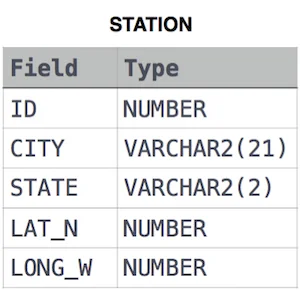

<a id="e4e6624ea7b2425aa6d2e74f6f17695c"></a>

## 문제

<a id="179eda9b0fe1801b83adec7fcc91f68a"></a>

Query the list of <em>CITY</em> names from <strong>STATION</strong> which have vowels (i&#46;e&#46;, <em>a</em>, <em>e</em>, <em>i</em>, <em>o</em>, and <em>u</em>) as both their first <em>and</em> last characters&#46; Your result cannot contain duplicates&#46;

<a id="179eda9b0fe180469c2acc0f3dcb0b94"></a>

<strong>Input Format</strong>

<a id="179eda9b0fe18025a23dd0d10cd20b94"></a>

The <strong>STATION</strong> table is described as follows&#58;



<a id="179eda9b0fe18083870fcf9c6216129c"></a>

where <em>LAT&#95;N</em> is the northern latitude and <em>LONG&#95;W</em> is the western longitude&#46;

<a id="c24017faab484e64a28cb8845f119e32"></a>

## 풀이

<a id="179eda9b0fe18072a348ffbf55c069de"></a>

```bash
SELECT DISTINCT CITY
FROM STATION
WHERE LOWER(LEFT(CITY, 1)) IN ('a', 'e', 'i', 'o', 'u')
  AND LOWER(RIGHT(CITY, 1)) IN ('a', 'e', 'i', 'o', 'u');
```
