<details>
<summary>reference</summary>

<a id="12feda9b0fe180f3a991c1d087507b64"></a>

‣

<a id="12feda9b0fe180c99e19f730c4164459"></a>

<a href="https://beautiful-college-c84.notion.site/43501786d7d54450b198142f989f56be">페이지</a> 

</details>

---

<a id="12feda9b0fe180e59712f6ce270b0504"></a>

### HTTP ( Hyper Text Transfer Protocol )

---

> <u>HTML, Text, Image, 음성, 영상, 파일, JSON, XML(API) 등 </u>거의 <strong><u>모든 바이너리(0, 1)  데이터가</u></strong><strong> HTTP로 </strong>전송 가능하다&#46; 

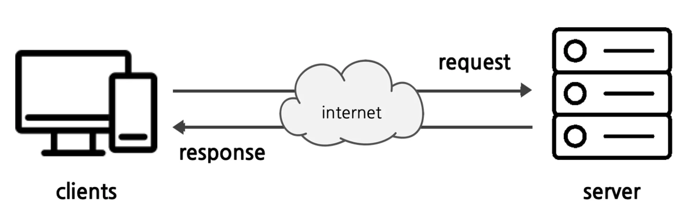

- <code>클라이언트 ↔ 서버</code>, <code>서버 ↔ 서버</code>, <code>앱 ↔ 서버</code> 등  거의 모든 통신에서 HTTP  프로토콜을 사용한다&#46; 

<details>
<summary>HTTP의 역사</summary>

<details>
<summary>1&#46; HTTP/0&#46;9 &#45; 1991년</summary>

- 문서화된 최초의 HTTP 버전

- GET 메서드 지원

- HTTP 헤더 X

</details>

<details>
<summary>2&#46; HTTP/1&#46;0 &#45; 1996년</summary>


</details>

</details>

<details>
<summary>기반 프로토콜 </summary>

> HTTP/1&#46;1 를 주로 사용하며, HTTP/2, HTTP/3도 증가하는 추세

- <code>TCP</code>
    - HTTP/1&#46;1

    - HTTP/2

- <code>UDP</code>
    - HTTP/3

</details>

<details>
<summary>무상태 ( Stateless )</summary>

<details>
<summary><strong><u>&#91; </u></strong>이전 정리 내용 &#93; <strong><u>무상태 아키텍처</u></strong></summary>

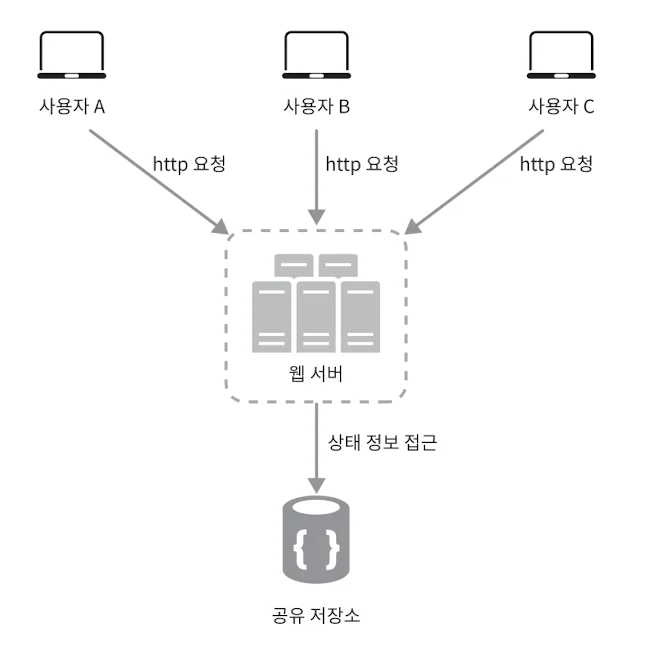

- 서버가 클라이언트의 요청에 의존적하지 않는다&#46; 
    - 이전 사용자 A에 대한 인증이서버1에서 처리 되었어도, 서버2, 3&#46;&#46; 에서 처리 되어도 인증 가능하다&#46; 왜냐하면 사용자의 상태 정보는 공유 저장소에 저장하기 때문에 어느 서버를 거치더라도 공유 저장소에 접근해 가져오면 된다&#46; 

- 웹 서버는 사용자의 상태 정보를 공유 저장소(shared storage)에 저장한다&#46;<br>따라서 상태 정보가 필요할 경우 공유 저장소에서 가져오면 된다&#46; 

- 상태 정보가 웹 서버로부터 물리적으로 분리되어 있다&#46;

- 이러한 구조는 단순하고, 안정적이며, 규모 확장이 쉽다&#46;

</details>

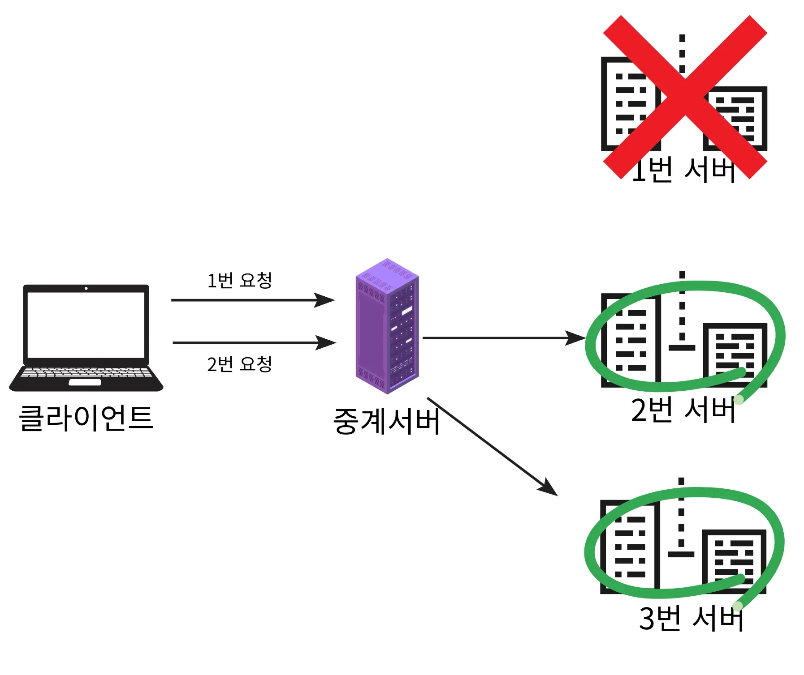

- 서버는 클라이언트의 상태를 보존하지 않는다&#46; 
    <a id="12feda9b0fe180809ee7c63f6cd4389f"></a>

    따라서 서버는 사용자의 정보에 종속적이지 않아 <strong><u>확장 및 변경에 용이</u></strong>하다&#46;

    - Scale Out 수평 확장성이 높음

    - 트래픽(요청)이 갑자기 증가하면 서버를 증설하면됨

- 클라이언트에서 <strong>상태 정보를 추가적으로 전송</strong>해야 하기 때문에 <u>통신에 대한 비용</u>이 stateful(상태 유지)한 방식보다 <u>더 크다&#46;</u>

- 무상태로 설계할 수  없는 케이스가 존재한다&#46; 

- 로그인과 같이 <strong><u>사용자의 인증 정보가 필요한 경우</u></strong>, 
    - Cookie, Session, Token 등을 활용하여 유저 인증 정보 무상태로 관리한다&#46;

</details>

<details>
<summary>비연결성 (  Connectionless )</summary>

> HTTP는 연결을 유지하지 않는 모델이다&#46; 

- 요청 시 매번 연결(TCP/IP &#45;3 Way Handshake)을 해야 한다&#46; 
    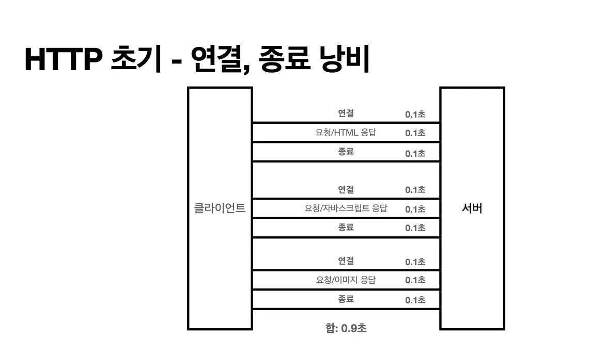

    - 요청마다 매번 연결, 종료를 하기 때문에 통신의 응답 소요 시간이 증가한다&#46; 

    - 이를 개선하기 위해 나온 방식이 <strong>HTTP 지속연결(Persistent Connections) </strong>이다&#46;

- 웹 사이트의 HTML, CSS, JS, 이미지 등의 정적 자원 모두를 다시 다운로드한다&#46;
    - 이는 캐싱을 통해 개선한다&#46;

<details>
<summary>HTTP 지속연결 (Persistent Connection )</summary>


- 하나의 요청에 필요한 모든 요청들이 응답될 때까지 연결을 유지함

- 연결을 한번만 맺고 끊기 때문에, Connectionless 방식보다 TCP/IP 연결 횟수가 적어지고 그만큼 더 빠르고 효율적으로 통신이 가능하다&#46; 

</details>

</details>

<a id="12feda9b0fe180c7b573e312cb662323"></a>

### HTTP 메세지 구조

---

<details>
<summary>HTTP 메세지 구조</summary>

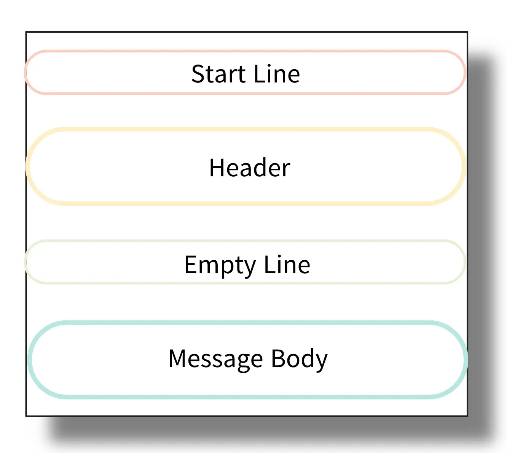

<details>
<summary>start&#45;line</summary>

- HTTP Version

- 상태 코드 ( Status Code ) 

- 상태 텍스트 ( Status Text )

</details>

<details>
<summary>header</summary>

- 메세지의 형식이나 길이, 호스트 등을 저장함

- 응답 메세지에서만 사용되는  header 속성들이 존재

</details>

- 공백 라인 ( empty line )&#58; 공백 한줄, 필수값

<details>
<summary>message body</summary>

- 실제 전송 데이터가 담김  ( HTML, 이미지, 음성, 영상 등)

- 데이터가 없다면, 공백으로 존재함

</details>

</details>

<details>
<summary>요청 메세지 ( Request Message )</summary>

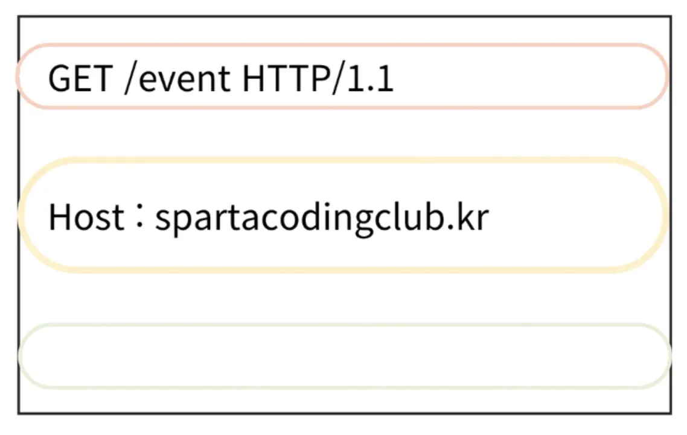

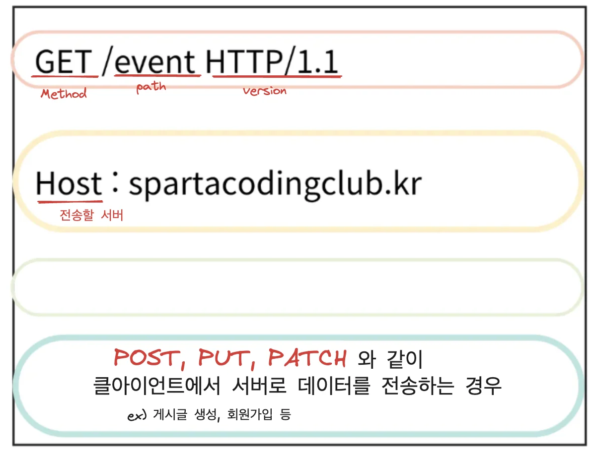

<details>
<summary>Start line </summary>

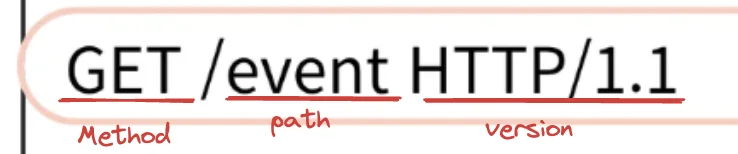

<a id="130eda9b0fe180c2aabae754ba5a62c9"></a>

위 그림과 같이 아래의 요소들이 차례대로 입력된다&#46; 

- Method

- Path

- Version

</details>

<details>
<summary>Header</summary>


- Host 
    - 요청을 전송한 서버의 <code>도메인명</code> or <code>IP 주소</code>가 들어간다&#46;  

</details>

- 공백 라인 ( empty line)

<details>
<summary>Message Body</summary>

- <code>조회</code>, <code>삭제</code>의 경우 단순히 id 값만 넘겨준다&#46;
    - <strong><u>쿼리 파라미터(스트링)</u></strong>를 사용 → 메세지 바디에 값이 없어 빈 값으로 전송

- <code>생성</code>, <code>업데이트</code>의 경우, <u>사용자로부터 클라이언트에서 데이터를 입력 받</u>아 <u>메세지 바디에 담</u>아 서버로 넘긴다&#46; 
    

</details>

</details>

<details>
<summary>응답 메세지 ( Response Message )</summary>

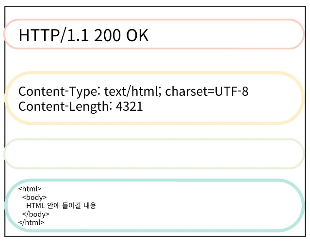

<details>
<summary>Start line ( 시작 라인)</summary>


<a id="5cb3a55bc335495287b84314c3080522"></a>

위 그림과 같이 아래의 요소들이 차례대로 입력된다&#46; 

- Version

- 상태 메세지
    - 상태 코드

    - 상테 텍스트 

</details>

<details>
<summary>Header</summary>


- 

</details>

- 공백 라인 ( empty line)

<details>
<summary>Message Body</summary>

- 실제 전송하는 데이터가 담겨 있는 부분

- 만약 전송할 데이터가 없다면, Body가 공백으로 존재한

</details>

</details>

<a id="12feda9b0fe180acac69f3126ab8609c"></a>

### HTTP 메서드

---

> ✏️ 
> 
> <a id="130eda9b0fe1802cb029c4a2a0f52631"></a>
> 
> 주요 메서드 
> 
> - <code>GET</code>&#58; 리소스 조회
> 
> - <code>POST</code>&#58; 리소스 생성
> 
> - <code>PUT</code>&#58; 리소스 대체, 해당 리소스가 없으면 생성
> 
> - <code>PATCH</code>&#58; 리소스 부분 변경
> 
> - <code>DELETE</code>&#58; 리소스 삭제
> 
> ---
> 
> <details>
> <summary>기타 메서드 </summary>
> 
> - <code>HEAD</code>&#58; GET과 동일하지만 메세지 바디를 제외하고, 상태 줄과 헤더만 반환
> 
> - <code>OPTIONS</code>&#58; 대상 리소스에 대한 통신 가능 옵션(메서드)을 설명 ( 주로 CORS에서 사용 )
> 
> - <code>CONNECT</code>&#58; 대상 리소스로 식별되는 서버에 대한 터널을 설정
> 
> - <code>TRACE</code>&#58; 대상 리소르에 대한 경로를 따라 메세지 루프백 테스트를 수행
> 
> </details>

<details>
<summary>Read &#45; <code>GET</code></summary>


- 리소스 조회

- <u>서버에 전달</u>하고 싶은 데이터는 <u>쿼리 파라미터(스트링)을 통해서 전달</u>
    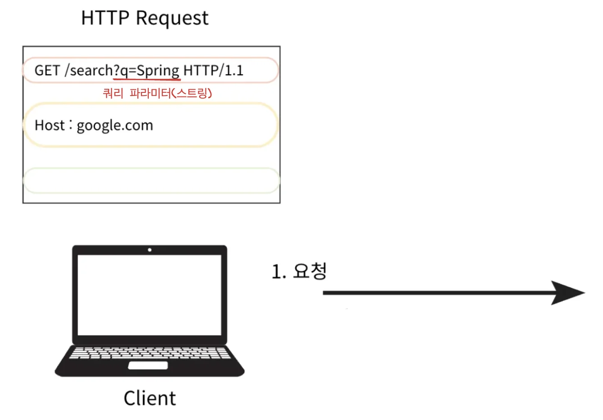

- 메세지 바디를 통해 데이터 전달 가능하지만, 권장하지 않음 ( 지원하는 곳이 많지 않음 )

</details>

<details>
<summary>Create &#45; <code>POST</code></summary>

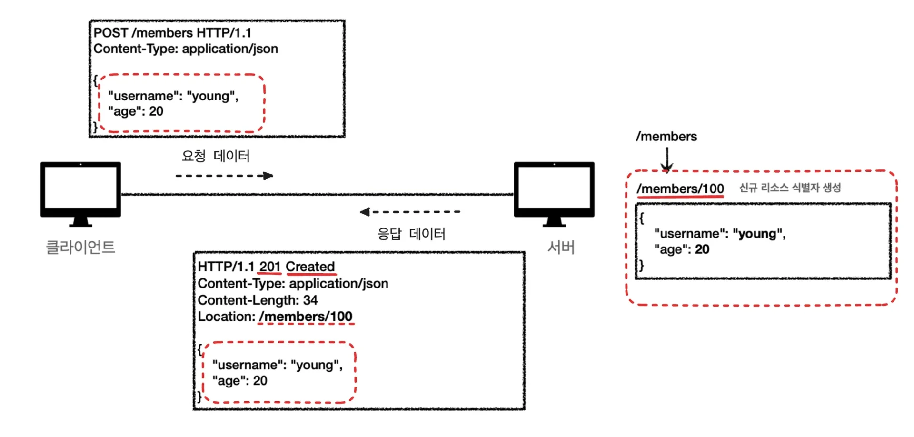

- 사용자로부터 입력받은 데이터를 클라이언트에서 <u>요청 메세지 바디에 담아 서버로 전송</u>
    - ex) 회원가입, 게시글 생성 등

</details>

<details>
<summary>Update &#45; <code>PUT</code>, <code>PATCH</code></summary>

<details>
<summary><code>PUT</code></summary>

<details>
<summary>1) 리소스가 있는 경우 → 덮어씀</summary>

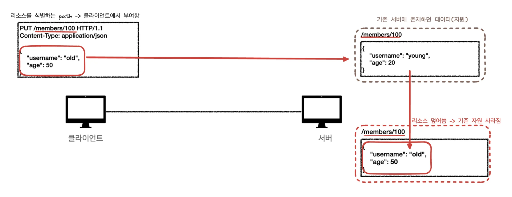

- 동일한 path를 가지는 리소스가 서버에 존재하면 해당 자원을 덮어쓴다&#46; 

- 따라서 기존의 있던 데이터는 삭제된다&#46;

</details>

<details>
<summary>2) 리소스가 없는 경우 → 생성 ( <code>POST</code> 와 동일) </summary>

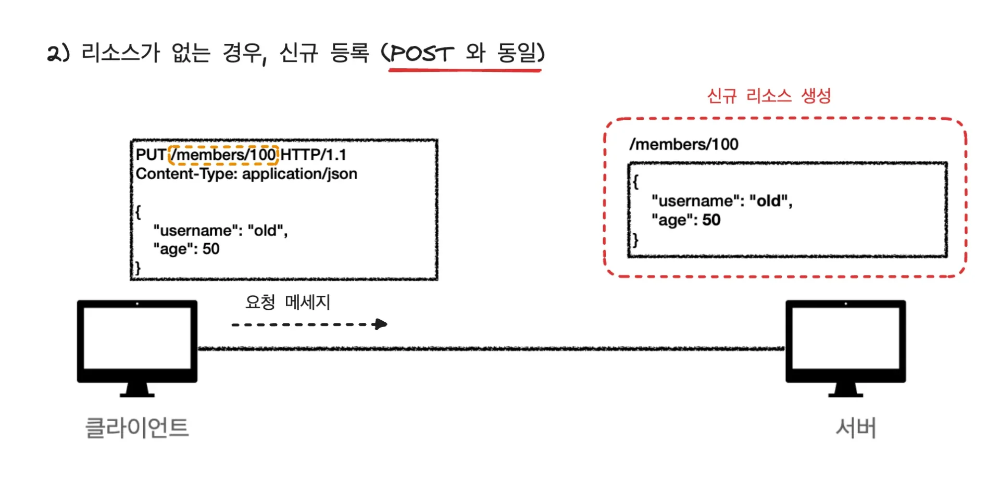

- 리소스가 없는 경우, 새로 등록한다&#46; <code>POST</code>의  동작과 동일하다&#46; 

</details>

</details>

<details>
<summary><code>PATCH</code></summary>

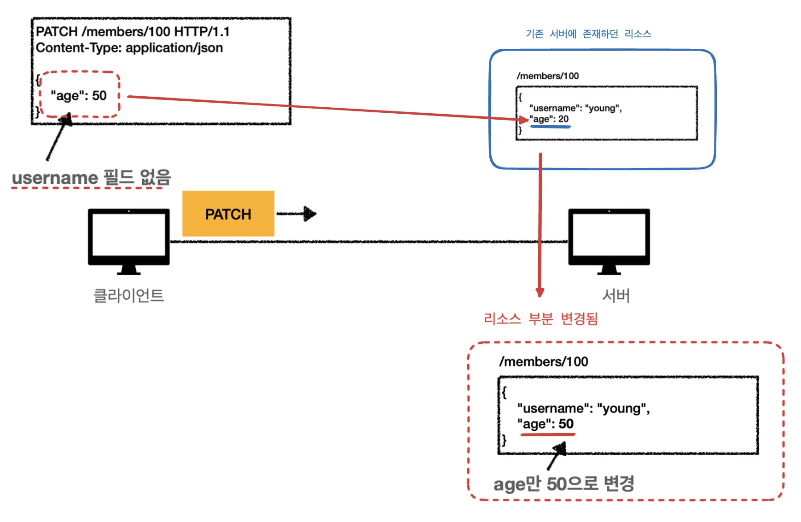

- 동일한 path를 가지는 서버의 리소스를 부분적으로 업데이트 한다&#46;
    - 기존 데이터는 손상되지 않음

</details>

</details>

<details>
<summary>Delete &#45; <code>DELETE</code></summary>

- 해당하는 리소스 삭제

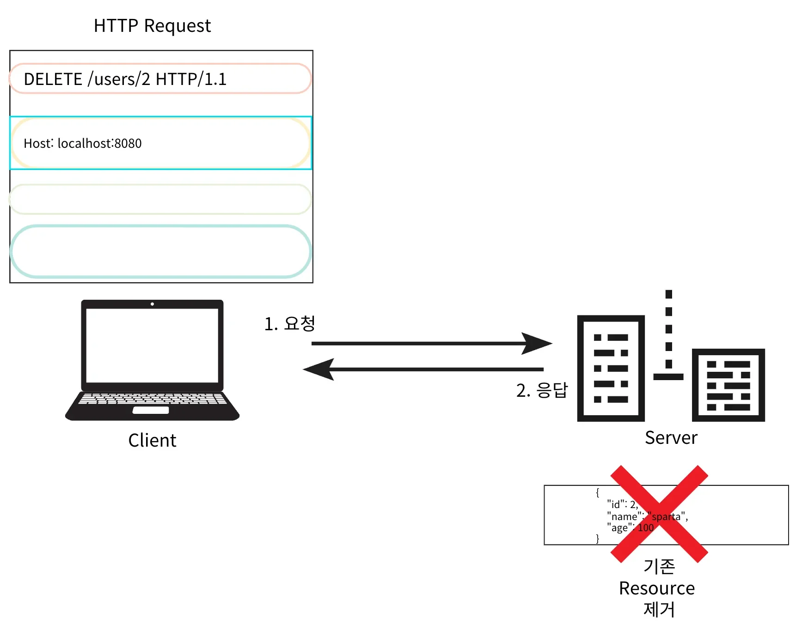

</details>

<a id="130eda9b0fe180b582ade6cb8494f461"></a>

### HTTP Method 속성

> 📌 
> 
> -  안전(Safe Methods)
> 
> - 멱등(Idempotent Methods)
> 
> - 캐시가능(Cacheable Methods)


<details>
<summary>안전 ( Safe ) &#45; <code>GET</code></summary>

> 서버 데이터를 변경 여부에 따라 안전성을 판단한다&#46;

- R(조회) &#45; <code>GET</code>&#58; 안전 
    -  DB의 데이터를 변경하지 않고 조회만 하기 때문에 안전하다&#46;

-  C•U•D &#45; <code>POST</code>, <code>PUT</code> , <code>PATCH</code>, <code>DELETE</code>&#58; 안전 ❌
    - DB의 데이터를 변경하기 때문에, 예상치 못한 변경이 발생되어 오류가 생길 수 있다&#46; <br>따라서 안전하지 않기 때문에  중간에 검증 절차가 필요할 수 있다&#46; 

</details>

<details>
<summary>멱등 ( Idempotent ) &#45; <code>GET</code>, <code>PUT</code>, <code>DELETE</code></summary>

<details>
<summary>멱등, 활용</summary>

> <strong>f(f(x)) = f(x) , 기존 함수 = 역함수</strong>

- 입력 조건이 같은 경우, 항상 동일 결과 값이 도출되는 것을 말한다&#46; 

- 요청을 보냈을 때, <u>해당 하는 요청 패킷이 </u><strong><u>중간에 소실</u></strong>되거나 서버에 <u>문제가 생겨서 이행되지 않았을 경우</u>에,<u> 재요청 판단 여부를 결정</u>에 쓰인다&#46;
    - 서버가 TimeOut 등으로 정상 응답을 못주었을 때, <u>요청의 메서드가 멱등에 해당</u>하는 경우(<code>GET</code>, <code>PUT</code>, <code>DELETE</code>) 클라이언트에서 <strong><u>재요청</u></strong>을 보낸다&#46;
        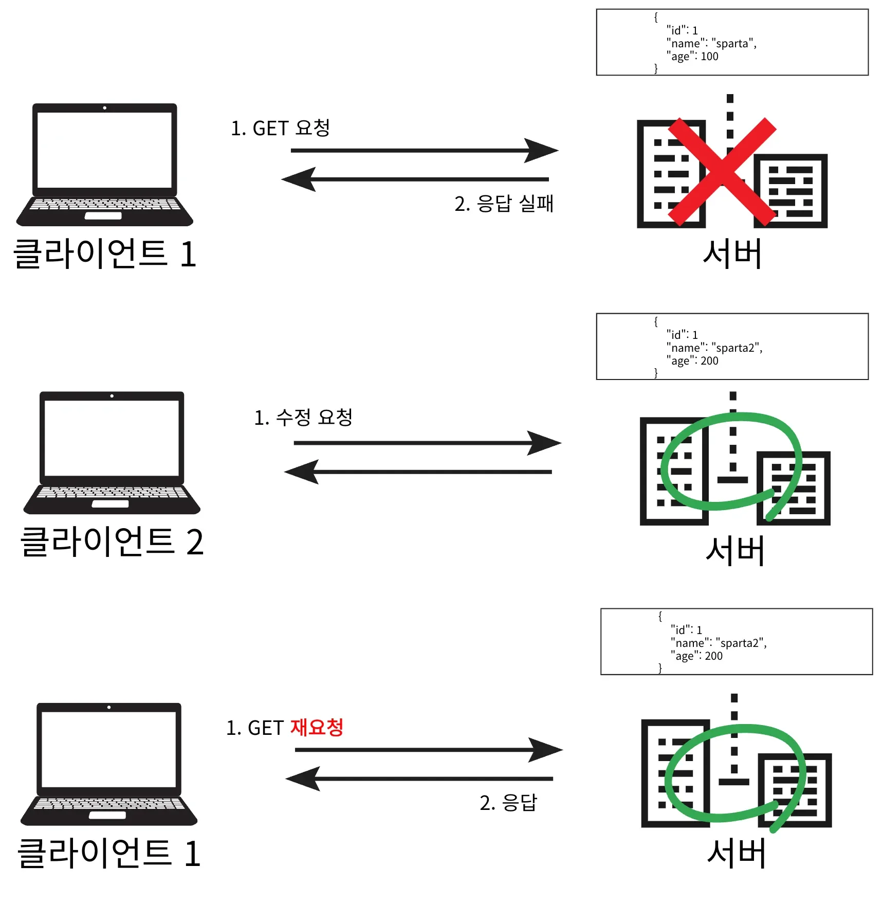

</details>

<details>
<summary>멱등 메서드</summary>

- <code>GET</code>&#58; 중간에 변화(Update, Delete)가 없는 한, 같은 리소스의 Path를 조회하면 동일한 리소스가 조회된다&#46;

- <code>PUT</code>&#58; 매번 결과를 덮어 쓴다&#46; 따라서 동일한 입력값이면 결과값도 항상 동일하다&#46;

- <code>DELETE</code>&#58; 결과를 삭제한다&#46;  이미 삭제된 리소스를 다시 삭제해도 똑같다&#46;

- <code>POST</code>&#58; 두번 호출 시, 같은 데이터가 중복에서 업데이트 된다&#46; 즉, 멱등이 아니다&#46;

</details>

<details>
<summary>외부 요인에 의해 중간에 리소스가 변경되는 것 까지는 고려하지 않는다&#46; </summary>

<a id="130eda9b0fe18065900ae51f51830ba1"></a>

```java
사용자1: GET -> username:A, age:20
사용자2: PUT -> username:A, age:30   // 사용자2 에 의해 리소스가 변경됨
사용자1: GET -> username:A, age:30 -> 사용자2의 영향으로 바뀐 데이터가 조회됨
```

</details>

</details>

<details>
<summary>캐시 가능 ( <strong>Cacheable ) &#45; </strong><strong><code>GET</code></strong><strong>, </strong><strong><code>POST</code></strong><strong>, </strong><strong><code>HEAD</code></strong><strong>, </strong><strong><code>PATCH</code></strong></summary>

> ☝🏻 
> 
> <a id="f9aca322f53c4f0ba96f64e1931753f6"></a>
> 
> 실제로는 <code>GET</code>, <code>HEAD</code> 정도만 캐시로 사용 → 실무에서는 거의 <code>GET</code> 만 사용
> 
> <a id="130eda9b0fe180c9aebaccfc7477e560"></a>
> 
> → <code>POST</code>, <code>PATCH</code> 는 본문(Body) 내용까지 캐시 키로 고려해야 하는데, 구현이 쉽지 않다

- 재사용을 위해 요청에 대한 응답 저장해서 사용한다&#46; 

- ex) 변경 가능성이 적은 정적자원(HTML, CSS, IMAGE, JS 등)을 주로 캐싱한다&#46;
    - 사용자가 증가하여 전세계의 서비스를 해야하는 경우 CDN을 통해 캐시를 저장하여 지역별 사용자가 가까운 CND에서 가져와 빠르게 서버스를 한다&#46; 

</details>

<a id="12feda9b0fe18063b6c7e3dd03d4c8ff"></a>

### HTTP 상태 코드

> 📌 <code>1xx</code> ( <code>Informational</code> )&#58; 요청이 수신되어 처리중
> 
> <a id="11c2e01bfb5e4e6f9a12d4b412eea96c"></a>
> 
> <code>2xx</code> ( <code>Successful</code> )&#58; 요청 정상 처리 
> 
> <a id="f7c77f3aab334dce9a28cd4a1a685199"></a>
> 
> <code>3xx</code> ( <code>Redirection</code> )&#58; 요청을 완료하려면 추가 행동이 필요
> 
> <a id="6f8133a3597947bcad29ea08efb0636a"></a>
> 
> <code>4xx</code> ( <code>Client Error</code> )&#58; 클라이언트 오류, 잘못된 문법 등으로 서버가 요청을 수행할 수 없음
> 
> <a id="723a6276ba904be4b5efb1b08eba8f35"></a>
> 
> <code>5xx</code> ( <code>Server Error</code> )&#58; 서버 오류, 서버가 정상 요청 처리하지 못함

- <strong>1xx (정보) &#45; </strong>요청 수신 후 처리중인 상태, 사용 ❌

<details>
<summary>2xx ( 성공 )</summary>

<details>
<summary>200 OK</summary>

- 요청 성공

</details>

<details>
<summary>201 Created</summary>

- 새로운 리소스 생성

</details>

<details>
<summary>202 Accepted </summary>

- 요청이 수신되었으나 처리가 완료되지 않음

- 주로 Batch 처리에서 사용됨

</details>

<details>
<summary>204 No Content</summary>

- 요청은 성공했지만, 응답 데이터가 없음 
    - ex) 저장 &#45; 작성 버튼 클릭 시

</details>

</details>

<details>
<summary>3xx ( 리다이렉션 )</summary>

> 요청 완료를 위해 추가 행동이 필요한 상태

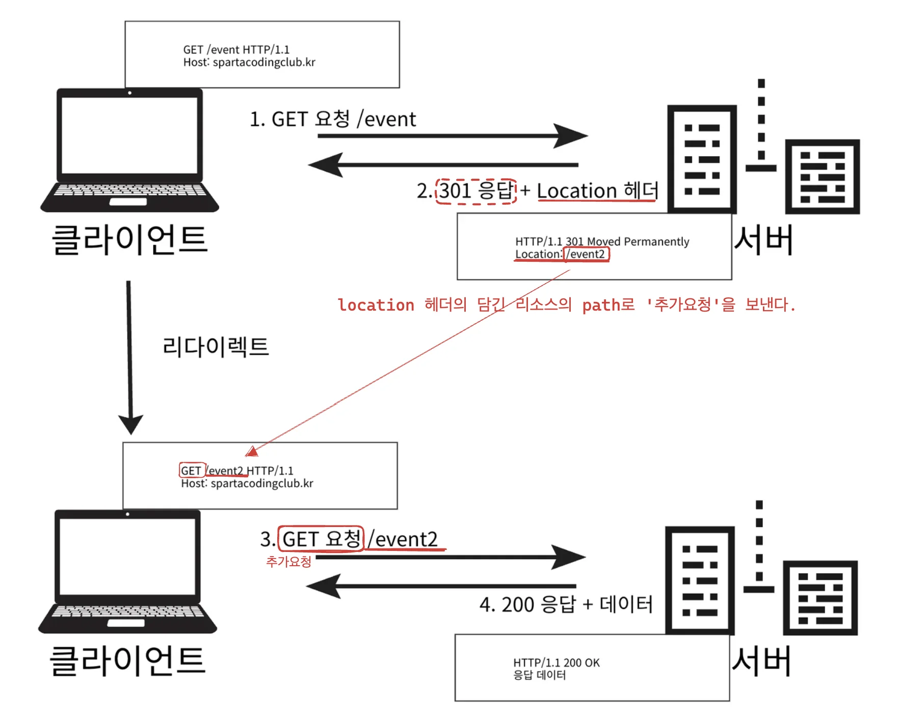

<a id="130eda9b0fe180bdae41d449261d2beb"></a>

클라이언트로 부터 받은 요청 리소스 path 이전의 경로이면 즉, 변경되전 전의 path로 요청이 들어온 경우 서버에서 변경된 리소스의 path를 Location 헤더에 담아 리다이렉션(3xx) 응답 메세지를 보낸다&#46; 

<a id="130eda9b0fe1800faa9ae713146dedce"></a>

클라이언트는 해당 리다이렉션 응답 메세지를 확인 후 location의 헤더에서 변경된 리소스의 path를 확인 후, 해당 path 다시 요청 메세지를 날린다&#46; 

<details>
<summary>리다이렉션 종류</summary>

- 300 사용 ❌

<details>
<summary>영구 리다이렉션 &#45; <code>301</code>, <code>308</code></summary>

> URL이 영구적으로 변경된 경우, 기존 URL 사용 ❌

<details>
<summary>301 Moved Permanently</summary>

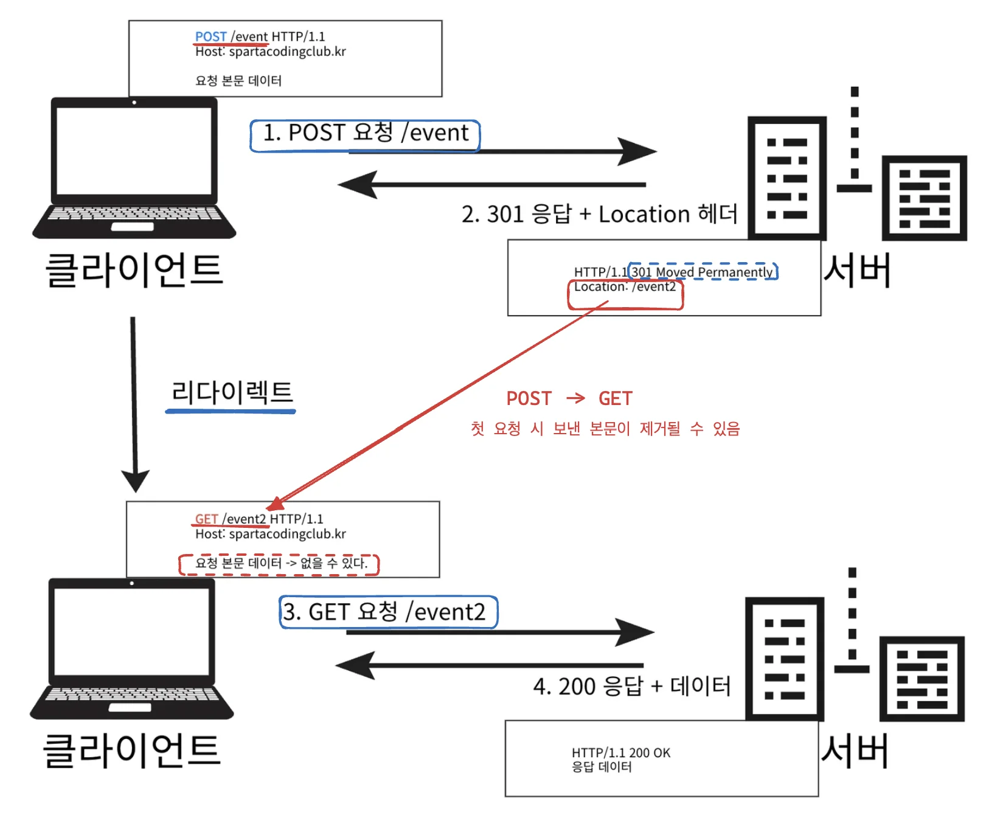

- POST → 리다이렉트 → GET

- 추가 GET 요청 시 본문 제거될 수 있음

</details>

<details>
<summary>308 Permanent Redirect</summary>

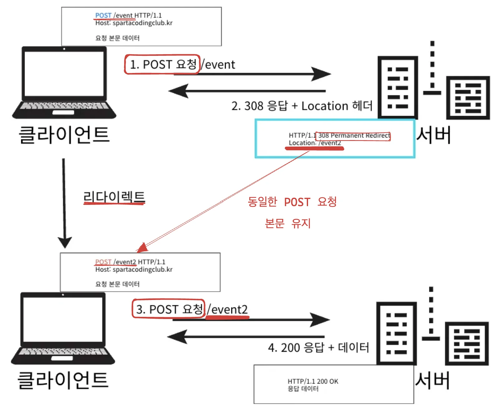

- POST → 리다이렉션 → POST

- 본문 유지 

</details>

</details>

<details>
<summary>일시 리다이렉션 &#45;  <code>PRG 패턴</code>, <code>302</code>, <code>303</code>, <code>307</code></summary>

> URL이 일시적으로 변경된 경우 

<details>
<summary>🤬 &#91;Error&#93; POST 요청 시,<strong><u> 새고로침 </u></strong>→ 중복 요청 → 데이터 중복 생성</summary>

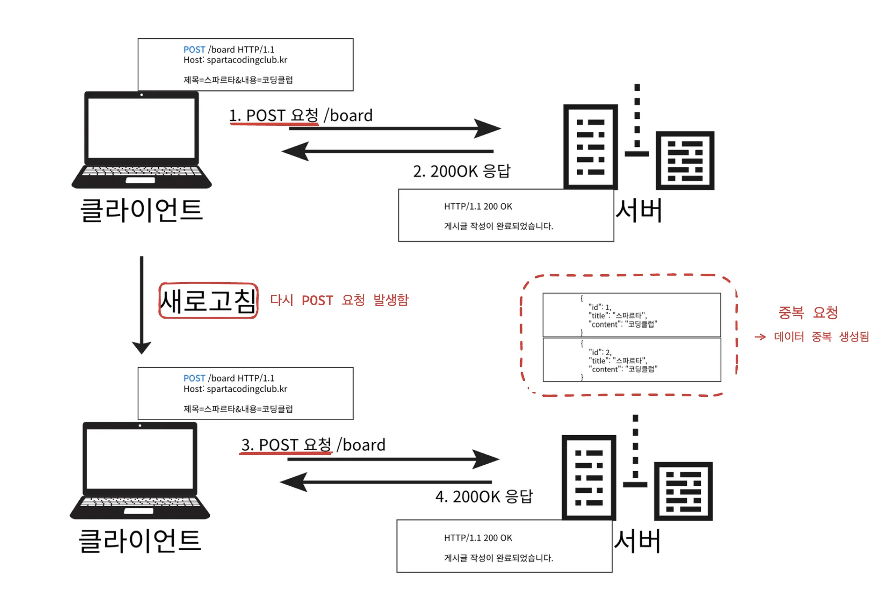

- POST 요청 후, <strong><u>다른 URL로 redirect 없이 새로고침 시</u></strong>에는 전의 POST 요청이 다시 중복으로 호출된다&#46; 

- 따라서 멱등의 속성이 가지지 않는 POST는 요청 시마다 서버에 데이터를 생성하고, 서버에는 <strong><u>동일한 데이터가 중복으로 다시</u></strong> 생성된다&#46; 

</details>

<details>
<summary>😁<strong> &#91;해결&#93;</strong>  PRG( Post / Redirect / Get ) 패턴</summary>

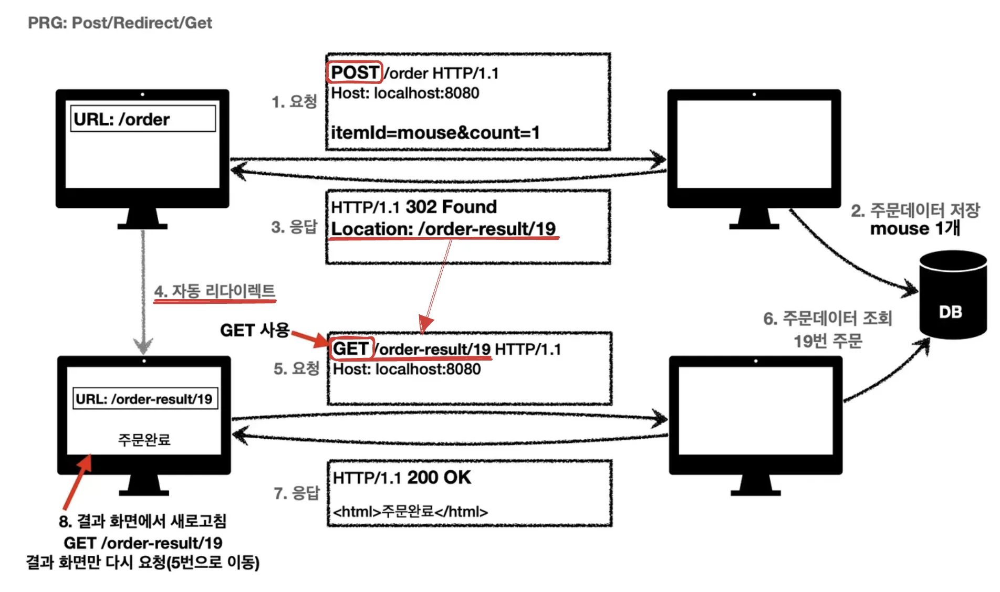

- 위와 같은 경우는 PRG 패턴을 통해 해결할 수 있다&#46;

- POST 요청 후 서버에서 <code>Redirect</code>로<strong><u> Location 헤더에 다른 리소스 path</u></strong>를 보내  <u>추가</u>로 <u>클라이언트에서 다른 화면</u>으로 <u><code>GET</code></u><u> 요청</u>을 보내도록 한다&#46; 

- 이후 <u>새로고침을 하면 해당 리소스에 대한 GET 요청</u>을 보내기 때문에 중복 POST 요청이 발생되어 중복된 데이터가 서버에 생성되는 오류가 해결할 수 있다&#46; 

</details>

<details>
<summary>상태 코드</summary>

<details>
<summary>302  Found</summary>

- 요청 메서드가 GET으로<u> 변할 수 있다&#46; </u>

- ‘변할 수 있다’ 라는 의미는 <u>‘변하지도 않을 수도 있다&#46;’</u> 의미가 포함된다&#46;<br>따라서 모호한 표현이기 때문에 <code>303</code>, <code>307</code> 상태코드가 등장 하게 되었다&#46; 

</details>

<details>
<summary>303 See Other</summary>

- Redirect 후 추가 요청 메서드가 GET으로 변경된다&#46; 

</details>

<details>
<summary>307 Temporary Redirect</summary>

- 리다이렉트 요청시 메서드와 본문이 유지된다&#46; 

</details>

</details>

</details>

<details>
<summary>기타 리다이렉션 &#45; <code>304</code></summary>

> 캐시를 활용할 것인지에 대한 여부

<details>
<summary>상태코드</summary>

<details>
<summary>304 Not Modified</summary>

- 캐시 목적으로 사용

- 리소스가 수정되지 않았다는 뜻, 클라이언트가 캐시된 데이터를 조회하도록 유도

- 응답 바디에 값이 있으면 안된다?

</details>

</details>

</details>

</details>

</details>

<details>
<summary>4xx ( 클라이언트 오류 )</summary>

> <u>클라이언트에서 잘못된 요청 ( 잘못된 문법, URL 등) </u>을 보내 <u>서버에서 요청을 수행할 수 없</u>는 경우를 나타냄

- 클라이언트의 요청이 잘못되었기 때문에, 같은 요청을 해도 실패한다&#46;

<details>
<summary>상태 코드 </summary>

<details>
<summary>400 Bad Request</summary>

- 클라이언트에서 잘못된 문법으로 인한 요청
    - ex) <u><code>GET</code></u><u> 메서드 API</u>에 <u><code>POST</code></u><u> 메서드로 요청</u>

    - ex) API 스펙과 일치하지 않음, 숫자를 문자로, 문자를 숫자로 요청함

</details>

<details>
<summary>401 Unauthorized</summary>

- 클라이언트가 리소스에 대한 <strong>인증(Authentication)</strong>이 필요한 경우 발생

- 응답에 <code>WWW&#45;Authenticate</code> 헤더와 함께 인증 방법을 설명해서 반환한다&#46; 
    - ex) 로그인

</details>

<details>
<summary>403 Forbidden</summary>

- 서버에서 요청을 받았지만 승인을 거부함

- 주로 인가(Authorization)에 대한 문제 시에 발생
    <details>
    <summary>ex) 일반 유저, 관리자 </summary>

    - 일반 유저가 관리자 권한이 필요한 요청을 했을 경우<br> → 404 Forbidden 반환받음

    </details>

</details>

<details>
<summary>404 Not Found</summary>

- 요청한 리소스가 서버에 없을 시 발생

- 리소스 숨겨 놓기 가능 
    - 있지만 없는 척 →  404 Not Found

</details>

</details>

</details>

<details>
<summary>5xx ( 서버 오류 )</summary>

> <u>요청은 정상</u>이지만 <u>서버에서 오류가 발생되어 응답을 처리하지 못</u>해 발생되는 경우를 나타냄

- 재시도 시, 성공할 수 있다&#46;  

<details>
<summary>상태 코드</summary>

<details>
<summary>500 Internal Server Error</summary>

- 대부분 500 으로 처리

</details>

<details>
<summary>503 Service Unavailable</summary>

- 서비스 이용 불가

- <code>Retry&#45;Ater</code> Header를 사용
    - 서버 복구 시간을 응답에 담아 전달 가능함

</details>

</details>

</details>

> 🧐 
> 
> <a id="7ccc45b5a4f84c06aff632b6c31f46ee"></a>
> 
> <strong>이외의 많은 상태 코드를 다 외워야  하는가?</strong>
> 
> - 클라이언트가 모르는 상태 코드를 서버가 반환하면 상위 상태 코드로 해석해서 처리돤다&#46;
> 
> - 따라서  100 단위의 숫자들이 어떤 의미를 가지고 있는지만 외우면 된다&#46;

> ☝🏻 
> 
> <a id="5052da7cf0cf4f63b52c243dfe6da1b7"></a>
> 
>  상황에 따라서 서버에서 응답 메세지에 맞는 상태코드를 적용하여 클라이언트로 보내야 하기 때문에 <strong><u>응답 코드를 상황에 맞게 잘 작성하는 것이 중요</u></strong><strong>하다&#46;</strong>

<a id="12feda9b0fe180709319ca590a9f00c0"></a>

### HTTP Header 

> 💬 
> 
> <a id="201eda9b0fe180928974dd7c5f3179c6"></a>
> 
> 표준으로 설정된 Header의 수가 굉장히 많기 때문에, 필요 시 찾아서 사용하면 된다&#46; 
> 
> - 자주 사용되는 대표적인 헤더는 알아두는 것이 좋음

[List of HTTP header fields]()

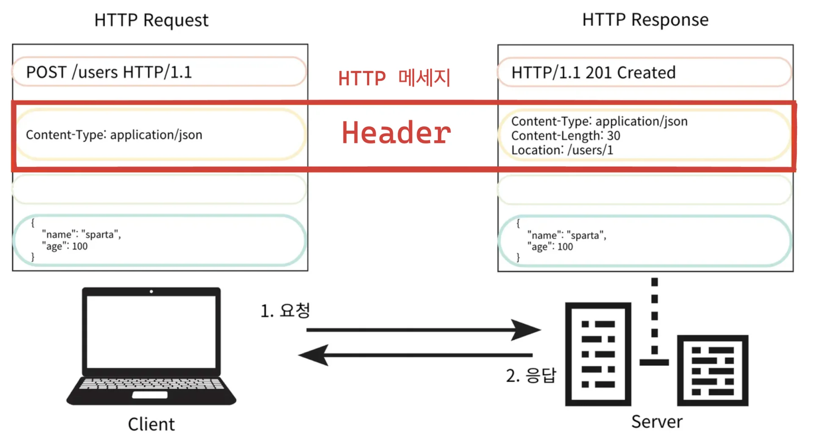

<details>
<summary>표현 헤더 ( Representation )</summary>

> ✏️ 
> 
> <a id="201eda9b0fe180e89692c0118fcbfa1e"></a>
> 
> 실제 데이터를 전송할 떄는 특정 형식으로 변환하여 보낸다&#46; <br>이때 해당 리소스에 대한 표현 정보(어떤 데이터 형식으로 보낼지)를 나타낸다&#46; 
> 
> - <strong><u>요청, 응답 모두 사용</u></strong>된다&#46;

- 종류
    <details>
    <summary><code>Content&#45;Type</code>&#58; 형식</summary>

    - 전송할 데이터 미디어 타입, 문자 인코딩을 나타낸다&#46;

    - <code>text/html; charset=utf&#45;8</code>

    - <code>application/json</code>

    </details>

    <details>
    <summary><code>Content&#45;Encoding</code>&#58; 압축 방식</summary>

    - 데이터 압축 후 Encoding 헤더를 추가하면, 읽는 쪽에서 해당 정보를 압축을 해제한다&#46; 

    - <code>gzip</code>

    - <code>identity</code>&#58; 압축하지 않음을 나타낸다&#46;

    </details>

    <details>
    <summary><code>Content&#45;language</code>&#58; 언어</summary>

    - 데이터의 언어를 표현한다&#46; 

    - ex) <code>ko</code>&#58; 한글, <code>en</code>&#58; 영어

    </details>

    <details>
    <summary><code>Content&#45;Length</code>&#58; 길이</summary>

    - 실제로는 표현 헤더가 아닌, 페이로드(Payload) 헤더이다&#46; 

    - byte 단위로 나타낸다&#46; 

    </details>

</details>

<details>
<summary>컨텐츠 협상 ( Content Negotiation )</summary>

> ✏️ 
> 
> <a id="201eda9b0fe180178c01f599cbf514ce"></a>
> 
> 클라이언트가 선호하는 표현을 요청한다&#46;
> 
> - 요청시에만 사용되는 Header이다&#46; 

- 우선 순위
    <details>
    <summary>1&#46; <code>q=0&#126;1</code></summary>

    - <code>Quality Values</code> 줄여서 <code>q</code>값을 사용한다&#46; 

    - 0 &#126; 1 사이의 값이 존재하며 1에 가까울수록 우선순위가 높다&#46; 

    - Value가 1인 경우 생략이 가능하다&#46; 

    - ex) <code>Accept&#45;Language&#58; ko&#45;KR, en&#45;US; q=0&#46;9,en;q=0&#46;8</code>
        <a id="201eda9b0fe18078934df00b0868e26f"></a>

        → 서버에서 지원 가능하다면 우선순위를 기반으로 응답 데이터를 표현한다&#46; 

    </details>

    <details>
    <summary>2&#46; q가 생략되었다면 <strong><u>선언된 순서</u></strong><strong><u>대로 우선순위를 가진다</u></strong>&#46; </summary>

    - ex) <code>Accept&#58; application/json, text/plain, &#42;</code><em><code>/&#42;</code></em>
        <a id="201eda9b0fe1805ea8cddd677ee16162"></a>

        ⇒ <code>application/json</code> → <code>text/plain</code> → <code>&#42;/&#42;</code>

    </details>

    <details>
    <summary>3&#46; 구체적으로 선언된 것이 우선순위가 높다&#46; </summary>

    - ex) <code>Accept&#58; text/&#42;, text/plain, text/plain;format=flowed, &#42;/&#42;</code>
        <a id="201eda9b0fe180528a0beec431b16c6c"></a>

        ⇒ <code>text/plain;format=flowed</code> → <code>text/plain</code> → <code>text/&#42;</code> → <code>&#42;/&#42;</code>

    </details>

- 종류
    - <code>Accept</code>&#58; 선호하는 미디어 타입

    - <code>Accept&#45;Charset</code>&#58; 선호하는 문자 인코딩

    - <code>Accept&#45;Encoding</code>&#58; 선호하는 압축 인코딩

    - <code>Accept&#45;Language</code>&#58; 선호하는 언어

</details>

<details>
<summary>일반 정보</summary>

> ✏️ 
> 
> <a id="201eda9b0fe1805598fbed2491d013f8"></a>
> 
> 단순한 정보들을 나타내는 Header이다&#46; 

- 종류 
    <details>
    <summary><code>Form</code>&#58; 클라이언트 이메일 정보</summary>

    - 잘 사용하지 않는다&#46; 

    </details>

    <details>
    <summary><code>Referer</code>&#58; 현제 요청된 페이지의 이전 웹 페이지 주소</summary>

    - 유입 경로 파악 가능

    - 요청 시 사용하는 Header

    </details>

    <details>
    <summary><code>User&#45;Agent</code>&#58; 클라이언트 애플리케이션 정보(PC, Mobile, 브라우저)</summary>

    - 어떤 환경에서 주로 접속하는지 통계

    - 어떤 종류의 환경에서 장애가 발생하는지 파악 가능

    - 요청 시 사용하는 Header

    </details>

    <details>
    <summary><code>Server</code>&#58; 요청을 처리하는 ORGIN 서버의 Software 정보</summary>

    - 응답에서 사용한다&#46; 

    </details>

    <details>
    <summary><code>Data</code>&#58; HTTP 요청이 발생한 날짜와 시간</summary>

    - 응답에서 사용

    </details>

</details>

<details>
<summary>특별한 정보</summary>

- 종류
    <details>
    <summary><code>Host</code>&#58; 요청한 도메인 정보</summary>

    - 필수적으로 포함해야하는 Header이다&#46; 

    - 요청시 사용한다&#46; 

    </details>

    <details>
    <summary><code>Location</code>&#58; 생성된 리소스 URI, 리다이렉트 주소</summary>

    - 응답코드 3xx와 함께 응답되면 리다이렉트 주소이다&#46; 

    - 응답코드 201(Created)와 함께 응답되면 생성된 리소스의 URI이다&#46; 

    </details>

    <details>
    <summary><code>Allow</code>&#58; 허용 가능한 HTTP Method</summary>

    - 405 ( Method Not Allowed와 함께 응답된다&#46; 

    - ex) <code>Allow&#58; GET, POST</code>

    </details>

    <details>
    <summary><code>Retry&#45;After</code>&#58; 다음 요청까지 대기 해야하는 시간</summary>

    - 503 ( Service Unavailable )와 함께 서비스가 언제까지 사용이 불가한지 알려준다&#46; 

    - 초단위, 날짜단위 모두 표현이 가능하다&#46; 

    </details>

</details>

<details>
<summary>인증</summary>

- 종류
    <details>
    <summary><code>Authorization</code>&#58; 클라이언트 인증 정보</summary>

    - 선택한 인증 방법에 따라 Value를 작성한다&#46; 

    </details>

    <details>
    <summary><code>WWW&#45;Authenticate</code>&#58; 리소스에 필요한 인증 방법</summary>

    - 401(Unauthorized) 응답과 함께 사용된다&#46;

    </details>

</details>

<details>
<summary>Cookie</summary>

> ✏️ 
> 
> <a id="201eda9b0fe1801eac34f64ff238aa97"></a>
> 
> HTTP는 <code>Stateless</code>( 비상태성 )특성을 가지고 있어 상태를 담아 보내야한다&#46; <br>이때&#46;, Cookie를 사용하여 모든 요청마다 상태를 전달한다&#46; 
> 
> - 사용자 세션 관리, 광고 정보 트래킹에 많이 사용된다&#46; 

- 종류
    <details>
    <summary><code>Set&#45;Cookie</code>&#58; 서버에서 응답 시 클라이언트로 Cookie 값 전달</summary>

    > ⚠️ 
    > 
    > - 항상 서버에 전달된다&#46; 따라서 최소한의 정보만을 사용하여 트래픽을 최적화 시켜야 한다&#46; 
    > 
    > - 탈취 당하기 쉬우니 보안에 민감한 개인정보 등은 지정하지 않는다&#46; 

    - 만료기간(expire, max&#45;age), 사용될 위치(domain, path)를 설정할 수 있다&#46; 

    </details>

    - <code>Cookie</code>&#58; 클라이언트가 서버에서 받은 쿠키를 Cookie 헤더를 통해 전송한다&#46; 

    <details>
    <summary><code>Secure</code>&#58; 해당 헤더가 적용되면 https인 경우에만 쿠키를 전송한다&#46; </summary>

    - 기본적으로 http, https 구분하지 않고 쿠키를 전송한다&#46; 
        - HTTPS&#58; HTTP &#43; Secuere

    </details>

    <details>
    <summary><code>HttpOnly</code>&#58; http 전송에만 사용한다&#46; </summary>

    - 자바스크립트에서 쿠키를 접근하지 못하게 만든다&#46; 

    </details>

    - <code>SameSite</code>&#58; 쿠키에 설정된 도메인이 같은 경우만 쿠키를 전송한다&#46; 

</details>

<details>
<summary>Cache</summary>

> ✏️ 
> 
> <a id="201eda9b0fe18027aec7fa165d2653e4"></a>
> 
> 캐시가 없다면 같은 요청에 대한 응답 데이터가 같아도 매번 데이터를 새로 다운로드 받는다&#46; 
> 
> - 새로 다운로드 받는만큼 속도가 느려지고, 비용이 발생된다&#46;

- 종류
    <details>
    <summary><code>Cache&#45;Control</code></summary>

    > 응답 시 사용하는 헤더이다&#46; 

    <details>
    <summary>Cache&#45;Control&#58; <code>max&#45;age</code> </summary>

    - 캐시 유효 시간(초)

    - 캐시 유효 시간이 지나면 다시 서버를 통해 데이터를 응답받고 캐시를 갱신

    - 다&#46; 

    </details>

    <details>
    <summary>Cache&#45;Control&#58; <code>no&#45;cache</code></summary>

    - 캐시 가능한 데이터지만, 서버에 검증하고 사용해야 한다&#46; 

    </details>

    <details>
    <summary>Cache&#45;Control&#58; <code>no&#45;store</code></summary>

    - 보안에 민감한 데이터, 캐시 하지 않는다&#46; 

    </details>

    </details>

    <details>
    <summary><code>if&#45;modified&#45;since</code>&#58; 캐시로 지정된 데이터 최종 수정일</summary>

    - 요청 시 사용하는 헤더

    </details>

    <details>
    <summary><code>Last&#45;Modified</code>&#58; 데이터가 마지막으로 수정된 시간</summary>

    - if&#45;modified&#45;since 요청이 오면 응답한다&#46; 

    - 304(Not Modified) 상태코드와 함께 응답되면 수정되지 않았다는 의미이다&#46;
        - HTTP Message Body가 존재하지 않는다&#46; ( 캐시 사용 )

    - 응답 시 사용하는 헤더이다&#46;

    </details>

    <details>
    <summary><code>ETag</code>&#58; 캐시용 데이터 날짜, 시간이 아닌 이름을 지정한다&#46; </summary>

    - <code>if&#45;modified&#45;since</code> &#43; <code>Last&#45;Modified</code> 방식은 수정된 데이터가 같거나 캐시가 불필요한 경우 구분하지 못한다&#46; 

    - 요청 시 사용하는 헤더이다&#46; 

    </details>

</details>

<a id="12feda9b0fe1800c8c3ffad2ed1a53c3"></a>

### HTTP API 설계 

> 📌 
> 
> <a id="a9c7b38eb705470cb75b91f07eda4f22"></a>
> 
> URL 설계 시 가장 중요한 것은 <strong><u>리소스의 식별</u></strong>이다<br>따라서 리소스만 식별하도록 리소스(명사)를 URL 매핑하여 설계해야 한다&#46; 

<details>
<summary>🧐 리소스</summary>

<a id="12feda9b0fe1802b8e46dc55d3d20bd5"></a>

회원을 등록하고, 수정하고, 조회한다고 할 때 여기서 리소스는 ‘회원’이다&#46;

<a id="12feda9b0fe180e49547f42c07489800"></a>

이렇게 동작의 ‘대상’을 리소스라고 한다&#46; 

- ex) 주문 생성, 추가, 조회 → 리소스&#58; &#45; 주문

</details>

<details>
<summary>🤬 잘못된 API URL 설계 예시  </summary>

<details>
<summary>예시 1) 회원 </summary>

- 회원 목록 조회&#58; <code>/read&#45;member&#45;list</code>

- 회원 조회&#58; <code>/read&#45;member&#45;by&#45;id</code>

- 회원 등록&#58; <code>/create&#45;member</code>

- 회원 수정&#58; <code>/update&#45;member</code>

- 회원 삭제&#58; <code>/delete&#45;member</code>

</details>

<details>
<summary>예시 2) 게시글</summary>

- 게시글 생성&#58; <code>/create/board</code>

- 게시글 1개 조회&#58; <code>/read/board/1</code>

- 게시글 목록 조회&#58; <code>/read/board&#45;list</code>

- 게시글 수정&#58; <code>/update/board/1</code>

- 게시글 삭제&#58; <code>/delete/board/1</code>

</details>

</details>

- ✅ 올바른 API URL 설계  &#45; Restful API
    [회원 등록](#/post/130eda9b-0fe1-8180-b590-dac73c73573d)

    [회원 조회](#/post/130eda9b-0fe1-8177-9e55-c8b1ccce8882)

    [회원 목록 조회](#/post/130eda9b-0fe1-81a9-a7ef-fa3b954804c7)

    [회원 수정](#/post/130eda9b-0fe1-8134-b7e5-e56b9ffda5ac)

    [회원 삭제](#/post/130eda9b-0fe1-81b5-8d31-e82367668f47)

    [게시글 생성](#/post/9d42fabb-13da-4f6a-ab28-13fd45fef1af)

    [게시글 1개 조회](#/post/6a3483ff-0db8-45d0-9fb3-175eedd614c9)

    [게시글 목록 조회](#/post/61160dd2-6184-4a6c-80ab-d255b4bdfac8)

    [게시글 수정](#/post/12feda9b-0fe1-806a-9997-ca4bbf78680d)

    [게시글 삭제](#/post/12feda9b-0fe1-80a6-88be-cdfd8fda16cf)

<a id="12feda9b0fe18072baa3e7f1df760d73"></a>

### RESTful API 

<details>
<summary>REST 란?</summary>

- <strong>REST(Representational State Transfer)는 </strong>자원(Resource)을 이름(Name)으로 구분하여 해당 자원의 상태(정보)를 주고받는 것을 의미한다&#46;

- <u>URI</u>를 통해 <u>자원(Resource)을 명시</u>하고, <u>HTTP Method(</u><u><code>POST</code></u><u>, </u><u><code>GET</code></u><u>, </u><u><code>PUT</code></u><u>, </u><u><code>DELETE</code></u><u>,</u><u><code>PATCH</code></u><u> 등)</u>를 통해 <u>해당 자원에 대한 CRUD Operation을 적용</u>하는 것을 REST라 칭한다&#46;

</details>

<details>
<summary>Restful API 작성 시 유의사항</summary>

[REST API URI Naming Conventions and Best Practices]()

- 리소스는 <strong><u>명사</u></strong>를 사용해야 한다&#46;

- 단수가 아닌 <u>복수 형태를 사용</u>해야 한다&#46;
    - ex ) user ❌  → <code>users</code>

    - ex) schedule → <code>schedules</code>

<details>
<summary>만약, REST만으로 해결하기 어렵다면, 동사 사용을 허용한다&#46; → Control URL</summary>

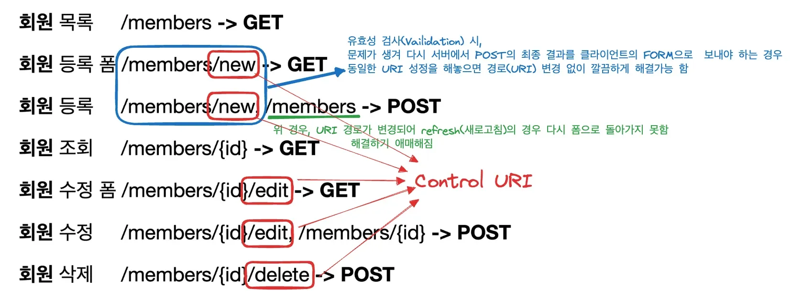

</details>

- 자원의 계층 관계는 슬래시(<code>/</code>)로 표현한다&#46;

- 마지막 문자에는 슬래시(<code>/</code>)가 있으면 안된다&#46; 

- 언더바(<code>&#95;</code>)가 아닌 하이픈(<code>&#45;</code>)을 사용해야 한다&#46;

- 소문자를 사용해야 한다&#46;

- URI에 파일 확장자를 포함하면 안된다&#46; 
    - ex) <code>&#46;jpg</code>, <code>&#46;html</code> …

<details>
<summary>CRUD 함수명이 아닌 <code>HTTP Method</code>를 사용하여 CRUD를 표현한다&#46; </summary>

- Create  &#45; <code>Post</code>

- Read &#45; <code>Get</code>

- Update &#45; <code>Put</code>, <code>Patch</code>, <code>Post</code>

- Delete &#45; <code>Delete</code>

</details>

- 정렬, 필터링, 페이징은 신규 API를 만드는것이 아닌 Query Parameter를 사용한다&#46;

</details>

<details>
<summary><strong>Maturity Model (성숙도 모델)</strong></summary>

<details>
<summary>Reference</summary>

[4 Maturity Levels of REST API Design]()

[Richardson Maturity Model]()

[REST API Maturity &#45; Towards The Glory of REST]()

</details>

> 📖 
> 
> <a id="130eda9b0fe18058a6c2cfc8e594ae20"></a>
> 
> A way to grade your API according to the constraints of REST
> 
> > REST의 제약 조건에 따라 API를 등급화하는 방법
> 
> <a id="130eda9b0fe18047b62ee7907af11d86"></a>
> 
> &#45; Leonard Richardson(Rest API 창시자 &#45;

<details>
<summary>Level 2</summary>

> 지금까지 정리한 API의 설계 표준이라 보면 될 듯 싶다&#46;

- 리소스를 HTTP Methods에 맞게 설계하고 서비스하는 단계
    - Read &#45; <code>GET</code>  …

- ex) 요청 예시(HTTP Method 활용)
    <a id="130eda9b0fe180068bdbec11430ee7a8"></a>

    ```json
    GET /users/123     // 특정 사용자 조회

    POST /users        // 사용자 생성
    {
        "name": "sparta",
        "password": "codingclub"
    }

    PUT /users/123     // 사용자 정보 수정
    {
        "name": "java",
        "password": "spring"
    }

    DELETE /users/123  // 사용자 삭제
    ```

</details>

<details>
<summary>Level 3</summary>

> 📌 
> 
> <a id="130eda9b0fe1805b983cc6e22abd01fb"></a>
> 
> <strong>HATEOAS(Hypermedia As The Engine Of Application State)</strong>
> 
> - 회원 가입 후 회원 정보 수정은 어떻게 해야 하는지
> 
> -  조회는 어떻게 해야 하는지
> 
> - 회원 조회를 하면서 그다음 단계로 진행할 수 있는 또 다른 리소스에 대한 정보는 어떠한 것이 있는지 
> 
> - 이러한 모든 정보를 같이 알려주는 기능

- 데이터를 가지고 그 다음 작업에서 어떠한 작업을 할 수 있는지 상태 정보를 함께 넘김
    - 클라이언트 측에서는 서버가 제공하는 서비스를 일일이 찾지 않아도 됨

    - 엔드포인트만 가지고 있으면 서버가 제공할 수 있는 다음, 그 다음 URI값을 알 수 있음

- 요청 예시 
    <a id="130eda9b0fe180119f4fd8be7e8fa6cc"></a>

    ```json
    GET /users/123
    {
        "id": 123,
        "name": "sparta",
        "links": {
            "self": "/users/123",
            "update": "/users/123",
            "delete": "/users/123"
        }
    }
    ```

</details>

</details>

<details>
<summary>RESTful API 설계 시 고려해야 할 사항들</summary>

<details>
<summary>1&#46; Consumer first</summary>

- 개발자 중심의 설계방식보다 해당 API 소비자 입장에서 간단하고 직관적인 API를 설계 해야한다&#46; 

- 위에서 소비자는 엔드 유저가 아닌 API를 사용하고 있는 또다른 시스템, 개발자등을 얘기한다&#46; 

</details>

<details>
<summary>2&#46; Make best use of HTTP</summary>

- HTTP Method와 Request, Response, Header와 같은 HTTP의 장점을 살려서 개발 해야한다&#46; 

</details>

<details>
<summary>3&#46; Request methods</summary>

- 최소한 성숙도 모델 Level2 로는 사용하여야 한다&#46; 

</details>

<details>
<summary>4&#46; Response Status</summary>

- 각각의 API 요청에 따라서 적절한 HTTP 상태코드가 전달되어야 한다&#46; 

- 성공했다&#46; 실패했다가 아닌 왜 실패하고 성공하였는지 함께 반환 시켜주어야 한다&#46; 

</details>

<details>
<summary>5&#46; No secure info in URI</summary>

- URI에는 사용자의 정보를 포함해서는 안된다&#46; 

</details>

<details>
<summary>6&#46; Use plurals</summary>

- 제공하는 데이터에 대해서 단수가 아닌 복수 형태로 쓰는 것이 일반적이다&#46; 

- 특정 유저를 찾고자 한다면 엔드포인트에 값을 추가한다&#46; 
    - ex) <code>/user</code> → <code>/users</code>

    - ex) <code>/users/1</code>

</details>

<details>
<summary>7&#46; User nouns for resources</summary>

- 모든 리소스는 가능하면 동사가 아닌 명사 형태로 표시한다&#46; 

- API URI만 보고도 어떠한 API인지 파악할 수 있는 것이 좋다&#46; 

</details>

<details>
<summary>8&#46; For exceptions &#45; define a consistent approach</summary>

- 일괄적인 엔드포인트를 사용하는 것이 좋다&#46; 

</details>

</details>
