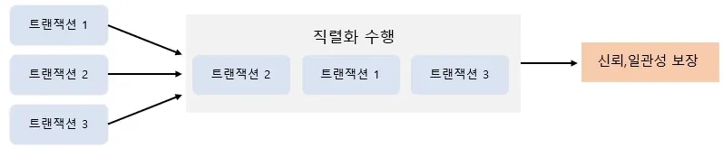
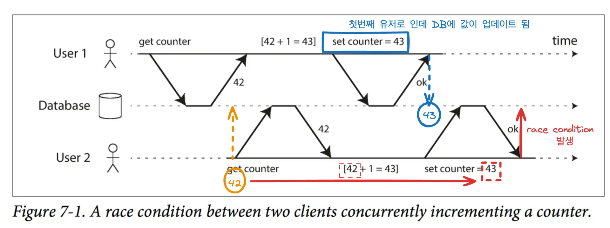
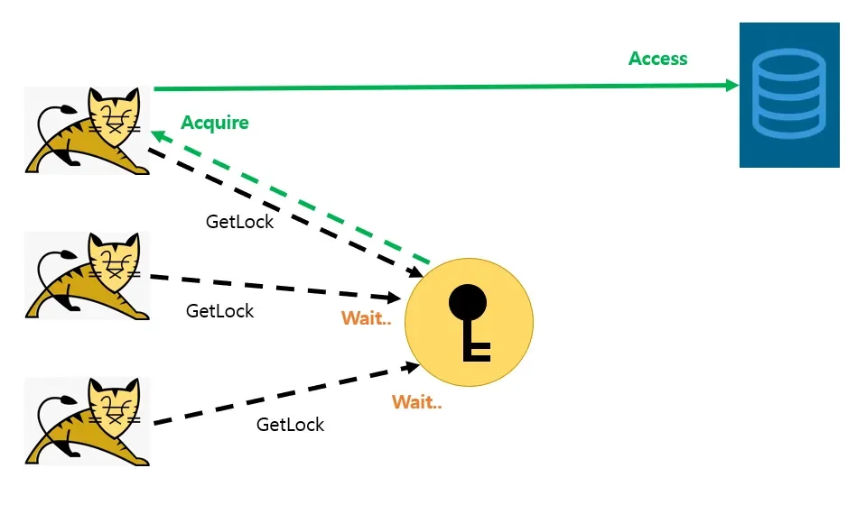
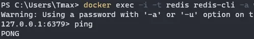
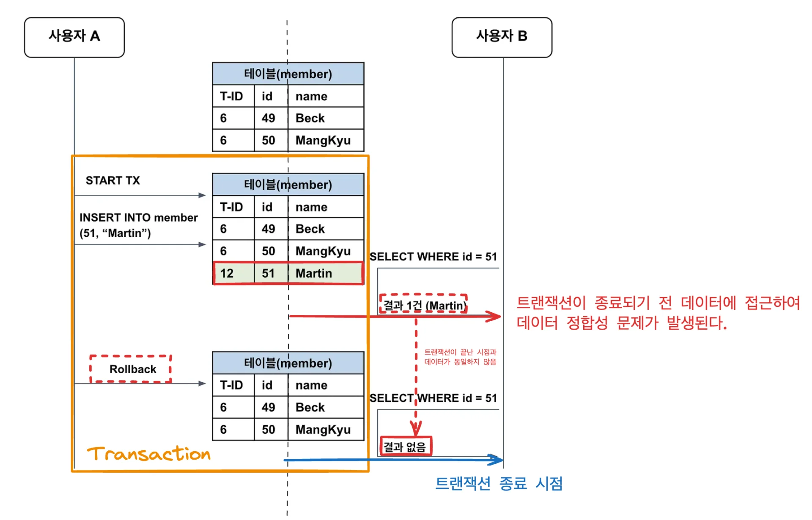
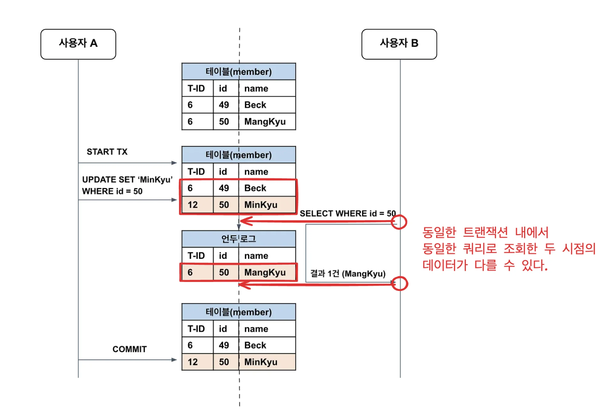
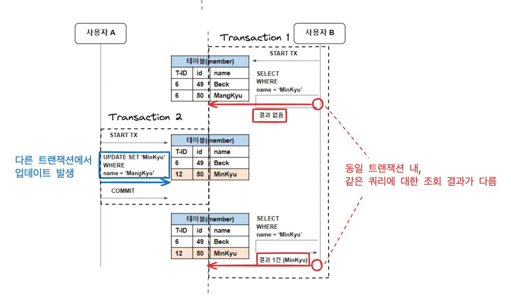
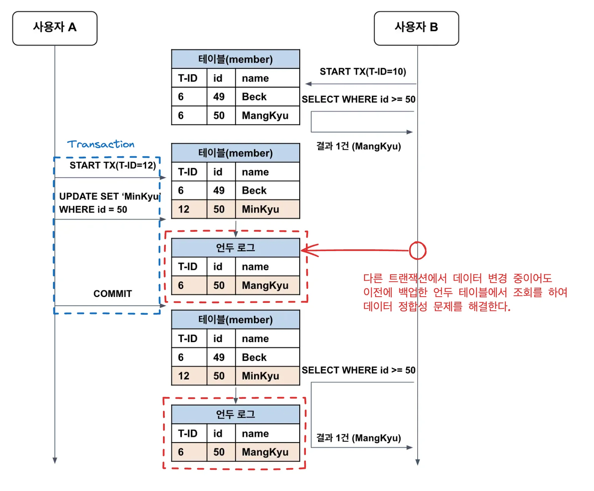
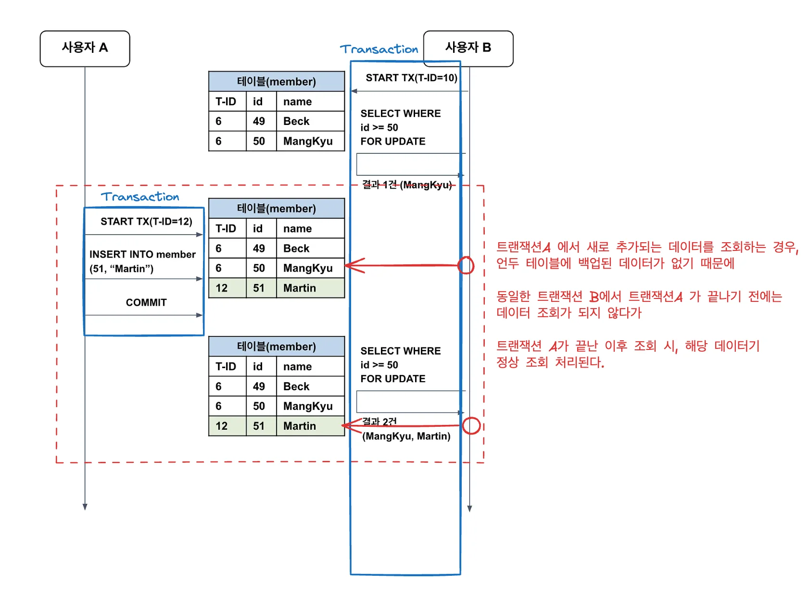
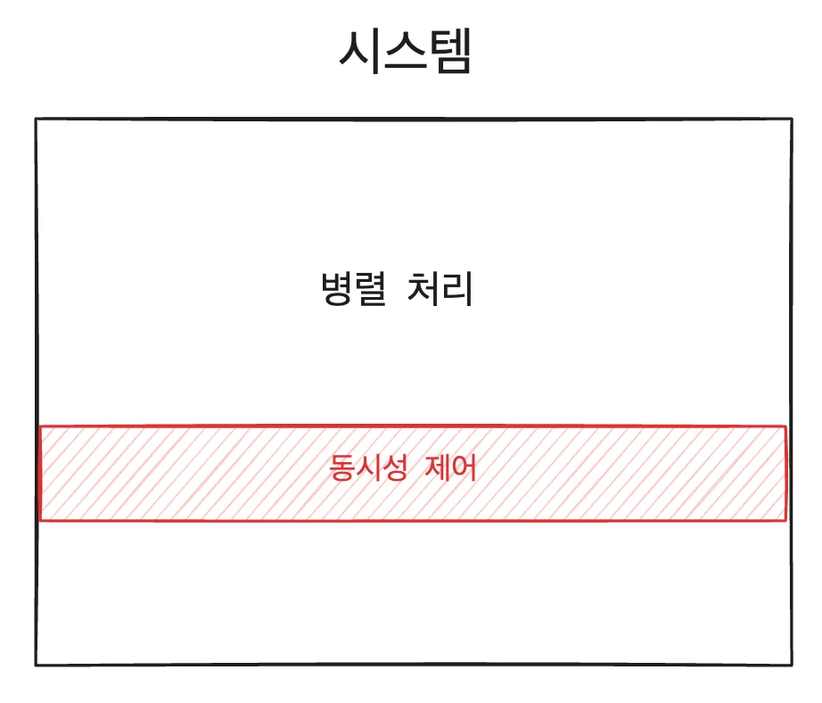

> 📌 
> 
> <a id="181eda9b0fe1819497a8e6b047b037c0"></a>
> 
> CS 특강 &#45; 동시성 제어
> 
> - 진행&#58; 김재연 튜터님
> 
> - 기간&#58; 24&#46;1&#46;20(월) 
> 
> <details>
> <summary>reference</summary>
> 
> <a id="181eda9b0fe18049989bc6e40389834e"></a>
> 
>  <a href="https://beautiful-college-c84.notion.site/1812dc3ef51480c38471de20fc1aabab">페이지</a> 
> 
> [Concurrency-java.zip](c594ffc8375b1210.zip)
> 
> </details>

<a id="181eda9b0fe180cb8329f6cb66af50fd"></a>

## 동시성 제어 

<a id="181eda9b0fe180c0a419fb7a37577e00"></a>

<code>DBMS</code>가 <strong><u>다수의 사용자 사이</u></strong>에서 <strong><u>동시에 작용하는 다중 트랜잭션의 상호간섭 작용</u></strong>에서 <code>Database</code>를 <strong><u>보호</u></strong>하는 것을 의미한다&#46; 

<a id="181eda9b0fe180d98effd48313ae3701"></a>

일반적인 어플리케이션은 다수의 사용자의 요청을 처리하고 이러한 요청에는 DB 접근을 필요로 하는 요청도 포함한다&#46;

<a id="181eda9b0fe180748853fb7b41da9507"></a>

이때 한번에 다수의 DB 접근을 필요로 하는 요청이 들어올 때 트랜잭션 단위로 DB 접근을 하게 되는데,<br>이때 <strong><u>DB 접근을 동시적으로 모두 허용</u></strong><strong>해주면</strong><strong> </strong><strong><u>데이터베이스의 </u></strong><strong><u>일관성</u></strong><strong><u>과 </u></strong><strong><u>무결성</u></strong><strong><u>이 </u></strong><strong><u>깨지게 된다&#46; </u></strong>

<a id="181eda9b0fe180fdb6a4f6d8443afa34"></a>

이를 방지하기 위해 동시성 제어를 통해 데이터베이스를 보호할 수 있다&#46;

<a id="181eda9b0fe180609228c329174fb2c5"></a>

동시성 제어는 <strong><u>병행 제어</u></strong>라고도 불리며 <strong><u>한번에 들어온 복수의 트랜잭션</u></strong>을 <strong><u>직렬화</u></strong>하는 수행을 보장한다&#46; 

- 싱글 스레드처럼 차례대로 동작하도록 보장함



<a id="181eda9b0fe180c2b687d6f03ee1e73e"></a>

###  Race Condition

<a id="181eda9b0fe180b28d48e1127dc505c1"></a>

두 개 이상의 스레드가 동시에 같은 데이터를 접근하여 값을 변경하고자 할 때, 데이터의 예상치 못한 변경이 발생할 수 있다&#46;



<a id="181eda9b0fe180ca864bf64c766c47ac"></a>

## Java &#45; Synchronized ( 사용 ❌ )

<a id="181eda9b0fe18092b582ee73817577a4"></a>

프로세스에 여러 스레드가 동시에 접근하는 것을 방지하기 위한 기법

<details>
<summary>메서드에 <code>synchronized</code> 키워드 추가</summary>

<a id="4f4d9a1bc490487c8f62e5f533c7c648"></a>

```java
public synchronized void decrease() {
		entity.decrease();
}
```

</details>

<details>
<summary><code>&#64;Synchronized</code> 어노테이션 추가</summary>

<a id="2ddb6834080e4282ba9684ab99e70b33"></a>

```java
@Synchronized
public void decrease() {
		entity.decrease();
}
```

</details>

<details>
<summary>코드 내부에 <code>synchronized</code> 블럭 추가</summary>

<a id="71956756fa91422fad19f9e82c23b44f"></a>

```java
public void decrease() {
		synchronized(this) {
			entity.decrease();
		}
}
```

</details>

<a id="181eda9b0fe180a8bb92f50862925a5e"></a>

###  왜 사용하면 안되는 것인가? 

<a id="181eda9b0fe180e8b231cf903cfff285"></a>

<code>synchronized</code>는  <strong><u>각 프로세스(서버) 안에서만 보장</u></strong>되기 때문에, 여러 서버가 있는 <strong>분산 환경</strong>에서는 <strong><u>결국 스레드에서 동시에 데이터 접근</u></strong>을 할 수 있게 되면서 <strong>레이스 컨디션</strong>이 발생된다&#46;

> 정리 내용&#58; <a href="https://beautiful-college-c84.notion.site/165eda9b0fe1814cb8c8ef553790ea97">페이지</a> 

<a id="181eda9b0fe18074ac4bff38ecbae3fe"></a>

## 데이터베이스 &#45;  락 ( 비관적 락, 낙관적 락 ) 

---

<a id="181eda9b0fe180a8b9adc00d890537e2"></a>

### 비관적 락 ( pessimistic lock )

---

> 이전 정리 내용&#58; <a href="https://beautiful-college-c84.notion.site/165eda9b0fe181a3a29fda7dae4cfd04">페이지</a> 

> ✏️ 
> 
> <a id="6bb7d21820014e4fbceb85f7ffb9240a"></a>
> 
> 현재 트랜잭션이 접근한 데이터에 <strong><u>row 단위로 Lock을 걸</u></strong>어 다른 트랜잭션이 읽기(Shared Lock) 혹은 쓰기(Exclusive Lock) 접근을 하지 못하게 하는 방법이다&#46;

<details>
<summary><strong>Shared lock (읽기 잠금, s&#45;lock)</strong></summary>

- 락을 획득한 트랜잭션에서만 대상 레코드를 수정, 삭제 할 수 있으며 락을 획득하지 못한 트랜잭션은 읽기만 허용하는 방법&#46; (PESSIMISTIC&#95;READ)

</details>

<details>
<summary><strong>Exclusive Lock (쓰기 잠금, x&#45;lock)</strong></summary>

- 락을 획득하지 못한 트랜잭션에서 대상 레코드를 수정, 삭제 뿐 아니라 읽기도 허용하지 않는 방법&#46; (PESSIMISTIC&#95;WRITE)

- 읽기를 허용하지 않기 때문에 한 번에 하나의 트랜잭션만 작업을 수행함을 보장&#46;

</details>

---

<details>
<summary>장점</summary>

- 테이블에 락을 걸어 다른 트랜잭션에서의 접근을 하지 못하게 하기 때문에 데이터의 일관성이 보장된다&#46; 

- 트랜잭션에서 데이터를 사용하기 전 락을 걸기 때문에, 데이터를 변경 중에 다른 트랜잭션과의 출동 가능성이 낮다&#46; 

</details>

<details>
<summary>단점</summary>

- 데이터 일관성을 보장하지만, <strong><u>동시 접속자가 많은 환경</u></strong>에서는 <u>락 대기 시간</u>으로 인해 <strong><u>성능에 영향을 줄 수 있</u></strong>다&#46; 

- <strong><u>다수의 트랜잭션</u></strong>이 <strong><u>서로 다른 순서로 여러 데이터에 락을 요청</u></strong>하면 <strong>데드락</strong>이 발생 할 수 있다&#46; 

</details>

<a id="181eda9b0fe18052add5d8c7730aed45"></a>

### 정리 

---

<a id="181eda9b0fe180efa38bce361e9e9a29"></a>

비관적 락은 특정 레코드를 대상으로 <strong><u>충돌이 자주 발생</u></strong>할 것으로 추측될 때, 사용하기 적합하다&#46;

<a id="181eda9b0fe1808fa124e12402a6304c"></a>

<strong><u>레코드 자체에 락</u></strong>을 걸기 때문에 <strong>동시성이 크게 저하</strong>될 수 있다&#46;

<a id="181eda9b0fe18047a173c54b779b0029"></a>

또한 반드시 <strong><u>타임아웃을 지정</u></strong>하여 무한 대기에 따른 <strong><u>데드락이 발생되지 않</u></strong>도록 <strong><u>주의가 필요</u></strong>하다&#46; 

> ❗ 
> 
> <a id="1561b95640f14aa2b7fba19416704b19"></a>
> 
> 비관적 락 ( pessimistic lock )은 무한정 대기하면 데드락 상황이 발생될 수 있어, 락에 대한 제한 시간을 설정하는 것이 좋다&#46;
> 
> - <strong>재시도를 하느라 쓰레드를 계속 물고있는 것</strong>이 <strong><u>굉장히 오버헤드가 큰 행위</u></strong>이다&#46; 

<a id="191eda9b0fe180b38300d679e04cc94e"></a>

### 코드 

---

<details>
<summary>&#91; 코드 &#93; PessimisticCounter</summary>

<a id="191eda9b0fe1803784b2f84009307508"></a>

```java
@Getter
@Entity
@NoArgsConstructor
public class PessimisticCounter {
    @Id
    @GeneratedValue(strategy = GenerationType.IDENTITY)
    private Long id;
    private int count;

    public PessimisticCounter(int count) {
        this.count = count;
    }

    public void initCount() {
        this.count = 1000;
    }

    public void decreaseCount() {
        this.count--;
    }
}
```

</details>

<details>
<summary>&#91; 코드 &#93; PessimisticCounterService</summary>

<a id="191eda9b0fe180318820cf42e766b890"></a>

```java
@Service
@RequiredArgsConstructor
public class PessimisticCounterService {

    private final PessimisticCounterRepository pessimisticCounterRepository;

    public void save(PessimisticCounter pessimisticCounter) {
        pessimisticCounterRepository.save(pessimisticCounter);
    }

    public void reset() {
        PessimisticCounter pessimisticCounter = pessimisticCounterRepository.findById(1L).orElseThrow();
        pessimisticCounter.initCount();
        pessimisticCounterRepository.save(pessimisticCounter);
    }

    @Transactional
    public void decreaseCount() {
        PessimisticCounter pessimisticCounter = pessimisticCounterRepository.findById(1L).orElseThrow();
        pessimisticCounter.decreaseCount();
        pessimisticCounterRepository.save(pessimisticCounter);
    }

    @Transactional
    public void decreaseCountWithLock() {
        PessimisticCounter pessimisticCounter = pessimisticCounterRepository.findByIdWithPessimisticLock(1L).orElseThrow();
        pessimisticCounter.decreaseCount();
        pessimisticCounterRepository.save(pessimisticCounter);
    }

    public void printCount() {
        PessimisticCounter pessimisticCounter = pessimisticCounterRepository.findById(1L).orElseThrow();
        System.out.println("count = " + pessimisticCounter.getCount());
    }
}
```

</details>

<details>
<summary>&#91; 코드 &#93; PessimisticCounterRepository &#45; 비관적 락 <code>&#64;Lock(LockModeType&#46;PESSIMISTIC&#95;READ)</code></summary>

<a id="191eda9b0fe1805fb776f969143d224c"></a>

```java
public interface PessimisticCounterRepository extends JpaRepository<PessimisticCounter, Long> {

    @Lock(LockModeType.PESSIMISTIC_READ)
    @QueryHints({@QueryHint(name = "jakarta.persistence.lock.timeout", value = "3000")})  // timeout 설정 (3초)
    @Query("select p from PessimisticCounter p where p.id in :id")
    Optional<PessimisticCounter> findByIdWithPessimisticLock(Long id);
}
```

</details>

<details>
<summary>&#91; 코드 &#93; 테스트</summary>

<a id="191eda9b0fe1807d9483cb207bdf313d"></a>

```java
@SpringBootTest
class PessimisticCounterServiceTest {

    @Autowired
    private PessimisticCounterService pessimisticCounterService;

    @BeforeEach
    void setUp() {
        pessimisticCounterService.save(new PessimisticCounter(1000));
    }

    @AfterEach
    void tearDown() {
        pessimisticCounterService.reset();
    }


    @Test
    @DisplayName("동시성 이슈 발생")
    void concurrencyTest() {
        System.out.println("\n\n\n\n[concurrencyTestWithPessimisticLock]");

        pessimisticCounterService.printCount();

        IntStream.range(0, 1000).parallel().forEach(i -> {
            pessimisticCounterService.decreaseCount();
        });

        pessimisticCounterService.printCount();
    }

    @Test
    @DisplayName("비관적 락을 이용한 동시성 제어")
    void concurrencyTestWithPessimisticLock() {
        System.out.println("\n\n\n\n[concurrencyTestWithPessimisticLock]");

        pessimisticCounterService.printCount();

        IntStream.range(0, 1000).parallel().forEach(i -> {
            pessimisticCounterService.decreaseCountWithLock();
        });

        pessimisticCounterService.printCount();
    }


}
```

</details>

<a id="181eda9b0fe180b881a6d775c61daa28"></a>

### 낙관적 락 ( Optimistic Lock  ) 

---

> 이전 정리&#58; <a href="https://beautiful-college-c84.notion.site/165eda9b0fe181b3b16fe0c4fb505c2f">페이지</a> 

> ✏️ 
> 
> <a id="f2a321509525454b96654591e3ff2155"></a>
> 
> version ( or 시간 관련 컬럼도 가능 ) 컬럼을 추가하여 버전이 다르면 업데이트가 불가능하게 하는 방법이다&#46;
> 
> 
> 
> - <u>락을 사용하지 않</u>고, <strong><u>버전</u></strong>을 통해 <strong><u>데이터의 정합성을 판단</u></strong>한다&#46; 
> 
> - <strong><u>버전 불일치로 인한 충돌 </u></strong>시 <code>ObjectOptimisticLockingFailureException</code> 발생된다&#46;

<details>
<summary>장점</summary>

- 동시 요청(재시도 횟수 X)에 대해 DB에 락을 걸지 않기 때문에, 비관적 락보다 성능 향상에 이점이 있다&#46;

- <code>낙관적 락</code>( Optimistic Lock )은 <strong><u>충돌이 자주 발생하지 않는 상황</u></strong>에서  다시 말해 <strong><u>쓰기 연산이 자주 발생되지 않는 상황</u></strong>에서 <code>비관적 락( pessimistic lock )</code>보다 성능이 더 좋다&#46; <br> 즉, 많은 사용자가 동시에 데이터에 접근하는 경우 즉, 읽기 연산의 경우  <code>비관적 락( pessimistic lock )</code>보다 <strong><u>더 빠르게 처리할 수 있</u></strong>다&#46; 

</details>

<details>
<summary>단점</summary>

- 동시에 요청하여<strong><u> 데이터 충돌이 발생</u></strong>했을 때 이를 해결하기 위한 <strong><u>추가적인 로직(재시도 로직)이 필요</u></strong>하며, 해당 구현에 복잡성이 있다&#46;

- 데이터의 변경 빈도가 높은 시스템에서는 <strong><u>충돌이 자주 발생</u></strong>하기 때문에, 이를 해결하기 위한 <strong><u>추가적인 시간이 필요</u></strong>하다&#46;
    <a id="181eda9b0fe1801ea089cd29a3608dfb"></a>

    따라서 충돌이 자주 발생되는 경우, <code>비관적 락( pessimistic lock )</code> 성능적으로 떨어진다&#46; 

</details>

<a id="181eda9b0fe18099bf16dfa4afa3b83d"></a>

쓰기에 락이 걸리면, 읽기 행위로 제한이 걸린다&#46;

- <code>읽기 잠금</code>&#58; 여러 쓰레드가 읽어올 수 있다&#46; 

- <code>쓰기 잠금</code>&#58; 아무도 읽을 수 없다&#46;

<a id="191eda9b0fe180f8a672cf26b0cdb483"></a>

### 코드 

---

<details>
<summary>&#91; 코드 &#93; OptimisticCounter</summary>

<a id="191eda9b0fe18016a9bfdccfae1776fc"></a>

```java
@Getter
@Entity
@NoArgsConstructor
public class OptimisticCounter {
    @Id
    @GeneratedValue(strategy = GenerationType.IDENTITY)
    private Long id;
    private int count;

    @Version
    private int version;

    public OptimisticCounter(int count) {
        this.count = count;
    }

    public void initCount() {
        this.count = 1000;
    }

    public void decreaseCount() {
        this.count--;
    }
}
```

</details>

<details>
<summary>&#91; 코드 &#93; OptimisticCounterService</summary>

<a id="191eda9b0fe180be9e0dda46ba3a6c02"></a>

```java
@Service
@RequiredArgsConstructor
public class OptimisticCounterService {

    private final OptimisticCounterRepository optimisticCounterRepository;

    @Transactional
    public void save(OptimisticCounter optimisticCounter) {
        optimisticCounterRepository.save(optimisticCounter);
    }

    @Transactional
    public void reset() {
        OptimisticCounter optimisticCounter = optimisticCounterRepository.findById(1L).orElseThrow();
        optimisticCounter.initCount();
        optimisticCounterRepository.save(optimisticCounter);
    }

    @Transactional
    public void decreaseCountWithLock() {
        OptimisticCounter optimisticCounter = optimisticCounterRepository.findByIdWithOptimisticLock(1L).orElseThrow();
        optimisticCounter.decreaseCount();
        optimisticCounterRepository.save(optimisticCounter);
    }

    public void printCount() {
        OptimisticCounter optimisticCounter = optimisticCounterRepository.findById(1L).orElseThrow();
        System.out.println("count = " + optimisticCounter.getCount() + ", version = " + optimisticCounter.getVersion());
    }
}

```

</details>

<details>
<summary>&#91; 코드 &#93; OptimisticCounterRepository &#45; 낙관적 락 <code>&#64;Lock(LockModeType&#46;PESSIMISTIC&#95;READ)</code></summary>

<a id="191eda9b0fe180deb5b3f5e66b77ede6"></a>

```java
public interface OptimisticCounterRepository extends JpaRepository<OptimisticCounter, Long> {


    @Lock(LockModeType.OPTIMISTIC_FORCE_INCREMENT)
    @Query("select p from OptimisticCounter p where p.id in :id")
    Optional<OptimisticCounter> findByIdWithOptimisticLock(Long id);
}
```

</details>

<details>
<summary>&#91; 코드 &#93; 테스트</summary>

<a id="191eda9b0fe180f0b6cfe6769ccf48ca"></a>

```java
package com.example.demo.concurrency.lock.optimistic;

import org.junit.jupiter.api.AfterEach;
import org.junit.jupiter.api.BeforeEach;
import org.junit.jupiter.api.DisplayName;
import org.junit.jupiter.api.Test;
import org.springframework.beans.factory.annotation.Autowired;
import org.springframework.boot.test.context.SpringBootTest;
import org.springframework.orm.ObjectOptimisticLockingFailureException;

import java.util.concurrent.atomic.AtomicInteger;
import java.util.stream.IntStream;

@SpringBootTest
public class OptimisticCounterServiceTest {

    @Autowired
    private OptimisticCounterService optimisticCounterService;

    @BeforeEach
    void setUp() {
        optimisticCounterService.save(new OptimisticCounter(1000));
    }

    @AfterEach
    void tearDown() {
        optimisticCounterService.reset();
    }

    @Test
    @DisplayName("낙관적 락을 이용한 동시성 제어")
    void concurrencyTestWithOptimisticLock() {
        System.out.println("\n\n\n\n[concurrencyTestWithOptimisticLock]");
        AtomicInteger optimisticLockFailures = new AtomicInteger(0);
        optimisticCounterService.printCount(); // 초기값 출력

        IntStream.range(0, 1000).parallel().forEach(i -> {
            try {
                optimisticCounterService.decreaseCountWithLock();
            } catch (ObjectOptimisticLockingFailureException e) {
                System.out.println("낙관적 락으로 인한 데이터 변경 실패 !");
                optimisticLockFailures.incrementAndGet();
            }
        });

        optimisticCounterService.printCount();
        System.out.println("decreaseCount() 실패 횟수: " + optimisticLockFailures.get());
    }

    @Test
    @DisplayName("낙관적 락을 이용한 동시성 제어 및 재시도 로직")
    void concurrencyTestWithOptimisticLockAndRetry() {
        System.out.println("\n\n\n\n[concurrencyTestWithOptimisticLockAndRetry]");
        final int maxRetries = 100; // 최대 재시도 횟수
        AtomicInteger totalAttempts = new AtomicInteger(0);
        AtomicInteger successfulDecrements = new AtomicInteger(0);
        optimisticCounterService.printCount(); // 초기값 출력

        IntStream.range(0, 1000).parallel().forEach(i -> {
            boolean updated = false;
            int attempts = 0;
            while (!updated && attempts < maxRetries) {
                try {
                    optimisticCounterService.decreaseCountWithLock();
                    successfulDecrements.incrementAndGet();
                    updated = true;
                } catch (ObjectOptimisticLockingFailureException e) {
                    attempts++;
                }
                totalAttempts.incrementAndGet();
            }
            if (!updated) {
                System.out.println("최대 재시도를 " + attempts + "회 하였으나 실패. (for iteration " + i + "번째에서 발생.)");
                // throw Exception
            }
        });

        optimisticCounterService.printCount();
        System.out.println("성공적으로 감소된 횟수: " + successfulDecrements.get());
        System.out.println("총 시도 횟수: " + totalAttempts.get());
    }
}
```

</details>

<a id="181eda9b0fe1803a8e44c2c610aae631"></a>

## Redis &#45; 분산 락 ( Distribured Lock )

<a id="181eda9b0fe1809bbf42f26b6c3eb442"></a>

### 분산 락 <strong>(Distributed Lock)</strong>

---

> ✏️ 
> 
> <a id="c368b1167289480981f3d3d8f9a9e8db"></a>
> 
> 분산락이란 <strong><u>여러 서버가(프로세스) 공유 데이터를 제어</u></strong>하기 위한 기술이다&#46;
> 
> <a id="3bec3fbcd14e4c8092b893d75ec4f8e0"></a>
> 
> <strong><u>락을 획득</u></strong><strong>한</strong> <u>프로세스</u> 혹은 <u>스레드</u>만이 <strong>공유 자원 혹은 Critical Section 에 접근</strong> 가능하다&#46;<br>따라서 <strong><u>서버 분산 환경</u></strong>에서도 <strong><u>프로세스들의 원자적 연산</u></strong>이 가능을 가능케 한다&#46;
> 
> 

- 공유자원 자체에 락을 거는 것이 아니라, 어떤 행위가 발생하는 <strong><u>임계구역(Critical Section)</u></strong>에 <strong><u>락</u></strong>을  건다,

- <strong><u>주로 Redis를 활용</u></strong>하기에 <strong><u>&#91; 분산 락 → Redis &#93;</u></strong>라 생각해도 무방하다&#46;
    - 분산 락을 <strong><u>MySQL로 구현 가능</u></strong>하나 Redis에 비해 <u>성능이 크게 떨</u>어진다&#46;

> 
> 
> <a id="181eda9b0fe1802f986fe05fdc590a58"></a>
> 
> <strong>Redis 락이 좋은 이유</strong>
> 
> - <code>Memory DB</code>
>     - Redis는 <strong><u>인메모리</u></strong>를 사용하기 때문에, 디스크를 사용하는 <strong><u>데이터베이스 락보다 수만배 빠르다&#46;</u></strong>
> 
> - <code>싱글 스레드</code>
>     - <strong><u>싱글 스레드</u></strong> 이기 때문에, <strong><u>락을 걸지 않고도 동시성 제어가 가능</u></strong>하다
> 
>     -  DB는 일반적으로 멀티 스레드이다&#46;

<a id="181eda9b0fe1800087b1f6b7e51011f5"></a>

### 종류

<details>
<summary>Lettuce</summary>

- spring&#45;data&#45;redis의 기본 구현체

- 기본적으로 Spin Lock을 사용한다&#46;
    - 이는 Lock을 대기하는 상황에서, Lock을 획득할 수 있는지 계속 요청을 보낸다&#46;

    - 따라서 Lock을 획득하려는 스레드가 많을 경우 Redis에 부하가 집중된다&#46;

- Lock에 대한 타임아웃이 없어, Unlock(잠금 해제) 호출을 하지 못한 경우 Dead Lock을 유발할 수 있다&#46;

</details>

<details>
<summary>Redisson</summary>

- pub/sub 방식을 사용한다&#46;
    - Lock을 당장 획득할 수 없으면 대기한다&#46;

    - Lock이 획득 가능할 경우 Redis에서 클라이언트로 획득 가능함을 알린다&#46;

- Lock의 lease time 설정이 가능하다&#46;
    - 즉, 설정된 lease time이 지난 경우 자동으로 Lock의 소유권을 회수하여 Dead Lock을 방지한다&#46;

</details>

<a id="181eda9b0fe1809bb564f613e158f4f2"></a>

### 코드&#58;  Lettuce, Redisson

---

<details>
<summary>Docker로 Redis 컨테이너 띄우기</summary>

1. Docker Desktop 실행

1. <strong>redis image를 pull 받는다&#46;</strong>
    <a id="181eda9b0fe1807ba2c7cdac9a3cec69"></a>

    ```yaml
    docker pull redis:alpine
    ```

1. <strong>redis를 docker로 컨테이너를 생성</strong>
    <a id="181eda9b0fe18040aa15fb97c731a77a"></a>

    ```yaml
    docker run -d --name redis-container -p 6379:6379 redis redis-server --requirepass "yourpassword"
    ```

1. <strong>redis&#45;cli를 실행하여 redis에 접근</strong>
    <a id="181eda9b0fe180eebf06ff17c1e63696"></a>

    ```yaml
    docker exec -i -t redis redis-cli -a [비밀번호]
    ```

1. &#91;핑, 퐁&#93; 을 통해 연결 확인
    

</details>

<details>
<summary>build&#46;gradle</summary>

<a id="c9dfe89a79eb4cc1ace28398a7a8dfbe"></a>

```java
// Redis
implementation 'org.springframework.boot:spring-boot-starter-data-redis'
```

</details>

<details>
<summary>application&#46;yml</summary>

<a id="439d2cf861c04e218bf9c250ba84790f"></a>

```java
spring:
  data:
    redis:
      host: 127.0.0.1
      port: 6379
      password: 1234
```

</details>

---

<details>
<summary>&#91; 코드 &#93; Redis Config &#45; redis 인증</summary>

<a id="3cf8669b7bac4b5b9fc5eba30f83fd06"></a>

```java
import org.redisson.Redisson;
import org.redisson.api.RedissonClient;
import org.redisson.config.Config;
import org.springframework.beans.factory.annotation.Value;
import org.springframework.context.annotation.Bean;
import org.springframework.context.annotation.Configuration;

@Configuration
class RedisConfig {

    @Value("${spring.data.redis.host}")
    private String host;
    @Value("${spring.data.redis.port}")
    private int port;
    @Value("${spring.data.redis.password}")
    private String password;
    private static final String REDISSON_PREFIX = "redis://";

    @Bean
    public RedissonClient redissonClient() {
        Config config = new Config();
        config.useSingleServer()
            .setAddress(REDISSON_PREFIX + host + ":" + port)
            .setPassword(password);

        return Redisson.create(config);
    }
}
```

</details>

<details>
<summary>&#91; 코드 &#93; Counter</summary>

<a id="191eda9b0fe180e582fff08b7e0c51e2"></a>

```java
@Getter
@Entity
@NoArgsConstructor
public class Counter {
    @Id @GeneratedValue(strategy = GenerationType.IDENTITY)
    private Long id;
    private int count;

    public Counter(int count) {
        this.count = count;
    }

    public void initCount() {
        this.count = 1000;
    }
    public void decreaseCount() {
        this.count--;
    }
}
```

</details>

<details>
<summary>&#91; 코드 &#93; CounterService</summary>

<a id="191eda9b0fe180be9311da079fd4c462"></a>

```java
@Service
@RequiredArgsConstructor
public class CounterService {

    private final CounterRepository counterRepository;
    private final RedissonClient redissonClient;
    private final RedisTemplate<String, Long> redisTemplate;

    private static final String LOCK_KEY = "counterLock";

    @Transactional
    public void save(Counter counter) {
        counterRepository.save(counter);
    }

    @Transactional
    public void reset() {
        Counter counter = counterRepository.findById(1L).orElseThrow();
        counter.initCount();
        counterRepository.save(counter);
    }

    @Transactional
    public void decreaseCount() {
        Counter counter = counterRepository.findById(1L).orElseThrow();
        counter.decreaseCount();
        counterRepository.save(counter);
    }

    @Transactional
    public void decreaseCountUsingLock() {
        RLock lock = redissonClient.getFairLock(LOCK_KEY);
        try {
            boolean isLocked = lock.tryLock(10, 60, TimeUnit.SECONDS);
            if (isLocked) {
                Counter counter = counterRepository.findById(1L).orElseThrow();
                counter.decreaseCount();
                counterRepository.save(counter);
            }
        } catch (InterruptedException e) {
            Thread.currentThread().interrupt();
        } finally {
            lock.unlock();
        }
    }

    public void printCount() {
        System.out.println("\n\n\n====================\n");
        System.out.println(counterRepository.findById(1L).orElseThrow().getCount());
        System.out.println("\n====================\n\n\n");
    }
}
```

</details>

<details>
<summary>&#91; 코드 &#93; CounterRepository</summary>

<a id="191eda9b0fe18033b830d126a4f52c7a"></a>

```java
package com.example.demo.concurrency.redis;

import org.springframework.data.jpa.repository.JpaRepository;

public interface CounterRepository extends JpaRepository<Counter, Long> {
}
```

</details>

<details>
<summary>&#91; 코드 &#93; 테스트 &#45; <code>Lettuce</code>, <code>Redisson</code> </summary>

<a id="3ec00decf51b4e3e97852a56a64ec358"></a>

```java
package org.example.concurrency;

import org.junit.jupiter.api.AfterEach;
import org.junit.jupiter.api.BeforeEach;
import org.junit.jupiter.api.Test;
import org.springframework.beans.factory.annotation.Autowired;
import org.springframework.boot.test.context.SpringBootTest;

import java.util.stream.IntStream;

@SpringBootTest
public class CounterServiceTest {

    @Autowired
    private CounterService counterService;

    @BeforeEach
    void setUp() {
        counterService.save(new Counter(100));
    }

    @AfterEach
    void tearDown() {
        counterService.reset();
    }

    @Test
    void concurrencyTest() {
        IntStream.range(0, 100).parallel().forEach(i -> counterService.decreaseCount());
        System.out.println("\n\n\n\n[concurrencyTest]");
        counterService.printCount();
    }

    @Test
    void concurrencyTestUsingLock() {
        System.out.println("\n\n\n\n[concurrencyTestUsingLock]");
        IntStream.range(0, 100).parallel().forEach(i -> counterService.decreaseCountUsingLock());
        counterService.printCount();
    }
}

```

</details>

<a id="181eda9b0fe180ac9747c8c60d31348b"></a>

## Redis의 싱글 스레드 특성을 이용한 동시성제어  <br>&#91; <code>👍🏻 Best</code> &#93;

> ✏️ 
> 
> <a id="41947a955c664b748373d94e875bdea7"></a>
> 
> Lock을 사용하지 않고, redis 의 싱글 스레드 특성을 이용한 동시성 제어 방법이다&#46;
> 
> - 가장 성능이 빠르다&#46;

<details>
<summary>전체 코드</summary>

<details>
<summary>&#91; 코드 &#93; CounterService</summary>

<a id="191eda9b0fe18074a1d2ccd8e35405e9"></a>

```java
@Service
@RequiredArgsConstructor
public class CounterService {

    private final CounterRepository counterRepository;
    private final RedissonClient redissonClient;
    private final RedisTemplate<String, Long> redisTemplate;

    private static final String LOCK_KEY = "counterLock";

    @Transactional
    public void save(Counter counter) {
        counterRepository.save(counter);
    }

    @Transactional
    public void reset() {
        Counter counter = counterRepository.findById(1L).orElseThrow();
        counter.initCount();
        counterRepository.save(counter);
    }

    @Transactional
    public void decreaseCount() {
        Counter counter = counterRepository.findById(1L).orElseThrow();
        counter.decreaseCount();
        counterRepository.save(counter);
    }

    @Transactional
    public void decreaseCountUsingLock() {
        RLock lock = redissonClient.getFairLock(LOCK_KEY);
        try {
            boolean isLocked = lock.tryLock(10, 60, TimeUnit.SECONDS);
            if (isLocked) {
                Counter counter = counterRepository.findById(1L).orElseThrow();
                counter.decreaseCount();
                counterRepository.save(counter);
            }
        } catch (InterruptedException e) {
            Thread.currentThread().interrupt();
        } finally {
            lock.unlock();
        }
    }

    public void initializeCounter() {
        ValueOperations<String, Long> ops = redisTemplate.opsForValue();
        ops.set("counter", 1000L);
    }

    public void decrementCounter() {
        ValueOperations<String, Long> ops = redisTemplate.opsForValue();
        ops.decrement("counter");
    }

    public void getCounter() {
        ValueOperations<String, Long> ops = redisTemplate.opsForValue();
        Long value = ops.get("counter");
        System.out.println(value);
    }

    public void printCount() {
        System.out.println("\n\n\n====================\n");
        System.out.println(counterRepository.findById(1L).orElseThrow().getCount());
        System.out.println("\n====================\n\n\n");
    }
}
```

</details>

<details>
<summary>&#91; 코드 &#93; CounterServiceTest</summary>

<a id="191eda9b0fe1804c8dd5f74189892418"></a>

```java
@SpringBootTest
public class CounterServiceTest {

    @Autowired
    private CounterService counterService;

    @BeforeEach
    void setUp() {
        counterService.save(new Counter(1000));
    }

    @AfterEach
    void tearDown() {
        counterService.reset();
    }

    @Test
    void concurrencyTest() {
        IntStream.range(0, 1000).parallel().forEach(i -> counterService.decreaseCount());
        System.out.println("\n\n\n\n[concurrencyTest]");
        counterService.printCount();
    }

    @Test
    void concurrencyTestUsingLock() {
        System.out.println("\n\n\n\n[concurrencyTestUsingLock]");
        IntStream.range(0, 1000).parallel().forEach(i -> counterService.decreaseCountUsingLock());
        counterService.printCount();
    }

    @Test
    @DisplayName("Redis의 싱글 스레드 특성을 이용한 동시성 제어")
    void concurrencyTestWithRedis() {
        counterService.initializeCounter();
        System.out.println("\n\n\n\n[concurrencyTestNoLockWithRedis]");
        IntStream.range(0, 1000).parallel().forEach(i -> counterService.decrementCounter());
        counterService.getCounter();
    }
}

```

</details>

</details>

- Redis에 재고를 100개로 설정

<a id="181eda9b0fe180c1bec0f203921d2ce7"></a>

```java
public void initializeCounter() {
    ValueOperations<String, Long> ops = redisTemplate.opsForValue();
    ops.set("counter", 1000L);
}
```

- Redis에서 재고를 1개씩 감소

<a id="181eda9b0fe1806691edf6547d9f3483"></a>

```java
public void decrementCounter() {
      ValueOperations<String, Long> ops = redisTemplate.opsForValue();
      ops.decrement("counter");
}
```

<a id="181eda9b0fe1802c885bf913100932b6"></a>

(이 예제에서는 재고가 하나씩만 감소한다고 가정하고 코드를 단순화)

- Redis의 재고 결과 확인

<a id="181eda9b0fe1806f9c00e399398885fb"></a>

```java
public void getCounter() {
    ValueOperations<String, Long> ops = redisTemplate.opsForValue();
    Long value = ops.get("counter");
    System.out.println(value);
}
```

- 테스트 코드

<a id="181eda9b0fe180ae9c14ebbbb398178a"></a>

```java
@Test 
@DisplayName("Redis의 싱글 스레드 특성을 이용한 동시성 제어")
void concurrencyTestWithRedis() {
    counterService.initializeCounter();
    System.out.println("\n\n\n\n[concurrencyTestNoLockWithRedis]");
    IntStream.range(0, 1000).parallel().forEach(i -> counterService.decrementCounter());
    counterService.getCounter();
}
```

<a id="181eda9b0fe180a2b151f69ef058d12d"></a>

## 트랙잰션 격리레벨 ( Transaction Isolation Level )

---

> ☝🏻 
> 
> <a id="3b35bfdffefa48d09c21da5521e32541"></a>
> 
> <u>트랜잭션 격리 레벨은 DB마다 다르다</u>&#46;  ( 아래의 내용은 MySQL 기준 )
> 
> <a id="181eda9b0fe1806695fdc3142e62bada"></a>
> 
> 동일한 트랜잭션 레벨의 이름을 갖고 있더라도 <strong>DB마다 세부적인 내용은 다를 수 있다&#46;</strong>

<a id="181eda9b0fe180009f53f0efaf2e6d12"></a>

### <strong>1&#46; READ UNCOMMITTED</strong>

> ✏️ 
> 
> <a id="de5c24b9fa5145c9810149581031b007"></a>
> 
> <strong><u>아직 커밋되지 않은 데이터</u></strong>도 <strong><u>다른 트랜잭션에서 접근</u></strong>할 수 있는 격리 수준을 말한다,

<details>
<summary>Dirty Read</summary>



- 커밋&#45;트랜잭션이 끝나지 않았는데도 데이터를 읽을 수 있기 때문에<strong><u> 데이터 정합성 문제</u></strong>가 발생될 수 있다&#46; 

</details>

<a id="181eda9b0fe18041a3c4f3248100f564"></a>

### 2&#46; READ COMMITTED

> ✏️ 
> 
> <a id="4ae3e86d0b38420889dc73b6f43a4d95"></a>
> 
> <strong><u>커밋된 데이터</u></strong>만 <strong><u>다른 트랜잭션에서 읽기 가능</u></strong>한 격리 수준을 말한다,

<details>
<summary>Non&#45;Repeatable Read</summary>





<a id="181eda9b0fe18052b313f2348d16e0cd"></a>

한 트랜잭션에서 첫번째 조회를 한 이후, 두번째 조회를 하기 전, 다른 트랜잭션에서 데이터 삽입/수정 커밋이 이뤄지면 한 트랜잭션 내에서 같은 조회 쿼리를 날려도 결과가 달라질 수있다&#46; 

</details>

<a id="181eda9b0fe180098ad3c2a4c835ccc9"></a>

### <strong>3&#46; REPEATABLE READ  ( MySQL default )</strong>

> ✏️ 
> 
> <a id="515c376c54c34ff380f40495ccd42d93"></a>
> 
> <strong><u>데이터 변경 전의 레코드</u></strong>를 <u>트랜잭션 번호와 함께 </u><strong><u>언두 공간에 백업</u></strong>해놓기 때문에, READ COMMITTED 처럼 그 사이에 <strong><u>다른 트랜잭션이 커밋 되었더라도 언두 공간에 백업 해놓은 데이터를 참조</u></strong>하기 때문에 <strong><u>항상 같은 조회 결과를 보장</u></strong>하는 격리 수준이다&#46;
> 
> 

<details>
<summary>Phantom Read</summary>



- 다른 트랜잭션에서 데이터 변경이 아닌 <strong><u>추가</u></strong>를 할 경우,<strong><u> 새로 추가된 데이터</u></strong>이기 때문에 <u>언두 공간에 백업할 게 없</u>어 <strong><u>한 트랜잭션 내</u></strong>에서 <strong><u>데이터가 &#91; 안 보였다 → 보였다 &#93; </u></strong><strong><u>하는 현상</u></strong>이 발생된다&#46;

</details>

<a id="181eda9b0fe180f497b1ce6f580531c9"></a>

## 질문 

---

<a id="181eda9b0fe180e9a6e5e3d18aeaf944"></a>

### 실무에서는 redis를 많이 사용하나요??

<a id="181eda9b0fe18088b22bc0461e01a5d4"></a>

분산 서버의 환경에서는 분산 락을 통해 동시성 제어를 해야한다&#46;

<a id="181eda9b0fe180b793a9c00b28bf1a67"></a>

이 분산 락을 구현하는데, redis를 많이 사용한다&#46; 

<a id="181eda9b0fe18036a22fc58a1ce4717d"></a>

그리고 대부분의 현업 환경에서는 분산 서버로 운영된다&#46;

<a id="181eda9b0fe180b0950bf29bf87d5a0d"></a>

따라서 redis를 사용한 분삭 락을 많이 사용한다&#46; 

<a id="181eda9b0fe180fdb258c091574326b8"></a>

### redis를 통한 동시성 제어는 싱글스레드로 먼저 들어온 요청부터 순차적으로 처리되기 때문에, 락 재시도에 대한 부분은 신경쓰지 않아도 되나요?

<a id="181eda9b0fe180d2bd37fbd7a1102bc3"></a>

락 재시도에 부분은 일반적으로 신경쓰지 않아도 된다&#46;

<a id="181eda9b0fe180a7818de7092c44d7bb"></a>

### 🧐 트랜잭션 종료와 락 종료 시 문제점 &#45; 트랜잭션 매니저

---

<a id="181eda9b0fe1806d9a29c0f8906a35db"></a>

트랜잭션은 프록시를 사용(프록시 패턴) 하기 때문에,  순서가 보장되지 않는다&#46;

> <a href="https://beautiful-college-c84.notion.site/165eda9b0fe1814cb8c8ef553790ea97">페이지</a> &#45; <code>&#64;Transactional</code> 오류

<a id="181eda9b0fe1807ab1a0fd16e281b9d3"></a>

커밋을 하고 락을 해제할 수 있도록 할 수 있다&#46; 

<a id="181eda9b0fe180ac8403cb86f212cf04"></a>

메서드가 종료될 때, 트랜잭 커밋, 언락에 대해 명확한 순서를 보장할 수 없어  → 동시성제어 문제가 발생된다&#46; 

<a id="181eda9b0fe180aaaa6de3b5c8dd53f4"></a>

트랜잭션이 프록시 패턴 패턴을 가져, 발생되는 문제점이다&#46; 

<a id="181eda9b0fe180e88339de7a73b93582"></a>

트랜잭션을 의존성 받아서 직접 commit 시켜 트랜잭션을 조작한다&#46; 

<a id="181eda9b0fe180fb8292ca3a1766b216"></a>

보통 TransactionSynchronizationMangager, AOP 와 같이 해결한다&#46;

<a id="181eda9b0fe180babadcdded7c34ca7b"></a>

이를 통해, 명확한 순서 보장까지 가능하다&#46;

<a id="181eda9b0fe180409e4aed7195f61fcc"></a>

트랜잭션, Spring redisson transactional manager

<a id="181eda9b0fe180acbe9efb34c9cd0ec0"></a>

### <u>병행 제어(멀티스레드)</u>와 <u>동시성 제어</u>는 상충된 개념이 아닌가? 어떻게 설계에서 그 둘 사이를 트레이드 오프 해야하나?

<a id="181eda9b0fe18088a784f93e144754c7"></a>

멀티 스레드와 동시성 제어는 상충된 개념이 맞지만, <u>그 목적성이 다르다</u>&#46; 



- <code>멀티 스레드</code>는 빠른 처리를 위해<strong><u> 여러 스레드를 사용</u></strong>하여 <strong><u>병렬로 처리</u></strong>하는 것이고,

- <code>동시성 제어</code>는 특정 서비스에서 <strong><u>데이터의 일관성과 무결성 즉, 정합성</u></strong>을 위해 부분적으로 병목 현상을 만들어 처리하는 것이다&#46; 
    - ex) 좋아요 수, 재고 정보 등

<a id="181eda9b0fe180c1a182e9ffbdffa5ef"></a>

상황에 따라 맞는 락을 걸어야 하며 ( 비관적 락, 낙관적 락, 분산 락 )

> ✏️ 
> 
> <a id="713479eb5cce4d94b4c053ff3cbdd1a2"></a>
> 
> 가장 좋은 락은 락을 안 거는 것 이다, 싱글 스레드 환경을 사용하여 락 없이 순차적으로 처리하는 것이 가장 성능적으로 뛰어나다&#46;

<a id="181eda9b0fe180fe8110cc186714e9f7"></a>

### 추가 학습 내용

- 프록시 패턴
    <a id="25ceda9b0fe180968cb4cb078daa0072"></a>

    <a href="#/post/1c3eda9b-0fe1-8113-8acd-edf688f2426d">페이지</a> 

- 프록시 패턴으로 인해, 발생되는 메서드와 트랜잭션 종료시점이 달라 락에 대한 제어가 풀리는 오류는 트랜잭션을 커스텀하게 설정하여 해결할 수 있다&#46;
