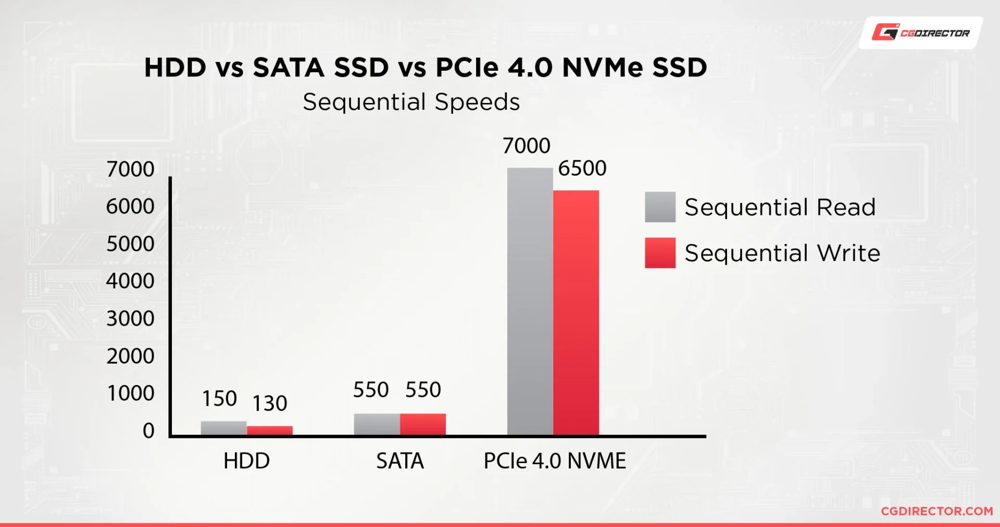
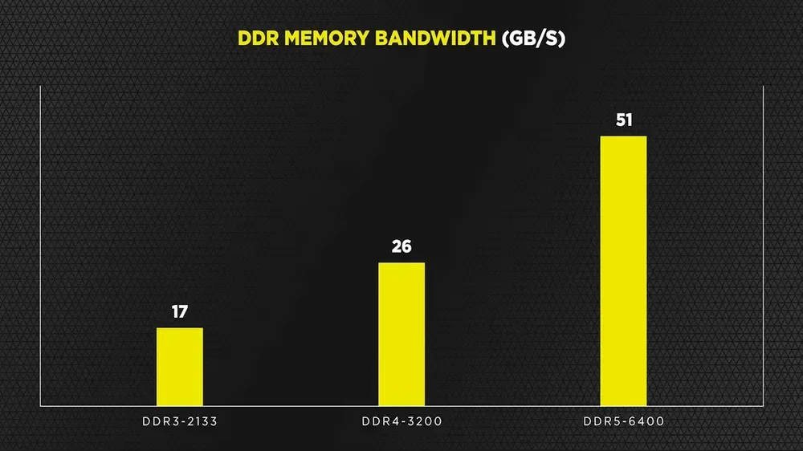
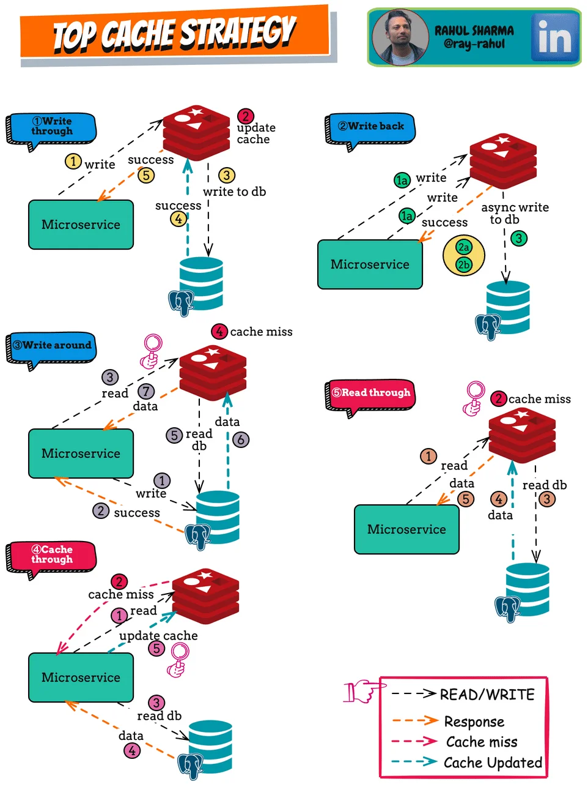

> 📆 
> 
> <a id="181eda9b0fe181ce8dedd0ec0f6dbc31"></a>
> 
> CS 특강 &#45; 제목
> 
> - 진행&#58; 김순철 튜터님
> 
> - 기간&#58; 24&#46;11&#46;27(수) 
> 
> - reference&#58;
>     -  <a href="https://beautiful-college-c84.notion.site/17a2dc3ef51480b39d8dfde2cf60f706">페이지</a> 
> 
>     - ‣

> 📌 
> 
> <a id="183eda9b0fe180ccab4bfead2f3160e4"></a>
> 
> 학습 목표
> 
> - 캐시
> 
> - Redis 찍먹

<a id="183eda9b0fe18074a41ec195b6a933c0"></a>

### Cache

<a id="183eda9b0fe1806b8659dcf8ef256638"></a>

Cache는 프랑스어 cacher에서 유래했으며, “숨기다” 또는 “저장하다”라는 의미를 가지고 있다&#46;

<a id="183eda9b0fe180a29851cbd3baa8d8b0"></a>

 주로 사냥꾼이나 탐험가들이 필요한 물품을 빠르게 사용하기 위해 숨겨두는 은닉 장소를 의미했다&#46;

<a id="183eda9b0fe1803691d3fefbdaeb8319"></a>

컴퓨터에서 캐시 또한 동일한 의미로 <strong><u>필요한 데이터를 빠르게 접근</u></strong>할 수 있도록 만들어 둔 공간을 의미한다&#46;

<a id="183eda9b0fe180fdad55cbcf47262cd0"></a>

### Cache 종류

- CPU의 L1, L2, L3 캐시

- 메모리 캐시

- 디스크 캐시

- 웹 캐시

- <strong>데이터베이스 캐시</strong>

<a id="183eda9b0fe18004ab18ecf77fe13f16"></a>

### 데이터베이스 캐시

<a id="183eda9b0fe1805aad67ccab3fe68f29"></a>

데이터 베이스 캐시는 <code>인메모리 캐시</code>, <code>쿼리 캐시</code>로 나뉜다&#46; 

- 인메모리 캐시 &#58; Redis, Memcached, Couchbase 등 

- <del>쿼리 캐시 &#58; DB 자체에서 사용하는 캐시 (동일 쿼리 실행 시 매번 조회하는 것이 아니라 캐시에 저장된 데이터를 반환해준다&#46; 그래서 쿼리 작성이 중요했었다&#46;)</del>
    - 성능적 이슈 문제로 이제는 지원하지 않는다&#46; 

> ❓ 
> 
> <a id="183eda9b0fe1803783c0d949db470874"></a>
> 
> Redis가 <strong><u>인메모리 캐시</u></strong>라고 했는데, 찾아보면 <strong><u>NoSQL</u></strong>이라고도 하던데 그럼 둘은 무엇이 다른 것인가?

<a id="183eda9b0fe1801f8f45e9e8b7f40a50"></a>

NoSQL은 관계형 데이터베이스(RDBMS)의 전통적인 구조를 따르지 않는 다양한 데이터 저장 기술을 총칭하는 용어이다&#46; 즉, 분류라고 생각하면 된다&#46; 

<a id="183eda9b0fe180c783a7e1e323af9f59"></a>

데이터베이스 캐시는 DB를 캐싱하는 목적으로 사용하는 것이다&#46; 여기서 Redis를 사용하는 이유는 DB 캐시에 적합한 모델이기 때문이다&#46; 

<a id="183eda9b0fe180059452c819bece68dc"></a>

비유) 

- 자동차 &#45; 화물차, 승용차 …

- NoSQL &#45; 인메모리 캐시, …

> ✏️ 
> 
> <a id="183eda9b0fe180edae89f749b62871af"></a>
> 
>  컴퓨터의 세계의 복사는 원본과 완벽하게 동일하다&#46;<br>따라서 복사된 데이터를 미리 복사해 두면 빠르게 접근할 수 있는 이점이 있다&#46;

<a id="183eda9b0fe1803e8664f3026ba1a77b"></a>

### Redis

> ✏️ 
> 
> <a id="183eda9b0fe1804f8f37c1be43bf87d3"></a>
> 
> 여러 종류의 캐시가 있지만 가장 많이 사용되는 Redis이다&#46;

<a id="183eda9b0fe18046a831f6bb46ba02eb"></a>

Redis는 <strong><u><code>Re</code></u></strong><code>mote </code><strong><u><code>Di</code></u></strong><code>ctionary </code><strong><u><code>S</code></u></strong><code>erver</code>의 약자이다&#46;

<a id="183eda9b0fe180e1af2dc963924fe554"></a>

여기서 Dictionary는 자바의 Map과 동일하다&#46;  ( key&#58;value 형태의 데이터 구조를 말함 )

<a id="183eda9b0fe18058b6d5fad8171b11d1"></a>

따라서 레디스는 <code>키&#45;값</code>의 쌍을 저장하는 저장소이다&#46;

<a id="183eda9b0fe1804fa80aeebd8cf88087"></a>

레디스는 데이터를 메모리에 저장하여 매우 빠른 읽기 및 쓰기 성능을 제공한다&#46;

<a id="183eda9b0fe1804982d1e8603532983c"></a>

그에 반해 DB는 파일시스템을 쓴다&#46; 즉, 파일에 데이터를 저장한다&#46; 

- 파일은 메모리가 아닌 하드디스크에 저장된다&#46; 

- 요즘에는 SSD를 많이 쓰지만, 그래도 아직 HDD를 쓰는 경우도 많고,<br>SSD라고 하더라도 메모리(RAM)가 월등하게 속도가 빠르다&#46;

<details>
<summary>🧐 메모리 vs  SSD</summary>

> ✏️ 
> 
> <a id="183eda9b0fe1803dae9bfad685d08318"></a>
> 
> <strong>SSD VS 메모리 속도 비교</strong><br><br>PCIe 4&#46;0 x4 규격의 현존 가장 빠른 NVMe SSD &#58; 읽기 약 7GB/s, 쓰기 약 7 GB/s
> 
> 
> 
> <a id="183eda9b0fe180bdba96f43e73a27326"></a>
> 
> 일반적인 DDR4 메모리 &#58; 약 25 GB/s<br>일반적인 DDR5 메모리 &#58; 약 51 GB/s
> 
> 

</details>

<details>
<summary><code>Redis</code>, <code>Rest API</code>  속도 통계 </summary>

<a id="183eda9b0fe180ec9527f8ab56064033"></a>

각각의 통상적인 응답속도는 아래와 같다&#46; 

- REST API 응답시간 &#58; 평균적으로 약 100ms &#126; 200ms (읽기/쓰기 전체 평균)

- 레디스 응답시간 &#58; 1ms 이내

<a id="183eda9b0fe18074ba5dfdd7f9521542"></a>

여기서<u> </u><code>REST API 응답시간</code>을 <strong><u>평균보다 빠른 50ms</u></strong>라고 가정하고 <strong><u>호출은 1,000,000(1백만)건</u></strong>으로 설정한다면 아래와 같은 차이가 난다&#46;

- REST API &#58; 50ms → 0&#46;05초 &#58; 0&#46;05초 &#42; 1백만 = 50,000초 =  833분 = 약 14시간 

- 레디스 1ms → 0&#46;001초 &#58; 0&#46;001초 = 1,000초 = 약 20분

<a id="183eda9b0fe180d8bb14ef16c79b3271"></a>

레디스의 가장 느린 응답(1ms)이 REST API 호출의 2배 빠른 평균응답(50ms)보다 <strong><u>약 42배 빠르다&#46;</u></strong>

<a id="183eda9b0fe18023aeb1e2466743294e"></a>

그래서 <strong><u>대용량 트래픽을 처리</u></strong>해야 하는 시스템에서는 <strong>레디스</strong>를 거의<strong> </strong><strong><u>필수적</u></strong>으로 사용한다&#46;

</details>

<a id="183eda9b0fe18078a537ece3951f1938"></a>

### Redis 단점

---

<a id="183eda9b0fe18011bb53e571bde08cbc"></a>

이렇게나 처리속도가 엄청난 레디스지만 아래와 같은 단점이 존재한다&#46;

- 메모리 제약
    - 저장소가 메모리이다 보니 용량이 제한적이다&#46; 

    - 대규모 데이터를 저장하려면 많은 메모리가 필요하고  이는 가격이 비싸다는 의미이다&#46; 

- 데이터 관리의 어려움
    - NoSQL이므로 복잡한 트랜잭션이나 RDBMS의 기능을 제공하지 않는다&#46;

- <strong>데이터 신뢰성</strong>
    - 기본적으로 메모리에 저장하기 때문에 서버가 종료되면 데이터가 손실된다&#46;

<a id="183eda9b0fe180efbbedc7a476e2cdd7"></a>

### Redis 적용시 주의사항

> ☝🏻 
> 
> <a id="183eda9b0fe1808bacbfd975ebcc6f92"></a>
> 
> Redis 적용 뿐만 아니라 캐시, DB의 인덱스에 모두 해당하는 내용이다<br>캐싱 적용을 할 때는 반드시 자주 사용 될 것으로 예상되는 데이터에 적용해야 한다&#46;<br>만약 10만건 중에 10건 정도(0&#46;00001%) 접근하는 데이터를 캐싱 한다면 굳이 필요없는 캐싱 공간만 차지하고 캐시 서버를 구성하고 유지관지하는 비용만 버리는 셈이다&#46;

>  데이터를 캐싱 시, 고려 상황

- <strong>데이터 접근 빈도</strong>
    - 자주 조회되는 데이터는 캐싱에 적합하다&#46;

- <strong>데이터 변경 빈도(= 일관성)</strong>
    - 변경이 잦거나 실시간 제공되어야 하는 데이터는 캐싱 대상이 되면 안된다&#46; 

- <strong>데이터의 위치</strong>
    - 내부 시스템에 있는 데이터는 캐싱 효율성이 매우 떨어진다&#46;

- <strong>데이터 사용 패턴 </strong>
    - 위 일관성과 비슷한 내용인데, 쓰기 빈도가 높다면 데이터 일관성이 떨어지므로 캐싱 대상에 부적합하다&#46;

<a id="183eda9b0fe18041881ae7bf066f2144"></a>

### Redis의 자료형

> Reids의 주요 자료형에는 아래와 같은 것들이 있다&#46;

- <strong>Strings</strong>
    - 가장 기본적인 데이터 타입으로 문자열, 숫자, 바이너리 데이터 저장 가능

    - 주요 명령어&#58; SET, GET, INCR, DECR

- <strong>Hashes</strong>
    - 필드&#45;값 쌍으로 구성된 해시 테이블

    - 주요 명령어&#58; HSET, HGET, HDEL

- <strong>Lists</strong>
    - 순서가 있는 문자열의 컬렉션으로 큐 및 스택으로 사용

    - 주요 명령어&#58; LPUSH, RPUSH, LPOP, RPOP

- <strong>Sets</strong>
    - 고유한 문자열의 집합

    - 주요 명령어&#58; SADD, SREM, SMEMBERS

<a id="183eda9b0fe180d3bc7fc0241d6d0f8f"></a>

### Redis 유효기간

<a id="183eda9b0fe1805dbdede70c8383de06"></a>

Redis에는 DB에는 없는 특별한 기능을 제공한다&#46; 바로 <strong><u>데이터의 유효기간</u></strong>이다&#46;

- 일반적으로 데이터의 유효기간을 TTL(Time to live)라고 말하는데, 레디스에서는 이를 <strong><u>Expire</u></strong>라고 표현한다&#46;

<a id="183eda9b0fe1800e95d8cbe181fb6294"></a>

Expire를 사용하면 만료된 데이터를 직접 제거할 필요없이 자동으로 삭제가 된다&#46; 

<a id="183eda9b0fe180628c57e0ce28ea730a"></a>

이는<strong><u> 삭제할 데이터 관리</u></strong>를 위해 <strong><u>삭제 대상의 선정, 조회, 삭제를 직접 처리하지 않</u></strong>아도 되어 <u>유지보수를 용의</u>하게 한다&#46; 

<a id="183eda9b0fe180f59d71c79b14ffb6d4"></a>

```java
SET mykey "Hello, Redis!"
EXPIRE mykey 10 // mykey의 유효기간을 10초로 설정
```

<a id="181eda9b0fe181f18168e73651cc3777"></a>

### 실습 코드

[GitHub &#45; suncheolKim/movie&#45;peronalize&#45;api at redis]()



- 영화정보 API를 활용해서 레디스를 적용

- 운영 전략이 있는데 여기서는 가장 일반적인 4번 Cache Through 방식을 사용

> <strong>Redis</strong>

<details>
<summary>docker&#45;compose&#46;yml</summary>

<a id="183eda9b0fe18018811ffcd61c27bd57"></a>

```java
version: '3.8'

services:
  redis:
    image: redis:latest
    container_name: redis
    ports:
      - "6379:6379"
    volumes:
      - redis-data:/data

volumes:
  redis-data:
```

</details>

<details>
<summary>yml</summary>

<details>
<summary>application&#46;yml</summary>

<a id="183eda9b0fe18036a5bfdec12e9026a7"></a>

```java
spring:
    application:
        name: movie-peronalize-api

api:
    movie-info-api: http://localhost:8083/v1

redis:
    host: localhost
    port: 6379
```

</details>

<details>
<summary>application&#45;dev&#46;yml</summary>

<a id="183eda9b0fe180809970fc9359bf193a"></a>

```java
spring:
    application:
        name: movie-peronalize-api

api:
    movie-info-api: http://14.39.87.109:8083/v1

redis:
    host: localhost
    port: 6379
```

</details>

</details>

<details>
<summary>Redis Config</summary>

<a id="183eda9b0fe180deb580c80335ae1c32"></a>

```java
package kr.sparta.movieperonalize.config;

import kr.sparta.movieperonalize.recommand.dto.MovieDto;
import org.springframework.beans.factory.annotation.Value;
import org.springframework.context.annotation.Bean;
import org.springframework.context.annotation.Configuration;
import org.springframework.data.redis.connection.lettuce.LettuceConnectionFactory;
import org.springframework.data.redis.core.RedisTemplate;
import org.springframework.data.redis.serializer.GenericJackson2JsonRedisSerializer;
import org.springframework.data.redis.serializer.StringRedisSerializer;

import java.util.List;

@Configuration
public class RedisConfig {
    @Value("${redis.host}")
    private String host;
    @Value("${redis.port}")
    private int port;

    @Bean
    public LettuceConnectionFactory redisConnectionFactory() {
        return new LettuceConnectionFactory(host, port);
    }

    @Bean
    public RedisTemplate<String, List<MovieDto>> redisTemplate(LettuceConnectionFactory connectionFactory) {
        RedisTemplate<String, List<MovieDto>> template = new RedisTemplate<>();
        template.setConnectionFactory(connectionFactory);
        template.setKeySerializer(new StringRedisSerializer());
        template.setValueSerializer(new GenericJackson2JsonRedisSerializer());

        return template;
    }
}

```

</details>

<details>
<summary>&#91; 전체 코드 &#93; RecommendService</summary>

<a id="183eda9b0fe180f3852ffa8797d62371"></a>

```java
package kr.sparta.movieperonalize.recommand;

import jakarta.annotation.PostConstruct;
import kr.sparta.movieperonalize.recommand.dto.MovieDto;
import kr.sparta.movieperonalize.recommand.enumtype.MovieGenre;
import lombok.extern.slf4j.Slf4j;
import org.springframework.beans.factory.annotation.Value;
import org.springframework.data.redis.core.RedisTemplate;
import org.springframework.stereotype.Service;
import org.springframework.util.StopWatch;
import org.springframework.web.reactive.function.client.WebClient;
import org.springframework.web.util.UriComponents;
import org.springframework.web.util.UriComponentsBuilder;
import reactor.util.retry.Retry;

import java.time.Duration;
import java.util.List;
import java.util.concurrent.TimeUnit;

@Slf4j
@Service
public class RecommendService {
    @Value("${api.movie-info-api}")
    private String movieInfoApiUrl;

    private final WebClient.Builder webClientBuilder;
    private final RedisTemplate<String, List<MovieDto>> redisTemplate;

    private WebClient webClient;
    private UriComponents movieInfoApiUriComponent;

    public RecommendService(WebClient.Builder webClientBuilder, RedisTemplate<String, List<MovieDto>> redisTemplate) {
        this.webClientBuilder = webClientBuilder;
        this.redisTemplate = redisTemplate;
    }

    @PostConstruct
    private void init() {
        this.webClient = webClientBuilder.build();
        this.movieInfoApiUriComponent = UriComponentsBuilder
                .fromUriString(movieInfoApiUrl)
                .path("/movies")
                .build();
    }

    public List<MovieDto> getMoviesByGenre(MovieGenre movieGenre) {
        final StopWatch stopWatch = new StopWatch();

        // 1. Redis에서 캐시 조회
        // Dictionary
        final String prefix = "movies:genre:";
        final String key = prefix + movieGenre.name();

        stopWatch.start("Redis 조회");
        List<MovieDto> movieDtos = redisTemplate.opsForValue().get(key);
        stopWatch.stop();

        // 2. 캐시에 데이터가 없으면
        if (null == movieDtos) {
            // 2-1. API 호출
            final String movieInfoByGenreUri = movieInfoApiUriComponent.expand(movieGenre).toUriString();

            stopWatch.start("API 호출");
            movieDtos = webClient.get()
                    .uri(movieInfoByGenreUri)
                    .retrieve()
                    .bodyToFlux(MovieDto.class)
                    .filter(movieDto -> movieDto.getGenre().contains(movieGenre.getKorean()))
                    .retryWhen(Retry.backoff(3, Duration.ofMinutes(500)))
                    .timeout(Duration.ofSeconds(3))
                    .collectList()
                    .block();
            stopWatch.stop();

            // 2-2. 응답 값 레디스에 저장
            if (null != movieDtos) {
                redisTemplate.opsForValue().setIfAbsent(key, movieDtos, 10, TimeUnit.SECONDS);
            }
        }

        log.info(stopWatch.prettyPrint(TimeUnit.SECONDS));

        return movieDtos;
    }
}
```

</details>

<a id="183eda9b0fe18083947be78b57f9f913"></a>

요즘은 redisTemplate이 아닌 rettuce를 사용한다고 하니, 해당 방법도 학습해서 추가로 정리할 것

- <a href="#/post/1c3eda9b-0fe1-81c7-ae23-cfbc9fd6e83a">페이지</a> &#45; 

<a id="183eda9b0fe18054a6e8e93fbf0af834"></a>

### 번외   &#45; feign 

<a id="183eda9b0fe18053a8c5e040953b836e"></a>

‣

<a id="183eda9b0fe180cd9274c4257b6a980f"></a>

### ☝🏻 면접에서 자주 나오는 Redis 질문

<a id="183eda9b0fe180efb6a8cd91ec13589b"></a>

레디스는 면접 단골 질문 중에 하나 입니다&#46; 레디스를 사용했다고 이력서에 작성했다면 높은 확률로 나오는 질문을 적어 두었습니다&#46; 학습을 해보시라는 의미로 답은 적어두지 않았습니다&#46; 직접 찾아서 정리 해보시길 바랍니다&#46;

<details>
<summary><strong>Redis의 데이터 지속성(persistence 또는 백업) 방식에는 어떤 것이 있는가?</strong></summary>


</details>

<details>
<summary><strong> Redis 클러스터와 Sentinel의 차이점은 무엇인가?</strong></summary>


</details>

<details>
<summary><strong>Redis Sentinel의 페일오버(Failover&#58; 하나의 서버가 죽었을 때 다른 서버가 이를 대체하는 것) 과정은 어떻게 이루어 지는가?</strong></summary>


</details>
