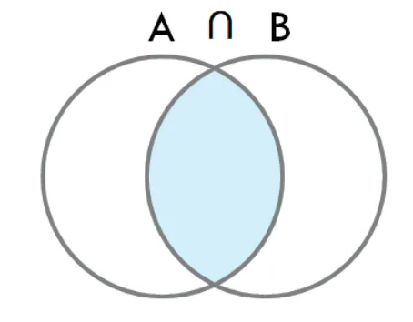
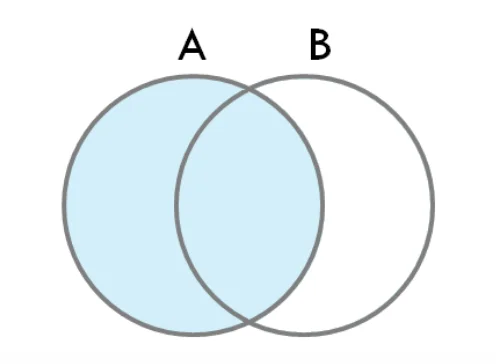
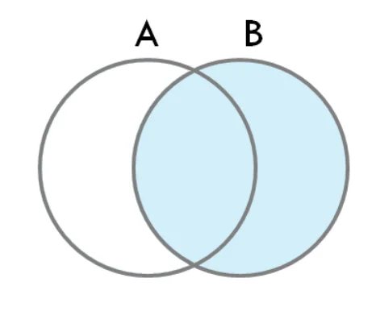
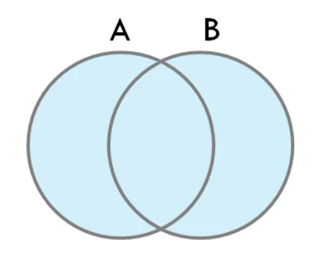

## 질문

### 첫번째 질문 아래 2개 중 하나 (Java, Spring)

- 오버로딩(Overloading)과 오버라이딩(Overriding)의 차이점은 무엇인가요?
    

    <code>오버로딩</code>은 <strong><u>같은 이름의 메서드</u></strong>를 <u>매개변수의 타입이나 개수를 다르게</u> 하여 여러 번 정의하는 것을 의미합니다&#46; 이를 통해 <strong><u>같은 이름의 메서드</u></strong>가 <strong>다양한 input(매개변수) 형태에 대응</strong>할 수 있습니다&#46; 

    

    <code>오버라이딩</code>은 상속받은 부모의 메서드를 자식 클래스에서 변경하는 것을 의미합니다&#46; 

    

    이를 통해, 부모 클래스의 메서드를 자식 클래스에 맞게 재정의 할 수 있습니다&#46; 

    

    둘다 객체지향의 특성들 중 하나인 다형성을 활용한 방법으로 코드의 재사용성 및 유지보수성을  코드의 생상성을 높일 수 있습니다&#46;

- 오버로딩, 오버라이딩 &#45;  컴파일, 런타임 시점에 달라질 수 있다&#46;

- 런타임, 컴파일 

- 오라이딩, 오버로딩 중복 사용 가능한가?

- IoC(Inversion of Control)와 DI(Dependency Injection)에 대해 설명해주세요&#46;
    

    IoC(Inversion of Control)와 DI(Dependency Injection)는 소프트웨어 개발에서 <strong><u>객체의 생성과 제어를 외부로 넘기는 설계 패턴</u></strong>입니다&#46;

    

    IoC, 제어의 역전은 프로그램의 제어 흐름을 외부로 넘기는 것을 말하며, DI, 의존성 주입은 객체의 의존성을 외부에서 주입하는 것을 말합니다&#46;

    - Spring에서는 이를 지원하기 위해 Application Context 즉, Spring IoC 컨테이너를 지원합ㅂ니다&#46;  이를 통해 객체 간의 의존성을 낮추고, 유연하고 확장 가능한 앱을 설계할 수 있습니다&#46; 

- 생명주기

- DI &#45; 생성자 방식을 권장하는 이유이다&#46;

- 테스트 

### 두번째 질문 아래 2개 중 하나 (CS, DB)

1. 조인(Join)의 종류와 각 방식의 특징에 대해 설명해주세요&#46;
    - Inner Join 
        -  A ∩ B

        

        

        교집합 연산과 동일하며, 기존 테이블과 조인 테이블의 교집합 데이터를 결과로 추출하는 것을 말합니다 &#46; 

    - Left outer Join 
        - ( (A ∩ B) ∪ (A &#45; B) 
            

        - A 테이블을 기준 테이블, B 테이블을 조인 테이블이라고 했을 경우, A와 B의 교집합, A 와 B의 차집합의 합을 말합니다 &#46;
            

            따라서 A와 B에 차집합에 대한 컬럼의 경우, B 테이블 즉, 조인 테이블의 데이터 값이 null 값이 나오게 되어 사용 시,  NullPointException에 대한 주의가 필요합니다&#46; 

    - Right outer join
        - ( (A ∩ B) ∪ (B &#45; A) 
            

        - A 테이블을 기준 테이블, B 테이블을 조인 테이블이라고 했을 경우, A와 B의 교집합,  B와 A의 차집합의 합을 말합니다&#46;
            

            따라서 B와 A에 차집합에 대한 컬럼의 경우, left Join 과 반ㄷ로  A테이블 즉, 기준 테이블의 데이터 값이 null 값이 나오게 되기 때문에 사용 시,  NullPointException에 대한 주의가 필요합니다&#46; 

    - Full outer join
        - A ∪ B

        

        -   Full outer join은 합집합 연산 결과와 같습니다&#46;

    - JPQL &#45; join 연산과, fetch Join 연산의 차이점 
        

         

1. 트랜잭션(Transaction)의 4가지 특성(ACID)에 대해 설명해주세요&#46;
    - 원자성
        

        트랜잭션 자체가 쪼개질 수 없는 최소의 단위인 하나의 원자처럼 동작한다는 의미입니다&#46; 

        

        즉, 트랜잭션 내부의 동작을 하나의 사이클로 판단하고, 트랜잭션 내부의 모든 작업들이 정상적으로 수행되거나, 어떠한 연산도 수행되지 않는 <code>All</code> or <code>Nothing</code> 방식이여야 한다는 것 입니다&#46;

        

        예를 들어 하나의 트랜잭션으로 정의한 서비스 레이어 내부의 메서드에 4개의 동작이 정의되어 있다면, 4가지의 동작이 모두 성공되었을 때, 해당 트랜잭션의 결과가 성공적으로 DB에 반영되어야 한다는 것 입니다&#46; 

    - 일관성
        

        트랜잭션의 실행이 성공적으로 완료되면, 언제나 일관성 있는 데이터베이스 상태로 변환되어야 한다는 특성입니다&#46;  

    - 고립성
        

        하나의 트랜잭션이 실행하고 있는 도중에 다른 트랜잭션에서 영향을 주면 안된다라는 특성입니다 

    - 지속성
        

        성공적으로 완료된 트랜잭션의 결과는 시스템이 고장나더라도 영구적으로 반영되어야 한다&#46;

1. 추가 질문 예상) 트랜잭션 연산
    - commit  연산
        

        commit 연산은 한개의 논리적 단위(트랜잭션)에 대한 작업이 성공적으로 끝났고 데이터베이스가 다시 일관된 상태에 있을 때, 이 트랜잭션이 행한 갱신 연산이 완료된 것을 트랜잭션 관리자에게 알려주는 연산입니다&#46; 

    - Rollback 연산
        

        Rollback 연산은 하나의 트랜잭션 처리가 비정상적으로 종료되어 데이터베이스의 일관성을 깨뜨렸을 때, 이 트랜잭션의 일부가 정상적으로 처리 되었더라도 트랜잭션의 원자성을 구현하기 위해 이 트랜잭션이 행한 모든 연산을 취소(Undo) 하는 연산이다&#46; 

        

        Rollback 시, 해당 트랜잭션을 재시작하거나 폐기한다&#46; 

- 일관성

- AOP 에 대해서 
    - A → B 호출 트랜잭션 

- 프록시 패턴 

### 세번째 질문 아래 2개 중 하나 (인성, 협업 등)

1. 상사나 동료로부터 부당하다고 느끼는 요구가 있을 때 어떻게 대처하시나요?
    

    ‘부당하다’라는 단어에 대해서 어떻게 정의하냐에 따라 다른 것 같습니다&#46;

    

    정말 인격적으로 모독하는 발언들이나, 말도 안되는 요구들을 저는 기피하는 것 같고, 단호하게 대처를 하든 돌려서 말하든 ‘거절’ 의사를 표현하는 것 같습니다&#46; 

    

    그 외 팀과 조직 전체를 기준으로 판단했을 때, 예를 들어 특정 이벤트로 인한 야근이나, 갑작스런 버그로 인해 일을 처리해야 할 때, 해당 조직에 속해 있다면 어느 정도 책임감이 있어야 된다고 생각하고,  어느 부분은 감소해야 된다 라고 생각합니다&#46; 

1. 일정이 지연될 수 있는 상황에서 어떻게 대처하시나요?
    

    우선 하나의 일정에 대해서 최대한 쪼개서 단계적으로 일을 처리할 수 있도록 노력하는 것 같습니다 &#46;

    

    특히 팀프로젝트를 하면서 많이 느꼈던 점은 내가 상황과 의도가 명확하게 전달되어야 한다 라는 것 같습니다 

    

    그렇기 위해서는 모호한 개념은 더 작은 단위로 구체화하고 단계적으로 나태낼 수 있어야 한다고 생각합니다 

    

    또한 단계적으로 나눔으로써 해당 작업에 대해 명확한 수치화된 통계를 나타낼 수 있다고 생각합니다&#46;

    

    따라서 일정이 지연됨에 있어서, 내가 지금 해당 작업에 대해서 어느 정도의 작업이 남았고, 어느 정도 추가로 염두해 두고 있다라는 명확한 수치적인 계산이 될 것이며, 이를 통해 팀원들을 설득하거나 도움을 얻을 것 같습니다 

### 피드백

- 오버로딩, 오버라이딩, 시점
    - 오버로딩이 컴파일 시점에 결정되고, 오버라이딩이 런타임 시점에 결정된다&#46; 

    - 오버로딩이 컴파일 시점에 결정된다는 말은 이름은 같지만, 매개변수의 타입이 다르다&#46; 

    - 컴파일을 하는 시점에 문법적으로 결정되서 1차적으로 끝난다&#46;

    - 오버라이딩, 다형성 &#45; 런타임에 들어가야 jvm으로 인해서 된다&#46;

- 오버로딩과 오버라이딩이 동시에 사용할 수 있는가?
    - 자식 클래스에서 오버라이드한 오버로딩이 가능하다&#46;

    - 동시에 사용할 수 있는가, 컴파일, 런타임에 대해서 한번 더 공부해야 한다&#46;

- 더 깊게 파야한다, 방법론을 내재화 해서 혼자서 해야한다&#46;

- Ioc, DI
    - 생성자 사용 이유, 테스트 이유 
        - 모르는게 있을 때도, 어떻게 대처하는 것을 보고 싶어한다&#46; 

        - 준비한 것 가지고, 아니면 애드립으로 임기응변으로 대처할 수있다&#46; 

    - 못한 것에 집중하면 면접대 맨탈이 나간다&#46;

    - inner, outer join기준이 되는 테이블이 가져오고, null 이 있어도 가져온다&#46;
        - 차이점을 가지고 설명하는 것이 더 명확하다&#46; 

        - out join은 없어도 다 가져올 수있다&#46; 

    - join 연관된, 엔티티에 대해서만 가져온다&#46; 

    - fetch join 
        - 전체다 바로 가져오는 것

    - join 
        - N &#43; 1 문제 해결할 수있다&#46; 무분별하게 사용하면 필요없는 데이터를 가져올 수 있다&#46;

        - 연관된 엔티티를 다 가져오는 것이 아니고, 호출한 엔티티만 가져온다&#46;

    - 모르면 모른다고, 깔끔하게 얘기하는 것이 맞는 것 같다&#46; 추후에 공부를 다시하는 것이 맞다&#46;

    - 인성 면접, 컬처 면접
        - 그것을 다시 정의해야 한다&#46;

        - 부당이라는 단어는 관점에 따라 다를 수 있다&#46;

        - 내 입장에서는 부당할 수 있지만, 신입이라서 부당하다고 느낄 수 있다고 한다&#46; 

        - 뒤에  맥락이라, 히스토리 같은 경우, 내가 순간에 임시적으로 부당하고 느낀다고 생갛 

        - 시간을 들여서 더 파악하거나, 이해할려고 하거나 해야 한다&#46;

        - 나의 생각을 잘 전달하는 것이 중요하다&#46;
            - 간신배 같이 말고…

        - 야근 이라는 것은 장기적으로 지속적으로 

        - 백엔드 개발자라면 야근은 어느 정도 이해할 수 있다&#46; 

        - 업무 특성상 이해를 하고 있다&#46; 

    - 말을 조금 더 명로하게, 자신있게 해야한다&#46;

    - 자신이 없다고 느낀다거나, 발음을 더 명료하게 해야한다&#46;

    - 메세지를 명료하게 해야한다&#46; 

> 그 기술에 단점이나, 리스크도 인지하고 있는가요?

좋은 점만이 아닌, 리스크나 확장에 대해 비용적인 나쁜 점들도 알고 있고 설명할 수 있는 것이 좋다&#46; 

그냥 구현이나, 설명은 이제는 큰 의미가 없다&#46; 

너무 자료가 많다&#46; 차별점을 가지기 위해서는 어느 부분에 더 집중적으로 생각해야 한다&#46;

> 포괄 임금제

- 야근 수당까지 포괄한다&#46;

- 돈보다 중요한 것은, 회사가 노력을 하는가가 중요하다&#46;

- 그만큼의 휴식을 줄려고 노력하는가? 

- 점심때 카드라도 주면서 밥을 주는가? 

- 포괄 임금제니까  당연한 것이다&#46;
    - 도망쳐라 

포괄 임금제

근로자에 대한 문화 등

> 연봉 협상의 팁

- 연봉에 팁, 이론적인 

- 연봉 협상이 아닌 연봉 통보이다&#46; 

- 평소에 내가 한 일들을 기록해야 한다&#46; 

- 핵심 일들에 대해서는 수치화 하는 것이 좋다&#46; 
    - 개선 작업, 

    - 레거시 상태 측정, 베포하기 전 개선 수치

    - 문서에 대한 수치 
        

        → 어필 

- 이직을 할 때 쓰면 좋다&#46;

- 그래서 블로그를 열심히 하면 좋다&#46;

- 왜 이것에 대해 써야하는지, 왜 이것이 좋은지? 이유에 대해서 자신만의 색깔 드러내는 방법이 최고다&#46; 

- 좋은 회사면 알아서 해준다&#46; 물론 놓칠 수 있다&#46; 

- 모든 사람을 관찰하는 것이 아니까, 스스로가 어필을 해야한다&#46;

- 연봉 협상 전, 딴 회사에 지원한다&#46;

- 그걸가지고 현 회사에 

- 일을 잘하면 알아서 올려준다? 이것은 아니다&#46;

- 회사에서는 자원이 한정되어 있기 때문에, 당연히 어느 정도는 본인이 챙겨야한다&#46;

- 우선순위가 비슷하면 어필을 더 하는 사람에게 줄 수 없다&#46; 

> Github 자료 우선적으로 자료가 부족해 지면 

- 책보다, 기술 블로그를 보는 것이 좋다&#46; 

- 책이 좋기는 하지만, 책의 위험성이 있다&#46; 
    - 클린 코드
        - 이런 책을 잘못보면, 너무 여기에 생각이 가칠 수있다&#46; 

        - 다른 사람들이 실제 어떻게 적용하는 것이 

- 유튜브 컨퍼런스 영상 
    - 그걸 보면서 궁금해지는 것이 나오면, 찾아보고, 

    - 한쪽에 쏠리는 이것을 해결할 수 없으면 그때 책을 사서 보는 것이 좋다&#46; 

- ex) 도메인 주도 개발, 
    - 컴퓨터에서 자료를 계속 찾아보고, 더이상 자료가 나오지 않는 경우 책을 사서 본다&#46;

    - 바로 책을 보면 판단 기준이 애매하다&#46;
        - 대규모 시스템 설계 기초

        - 도메인 주도 개발

        - 스프링 책

        - 이펙트브 자바

        - 실용주의 프로그래머 
            - ex) 중요한 것만 외래키로 연결하지 않는다&#46; 이런 것들, 이론적과 실무는 다르다&#46;

- 원칙은 중요하지만, 실무적으로 사고할 수 있는 것이 좋다&#46; 

미시적인 뿐만 아니라, 거시적으로 사회적인 개념들을 보고 배경을 쌓는 것이 좋다&#46;

- 피드백
    

    설명이 덜 된 것 같아서, 깔끔하게 끝내고 턴을 넘겨라

- cs
