[Video Conferencing, Web Conferencing, Webinars, Screen Sharing]()

> 🧷 
> 
> <a id="18feda9b0fe180e385bce31564f20ed7"></a>
> 
> 지난 시간엔 데이터베이스 설계와 기능(트랜잭션, 락)에 대해서 알아보았습니다&#46;<br>이번 특강에서는 좋은 코드를 작성하기 위한 원칙과 패턴에 대해서 알아보고자 합니다&#46;
> 
> <a id="18feda9b0fe18092a5cbe960b683827a"></a>
> 
> 아래 원칙과 패턴들을 활용하여 현재 우리가 사용하는 Java와 Spring 코드가 만들어졌음을 이해하고 하나씩 정립해 가시면 좋겠습니다&#46;
> 
> <a id="18feda9b0fe180379872e68fc24187fe"></a>
> 
> 아직 구현에 익숙하지 않으신 분은 이러한 개념들이 있다는 것을 알아주셨으면 합니다&#46;
> 
> <a id="18feda9b0fe180bb8daae54b6880a8d9"></a>
> 
> <strong>해당 원칙들과 다자인 패턴은 기술면접에서도 단골 질문들입니다&#46;</strong>
> 
> ---
> 
> <a id="18feda9b0fe180c18649dc27b7d4c968"></a>
> 
> <strong>(주의)</strong>
> 
> <a id="18feda9b0fe180c884a0c0d55a4d975b"></a>
> 
> <strong>해당 내용을 무리하게 적용하려고 하지마세요&#33;&#33;&#33; <br>원칙과 패턴을 잘못 적용하게 되면 오히려 유지보수를 헤치게 됩니다&#33;&#33;&#33;</strong>

<a id="18feda9b0fe180719170da670d10e56a"></a>

# 1&#46; OOP 다시보기

- <strong><code>객체 지향 프로그래밍(Object Oriented Programing)</code></strong>은 현실 세계에 존재하는 개념을 데이터와 행동으로 정의한 클래스들의 관계를 기반으로 프로그래밍하는 방식입니다&#46;

---

<a id="18feda9b0fe180aa9cfff01ab406ae85"></a>

## 1&#45;1&#46; 객체<strong>, </strong>클래스

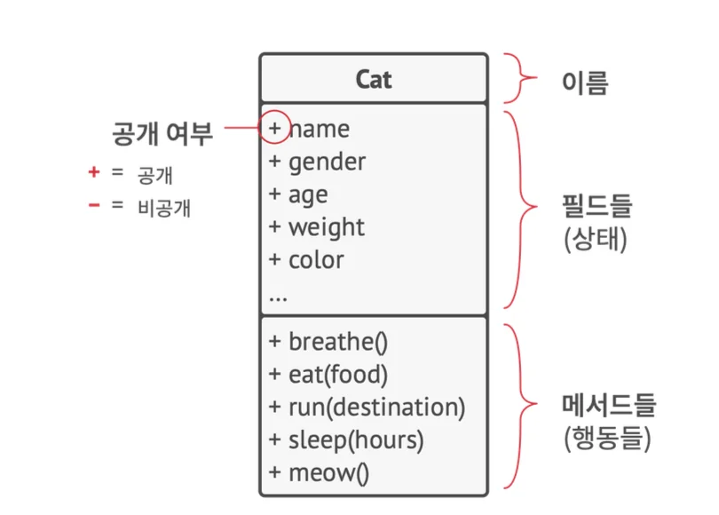

- <strong><code>클래스</code></strong> <strong>&#58;</strong> 객체들의 구조를 정의한 틀(청사진)입니다&#46;

- <strong><code>객채</code></strong><strong> &#58; </strong>객체는 클래스를 구상한 인스턴스(사례)입니다&#46;

---

<a id="18feda9b0fe180008672dc8964b38f84"></a>

## 1&#45;2&#46; 클래스<strong> </strong>계층구조

- 단일 클래스를 정의하는 것은 간단한 할 수 있습니다&#46; 하지만 현실 세계가 복잡하듯이 대부분 프로그램은 하나 이상의 클래스가 포함되어 있습니다&#46; 이러한 클래스 중 일부는 클래스 계층구조로 구성될 수 있으며, 우린 이를 상속이라고 배웠습니다&#46;
    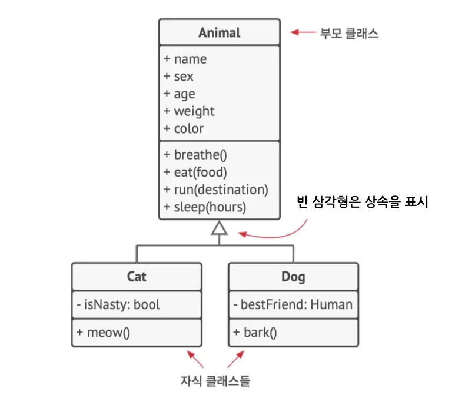

- 위 그림에 정의한 것과 같은 상위 클래스를 <strong><code>부모 클래스</code></strong>라고 하위 클래스를 <strong><code>자식 클래스</code></strong>라고 부를 수 있습니다&#46;

- 해당 클래스들의 관계는 빈 삼각형으로 표시하여 식별할 수 있습니다&#46; <br>이를 통해 <strong><code>고양이</code></strong>는 <strong><code>meow(야옹)</code></strong> 메서드가 있고 <strong><code>강아지</code></strong>에는 <strong><code>bark(멍멍 짖는)</code></strong> 메서드로 구분할 수 있습니다&#46;

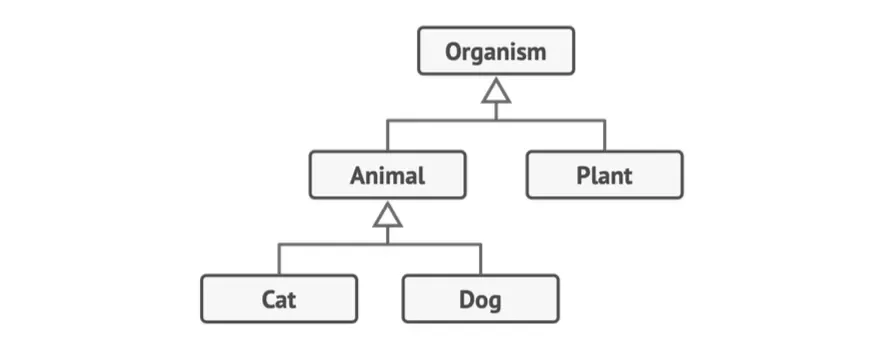

- 더 나아가 <strong><code>Organisms(모든 생명체들</code></strong>)라는 더욱 일반적인 클래스를 추상화할 수도 있습니다&#46; 이 클래스는 <strong><code>Animals(동물들)</code></strong> 및 <strong><code>Plants(식물들)</code></strong>에 대한 부모 클래스가 될 것입니다&#46; 이런 클래스들의 피라미드가 바로 계층구조입니다&#46; 

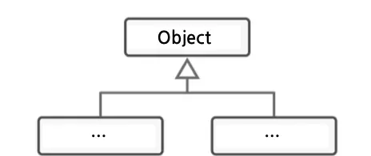

<a id="18feda9b0fe18044b11fd24ff85b689c"></a>

→ 또한 실제 코드에서는 확인할 수 없지만 우리가 구현하는 모든 클래스는 최상위 클래스인 <strong><code>Object</code></strong>를 상속받게 설정되어 있습니다&#46;

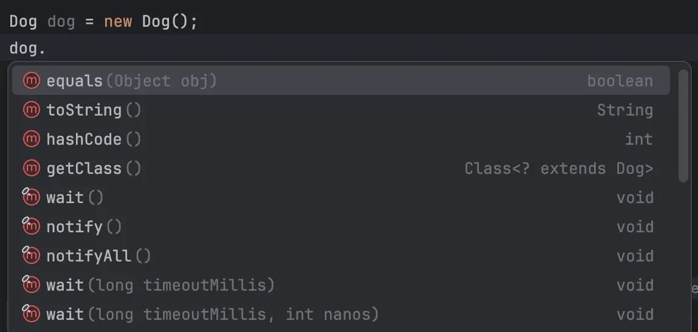

<a id="18feda9b0fe1803ebe31e07f17798ae0"></a>

## 1&#45;3&#46; <strong>OOP 핵심 개념</strong>

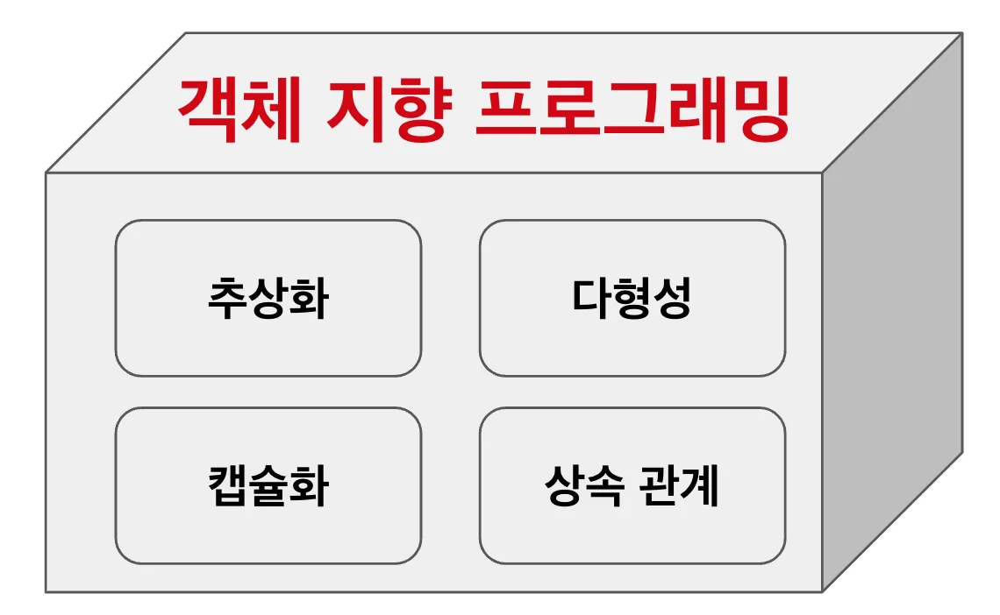

- OOP는 다른 프로그래밍 체계들과 차별화하는 4가지 개념들을 기반으로 합니다&#46;

---

<a id="18feda9b0fe18020aa04f786c7cf51b9"></a>

### 1) 추상화

- 대부분의 경우 OOP를 사용하여 프로그램을 만들 때는 실생활에 존재하는 개념들을 기반으로 객체들을 구상합니다&#46; 

- 그러나 프로그램의 객체들은 실존 객체들의 속성들을 정확하게 구현하지 못하며 그럴 필요도 없습니다&#46; <br>대신 프로그램의 객체들은 특정 맥락만 실제 객체들의 속성들과 행동들을 모델링하고 나머지들은 무시합니다&#46;
    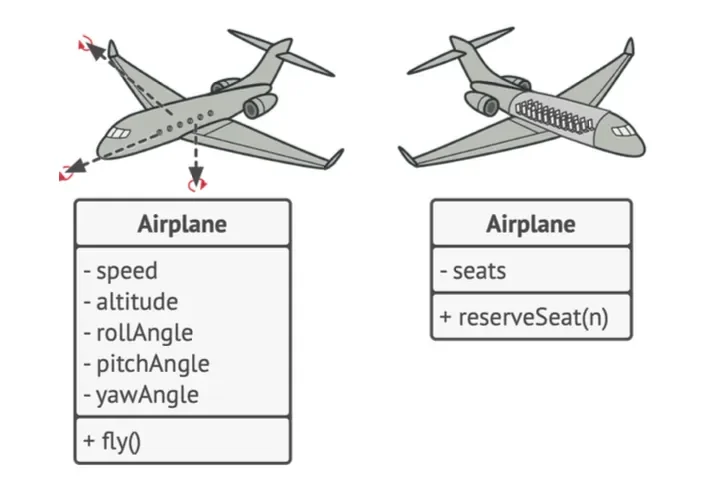

- 예를들어 <strong><code>Airplane(비행기)</code></strong> 는 <strong><code>비행 시뮬레이터</code></strong>와 <strong><code>항공 좌석 예약 앱</code></strong> 모두에 구상할 수 있습니다&#46; <br><strong><code>비행 시뮬레이터</code></strong>가 실제 비행과 관련된 세부 정보들을 담고 있다면, <br><strong><code>항공 좌석 예약 앱</code></strong>에서 사람들이 신경쓰는 건 좌석 배치도와 예약 가능한 좌석들 같은 정보만 있으면 됩니다&#46; <strong>즉, 추상화는 맥락에 따라 핵심적인 개념 또는 기능들로 제한하여 필요한 정보만을 취합한 것이라고도 볼 수 있습니다&#46;</strong>

<a id="18feda9b0fe1800ba741de44bee96b20"></a>

### 2) 캡슐화

- 우리가 자동차 시동을 걸려면 버튼을 누르거나 키를 돌리기만 하면됩니다&#46; <br>그 안에 장치들(실린더, 피스톤) 등은 감추어져 있기도 하지만 장치들에 대해서 몰라도 시동을 걸 수 있죠&#46; <br>이때 버튼과 키는 객체의 인터페이스를 의미합니다&#46; <br><strong>즉,  </strong><strong><code>인터페이스</code></strong><strong>는 다른 객체와 상호작용할 수 있는 객체의 공개된 부분입니다&#46;</strong><br><strong>캡슐화는 객체가 그 상태와 행동의 일부를 다른 객체들로부터 숨기고 제한된 인터페이스만 노출하는 개념입니다&#46;</strong>

- <strong><code>캡슐화</code></strong>를 한다는 것은 인터페이스르 제외한 부분을 <strong><code>private(비공개)</code></strong>로 제한한다는 것을 의미하기도 합니다&#46;<br>또는 protected 접근제한자로 상속받은 객체들은 사용할 수 있게 허용하는 것도 포함합니다&#46;

- 우리가 <strong><code>인터페이스</code></strong>를 사용하는 가장 큰 이유는 캡슐화하기 위함이며 <strong><code>인터페이스</code></strong>에 필드를 선언할 수 없는 이유이기도 합니다&#46;

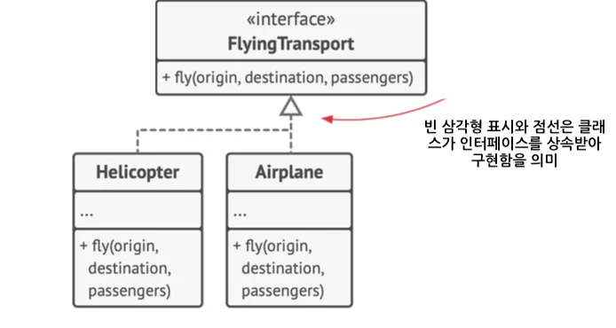

- 비행기를 사용하려는 관점에서는 <strong><code>fly(비행하다)</code></strong> 외에는 관심 밖의 영역인 것입니다&#46;

<a id="18feda9b0fe1807faba2d24aac10e541"></a>

### 3) 상속

- <strong><code>상속</code></strong>은 기존 클래스들 재사용하여 새로운 클래스를 만드는 과정입니다&#46; 

- 기존 클래스와 약간 다른 클래스를 만들고 싶을 때 <strong><code>기존 코드를 복제할 필요가 없이</code></strong> 기존(부모) 클래스를 <br><strong><code>확장</code></strong>한 후 부모 클래스의 필드와 메서드를 사용하거나 자식 클래스에서 추가하면 됩니다&#46; 

- 때에 따라서 부모 클래스를 추상 클래스로 만들 수 있습니다&#46;<br>

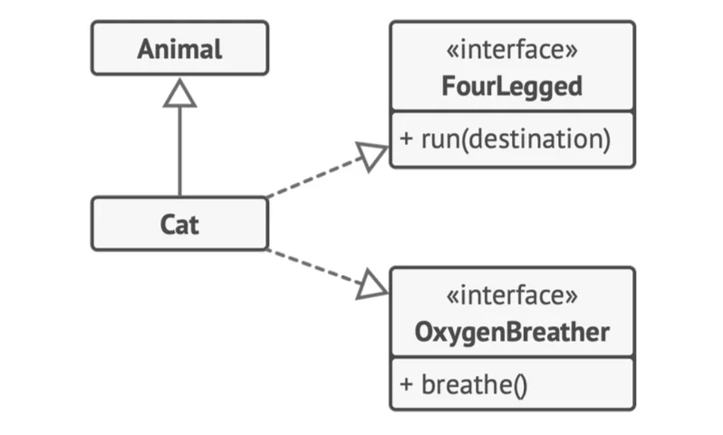

- 자식 클래스는 하나의 부모 클래스만 확장할 수 있습니다&#46; <br>반면 부모 클래스가 인터페이스를 구현한다면 모든 자식 클래스들 또한 그 인터페이스를 구현해야 합니다&#46;

---

<a id="18feda9b0fe180cf884cda97016a710d"></a>

### 4) 다형성

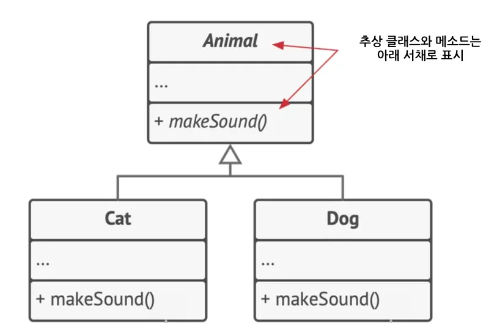

- 추상화된 추상 클래스에 추상 메소드는 자식 객체가 반드시 재구현해야합니다&#46; <br>재구현된 makeSound()는 각 자식 클래스에서 새롭게 재정의하여 동작시킬 수 있습니다&#46;

- <strong><code>다형성</code></strong><strong>은 객체를 사용하는 맥락에서 실제 유형을 알 수 없는 경우에도 사용할 수 있는 개념입니다&#46;</strong>

<a id="18feda9b0fe1809c8234d37cab50d09f"></a>

```java
// 바구니 안에 고양이와 개를 넣었을 때
List<Animal> bag = List.of(new Cat(), new Dog());

for (Animal a : bag) {
	 a.makeSound(); // "야옹!", "멍멍!"
}

// 해당 바구니는 고양이만 담을 수 있게 된다. 그래서 고양이 바구니, 강아지 바구니 등을 만들어야 함!
List<Cat> catBag = List.of(new Cat(), new Cat());

for (Cat c : bag) {
	 c.makeSound(); // "야옹!", "야옹!"
}
```

---

<a id="18feda9b0fe180e59e7bfdfd2a93947a"></a>

## 1&#45;4&#46; 객체 간의 관계

- 객체 간의 관계는 extends(상속&#45;확장) 및 implements(구현&#45;구체화) 외에도 객체들 간에는 <br><strong><code>의존성</code></strong>, <strong><code>연관 관계</code></strong>, <strong><code>집합 관계</code></strong>, <strong><code>합성 관계</code></strong><strong> </strong>를 맺을 수 있습니다&#46;<br>우리가 고립되어 살 수 없는 것처럼 말이죠&#33;

<a id="18feda9b0fe180ef90fbd2088e4d45cb"></a>

### 1) 의존성


- <strong><code>의존성</code></strong>은 클래스 간의 가장 기본적이고 약한 유형의 관계입니다&#46; <br>한 클래스의 정의를 일부 변경했을 때 다른 클래스가 변경되는 경우 두 클래스 사이에 의존성이 있다고 할 수 있습니다&#46; 

- <strong><code>의존성</code></strong>은 일반적으로 클래스에서 다른 클래스를 사용할 때 나타납니다&#46; 

- 이때 직접적인 클래스의 사용이 아닌 인터페이스나 추상 클래스에 의존하게 만들면 의존성을 약화할 수 있습니다&#46;
    <details>
    <summary>참조 코드</summary>

    <a id="18feda9b0fe180c29247c64c101b04ac"></a>

    ```java
    /**
     * 교수와 강의 자료에 대한 의존성을 예로 들어 보겠습니다. 
     * 인터페이스에 의존하게 설계하면 강의 자료의 종류가 변경되더라도 
     * Professor 클래스의 변경을 최소화할 수 있습니다.
     */ 


    interface TeachingMaterial {
        void displayContent();
    }

    class LectureMaterial implements TeachingMaterial {
        private String content;

        @Override
        public void displayContent() {
            System.out.println("Displaying lecture content: " + content);
        }
    }

    class VideoMaterial implements TeachingMaterial {
        private byte[] content;

        @Override
        public void displayContent() {
            System.out.println("Playing video content: " + content);
        }
    }

    class Professor {
        private TeachingMaterial teachingMaterial;

        // 인터페이스 타입으로 의존성 주입
        public Professor(TeachingMaterial teachingMaterial) {
            this.teachingMaterial = teachingMaterial;
        }

        public void teach() {
            System.out.println("Professor starts teaching...");
            teachingMaterial.displayContent();  // 강의 자료 인터페이스에 의존
        }
    }

    ```

    </details>

- 일반적으로 UML 다이어그램은 모든 의존 관계를 표시하지 않습니다&#46; 왜냐하면 실제 코드에는 너무나도 많은 의존 관계들이 있기 때문입니다&#46;

<a id="18feda9b0fe1807d9d21cec472c62a7a"></a>

### 2) 연관 관계


- <strong><code>연관 관계</code></strong>는 한 객체가 다른 객체를 사용하거나 이 두 객체가 상호 작용하는 관계입니다&#46; 

- UML 다이어그램에서 연관 관계는 한 객체에서 그 객체가 사용하는 객체로 향하는 <strong><code>간단한 화살표로 표시</code></strong>되며 양방향 연관 관계(상호 소통 관계)의 경우 화살의 양 끝에 화살표로 표시합니다&#46;

- 일반적으로 다른 객체가 포함된 필드를 나타낼 때는 연관관계를 사용합니다&#46; <br>이때 객체는 언제나 상호작용하는 객체에 접근할 수 있습니다&#46; <br>하지만 모든 객체가 연관 관계일 필요는 없으며 필드일 필요도 없습니다&#46;<br>일부 객체를 반환하는 메서드로 나타낼 수도 있습니다&#46; 

<a id="18feda9b0fe18091b7abf591d79ab761"></a>

```java
// 의존 관계와 연관 관계의 차이를 알아볼게요!

class Professor {

    private Student student;
		
		/**
		 이 메서드는 Course(수업) 클래스를 매개변수로 사용합니다.
		 이때 누군가가 getKnowledge 메서드의 이름을 바꾼다든지 또는 매개변수를 추가한다든지
		 코드 변경하면 더 이상 작동하지 않을 것입니다. 
		 바로 이것이 Professor 클래스가 Course 클래스에 의존한다고 말할 수 있는 이유입니다.
		*/
    public void teach(Cource cource) {
        ...
        
        
		    /**
		     Student 클래스는 Professor 클래스에 필드로 의존한다고 확실히 말할 수 있습니다.
		     왜냐하면 remember 메서드가 변경되면 코드가 변경되기 때문입니다. 
		     그러나 Professor의 모든 메서드는 student 필드에 접근할 수 있으므로, 
		     Student 클래스는 Professor에 의존할 뿐만이 아니라 연관 관계가 있기도 합니다.
		    */
        this.student.remember(c.getKnowledge());
    }
}

```

<a id="18feda9b0fe180bfbf75cdbb96857092"></a>

### <strong>3) 집합 관계</strong>


<a id="18feda9b0fe180309a80feac73195983"></a>

학과는 교수들을 포함합니다&#46;

<a id="18feda9b0fe180e1bafbd8c7b022dc82"></a>

<strong>ALT</strong>

<a id="18feda9b0fe180cd99d3fad9e73e5b5a"></a>

<strong>집합 관계</strong>는 여러 객체 간의 &#39;1&#58;N&#39;, &#39;N&#58;M’ 관계들을 나타내는 연관 관계입니다&#46;

<a id="18feda9b0fe180d6ae9cd0057820d84a"></a>

일반적으로 집합 관계에서 객체는 다른 객체들의 집합을 가지며 컬렉션 역할을 합니다&#46; <br><strong>교수는 학과에 포함될 수 있지만, 학과가 없어져도 교수는 여전히 독립적으로 존재할 수 있고, 다른 학과에도 속할 수 있습니다&#46;</strong>

<a id="18feda9b0fe18099870af66eac30e2b6"></a>

UML에서 집합 관계는 컨테이너(여러 개) 끝에서는 <strong>빈 다이아몬드</strong>가 달려있고 컴포넌트(한개)를 가리키는 끝부분에서는 <strong>화살표가 달린 선으로 표시</strong>됩니다

<a id="18feda9b0fe18076b399cbca2835fb7c"></a>

```java
// 학과
class Department {
    ...
    private Set<Professor> professors; // 학과에 속한 여러 교수

}

// 교수
class Professor {
    ...
    private Department departments; // 교수가 연결된 학과

}
```

<a id="18feda9b0fe180588d16d4a4fb728f0d"></a>

# 2&#46; 좋은 코드를 작성하기 위한 원칙

- 이번엔 좋은 코드를 작성하기 위해서 몇가지 목표와 원칙에 대해서 알아보겠습니다&#46;

<a id="18feda9b0fe180d785cdff493ed70ee3"></a>

## 2&#45;1&#46; 목표

---

<a id="18feda9b0fe180029361d5330f1ac765"></a>

### 1) 코드 재사용

- 소프트웨어 제작할 때 가장 중요한 두 가지 요소는 <strong><code>비용</code></strong>과 <strong><code>시간</code></strong>입니다&#46; 개발 시간이 줄어들면 시장에 진입할 수 빨라지고, 개발 비용이 낮아지면 다른 비개발 비용에 투자할 수 있게 됩니다&#46; 

- 코드 재사용은 처음부터 다시 개발하지 말고, 기존 코드를 재활용함으로써 개발 비용을 줄이자는 목표를 가집니다&#46; 

- 그러나 현실적으로 새로운 상황에서 기존 코드를 작동하기는 굉장히 어려운 일입니다&#46; <br>그 이유는 컴포넌트 간의 단단한 결합, 인터페이스 대신 구상 클래스들에 대한 의존 관계, 하드코딩 된 작업과 같은 여러 가지 요인들이 이를 어렵게 만들기 때문입니다&#46;

- 이를 최소화하기 위해 우린 <strong><code>원칙</code></strong>과 <strong><code>패턴</code></strong>을 통해 유연성을 높이고 재사용성을 높이고자 노력하는 것입니다&#46; <strong>그러나 이 방법은 컴포넌트들을 복잡하게 만들어 역효과가 나타날 수 있기 때문에 주의하여 사용해야합니다&#46;</strong>

| 재사용 수준 |  |
| --- | --- |
| <strong>낮은 수준</strong> | 클래스 재사용<br>ex) 클래스 라이브러리, 컨테이너 클래스 |
| <strong>중간 수준</strong> | 디자인 패턴 재사용 |
| <strong>최고 수준</strong> | 프레임워크 재사용 &#45; (클래스 &#43; 디자인 패턴 집합) |

---

<a id="18feda9b0fe180ac9d6fcf31ec571417"></a>

### 2) 확장성

- 소프트웨어는 고정되어 있지 않고 항상 <code>변화</code>합니다&#46; 우린 이러한 변화에 열린 마음을 가지고 준비해야 합니다&#46; 하지만 코드 재사용과 마찬가지로 모든 것을 대비할 순 없습니다&#46; 적정한 확장성은 항상 개발자를 고민에 빠뜨리는 요소입니다&#46;

<a id="18feda9b0fe1802fba1ef78d1387f16f"></a>

<strong>사례</strong>

1. 웹 API를 대응하기 위한 서버를 오픈하였는데 불과 1달만에 모바일용 API를 대응해야하는 요구를 받았습니다&#46;

1. 네모난 버튼 모양으로 UI를 설계했는데 둥근 모양이 유행하게 되었습니다&#46;

- 위와 같이 변화하는 환경 속에서 완벽히 확장성을 고려한 설계나 구현을 어려운 일입니다&#46; <br>하지만 예측 가능한 범위에서의 확장성 확보는 유능한 개발자가 가치고 있어야할 덕목 중에 하나입니다&#46;

<a id="18feda9b0fe180deb814e41a8b9de50c"></a>

## 2&#45;2&#46; 디자인 원칙

- 그럼 <strong><code>재사용</code></strong> 과 <strong><code>확장성</code></strong><strong> </strong>을 고려한 코드를 구현하려면 어떻게 해야할까요?

- 우선 디자인 원칙에 대해서 알아보겠습니다&#46; <br><strong>해당 원칙들은 다음 시간에 배울 디자인 패턴에 기본 개념입니다&#33;&#33;</strong>

<a id="18feda9b0fe180fa93b1e3aa2b2a5e99"></a>

### 2&#45;2&#45;1&#46; 캡슐화 활용

- 이 원칙의 핵심 목적은 <strong>변화로 인한 결과를 최소화</strong>하는 것입니다&#46; 

- 프로그램에서도 변경되는 부분을 <strong>독립된 모듈로 분리</strong>하여 나머지 코드가 변화의 영향을 받지 않도록 보호할 수 있습니다&#46; 

---

<a id="18feda9b0fe1801aa01ff6cd8d48b894"></a>

### 1) 메소드 캡슐화

-  주문을 하는 코드를 작성한다고 가정해 봅시다&#46;

<details>
<summary>코드</summary>

<a id="18feda9b0fe1800e9ee7eb420c136e06"></a>

```java

/** 
 getOrderTotal 메서드 내에서 세금 계산 로직이 주문의 나머지 계산과 뒤섞여 있어, 
 세금 변경 시 메서드를 자주 수정해야 하는 상황이 발생할 수 있습니다.
*/ 

public class Order {
    public double getOrderTotal(Order order) {
        double total = 0;
        for (Item item : order.lineItems) {
            total += item.price * item.quantity;
        }

        if ("KOREA".equals(order.country))) {
            total += total * 0.07;
        } else if ("JAPAN".equals(order.country)) {
            total += total * 0.20;
        }

        return total;
    }
}


```

<a id="18feda9b0fe180659f5ff64be9fe2b9b"></a>

```java
/** 
세금 계산 로직을 별도의 getTaxRate 메서드로 분리하여 변경 사항을 하나의 메서드 내에 격리시킴으로써,
코드가 더 깔끔해지고 유지보수가 용이해졌습니다. 
이렇게 하면 세금 관련 변경이 있을 때 해당 메서드만 수정하면 되며, 
복잡한 세금 계산 로직이 필요할 경우에는 getTaxRate 메서드를 더욱 세분화하거나 클래스로 분리할 수 있습니다.
*/ 

public class Order {
    public double getOrderTotal(Order order) {
        double total = 0;
        for (Item item : order.lineItems) {
            total += item.price * item.quantity;
        }

        total += total * getTaxRate(order.country); 
        return total;
    }

    public double getTaxRate(String country) {
        if ("KOREA".equals(order.country))) {
            total += total * 0.07;
        } else if ("JAPAN".equals(order.country)) {
            total += total * 0.20;
        }
        
        return 0;
    }
}


```

</details>

---

<a id="18feda9b0fe1806eb207f84eacd431d7"></a>

### 2) 클래스 캡슐화

- 요구사항이 변경되어 <code>Order</code> 클래스 메서드에 많은 변화가 발생하고 해당 클래스가 비대해진다고 가정해봅시다&#46;

- 이럴 때는 모든 세금 관련 작업을 수행하는 별도의 <code>TaxCalculator</code> 라는 객체로 분리하여 위임하는 것이 옳습니다&#46;

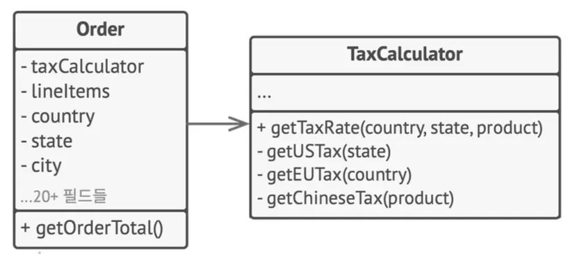

---

<a id="18feda9b0fe1804dab53d9642f50a584"></a>

### 3) 인터페이스 활용

- 구체적인 클래스를 상속하여 사용하기 보다는 인터페이스를 활용하여 해당 객체들이 수행하는 활동을 정의하여 <strong>클래스 자체가 아닌 추상화에 의존시기 바랍니다&#46;</strong>

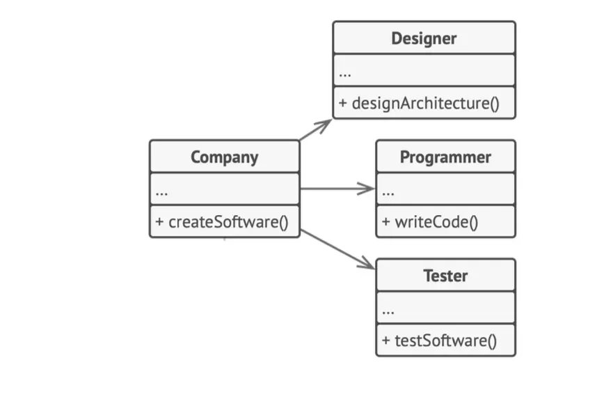

<a id="18feda9b0fe180789024e675a440d5d5"></a>

```java
// 클래스에 의존하면 각 클래스가 가지는 고유의 메소드를 각각 구현하게 됩니다.
Designer designer = new Designer()
designer.designArchitecture()
Programmer programmer = new Programmer
programmer.writeCode()
Tester tester = new Tester()
tester.testSoftware()
```

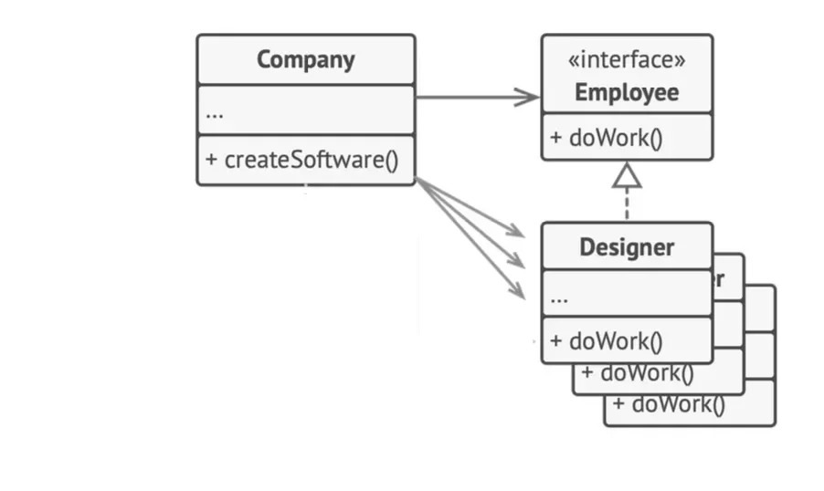

<a id="18feda9b0fe1800f9278f9a8b1a3109d"></a>

```java
// 업무 관련 메서드들을 일반화하여 확장할 수 있습니다.
Employee designer = new Designer()
designer.doWork();
```

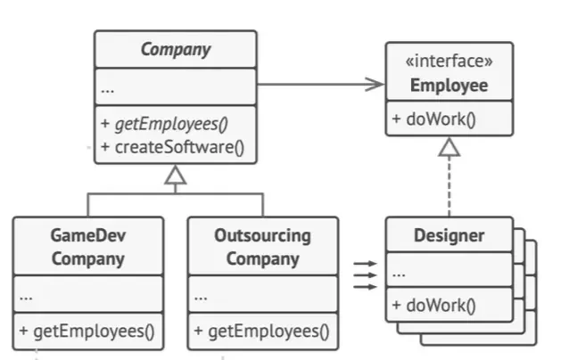

> 🧷 
> 
> <a id="18feda9b0fe1802e9935f4fcb98bdb5a"></a>
> 
> 한발 더 나아가 Comany를 Abstract 클래스로 추상화시켜 여러 종류의 회사로도 확장할 수 있습니다&#46;
> 
> <a id="18feda9b0fe18071b11bf2661eee89ae"></a>
> 
> 이는 다음 시간에에 알아볼 팩토리 메소드 패턴의 예시 입니다&#33;

<a id="18feda9b0fe180aabee2fe40bdbddf36"></a>

### 4) 합성 활용

---

- 앞서 알아본 것처럼 상속은 코드 구현에 만능처럼 느껴지지만 그렇지 않습니다&#46;

- 아래와 같은 문제를 야기할 수 있습니다&#46;

| <strong>문제</strong> | 내용 |
| --- | --- |
| <strong>메서드 호환성</strong> | 새로 추가할 자식 클래스가 부모 클래스가 정의한 기능과 호환되지 않으면 충돌이 발생하여 자식 클래스가 불필요한 기능을 수행하여 옳바른 동작을 보장할 수 없습니다&#46; |
| <strong>인터페이스 비대화</strong> | 자식 클래스는 부모 클래스의 모든 추상 메서드를 구현해야 하므로, 사용하지 않는 메서드도 구현해야 할 수 있습니다&#46; |
| <strong>부모&#45;자식 클래스 결합</strong> | 부모 클래스를 변경하면 자식 클래스의 기능이 손상될 위험이 있습니다&#46; |
| 상속 계층구조 복잡성 | 상속을 남용하면 클래스 계층 구조가 복잡해져 관리가 어려워집니다&#46; |

- <strong>합성</strong>은 &#34;나는 무엇의 &#126;이다&#34;라는 상속의 관계(is a 관계) 대신, &#34;&#126;을/를 가진다&#34;는 관계(has a 관계)를 사용하여 객체를 구성합니다&#46; 예를 들어, 자동차는 엔진을 <strong>가진다</strong> (합성), 반면 자동차는 교통수단 <strong>이다</strong> (상속)라는 관계입니다&#46;

- 상속보다는 합성을 통해 확장성을 도모할 수 있습니다&#46;

- <strong>예시 </strong>
    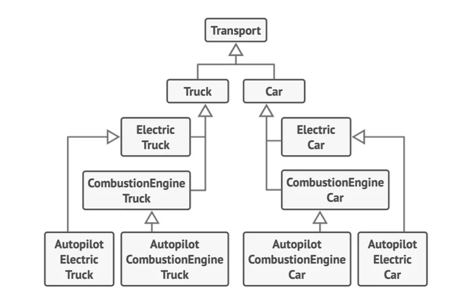

    - 상속을 사용하여 다양한 종류의 자동차 객체를 만들면, 부속이 추가될 때마다 자식 클래스의 수가 폭발적으로 증가하고, 클래스 계층 구조가 복잡해질 수 있습니다&#46; 

    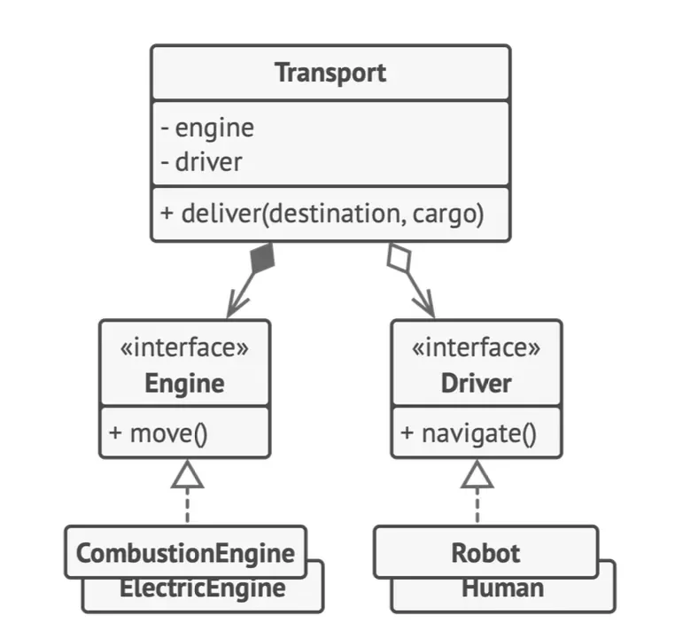

- 합성을 통해 기능을 독립적인 클래스로 나누어, 조합하면 여러 기능들을 수행하는 객체로 구현할 수 있습니다&#46; 

<details>
<summary>코드</summary>

<a id="18feda9b0fe180baabb0c421381a793b"></a>

```java

// 엔진을 나타내는 인터페이스
interface Engine {
    void move();
}

// 전기 엔진 클래스
class ElectricEngine implements Engine {
    @Override
    public void move() {
        System.out.println("Electric engine started!");
    }
}

// 내연 엔진 클래스
class CombustionEngine implements Engine {
    @Override
    public void move() {
        System.out.println("Combustion engine started!");
    }
}

// 운전 인터페이스
interface Driver {
    void nevigate();
}

// 로봇 운전자 클래스
class Robot implements DrivingSystem {
    @Override
    public void nevigate() {
        System.out.println("Nevigate Robot!");
    }
}

// 사람 운전자 클래스
class Human implements Driver {
    @Override
    public void nevigate() {
        System.out.println("Nevigate Human!");
    }
}

// 운송수단 클래스
class Transport {
    private Engine engine;
    private Driver driver;

    public Transport(Engine engine, Driver driver) {
        this.engine = engine;
        this.driver = driver;
    }
}
```

</details>

<a id="18feda9b0fe1804298e6c7e3755b38b3"></a>

## 2&#45;3&#46; SOLID 원칙

- 기본적인 디자인 원칙과 함께 이번엔 일반적인 5가지 원칙인 SOLID 원칙에 대해서 알아보겠습니다&#46;

- 해당 원칙은 로버트 마틴이라는 소프트웨어 아키텍처가 고안해 낸 객체지향 프로그래밍 원칙으로 원칙들의 앞글자를 축약하여 부릅니다&#46;

- 우리가 세상을 살아가면서 모든 원칙을 지킬 수 없듯이 해당 원칙도 교리처럼 맹목적으로 따를 수는 없지만 해당 개념을 가지고 설계와 구현에 적용해보면 보다 나은 코드를 만들 수 있는 길잡이가 될 겁니다&#46;

---

<a id="18feda9b0fe1803db954d1cb9c99c6a3"></a>

### 1) 단일 책임 원칙 &#45; <strong>Single Responsibility Principle</strong>

- <strong>클래스는 한가지 책임을 가지며 한 가지 이유로 변경되어야 한다는 원칙입니다&#46;</strong>

- 단일 책임 원칙(SRP)은 클래스가 하나의 기능만 책임지도록 하고, 그 기능을 완전히 캡슐화하여 클래스 내부에 숨기라는 원칙입니다&#46; 이를 통해 프로그램의 복잡성을 줄일 수 있습니다&#46;

- 클래스가 너무 많은 책임을 지고 있으면, 변경 시 다른 부분에 영향을 미칠 수 있어 유지보수가 어려워집니다&#46; 코드 탐색이 느려지고, 클래스나 프로그램 전체를 살펴봐야 특정 코드를 찾을 수 있습니다&#46; 

- 따라서 프로그램이 복잡해지고 클래스가 많은 작업을 처리할 때, 단일 책임 원칙을 다시 떠올려 클래스를 분리해야 할 시점을 인식하는 것이 중요합니다&#46;

<a id="18feda9b0fe180c3932aca188708001f"></a>

<strong>예시</strong>

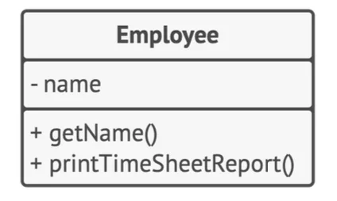

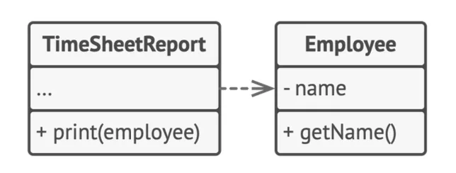

- <code>Employee</code> 클래스가 직원 데이터 관리와 보고서 인쇄와 같은 기능을 가졌다고 봅시다&#46;<br>시간이 흘러 보고서의 형식이 다양해 해당 클래스를 수정해야하는 상황이 발생할 수 있다고 가정할 수 있다면<br>이를 해결하기 위해서 보고서 관련 행동을 별도의 클래스로 옮기고, <code>Employee</code> 클래스는 직원 데이터 관리만 담당하도록 해야합니다&#46;

<details>
<summary>코드</summary>

<a id="18feda9b0fe18078ba31fa51c8af1431"></a>

```java
// Employee 클래스는 직원 데이터만 관리
public class Employee {
    private String name;

    // 직원 데이터 관리 관련 메서드
    public void displayEmployeeInfo() {
        System.out.println("Name: " + name + ", Position: " + position);
    }
}


```

<a id="18feda9b0fe180b59b9bf1aac028e0b9"></a>

```java
// TimeSheetReport 클래스로 보고서를 인쇄하는 책임 분리
public class TimeSheetReport {

    // 보고서를 인쇄하는 메서드
    public void printTimesheetReport(Employee employee) {
        System.out.println("Printing timesheet report for employee: " 
										        + employee.getName());
    }
}

```

</details>

<details>
<summary>Spring 코드로 해석한 SRP</summary>

<a id="18feda9b0fe180998240c09ccf77ed56"></a>

```java
/**
OrderService는 사용자 관리 비즈니스 로직만을 담당하고, 
데이터베이스 접근은 OrderRepository에서 담당하게 됩니다. 
Spring의 @Service, @Repository 애너테이션을 사용하면 각각의 역할을 명확하게 분리하여 SRP를 실현할 수 있습니다.
*/

@Service
public class OrderService {

		private final OrderRepository orderRepository;

    public OrderService(OrderRepository orderRepository) {
        this.orderRepository = orderRepository;
    } 

    public void placeOrder(Order order) {
        System.out.println("Order placed with ID: " + order.getId());
    }
}
```

</details>

---

<a id="18feda9b0fe18082b210deb26785091d"></a>

### 2) 개방/폐쇄 원칙 &#45; O<strong>pen/Closed Principle</strong>

- <strong>클래스들은 확장에는 열려있어야 하지만 변경에는 닫혀 있어야 한다는 원칙입니다&#46;</strong>

- 이 원칙의 주요 목적은 새로운 기능을 구현할 때 기존 코드가 깨지지 않도록 하는 것입니다&#46; 클래스는 <strong>확장 가능(open)</strong> 하되, <strong>수정 불가능(closed)</strong> 해야함을 의미합니다&#46;
    - <strong>개방(open)</strong>&#58; 클래스는 자식 클래스를 생성하거나, 기존 행동을 오버라이드하거나, 새로운 필드나 메서드를 추가할 수 있도록 확장할 수 있어야 합니다&#46;

    - <strong>폐쇄(closed)</strong>&#58; 클래스는 이미 완성되어 있고, 기존의 기능을 수정하지 않도록 해야 합니다&#46; 즉, 클래스는 이미 정의된 인터페이스와 동작을 유지하면서, 확장만 가능해야 합니다&#46;

- 이를 통해 기존 코드를 변경하지 않고 새로운 기능을 추가할 수 있어, 기존 기능이 손상되지 않도록 보호합니다&#46; 클래스가 이미 개발되어 사용 중이라면, 기존 코드를 변경하는 대신 자식 클래스를 생성하여 필요한 부분만 오버라이드하는 방식으로 확장합니다&#46;

- 단, 버그로 인한 수정엔 적용되지 않습니다&#46;

<a id="18feda9b0fe18086bb77ea820387bfb4"></a>

<strong>예시 </strong>

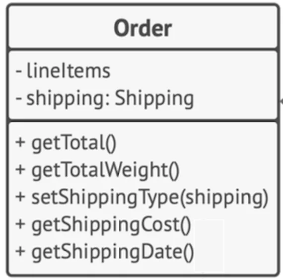

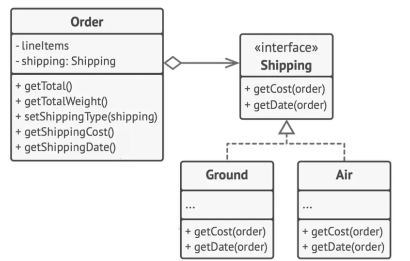

- 만약 <code>Order</code> 클래스에 모든 배송 방법이 구현되어 있을 때, 새로운 배송 방법을 추가하려면 <code>Order</code> 클래스를 수정해야 하므로 사이드 임펙트가 발생할 수 있습니다&#46; 

<a id="18feda9b0fe1804ab38bce5121f945be"></a>

<strong>해결방법</strong>

- 이때 <strong>전략 패턴</strong>을 사용하여 각 배송 방법을 공통 인터페이스를 가진 별도의 클래스로 분리하면 <code>Order</code> 클래스의 책임을 단일화하고, 새로운 배송 방법을 유연하게 추가할 수 있습니다&#46;

<details>
<summary>코드</summary>

<a id="18feda9b0fe180489252ccc527d5fb59"></a>

```java
// 변경 전
public class Order {
    private double total;
    private String shipping;
		
		// 새로운 배송 방법이 추가되면 calculateShipping()를 지속적으로 수정해야 함
    public double calculateShipping() {
        if ("Standard".equals(shipping)) {
            return total * 0.1; // Standard shipping rate
        } else if ("Express".equals(shipping)) {
            return total * 0.2; // Express shipping rate
        }
        return 0;
    }
}
```

<a id="18feda9b0fe18017891ce82de3cb9d74"></a>

```java
// 변경 후

// 배송 인터페이스
public interface Shipping {
    double getCost(Order order);
}

// 일반 배송
public class StandardShipping implements Shipping {
    
    private static final double tax = 0.1;

    @Override
    public double getCost(Order order) {
        return order.getTotal() * tax;
    }
}

// 긴급 배송
public class ExpressShipping implements Shipping {

	  private static final double tax = 0.2;

    @Override
    public double getCost(Order order) {
        return order.getTotal() * tax;
    }
}

// 주문
public class Order {
    private double total;
    private Shipping shipping;

    public double calculateShipping() {
        return shipping.getCost(this);
    }

    public double getTotal() {
        return total;
    }
}
```

</details>

<details>
<summary>Spring 코드로 해석한 OCP</summary>

<a id="18feda9b0fe180409a40ece9a0c700c5"></a>

```java
/**
PaymentProcessor 인터페이스를 구현하는 여러 클래스가 있으며, 
Spring은 DI를 통해 OrderService에 PaymentProcessor 구현체를 주입합니다. 
새로운 결제 방식을 추가하려면 PaymentProcessor를 구현하는 클래스를 추가하기만 하면 되므로 기존 코드를 수정하지 않고 기능을 확장할 수 있습니다.
*/

public interface PaymentProcessor {
    void processPayment(double amount);
}

@Component  // spring bean으로 등록!!
public class CreditCardPaymentProcessor implements PaymentProcessor {
    @Override
    public void processPayment(double amount) {
        System.out.println("Processing credit card payment of $" + amount);
    }
}

@Component
public class PayPalPaymentProcessor implements PaymentProcessor {
    @Override
    public void processPayment(double amount) {
        System.out.println("Processing PayPal payment of $" + amount);
    }
}

@Service
public class OrderService {
    private final PaymentProcessor paymentProcessor;

    public OrderService(PaymentProcessor paymentProcessor) {
        this.paymentProcessor = paymentProcessor;
    }

    public void placeOrder(double amount) {
        paymentProcessor.processPayment(amount);
    }
}
```

</details>

---

<a id="18feda9b0fe180fd9916cf1273ed4c43"></a>

### 3) 리스코프 치환 원칙 &#45; <strong>Liskov Substitution Principle</strong>

- <strong>클래스를 확장할 때 클라이언트 코드를 손상하지 않고 자식 클래스의 객체들을 부모 클래스의 객체들로 교체(치환)할 수 있어야 한다는 원칙입니다&#46;</strong>

- 리스코프란 아키텍처가 제안한 원칙입니다&#46;

- 이 원칙은 기존의 코드가 자식 클래스와 함께 작동할 때 예상치 못한 오류가 발생하지 않도록 합니다&#46; 

| <strong>조건</strong> | <strong>내용</strong> |
| --- | --- |
| <strong>매개변수 유형</strong> | 자식 클래스의 메서드는 부모 클래스의 메서드에서 사용된 매개변수 유형보다 더 추상적이거나 같아야 합니다&#46;<br>&#45; <code>feed(Cat)</code> → <code>feed(Animal)</code> (좋은 코드) <br>&#45; <code>feed(BengalCat)</code> (나쁜 코드) <br>   <strong>why? </strong>매개변수가 지협적이라 교체가 어렵다&#46; |
| <strong>반환 유형</strong> | 자식 클래스의 메서드의 반환 유형은 부모 클래스의 메서드의 반환 유형의 하위 유형이거나 동일해야 합니다&#46;<br>&#45; <code>buyCat()</code> return<code>BengalCat</code> (좋은 코드)<br>&#45; <code>buyCat()</code> return <code>Animal</code> (나쁜 코드)<br>   <strong>why? </strong>반환 유형이 다르다&#46; |
| <strong>사전 조건</strong> | 자식 클래스는 부모 클래스의 사전 조건을 강화해서는 안 됩니다&#46; <br>예를 들어, 부모 클래스가 음수 값을 받는 메서드를 오버라이드하고 자식 클래스가 음수에 대해 예외를 던지는 것은 잘못된 구현입니다&#46; |
| <strong>사후 조건</strong> | 자식 클래스는 부모 클래스의 사후 조건을 약화해서는 안 됩니다&#46; <br>예를 들어, 부모 클래스가 데이터베이스 연결을 닫는 메서드를 오버라이드하여 자식 클래스가 연결을 닫지 않는 것은 문제가 될 수 있습니다&#46; |
| <strong>예외 처리</strong> | 자식 클래스는 부모 클래스의 메서드가 던지는 예외와 다른 예외를 던져서는 안 됩니다&#46; |
| <strong>비공개 필드</strong> | 자식 클래스는 부모 클래스의 비공개 필드를 변경해서는 안 됩니다&#46; |

<a id="18feda9b0fe180058305f9b79d8b4196"></a>

<strong>예시</strong>

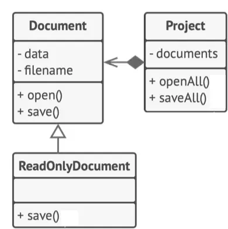

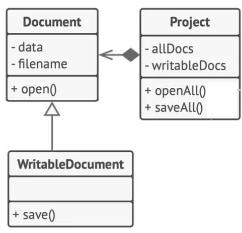

- 리스코프 치환 원칙을 위반하는 예로, <code>ReadOnlyDocument</code> 클래스가 부모 <code>Document</code> 클래스의 <code>save()</code> 메서드를 오버라이드하여 예외를 던지는 경우가 있습니다&#46; 이로 인해 <code>Document</code> 클래스를 사용하는 클라이언트 코드가 <code>save()</code> 메서드 호출 전, 문서가 읽기 전용인지 아닌지를 확인해야 하는 문제가 발생합니다&#46; 또한, 이는 개방/폐쇄 원칙(OCP)을 위반하여 클라이언트가 문서의 구체적인 클래스에 의존하게 만듭니다&#46;

<a id="18feda9b0fe180f699fac4d4f46f2fd5"></a>

<strong>해결 방법</strong>

- 클래스 계층을 재설계하여 <code>ReadOnlyDocument</code>를 상위 클래스로 만들고, 쓰기 가능한 문서를 별도의 자식 클래스로 두어 <code>save()</code> 기능을 추가합니다&#46; 이렇게 하면 <code>ReadOnlyDocument</code>와 <code>WritableDocument</code>가 각각의 역할에 맞는 행동을 하도록 하여 LSP와 OCP를 모두 지킬 수 있습니다&#46;

<details>
<summary>코드</summary>

<a id="18feda9b0fe180ea89a1fd0621991258"></a>

```java
abstract class Document {
    private byte[] data;
    private String filename;

    public void open() {
        System.out.println("open document");
    }
}


// 최상위 읽기 전용 문서 클래스
class ReadOnlyDocument extends Document {

}

// 쓰기 가능한 문서 클래스 - 저장 기능 추가
class WritableDocument extends ReadOnlyDocument {

    public void save() throws WriteOnlyException {
        System.out.println("Document saved.");
    }
}
```

</details>

<details>
<summary>Spring 코드로 해석한 LSP</summary>

<a id="18feda9b0fe180699c04c33882a386d2"></a>

```java
/**
NotificationService 인터페이스를 구현하는 
모든 클래스(EmailNotificationService나 SmsNotificationService)는 
NotificationClient에 주입되어 사용될 수 있습니다. 
이로써 LSP 원칙을 준수하며, NotificationService 타입을 가진 어떤 구현체도 교체 가능해집니다.
*/

public interface NotificationService {
    void sendNotification(String message);
}

@Component
public class EmailNotificationService implements NotificationService {
    @Override
    public void sendNotification(String message) {
        System.out.println("Sending email: " + message);
    }
}

@Component
public class SmsNotificationService implements NotificationService {
    @Override
    public void sendNotification(String message) {
        System.out.println("Sending SMS: " + message);
    }
}

@Service
public class NotificationClient {
    private final NotificationService notificationService;

    public NotificationClient(NotificationService notificationService) {
        this.notificationService = notificationService;
    }

    public void notifyUser(String message) {
        notificationService.sendNotification(message);
    }
}
```

</details>

---

<a id="18feda9b0fe180d1a2b6f0c2d9b2eadf"></a>

### 4) 인터페이스 분리 원칙 &#45; I<strong>nterface Segregation Principle</strong>

- <strong>구현자가 사용하지 않는 메소드들에 의존하도록 강요되어서는 안된다는 원칙입니다&#46;</strong>

- 이 원칙은 호출자가 불필요한 메서드를 구현하지 않도록 인터페이스를 작고 구체적으로 설계하는 것을 뜻합니다&#46; 

- 즉, 관련 없는 메서드를 하나의 인터페이스에 넣는 대신 각 기능에 맞는 개별 인터페이스로 분리하기를 권장합니다&#46;

<a id="18feda9b0fe18027b312fb0a281dc985"></a>

<strong>예시 </strong>

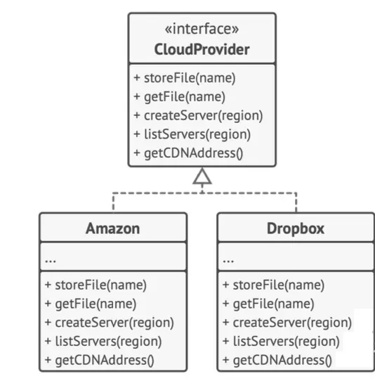

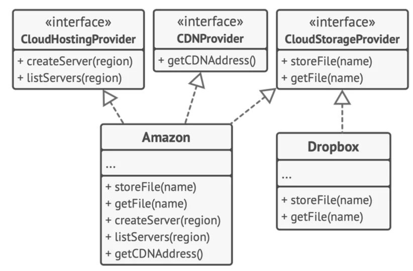

- 위와 같이 클라우드 공급자는 모든 특정 기능을 가지고 있기 때문에 불필요한 메서드들을 구현해야 하는 문제가 발생합니다&#46; 

- 이러한 경우 인터페이스를 작은 단위로 분리하여 각 클라우드 공급자에 맞는 메서드만 구현하게 함으로써 코드의 유연성과 확장성을 높일 수 있습니다&#46;

<a id="18feda9b0fe180d0bb54f6479bdd5bb9"></a>

<strong>예시</strong>

<details>
<summary>코드</summary>

<a id="18feda9b0fe180a880f0d6cf0dfc5c91"></a>

```java

interface CloudHostingProvider {
    Server createServer(Region region);
    List<Server> listServers(Region region);
}

interface CDNProvider {
    String getCDNAddress();
}

interface CloudStorageProvider {
    void storeFile(String name);
    File getFile(String name);
}

// 각 공급자는 자신에게 필요한 인터페이스만 구현
class Amazon implements CloudHostingProvider, CDNProvider, CloudStorageProvider {
    @Override
    public Server createServer(Region region) {
	    ...
    }
    
    @Override
    public List<Server> listServers(Region region) {
	    ...
    }
    ...
}

class Dropbox implements CloudStorageProvider {
	
	  @Override
    public void storeFile(String name) {
	    ...
    }
    
    @Override
    public File getFile(String name) {
	    ...
    }
}

```

</details>

<details>
<summary>Spring 코드로 해석한 ISP</summary>

<a id="18feda9b0fe180e89a35d872f2f0b97b"></a>

```java
/**
UserReadable와 UserWritable 인터페이스로 조회와 쓰기 작업을 분리했습니다. 
이로써 클라이언트가 필요한 인터페이스만 사용할 수 있게 되어 ISP 원칙을 지킵니다.
*/

public interface UserReadable {
    User findUserById(Long id);
}

public interface UserWritable {
    void saveUser(User user);
}

@Service
public class UserService implements UserReadable, UserWritable {
    private final UserRepository userRepository;

    public UserService(UserRepository userRepository) {
        this.userRepository = userRepository;
    }

    @Override
    public User findUserById(Long id) {
        return userRepository.findById(id).orElse(null);
    }

    @Override
    public void saveUser(User user) {
        userRepository.save(user);
    }
}
```

</details>

---

<a id="18feda9b0fe18027afa9cfbfa0097815"></a>

### 5) 의존관계 역전 원칙 &#45; D<strong>ependency Inversion Principle</strong>

- <strong>상위 계층 클래스들은 하위 계층 클래스들에 의존해서는 안되며 모두 추상화에 의존해야 함을 뜻하는 원칙입니다&#46;</strong>

- 소프트웨어 설계 시, 클래스는 보통 <strong>하위 계층</strong> (파일 작업, 데이터 전송 등 기본 작업)과 <strong>상위 계층</strong> (비즈니스 로직을 지시하는 클래스)으로 나뉩니다&#46; 개발 초기 단계에서는 하위 계층 기능들이 미완성이기 때문에 상위 계층이 하위 계층 클래스에 직접 의존하는 경우가 많습니다&#46;

- <strong>의존관계 역전 원칙</strong>은 이러한 종속성을 반대로 만들어, 상위 계층이 하위 계층의 구체적인 클래스가 아닌 비즈니스 용어의 인터페이스에 의존하게 합니다&#46; 이렇게 하면 하위 계층이 이 인터페이스를 구현함으로써 오히려 상위 계층에 의존하게 되어 종속성의 방향이 역전됩니다&#46; 이 원칙을 통해 설계의 유연성이 높아지고 기존 상위 계층을 수정하지 않고 하위 계층 기능을 확장할 수 있습니다&#46;

<a id="18feda9b0fe180a4b589f89c55677785"></a>

<strong>예시</strong>

- 상위 계층의 예산 보고 클래스가 하위 계층의 구체적인 데이터베이스 클래스에 직접 의존하면, 데이터베이스가 변경될 때마다 상위 계층이 영향을 받을 수 있습니다&#46; 

<a id="18feda9b0fe180f7946df21ca71b21c1"></a>

<strong>해결방법</strong>

- 상위 계층에서 필요한 읽기/쓰기 작업을 설명하는 인터페이스를 생성하고, 예산 보고 클래스가 이 인터페이스를 사용하도록 합니다&#46; 그 후, 하위 계층의 데이터베이스 클래스가 이 인터페이스를 구현하도록 하면 의존성이 역전됩니다&#46; 이제 하위 계층이 상위 계층의 추상화에 의존하게 되어 변경에 유연해집니다&#46;

<details>
<summary>코드</summary>

<a id="18feda9b0fe1807b9f71f5b03de4afc1"></a>

```java
interface Database {
    void insert(String data);
    void update(int id, String newData);
    void delete(int id);
}

// 상위 계층 클래스: 예산 보고서 (BudgetReport)
class BudgetReport {
    private Database database;

    // 생성자에서 인터페이스를 받아 의존성을 주입
    public BudgetReport(Database database) {
        this.database = database;
    }

    public void open(Date reportDate) {
        System.out.println("Report opened for date: " + reportDate);
    }

    public void save(String data) {
        System.out.println("Saving data to database...");
        database.insert(data);
    }
}

// 하위 계층 MySQL 구현
class MySQL implements Database {
    @Override
    public void insert(String data) {
        System.out.println("MySQL: Inserting data - " + data);
    }

    @Override
    public void update(int id, String newData) {
        System.out.println("MySQL: Updating data with ID " + id + " to " + newData);
    }

    @Override
    public void delete(int id) {
        System.out.println("MySQL: Deleting data with ID " + id);
    }
}

// 하위 계층 MongoDB 구현
class MongoDB implements Database {
    @Override
    public void insert(String data) {
        System.out.println("MongoDB: Inserting data - " + data);
    }

    @Override
    public void update(int id, String newData) {
        System.out.println("MongoDB: Updating data with ID " + id + " to " + newData);
    }

    @Override
    public void delete(int id) {
        System.out.println("MongoDB: Deleting data with ID " + id);
    }
}
```

</details>

<details>
<summary>Spring 코드로 해석한 DIP</summary>

<a id="18feda9b0fe180ad9b76ee8cf147dfc4"></a>

```java
/**
NotificationService는 MessageSender 인터페이스에 의존하며, 
실제 구현은 EmailSender 같은 구체적인 클래스가 됩니다. 
Spring의 DI를 통해 실제 구현을 주입함으로써 DIP를 준수할 수 있습니다.
*/

public interface MessageSender {
    void sendMessage(String message);
}

@Component
public class EmailSender implements MessageSender {
    @Override
    public void sendMessage(String message) {
        System.out.println("Email sent: " + message);
    }
}

@Service
public class NotificationService {
    private final MessageSender messageSender;

    public NotificationService(MessageSender messageSender) {
        this.messageSender = messageSender;
    }

    public void notify(String message) {
        messageSender.sendMessage(message);
    }
}
```

</details>

---
