[Video Conferencing, Web Conferencing, Webinars, Screen Sharing]()

> 🧷 
> 
> <a id="18feda9b0fe180179d3ceeedf6baf08e"></a>
> 
> 지난 데이터베이스를 통해 <strong><code>데이터베이스 일반</code></strong>, <strong><code>설계</code></strong><strong>,</strong> <strong><code>트랜잭션과 락</code></strong> 에 대해서 알아봤습니다&#46;
> 
> <a id="18feda9b0fe180ab8660f4b177f53fa4"></a>
> 
> 이번 시간엔 데이터베이스의<strong> </strong><strong><code>SQL 실행절차</code></strong><strong>, </strong><strong><code>Index</code></strong><strong>, </strong><strong><code>데이터 검색</code></strong><strong>, </strong><strong><code>실행계획</code></strong><strong>, </strong><strong><code>join 방식</code></strong>에  대해서 알아보겠습니다&#46;

<a id="18feda9b0fe180b39a16d6015987bf9f"></a>

## <strong>1&#46; SQL 실행 절차</strong>

> ✏️ 
> 
> <a id="18feda9b0fe180e49537c97039b376a2"></a>
> 
> SQL은 어떻게 해석되어 출력되는지 SQL의 실행에 절차에 대해서 알아보겠습니다&#46;

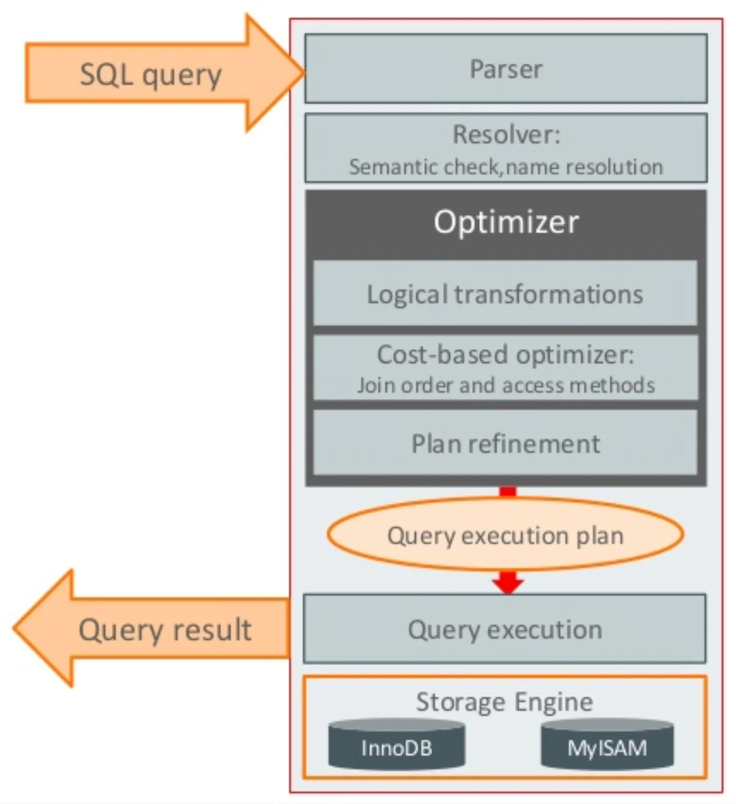

1. <strong><code>Parser</code></strong>&#58; 쿼리 문장을 쪼개서 MySQL이 이해할 수 있도록 세분화하여 tree 형태로 만듭니다&#46;

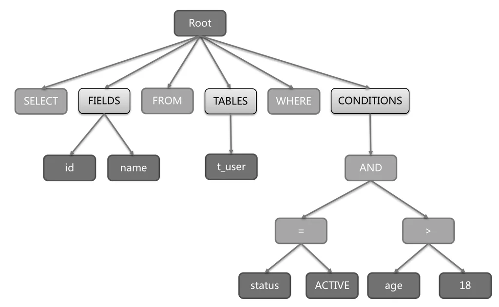

1. <strong><code>Resolver</code></strong> &#58; 쪼개진 문장을 체크합니다&#46;

1. <strong><code>&#42; Optimizer &#42;</code></strong><strong> </strong> &#58; tree를 탐색하며 무슨 테이블들 읽을지, 조건은 무엇인지, 어떤 인덱스를 사용할지 혹은 사용하지 않을지 선별하여 최적화시킨 후 실행 계획을 만듭니다&#46;

1. <strong><code>Query execution</code></strong><strong> &#58; </strong>최적화된 실행 계획을 기반으로 스토리지 엔진으로부터 데이터를 가져옵니다&#46;

> ✏️ 
> 
> <a id="18feda9b0fe1805a9e27f07caeb5f72f"></a>
> 
> 실제로 수행되는 절(Clause) 단위 수행 절차는 아래와 같습니다&#46;

<a id="18feda9b0fe180df8753f70c596c020c"></a>

```sql
5.    SELECT department_id, 
             COUNT(*) AS employee_count, 
             AVG(salary) AS average_salary
1.      FROM employees
2.     WHERE hire_date >= '2020-01-01' 
         AND status = 'ACTIVE'
3.  GROUP BY department_id
4.    HAVING COUNT(*) > 5
5.  ORDER BY average_salary DESC
6.     LIMIT 10;
```

| <strong>순서</strong> | <strong>절(Clause)</strong> | <strong>설명</strong> |
| --- | --- | --- |
| <strong>1</strong> | <strong>from</strong> | 주 테이블 선택합니다&#46; |
| <strong>2</strong> | <strong>where</strong> | 기본 데이터를 필터링합니다&#46; |
| <strong>3</strong> | <strong>group by</strong> | 기본 데이터를 집계합니다&#46; |
| <strong>4</strong> | <strong>having</strong> | 집계된 데이터를 필터링합니다&#46; |
| <strong>5</strong> | <strong>select</strong> | 최종 데이터를 반환합니다&#46; |
| <strong>6</strong> | <strong>order by</strong> | 최종 데이터를 정렬합니다&#46; |

<a id="18feda9b0fe18021b2ede633ec3e2d02"></a>

## 2&#46; Index(인덱스)

---

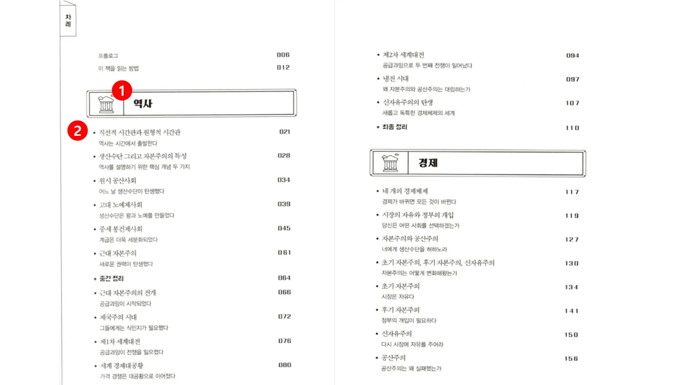

> 💡 <strong><code>Index(인덱스)</code></strong>는 데이터베이스에 저장된 테이블 레코드를 빠르게 탐색하기 위한 자료구조를 말합니다&#46; 레코드를 빠르게 탐색할 수 있는 이유는 미리 <strong><code>정렬</code></strong>이 되어있기 때문이죠&#46;<br><br>우리가 책에 내용을 찾을 때 순서대로 나열된 목차를 보고 내용을 찾듯이 데이터베이스도 레코드를 검색할 때 index를 통해 찾게되면 더 빠르게 찾을 수 있습니다&#46; <br>즉, 검색이 빨라집니다&#46;<br><br>반면 record의 쓰기(생성, 수정, 삭제)이 일어나면 재정렬하거나 인덱스를 추가해주는 작업이 필요하기 때문에 오히려 성능이 떨어질 수 있습니다&#46;<br><br><strong>무계획적인 인덱스 생성 보다는 SQL문을 효율적으로 작성 한후 인덱스 사용을 고려하시기 바랍니다&#33;&#33;</strong>

<a id="18feda9b0fe18065879eed8fb7dff28d"></a>

## <strong>1&#46;1 Index 종류</strong>

---

<a id="18feda9b0fe180eb8482fafaec8b686b"></a>

### <strong>1&#46;1&#46;1 CLUSTERD INDEX, NON&#45;CLUSTERD INDEX</strong>

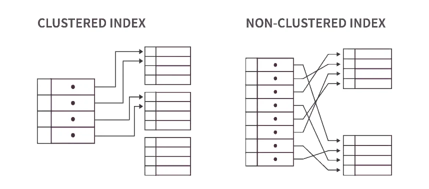

|  |  |  |
| --- | --- | --- |
|  | <strong>Clustered Index</strong> | <strong>Non&#45;Clustered(Secondary) Index</strong> |
| <strong>스토리지</strong> | <strong>데이터 행은 인덱스와 동일한 순서로 정렬되고 저장</strong> | <strong>인덱스 행과 데이터 행은 별도로 저장</strong> |
| <strong>주요 칼럼</strong> | 일반적으로 <strong>고유한 열</strong>(primary key) | 쿼리에서 자주 사용되는 <strong>모든 열 가능</strong> |
| <strong>크기</strong> | <strong>모든 데이터 행</strong> | <strong>인덱스 키 값, 데이터 행에 대한 포인터</strong> |
| <strong>변경</strong> | 기본 키 열이 변경되면 전체 인덱스를 다시 작성 | 영향을 받는 인덱스 페이지만 업데이트 |
| <strong>성능</strong> | 순차적 데이터의 <strong>광범위한 검색</strong>을 더 빠름 | <strong>소규모 데이터 집합을 검색</strong>하거나 데이터를 정렬하고 집계하는 데 더 빠름 |
| <strong>주 사용처</strong> | <strong>primary key, foreign key</strong> | <strong>unique key</strong>, <strong>일반적인 index</strong> |

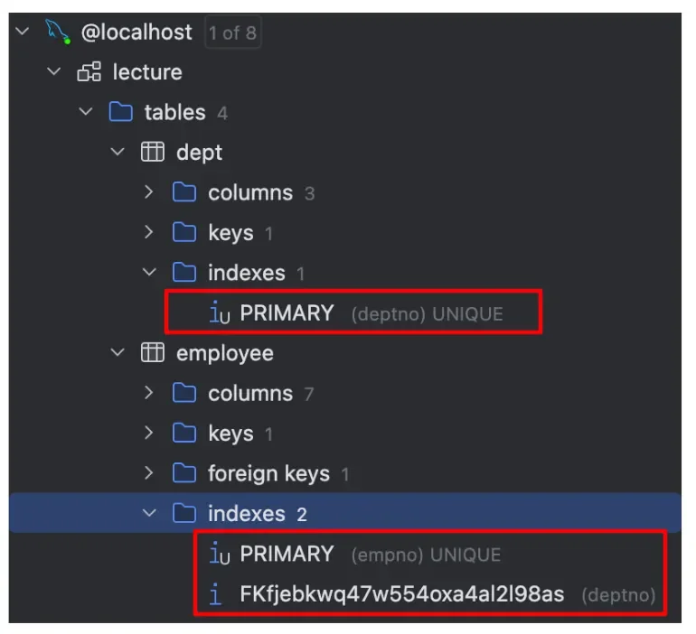

> 📌 
> 
> <a id="18feda9b0fe1803da599f95243b573b6"></a>
> 
> 기본적으로 <strong><code>PK</code></strong>, <strong><code>FK</code></strong>, <strong><code>UK</code></strong>의 경우 index를 자동 생성하여 줍니다&#46;

<a id="18feda9b0fe180c6bd76f23dc62be20b"></a>

### <strong>1&#46;1&#46;2 Covering Index</strong>

<a id="18feda9b0fe180cb85b3e847a05ca93f"></a>

index로 지정된 데이터만을 출력할 때 <strong>Covering Index </strong>를 사용하게 되는데 해당 index는 설정에 의한 index가 아니라 사용에 의한 index입니다&#46;

<a id="18feda9b0fe180629501c541cc2308d8"></a>

```java
CREATE INDEX idx_employee ON Employees(salary);

## index로 설정한 salary만 조회, 정렬하여 사용될 때
   SELECT salary 
     FROM employees
 ORDER BY salary;
```

<a id="18feda9b0fe1809493f6ed5a5c9fe0e0"></a>

## 1&#46;3 Index 적용 기준

---

> 💡 앞서 말씀드린 것과 같이 무분별한 인덱스 사용은 오히려 독이 됩니다&#46;<br>그래서 인덱스는 테이블에 데이터가 대용량이고 사용빈도가 높을 때 사용하는 것이 좋습니다&#46;<br>막 시작한 서비스에 데이터가 작고, 사용빈도가 낮으면 인덱스를 쓸 필요는 없을 수 있습니다&#46;

|  |  |  |
| --- | --- | --- |
| <strong>준</strong> | <strong>내용</strong> | <strong>정도</strong> |
| <strong>카디널리티 (Cardinality)</strong> | <strong>중복되지 않는 값 (단일한 값)</strong> | 높을 수록 적합 |
| <strong>활용도</strong> | <strong>많이 활용되는 값</strong> | 높을 수록 적합 |

|  |  |  |  |
| --- | --- | --- | --- |
| <strong>노동자</strong> | <strong>Employee</strong> | <strong>카디널리티</strong> | <strong>활용도</strong> |
| 아이디 | empno (PK) | 1,000,000 (높음) | 높음 |
| 이름 | ename | 900,000 (높음) | &#45; |
| 고용일 | hire&#95;date | 800,000 (높음) | &#45; |
| 직업 | job | 10 (낮음) | &#45; |
| 급여 | salary | 300,000 (낮음) | &#45; |
| 부서 | depno(FK) | 5 (낮음) | 높음 |

1. <strong><code>empno</code></strong>
    - <strong>카디널리티</strong>
        - 1,000,000 (높음 &#45; 전체 행 수와 동일)

    - <strong>예시 </strong>
        - SELECT &#42; FROM employee WHERE id = 500000;

    - <strong>설명</strong> 
        - Primary Key인 empno는 고유한 값을 가지므로 cardinality가 매우 높습니다&#46; <br>이런 경우 인덱스가 매우 효과적입니다&#46;

1. <strong><code>ename</code></strong>, <strong><code>hire&#95;date</code></strong>
    - <strong>카디널리티</strong>
        - 800,000 (높음)

    - <strong>예시</strong> 
        - SELECT &#42; FROM employee WHERE ename = &#39;이태현&#39;;

    - <strong>설명</strong>
        - Primary key 보다는 고유한 값이 적지만 상대적으로 유니크한 값을 가지므로 <br>인덱스 생성을 고려할 수 있습니다&#46;

1. <strong><code>job</code></strong> 
    - Cardinality
        - 5 (낮음)

    - <strong>예시</strong>
        -  SELECT &#42; FROM employee WHERE job = &#39;ANALYST&#39;;

    - <strong>설명</strong>
        - 고유한 값이 적은 직업은 적합하지 않다&#46;

1. <strong><code>depno</code></strong>
    - <strong>Cardinality</strong>
        -  20 (낮음)

    - <strong>예시</strong>
        - SELECT &#42; FROM employee WHERE depno = &#39;개발 1 팀&#39;;

    - <strong>설명</strong>
        - 고유한 값이 적은 부서는 적합하지 않다&#46;

1. <strong><code>복합 인덱스</code></strong>(<strong><code>job</code></strong>, <strong><code>salary</code></strong>)  
    - <strong>예시</strong>
        -  SELECT &#42; FROM employee WHERE job = &#39;ANALYST&#39; AND salary &#62; 50000;

    - <strong>설명</strong>
        - 현업에선 단일 인덱스보다는 복합 인덱스를 더 많이 사용합니다&#46;

        - <strong>3개 이상의 컬럼을 되도록 사용하지 않는게 좋습니다&#46;</strong>

        - <strong>배치 순서 중요합니다&#46;<br>why? <br>지정한 순서에 따라 정렬의 기준이 정해지고 순서가 달라지면 인덱스를 사용되지 않을 수 있습니다&#46;</strong>

> ✏️ 
> 
> <a id="18feda9b0fe1807a9d4bc5b0754100df"></a>
> 
> 아래와 같이 index에 중복이 있는 경우 해당 index는 사용되지 않을 수 있으니 제거해줍니다&#46;중복 제거<br><br>idx&#95;employee&#95;01 &#58; ename, job<br><del>idx&#95;employee&#95;02 &#58; ename</del><br>idx&#95;employee&#95;03 &#58; ename, hire&#95;date

<a id="18feda9b0fe1802a8aadcfa37f018935"></a>

### <strong>1&#46;4 Index 적용법</strong>

---

<a id="18feda9b0fe180e6bf72da8a72a90393"></a>

```sql
# 생성 및 추가
CREATE INDEX 인덱스명 ON 테이블(컬럼1, 컬럼2, ...);

# 추가
ALTER TABLE 테이블명 ADD INDEX 인덱스명(컬럼1, 컬럼2, ...);   

# 삭제
ALTER TABLE 테이블명 DROP INDEX 인덱스명;
```

<a id="18feda9b0fe1804b8491e19dc79dc420"></a>

### <strong>1&#46;5 Index 사용 규칙</strong>

---

<a id="18feda9b0fe1808185afe800d3b80319"></a>

```sql
# 컬럼 값을 변경하지 말 것 
SELECT salary FROM employees WHERE salary * 10 = 10000 (X). 
# 필드에 직접 변경 시 index 값을 찾을 없어 index를 사용할 수 없습니다.

SELECT salary FROM Employees WHERE salary = 10000 * 10 (O) 

# index 컬럼 순서를 맞출 것
CREATE INDEX idx_employee ON employees(salary, hire_date);

# 순서가 옳바르지 않을 시 index가 적용되지 않습니다.
SELECT salary FROM Employees 
WHERE hire_date between '20100101' and '20240101'
  AND salary = 10000;

# 옳바른 조회
SELECT salary FROM employees 
WHERE salary = 10000; 
  AND hire_date between '2010-01-01' and '2024-01-01'
```

<a id="18feda9b0fe180f09e05d5a5bfc1e133"></a>

## <strong>3&#46; 데이터 검색</strong>

---

> 📖 
> 
> <a id="18feda9b0fe180858affc558dc4e2582"></a>
> 
> 쿼리 조회 시 가장 우선시 해야하는 것은 <strong><u>탐색 데이터 범위를 줄이는 것</u></strong><strong>입니다&#46;<br>이때 인덱스를 통해 읽어야할 데이터 레코드(행) 가 20&#126;25%를 넘으면 인덱스로 읽는 것 보다 테이블 데이터를 직접 읽는 것이 더 효율적이라고 옵티마이저는 해석합니다&#46; <br>즉, index scan을 하는 것이 아닌 full scan을 통해 전체 데이터 조회를 할 수 있습니다&#46;</strong>

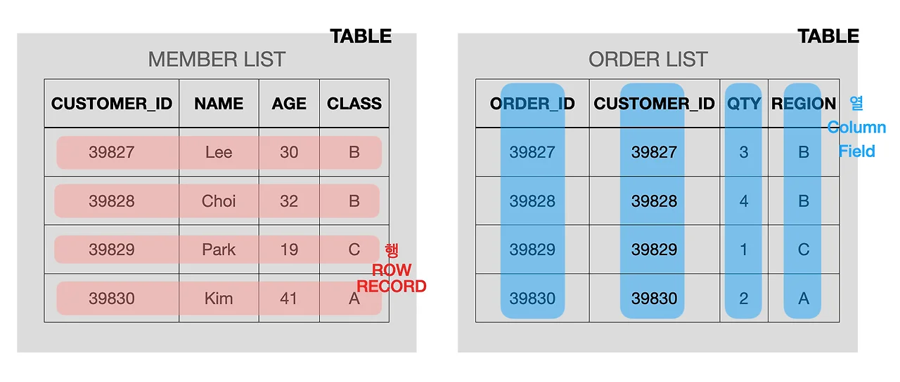

<a id="18feda9b0fe1804090aae332c3ce2cba"></a>

### <strong>1) Full Table Scan</strong>

- <strong><code>Full Table Scan</code></strong>은 데이터베이스가 테이블의 모든 행을 순차적으로 읽는 방법입니다&#46; <br>index를 사용하지 않으며, 테이블의 모든 데이터를 확인해야 함으로 비효율적입니다&#46;

<a id="18feda9b0fe180fdae38c4d65355fcbc"></a>

```sql
SELECT * FROM Employees;
```

<a id="18feda9b0fe180b5b600fa2d5646eb1f"></a>

### <strong>2) Full Index Scan</strong>

- <strong><code>Full Index Scan</code></strong>은 인덱스의 모든 엔트리를 순차적으로 읽는 방법입니다&#46; <br>테이블 전체를 읽는 것보다 빠를 수 있지만, 여전히 인덱스의 모든 항목을 읽어야 하기 때문에 비효율적입니다&#46;

<a id="18feda9b0fe180649130edabeed9ea94"></a>

```sql
CREATE INDEX idx_employee ON Employees(salary);

SELECT salary FROM employees ORDER BY salary;
```

<a id="18feda9b0fe18035b6d4d99449394768"></a>

### <strong>3) Full Range Scan</strong>

- <strong><code>Full Range Scan</code></strong>은 인덱스의 특정 범위 내에 있는 엔트리만 읽는 방법입니다&#46; <br>인덱스를 활용하여 필요한 데이터만 읽기 때문에 효율적입니다&#46;

<a id="18feda9b0fe18086b3ebda959afbbe5f"></a>

```sql
SELECT * FROM employees WHERE salary BETWEEN 50000 AND 100000;
```

<a id="18feda9b0fe180b3803dd6b941ad3aa0"></a>

### <strong>4) Index Unique Scan</strong>

<a id="18feda9b0fe1802b968ed4f3d951ba85"></a>

<strong><code>Index Unique Scan</code></strong>은 인덱스를 사용하여 하나의 특정 행을 검색하는 방법입니다&#46; <br>매우 효율적이며, unique 인덱스가 있는 경우 사용됩니다&#46;

<a id="18feda9b0fe1805fb8bcd1d0933ab2a2"></a>

```java
SELECT * FROM employees WHERE employee_id = 123;
```

<a id="18feda9b0fe180999fe0fc124b049e5b"></a>

### <strong>5) Index Range Scan</strong>

<a id="18feda9b0fe180479769d632e2303dce"></a>

<strong>I</strong><strong><code>ndex Range Scan</code></strong>은 인덱스를 사용하여 특정 범위 내의 데이터를 검색하는 방법입니다&#46;<br> Full Range Scan과 유사하지만, 인덱스를 사용하여 보다 효율적입니다&#46;

<a id="18feda9b0fe180ee8d52d9a1aa5f71fe"></a>

```sql
CREATE INDEX idx_employee ON Employees(last_name);

SELECT * FROM employees WHERE last_name LIKE 'A%';
```

<a id="18feda9b0fe180f9a67cfb6ff223d9ac"></a>

### <strong>6) Index Skip Scan</strong>

<a id="18feda9b0fe180f3b8a9cbc723530085"></a>

<strong>I</strong><strong><code>ndex Skip Scan</code></strong>은 <strong><u>인덱스의 리프 노드 사이를 건너뛰면서</u></strong> 필요한 데이터를 검색하는 방법입니다&#46; <br>복합 인덱스를 사용할 때, 선행 열의 값을 무시하고 후행 열의 값을 기반으로 검색할 때 사용됩니다&#46;

<a id="18feda9b0fe180938590e20a67026469"></a>

```sql
CREATE INDEX idx_employee ON Employees(department_id, salary);

SELECT * FROM employees WHERE salary > 50000;
```

|  |  |  |
| --- | --- | --- |
| <strong>종류</strong> | <strong>내용</strong> | <strong>효율성</strong> |
| <strong>Full Table Scan</strong> | 테이블의 모든 행을 읽습니다&#46; 큰 테이블에서는 비효율적입니다&#46; | 큰 테이블에서는 비효율적 |
| <strong>Full Index Scan</strong> | 인덱스의 모든 엔트리를 읽습니다&#46; | 일부 경우에서 비효율적 |
| <strong>Full Range Scan</strong> | 인덱스의 특정 범위 내의 엔트리를 읽습니다&#46; | 매우 효율적 |
| <strong>Index Unique Scan</strong> | 고유 인덱스를 사용하여 하나의 특정 행을 검색합니다&#46; | 매우 효율적 |
| <strong>Index Range Scan</strong> | 인덱스를 사용하여 특정 범위 내의 데이터를 검색합니다&#46; | 효율적 |
| <strong>Index Skip Scan</strong> | 복합 인덱스의 후행 열을 사용하여 데이터를 검색합니다&#46; | 조건에 따라 효율적 |

<a id="18feda9b0fe180a7b75ff216294f5370"></a>

# 5&#46; SQL 실행계획

---

> 💡 <strong>Explain</strong> 구문을 이용해서 작성된 Query가 어떠한 방식으로 수행되는지 분석할 수 있는 방법입니다&#46;

<a id="18feda9b0fe1808f934ddc3d24225ffd"></a>

```sql
EXPLAIN 
SELECT * FROM thread;
```

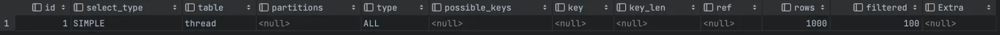

<a id="18feda9b0fe180918774f7ca030e4d15"></a>

```sql
# 쿼리의 실행시간을 알 수 있어요.
EXPLAIN ANALYZE 
SELECT * FROM thread;
```


| <strong>항목</strong> | <strong>설명</strong> |
| --- | --- |
| <strong>id</strong> | select 문에 구분하는 식별자, 실행 순서 x |
| <strong>select&#95;type</strong> | select 문의 유형<br><br><strong>simple</strong><br>&#45; select&#95;type이 SIMPLE인 단위 쿼리는 최대 하나만 존재하는 단순 select문<br><br><strong>primary</strong><br>&#45;  union, sub&#45;query가 포함된 가장 바깥쪽 select문<br><br><strong>subquery</strong><br>&#45; FROM절을 제외한 절에서 사용되는 sub&#45;query select문<br><br><strong>derived</strong><br>&#45; FROM절에 사용된 sub&#45;query 결과를 담은 임시 테이블<br><br><strong>ETC</strong> |
| <strong>table</strong> | 해당 select문이 참조하는 table<br><br>dervied N &#58; 임시 테이블 |
| <strong>type</strong> | scan 유형<br>&#58; 속도는 const 가장 빠르며 all이 가장 느리다&#46;<br><br><strong>index 이용</strong> {<br>  <strong>const<br>  &#45;</strong> pk, uk를 조건으로 1건 검색<br><br>  <strong>eq&#95;ref<br>  &#45; </strong>pk, unique key로 동등 비교 하여 join되는 경우<br><br>  <strong>ref<br>  </strong>&#45; pk, unique, not null이 아닌 index를 동등 비교 하여 검색 <br><br>  <strong>range<br>  &#45;</strong> 범위&#46; BETWEEN ,IN, &#39;&#62;=&#39;, LIKE 로 검색<br><br>  <strong>index</strong><br>  &#45; 모든 index full scan<br>}<br><br>index 이용 x {<br>  <strong>all <br>  &#45; </strong>모든 row full scan<br>  &#45; 카디널리티가 낮은 경우 full scan이 index보다 빠르다&#46;<br>  &#45; 데이터가 적거나 읽고자 하는 데이터 적으면 index가 있더라도 full table scan 한다&#46;<br>}<br><br><strong>ETC</strong> |
| <strong>possible&#95;keys</strong> | 후보 index들 |
| <strong>key</strong> | 실제 사용된 index |
| <strong>ref</strong> | key column 에 지정된 인덱스와 비교되는 column 또는 constant |
| <strong>rows</strong> | 실행 시 조사하는 행 수립&#46; 실제 수와 일치하지 않을 수 있음 |
| <strong>extra</strong> | 실행계획에 있어서 표현되는 부가적인 정보<br><br><strong>Using where</strong> <br>&#45; 조건 등을 사용한 데이터 추출 시<br><br><strong>Using index</strong> <br>&#45; 데이터 직접 조회 없이 index만 사용해 데이터 추출 시 <br><br><strong>Using filesort</strong><br>&#45; index를 사용하지 못해쓸 때 재정렬 했을 시<br><br><strong>Using temporary<br>&#45; </strong>group by와 같이 임시 테이블이 사용되었을 시 |

<a id="18feda9b0fe1801cb36bcd1e666f8576"></a>

# 6&#46; JOIN 방식

---

> 💡 관계가 맺어진 테이블간에 Join하여 결과를 출력할 때 옵티마이저(<strong>Optimizer</strong>)는 어떤 방식으로 결과를 도출할까요? <br>가장 일반적인 방식인 <strong><code>Nested Loop Join</code></strong>, <strong><code>Hash Join</code></strong><strong> </strong>에 대해서 알아볼게요&#46;

> 📌 <strong><code>드라이빙 테이블(Driving Table)</code></strong><strong> &#58; 먼저 조회되는 주 테이블<br></strong><strong><code>드리븐 테이블(Driven Table)</code></strong><strong> &#58; 드라이빙 테이블이 조회 된 후 조회되는 테이블<br><br></strong>현대의 모든 데이터베이스는<strong> </strong><strong><code>비용기반 옵티마이저(Cost&#45;Based Optimizer, CBO)</code></strong><strong> </strong>로 쿼리를 수행합니다&#46; 따라서 데이터량, 설정정보, 버전에 따라 어떤 테이블을 <strong><code>드라이빙 테이블</code></strong> 로 선택할지 혹은 <strong><code>드리븐 테이블</code></strong> 로 선택할지 서로 다른 실행계획을 생성합니다&#46; <br>이때 한번 혹은 자주 실행된 결과는 데이터베이스 캐싱(Cashing)되어 저장되어 SQL마다 실행계획을 재수행하지 않습니다&#46;

<a id="18feda9b0fe1800294ebed32498e28cd"></a>

## 6&#46;1 Nested Loop Join(중첩된 루프 조인)

---

<a id="18feda9b0fe180da8337e14660b1a828"></a>

```sql
    SELECT * 
      FROM employee e
INNER JOIN dept d on e.deptno = d.deptno
```

> 📌 위와 같이 join SQL을 사용했을 때 일반적으로 PK, FK를 기준으로 join을 걸게 됩니다&#46;<br>이때 row 수가 적은 <strong><code>dept</code></strong><strong> </strong>이 <strong><code>드라이빙 테이블</code></strong><strong> </strong>이 되고, <strong><code>employee</code></strong>이 <strong><code>드리븐 테이블(Driven Table)</code></strong><strong> </strong>이 됩니다&#46;<br><strong><code>dept&#46;deptno</code></strong> 와  <strong><code>employee&#46;deptno</code></strong><strong> </strong>가 일치하는 값을 loop를 수행하듯이 찾는 방법을 <strong><code>Nested Loop Join</code></strong><strong> </strong>라고 합니다&#46;<br>

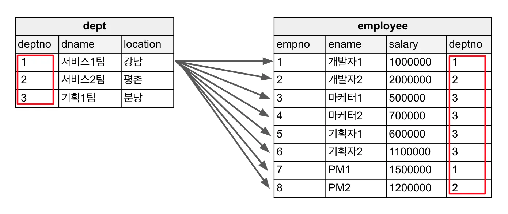

<a id="18feda9b0fe18050bed6d564e02b64a1"></a>

<strong>&#60;&#60;실행계획&#62;&#62;</strong>

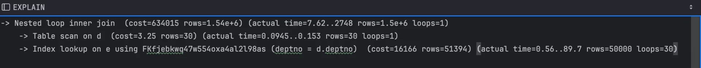

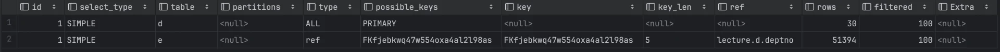

1. <strong><code>드라이빙 테이블</code></strong><strong> </strong>인<strong> </strong><strong><code>dept</code></strong><strong> </strong>을 full 스캔 합니다&#46;

1. <strong><code>employee</code></strong><strong> </strong>의 <strong> </strong><strong><code>FK index</code></strong><strong> </strong>로 <strong><code>deptno</code></strong><strong> </strong>가 같은 값을 탐색하며 inner join합니다&#46;

1. join한 결과를 <strong><code>조인 테이블(join table)</code></strong>에 저장합니다&#46;

1. 출력합니다&#46;

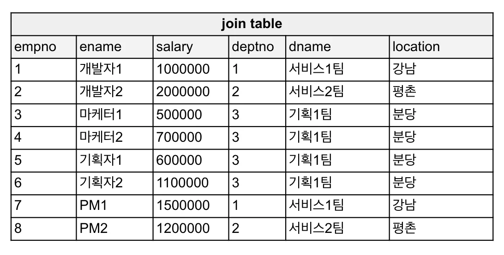

<a id="18feda9b0fe180ef9376eda1dd506206"></a>

## 6&#46;2 Hash join(해시 조인)

---

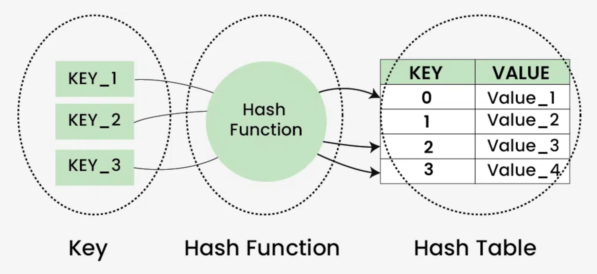

> 📌 <strong><code>해시 테이블(Hash Table)</code></strong><strong> </strong>는 Java에 Map에 많이 사용되며 Key&#45;Value로 데이터를 조작할 수 있는 자료구조입니다&#46;<br><br><strong><code>키(Key)</code></strong><strong> &#58; </strong>문자열 혹은 숫자 형태인 고유한 값<br><strong><code>해시 함수(Hash Function)</code></strong><strong> &#58; </strong><strong><code>Key</code></strong><strong> </strong>를 배열의 고유한 인덱스로 변환해주는 함수<br><strong><code>해시 테이블(Hash Table)</code></strong><strong> &#58; </strong>index로 값이 저장된 배열 형태의 테이블<br><br>→ 즉, <strong><code>해시 테이블(Hash Table)</code></strong> 에서 데이터를 찾는 방법은 <strong><code>해시 함수(Hash Function)</code></strong><strong> </strong>통해 index로 정렬 된 값을 찾는 것 입니다&#46;<br><br><strong><code>해시 조인(Hash Join)</code></strong>은 테이블의 조인 조건이 되는 <strong><code>key</code></strong>를  <strong><code>해시 함수(Hash Function)</code></strong>를 사용하여 <strong><code>해시 테이블(Hash Table)</code></strong>에 저장 한 후 테이블을 기반으로 검색하고 join하는 방식입니다&#46;<br><strong><code>해시 테이블(Hash Table)</code></strong>은 <strong><code>조인 버퍼(join buffer)</code></strong>라고 불리는 메모리 공간에 생성됩니다&#46;<br>

<a id="18feda9b0fe180cb8d27db65404929e8"></a>

```sql
## depno에 FK index를 삭제한 후 
    SELECT * 
      FROM employee e
INNER JOIN dept d on e.deptno = d.deptno
```

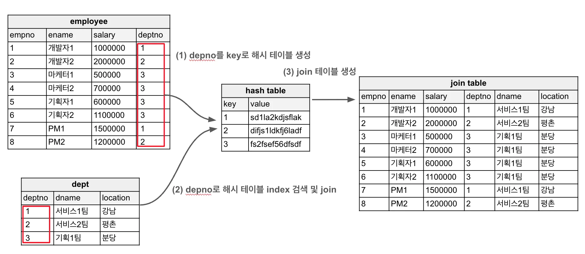

<a id="18feda9b0fe18078a60df25f1e3180a2"></a>

<strong>&#60;&#60;실행계획&#62;&#62;</strong>

1. <strong><code>드라이빙 테이블</code></strong><strong> </strong>인<strong> </strong><strong><code>employee</code></strong><strong> </strong>을 full 스캔 합니다&#46;

1. <strong><code>dept</code></strong><strong> </strong>에 <strong><code>deptno</code></strong>로 <strong><code>해시 테이블(Hash Table)</code></strong><strong> </strong>을 생성 합니다&#46;

1. <strong><code>dept</code></strong><strong> </strong>는 <strong><code>deptno</code></strong><strong> </strong>를 <strong><code>key</code></strong>로  <strong><code>해시 테이블(Hash Table)</code></strong> 을 탐색하며 inner join합니다&#46;

1. join한 결과를 <strong><code>조인 테이블(join table)</code></strong>에 저장합니다&#46;

1. 출력합니다&#46;

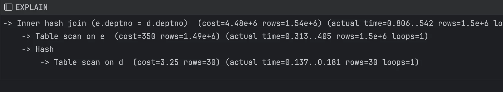

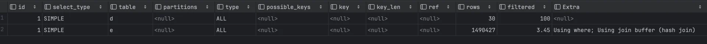

<a id="18feda9b0fe180fcb8a8d0b0d3207803"></a>

## 6&#46;3 Nested loop join vs Hash join

---

> 📌 
> 
> <a id="18feda9b0fe1806ba993c988403079e0"></a>
> 
> <strong><code>Nested loop join</code></strong><strong> &#58; </strong>첫번째 레코드를 찾는데 걸리는 시간이 빠릅니다&#46; (<strong>index 사용</strong>)<br><strong><code>Hash join</code></strong><strong> &#58; </strong>전체 레코드를 찾는데 걸리는 시간이 빠릅니다&#46; (<strong>index 미사용</strong>)<br><br>옵티마이저들은 index를 기반으로 데이터를 탐색하는 방법이 전체 레코드를 탐색하는 방법 보다 빠르기 때문에 대부분 <strong><code>Nested loop join</code></strong><strong> </strong>를 통해 join을 하지만 index가 없거나 사용되지 않는 경우 <strong><code>Hash join</code></strong><strong> </strong>을 사용하게 됩니다&#33;

<a id="18feda9b0fe18058a035ec4b4f547e71"></a>

## 7&#46; 예제

<a id="18feda9b0fe1809ebb3cd3bf10faeeee"></a>

```sql
## empLoyee 2諛깅쭔 row
select count(1) from employee;


## clusterd index - primary index
explain
select *
from employee
where empno = 1000;


## non-clustered index - secondary index
alter table employee add index idx_employee_01 (hire_date);

alter table employee drop index idx_employee_01;

explain
select
    empno, ename, hire_date
from employee
where hire_date
between '2024-06-21' and '2024-07-01';


## composite index (蹂듯빀 �몃뜳��)
alter table employee add index idx_employee_02(ename, hire_date);
alter table employee drop index idx_empLoyee_02;

explain
select
    empno, ename
from employee
where 1=1
  and ename = '�몃룞��_225'
#and trim(enane) ='�몃룞��_225'
  and hire_date between '20200621' and '20240701';


## group by
alter table employee add index idx_employee_04(job);
alter table employee drop index idx_employee_04;

explain select
    job, max(salary)
from employee
where job = '湲고쉷��'
group by job;


## covering index
alter table employee add index idx_employee_05 (deptno, salary);
alter table employee drop index idx_employee_05;

explain
select e.deptno, e.salary, d.dname
from employee e
         join dept d on e.deptno = d.deptno
where e.deptno = 2
  and e.salary > 5000;
```
