[Video Conferencing, Web Conferencing, Webinars, Screen Sharing]()

[design_pattern (2).zip](e9487b1cd13b9daa.zip)

> 🧷 
> 
> <a id="18feda9b0fe180dc97e0cb1f2477be9f"></a>
> 
> 지난 시간엔 OOP와 디자인 원칙에 대해서 알아보았습니다&#46;<br>이번 특강에서는 해당 원칙을 패턴화한 여러 방식에 대해서 알아보고자 합니다&#46;
> 
> <a id="18feda9b0fe18044970ee9f4fa0de7b8"></a>
> 
> 본 특강을 통해 우리가 사용하는 Java와 Spring 내에 어떠한 패턴들이 있는지 이해하고 <br>라이브러리을 활용할 때 원리를 이해하는 목적으로 들어주시면 좋겠습니다&#46;
> 
> <a id="18feda9b0fe180d0b8c5d918b4dca343"></a>
> 
> <strong>(주의)</strong>
> 
> <a id="18feda9b0fe180c5843bee1e83034c2c"></a>
> 
> <strong>해당 내용을 무리하게 적용하려고 하지마세요&#33;&#33;&#33; <br>원칙과 패턴을 잘못 적용하게 되면 오히려 유지보수를 헤치게 됩니다&#33;&#33;&#33;</strong>

<a id="18feda9b0fe180fe991bf7621d3fa5e9"></a>

# <strong>1&#46; 왜 패턴을 배워야 하나요?</strong>

<a id="18feda9b0fe180ca808de291361c716c"></a>

결론부터 말씀드리자면 여러분은 패턴에 대해 아무것도 알지 못해도 개발자로 일할 수 있습니다&#46; <br>실제로 많은 개발자가 패턴에 대한 아무런 지식 없이 업무를 수행하기도 합니다&#46; <br><strong>하지만, </strong>그 많은 개발자들은 자신도 모르는 사이에 일부 패턴들을 사용하고 있고 구현하고 있습니다&#46;

<a id="18feda9b0fe18053a5e6d93d8bf00616"></a>

단지 개념화하고 도식화하여 머릿 속에 저장하지 않았을 뿐입니다&#46;

<a id="18feda9b0fe180799fe7ecb7e98a9e5f"></a>

개념화와 도식화의 큰 장점은 필요에 따라 머릿 속에 저장되어있는 내용을 끄집어내어 활용할 수 있다는 것입니다&#46;

<a id="18feda9b0fe180bd98cee649bd7c7ab7"></a>

<strong>적어도 우리 </strong><strong><code>스파르타코딩클럽</code></strong><strong> 수료생 분들이라면 그 많은 개발자가 아닌 더 나은 개발자가 되시길 바랄 뿐입니다&#33; </strong>

- 소프트웨어에서 패턴은 소프트웨어 디자인의 일반적인 문제들에 대해 <strong><code>시도되고 검증된 해결책</code></strong>들을 모은 것입니다&#46; <br>몇가지 패턴을 학습하게 되면 <strong><code>객체 지향 디자인의 원칙들을 사용해 많은 종류의 문제를 해결</code></strong>하는 방법들을 배울 수 있습니다&#46;

- 또한, 이미 만들어져 있는 프레임워크, 라이브러리에 사용된 패턴들을 이해하고 사용하는데 도움이 됩니다&#46;

- 어느날 한 팀원이 <strong><code>&#39;그 객체는 싱글턴으로 만들어줘&#39;</code></strong> 하였을 때 싱글턴이 무엇인지 모른다면 곤란할 수 있을 것입니다&#46;

- <strong><code>패턴</code></strong>과 <strong><code>알고리즘</code></strong>과 자주 혼동됩니다&#46; <br>왜냐하면 두 개념 모두 알려진 문제에 대한 일반적인 해결책을 설명하기 때문입니다&#46; <br><strong><code>알고리즘</code></strong>은 어떤 목표를 달성하기 위해 따라야 할 명확한 일련의 절차를 정의하는 <strong><code>조리법</code></strong>이라면<br><strong><code>패턴</code></strong>은 해결책에 대한 더 상위 수준의 <strong><code>레시피</code></strong><strong> </strong>라 할 수 있겠습니다&#46;

- 몇몇 패턴을 사용하면 실제<strong> </strong>코드 파일 크기를 줄일 수도 있다&#46; <br>반복을 피할 수 있기 때문이다&#46; <br>이런 패턴을 사용하면 개발자들은 자신의 솔루션에서 반복을 바로 줄일 수 있을 만한 부분을 보다 꼼꼼히 찾아 코드의 전체 분량을 줄일 수 있다&#46;

<a id="18feda9b0fe180fca21cdee5412eb761"></a>

# 2&#46; 아키텍처 패턴 (Architectural Patterns)

> 💡 
> 
> <a id="18feda9b0fe1802ea9b7c0b3288f12a3"></a>
> 
> <strong><code>소프트웨어 아키텍처 패턴</code></strong>은 애플리케이션의 구조를 정의하는 고수준의 설계 패턴입니다&#46; <br>시스템의 구성 요소 간의 관계, 데이터의 흐름, 상호작용 방식 등을 정의하며, 특정한 유형의 문제를 해결하기 위한 지침을 제공합니다&#46; <br>아키텍처 패턴은 시스템 전반의 설계 방향을 결정하므로, 선택에 따라 애플리케이션의 유지보수성, 확장성, 성능에 큰 영향을 미치기도 합니다&#46; <br>아래 도식을 바탕으로 Spring Framework가 기본적으로 지향하는 패턴인 <br><strong>클라이언트&#45;서버 (Client&#45;Server), <br>계층형 패턴 (Layered Pattern), <br>MVC (Model&#45;View&#45;Controller)</strong>에 대해서 알아보겠습니다&#46;

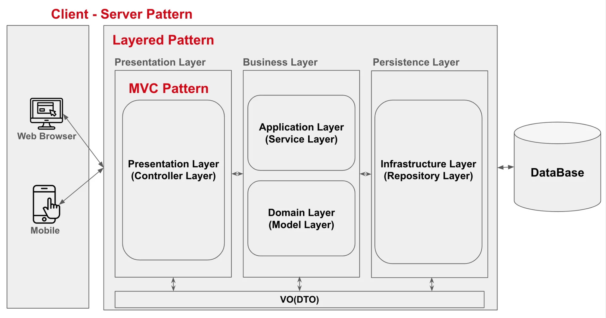

<a id="18feda9b0fe1808c88dcd9c41e6efe5f"></a>

## <strong>1&#46; 클라이언트&#45;서버 (Client&#45;Server)</strong>

> 💡 
> 
> <a id="18feda9b0fe180dab0aecd2e041b5666"></a>
> 
> <strong><code>클라이언트&#45;서버 패턴</code></strong>은 인터넷 환경에서 기능과 데이터의 책임을 클라이언트와 서버로 분리하여, 각기 다른 역할을 수행하도록 하는 소프트웨어 아키텍처 패턴입니다&#46; 

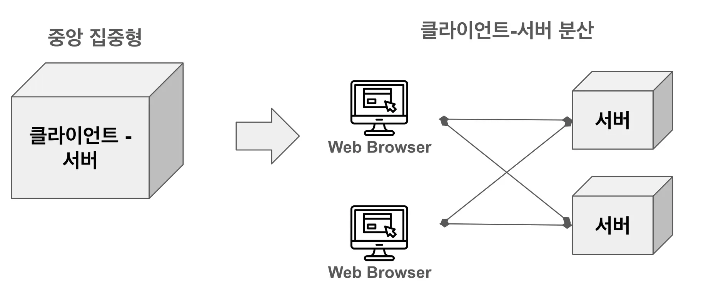

<a id="18feda9b0fe1803bbc12f320a65ee27d"></a>

<strong>탄생 배경</strong>

- 초기의 컴퓨터 시스템에서는 애플리케이션이 <strong><code>중앙 집중형(하나의 서버)</code></strong>으로 관리되었습니다&#46; 

- 인터넷이 발달로 분산 컴퓨터(여러개의 컴퓨터)가 가능해지면서 다수의 사용자와 데이터 요청을 효율적으로 처리하기 위해 <strong><code>클라이언트&#45;서버</code></strong> 구조가 탄생하게 되었습니다&#46;

- 이 구조는 서버가 데이터와 기능을 관리하고, 클라이언트가 사용자 인터페이스와 요청을 담당함으로써 처리의 분리와 효율성을 높일 수 있었습니다&#46;

<a id="18feda9b0fe180bbaaa4d28309d13bdf"></a>

<strong>사용</strong>

- <strong><code>클라이언트</code></strong>는 다양한 유형의 사용자 인터페이스(웹, 모바일 등)를 담당하고 여러 유형의 요청을 서버에 질의할 수 있습니다&#46;

- <strong><code>서버</code></strong>는 클라이언트가 요청한 질의를 처리한 후 자원을 반환하는 형태이기 때문에 각 컴포넌트들은 서로 독립적으로 서로의 역할을 수행할 수 있습니다&#46;

<a id="18feda9b0fe18013b251f43af7902b2e"></a>

<strong>발전</strong>

- 해당 패턴은 지속적으로 발전하여 각 컴포넌트(클라이언트, 서버)가 자신들의 수요와 특징에 맞게 세분화되어 생태계를 만들어냈고 <strong><code>Front&#45;End(클라이언트)</code></strong>, <strong><code>Back&#45;End(서버)</code></strong> 엔지니어의 분업화를 가져왔습니다&#46; 

<a id="18feda9b0fe180b490bae4087dde5353"></a>

## <strong>2&#46; 계층형 패턴 (Layered Pattern)</strong>

> 💡 
> 
> <a id="18feda9b0fe180e5ba16c7b853f32a14"></a>
> 
> 애플리케이션을 계층으로 나누어 각 계층마다 특정 역할을 담당하도록 설계함으로써 <strong>서버 내에서</strong> 계층간에 독립적인 구현과 유지보수가 수행되도록 하는 소프트웨어 아키텍처 패턴입니다&#46; <br><strong>&#42;&#42; 레이어의 분류는 역할을 어떻게 분류하느냐에 따라서 유동적으로 정의하며 고정된 것이 아닙니다&#33;&#33;</strong>

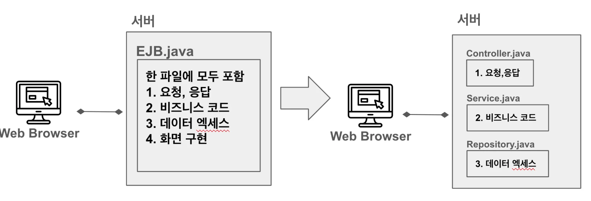

<a id="18feda9b0fe1802eb76cdf679f42ea30"></a>

<strong>탄생 배경</strong>

- 레이어드 패턴은 소프트웨어의 복잡성이 증가하면서 각 구성 요소의 역할과 책임을 명확히 하여 개발 및 유지보수의 편의성을 높이고자 탄생했습니다&#46; 

- 초기의 시스템은 모든 코드가 단일 코드베이스에 섞여 있어 이해하기 어렵고, 수정이 어려운 경우가 많았습니다&#46; 

- 이를 해결하기 위해 코드가 비슷한 역할을 수행하는 레이어별로 분리되는 구조를 도입하게 되었습니다&#46;

<a id="18feda9b0fe180b1b635cd9b911dc4bb"></a>

<strong>사용</strong>

- 레이어드 패턴은 일반적으로 3개의 주요 레이어로 나뉩니다&#46;

- 레이어드 패턴는 필요에 의해 세분화시켜 사용합니다&#46;

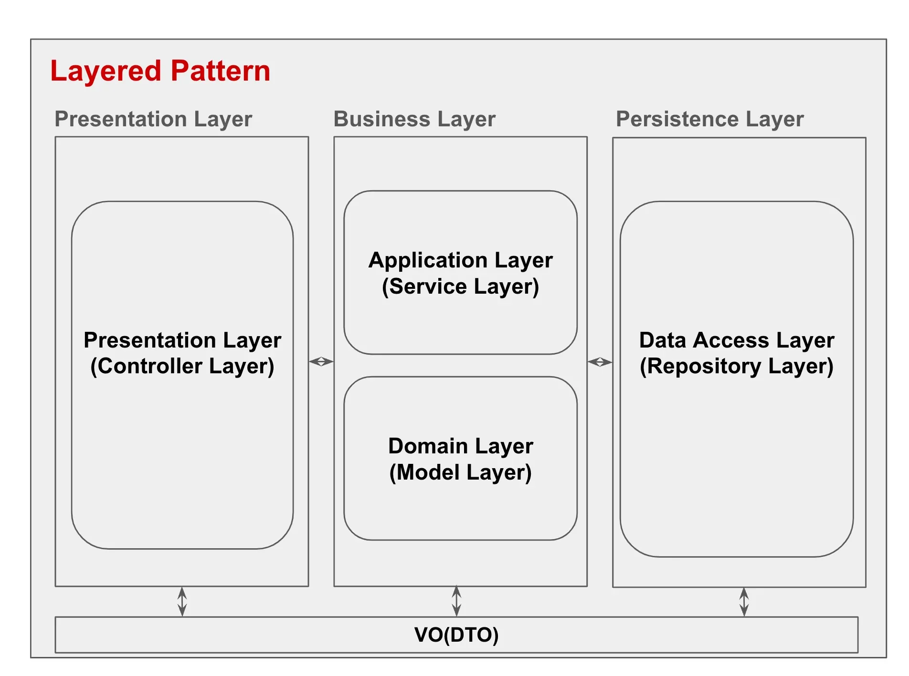

1. <strong>제공 레이어(Presentation Layer)</strong>
    - <strong>역할</strong>
        - 사용자가 애플리케이션과 상호작용할 수 있는 인터페이스를 제공합니다&#46;

    - <strong>설명</strong>
        - 사용자와의 인터페이스에 대한 책임을 맡으며, 비즈니스 로직을 다루지 않고 요청 및 응답의 흐름을 제어하는 데 집중합니다&#46;

    - <strong>구성 요소</strong>&#58;
        - <code>&#64;Controller</code>, <code>&#64;RestController</code>를 사용하는 <strong>Controller 클래스</strong>가 주로 포함됩니다&#46;

        - Spring MVC에서 HTTP 요청을 처리하고, 결과를 JSON, XML, HTML 등으로 응답합니다&#46;

    - <strong>주요 책임</strong>
        -  사용자 인터페이스 관리, 사용자 입력 수집 및 유효성 검사&#46;

1. <strong>비즈니스 레이어(Business Layer)</strong>
    1. <strong>Application Layer (Service Layer)</strong>
        - <strong>역할</strong>
            - 프레젠테이션 레이어와 비즈니스 로직을 연결하여 특정 작업을 처리합니다&#46;

        - <strong>설명</strong>
            -  애플리케이션의 흐름을 제어하고, 실제 어플리케이션이 수행하는 핵심 로직 구현하고 비즈니스 규칙과 정책을 처리하는 기능을 수행합니다&#46;

        - <strong>구성 요소</strong>
            - 주로 <code>&#64;Service</code>로 정의된 <strong>서비스 클래스</strong>로 이루어져 있습니다&#46;

            - 비즈니스 로직을 호출하고 트랜잭션을 관리하며, Presentation Layer와 Domain Layer 사이의 중재자 역할을 합니다&#46;

        - <strong>주요 책임</strong>
            -  비즈니스 로직 실행 제어, 트랜잭션 관리, 비즈니스와 프레젠테이션 로직을 중재&#46;

    1. <strong>  Domain Layer (Model Layer)</strong>
        - <strong>역할</strong>
            - 실제 비즈니스에 사용되는 모든 개념을 추상화시켜 만든 엔티티들의 집합으로 해당 엔티티를 통해 비즈니스 로직을 구현합니다&#46;

        - <strong>설명</strong>
            -  비즈니스를 수행하는 사용자들의 개념을 정의하여 설계된 엔티티들임으로 사용자와의 소통이 원활하고 실제 비즈니스를 시스템화할 수 있습니다&#46;

        - <strong>구성 요소</strong>
            - <strong><code>Entity</code></strong>, <strong><code>VO(값 객체)</code></strong> 등 <strong>도메인 모델</strong>이 포함되며 <br><strong><code>Aggregate(군집)</code></strong><strong> </strong>으로 연관 entity의 모음을 만듭니다&#46;

        - <strong>기준</strong>
            -  비즈니스 규칙을 유지하며, 도메인 객체 간의 관계와 상호작용을 관리합니다&#46; 모든 핵심 로직은 이 레이어에 속하여 애플리케이션의 일관성을 유지합니다&#46;

        - <strong>주요 책임</strong>
            -  비즈니스 엔티티 정의, 엔티티 기능 수행&#46;

1. <strong>영속 레이어(Persistence Layer)</strong>
    - <strong>역할</strong>
        -  데이터베이스 혹은 외부 시스템과의 통신을 관리합니다&#46;

    - <strong>설명</strong>
        -  데이터베이스로부터 데이터를 가져오고 저장하는 기능을 제공하며, 비즈니스 레이어에 데이터를 전달합니다&#46;

    - <strong>주요 책임</strong>
        -  데이터베이스 CRUD 연산, 데이터 소스 연결, 데이터 접근 로직 관리&#46;

<a id="18feda9b0fe180779197ddd3c292c48d"></a>

### 레이어 간의 의존성

- 레이어드 패턴에서는 각 레이어가 특정 레이어와만 의존성을 가지는 것이 일반적입니다&#46; 

- 보통 <strong><code>Presentation Layer</code></strong>는 <strong><code>Business Layer</code></strong>에만 접근하고, <br><strong><code>Business Layer</code></strong>는 <strong><code>Persistence Layer</code></strong>에만 접근하는 구조를 가집니다&#46; <br>이를 통해 레이어 간 결합도를 낮춰 유연한 시스템 구성이 가능합니다&#46;

<a id="18feda9b0fe1807db10bfad829a82cfd"></a>

### 레이어드 패턴의 한계와 고려사항

- 레이어드 패턴은 단순한 구조를 갖추기에 좋으나, 애플리케이션이 복잡해질수록 레이어가 비대해지는 문제가 발생할 수 있습니다&#46; 

- 따라서 복잡성이 높아질 경우에는 도메인 중심의 아키텍처나 마이크로서비스와 같은 대체 아키텍처를 고려할 수도 있습니다&#46; <br><strong>우리가 더 큰 아키텍처 패턴을 도입하는 이유는 멋있어서가 아니라 어쩔 수 없어서 입니다&#46;</strong>

<a id="18feda9b0fe180c9a33fc9b3f5e5cfd4"></a>

## MVC(Model&#45;View&#45;Controller)

> 💡 
> 
> <a id="18feda9b0fe1804a8cefe8b2e95fa729"></a>
> 
> <strong><code>MVC(Model&#45;View&#45;Controller)</code></strong>는 애플리케이션을 세 가지 주요 <strong><code>구성 요소(모델, 뷰, 컨트롤러</code></strong>)로 분리하여 관리하는 방식으로 <strong><code>사용자 인터페이스(뷰)</code></strong>와 <strong><code>비즈니스 로직(모델)</code></strong>을 명확히 구분하기 위해 사용됩니다&#46;

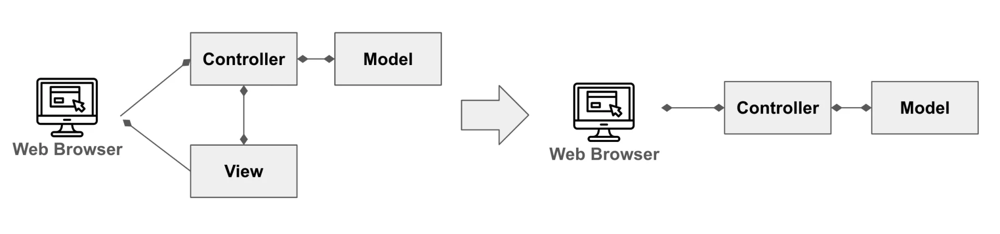

<a id="18feda9b0fe18031ba0ad4caef20aca8"></a>

<strong>탄생 배경</strong>

- 사용자 인터페이스 프로그램의 복잡성이 증가하면서 유지보수가 어려워지고 재사용성이 떨어지는 문제를 해결하기 위해 탄생했습니다&#46; 

- 최근 <strong><code>Spring MVC</code></strong>는 <strong><code>Rest API</code></strong>를 만족시키기 위해 View(화면) 구현을 배제한 <strong><code>MV 패턴</code></strong>이 더 정확한 표현이 될 수 있습니다&#46;

<a id="18feda9b0fe180e6a7d2f9ed8a4f8ec2"></a>

<strong>사용</strong>

1. <strong>Model (모델)</strong>
    - <strong>역할</strong>
        - 데이터 및 비즈니스 로직을 처리하는 부분입니다&#46;

    - <strong>설명</strong>
        - 모델은 애플리케이션의 핵심 데이터를 다루며, 데이터베이스와의 연결, 비즈니스 규칙 및 로직을 관리합니다&#46; 사용자나 뷰의 요청에 따라 데이터를 생성, 갱신, 삭제 등의 처리를 수행합니다&#46;

    - <strong>주요 책임</strong>
        -  데이터의 저장 및 조작, 비즈니스 규칙 적용, 데이터의 상태 변경을 뷰에 알림&#46;

1. <strong>View (뷰)</strong>
    - <strong>역할</strong>
        -  사용자에게 데이터를 보여주는 역할을 합니다&#46;

    - <strong>설명</strong>
        -  뷰는 모델의 데이터를 시각적으로 표현하는 부분으로 컨트롤러로부터 받은 데이터를 화면에 표시하며, 사용자가 애플리케이션과 상호작용할 수 있도록 구성됩니다&#46;

    - <strong>활용 기술</strong>
        - SCR(Server&#45;Side&#45;Rendering &#45; <strong>서버에서 화면 그림</strong>) &#58; JSP, Thymeleaf

        - CSR(Client&#45;Side&#45;Rendering &#45; <strong>클라이언트에서 그림</strong>) &#58; react, vue, Anguler

    - <strong>주요 책임</strong>
        - 데이터 시각화, 사용자에게 결과 표시, 모델의 상태 변화 감지 및 업데이트&#46;<br>

1. <strong>Controller (컨트롤러)</strong>
    - <strong>역할</strong>
        -  사용자 입력을 받아 모델과 뷰를 업데이트하는 역할을 합니다&#46;

    - <strong>설명</strong>
        -  컨트롤러는 사용자가 클릭, 입력 등의 액션을 수행했을 때 해당 이벤트를 받아 모델과 뷰에 전달하여 그에 맞는 로직을 수행하도록 합니다&#46; 

        - 사용자의 요청에 따라 모델을 조작하고, 변경된 데이터를 다시 뷰로 전달하여 화면을 갱신하게 합니다&#46;

    - <strong>주요 책임</strong>
        -  사용자 요청 처리, 모델 데이터 갱신, 뷰 업데이트 지시&#46;

<a id="18feda9b0fe180cc9abfe3ff1820c979"></a>

# 3&#46; 디자인 패턴 (Design Patterns)

<a id="18feda9b0fe1801fb625e2ffda6ed43e"></a>

## <strong>0&#46; 패턴의 분류</strong>

> ❗ 
> 
> <a id="18feda9b0fe180f69a39d40980e80776"></a>
> 
> 우리는 앞서 상위 설계 패턴인 <strong><code>아키텍처 패턴</code></strong> 을 잠깐 알아보았습니다&#46;<br><strong><code>아키텍처 패턴</code></strong><strong> </strong>아래에서 설계되는 패턴들은 <strong><code>디자인 패턴</code></strong><strong> </strong>이라고 부르며 해당 패턴은 의도 또는 목적에 따라 분류합니다&#46;
> 
> <a id="18feda9b0fe1801ba246f460c7caf6e5"></a>
> 
> 크게 아래와 세 가지 그룹으로 분류하며 이번 강의에선 각 그룹에서 가장 많이 사용되는 패턴 세 세가지를 알아보겠습니다&#46;

1. <strong>생성 패턴 (Creational Patterns) </strong>
    <a id="18feda9b0fe180e5b9eccd98d8150c92"></a>

    <strong><code>생성 패턴 (Creational Patterns) </code></strong>들은 객체의 생성 다양한 메커니즘들을 제공합니다&#46;

1. <strong>구조 패턴(Structural Pattern)</strong>
    <a id="18feda9b0fe180d89770dcdb352c6a39"></a>

    <strong><code>구조 패턴(Structural Pattern)</code></strong>은 구조를 유연하고 효율적으로 유지하면서 객체와 클래스를 더 큰 구조로 조합하는 방법을 설명합니다&#46;

1. <strong>행동 패턴(Behavioral Patterns)</strong>
    <a id="18feda9b0fe18041b4bcd81b3124985a"></a>

    <strong><code>행동 패턴(Behavioral Patterns)</code></strong>은 객체 간의 효과적인 의사소통과 책임 할당을 처리합니다&#46;

<a id="18feda9b0fe180abaa5cc84f281555b6"></a>

## 1&#46; 생성 패턴 (Creational Patterns)

> 👉 
> 
> <a id="18feda9b0fe180dfbf86f19268733446"></a>
> 
> 객체의 생성 방식은 <code>new Class()</code> 으로만 가능하진 않습니다&#46; 객체를 생성과 관련된 패턴으로, 객체 생성 방식을 다루어 코드 확장성과 재사용성을 높입니다&#46;

---

<a id="18feda9b0fe1800ea4e5eae4efcc730b"></a>

### <strong>1&#46;1&#46; 싱글턴 패턴(Singleton Pattern)</strong>

> 📌 
> 
> - 시스템 내에 인스턴스가 하나만을 존재하도록 만들어 해당 인스턴스에 전역으로 접근할 수 있도록 허용하여 매번 새롭게 인스턴스를 생성하지 않고 기존 객체를 재활용하는 방식입니다&#46;

<a id="18feda9b0fe1803ba687c353ba32e3f0"></a>

<strong>언제 사용하나요?</strong>

1. <strong>애플리케이션에서 하나의 인스턴스를 전역적으로 공유해야 할 때</strong>
    <a id="18feda9b0fe180d3a34dff1cfe761035"></a>

    로그 시스템, 데이터베이스 연결, 캐시 관리 등 한 번만 생성하고 여러 객체에서 공유하는 것이 바람직한 경우 싱글턴 패턴을 사용합니다&#46;

1. <strong>자원 관리가 중요한 경우</strong>
    <a id="18feda9b0fe1807a9fd3f608cda4a26d"></a>

    리소스를 많이 소모하거나 비용이 큰 객체를 매번 새로 생성하는 것보다, 하나의 인스턴스를 생성하여 공유하는 것이 더 효율적인 경우에 적합합니다&#46;

1. <strong>상태를 전역적으로 관리해야 할 때</strong>
    <a id="18feda9b0fe18018855ee0e0d48c5fac"></a>

    전역적인 상태를 관리해야 하며, 여러 컴포넌트에서 이 상태에 접근해야 할 경우 싱글턴 패턴을 사용하여 관리합니다&#46;

<a id="18feda9b0fe180cea551f0781399b52a"></a>

<strong>장점</strong>

1. <strong>전역적으로 하나의 인스턴스를 보장</strong>
    <a id="18feda9b0fe1801fab48f2c1bea483b9"></a>

    싱글턴 패턴은 애플리케이션 내에서 하나의 인스턴스만 존재하도록 보장합니다&#46; 이를 통해 인스턴스가 중복되어 생성되는 문제를 피하고, 메모리 사용을 최적화할 수 있습니다&#46;

1. <strong>글로벌 접근성 제공</strong>
    <a id="18feda9b0fe180bcb4a5e3edda8d910b"></a>

    싱글턴 객체는 애플리케이션 전역에서 접근할 수 있어, 인스턴스에 대한 접근 방식이 단순하고 일관됩니다&#46; 여러 클래스가 동일한 인스턴스를 사용하므로, 상태 관리가 용이해집니다&#46;

1. <strong>인스턴스 생성 비용 절감</strong>
    <a id="18feda9b0fe18069929de95f1b931a2d"></a>

    객체 생성 비용이 크거나, 자주 생성할 필요가 없는 객체라면 싱글턴 패턴을 통해 최초 한 번만 객체를 생성하고 재사용함으로써 자원을 절약할 수 있습니다&#46;

<a id="18feda9b0fe18094a1effd313f981b93"></a>

<strong>단점</strong>

1. <strong>전역 상태 공유의 문제</strong>
    <a id="18feda9b0fe18058afd2dd26bb08cd8c"></a>

    싱글턴 패턴은 애플리케이션 전역에서 객체를 공유하기 때문에, 상태를 변경하는 코드가 다른 코드에 영향을 줄 수 있습니다&#46; 여러 부분에서 동일한 인스턴스를 수정할 수 있어, 예기치 않은 결과가 발생할 수 있습니다&#46;

1. <strong>테스트가 어려워질 수 있다</strong>
    <a id="18feda9b0fe18028a7e9c89ee9d5a0ba"></a>

    싱글턴 패턴을 사용할 경우, 객체가 전역적으로 공유되므로 테스트에서 객체의 상태나 동작을 격리하기 어려운 경우가 발생할 수 있습니다&#46; 의존성 주입(Dependency Injection)을 활용하지 않으면 테스트가 복잡해질 수 있습니다&#46;

1. <strong>다중 스레드 환경에서의 문제</strong>
    <a id="18feda9b0fe180d1bfdcef4a987f0f4f"></a>

    멀티스레드 환경에서 싱글턴 객체가 동시에 접근될 경우, 인스턴스 생성이 중복될 위험이 있으며, 이를 해결하기 위해 동기화(Synchronization)를 추가해야 하므로 성능 문제가 발생할 수 있습니다&#46; 이는 코드 복잡도를 증가시킬 수 있습니다&#46;

<a id="18feda9b0fe1806a9e4be6b10a871e8b"></a>

예시 코드

- <code>&#95;1&#95;Creational&#95;생성&#46;&#95;01&#95;singleton&#95;싱글톤</code> 패키지 참조

<a id="18feda9b0fe180db8219fba92efa11d9"></a>

### <strong>1&#46;2&#46; 팩토리 메서드 패턴(Factory Method Pattern)</strong>

> 📌 
> 
> <a id="18feda9b0fe180d68ccbc8ffd65f61cb"></a>
> 
> <code>팩토리 메서드</code>는 부모 클래스에서 객체들을 생성할 수 있는 인터페이스를 제공하지만, <br>구체적으로 어떤 인스턴스를 만들지는 자식 클래스에서 정하여 생성 패턴입니다&#46;
> 
> <a id="18feda9b0fe180a5bb31d728cde402b7"></a>
> 
> 즉, 객체 생성을 <code>Factory</code> 클래스로 캡슐화하여 생성하는 방식으로 객체 생성을 수행하는 공장 클래스가 객체를 생성합니다&#46;

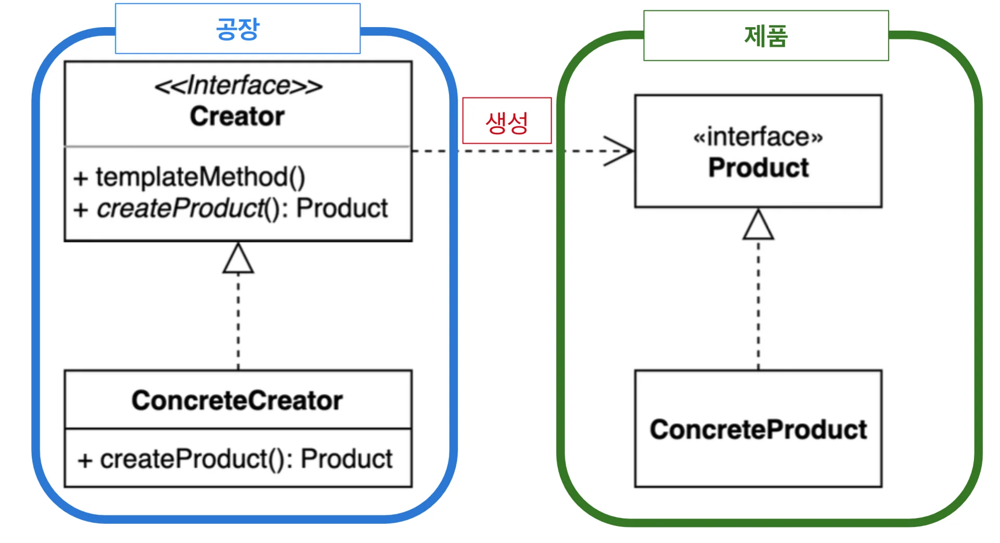

1. <strong>제품(Product)</strong>
    - 부모 클래스인 <strong><code>제품(Product)</code></strong> 를 인터페이스 혹은 추상 클래스로 선언한 후 공통되는 기능들을 정의합니다&#46;

1. <strong>구체적 제품(ConcreteProduct)</strong>
    - 자식 클래스 <strong><code>구체적 제품(ConcreteProduct)</code></strong><strong> </strong>는 <strong> </strong><strong><code>제품(Product)</code></strong><strong> </strong>의 기능을 구현하고 스스로를 재정의 합니다&#46;

1. <strong>생성자 인터페이스(Creator Interface)</strong>
    - <strong><code>생성자 인터페이스( Creator Interface)</code></strong><strong> </strong>클래스는 <strong><code>Factory</code></strong> 역할을 수행하는 인터페이스로 새로운 제품 객체들을 반환하는 <strong><code>팩토리 메서드</code></strong>를 선언합니다&#46;

1. <strong>구체적 생성자(ConcreteCreator) </strong>
    - 실제 객체를 생성하는 클래스는 <strong><code>구체적 생성자(ConcreteCreator) </code></strong><strong> </strong>이며 <strong><code>생성자 인터페이스( Creator Interface)</code></strong> 메서드를 재정의하여 다른 유형의 제품을 반환하게 하도록 합니다&#46; <br>이때 <strong><code>구체적 생성자(ConcreteCreator) </code></strong><strong> </strong>는 <strong><code>구체적 제품(ConcreteProduct)</code></strong><strong> </strong>를 생성합니다&#46;

<a id="18feda9b0fe1800dba07c511e2428468"></a>

<strong>언제 사용하나요?</strong>

1. <strong>객체 생성 방식이 다양할 때</strong>
    <a id="18feda9b0fe180fe9253d5ad4da01041"></a>

    여러 종류의 객체를 생성해야 하지만, 각 객체를 생성하는 방법을 하위 클래스에 위임하고 싶은 경우 유용합니다&#46;

1. <strong>객체 생성을 클라이언트 코드에서 숨기고 싶을 때</strong>
    <a id="18feda9b0fe180e599b0e7e2739f30be"></a>

    클라이언트 코드에서 객체를 직접 생성하는 것이 아니라, 팩토리 메서드를 통해 객체를 생성함으로써 객체 생성의 세부 사항을 숨길 수 있습니다&#46;

1. <strong>서브클래스에서 객체 생성을 다르게 구현하고 싶을 때</strong>
    - 서브클래스마다 다르게 객체를 생성할 수 있도록 하여, 동일한 인터페이스를 통해 다형성을 구현할 수 있습니다&#46;

<a id="18feda9b0fe180e18efef61d111996ea"></a>

<strong>장점</strong>

1. <strong>클래스 결합도를 낮출 수 있다</strong>
    <a id="18feda9b0fe1802db1bfd81d8f08fe99"></a>

    객체 생성 코드가 팩토리 메서드로 캡슐화되므로, 클라이언트는 구체적인 클래스에 의존하지 않게 됩니다&#46; 이를 통해 상위 클래스와 하위 클래스 간의 결합도를 낮출 수 있습니다&#46;

1. <strong>객체 생성 로직을 중앙화할 수 있다</strong>
    <a id="18feda9b0fe18002951dd675d95f9cd7"></a>

    객체 생성 방법이 하나의 메서드로 중앙화되므로, 객체 생성 과정에서 일어나는 변경 사항을 팩토리 메서드에서만 수정하면 됩니다&#46; 이로 인해 객체 생성 로직을 쉽게 유지보수할 수 있습니다&#46;

1. <strong>객체 생성에 대한 유연성을 제공</strong>
    <a id="18feda9b0fe180afbef2f680ad1d2efe"></a>

    서브클래스에서 객체 생성을 담당하게 되므로, 새로운 객체 유형을 추가할 때 기존 코드에 영향을 주지 않고 새로운 팩토리 메서드를 추가하여 유연하게 대응할 수 있습니다&#46;

1. <strong>객체 생성의 일관성을 유지</strong>
    <a id="18feda9b0fe180a7869ef022d1b33322"></a>

    팩토리 메서드를 사용하면 객체 생성 과정이 일관되게 처리됩니다&#46; 동일한 타입의 객체를 만들 때마다 팩토리 메서드를 사용하기 때문에 생성되는 객체가 일관된 방식으로 생성됩니다&#46;

<a id="18feda9b0fe180ff849cfa1602af9bc9"></a>

<strong>단점</strong>

1. <strong>서브클래스가 많아질 수 있다</strong>
    <a id="18feda9b0fe180a68c66ca5a7242fecc"></a>

    팩토리 메서드는 각 객체에 대해 서브클래스를 만들어야 하기 때문에, 객체 유형이 많아지면 서브클래스가 증가하게 됩니다&#46; 이는 코드 관리 측면에서 불편할 수 있습니다&#46;

1. <strong>간접적인 객체 생성으로 성능이 떨어질 수 있다</strong>
    <a id="18feda9b0fe180819086e5a6add43068"></a>

    팩토리 메서드를 통해 객체를 생성하면 직접 객체를 생성하는 것보다 간접적인 호출이 들어가게 됩니다&#46; 이로 인해 객체 생성에 약간의 성능 저하가 있을 수 있습니다&#46;

1. <strong>복잡성이 증가할 수 있다</strong>
    <a id="18feda9b0fe18003955ad87455da1464"></a>

    팩토리 메서드를 사용하면 생성 로직이 별도의 메서드로 분리되어, 객체 생성이 간단하지 않거나, 작은 프로젝트에서는 오히려 불필요한 복잡성을 초래할 수 있습니다&#46; 즉, 객체가 간단한 경우에는 오히려 불필요한 설계일 수 있습니다&#46;

1. <strong>상위 클래스에 의존성 추가</strong>
    <a id="18feda9b0fe18095bc05e1669ce073ef"></a>

    팩토리 메서드를 상위 클래스에서 정의하고 하위 클래스에서 이를 구현하는 방식으로 동작하므로, 상위 클래스에 객체 생성 관련 로직이 추가되며, 이로 인해 상위 클래스의 의존성이 커질 수 있습니다&#46;

<a id="18feda9b0fe180269dd4c7c79cc223b8"></a>

<strong>예시 코드 </strong>

- <code>&#95;1&#95;Creational&#95;생성&#46;&#95;02&#95;factory&#95;method&#95;팩토리메소드</code> 참조


<a id="18feda9b0fe180758414dd1c2c36cb7a"></a>

### <strong>1&#46;3&#46; 빌더 패턴(Builder Pattern)</strong>

> 📌 
> 
> <a id="18feda9b0fe1802dbb71f4206ea85f7f"></a>
> 
> <strong><code>빌더 패턴(Builder Pattern)</code></strong>은 복잡한 객체를 생성하는 과정과 표현 방법을 분리하여 다양한 구성의 객체를 만드는 생성 패턴입니다&#46; 
> 
> <a id="18feda9b0fe1805f9c47f04edd107e7f"></a>
> 
> 객체의 속성들을 메서드를 통해 하나씩 설정하고, 마지막에 통합하여 객체를 생성합니다&#46; 
> 
> <a id="18feda9b0fe180498604fbaf3ec734f7"></a>
> 
> 수제 햄버거를 만들 때 고객이 재료를 유연하게 선택할 수 있는 것처럼 선택적 매개변수가 많은 클래스에서 유용하게 사용됩니다&#46;

<a id="18feda9b0fe180eeb268e25f91a6a61d"></a>

<strong>빌더 패턴 vs (점층적 생성자, 자바 빈)</strong>

<a id="18feda9b0fe1808882bed16b803ba858"></a>

<strong>점층적 생성자 패턴(Telescoping Constructor Pattern)</strong>

- <strong><code>점층적 생성자 패턴(Telescoping Constructor Pattern)</code></strong>은 다양한 매개변수를 오버로딩된 생성자를 통해 처리하는 방식입니다&#46; 여러 생성자를 정의하여 필수 매개변수와 선택 매개변수를 조합해 객체를 생성합니다&#46; 

<details>
<summary>참조</summary>

<a id="18feda9b0fe1805688ece1a84ca0e213"></a>

```java
class Car {
    private String color;
    private String engine;
    private int wheelSize;
    private boolean sunroof;
    private boolean gps;
    private boolean leatherSeats;

    // 모든 옵션을 가진 자동차 생성자
    public Car(String color, String engine, int wheelSize, boolean sunroof, boolean gps, boolean leatherSeats) {
        this.color = color;
        this.engine = engine;
        this.wheelSize = wheelSize;
        this.sunroof = sunroof;
        this.gps = gps;
        this.leatherSeats = leatherSeats;
    }

    public Car(String color, String engine, int wheelSize, boolean sunroof, boolean gps) {
        this.color = color;
        this.engine = engine;
        this.wheelSize = wheelSize;
    }

    public Car(String color, String engine, int wheelSize) {
        this.color = color;
        this.engine = engine;
    }
}

public class Main {
    public static void main(String[] args) {
        // 모든 옵션이 있는 자동차
        Car car1 = new Car("Red", "V8", 18, true, true, true, true);

        // 휠 크기와 GPS, 썬루프만 있는 자동차
        Car car2 = new Car("Blue", "V6", 16, true, true, true);

        // 휠 크기와 기본 옵션만 있는 자동차
        Car car4 = new Car("White", "V4", 14);
    }
}
```

</details>

<a id="18feda9b0fe18022a2e8daa2c3c9a823"></a>

<strong>문제점</strong>

- 생성자의 매개변수 순서가 고정되어 있어, 개발자가 잘못된 순서로 값을 전달할 수 있습니다&#46; <br>예를 들어, <code>Car car2 = new Car(&#34;Blue&#34;, &#34;V6&#34;, 16, true, true);</code>에서 각 매개변수가 정확히 무엇을 의미하는지 파악하기 어려울 수 있습니다&#46;

- 생성자 오버로딩이 많아지면 코드의 가독성이 떨어지고, 각각의 생성자가 무엇을 하는지 쉽게 파악하기 어렵습니다&#46; <br>예를 들어, <code>Car(String color, String engine)</code>와 <code>Car(String color, String engine, int wheelSize)</code>는 매우 유사한 형태지만, 옵션이 몇 개인지 바로 알기 어렵습니다&#46;

<a id="18feda9b0fe18032a02ce1fdfd431588"></a>

<strong>자바 빈(Java Beans)</strong>

- <strong><code>자바 빈(Java Beans) </code></strong>패턴은 매개변수가 없는 생성자를 사용하여 객체를 생성한 후, <strong>Setter 메서드를 이용해 필드 값을 설정</strong>하는 방식입니다&#46; 

<details>
<summary>참조</summary>

<a id="18feda9b0fe18065b5bde182d41d0755"></a>

```java
class Car {
    private String color;
    private String engine;
    private int wheelSize;
    private boolean sunroof;
    private boolean gps;

    // 기본 생성자
    public Car() {}

    // Setter 메서드들
    public void setColor(String color) {
        this.color = color;
    }

    public void setEngine(String engine) {
        this.engine = engine;
    }

    public void setWheelSize(int wheelSize) {
        this.wheelSize = wheelSize;
    }

    public void setSunroof(boolean sunroof) {
        this.sunroof = sunroof;
    }

    public void setGps(boolean gps) {
        this.gps = gps;
    }
}

public class Main {
    public static void main(String[] args) {
        // 객체 생성 후 Setter 메서드를 통해 속성 설정
        Car car = new Car();
        car.setColor("Red");
        car.setEngine("V8");
        car.setWheelSize(18);
        car.setSunroof(true);
        car.setGps(true);

    }
}


```

</details>

<a id="18feda9b0fe1804b9abcf5a34dcee6c5"></a>

<strong>문제점</strong>

- 이 방식은 Setter 메서드를 활용하여 쉽게 객체의 속성을 변경할 수 있지만 객체 생성 시점에 값을 설정하지 않기 때문에 데이터 <strong><code>일관성</code></strong>이 떨어지고 개발자의 실수로 데이터를 누락할 수 있습니다&#46;

- 어디서든 해당 객체에 모든 데이터를 수정할 수 있기 때문에 객체 <strong><code>불변성</code></strong> 깨드릴 수 있습니다&#46;

<a id="18feda9b0fe180478939c4bd5a1da500"></a>

<strong>언제 사용하나요?</strong>

1. <strong>복잡한 객체 생성 시 유용</strong>
    <a id="18feda9b0fe180c5928bfd53484379a4"></a>

    여러 속성을 설정해야 하는 복잡한 객체를 생성할 때, 객체 생성을 단계별로 처리할 수 있도록 합니다&#46;

1. <strong>불변 객체를 만들 때</strong>
    <a id="18feda9b0fe180fab174e369a55d2d71"></a>

    생성 후에는 변경될 필요가 없는 불변 객체를 만들 때 유용합니다&#46; 빌더 패턴은 모든 속성을 설정한 후 객체를 생성할 수 있도록 합니다&#46;

1. <strong>매개변수가 많은 생성자를 사용하지 않을 때</strong>
    <a id="18feda9b0fe180a1bde2e402012b792f"></a>

    생성자에서 많은 인자를 받는 경우, 매개변수가 많은 생성자를 사용하지 않고 각 속성을 명확히 설정할 수 있는 방법을 제공합니다&#46;

<a id="18feda9b0fe1807683abe59473d2c792"></a>

<strong>장점</strong>

1. <strong>가독성 및 유지보수성 향상</strong>
    <a id="18feda9b0fe1805e8c2cf222df38b31d"></a>

    생성자나 메서드에서 파라미터가 많을 경우, 각 인자의 의미를 명확하게 할 수 있습니다&#46;

1. <strong>유연한 객체 생성</strong>
    <a id="18feda9b0fe180f880b1dca8853a0cb7"></a>

    빌더 패턴은 객체 생성 시 필수적인 속성뿐만 아니라 선택적인 속성까지 유연하게 설정할 수 있도록 해줍니다&#46; 클라이언트는 필요한 속성만 설정하여 객체를 생성할 수 있습니다&#46;

1. <strong>불변 객체 생성 용이</strong>
    <a id="18feda9b0fe180968837d84c5094710c"></a>

    객체가 불변 객체인 경우, 객체 생성 후에는 필드 값이 변경되지 않도록 보장할 수 있습니다&#46; 빌더 패턴은 객체 생성 시에만 값을 설정하고, 그 이후에는 수정할 수 없도록 만들어 불변 객체를 쉽게 생성할 수 있습니다&#46;

1. <strong>인스턴스화 과정에서 오류를 방지</strong>
    <a id="18feda9b0fe18014ad88eac3f0096f0c"></a>

    빌더 패턴은 생성 과정에서 누락된 필드나 잘못된 값으로 인한 오류를 미리 방지할 수 있습니다&#46; 필수적인 속성들을 단계별로 명확하게 설정하도록 강제할 수 있습니다&#46;

<a id="18feda9b0fe180119e85ea8ee55360cd"></a>

<strong>단점</strong>

1. <strong>단순한 객체에는 과한 설계일 수 있음</strong>
    <a id="18feda9b0fe180c1913ed9ea1bc7bd52"></a>

    빌더 패턴은 복잡한 객체 생성에 유리하지만, 객체가 단순한 경우 빌더를 사용하는 것이 과할 수 있습니다&#46; 단순히 생성자를 통해 객체를 만드는 것이 더 효율적일 수 있습니다&#46;

1. <strong>추가적인 시간 소모</strong>
    <a id="18feda9b0fe180c6ae1af596fafa82b1"></a>

    빌더 패턴을 사용할 때, 객체를 생성하는 데 추가적인 시간이 소모될 수 있습니다&#46; 각 속성을 설정하는 단계가 추가되므로, 단순히 객체를 한 번에 생성하는 것보다 시간이 더 걸릴 수 있습니다&#46;

<a id="18feda9b0fe180e1b5b0f69db0ee9311"></a>

<strong>예시 코드</strong>

- <code>&#95;1&#95;Creational&#95;생성&#46;&#95;03&#95;builder&#95;빌더</code> 참조

<a id="18feda9b0fe180e2966ffa6d2d57313d"></a>

## 2&#46; 구조 패턴(<strong>Structural Pattern</strong>)

> 👉 
> 
> <a id="18feda9b0fe1801b8dd9ee25a48a7493"></a>
> 
> 구조 패턴은 구조를 유연하고 효율적으로 유지하면서 객체들과 클래스들을 더 큰 구조로 조립하는 방법을 설명합니다&#46;

---

<a id="18feda9b0fe18001850ef46d3975b316"></a>

### 2&#46;1&#46; 어댑터 패턴(Adapter Pattern)

> 📌 
> 
> <a id="18feda9b0fe1804e9c7acc846772e791"></a>
> 
> <strong><code>어댑터 패턴(Adapter Pattern)</code></strong>은 호환되지 않는 인터페이스를 가진 클래스들이 함께 작동할 수 있도록 변환 역할을 하는 방식입니다&#46; 
> 
> <a id="18feda9b0fe180838c98e508f9a5fae4"></a>
> 
> 실제 예로, 110V 가전을 220V 전압에 맞춰주는 전기 어댑터와 같습니다&#46; 
> 
> <a id="18feda9b0fe1805da30ddee8cfd7366f"></a>
> 
> 이를 소프트웨어에 적용하면 기존 시스템에 새로운 라이브러리를 추가하거나 레거시 인터페이스를 새로운 형태로 교체할 때 유용합니다&#46; 
> 
> <a id="18feda9b0fe18055a0f7c4b95dfcbc53"></a>
> 
> 어댑터는 기존 시스템과 새 요소 간의 인터페이스를 맞춰 호환성을 보장하며, 코드 재사용성과 기능 확장성을 높이는 데 기여합니다&#46;


<a id="18feda9b0fe180e2aeaec0f9f2fd700b"></a>

<strong>종류</strong>

<a id="18feda9b0fe180059388ff9b0b8fe850"></a>

<strong>객체 어댑터(Object Adapter) &#45; 조합</strong>

- 기존 시스템을 합성하여 사용하는 방법으로 어댑터 객체에 기존 서비스(adaptee)를 필드로 선언하여 활용하는 구조입니다&#46;

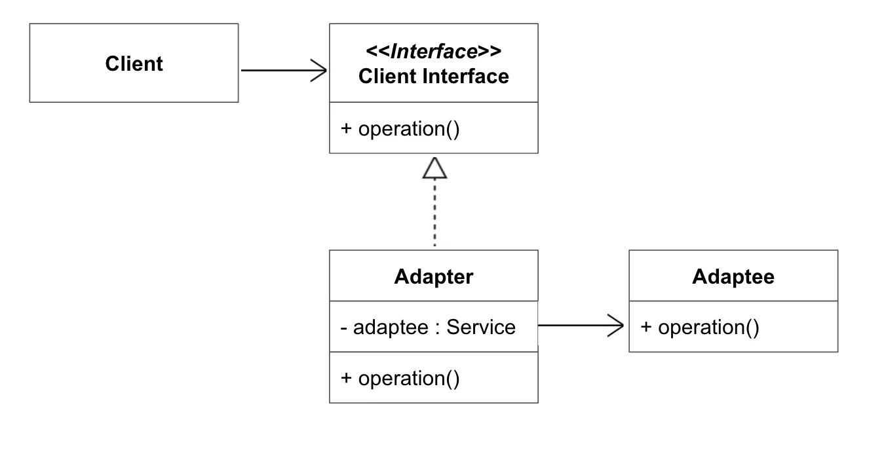

<a id="18feda9b0fe180448629c96a6f6be296"></a>

1&#46; <strong>클라이언트 (Client)</strong>

- <strong><code>클라이언트 (Client)</code></strong>는 <strong><code>클라이언트 인터페이스 (Client Interface)</code></strong>를 통해 작업을 수행합니다&#46;

- <strong><code>클라이언트 (Client)</code></strong>는 <strong><code>어댑터 (Adapter)</code></strong>를 사용하여 서비스 객체와 상호작용하지만, <strong><code>어댑터 (Adapter)</code></strong>의 구체적인 구현에 의존하지 않습니다&#46; 즉, <strong><code>클라이언트 (Client)</code></strong>는 <strong><code>어댑터 (Adapter)</code></strong>가 어떤 클래스를 래핑하는지에 대해 알지 못합니다&#46;

<a id="18feda9b0fe1801cb5acf4202cdf8c36"></a>

2&#46; <strong>클라이언트 인터페이스 (Client Interface)</strong>

- <strong><u><code>클라이언트 인터페이스 (Client Interface)</code></u></strong>는 <strong><code>클라이언트 (Client)</code></strong>가 호출하는 메서드를 포함합니다&#46;

- <strong><code>클라이언트 (Client)</code></strong>가 사용하는 인터페이스는 <strong><code>어댑터 (Adapter)</code></strong>가 구현해야 하는 인터페이스로, 클라이언트는 이 인터페이스를 통해 작업을 수행합니다&#46;

<a id="18feda9b0fe18007a4faca0f5a22b1cc"></a>

3&#46; <strong>어댑터 (Adapter)</strong>

- <strong><code>어댑터 (Adapter)</code></strong>는 <strong><code>서비스 클래스 (Adaptee)</code></strong>와 <strong><u><code>클라이언트 인터페이스 (Client Interface)</code></u></strong> 간의 호환성 문제를 해결하는 클래스입니다&#46;

- <strong><code>어댑터 (Adapter)</code></strong>는 <strong><u><code>클라이언트 인터페이스 (Client Interface)</code></u></strong><strong><code> </code></strong>와 서비스 간의 중개 역할을 하며, 두 클래스가 함께 작업할 수 있도록 합니다&#46;

<a id="18feda9b0fe1809e8407d29142c7a91e"></a>

4&#46; <strong>서비스 클래스 (Adaptee)</strong>

- <strong><code>서비스 클래스(Adaptee)</code></strong>는 일반적으로 타사 라이브러리나 레거시 시스템의 클래스입니다&#46;

- <strong><code>클라이언트 (Client)</code></strong>는 직접 이 서비스를 사용할 수 없습니다&#46; 왜냐하면 <strong><code>서비스 클래스(Adaptee)</code></strong>는 <strong>클라이언트 인터페이스</strong>와 호환되지 않기 때문입니다&#46; 따라서 <strong><code>서비스 클래스(Adaptee)</code></strong><strong> </strong>를 연결해주는<strong> </strong><strong><code>어댑터 (Adapter)</code></strong><strong> </strong>를 통해<strong> </strong><strong><code>클라이언트 (Client)</code></strong>에게 전달합니다&#46;

<a id="18feda9b0fe18072ba49c96755a82d5a"></a>

<strong>클래스 어댑터 (Class Adaptor) &#45; 상속</strong>

- 기존 시스템을 상속하여 사용하는 방법으로 어댑터 객체에 기존 서비스(adaptee)를 상속 받아 재사용하는 방법으로 기존 시스템에 종속되고 다중 상속 문제를 발생시킴으로 <strong>권장하지 않습니다&#46;</strong>

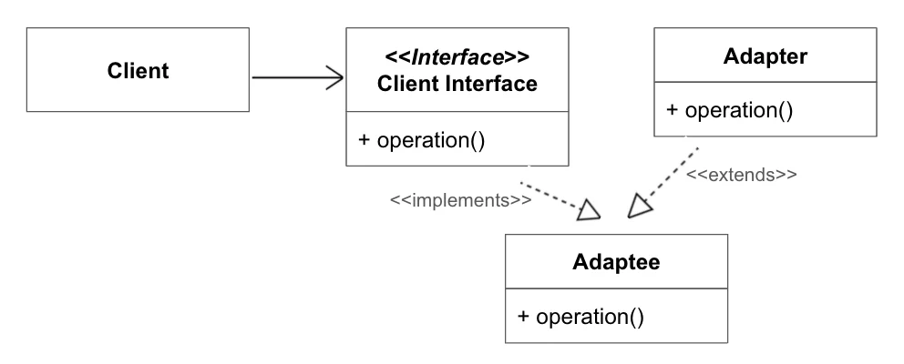

<a id="18feda9b0fe180bd877cce6898f41b9e"></a>

<strong>언제 사용하나요?</strong>

1. <strong>호환되지 않는 인터페이스 간의 연동 필요할 때</strong>
    - 기존의 코드 또는 클래스가 다른 인터페이스를 사용하고 있는데, 이를 새로 추가된 클래스에서 사용해야 할 때 사용합니다&#46;

    - 예&#58; 기존 코드에서는 <code>XML</code> 형식을 사용하고 있고, 새로운 시스템에서는 <code>JSON</code> 형식을 사용해야 할 때&#46;

1. <strong>서로 다른 라이브러리나 서드파티 API와 통합할 때</strong>
    - 외부 라이브러리나 API가 제공하는 인터페이스가 기존 시스템의 인터페이스와 맞지 않을 때 이를 변환하여 사용합니다&#46;

    - 예&#58; 외부 결제 시스템과의 통합 시 API가 제공하는 방식이 기존 시스템과 다를 때&#46;

1. <strong>기존 코드를 수정할 수 없을 때</strong>
    - 기존 코드에 손을 대지 않고 새로 추가된 코드나 시스템을 기존 시스템에 통합해야 할 때 사용합니다&#46;

    - 예&#58; 레거시 시스템에 새로운 기능을 추가해야 하는 경우&#46;

1. <strong>인터페이스의 표준화가 필요한 경우</strong>
    - 여러 개의 인터페이스를 동일한 방식으로 처리하려고 할 때 사용합니다&#46;

    - 예&#58; 다양한 데이터 소스(파일, 데이터베이스 등)를 동일한 방식으로 처리하고자 할 때&#46;

<a id="18feda9b0fe1806eb498e0c355afa143"></a>

<strong>단점</strong>

1. <strong>클래스 수 증가</strong>
    <a id="18feda9b0fe18077816dfa3901b9ed74"></a>

    어댑터 클래스를 추가해야 하기 때문에 클래스 수가 많아질 수 있습니다&#46; 특히 어댑터가 여러 개 필요하면 코드 복잡성이 증가할 수 있습니다&#46;

1. <strong>성능 오버헤드</strong>
    <a id="18feda9b0fe1800f8eb2cccf546d933f"></a>

    중간에 변환을 담당하는 어댑터가 있기 때문에, 변환에 따른 성능 오버헤드가 발생할 수 있습니다&#46; 예를 들어, 두 시스템 간의 데이터 형식 변환이 많을 경우 성능에 영향을 줄 수 있습니다&#46;

1. <strong>어댑터 남용 가능성</strong>
    <a id="18feda9b0fe180e1bfebf7cccdfec250"></a>

    어댑터를 남용하면 코드가 복잡해지고, 모든 인터페이스에 대해 어댑터를 만들어야 할 상황이 발생할 수 있습니다&#46; 이 경우 설계가 지나치게 복잡해질 수 있습니다&#46;

1. <strong>인터페이스 갯수 증가</strong>
    <a id="18feda9b0fe180c9add2df238f047bd4"></a>

    어댑터가 필요한 인터페이스의 수가 많아지면, 관리해야 할 인터페이스가 늘어나므로 유지 보수에 어려움이 있을 수 있습니다&#46;

<a id="18feda9b0fe180ecac3dcdefedba7328"></a>

<strong>활용 예시</strong>

1. <strong>다양한 데이터 소스를 처리하는 경우</strong>
    <a id="18feda9b0fe180ae9817f01ce9d4cd5e"></a>

    여러 데이터 소스(XML, JSON, CSV 등)에 대한 데이터를 처리하는 코드가 있을 때, 각 데이터 소스를 동일한 형식으로 변환하는 어댑터 패턴을 적용할 수 있습니다&#46; 어댑터는 각 데이터 소스의 형식에 맞게 데이터를 변환하여 동일한 인터페이스로 처리할 수 있게 만듭니다&#46;

1. <strong>외부 라이브러리와의 통합하는 경우</strong>
    <a id="18feda9b0fe18023a3c1d61723a873a1"></a>

    외부 시스템에서 제공하는 API와 기존 시스템 간의 인터페이스가 맞지 않을 때 어댑터를 사용하여 통합합니다&#46; 예를 들어, 외부 결제 시스템의 API와 기존 시스템의 결제 모듈이 호환되지 않으면 어댑터를 사용하여 두 시스템을 연결합니다&#46;

<a id="18feda9b0fe1804f9847fdecb4565ac8"></a>

<strong>예시 코드</strong>

<a id="18feda9b0fe1802bb0e1e0e8132622ac"></a>

→ <code>&#95;2&#95;Structural&#95;구조&#46;&#95;01&#95;adapter&#95;어뎁터</code>참조<br>

<a id="18feda9b0fe180b2b41acaa6c39972ce"></a>

### 2&#46;2&#46; 프록시 패턴(proxy pattern)

> 📌 
> 
> <a id="18feda9b0fe180e7bce2f33fc1355c86"></a>
> 
> 객체에 대한 <strong><code>Proxy(대리인)</code></strong>을 제공하여 클라이언트가 직접 접근하지 않고 대리 객체를 통해 주 객체와 상호작용하도록 제어하기 위한 방식입니다&#46; 
> 
> <a id="18feda9b0fe18094aab4d37ba75d96b1"></a>
> 
> 이 방식을 통해 대상 객체에 직접 접근을 제한하여 보안을 강화할 수 있습니다&#46; 
> 
> <a id="18feda9b0fe180909e03ffac06afe497"></a>
> 
> 또한 원본 객체를 수정하지 않고 부가적인 로직을 수행하도록 구현할 수 있어 원본 객체를 수정할 수 없을 때 사용하면 유익합니다&#46;

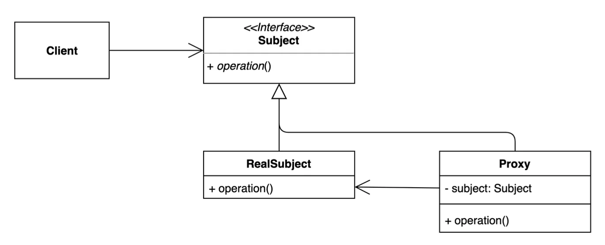

1. <strong>주제(Subject)</strong>
    - <strong><code>주제(Subject)</code></strong>는<strong> </strong><strong><code>대리자(Proxy)</code></strong>와 <strong><code>실제 주제(RealSubject)</code></strong>를 <strong><code>행위(operation)</code></strong> 를 일치시키기 위한 인터페이스입니다&#46;

1. <strong>실제 주제(RealSubject)</strong>
    - <strong><code>실제 주제(RealSubject)</code></strong><strong>는 </strong>실제 비즈니스를 수행할 원본 대상 객체입니다&#46;

1. <strong>대리자(Proxy)</strong>
    - <strong><code>대리자(Proxy)</code></strong><strong>는 </strong><strong><code>실제 객체(RealSubject)</code></strong>를 대리할 객체로 원본 객체를 합성하여 원본 객체와 동일한 행위를 수행하되 별도의 로직을 추가할 수 있지만 결과값을 조작하거나 변경해서는 안됩니다&#46;

1. <strong>클라이언트(Client)</strong>
    - <strong><code>클라이언트(Client)</code></strong>는 <strong><code>대리자(Proxy)</code></strong>를 중간에 두고 프록시를 통해서 <strong><code>실제 객체(RealSubject)</code></strong>와 데이터를 주고 받습니다&#46;

<a id="18feda9b0fe1801a84ccd1ea3d29af8a"></a>

<strong>언제 사용하나요?</strong>

1. <strong>비용이 많이 드는 작업을 지연하거나 대체할 때</strong>
    <a id="18feda9b0fe18023b911e90cb5016e99"></a>

    실제 객체의 생성, 초기화, 또는 실행이 자원을 많이 소비하는 경우 사용합니다&#46;

    <a id="18feda9b0fe1807f98b7dd81bc7862b5"></a>

    예&#58; 대규모 파일 로드, 원격 서버와의 네트워크 통신, 데이터베이스 연결&#46;

1. <strong>접근을 제어해야 할 때</strong>
    <a id="18feda9b0fe180bea4fefa95faa67128"></a>

    클라이언트가 실제 객체를 사용하는 것을 제한하거나 보호해야 할 경우 사용합니다&#46;

    <a id="18feda9b0fe18060a647cb8d6c4e4a7b"></a>

    예&#58; 인증 및 권한 검사가 필요한 시스템&#46;

1. <strong>원격 객체와 통신할 때</strong>
    <a id="18feda9b0fe180f08da3ee045eb1dd5a"></a>

    클라이언트와 원격 서버 간의 통신을 단순화하는 대리 객체를 제공합니다&#46;

    <a id="18feda9b0fe180aeb990d1d41ec2c0f6"></a>

    예&#58; 원격 메서드 호출(RMI) 또는 API 호출&#46;

1. <strong>원래 객체에 대한 부가적인 작업을 수행해야 할 때</strong>
    <a id="18feda9b0fe180f1ade5dc0197e9ce10"></a>

    실제 객체 호출 전에 로깅, 캐싱, 또는 성능 측정을 추가할 수 있습니다&#46;

    <a id="18feda9b0fe18050a72ff183cf076969"></a>

    예&#58; 웹 요청 로깅, API 응답 캐싱&#46;

<a id="18feda9b0fe180af9a9de3ee225dbe0b"></a>

<strong>장점</strong>

1. <strong>접근 제어 및 보안 강화</strong>
    <a id="18feda9b0fe180c29300c67a6fdabe57"></a>

    프록시를 통해 특정 객체에 대한 접근을 제한하거나 조건부로 허용할 수 있습니다&#46;

1. <strong>실제 객체의 생성을 지연</strong>
    <a id="18feda9b0fe180948be7ca03621db88f"></a>

    지연 초기화(Lazy Initialization)를 통해 객체 생성 비용을 줄일 수 있습니다&#46;

1. <strong>원격 접근 간소화</strong>
    <a id="18feda9b0fe180738df5d0688014c377"></a>

    원격 객체와의 통신을 추상화하여 네트워크 세부 사항을 숨길 수 있습니다&#46;

1. <strong>부가 기능 추가</strong>
    <a id="18feda9b0fe180eeaeb9da5a71bc0c58"></a>

    실제 객체 호출 전에 로깅, 인증, 캐싱 등의 작업을 추가할 수 있습니다&#46;

1. <strong>OCP(개방&#45;폐쇄 원칙) 준수</strong>
    <a id="18feda9b0fe180dab869e516e005b04a"></a>

    기존 객체의 코드 수정 없이 프록시를 통해 기능을 확장할 수 있습니다&#46;

<a id="18feda9b0fe180828ef1ea8e0bf1143c"></a>

<strong>단점</strong>

1. <strong>구현의 복잡성 증가</strong>
    <a id="18feda9b0fe1805baceec30494bf8b9b"></a>

    프록시 객체를 추가로 생성해야 하므로 설계 및 구현이 복잡해질 수 있습니다&#46;

1. <strong>응답 시간 증가</strong>
    <a id="18feda9b0fe18012b12eec85f370c140"></a>

    프록시가 실제 객체 호출 전에 추가 작업을 수행하므로 약간의 지연이 발생할 수 있습니다&#46;

1. <strong>추가 코드 관리 부담</strong>
    <a id="18feda9b0fe1802cb9b8caeec1a6e9a9"></a>

    프록시와 실제 객체 간의 동기화 및 유지보수가 필요합니다&#46;

1. <strong>데드락 위험</strong>
    <a id="18feda9b0fe180369426ce78645acb00"></a>

    원격 프록시의 경우, 네트워크 장애로 인해 객체 호출이 지연되거나 데드락이 발생할 가능성이 있습니다&#46;

<a id="18feda9b0fe18091bc82e797f9edc5ce"></a>

<strong>활용 예시</strong>

<a id="18feda9b0fe18006b7f9fe891c1bf803"></a>

<strong>1&#46; 가상 프록시(Virtual Proxy)</strong>

- 리소스가 많이 드는 객체의 생성을 지연시키기 위해 사용됩니다&#46;

- 실제 객체가 필요할 때까지 프록시가 대신 역할을 합니다&#46;

- 메모리와 초기화 시간을 절약할 수 있습니다&#46;

- 실제 객체의 생성을 제어합니다&#46;

<a id="18feda9b0fe18057bc52c6424860a28e"></a>

<strong>사용처</strong>

- <strong>대용량 이미지 로드 지연</strong>&#58; 이미지 뷰어에서 이미지를 표시하기 전 프록시가 대체 이미지를 표시&#46;

- <strong>데이터베이스 연결 지연</strong>&#58; 연결이 필요한 시점까지 객체를 초기화하지 않음&#46;

<a id="18feda9b0fe180889ccaed456e6b0e83"></a>

<code>&#95;2&#95;Structural&#95;구조&#46;&#95;02&#95;proxy&#95;대리인&#46;&#95;01&#95;example</code>참조

<a id="18feda9b0fe180e4ae87dd9309ef8964"></a>

<strong>2&#46; 동적 프록시(Dynamic Proxy)</strong>

- 런타임에 동적으로 프록시 객체를 생성하여 동작을 확장하거나 대체합니다&#46;

- 코드 작성 시점에 구체적인 프록시 클래스를 정의하지 않습니다&#46;

- <strong>Reflection</strong> 기술을 사용해 인터페이스 기반의 프록시를 생성합니다&#46;

- 다양한 부가 기능(로깅, 권한 검사 등)을 쉽게 추가할 수 있습니다&#46;

<a id="18feda9b0fe180f9b802edf837f7bef9"></a>

<strong>사용처</strong>

- <strong>AOP(Aspect&#45;Oriented Programming)</strong>&#58; 메서드 호출 전후에 로직 추가&#46;

- <strong>Spring의 Bean Proxy</strong>&#58; 빈 생성을 동적으로 제어&#46;

<a id="18feda9b0fe180049f7ccdde1b574844"></a>

<code>&#95;2&#95;Structural&#95;구조&#46;&#95;02&#95;proxy&#95;대리인&#46;&#95;02&#95;example</code>참조

---

<a id="18feda9b0fe1809c93a6c85706cea2ab"></a>

<strong>3&#46; 지연 초기화 프록시(Lazy Initialization Proxy)</strong>

- 실제 객체의 생성을 필요 시점까지 지연하여 초기화 비용을 줄이는 프록시입니다&#46;

- 객체 초기화에 드는 비용(시간, 메모리)을 지연&#46;

- 필요하지 않은 객체가 초기화되지 않도록 함&#46;

<a id="18feda9b0fe18010b47ddac6542b4938"></a>

<strong>사용처</strong>

- <strong>JPA 지연 로딩</strong>&#58; 연관된 엔티티를 프록시로 대체하고 접근할 때 데이터를 로드&#46;

<details>
<summary>코드</summary>

<a id="18feda9b0fe18002a3d0f06833c42719"></a>

```java
@Entity
public class User {
    @Id
    private Long id;

    @OneToMany(fetch = FetchType.LAZY)
    private List<Order> orders; // 지연 초기화

    // 실제 getOrders를 호출하였을 때 sql을 DB에 조회하고 조회된 결과를 주입
    public List<Order> getOrders() {
	    return this.orders();
    }
}
```

</details>

<a id="18feda9b0fe180c1921adf58e44d4ea3"></a>

<strong>예시 코드</strong>

<a id="18feda9b0fe180ce8104e942d6d8d091"></a>

→ <code>&#95;2&#95;Structural&#95;구조&#46;&#95;02&#95;proxy&#95;대리인</code>참조<br>

<a id="18feda9b0fe180579c75da973ea9a759"></a>

### 2&#46;3&#46; 데코레이터 패턴(Decorator Pattern)

> 📌 
> 
> <a id="18feda9b0fe18099bbc4e14a1d009064"></a>
> 
> 데코레이터 패턴(Decorator Pattern)은 객체의 기능을 동적으로 확장하거나 변경할 수 있는 구조적 디자인 패턴입니다&#46; 이 패턴은 서브클래싱을 사용하는 대신, 기존 객체를 새로운 &#34;장식자&#34; 객체로 감싸 추가적인 행동을 부여하는 방식입니다&#46;<br>예를 들어, 제품에 포장을 더해 새로운 기능을 부여하듯, 객체에 필요한 기능을 조합하여 확장하면서도 기본 객체와 새 기능의 구현을 분리하여 유지보수를 용이하게 합니다&#46;

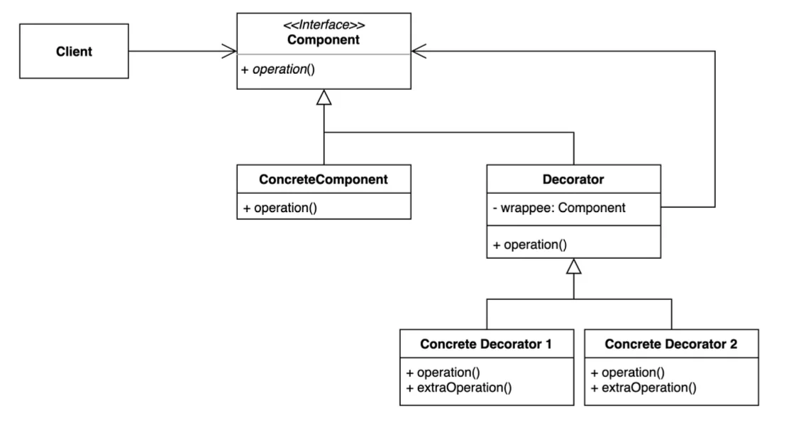

1. <strong>구성 인터페이스(Component Interface)</strong>
    - <strong><code>구성 인터페이스(Component Interface)</code></strong><strong>는 </strong>원본 객체와 장식된 객체를 묶는 공통 인터페이스로, 클라이언트가 동일한 방식으로 객체를 사용할 수 있도록 정의합니다&#46;

1. <strong>구체적 구성(ConcreteComponent)</strong>
    - <strong><code>구체적 구성 (ConcreteComponent)</code></strong><strong>는 </strong>데코레이터가 장식할 대상인 원본 객체로, 기본 동작을 구현합니다&#46;데 코레이터에 의해 동작이 확장되거나 변경될 수 있습니다&#46;

1. <strong>장식자(Decorator)</strong>
    - <strong><code>장식자(Decorator)</code></strong><strong>는 </strong>원본 객체를 필드로 가지며(<code>wrappee</code>), <strong><code>구성 인터페이스(Component Interface)</code></strong>를 구현합니다&#46; 기본 동작을 원본 객체에 위임할 수 있으며, 추가 기능을 구현하기 위한 기반 구조를 제공합니다&#46;

1. <strong>구체적 장식자(ConcreteDecorator)</strong>
    - <strong><code>구체적 장식자(ConcreteDecorator)</code></strong><strong>는 </strong>원본 객체의 기본 동작을 확장하거나 변경하기 위해 구체적인 추가 기능을 정의합니다&#46; 부모 클래스의 메서드를 호출하면서 호출 전후로 새로운 로직을 추가하여 동작을 변경합니다&#46;

1. <strong>클라이언트(</strong>Client)
    - <strong><code>클라이언트(Client)</code></strong><strong>는 </strong><strong><code>구성 인터페이스(Component Interface)</code></strong>를 통해 객체와 상호작용하며, 여러 계층의 데코레이터를 조합해 동작을 확장합니다&#46; 데코레이터와 원본 객체의 구조를 신경 쓰지 않고 사용 가능합니다&#46;

<a id="18feda9b0fe180cdac28f1bcb53024a9"></a>

<strong>언제 사용하나요?</strong>

1. <strong>객체에 새로운 기능을 동적으로 추가해야 할 때</strong>
    <a id="18feda9b0fe1802cbc34deece3b98ee6"></a>

    런타임에 객체의 책임(기능)을 동적으로 변경해야 할 때 사용합니다&#46;

1. <strong>상속보다 유연한 방법으로 객체의 동작을 확장하고 싶을 때</strong>
    <a id="18feda9b0fe180708b44efb7181802e0"></a>

    상속을 통한 확장이 비효율적이거나 클래스를 폭발적으로 증가시킬 가능성이 있을 때 조합하여 사용합니다&#46;

    <a id="18feda9b0fe180129081ec5e6dd458b8"></a>

    예&#58; 다양한 데이터 스트림(파일 스트림, 네트워크 스트림 등)과 필터(암호화, 압축 등)를 조합할 때&#46;

1. <strong>개방&#45;폐쇄 원칙(OCP)을 준수하고 싶을 때</strong>
    <a id="18feda9b0fe1802983d3c197dfd9004f"></a>

    기존 클래스의 코드를 수정하지 않고 추가 기능을 구현할 필요가 있을 경우 사용합니다&#46;

    <a id="18feda9b0fe180939d98fcddb1a513dc"></a>

    예&#58; 로깅이나 성능 모니터링 기능을 기존 시스템에 쉽게 추가&#46;

1. <strong>기능의 조합이 빈번히 요구될 때</strong>
    <a id="18feda9b0fe1805d90bce925857cf0f4"></a>

    여러 기능을 필요에 따라 유연하게 결합하고 분리할 수 있어야 할 경우 사용합니다&#46;

    <a id="18feda9b0fe180f6b5eee51eb1a6c64f"></a>

    예&#58; 텍스트 편집기에서 글자 색상, 크기, 스타일을 조합하여 적용&#46;

<a id="18feda9b0fe180069612fcdcc486cebd"></a>

<strong>장점</strong>

1. <strong>객체의 동작을 동적으로 확장 가능</strong>
    <a id="18feda9b0fe18073800dd5569acf2e95"></a>

    상속 없이 런타임에 객체의 기능을 추가하거나 수정할 수 있습니다&#46;

1. <strong>조합의 유연성</strong>
    <a id="18feda9b0fe180929602f2f51203f1aa"></a>

    여러 데코레이터를 조합하여 다양한 기능을 적용할 수 있습니다&#46;

    <a id="18feda9b0fe180948fded63396654dfb"></a>

    예&#58; 암호화된 데이터 스트림에 압축 기능을 추가하고, 그 위에 버퍼링 기능을 더할 수 있음&#46;

1. <strong>OCP(개방&#45;폐쇄 원칙) 준수</strong>
    <a id="18feda9b0fe18075adb8f02840acee21"></a>

    기존 코드를 수정하지 않고 새로운 데코레이터를 추가하여 기능을 확장할 수 있습니다&#46;

1. <strong>SRP(단일 책임 원칙) 준수</strong>
    <a id="18feda9b0fe180ae80c6c0fa771e241b"></a>

    각 데코레이터 클래스는 하나의 책임만을 가지므로 기능별로 명확히 구분됩니다&#46;

<a id="18feda9b0fe1809c85b0ecbec398c688"></a>

<strong>단점</strong>

1. <strong>객체 생성 코드의 복잡성 증가</strong>
    - 여러 데코레이터를 조합하는 과정에서 코드가 복잡해지고 가독성이 떨어질 수 있습니다&#46;

    - 예&#58; <code>new LoggingDecorator(new CompressionDecorator(new BasicStream()))</code>

1. <strong>디버깅이 어려움</strong>
    - 데코레이터가 중첩된 경우, 호출 흐름을 추적하거나 디버깅하는 데 어려움이 있을 수 있습니다&#46;

1. <strong>특정 데코레이터 제거의 어려움</strong>
    - 데코레이터 스택에서 특정 데코레이터를 제거하려면 구조를 새로 생성해야 할 수 있습니다&#46;

1. <strong>순서 의존성 문제</strong>
    - 데코레이터 적용 순서에 따라 결과가 달라질 수 있어 설계 및 구현 시 주의가 필요합니다&#46;

<a id="18feda9b0fe180fca965f4e10fc82825"></a>

<strong>활용 예시</strong>

- <strong>데이터 스트림 처리</strong>
    <a id="18feda9b0fe1803fafeedd9a74a45773"></a>

    입력/출력 스트림에 암호화, 압축, 버퍼링 등의 기능을 동적으로 추가하고자 하는 경우 사용합니다&#46;

- <strong>웹 요청 처리</strong>
    <a id="18feda9b0fe180cf9ca4c094e450f73e"></a>

    HTTP 요청에 로깅, 인증, 캐싱 등을 동적으로 추가하고자 하는 경우 사용합니다&#46;

<a id="18feda9b0fe18038bbb9c6df10dfed22"></a>

<strong>예시 코드</strong>

<a id="18feda9b0fe18093be03c5536fc74304"></a>

→ <code>&#95;2&#95;Structural&#95;구조&#46;&#95;01&#95;template&#95;템플릿</code> 참조<br>

<a id="18feda9b0fe180b8b801e74bad6197dd"></a>

## <strong>3&#46; 행동 패턴</strong>(Behavioral Patterns)

> 👉 
> 
> <a id="18feda9b0fe180eb9780cd83c1dfaf7b"></a>
> 
> <strong>행동 패턴</strong>(Behavioral Patterns)은 주요 목적은 <strong>객체 간의 상호작용을 명확히 정의</strong>하고, <strong>느슨한 결합</strong>을 구현하는 데 있습니다&#46; 객체의 행위를 유연하게 변경하거나 확장할 수 있도록 돕고, 시스템의 복잡성을 줄이며 유지보수를 용이하는 방식입니다&#46;

---

<a id="18feda9b0fe18064ac29f3ae60337911"></a>

### 3&#46;1&#46; 템플릿 메서드 패턴(Template Method Pattern)

> 📌 
> 
> <a id="18feda9b0fe1808baeb5f2acf24b90ce"></a>
> 
> <strong>템플릿 메서드</strong>는 알고리즘의 실행 흐름을 상위 클래스에서 정의하고, 알고리즘의 구체적 구현은 하위 클래스에서 제공하도록 설계된 방식입니다&#46;

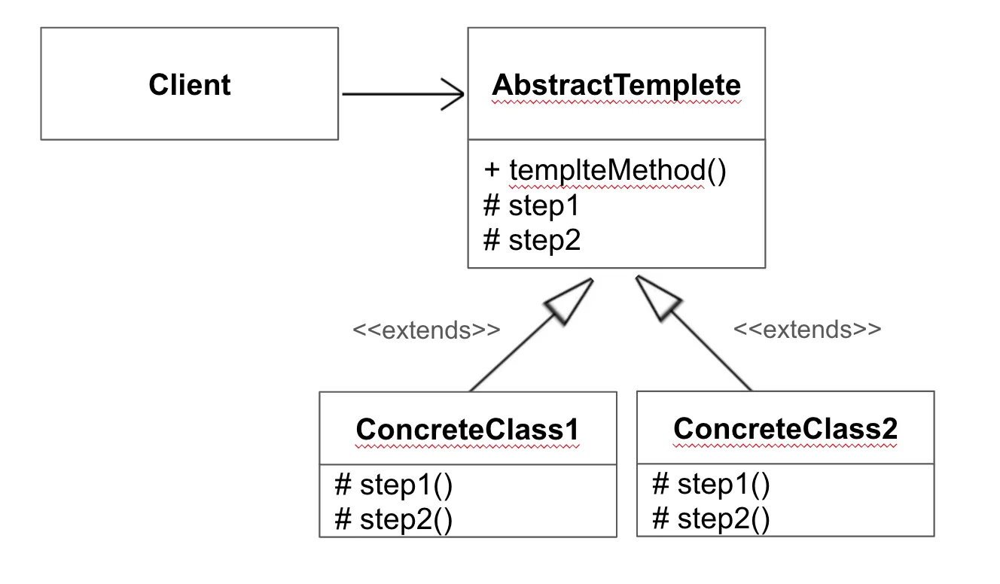

1. <strong>추상 템플릿(AbstractTemplete)</strong>
    - <strong><code>추상 템플릿(AbstractTemplete)</code></strong><strong> </strong>은<strong> </strong>단계 혹은 역할을 하는 메서드들을 선언하며, 이러한 메서드를 특정 순서로 호출하는 실제 템플릿 메서드도 선언합니다&#46; 단계들은 abstract로 선언되거나 일부 디폴트 구현을 갖습니다&#46;

1. <strong>구체적 클래스(ConcreteClass)</strong>
    - <strong><code>ConcreteClass(구체적 클래스)</code></strong>는 <strong><code>구체적 클래스(ConcreteClass)</code></strong>를 상속하고 추상 메소드를 구체적으로 구현합니다&#46;  <strong><code>구체적 클래스(ConcreteClass)</code></strong>에서 구현한 메소드는 <strong><code>ConcreteClass(구체적 클래스)</code></strong>의 템플릿 메소드에서 호출합니다&#46;

<a id="18feda9b0fe180dc8d72ce2a0dbbb1d3"></a>

<strong>언제 사용하나요?</strong>

1. <strong>알고리즘의 실행 순서가 고정적이고, 일부 세부 동작만 변경이 필요할 때<br></strong>상위 클래스에서 알고리즘의 흐름을 정의하고, 하위 클래스에서 구체적 동작을 구현합니다&#46;

1. <strong>코드 중복을 줄이고 재사용성을 높이고 싶을 때<br></strong>공통된 로직은 상위 클래스에 작성하고, 변하는 부분만 하위 클래스에서 구현합니다&#46;

1. <strong>여러 클래스 간에 유사한 작업 흐름이 존재하지만, 일부 동작이 달라야 할 때</strong>&#58;<br>상속과 다형성을 활용해 구조를 단순화합니다&#46;<br>예&#58; 웹 요청 처리 과정(인증, 요청 처리, 응답 작성)이 공통적이나 각 요청 유형에 따라 처리 방식이 다른 경우

<a id="18feda9b0fe180d69032faaa188c5338"></a>

<strong>장점</strong>

1. <strong>코드 재사용성 향상</strong>
    <a id="18feda9b0fe180fea39eed9566158fb9"></a>

    상위 클래스에서 공통 로직을 정의함으로써 중복 코드를 줄일 수 있음습니다&#46;

1. <strong>알고리즘 변경 시 유연성</strong>
    <a id="18feda9b0fe1803c818df84d71c77e92"></a>

    알고리즘의 구조를 변경하지 않고, 하위 클래스에서 세부 동작만 변경할 수 있습니다&#46;

1. <strong>유지보수성 개선</strong>
    <a id="18feda9b0fe180cb9308efc33fe2c05b"></a>

    공통 로직이 한 곳에 모여 있어 관리가 용이하며, 변하는 부분만 하위 클래스에서 관리할 수 있습니다&#46;

1. <strong>강화된 제어</strong>
    <a id="18feda9b0fe180f0ad59e9c46c5af3b1"></a>

    상위 클래스에서 전체 흐름을 통제하며, 하위 클래스는 세부 사항만 담당하여 역할이 명확합니다&#46;

1. <strong>객체지향 원칙 준수</strong>
    <a id="18feda9b0fe180b4a8cddda3fea9b156"></a>

    <strong>단일 책임 원칙(SRP)</strong>&#58; 상위 클래스는 알고리즘의 구조만 정의하고, 하위 클래스는 구체적 동작만 책임집니다&#46;

    <a id="18feda9b0fe180248cc5d4f6b4d1cb87"></a>

    <strong>개방&#45;폐쇄 원칙(OCP)</strong>&#58; 알고리즘의 뼈대를 변경하지 않고도 새로운 세부 동작을 추가할 수 있습니다&#46;

<a id="18feda9b0fe18087baf7cae5d88ae99f"></a>

<strong>단점</strong>

1. <strong>상속의 의존성</strong>
    <a id="18feda9b0fe180d29b54e2b0a7ef4bd9"></a>

    템플릿 메서드 패턴은 상속에 의존하므로, 상속이 불필요한 경우에도 강제될 수 있어 유연성이 떨어질 수 있음&#46;

1. <strong>클래스 수 증가</strong>
    <a id="18feda9b0fe18054899eea066dae07df"></a>

    세부 동작마다 새로운 하위 클래스를 만들어야 하므로, 복잡도가 증가하고 관리가 어려워질 수 있음&#46;

1. <strong>알고리즘 구조 변경 어려움</strong>
    <a id="18feda9b0fe18093ada3fb8c5eaaf53d"></a>

    상위 클래스에서 알고리즘의 뼈대를 고정하기 때문에, 실행 순서를 수정해야 할 경우 구조적 변경이 필요&#46;

1. <strong>잘못된 오버라이드 위험</strong>
    <a id="18feda9b0fe1806797eee42a08981812"></a>

    하위 클래스에서 잘못된 방식으로 메서드를 오버라이드하면 상위 클래스의 의도된 흐름을 깨트릴 수 있습니다&#46;

<a id="18feda9b0fe180e6a2eedc865ab25fc0"></a>

<strong>활용 예시</strong>

- <strong>문서 처리 시스템<br></strong>파일 열기, 데이터 읽기, 데이터 처리, 파일 닫기의 흐름을 템플릿화하고, 처리 단계는 파일 형식(PDF, XML, JSON 등)에 따라 다르게 구현합니다&#46;

- <strong>웹 프레임워크<br></strong>요청 처리 알고리즘(인증 → 요청 처리 → 응답 생성)은 템플릿으로 고정하고, 특정 요청 처리 로직은 하위 클래스에서 정의합니다&#46;

<a id="18feda9b0fe180b2b327f520bba097cd"></a>

<strong>예시 코드</strong>

<a id="18feda9b0fe180d289e9d6e627434389"></a>

→ <code>&#95;3&#95;Behavioral&#95;행동&#46;&#95;01&#95;template&#95;템플릿</code> 참조<br>

<a id="18feda9b0fe1807f8a5eeccbf5ab7294"></a>

### 3&#46;2&#46; 전략 패턴(Strategy Pattern)

> 📌 
> 
> <a id="18feda9b0fe180fdbc87feca2ab7a932"></a>
> 
> <strong><code>전략 패턴(Strategy Pattern)</code></strong>은 동일한 목표를 달성하기 위한 여러 동작(전략)를 캡슐화하여, 실행되는 중에 다양한 동작을 선택하거나 변경할 수 있도록 설계된 방식입니다&#46; 이 패턴은 객체의 행위를 분리하여 교체 가능한 구조를 제공하며 유연하게 확장하고 변경할 수 있습니다&#46;

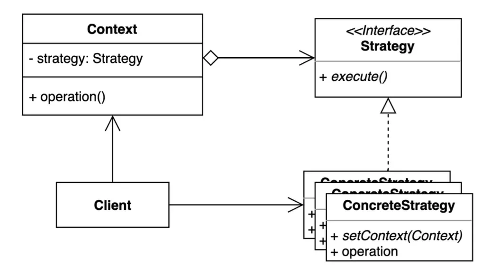

<a id="18feda9b0fe180d584ccf6f8c907f710"></a>

1&#46; <strong>콘텍스트 (Context)</strong>

- 동작을 실행하는 클라이언트입니다&#46;

- <strong><code>구체적 전략(Concrete Strategy)</code></strong> 중 하나에 대한 참조를 유지하며, 이를 통해 작업을 위임합니다&#46;

- <strong><code>전략 인터페이스(Strategy Interface)</code></strong>를 사용하여 전략 객체와 통신합니다&#46;

- 클라이언트가 실행 중에 동작을 교체할 수 있도록 <strong><code>전략 객체를 설정(setter)</code></strong>하는 메서드를 제공합니다&#46;

<a id="18feda9b0fe1808e85accfc1e951a9be"></a>

2&#46; <strong>전략 인터페이스 (Strategy Interface)</strong>

- 모든 구체적 전략에서 공통적으로 구현해야 할 메서드를 정의합니다&#46;

- 이를 통해 콘텍스트가 전략을 실행하는 데 필요한 <strong><code>실행(execute)</code></strong>을 제공합니다&#46;

- 인터페이스나 추상 클래스 형태로 구현됩니다&#46;

<a id="18feda9b0fe1807bb31bfdc648830f6b"></a>

3&#46; <strong>구체적 전략 (Concrete Strategies)</strong>

- <strong><code>전략 인터페이스(Strategy Interface)</code></strong>를 구현하여 구체적인 알고리즘 또는 동작을 정의합니다&#46;

- 각 구체적 전략은 특정 요구사항에 맞는 알고리즘 변형을 제공합니다&#46;

- 콘텍스트는 구체적 전략의 구체적인 세부 사항을 알 필요가 없으며, 인터페이스를 통해 이를 호출합니다&#46;

<a id="18feda9b0fe180c0bd4fca602d7e977b"></a>

4&#46; <strong>클라이언트 (Client)</strong>

- 전략 객체를 생성하고, 이를 콘텍스트에 전달합니다&#46;

- 실행 중에 다른 전략 객체를 선택하거나 교체할 수 있습니다&#46;

<a id="18feda9b0fe180f1a9bce93c2e915b63"></a>

<strong>언제 사용하나요?</strong>

1. <strong>여러 알고리즘 중 하나를 동적으로 선택해야 할 때</strong>
    <a id="18feda9b0fe180e081c0f2e72fd16c09"></a>

    프로그램 실행 중에 특정 상황에 따라 동작을 변경해야 하는 경우 사용합니다&#46;

1. <strong>유사한 동작을 가진 클래스들이 있을 때</strong>
    <a id="18feda9b0fe18014abb4c7d3e82a3500"></a>

    클래스마다 유사한 기능을 가지고 있지만 동작 방식이 달라 코드 중복이 발생하는 경우 사용합니다&#46;

1. <strong>클래스가 복잡한 조건문(if&#45;else 또는 switch&#45;case)을 포함할 때</strong>
    <a id="18feda9b0fe1808cb07ec2251ae4393d"></a>

    조건문을 줄이고, 다양한 행동을 전략 객체로 분리하여 구조를 단순화하고 확장성을 높여야 할 때 사용합니다&#46;

1. <strong>기능 확장이 필요하지만 기존 코드를 수정하지 않으려 할 때</strong>
    <a id="18feda9b0fe180feb205f39c95eda6aa"></a>

    새로운 알고리즘이나 동작을 추가해야 할 때 기존 코드에 영향을 주지 않고 확장할 수 있습니다&#46;

<a id="18feda9b0fe180c1a81ac553830eb420"></a>

<strong>장점</strong>

1. <strong>조건문 제거</strong>
    <a id="18feda9b0fe180dfb808cb9c673e7c32"></a>

    여러 알고리즘을 분리하여 조건문(if&#45;else, switch&#45;case)을 없애고 코드를 간결하게 유지할 수 있습니다&#46;

1. <strong>유연한 확장성</strong>
    <a id="18feda9b0fe180fe99bdd4326ff844c3"></a>

    새로운 전략(알고리즘)을 추가할 때 기존 코드를 수정할 필요가 없어 개방&#45;폐쇄 원칙(OCP)을 준수합니다&#46;

1. <strong>유지보수성 증가</strong>
    <a id="18feda9b0fe180a1b419cac7a8591a62"></a>

    알고리즘들을 각각 별도 클래스로 분리하여, 특정 알고리즘을 수정해도 다른 알고리즘에 영향을 미치지 않습니다&#46;

1. <strong>의존 역전 원칙(DIP) 준수</strong>
    <a id="18feda9b0fe180bd9138f7ffcaf17ce6"></a>

    클라이언트는 구체적인 구현이 아닌 <strong><code>전략 인터페이스</code></strong>에 의존하므로 결합도를 낮출 수 있습니다&#46;

1. <strong>재사용성</strong>
    <a id="18feda9b0fe1801a873dd156c2c86a25"></a>

    전략 객체는 독립적으로 설계되어 다른 콘텍스트에서도 재사용할 수 있습니다&#46;

<a id="18feda9b0fe180719fe9f2e4a803e080"></a>

<strong>단점</strong>

1. <strong>클래스 증가</strong>
    <a id="18feda9b0fe18050ab7ff32a0e4c51a3"></a>

    각 알고리즘을 별도의 클래스로 정의하기 때문에 클래스 수가 증가하여 관리가 복잡해질 수 있습니다&#46;

1. <strong>클라이언트가 전략을 이해해야 함</strong>
    <a id="18feda9b0fe1804889eeebf53ea51569"></a>

    클라이언트가 적절한 전략을 선택하고 설정해야 하므로 전략의 동작 방식을 이해해야 할 필요가 있습니다&#46;

1. <strong>객체 간 상호작용 증가</strong>
    <a id="18feda9b0fe1800ca798da79e4c0d8df"></a>

    전략 패턴을 사용하면 객체 간 상호작용이 늘어나 코드가 더 복잡해질 수 있습니다&#46;

1. <strong>단일 책임 원칙(SRP) 위반 가능성</strong>
    <a id="18feda9b0fe180c6b217cc9461f11762"></a>

    콘텍스트가 전략 선택 논리를 포함하게 되면 단일 책임 원칙(SRP)을 위반할 수 있습니다&#46;

<a id="18feda9b0fe1806ba217f1d912529a27"></a>

<strong>활용 예시</strong>

- <strong>결제 시스템</strong>&#58; 다양한 결제 방식(카드, 페이팔, 암호화폐 등) 구현&#46;

- <strong>데이터 압축</strong>&#58; 다양한 압축 알고리즘(zip, rar, tar 등) 선택&#46;

- <strong>문서 형식 변환</strong>&#58; PDF, DOCX, HTML 등 다양한 변환 전략 사용&#46;

<a id="18feda9b0fe180c383a2df9fd83590dd"></a>

<strong>예시 코드</strong>

<a id="18feda9b0fe1804b995ac651896dca12"></a>

→ <code>&#95;3&#95;Behavioral&#95;행동&#46;&#95;02&#95;strategy&#95;전략관찰자</code> 참조<br>

<a id="18feda9b0fe18095a725ccc84059582a"></a>

### 3&#46;3&#46; 옵저버 패턴(Observer Pattern)

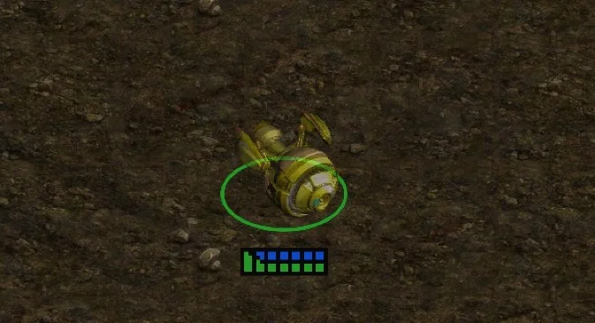

> 📌 
> 
> <a id="18feda9b0fe18093bcc8e0e1bb861222"></a>
> 
> <strong><code>옵저버 패턴(Observer Pattern)</code></strong>은 <strong><code>대상 객체(Subject)</code></strong>의 상태가 변화할 때, <strong><code>관찰자(Observer)</code></strong>들이 그 변화를 감지하고 적절한 조치를 취하도록 하는 방식입니다&#46; <br>이 방식은 <strong>일대다</strong>(one&#45;to&#45;many) 관계를 설정하여, 하나의 객체가 여러 객체를 관찰하도록 하고, 대상 객체의 상태 변화가 있을 때마다 그 변화가 관찰자들에게 자동으로 통지되는 구조를 가집니다&#46;

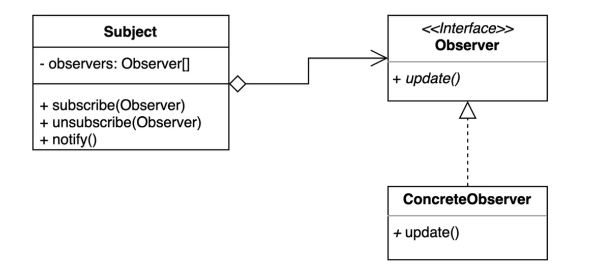

1. <strong>Subject (대상자)</strong>
    - <strong><code>Subject</code></strong>의 상태가 변경되면, 이를 알리기 위해 <strong><code>notify</code></strong><code>()</code> 메서드를 호출하여 모든 <strong><code>Observer</code></strong>에게 알림을 보냅니다&#46;

    - 상태 변화를 추적하고, 상태를 관리하는 필드를 포함하고 있습니다&#46;

1. <strong>Observer (관찰자 인터페이스)</strong>
    - <strong><code>Observer</code></strong>는 구독자의 공통 인터페이스로, <strong><code>Subject</code></strong>가 상태 변화 시 이를 받아들이고 처리하는 메서드를 정의합니다&#46;

    - <strong><code>update</code></strong><code>()</code> 메서드를 통해 <strong><code>Subject</code></strong>의 상태를 받아옵니다&#46; 이 때 <strong><code>Observer</code></strong>는 <strong><code>Subject</code></strong>의 상태를 직접 처리하는 대신 <strong><code>update</code></strong><code>()</code>를 통해 상태를 업데이트합니다&#46;

1. <strong>ConcreteObserver (구체적인 관찰자 / 구독자)</strong>
    - <strong><code>ConcreteObserver</code></strong>는 <strong><code>Observer</code></strong> 인터페이스를 구현한 객체로, 실제 구독자입니다&#46; <strong><code>Subject</code></strong> 상태를 변경하면, <strong><code>ConcreteObserver</code></strong>는 이를 감지하고 적절한 행동을 취합니다&#46;

    - 상태를 추적하거나 알림을 처리하는 구체적인 로직을 포함합니다&#46;

<a id="18feda9b0fe180179d71c93659db9e5f"></a>

<strong>언제 사용하나요?</strong>

1. <strong>객체 간 일대다(one&#45;to&#45;many) 의존성을 유지해야 할 때</strong>
    <a id="18feda9b0fe1801bb6c3ffe21ffde090"></a>

    한 객체의 상태 변화가 여러 객체에 영향을 미칠 때 사용합니다&#46;

    <a id="18feda9b0fe180f28752ea6a93348a42"></a>

    예&#58; 주식 가격 알림 시스템, 이벤트 처리 시스템 등&#46;

1. <strong>상태 변화나 이벤트 발생을 다른 객체에 자동으로 통지해야 할 때</strong>
    <a id="18feda9b0fe1809b9d5ee8f1b68d0a8c"></a>

    관찰 대상 객체의 상태 변화에 따라 다른 객체들이 자동으로 업데이트되어야 할 경우 적합합니다&#46;

1. <strong>객체 간 느슨한 결합(loose coupling)이 필요할 때</strong>
    <a id="18feda9b0fe180229518ec2ab6578818"></a>

    관찰자(Observer)와 관찰 대상(Subject)이 서로의 구체적 구현에 의존하지 않아야 할 경우

<a id="18feda9b0fe1801aa152f9170fc3df30"></a>

<strong>장점</strong>

1. <strong>느슨한 결합(loose coupling)</strong>
    <a id="18feda9b0fe180a893dae1dd696bf7e5"></a>

    관찰자와 관찰 대상은 인터페이스를 통해 상호작용하므로 서로의 구체적 구현을 몰라도 됩니다&#46;

1. <strong>자동 업데이트</strong>
    <a id="18feda9b0fe18073a245fdffec978762"></a>

    관찰 대상의 상태 변화가 있을 때 등록된 모든 관찰자에게 자동으로 알림이 전달되므로, 관찰자들은 최신 상태를 유지할 수 있습니다&#46;

1. <strong>확장성</strong>
    <a id="18feda9b0fe180af89cbfde634e8372f"></a>

    새로운 관찰자를 추가하거나 제거해도 관찰 대상의 코드에 영향을 미치지 않아 시스템 확장이 용이합니다&#46;

1. <strong>일대다(one&#45;to&#45;many) 의존성 관리</strong>
    <a id="18feda9b0fe1808aad58f69318a14dc7"></a>

    하나의 객체 상태 변경으로 여러 객체에게 효과적으로 통지할 수 있습니다&#46;

<a id="18feda9b0fe1804aba77f6eb1800b578"></a>

<strong>활용 예시</strong>

- <strong>실시간 데이터 스트림</strong>&#58; 주식 거래 시스템, 날씨 알림 서비스&#46;

- <strong>발행/구독(Pub/Sub) 모델</strong>&#58; 메시지 큐, 뉴스 피드 업데이트&#46;

- <strong>소셜 미디어</strong>&#58; 팔로우/구독 모델에서 새 게시물 알림&#46;

<a id="18feda9b0fe180c19eccd9f484d7d4b9"></a>

<strong>예시 코드</strong>

<a id="18feda9b0fe18064b800c7b0c18db2e5"></a>

→ <code>&#95;3&#95;Behavioral&#95;행동&#46;&#95;03&#95;observer&#95;관찰자</code> 참조
